# HW2 과제 해설 — 고급 시각화

[레포지토리 안내](../../README.ko.md) | [English](Assignment-Explanation.md) | [한국어](Assignment-Explanation.ko.md)

> **최종 수정일:** 2026-11-27
>
> Modern Data Visualization with R, Kabacoff, Ch 5, 6, 7, 8

> **학습 목표:**
> 1. 과제의 그림 선택 조건, 보고서 형식, 채점 기준을 풀이의 각 부분에 대응시킬 수 있다
> 2. 두 변수의 유형 조합에 따라 알맞은 이변량 그래프를 고르고 그 결과를 해석할 수 있다
> 3. 위치 밖의 미적 요소와 패싯으로 셋 이상의 변수를 나타낸 그래프를 해석할 수 있다
> 4. 지도 위에 관측 위치와 지역별 값을 나타내는 방식과, 자료를 지도에 결합하는 조건을 설명할 수 있다
> 5. 시간을 축으로 하는 그래프에서 변화의 크기와 구성의 흐름을 읽을 수 있다

---

## 목차

- [1. 과제 구성](#1-과제-구성)
- [2. 요구사항](#2-요구사항)
  - [2.1 그림 선택 조건](#21-그림-선택-조건)
  - [2.2 보고서 형식](#22-보고서-형식)
  - [2.3 채점 기준에 대한 대응](#23-채점-기준에-대한-대응)
- [3. Kabacoff 5장: Bivariate Graphs](#3-kabacoff-5장-bivariate-graphs)
  - [3.1 범주형 변수와 범주형 변수](#31-범주형-변수와-범주형-변수)
  - [3.2 양적 변수와 양적 변수](#32-양적-변수와-양적-변수)
  - [3.3 범주형 변수와 양적 변수](#33-범주형-변수와-양적-변수)
- [4. Kabacoff 6장: Multivariate Graphs](#4-kabacoff-6장-multivariate-graphs)
  - [4.1 그룹화](#41-그룹화)
  - [4.2 패싯](#42-패싯)
- [5. Kabacoff 7장: Maps](#5-kabacoff-7장-maps)
  - [5.1 점 밀도 지도](#51-점-밀도-지도)
  - [5.2 단계구분도](#52-단계구분도)
- [6. Kabacoff 8장: Time-dependent graphs](#6-kabacoff-8장-time-dependent-graphs)
- [요약](#요약)
- [점검 문제](#점검-문제)

---

<br>

## 1. 과제 구성

> **풀어 보기:** 이 문서는 정답과 풀이를 담고 있다. 먼저 [과제 안내문](Original/Assignment.ko.md)의 문제를 직접 풀어 본 뒤 읽는다.

이 과제는 R. Kabacoff의 *Modern Data Visualization with R*(이하 Kabacoff)의 5~8장에서 장마다 그림을 5개 이상 골라 R 코드를 실행하고, 콘솔과 Plots 창의 캡처를 보고서로 엮는 과제이다. 정해진 정답은 없으며, 풀이는 조건보다 많은 25개의 그림을 골랐다. 코드는 `Solution/HW_AdvancedVisualization.R` 한 파일에 장 순서대로 모았고, 각 블록의 번호 (1), (2), ...는 제출한 보고서의 항목 번호와 같다.

이 문서는 각 블록이 Kabacoff의 어느 절과 그림을 재현하는지 대응시키고 실행 결과를 해석한다. 코드를 줄 단위로 읽는 설명은 [HW2 코드 총정리](Code-Walkthrough.ko.md)에, 그래프 유형의 개념은 [9장 강의 노트](../../Lecture-Notes/Ch09_Advanced-Visualization/Concepts_Lecture.ko.md)에 있다.

```plaintext
Coursework/HW02_Advanced-Visualization/
├── Assignment-Explanation.ko.md
├── Assignment-Explanation.md
├── Code-Walkthrough.ko.md
├── Code-Walkthrough.md
├── Original/
│   ├── Assignment.ko.md                    # assignment handout
│   └── Assignment.md
├── Solution/
│   └── HW_AdvancedVisualization.R          # R code of the 25 figures
└── data/
    ├── cb_2024_us_state_5m.*               # US state boundary shapefile (5 files)
    └── us_literacy_rates_by_state_2025.csv # literacy rate data by state
```

*그림 1. HW2 과제의 디렉토리 구성*

| Kabacoff의 장 | 고른 그림 | 코드 줄 | 해설 |
|:-----|:-----:|:-----|:-----|
| 5장 Bivariate Graphs | 7개 | 8\~104행 | [3절](#3-kabacoff-5장-bivariate-graphs) |
| 6장 Multivariate Graphs | 8개 | 106\~195행 | [4절](#4-kabacoff-6장-multivariate-graphs) |
| 7장 Maps | 5개 | 198\~282행 | [5절](#5-kabacoff-7장-maps) |
| 8장 Time-dependent graphs | 5개 | 285\~372행 | [6절](#6-kabacoff-8장-time-dependent-graphs) |

*표 1. 장별로 고른 그림의 수와 코드의 위치*

---

<br>

## 2. 요구사항

### 2.1 그림 선택 조건

- 책은 Kabacoff의 *Modern Data Visualization with R*이며, 전체 내용이 https://rkabacoff.github.io/datavis/ 에 공개되어 있다.
- 5장 Bivariate Graphs, 6장 Multivariate Graphs, 7장 Maps, 8장 Time-dependent graphs에서 장마다 원하는 그림을 5개 이상, 모두 20개 이상 고른다.
- 고른 그림의 R 코드를 스크립트 창에 입력하거나 복사해 붙여 넣고 실행하여, Plots 창에 나오는 그림을 확인한다.

### 2.2 보고서 형식

- 콘솔의 코드를 색이 보이도록 캡처하고, Plots 창의 그림을 함께 캡처한다.
- hwp나 Word에서 목차와 절을 구분할 수 있도록 편집한 뒤 PDF로 변환해, 개인당 한 파일로 만든다.

### 2.3 채점 기준에 대한 대응

| 채점 기준 | 풀이의 대응 |
|:-----|:-----|
| 장마다 그림 5개 | 5장 7개, 6장 8개, 7장 5개, 8장 5개로 모든 장에서 5개 이상이고 합계는 25개이다 |
| 콘솔과 Plots 창의 캡처 | 항목마다 왼쪽에 RStudio 콘솔의 실행 코드를, 오른쪽에 Plots 창의 결과를 나란히 캡처했다. mapview 지도는 Viewer 창에 열리므로 Viewer 창을 캡처했다 |
| 장의 형식과 절의 구분 | 보고서를 표지와 Chapter 5, 6, 7, 8의 네 절로 나누고, 항목마다 `(1) 5.1.2. Grouped Bar Chart (Side-by-side bar chart)`처럼 번호, Kabacoff의 절 번호와 제목, 그림 이름을 붙였다 |
| PDF 형식 | 한글(hwpx)로 편집한 뒤 PDF 한 파일로 변환했다 |

*표 2. 채점 기준과 풀이의 대응*

mapview 지도 두 개는 화면에서 확대하고 움직이는 인터랙티브 지도여서 정적인 그림으로 싣지 않고 글로 설명한다.

---

<br>

## 3. Kabacoff 5장: Bivariate Graphs

Kabacoff 5장은 두 변수의 관계를 변수 유형의 조합으로 나누어, 범주형과 범주형(5.1절), 양적과 양적(5.2절), 범주형과 양적(5.3절)의 세 조합을 다룬다. 풀이는 세 조합에서 모두 그림을 골랐다. 강의 노트 열의 절 번호는 [9장 강의 노트](../../Lecture-Notes/Ch09_Advanced-Visualization/Concepts_Lecture.ko.md)의 절이다.

| 번호 | 코드 줄 | Kabacoff의 절 | Kabacoff의 그림 | 강의 노트 |
|:-----|:-----|:-----|:-----|:-----|
| (1) | 13\~17행 | 5.1.2 Grouped bar chart | Figure 5.2: Side-by-side bar chart | 1.1절 |
| (2) | 20\~33행 | 5.2.1 Scatterplot | Figure 5.8: Scatterplot with color, transparency, and axis scaling | 2.1절 |
| (3) | 36\~51행 | 5.2.2 Line plot | Figure 5.14: Line plot with points and labels | 3.1절 |
| (4) | 54\~61행 | 5.3.2 Grouped kernel density plots | Figure 5.17: Grouped kernel density plots | 4.1절 |
| (5) | 64\~70행 | 5.3.3 Box plots | Figure 5.18: Side-by-side boxplots | 4.2절 |
| (6) | 73\~83행 | 5.3.5 Ridgeline plots | Figure 5.22: Ridgeline graph with color fill | 4.3절 |
| (7) | 86\~103행 | 5.3.7 Strip plots | Figure 5.29: Fancy jittered plot | 4.4절 |

*표 3. Kabacoff 5장에서 고른 그림과 코드의 대응*

### 3.1 범주형 변수와 범주형 변수

**(1) 병렬 막대 그래프.** ggplot2에 들어 있는 `mpg`의 자동차 234대를 차종(`class`)으로 나누고, 차종 안에서 구동 방식(`drv`: `4`는 사륜, `f`는 전륜, `r`은 후륜)마다 막대를 나란히 세운다. Kabacoff 5.1.1절의 누적 막대 그래프와 같은 자료이지만, `position = "dodge"`로 막대를 쌓지 않아 한 차종 안에서 구동 방식별 대수를 바로 비교할 수 있다.

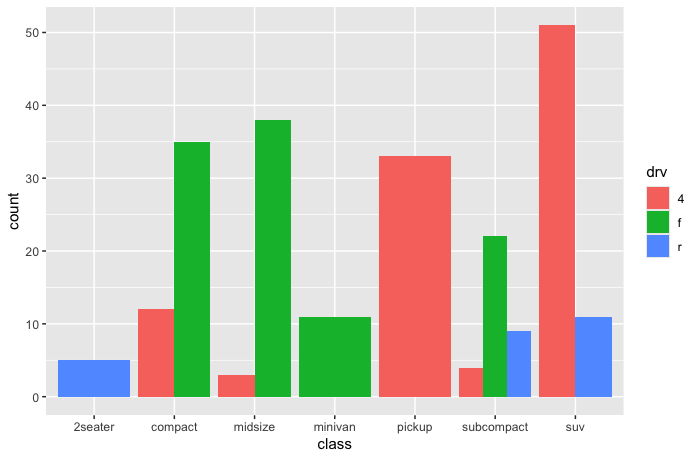

*그림 2. 차종별 구동 방식의 병렬 막대 그래프*

`pickup`은 33대 모두 사륜, `minivan`은 11대 모두 전륜, `2seater`는 5대 모두 후륜이며, 가장 높은 막대는 사륜 `suv`의 51대이다. 한 차종에 없는 구동 방식은 자리가 비지 않고 남은 막대가 그 폭을 나누어 가지므로 막대 너비가 차종마다 다르다. Kabacoff는 이 문제를 Figure 5.3에서 `position_dodge(preserve = "single")`로 바로잡는다.

### 3.2 양적 변수와 양적 변수

**(2) 꾸민 산점도.** `carData` 패키지의 `Salaries`는 미국 한 대학의 조교수, 부교수, 교수 397명의 2008\~2009학년도 9개월 급여 자료이다. 박사 학위 취득 후 연수(`yrs.since.phd`)와 급여(`salary`)의 관계를 점으로 찍되, 점의 색, 크기, 투명도를 고정값으로 정하고 y축을 달러 형식으로, x축 눈금을 10년 간격으로 바꾸었다.

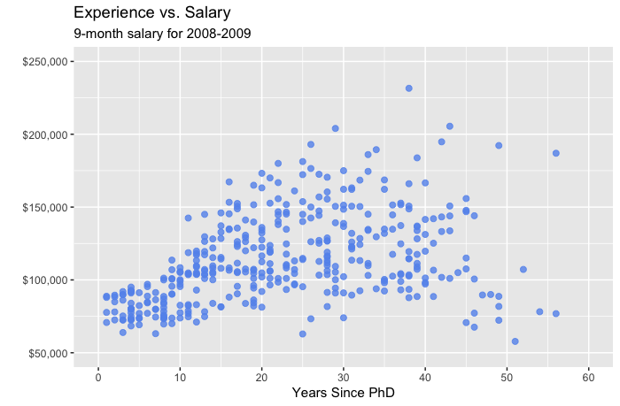

*그림 3. 박사 학위 취득 후 연수와 급여의 산점도*

연수가 늘수록 급여가 오르는 경향이 있지만, 연수가 40년을 넘으면 급여가 낮은 점도 많아지고 같은 연수에서도 급여의 퍼짐이 커진다. 급여는 57,800\~231,545달러, 연수는 1\~56년이므로 축 범위(`limits`) 밖으로 잘리는 점은 없다.

**(3) 점과 레이블을 더한 선 그래프.** gapminder 패키지의 `gapminder`에서 미국의 기대수명(`lifeExp`)을 1952년부터 2007년까지 5년 간격의 12개 시점으로 이어 그린다. 연한 회색의 굵은 선 위에 파란 점을 얹고 제목, 부제목, 출처 캡션을 붙였다.

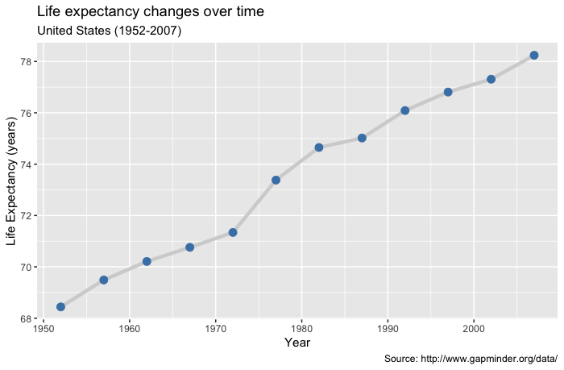

*그림 4. 미국 기대수명의 변화를 나타낸 선 그래프*

기대수명은 68.4세에서 78.2세로 한 번도 줄지 않고 늘었다. 선만 그린 Figure 5.13과 달리 점이 있어 실제 관측 시점이 드러나고, 선이 점 사이를 보간한 값임을 알 수 있다.

### 3.3 범주형 변수와 양적 변수

**(4) 그룹별 커널 밀도 그래프.** 직급(`rank`)별 급여 분포를 커널 밀도 곡선으로 겹쳐 그리고, `alpha = 0.4`로 반투명하게 칠해 겹친 부분이 보이게 했다.

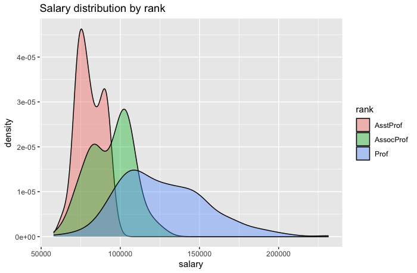

*그림 5. 직급별 급여의 커널 밀도 곡선*

조교수(`AsstProf`, 67명)의 분포는 8만 달러 근처에 좁게 몰려 있고, 부교수(`AssocProf`, 64명)는 그보다 조금 오른쪽에, 교수(`Prof`, 266명)는 10만 달러에서 23만 달러까지 넓게 퍼져 있다. 밀도 곡선은 집단마다 곡선 아래 넓이가 1이 되도록 그리므로, 인원이 조교수의 네 배인 교수 집단의 곡선이 그만큼 높게 그려지지는 않는다.

**(5) 병렬 상자 그림.** 같은 자료를 직급별 상자 그림으로 나타낸다.

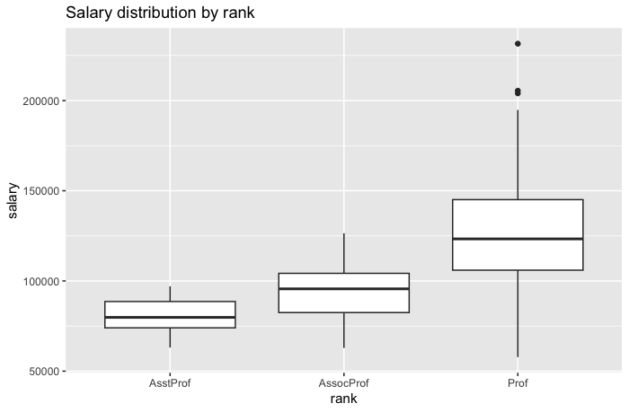

*그림 6. 직급별 급여의 병렬 상자 그림*

중앙값은 조교수 79,800달러, 부교수 95,626.5달러, 교수 123,321.5달러로 직급이 오를수록 높아진다. 교수 집단의 위쪽에는 이상점으로 표시된 세 명(204,000달러, 205,500달러, 231,545달러)이 있으며, 그중 두 점은 값이 가까워 거의 겹쳐 보인다.

**(6) 능선 그래프.** ggridges 패키지의 `geom_density_ridges()`로 차종별 도시 주행 연비(`cty`, 갤런당 마일)의 밀도 곡선을 세로로 조금씩 어긋나게 겹쳐 놓는다. 색이 y축의 차종을 다시 나타내므로 범례는 지웠다.

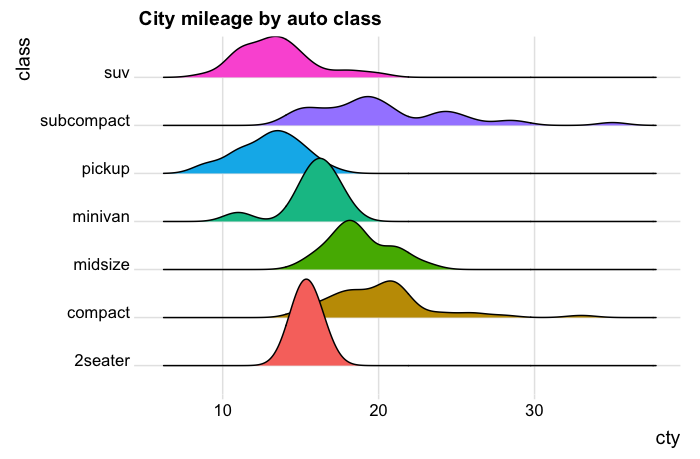

*그림 7. 차종별 도시 주행 연비의 능선 그래프*

`pickup`과 `suv`는 중앙값 13마일로 가장 낮은 쪽에, `compact`(20마일)와 `subcompact`(19마일)는 높은 쪽에 있으며, `subcompact`는 35마일까지 이어지는 긴 오른쪽 꼬리를 가진다. 제목은 x축 변수 `cty`에 맞추어 "City mileage by auto class"로 붙였다. Kabacoff의 코드는 `labs()`에 인수 이름 없이 "Highway mileage by auto class"를 넘겨 제목이 지정되지 않으며, ggplot2 4.0.1에서는 모든 레이블에 이름이 있어야 한다는 오류가 난다.

**(7) jittered strip plot.** 직급을 두 줄짜리 이름(`"Assistant\nProfessor"` 등)으로 바꾸어 y축에 두고, 급여를 x축에 점으로 찍되 `geom_jitter()`로 점의 위치를 무작위로 조금씩 흩뜨려 겹치지 않게 한다. 색이 직급을 다시 나타내므로 범례를 지우고, `theme_minimal()`로 배경을 비웠다.

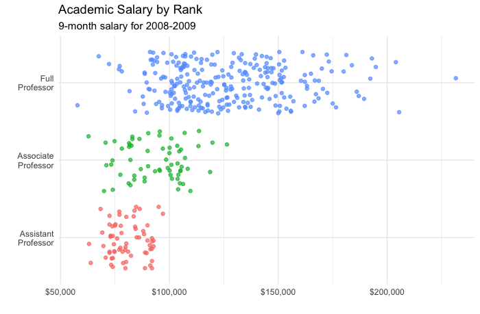

*그림 8. 직급별 급여의 jittered strip plot*

상자 그림이 다섯 개의 요약값만 보이는 것과 달리 397명이 모두 점으로 보이므로, 교수 집단의 인원이 가장 많고 급여의 범위가 가장 넓다는 점이 점의 밀도로 드러난다. jittering은 무작위이므로 실행할 때마다 점의 위치가 조금씩 달라진다.

---

<br>

## 4. Kabacoff 6장: Multivariate Graphs

Kabacoff 6장은 셋 이상의 변수를 한 그래프에 나타내는 두 방법, 곧 위치 밖의 미적 요소에 변수를 더하는 그룹화(6.1절)와 범주마다 패널을 나누는 패싯(6.2절)을 다룬다. 그룹화의 다섯 그림은 같은 산점도에 변수를 하나씩 더해 가는 Kabacoff의 순서를 그대로 따랐다.

| 번호 | 코드 줄 | Kabacoff의 절 | Kabacoff의 그림 | 강의 노트 |
|:-----|:-----|:-----|:-----|:-----|
| (1) | 111\~118행 | 6.1 Grouping | Figure 6.1: Simple scatterplot | 5절 |
| (2) | 121\~124행 | 6.1 Grouping | Figure 6.2: Scatterplot with color mapping | 5.1절 |
| (3) | 127\~131행 | 6.1 Grouping | Figure 6.3: Scatterplot with color and shape mapping | 5.2절 |
| (4) | 134\~139행 | 6.1 Grouping | Figure 6.4: Scatterplot with size and color mapping | 5.3절 |
| (5) | 142\~154행 | 6.1 Grouping | Figure 6.5: Scatterplot with color mapping and quadratic fit lines | 5.4절 |
| (6) | 157\~161행 | 6.2 Faceting | Figure 6.6: Salary distribution by rank | 6.1절 |
| (7) | 164\~179행 | 6.2 Faceting | Figure 6.9: Salary by experience, rank, and sex (better labeled) | 6.2절 |
| (8) | 182\~195행 | 6.2 Faceting | Figure 6.10: Changes in life expectancy by country | 6.3절 |

*표 4. Kabacoff 6장에서 고른 그림과 코드의 대응*

### 4.1 그룹화

**(1) 단순 산점도.** 박사 학위 취득 후 연수와 급여의 기본 산점도로, (2)부터 (5)까지의 출발점이다.

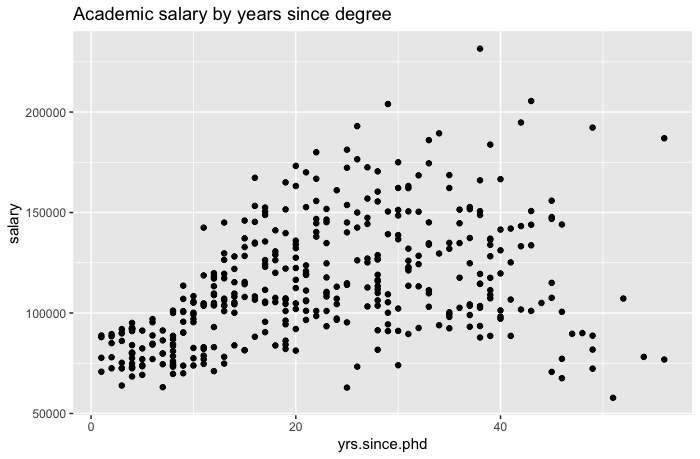

*그림 9. 박사 학위 취득 후 연수와 급여의 단순 산점도*

**(2) 색상 매핑.** `color = rank`를 `aes()` 안에 넣어 직급을 점의 색으로 나타낸다.

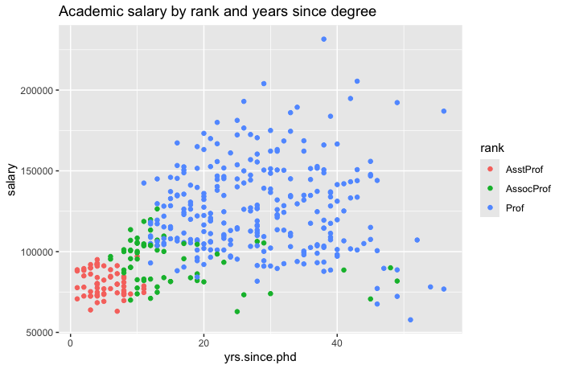

*그림 10. 직급을 색으로 나타낸 산점도*

조교수는 연수 1\~11년, 부교수는 6\~49년, 교수는 11\~56년에 놓여, 연수와 직급이 강하게 얽혀 있음을 보여 준다. (1)에서 연수와 함께 급여가 오르던 경향의 상당 부분이 직급의 차이였다는 해석이 가능해진다.

**(3) 색상과 모양 매핑.** 성별(`sex`)을 점의 모양으로 더한다. 점이 겹쳐도 보이도록 크기를 3, 투명도를 0.6으로 정했다.

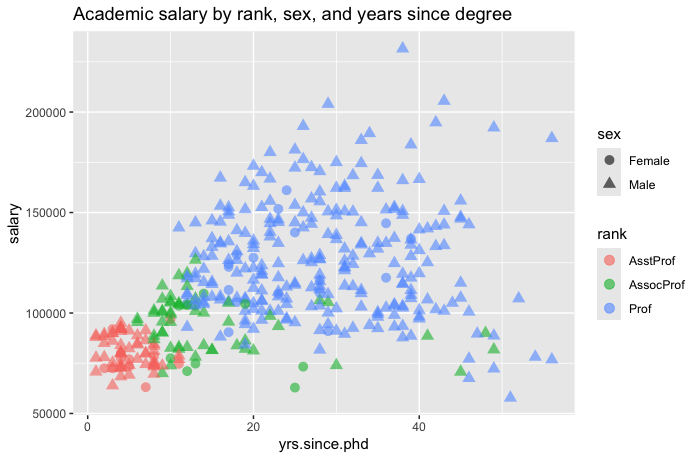

*그림 11. 직급을 색으로, 성별을 모양으로 나타낸 산점도*

여성은 39명으로 남성 358명보다 훨씬 적어 삼각형(남성) 사이에 원(여성)이 드문드문 보인다. 변수가 네 개가 되면 색과 모양을 동시에 읽어야 하므로 그래프가 빠르게 복잡해진다.

**(4) 색상과 크기 매핑.** 모양 대신 재직 연수(`yrs.service`)를 점의 크기로 나타낸다.

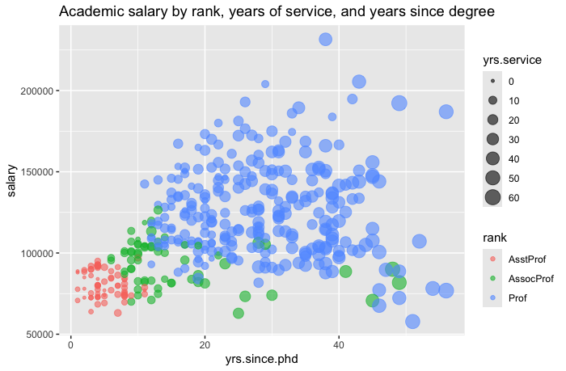

*그림 12. 직급을 색으로, 재직 연수를 크기로 나타낸 산점도*

점이 클수록 오래 재직한 교수이며, 큰 점은 대부분 오른쪽의 교수 집단에 있다. 재직 연수는 박사 학위 취득 후 연수와 함께 움직이므로, 크기가 새로 더하는 정보는 많지 않다.

**(5) 성별 2차 적합선.** 성별을 색으로 나타내고, `geom_smooth(method = "lm", formula = y ~ poly(x, 2))`로 성별마다 2차 다항 회귀 곡선을 더했다. 축과 범례의 이름을 바꾸고, y축을 달러 형식으로, 색을 `Set1` 팔레트로 바꾸었다.

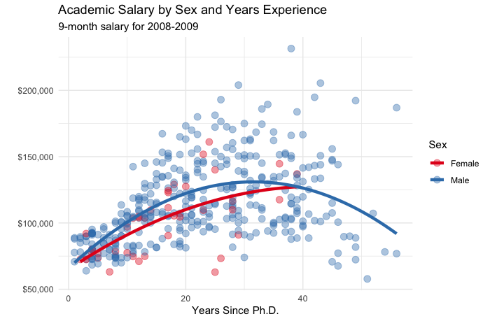

*그림 13. 성별 2차 적합선을 더한 산점도*

남성의 곡선은 연수 약 31.5년에서 가장 높았다가 내려가고, 여성의 곡선은 정점이 약 42.5년이어서 여성 자료의 범위(2\~39년) 안에서는 계속 오르다가 오른쪽 끝에서 완만해진다. 남성의 곡선이 대부분의 구간에서 여성보다 위에 있지만, 여성은 39명뿐이어서 여성 곡선의 모양은 불확실하다.

### 4.2 패싯

**(6) 직급별 히스토그램.** `facet_wrap(~rank, ncol = 1)`로 직급마다 급여 히스토그램을 하나씩 만들어 한 열로 쌓는다.

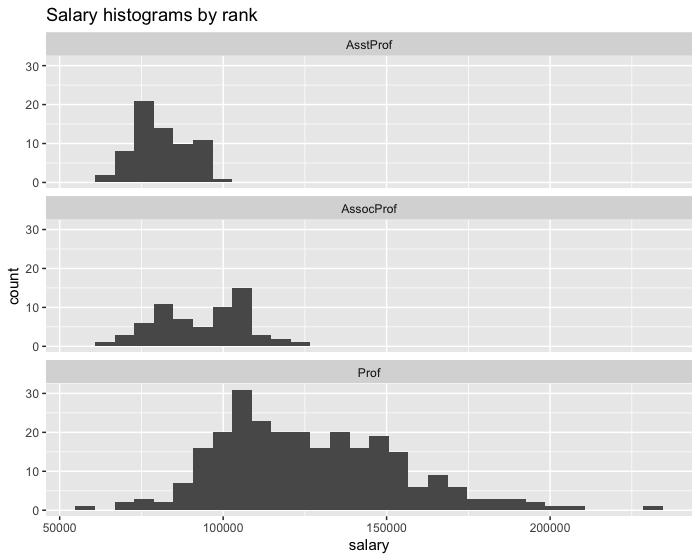

*그림 14. 직급별로 나눈 급여 히스토그램*

세 패널이 x축을 공유하므로 직급별 급여의 위치를 위아래로 바로 비교할 수 있다. 밀도 곡선(그림 5)과 달리 y축이 인원수이므로 교수 집단의 인원이 많다는 점도 함께 보인다. 구간 수를 지정하지 않아 기본값 30개 구간을 쓰며, 실행하면 더 나은 구간 폭을 고르라는 메시지가 출력된다.

**(7) 학과 유형별 패싯 산점도.** 학과 유형(`discipline`)의 수준 A와 B를 "Theoretical"과 "Applied"로 바꾸어 두 패널로 나누고, 각 패널에서 성별마다 직선 회귀선을 그렸다.

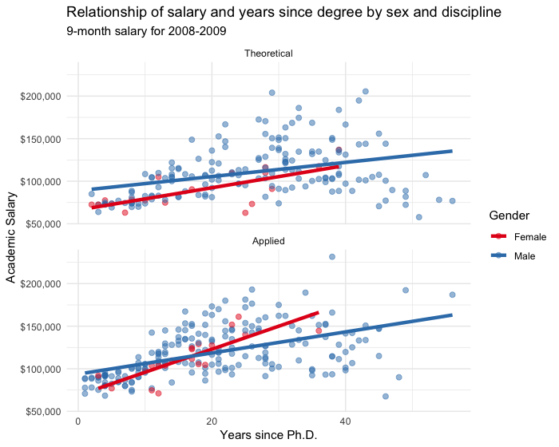

*그림 15. 학과 유형별로 나누고 성별 회귀선을 더한 산점도*

회귀선의 기울기를 직접 계산하면 이론 학과에서 여성은 연당 1,307달러, 남성은 831달러, 응용 학과에서 여성은 2,704달러, 남성은 1,239달러로 두 학과 모두 여성의 기울기가 더 가파르다. 그러나 여성 회귀선의 절편이 남성보다 낮고, 여성 표본은 이론 학과 18명과 응용 학과 21명뿐이다.

**(8) 아메리카 국가별 기대수명.** 아메리카 대륙 25개국의 기대수명 변화를 `facet_wrap(~country)`로 나라마다 작은 패널에 그린다. 글자 크기를 9로 줄이고 x축 눈금 글자를 45도 기울여 겹치지 않게 했다.

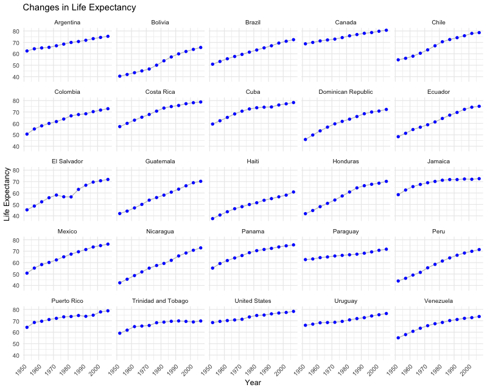

*그림 16. 아메리카 25개국의 기대수명 변화*

모든 나라에서 기대수명이 늘었고, 2007년에는 캐나다(80.7세)가 가장 높고 아이티(60.9세)와 볼리비아(65.6세)가 가장 낮다. 25개 패널이 같은 축을 쓰므로 수준과 기울기를 나라끼리 비교할 수 있다.

---

<br>

## 5. Kabacoff 7장: Maps

Kabacoff 7장은 주소를 좌표로 바꾸는 지오코딩(7.1절), 관측값을 지도 위의 점으로 찍는 점 밀도 지도(7.2절), 지역마다 값에 따라 색을 칠하는 단계구분도(7.3절)를 다룬다. 풀이는 7.2절에서 두 개, 7.3절에서 세 개를 골랐다.

| 번호 | 코드 줄 | Kabacoff의 절 | Kabacoff의 그림 | 강의 노트 |
|:-----|:-----|:-----|:-----|:-----|
| (1) | 203\~218행 | 7.2.1 Interactive maps with mapview | 번호 없는 인터랙티브 지도 | 7.1절 |
| (2) | 221\~225행 | 7.2.1 Interactive maps with mapview | 번호 없는 인터랙티브 지도 | 7.1절 |
| (3) | 228\~251행 | 7.3.1 Data by country | Figure 7.8: Choropleth map of life expectancy | 7.2절 |
| (4) | 254\~260행 | 7.3.1 Data by country | Figure 7.9: Choropleth map of life expectancy with labels and a better color scheme | 7.2절 |
| (5) | 263\~282행 | 7.3.4 Building a choropleth map using the sf and ggplot2 packages and a shapefile | Figure 7.11: Choropleth map of state literacy rates | 7.3절 |

*표 5. Kabacoff 7장에서 고른 그림과 코드의 대응*

### 5.1 점 밀도 지도

**(1) mapview 인터랙티브 지도.** ggmap 패키지의 `crime`은 2010년 1월부터 8월까지 미국 휴스턴의 범죄 기록 86,314건이다. 그중 살인(`murder`) 157건을 골라 날짜, 범죄 유형, 주소, 경도, 위도만 남기고, `st_as_sf()`로 sf 객체로 바꾸어 `mapview()`에 넘긴다. 콘솔에는 `head(homicide, 3)`의 결과가 출력된다.

```text
      date offense            address       lon      lat
1 1/1/2010  murder    9650 marlive ln -95.43739 29.67790
2 1/5/2010  murder   1350 greens pkwy -95.43944 29.94292
3 1/5/2010  murder 10250 bissonnet st -95.55906 29.67480
```

결과는 RStudio의 Viewer 창에 열리는 Leaflet 지도이다. 기본 배경 지도(CartoDB Positron) 위에 157건이 파란 점으로 찍히고, 오른쪽 위에 레이어 이름 `mymap`의 범례가 있다. 마우스 휠이나 왼쪽 위의 확대, 축소 단추로 배율을 바꾸고 지도를 끌어 옮길 수 있으며, 점을 누르면 그 행의 속성이 팝업으로 열린다.

**(2) OpenStreetMap 배경의 mapview 지도.** 같은 sf 객체를 다시 만들고, 점의 테두리를 검정(`color`), 채우기를 빨강(`col.regions`), 채우기 투명도를 0.5(`alpha.regions`)로 바꾸며, 범례와 홈 단추를 지우고 배경 지도를 OpenStreetMap으로 정한다. 결과는 도로와 지명이 표시된 OpenStreetMap 위에 검은 테두리의 반투명한 빨간 점이 찍힌 지도이며, 범례와 오른쪽 아래의 홈 단추가 사라져 지도가 간결해진다.

### 5.2 단계구분도

**(3) 국가별 기대수명 단계구분도.** 2007년의 gapminder 자료를 `country_choropleth()`가 요구하는 형식(지역 이름 열 `region`, 값 열 `value`, 소문자 이름)으로 바꾸고, `recode()`로 표기가 다른 국가 이름 9개를 지도의 이름에 맞춘 뒤 세계 지도를 그린다. Kabacoff의 코드는 `recode()`에서 남한과 북한의 이름을 서로 바꾸어 적고 `"korea, rep."`를 `"korea. rep."`로 잘못 적었는데, 풀이는 두 이름을 바로잡았다.

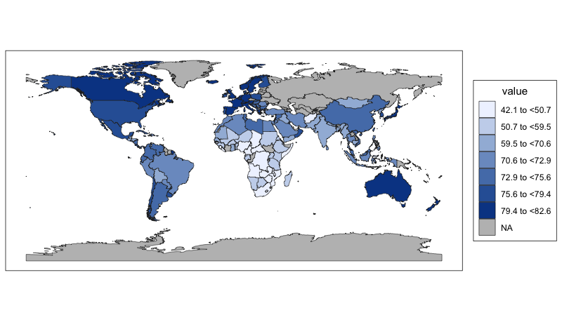

*그림 17. 2007년 국가별 기대수명의 단계구분도*

기본값은 값을 7개 구간으로 나누어 파란색의 진하기로 칠한다. 북아메리카, 서유럽, 오스트레일리아, 일본이 진하고 사하라 이남 아프리카가 옅다. 러시아처럼 gapminder에 없는 나라와 이름이 맞지 않은 나라는 결측값(`NA`)의 회색으로 남는다.

> **참고:** **패키지 버전과 지역 이름.** `recode()`의 대상 이름은 Kabacoff가 쓴 choroplethr 버전의 지역 이름에 맞춘 것이다. 그림 17과 그림 18을 그린 choroplethr 5.0.1은 지역 이름 표가 달라, 콩고 공화국(`"republic of congo"`), 체코(`"czech republic"`), 코트디부아르를 비롯한 12개 지역을 찾지 못했다는 메시지를 출력하고 그 지역을 칠하지 않는다. 바레인, 싱가포르처럼 지도에 지역이 없는 작은 나라는 이름을 맞추어도 칠해지지 않는다.

**(4) 색 구성을 바꾼 단계구분도.** (3)의 지도를 `num_colors = 9`로 9개 구간으로 나누고, `scale_fill_brewer(palette = "YlOrRd")`로 노랑에서 빨강으로 이어지는 색을 쓰며, 제목, 부제목, 출처, 범례 이름을 붙였다.

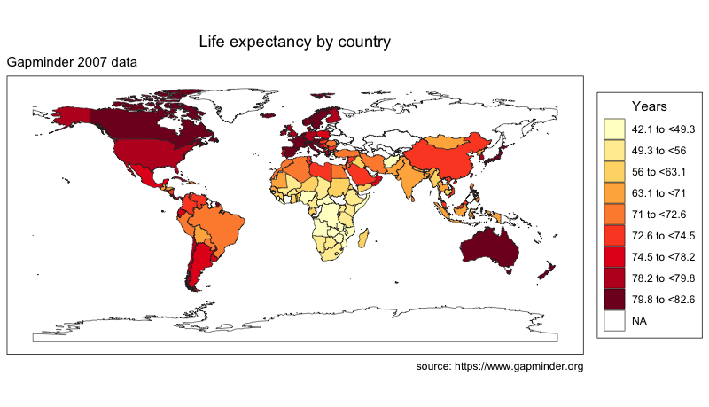

*그림 18. 9개 구간과 YlOrRd 색으로 칠한 기대수명 단계구분도*

choroplethr가 돌려주는 지도도 ggplot2 객체이므로 `+`로 척도와 레이블을 더할 수 있다. 다만 채우기 척도가 이미 있으므로 새 척도로 바꾼다는 메시지가 출력된다. Kabacoff에 따르면 `num_colors`의 기본값은 7이고 최댓값은 9이다.

**(5) 셰이프파일로 그린 미국 주별 지도.** 미국 인구조사국의 2024년 주 경계 shapefile(`cb_2024_us_state_5m`, 56개 지역)을 `st_read()`로 읽고, 주별 값을 담은 CSV(`us_literacy_rates_by_state_2025.csv`, 52행)를 주 이름으로 결합한 뒤, 하와이, 알래스카, 푸에르토리코와 값이 없는 자치령을 빼고 본토 48개 주와 워싱턴 D.C.의 49개 지역을 `geom_sf()`로 칠한다. Kabacoff 7.3.4절의 방법을 2024년 경계 파일과 2025년 CSV에 적용한 것이다.

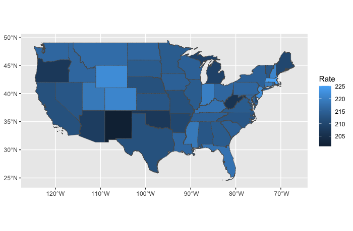

*그림 19. 셰이프파일과 CSV를 결합한 미국 본토의 주별 단계구분도*

색이 밝을수록 `Rate`가 크며, 매사추세츠(225)가 가장 밝고 뉴멕시코(201)가 가장 어둡다. Kabacoff가 쓴 CSV의 `Rate`는 94.2 같은 백분율이지만, 이 CSV의 `Rate`는 201\~225 범위의 값이어서 범례를 백분율로 읽을 수 없다. CSV의 52행 가운데 `United States` 행은 지도에 같은 이름의 지역이 없어 결합에서 빠진다.

---

<br>

## 6. Kabacoff 8장: Time-dependent graphs

Kabacoff 8장은 시간을 축으로 하는 그래프를 시계열(8.1절), dumbbell chart(8.2절), 기울기 그래프(8.3절), 영역 차트(8.4절), stream graph(8.5절)의 다섯 절로 다룬다. 풀이는 다섯 절에서 하나씩 골랐다.

| 번호 | 코드 줄 | Kabacoff의 절 | Kabacoff의 그림 | 강의 노트 |
|:-----|:-----|:-----|:-----|:-----|
| (1) | 290\~302행 | 8.1 Time series | Figure 8.2: Simple time series with modified date axis | 8.1절 |
| (2) | 305\~324행 | 8.2 Dumbbell charts | Figure 8.4: Simple dumbbell chart | 8.2절 |
| (3) | 327\~344행 | 8.3 Slope graphs | Figure 8.6: Slope graph | 8.3절 |
| (4) | 347\~352행 | 8.4 Area Charts | Figure 8.7: Basic area chart | 8.4절 |
| (5) | 355\~372행 | 8.5 Stream graph | Figure 8.10: Basic stream graph | 8.4절 |

*표 6. Kabacoff 8장에서 고른 그림과 코드의 대응*

**(1) 날짜 축을 바꾼 시계열.** ggplot2에 들어 있는 `economics`는 미국 경제 지표의 월별 자료이다. 개인 저축률(`psavert`)을 1967년 7월부터 2015년 4월까지 선으로 그리고, `geom_smooth()`로 LOESS 평활 곡선을 더했다. `scale_x_date()`는 눈금을 5년 간격으로 두고 `"%b-%y"` 형식(월 약칭과 두 자리 연도)으로 표시한다.

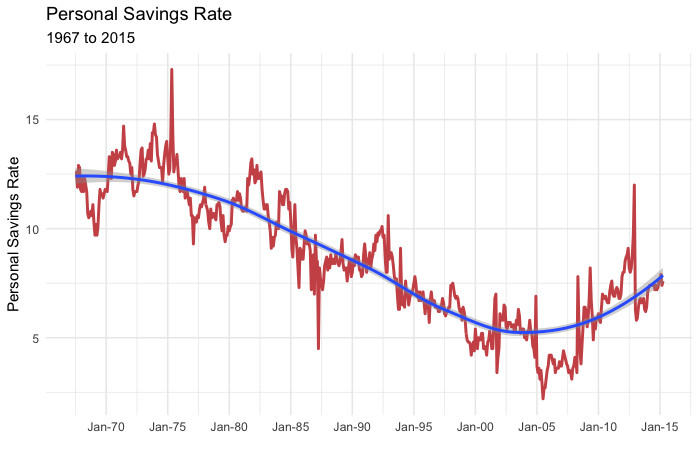

*그림 20. 날짜 축을 바꾸고 평활 곡선을 더한 개인 저축률 시계열*

저축률은 1975년 5월에 17.3%로 가장 높고, 이후 대체로 낮아져 2005년 7월에 2.2%로 가장 낮았다가 다시 오른다. 평활 곡선은 월별 등락을 걷어 내고 이 긴 흐름만 보여 준다. 월 약칭은 R의 로캘을 따르므로 한국어 로캘에서는 `Jan-70` 대신 `1월-70`처럼 표시되며, 그림 20은 영어 로캘의 표시이다.

**(2) dumbbell chart.** 아메리카 25개국의 1952년과 2007년 기대수명을 `pivot_wider()`로 나라마다 한 행(`y1952`, `y2007`)이 되게 펼친 뒤, ggalt 패키지의 `geom_dumbbell()`로 두 시점의 값을 선분으로 잇는다.

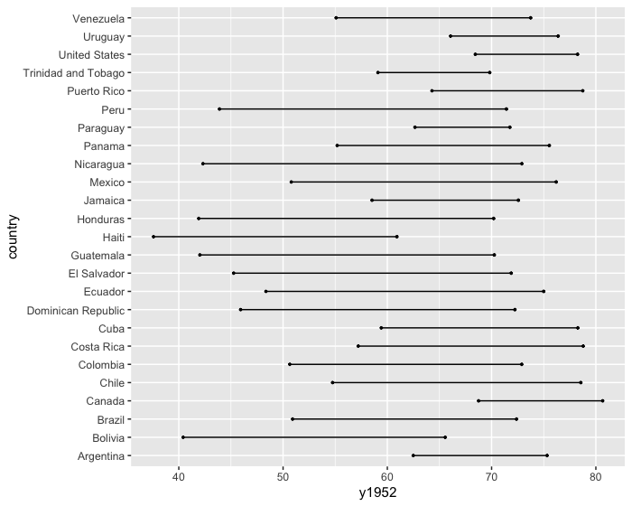

*그림 21. 아메리카 25개국의 1952년과 2007년 기대수명을 잇는 dumbbell chart*

모든 나라의 선분이 오른쪽으로 뻗어 기대수명이 늘었음을 보여 준다. 가장 많이 늘어난 나라는 니카라과(42.3세에서 72.9세로 30.6년), 가장 적게 늘어난 나라는 파라과이(62.6세에서 71.8세로 9.1년)이다. x축 제목이 `y1952`로 나오는 것은 `x`에 매핑한 변수의 이름이 그대로 쓰였기 때문이며, Kabacoff는 Figure 8.5에서 나라를 정렬하고 색과 축 제목을 다듬는다.

**(3) 기울기 그래프.** 중앙아메리카 7개국을 골라 1992, 1997, 2002, 2007년의 기대수명을 정수로 반올림하고, CGPfunctions 패키지의 `newggslopegraph()`로 시점마다 값을 세로로 늘어놓고 나라별로 선을 잇는다.

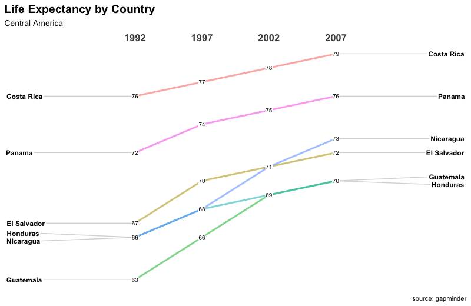

*그림 22. 중앙아메리카 국가의 기대수명 기울기 그래프*

gapminder에 벨리즈가 없으므로 실제로는 6개국이 그려진다. 코스타리카는 76세에서 79세로 네 시점 내내 가장 높고, 과테말라(63세에서 70세)와 니카라과(66세에서 73세)가 7년씩 늘어 가장 많이 올랐다. 같은 해에 값이 같은 나라(예: 1992년의 니카라과와 온두라스, 66세)는 레이블이 한곳에 모인다.

**(4) 영역 차트.** (1)과 같은 저축률을 `geom_area()`로 그려 선 아래를 연한 파랑으로 채운다.

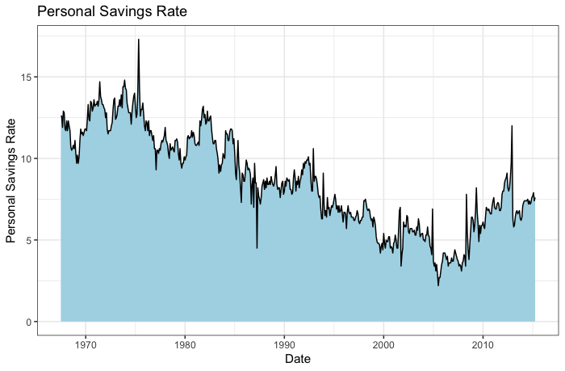

*그림 23. 개인 저축률의 영역 차트*

선 그래프와 같은 정보이지만, 0부터 채운 넓이가 각 시점의 양을 강조한다. 영역 차트는 y축이 0에서 시작해야 넓이가 의미를 가지므로, 변화의 폭이 값의 크기에 비해 작은 자료에서는 선 그래프가 변화를 더 잘 보여 준다.

**(5) stream graph.** gcookbook 패키지의 `uspopage`는 1900\~2002년 미국 인구를 8개 연령대로 나눈 천 명 단위 자료이다. 값을 백만 명 단위로 바꾸어, ggstream 패키지의 `geom_stream()`으로 8개 연령대를 가운데 선의 위아래로 대칭이 되게 쌓는다.

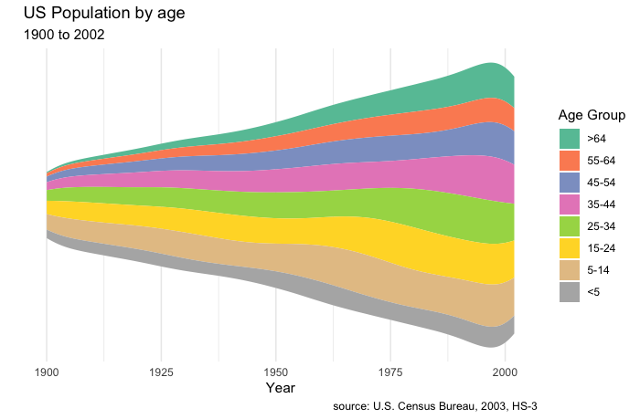

*그림 24. 1900년부터 2002년까지 미국 인구의 연령대별 stream graph*

전체 폭은 1900년 약 7,610만 명에서 2002년 약 2억 8,840만 명으로 넓어지고, 65세 이상(`>64`) 층은 약 310만 명에서 약 3,560만 명으로 두꺼워진다. 층의 위치가 해마다 달라 개별 값을 축에서 읽기 어려우므로 y축 눈금을 지웠으며, 그래프는 정확한 값보다 연령 구성의 흐름을 보여 준다.

---

<br>

## 요약

| 개념 | 핵심 요약 |
|:-----|:-----|
| 그림 선택 조건 | Kabacoff 5\~8장에서 장마다 5개 이상, 모두 20개 이상을 골라야 하며, 풀이는 7, 8, 5, 5개로 25개를 골랐다. |
| 이변량 그래프 | 두 변수의 유형 조합(범주형과 범주형, 양적과 양적, 범주형과 양적)에 따라 막대, 산점도, 선, 밀도, 상자, 능선, strip plot을 고른다. |
| 그룹화 | 색, 모양, 크기에 변수를 하나씩 더하면 한 산점도에 넷 이상의 변수를 나타낼 수 있지만, 매핑이 늘수록 읽기 어려워진다. |
| 패싯 | 범주마다 같은 축의 패널을 나누면 집단 사이의 수준과 추세를 나란히 비교할 수 있다. |
| 지도 | 점 밀도 지도는 관측 위치를, 단계구분도는 지역별 값을 나타내며, 단계구분도는 자료의 지역 이름이 지도의 이름과 정확히 맞아야 칠해진다. |
| 시간 의존 그래프 | 시계열과 영역 차트는 추이를, dumbbell chart와 기울기 그래프는 시점 사이의 변화를, stream graph는 구성의 흐름을 보여 준다. |
| 보고서 형식 | 콘솔과 Plots 창을 함께 캡처하고, 장과 항목을 구분해 편집한 PDF 한 파일로 만든다. |

---

<br>

## 점검 문제

1. **막대 너비:** 3.1절의 병렬 막대 그래프에서 `2seater`의 막대가 다른 막대보다 넓은 이유는 무엇이며, 모든 막대의 너비를 같게 하려면 어떻게 하는가?

   <details>
   <summary>정답</summary>

   `2seater`에는 후륜 차만 있어 막대 하나가 그 차종의 자리를 모두 차지하기 때문이다. `geom_bar(position = position_dodge(preserve = "single"))`로 그리면 막대 하나의 너비가 모든 차종에서 같아진다.

   </details>

2. **밀도 곡선과 인원:** 3.3절의 커널 밀도 그래프에서 교수는 266명으로 조교수 67명의 약 네 배인데, 교수의 곡선이 그만큼 높지 않은 이유는 무엇인가?

   <details>
   <summary>정답</summary>

   커널 밀도 곡선은 집단마다 곡선 아래 넓이가 1이 되도록 정규화되므로 집단의 크기를 반영하지 않는다. 인원의 차이까지 보이려면 4.2절의 히스토그램처럼 y축이 개수인 그래프를 쓴다.

   </details>

3. **지도와 자료의 결합:** 5.2절의 미국 주별 지도에서 CSV의 `United States` 행이 지도에 나타나지 않는 이유는 무엇인가? `filter()`에서 `!is.na(Rate)`를 빼면 지도는 어떻게 달라지는가?

   <details>
   <summary>정답</summary>

   `left_join()`은 왼쪽 자료인 지도의 56개 지역만 유지하고, CSV에서 지도에 짝이 없는 `United States` 행은 버린다. `!is.na(Rate)`를 빼면 CSV에 값이 없는 미국령 버진아일랜드, 괌, 북마리아나 제도, 아메리칸사모아가 `NA`의 회색으로 함께 그려져 지도의 범위가 태평양까지 넓어진다.

   </details>

4. **기울기 그래프의 국가 수:** 6절의 기울기 그래프는 7개국을 골랐는데 6개국만 그려진다. 이유는 무엇이며, 그래프에 쓰인 자료는 몇 행인가?

   <details>
   <summary>정답</summary>

   gapminder에 벨리즈가 없어 `country %in% c(...)`의 조건에 맞는 벨리즈의 행이 없기 때문이다. 자료는 6개국과 4개 시점의 24행이다.

   </details>

5. **날짜 축의 레이블:** `date_format("%b-%y")`로 만든 눈금이 한국어 환경에서 `1월-70`처럼 표시되는 이유는 무엇이며, `Jan-70`처럼 표시하려면 어떻게 하는가?

   <details>
   <summary>정답</summary>

   `%b`는 현재 로캘의 월 약칭을 쓰기 때문이다. 그래프를 그리기 전에 `Sys.setlocale("LC_TIME", "C")`로 시간 로캘을 바꾸면 영어 약칭이 표시된다.

   </details>
