# HW2 Assignment Explanation — Advanced Visualization

[Repository Guide](../../README.md) | [English](Assignment-Explanation.md) | [한국어](Assignment-Explanation.ko.md)

> **Last Updated:** 2026-11-18
>
> Modern Data Visualization with R, Kabacoff, Ch 5, 6, 7, 8

> **Learning Objectives:**
> 1. Map the figure selection conditions, report format, and grading criteria of the assignment to each part of the solution
> 2. Choose a suitable bivariate graph for a combination of two variable types and interpret the result
> 3. Interpret graphs that show three or more variables with non-positional aesthetics and facets
> 4. Explain how a map shows observation locations and regional values, and the conditions for joining data to a map
> 5. Read the size of changes and the flow of composition in graphs with time on an axis

---

## Table of Contents

- [1. Assignment Structure](#1-assignment-structure)
- [2. Requirements](#2-requirements)
  - [2.1 Figure Selection Conditions](#21-figure-selection-conditions)
  - [2.2 Report Format](#22-report-format)
  - [2.3 Response to the Grading Criteria](#23-response-to-the-grading-criteria)
- [3. Kabacoff Chapter 5: Bivariate Graphs](#3-kabacoff-chapter-5-bivariate-graphs)
  - [3.1 Categorical vs. Categorical](#31-categorical-vs-categorical)
  - [3.2 Quantitative vs. Quantitative](#32-quantitative-vs-quantitative)
  - [3.3 Categorical vs. Quantitative](#33-categorical-vs-quantitative)
- [4. Kabacoff Chapter 6: Multivariate Graphs](#4-kabacoff-chapter-6-multivariate-graphs)
  - [4.1 Grouping](#41-grouping)
  - [4.2 Faceting](#42-faceting)
- [5. Kabacoff Chapter 7: Maps](#5-kabacoff-chapter-7-maps)
  - [5.1 Dot Density Maps](#51-dot-density-maps)
  - [5.2 Choropleth Maps](#52-choropleth-maps)
- [6. Kabacoff Chapter 8: Time-dependent graphs](#6-kabacoff-chapter-8-time-dependent-graphs)
- [Summary](#summary)
- [Self-Check Questions](#self-check-questions)

---

<br>

## 1. Assignment Structure

> **Try It First:** This document contains the answers and solutions. Solve the problems in the [assignment handout](Original/Assignment.md) yourself before reading on.

In this assignment, students choose at least 5 figures from each of Chapters 5-8 of *Modern Data Visualization with R* by R. Kabacoff (Kabacoff below), run their R code, and arrange the captures of the console and the plot pane into a report. There is no single correct answer, and the solution chooses 25 figures, more than the condition requires. The code is collected in one file, `Solution/HW_AdvancedVisualization.R`, in chapter order, and the block numbers (1), (2), ... match the item numbers of the submitted report.

This document maps each block to the section and figure of Kabacoff that it reproduces and interprets the results. The line-by-line reading of the code is in the [HW2 code walkthrough](Code-Walkthrough.md), and the concepts of the graph types are in the [Chapter 9 lecture notes](../../Lecture-Notes/Ch09_Advanced-Visualization/Concepts_Lecture.md).

```plaintext
Coursework/HW02_Advanced-Visualization/
├── Assignment-Explanation.ko.md
├── Assignment-Explanation.md
├── Code-Walkthrough.ko.md
├── Code-Walkthrough.md
├── Original/
│   ├── Assignment.ko.md                    # assignment handout
│   └── Assignment.md
├── Solution/
│   └── HW_AdvancedVisualization.R          # R code of the 25 figures
└── data/
    ├── cb_2024_us_state_5m.*               # US state boundary shapefile (5 files)
    └── us_literacy_rates_by_state_2025.csv # literacy rate data by state
```

*Figure 1. Directory structure of the HW2 assignment*

| Kabacoff Chapter | Figures Chosen | Code Lines | Explanation |
|:-----|:-----:|:-----|:-----|
| Chapter 5 Bivariate Graphs | 7 | Lines 8-104 | [Section 3](#3-kabacoff-chapter-5-bivariate-graphs) |
| Chapter 6 Multivariate Graphs | 8 | Lines 106-195 | [Section 4](#4-kabacoff-chapter-6-multivariate-graphs) |
| Chapter 7 Maps | 5 | Lines 198-282 | [Section 5](#5-kabacoff-chapter-7-maps) |
| Chapter 8 Time-dependent graphs | 5 | Lines 285-372 | [Section 6](#6-kabacoff-chapter-8-time-dependent-graphs) |

*Table 1. Number of figures chosen per chapter and location of the code*

---

<br>

## 2. Requirements

### 2.1 Figure Selection Conditions

- The book is *Modern Data Visualization with R* by Kabacoff, and its full text is available at https://rkabacoff.github.io/datavis/.
- Choose at least 5 figures from each of Chapter 5 Bivariate Graphs, Chapter 6 Multivariate Graphs, Chapter 7 Maps, and Chapter 8 Time-dependent graphs, at least 20 in total.
- Type the R code of each chosen figure into the R source pane or copy and paste it, run it, and check the figure that appears in the plot pane.

### 2.2 Report Format

- Capture the code in the R console pane so that its colors are visible, together with the figure in the plot pane.
- Edit the captures in hwp or Word so that the table of contents and sections can be told apart, convert the document to PDF, and submit one file per student on the LMS.
- The file name is `Global_StudentID_Name.pdf`, and the deadline is 2025-11-29 (Sat) 18:00.

### 2.3 Response to the Grading Criteria

| Grading Criterion | Response of the Solution |
|:-----|:-----|
| 5 figures per chapter | 7 in Chapter 5, 8 in Chapter 6, 5 in Chapter 7, and 5 in Chapter 8, so every chapter has at least 5, and the total is 25 |
| Captures of the R console pane and the plot pane | Each item captures the executed code in the RStudio console on the left and the result in the Plots pane on the right, side by side. The mapview maps open in the Viewer pane, so the Viewer pane was captured |
| Chapter format and section separation | The report is divided into a cover and four sections, Chapters 5, 6, 7, and 8, and each item carries its number, the Kabacoff section number and title, and the figure name, as in `(1) 5.1.2. Grouped Bar Chart (Side-by-side bar chart)` |
| PDF format and file name | The report was edited in Hangul (hwpx) and converted to PDF, and the file name follows the `Global_StudentID_Name.pdf` format |
| Deadline | The report was submitted on 2025-11-17 (Mon), ahead of the deadline |

*Table 2. Grading criteria and the response of the solution*

The two mapview maps are interactive maps that are zoomed and moved on screen, so they are described in text instead of being shown as static figures.

---

<br>

## 3. Kabacoff Chapter 5: Bivariate Graphs

Kabacoff Chapter 5 divides the relationship between two variables by the combination of variable types and covers three combinations: categorical vs. categorical (Section 5.1), quantitative vs. quantitative (Section 5.2), and categorical vs. quantitative (Section 5.3). The solution chooses figures from all three combinations. The section numbers in the lecture notes column refer to the [Chapter 9 lecture notes](../../Lecture-Notes/Ch09_Advanced-Visualization/Concepts_Lecture.md).

| No. | Code Lines | Kabacoff Section | Kabacoff Figure | Lecture Notes |
|:-----|:-----|:-----|:-----|:-----|
| (1) | Lines 13-17 | 5.1.2 Grouped bar chart | Figure 5.2: Side-by-side bar chart | Section 1.1 |
| (2) | Lines 20-33 | 5.2.1 Scatterplot | Figure 5.8: Scatterplot with color, transparency, and axis scaling | Section 2.1 |
| (3) | Lines 36-51 | 5.2.2 Line plot | Figure 5.14: Line plot with points and labels | Section 3.1 |
| (4) | Lines 54-61 | 5.3.2 Grouped kernel density plots | Figure 5.17: Grouped kernel density plots | Section 4.1 |
| (5) | Lines 64-70 | 5.3.3 Box plots | Figure 5.18: Side-by-side boxplots | Section 4.2 |
| (6) | Lines 73-83 | 5.3.5 Ridgeline plots | Figure 5.22: Ridgeline graph with color fill | Section 4.3 |
| (7) | Lines 86-103 | 5.3.7 Strip plots | Figure 5.29: Fancy jittered plot | Section 4.4 |

*Table 3. Figures chosen from Kabacoff Chapter 5 and the corresponding code*

### 3.1 Categorical vs. Categorical

**(1) Side-by-side bar chart.** The 234 cars of `mpg`, which comes with ggplot2, are divided by class (`class`), and within each class one bar stands for each drive type (`drv`: `4` is four-wheel drive, `f` front-wheel drive, and `r` rear-wheel drive), side by side. The data are the same as in the stacked bar chart of Kabacoff Section 5.1.1, but `position = "dodge"` does not stack the bars, so the counts of the drive types within a class can be compared directly.

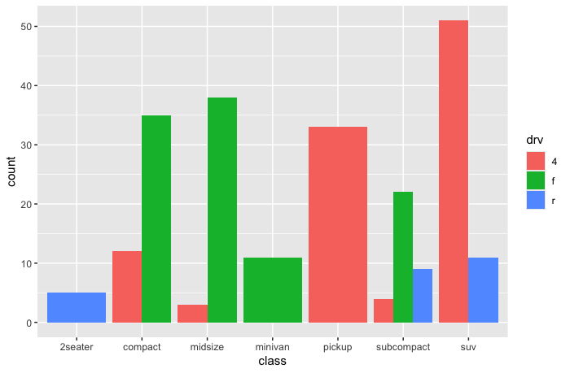

*Figure 2. Side-by-side bar chart of drive types by car class*

All 33 `pickup` cars are four-wheel drive, all 11 `minivan` cars are front-wheel drive, and all 5 `2seater` cars are rear-wheel drive, and the tallest bar is the 51 four-wheel-drive `suv` cars. A drive type missing from a class does not leave an empty slot; the remaining bars share its width, so the bar width differs between classes. Kabacoff fixes this problem in Figure 5.3 with `position_dodge(preserve = "single")`.

### 3.2 Quantitative vs. Quantitative

**(2) Customized scatterplot.** `Salaries` in the `carData` package holds the 9-month salaries of 397 assistant professors, associate professors, and professors at a US university in the 2008-2009 academic year. The relationship between years since the PhD (`yrs.since.phd`) and salary (`salary`) is plotted as points, with fixed values for the point color, size, and transparency, the y axis in dollar format, and the x axis ticks every 10 years.

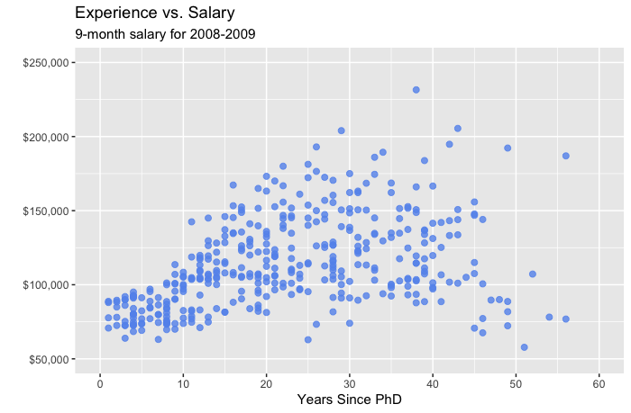

*Figure 3. Scatterplot of years since the PhD and salary*

Salary tends to rise with years since the PhD, but beyond 40 years many points have low salaries, and the spread of salaries at the same number of years grows. Salaries range from 57,800 to 231,545 dollars and years from 1 to 56, so no point is cut off outside the axis ranges (`limits`).

**(3) Line plot with points and labels.** From `gapminder` in the gapminder package, the life expectancy (`lifeExp`) of the United States is connected over 12 time points at 5-year intervals from 1952 to 2007. Blue points sit on a thick light grey line, with a title, a subtitle, and a source caption.

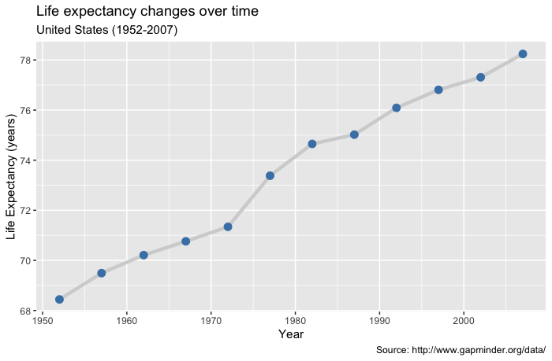

*Figure 4. Line plot of the change in US life expectancy*

Life expectancy rose from 68.4 to 78.2 years without a single decrease. Unlike Figure 5.13, which draws only the line, the points reveal the actual observation times and show that the line interpolates between them.

### 3.3 Categorical vs. Quantitative

**(4) Grouped kernel density plots.** The salary distributions by rank (`rank`) are overlaid as kernel density curves and filled semi-transparently with `alpha = 0.4` so that the overlaps remain visible.

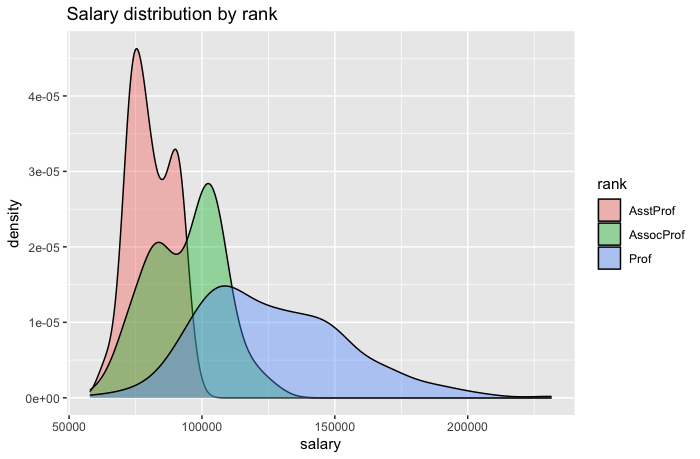

*Figure 5. Kernel density curves of salary by rank*

The distribution of assistant professors (`AsstProf`, 67 people) is concentrated narrowly near 80,000 dollars, associate professors (`AssocProf`, 64 people) lie slightly to the right of it, and professors (`Prof`, 266 people) spread widely from 100,000 to 230,000 dollars. Each density curve is drawn so that the area under it is 1 for its group, so the curve of the professors, four times as many as the assistant professors, is not drawn correspondingly higher.

**(5) Side-by-side boxplots.** The same data are shown as boxplots by rank.

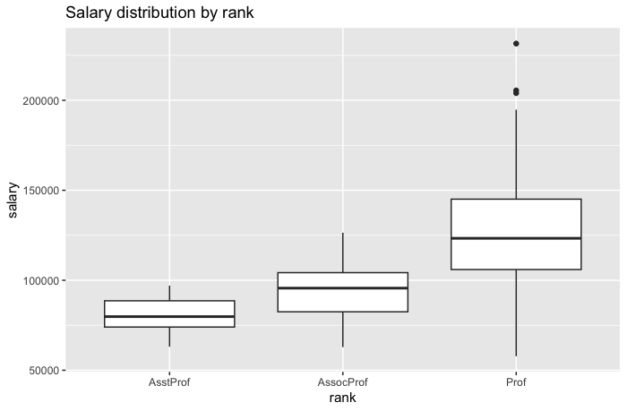

*Figure 6. Side-by-side boxplots of salary by rank*

The medians are 79,800 dollars for assistant professors, 95,626.5 dollars for associate professors, and 123,321.5 dollars for professors, rising with rank. Above the professor box, three people are marked as outliers (204,000, 205,500, and 231,545 dollars), and two of these points nearly overlap because their values are close.

**(6) Ridgeline plot.** `geom_density_ridges()` from the ggridges package stacks the density curves of city mileage (`cty`, miles per gallon) by car class, each shifted slightly vertically. The color repeats the class on the y axis, so the legend is removed.

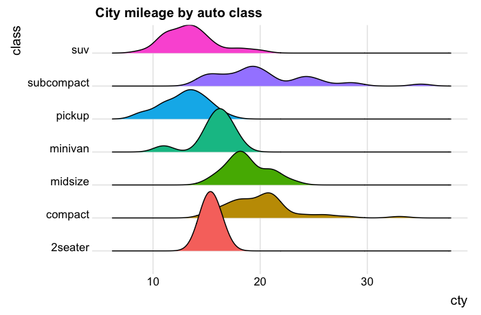

*Figure 7. Ridgeline plot of city mileage by car class*

`pickup` and `suv` sit at the low end with a median of 13 miles, `compact` (20 miles) and `subcompact` (19 miles) sit at the high end, and `subcompact` has a long right tail reaching 35 miles. The title "City mileage by auto class" matches the x variable `cty`. Kabacoff's code passes "Highway mileage by auto class" to `labs()` without an argument name, so no title is set, and ggplot2 4.0.1 raises an error saying that every label must be named.

**(7) Jittered strip plot.** The ranks are renamed with two-line names (`"Assistant\nProfessor"` and so on) and placed on the y axis, and salaries are plotted as points on the x axis, with `geom_jitter()` scattering the positions of the points slightly at random so that they do not overlap. The color repeats the rank, so the legend is removed, and `theme_minimal()` clears the background.

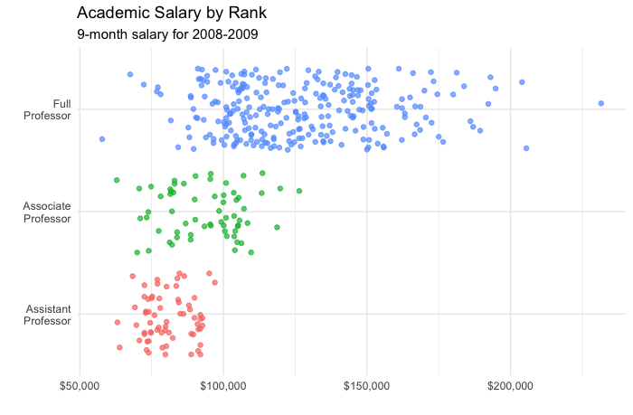

*Figure 8. Jittered strip plot of salary by rank*

Unlike the boxplot, which shows only five summary values, all 397 people appear as points, so the density of points reveals that the professor group is the largest and has the widest salary range. Jittering is random, so the positions of the points change slightly with every run.

---

<br>

## 4. Kabacoff Chapter 6: Multivariate Graphs

Kabacoff Chapter 6 covers two ways to show three or more variables in one graph: grouping, which adds variables to non-positional aesthetics (Section 6.1), and faceting, which splits panels by category (Section 6.2). The five grouping figures follow Kabacoff's order of adding one variable at a time to the same scatterplot.

| No. | Code Lines | Kabacoff Section | Kabacoff Figure | Lecture Notes |
|:-----|:-----|:-----|:-----|:-----|
| (1) | Lines 111-118 | 6.1 Grouping | Figure 6.1: Simple scatterplot | Section 5 |
| (2) | Lines 121-124 | 6.1 Grouping | Figure 6.2: Scatterplot with color mapping | Section 5.1 |
| (3) | Lines 127-131 | 6.1 Grouping | Figure 6.3: Scatterplot with color and shape mapping | Section 5.2 |
| (4) | Lines 134-139 | 6.1 Grouping | Figure 6.4: Scatterplot with size and color mapping | Section 5.3 |
| (5) | Lines 142-154 | 6.1 Grouping | Figure 6.5: Scatterplot with color mapping and quadratic fit lines | Section 5.4 |
| (6) | Lines 157-161 | 6.2 Faceting | Figure 6.6: Salary distribution by rank | Section 6.1 |
| (7) | Lines 164-179 | 6.2 Faceting | Figure 6.9: Salary by experience, rank, and sex (better labeled) | Section 6.2 |
| (8) | Lines 182-195 | 6.2 Faceting | Figure 6.10: Changes in life expectancy by country | Section 6.3 |

*Table 4. Figures chosen from Kabacoff Chapter 6 and the corresponding code*

### 4.1 Grouping

**(1) Simple scatterplot.** The basic scatterplot of years since the PhD and salary is the starting point for (2) through (5).

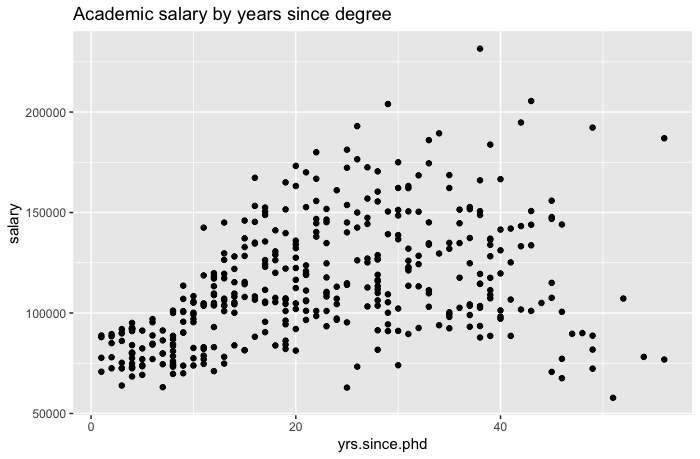

*Figure 9. Simple scatterplot of years since the PhD and salary*

**(2) Color mapping.** Putting `color = rank` inside `aes()` shows the rank as the point color.

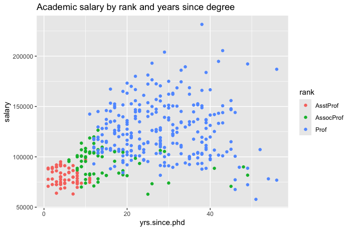

*Figure 10. Scatterplot with rank shown by color*

Assistant professors lie at 1-11 years, associate professors at 6-49 years, and professors at 11-56 years, which shows that years and rank are strongly intertwined. It becomes possible to read much of the rising salary with years in (1) as a difference between ranks.

**(3) Color and shape mapping.** Sex (`sex`) is added as the point shape. The size is set to 3 and the transparency to 0.6 so that overlapping points remain visible.

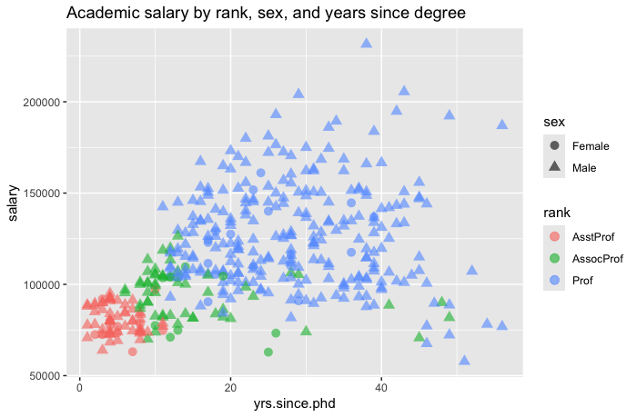

*Figure 11. Scatterplot with rank shown by color and sex by shape*

There are only 39 women against 358 men, so circles (women) appear sparsely among triangles (men). With four variables, color and shape must be read at the same time, so the graph quickly becomes complex.

**(4) Color and size mapping.** Instead of shape, years of service (`yrs.service`) is shown as the point size.

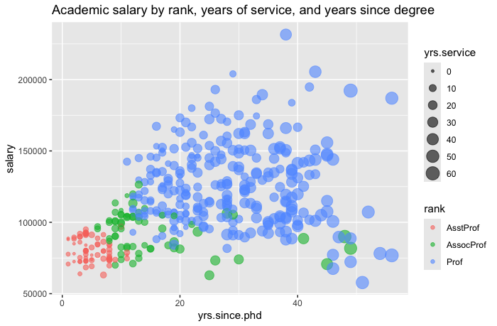

*Figure 12. Scatterplot with rank shown by color and years of service by size*

Larger points are faculty who have served longer, and most large points lie in the professor group on the right. Years of service moves together with years since the PhD, so the size adds little new information.

**(5) Quadratic fit lines by sex.** Sex is shown by color, and `geom_smooth(method = "lm", formula = y ~ poly(x, 2))` adds a second-degree polynomial regression curve for each sex. The axis and legend names are changed, the y axis is in dollar format, and the colors use the `Set1` palette.

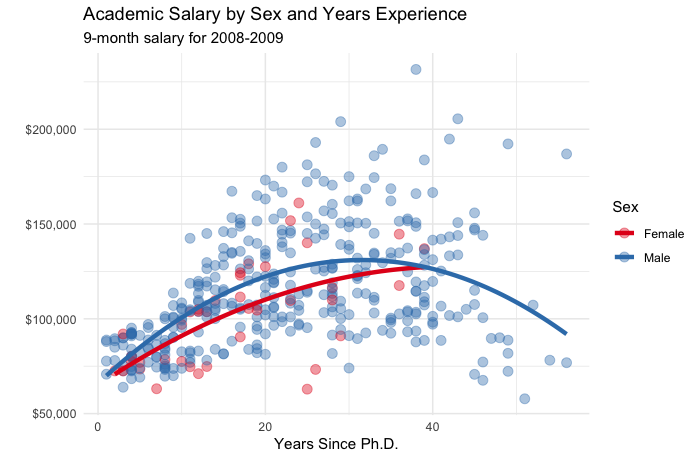

*Figure 13. Scatterplot with quadratic fit lines by sex*

The male curve peaks at about 31.5 years and then declines, while the female curve has its peak at about 42.5 years, so within the range of the female data (2-39 years) it keeps rising and flattens at the right end. The male curve lies above the female curve over most of the range, but there are only 39 women, so the shape of the female curve is uncertain.

### 4.2 Faceting

**(6) Histograms by rank.** `facet_wrap(~rank, ncol = 1)` makes one salary histogram per rank and stacks them in one column.

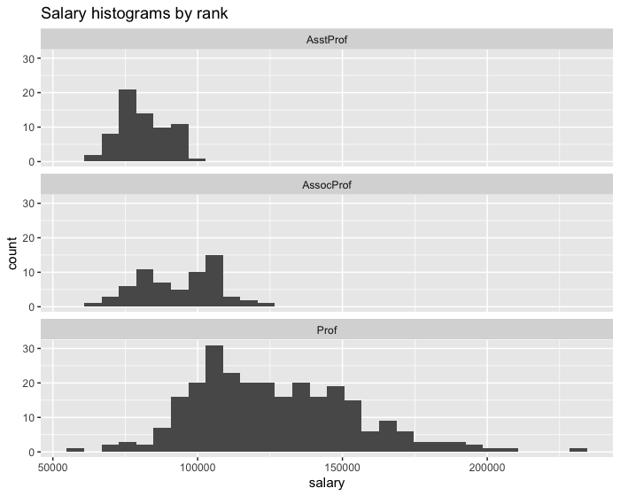

*Figure 14. Salary histograms split by rank*

The three panels share the x axis, so the positions of the salaries by rank can be compared directly from top to bottom. Unlike the density curves (Figure 5), the y axis is a count, so the size of the professor group is also visible. The number of bins is not specified, so the default of 30 bins is used, and running the code prints a message to pick a better bin width.

**(7) Faceted scatterplot by discipline.** The levels A and B of the discipline type (`discipline`) are renamed "Theoretical" and "Applied" to split two panels, and a straight regression line is drawn for each sex in each panel.

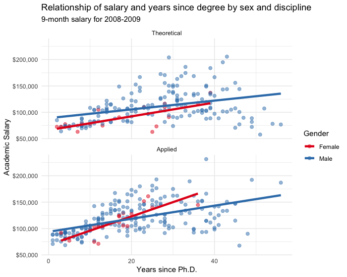

*Figure 15. Scatterplot split by discipline with regression lines by sex*

Computing the slopes of the regression lines gives 1,307 dollars per year for women and 831 dollars for men in theoretical departments, and 2,704 dollars for women and 1,239 dollars for men in applied departments, so the female slope is steeper in both. However, the intercepts of the female lines are lower than those of the male lines, and the female samples are only 18 people in theoretical and 21 people in applied departments.

**(8) Life expectancy by country in the Americas.** `facet_wrap(~country)` draws the change in life expectancy of 25 countries in the Americas in a small panel per country. The font size is reduced to 9 and the x tick labels are tilted 45 degrees so that they do not overlap.

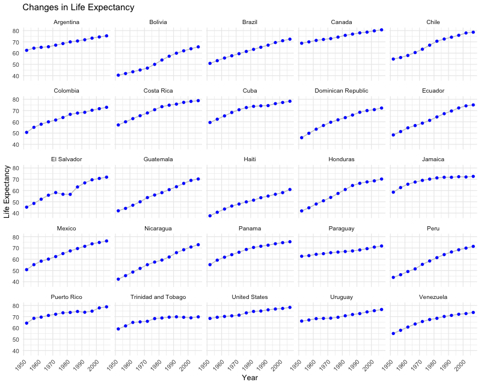

*Figure 16. Change in life expectancy of 25 countries in the Americas*

Life expectancy rose in every country, and in 2007 Canada (80.7 years) is the highest while Haiti (60.9 years) and Bolivia (65.6 years) are the lowest. The 25 panels share the same axes, so levels and slopes can be compared between countries.

---

<br>

## 5. Kabacoff Chapter 7: Maps

Kabacoff Chapter 7 covers geocoding, which turns addresses into coordinates (Section 7.1), dot density maps, which plot observations as points on a map (Section 7.2), and choropleth maps, which color each region by its value (Section 7.3). The solution chooses two figures from Section 7.2 and three from Section 7.3.

| No. | Code Lines | Kabacoff Section | Kabacoff Figure | Lecture Notes |
|:-----|:-----|:-----|:-----|:-----|
| (1) | Lines 203-218 | 7.2.1 Interactive maps with mapview | Unnumbered interactive map | Section 7.1 |
| (2) | Lines 221-225 | 7.2.1 Interactive maps with mapview | Unnumbered interactive map | Section 7.1 |
| (3) | Lines 228-251 | 7.3.1 Data by country | Figure 7.8: Choropleth map of life expectancy | Section 7.2 |
| (4) | Lines 254-260 | 7.3.1 Data by country | Figure 7.9: Choropleth map of life expectancy with labels and a better color scheme | Section 7.2 |
| (5) | Lines 263-282 | 7.3.4 Building a choropleth map using the sf and ggplot2 packages and a shapefile | Figure 7.11: Choropleth map of state literacy rates | Section 7.3 |

*Table 5. Figures chosen from Kabacoff Chapter 7 and the corresponding code*

### 5.1 Dot Density Maps

**(1) Interactive mapview map.** `crime` in the ggmap package holds 86,314 crime records from Houston in the United States from January to August 2010. The code selects the 157 murders (`murder`), keeps only the date, offense, address, longitude, and latitude, converts them to an sf object with `st_as_sf()`, and passes it to `mapview()`. The console prints the result of `head(homicide, 3)`.

```text
      date offense            address       lon      lat
1 1/1/2010  murder    9650 marlive ln -95.43739 29.67790
2 1/5/2010  murder   1350 greens pkwy -95.43944 29.94292
3 1/5/2010  murder 10250 bissonnet st -95.55906 29.67480
```

The result is a Leaflet map that opens in the RStudio Viewer pane. The 157 records appear as blue points on the default basemap (CartoDB Positron), and a legend with the layer name `mymap` sits in the upper right. The mouse wheel or the zoom buttons in the upper left change the scale, the map can be dragged, and clicking a point opens a pop-up with the attributes of that row.

**(2) mapview map on an OpenStreetMap basemap.** The same sf object is created again, the point outline is set to black (`color`), the fill to red (`col.regions`), and the fill transparency to 0.5 (`alpha.regions`), the legend and home button are removed, and the basemap is set to OpenStreetMap. The result is a map of semi-transparent red points with black outlines on OpenStreetMap, which shows roads and place names, and the removal of the legend and the home button in the lower right makes the map cleaner.

### 5.2 Choropleth Maps

**(3) Choropleth map of life expectancy by country.** The 2007 gapminder data are reshaped into the format that `country_choropleth()` requires (a region name column `region`, a value column `value`, and lowercase names), `recode()` aligns 9 country names spelled differently with the names of the map, and the world map is drawn. Kabacoff's code swaps the names of South Korea and North Korea in `recode()` and misspells `"korea, rep."` as `"korea. rep."`, and the solution corrects both names.

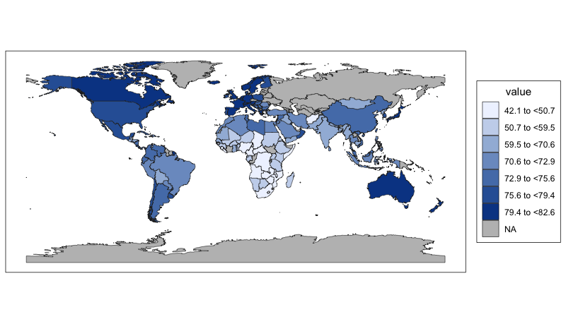

*Figure 17. Choropleth map of life expectancy by country in 2007*

By default, the values are divided into 7 intervals and colored by the depth of blue. North America, Western Europe, Australia, and Japan are dark, and sub-Saharan Africa is light. Countries missing from gapminder, such as Russia, and countries whose names do not match remain in the grey of missing values (`NA`).

> **Note:** **Package version and region names.** The target names in `recode()` follow the region names of the choroplethr version that Kabacoff used. choroplethr 5.0.1, which drew Figures 17 and 18, has a different table of region names, so it prints a message that 12 regions, including the Republic of the Congo (`"republic of congo"`), the Czech Republic (`"czech republic"`), and Côte d'Ivoire, were not found, and leaves those regions uncolored. Small countries that have no region on the map, such as Bahrain and Singapore, are not colored even when their names match.

**(4) Choropleth map with a new color scheme.** The map of (3) is divided into 9 intervals with `num_colors = 9`, uses colors running from yellow to red with `scale_fill_brewer(palette = "YlOrRd")`, and gets a title, a subtitle, a source, and a legend name.

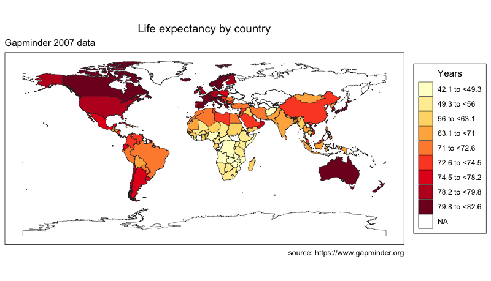

*Figure 18. Life expectancy choropleth map with 9 intervals and YlOrRd colors*

The map that choroplethr returns is also a ggplot2 object, so scales and labels can be added with `+`. A fill scale already exists, however, so a message says that it is replaced by the new scale. According to Kabacoff, the default of `num_colors` is 7 and the maximum is 9.

**(5) US state map drawn from a shapefile.** The 2024 state boundary shapefile of the US Census Bureau (`cb_2024_us_state_5m`, 56 regions) is read with `st_read()`, a CSV of values by state (`us_literacy_rates_by_state_2025.csv`, 52 rows) is joined by state name, and after removing Hawaii, Alaska, Puerto Rico, and the territories without values, the 49 regions of the 48 contiguous states and Washington, D.C. are colored with `geom_sf()`. This applies the method of Kabacoff Section 7.3.4 to the 2024 boundary file and the 2025 CSV.

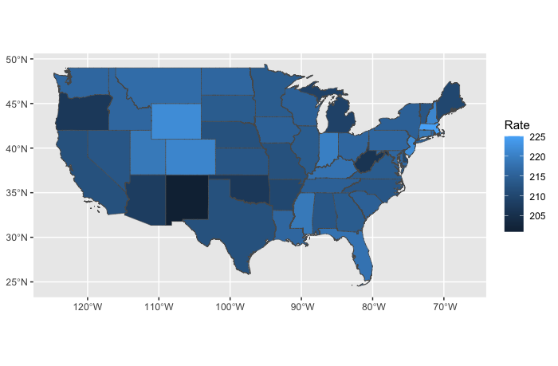

*Figure 19. Choropleth map of the contiguous US states joining the shapefile and the CSV*

Lighter colors mean larger `Rate`, with Massachusetts (225) the lightest and New Mexico (201) the darkest. The `Rate` in the CSV that Kabacoff used is a percentage such as 94.2, but the `Rate` in this CSV takes values in the range 201-225, so the legend cannot be read as a percentage. Of the 52 rows of the CSV, the `United States` row has no region with the same name on the map and drops out of the join.

---

<br>

## 6. Kabacoff Chapter 8: Time-dependent graphs

Kabacoff Chapter 8 covers graphs with time on an axis in five sections: time series (Section 8.1), dumbbell charts (Section 8.2), slope graphs (Section 8.3), area charts (Section 8.4), and stream graphs (Section 8.5). The solution chooses one figure from each of the five sections.

| No. | Code Lines | Kabacoff Section | Kabacoff Figure | Lecture Notes |
|:-----|:-----|:-----|:-----|:-----|
| (1) | Lines 290-302 | 8.1 Time series | Figure 8.2: Simple time series with modified date axis | Section 8.1 |
| (2) | Lines 305-324 | 8.2 Dumbbell charts | Figure 8.4: Simple dumbbell chart | Section 8.2 |
| (3) | Lines 327-344 | 8.3 Slope graphs | Figure 8.6: Slope graph | Section 8.3 |
| (4) | Lines 347-352 | 8.4 Area Charts | Figure 8.7: Basic area chart | Section 8.4 |
| (5) | Lines 355-372 | 8.5 Stream graph | Figure 8.10: Basic stream graph | Section 8.4 |

*Table 6. Figures chosen from Kabacoff Chapter 8 and the corresponding code*

**(1) Time series with a modified date axis.** `economics`, which comes with ggplot2, holds monthly US economic indicators. The personal savings rate (`psavert`) is drawn as a line from July 1967 to April 2015, and `geom_smooth()` adds a LOESS smoothing curve. `scale_x_date()` places ticks every 5 years and shows them in the `"%b-%y"` format (month abbreviation and two-digit year).

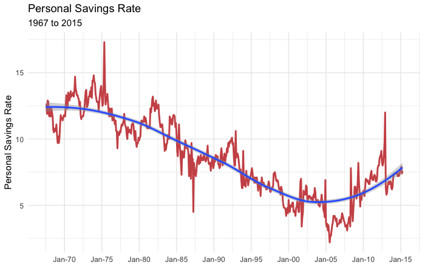

*Figure 20. Personal savings rate time series with a modified date axis and a smoothing curve*

The savings rate was highest at 17.3% in May 1975, mostly declined afterwards to its lowest value of 2.2% in July 2005, and then rose again. The smoothing curve removes the monthly ups and downs and shows only this long-term flow. The month abbreviation follows the R locale, so a Korean locale shows `1월-70` instead of `Jan-70`; Figure 20 shows the English locale.

**(2) Dumbbell chart.** The 1952 and 2007 life expectancies of 25 countries in the Americas are spread with `pivot_wider()` into one row per country (`y1952`, `y2007`), and `geom_dumbbell()` from the ggalt package connects the two values with a segment.

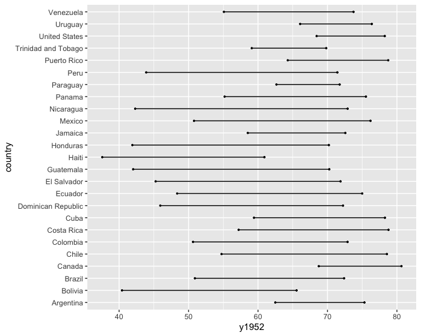

*Figure 21. Dumbbell chart connecting the 1952 and 2007 life expectancies of 25 countries in the Americas*

Every country's segment extends to the right, showing that life expectancy rose. The largest increase is Nicaragua (from 42.3 to 72.9 years, 30.6 years), and the smallest is Paraguay (from 62.6 to 71.8 years, 9.1 years). The x axis title appears as `y1952` because the name of the variable mapped to `x` is used as is, and Kabacoff sorts the countries and polishes the colors and axis titles in Figure 8.5.

**(3) Slope graph.** Seven Central American countries are selected, their life expectancies in 1992, 1997, 2002, and 2007 are rounded to integers, and `newggslopegraph()` from the CGPfunctions package lines up the values vertically at each time point and connects them with a line per country.

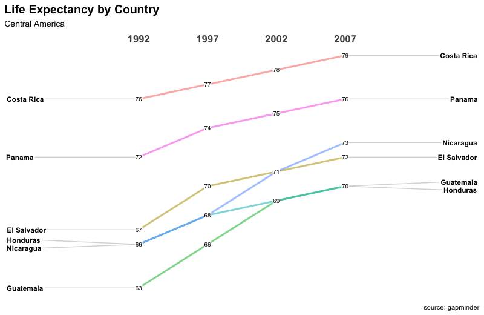

*Figure 22. Slope graph of life expectancy in Central American countries*

gapminder has no data for Belize, so only six countries are drawn. Costa Rica is the highest at all four time points, from 76 to 79 years, and Guatemala (from 63 to 70) and Nicaragua (from 66 to 73) rose the most, by 7 years each. Countries with the same value in the same year (for example, Nicaragua and Honduras at 66 years in 1992) have their labels gathered in one place.

**(4) Area chart.** The same savings rate as in (1) is drawn with `geom_area()`, filling the area under the line with light blue.

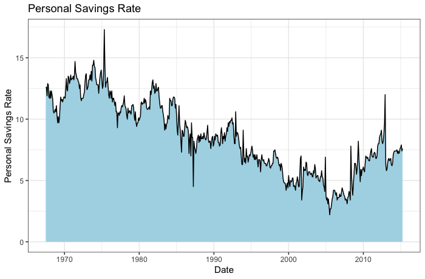

*Figure 23. Area chart of the personal savings rate*

The information is the same as in the line graph, but the area filled from 0 emphasizes the amount at each time point. The area is meaningful only when the y axis starts at 0, so for data whose changes are small relative to their values, a line graph shows the changes better.

**(5) Stream graph.** `uspopage` in the gcookbook package holds the US population from 1900 to 2002 in 8 age groups, in thousands. The values are converted to millions, and `geom_stream()` from the ggstream package stacks the 8 age groups symmetrically above and below a center line.

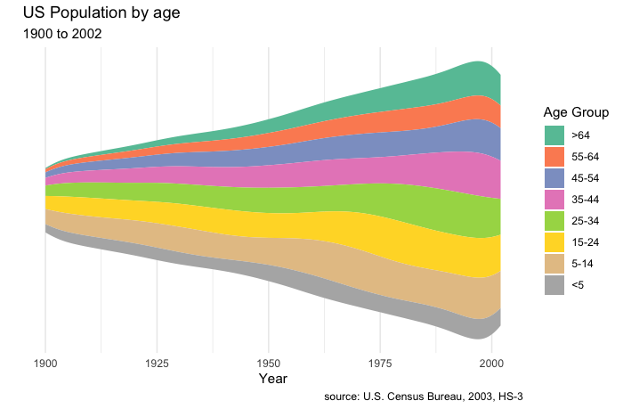

*Figure 24. Stream graph of the US population by age group from 1900 to 2002*

The total width grows from about 76.1 million in 1900 to about 288.4 million in 2002, and the 65-and-over layer (`>64`) thickens from about 3.1 million to about 35.6 million. The positions of the layers change every year, so individual values are hard to read from an axis; the y tick labels are removed, and the graph shows the flow of the age composition rather than exact values.

---

<br>

## Summary

| Concept | Key Summary |
|:-----|:-----|
| Figure selection conditions | At least 5 figures from each of Kabacoff Chapters 5-8 and at least 20 in total are required, and the solution chooses 25 figures: 7, 8, 5, and 5. |
| Bivariate graphs | Bar charts, scatterplots, line plots, density plots, boxplots, ridgeline plots, and strip plots are chosen by the combination of two variable types (categorical vs. categorical, quantitative vs. quantitative, categorical vs. quantitative). |
| Grouping | Adding variables one at a time to color, shape, and size shows four or more variables in one scatterplot, but the graph becomes harder to read as the mappings increase. |
| Faceting | Splitting panels with the same axes by category allows the levels and trends of groups to be compared side by side. |
| Maps | A dot density map shows observation locations and a choropleth map shows values by region, and a choropleth map colors a region only when the region name in the data matches the name in the map exactly. |
| Time-dependent graphs | Time series and area charts show trends, dumbbell charts and slope graphs show changes between time points, and stream graphs show the flow of composition. |
| Report format | The console and the plot pane are captured together, and one PDF file edited so that chapters and items can be told apart is submitted as `Global_StudentID_Name.pdf`. |

---

<br>

## Self-Check Questions

1. **Bar width:** In the side-by-side bar chart of Section 3.1, why is the `2seater` bar wider than the other bars, and how can all bars be given the same width?

   <details>
   <summary>Answer</summary>

   `2seater` has only rear-wheel-drive cars, so a single bar takes the whole slot of that class. Drawing with `geom_bar(position = position_dodge(preserve = "single"))` gives every bar the same width in all classes.

   </details>

2. **Density curves and counts:** In the kernel density plot of Section 3.3, there are 266 professors, about four times the 67 assistant professors. Why is the professor curve not correspondingly higher?

   <details>
   <summary>Answer</summary>

   A kernel density curve is normalized so that the area under it is 1 for each group, so it does not reflect the group size. To show the difference in counts as well, use a graph whose y axis is a count, such as the histograms in Section 4.2.

   </details>

3. **Joining data to a map:** In the US state map of Section 5.2, why does the `United States` row of the CSV not appear on the map? How does the map change if `!is.na(Rate)` is removed from `filter()`?

   <details>
   <summary>Answer</summary>

   `left_join()` keeps only the 56 regions of the map, the left data, and drops the `United States` row of the CSV, which has no match in the map. Without `!is.na(Rate)`, the US Virgin Islands, Guam, the Northern Mariana Islands, and American Samoa, which have no value in the CSV, are drawn in the grey of `NA`, and the map extent widens to the Pacific.

   </details>

4. **Number of countries in the slope graph:** The slope graph of Section 6 selects 7 countries but draws only 6. Why, and how many rows do the plotted data have?

   <details>
   <summary>Answer</summary>

   gapminder has no rows for Belize, so no Belize rows satisfy the condition `country %in% c(...)`. The data have 24 rows for 6 countries and 4 time points.

   </details>

5. **Date axis labels:** Why do the ticks made with `date_format("%b-%y")` appear as `1월-70` in a Korean environment, and how can they be shown as `Jan-70`?

   <details>
   <summary>Answer</summary>

   `%b` uses the month abbreviation of the current locale. Changing the time locale with `Sys.setlocale("LC_TIME", "C")` before drawing the graph shows the English abbreviations.

   </details>
