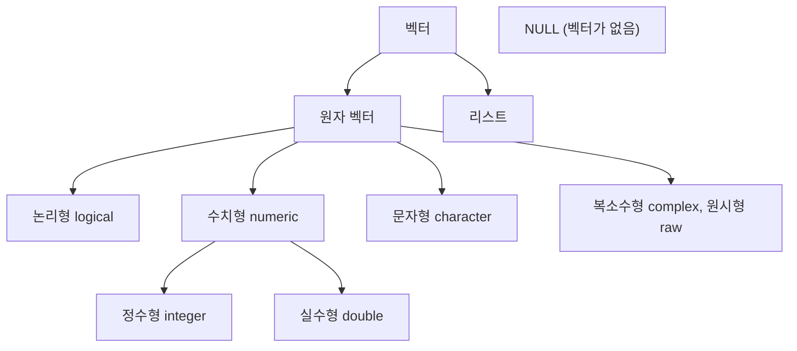

# 2장 — R의 데이터 구조

[레포지토리 안내](../../README.ko.md) | [English](Concepts_Lecture.md) | [한국어](Concepts_Lecture.ko.md)

> **최종 수정일:** 2026-11-26
>
> 혼자 공부하는 R 데이터 분석, 강전희와 엄동란, Ch 2

> **학습 목표:**
> 1. 벡터, 리스트, 데이터 프레임을 생성하고 조작할 수 있다
> 2. 인덱싱과 부분 선택 연산을 적용할 수 있다
> 3. 서로 다른 R 데이터 구조 간 변환을 수행할 수 있다
> 4. 재활용 규칙과 암묵적 형 변환의 순서로 벡터 연산의 결과를 예측할 수 있다
> 5. 티블과 데이터 프레임의 차이, 팩터의 수준과 Date 클래스를 설명할 수 있다
> 6. 데이터의 생김새(관측치, 변수, 값)와 데이터 분석 과정을 설명할 수 있다

---

## 목차

- [1. 벡터](#1-벡터)
  - [1.1 벡터 생성](#11-벡터-생성)
  - [1.2 벡터 속성](#12-벡터-속성)
  - [1.3 벡터 연산](#13-벡터-연산)
  - [1.4 원자 벡터의 유형과 NULL](#14-원자-벡터의-유형과-null)
  - [1.5 인덱싱](#15-인덱싱)
  - [1.6 재활용 규칙](#16-재활용-규칙)
  - [1.7 암묵적 형 변환](#17-암묵적-형-변환)
  - [1.8 수열과 반복](#18-수열과-반복)
  - [1.9 벡터를 다루는 함수](#19-벡터를-다루는-함수)
- [2. 행렬](#2-행렬)
  - [2.1 행렬 생성](#21-행렬-생성)
  - [2.2 행렬 인덱싱](#22-행렬-인덱싱)
  - [2.3 행렬 확인 및 변환](#23-행렬-확인-및-변환)
  - [2.4 행렬의 크기와 이름](#24-행렬의-크기와-이름)
  - [2.5 행렬 연산](#25-행렬-연산)
- [3. 배열](#3-배열)
  - [3.1 배열 생성](#31-배열-생성)
  - [3.2 배열 vs. 행렬](#32-배열-vs-행렬)
  - [3.3 배열의 인덱싱](#33-배열의-인덱싱)
- [4. 리스트](#4-리스트)
  - [4.1 리스트 생성](#41-리스트-생성)
  - [4.2 명명된 리스트](#42-명명된-리스트)
  - [4.3 혼합 유형 저장](#43-혼합-유형-저장)
  - [4.4 중첩 리스트](#44-중첩-리스트)
  - [4.5 리스트 원소 꺼내기](#45-리스트-원소-꺼내기)
  - [4.6 리스트 수정](#46-리스트-수정)
- [5. 데이터 프레임](#5-데이터-프레임)
  - [5.1 데이터 프레임 생성](#51-데이터-프레임-생성)
  - [5.2 데이터 프레임 확인](#52-데이터-프레임-확인)
  - [5.3 열 접근](#53-열-접근)
  - [5.4 대안: data.frame() 인라인 생성](#54-대안-dataframe-인라인-생성)
  - [5.5 데이터의 생김새: 관측치, 변수, 값](#55-데이터의-생김새-관측치-변수-값)
  - [5.6 조건으로 행 고르기와 열 추가](#56-조건으로-행-고르기와-열-추가)
  - [5.7 티블과 데이터 프레임](#57-티블과-데이터-프레임)
- [6. 팩터](#6-팩터)
  - [6.1 팩터의 개념](#61-팩터의-개념)
  - [6.2 팩터 vs. 문자형 벡터](#62-팩터-vs-문자형-벡터)
  - [6.3 팩터의 산술 연산 동작](#63-팩터의-산술-연산-동작)
  - [6.4 팩터에서의 대소문자 구분](#64-팩터에서의-대소문자-구분)
  - [6.5 수준의 순서와 순서형 팩터](#65-수준의-순서와-순서형-팩터)
  - [6.6 수준 다루기](#66-수준-다루기)
  - [6.7 수치를 구간으로 나누기: cut()](#67-수치를-구간으로-나누기-cut)
- [7. 유형 확인 및 변환](#7-유형-확인-및-변환)
  - [7.1 유형 확인](#71-유형-확인)
  - [7.2 유형 변환 함수](#72-유형-변환-함수)
  - [7.3 내장 데이터셋](#73-내장-데이터셋)
  - [7.4 변수 타입과 class()의 결과](#74-변수-타입과-class의-결과)
  - [7.5 날짜: Date 클래스](#75-날짜-date-클래스)
  - [7.6 class(), typeof(), mode()의 비교](#76-class-typeof-mode의-비교)
- [8. 데이터 구조 비교](#8-데이터-구조-비교)
- [9. 데이터 분석 과정](#9-데이터-분석-과정)
- [개념 적용](#개념-적용)
- [요약](#요약)
- [점검 문제](#점검-문제)
- [참고 문헌](#참고-문헌)

---

<br>

## 1. 벡터

### 1.1 벡터 생성

> **용어 정의:** **벡터(vector)** 는 원소를 순서대로 모은 1차원 데이터 구조로, R에서 가장 기본적인 데이터 구조이다. 흔히 벡터라고 하면 모든 원소가 같은 유형인 것을 가리킨다(1.4절).

다음은 벡터를 만드는 예이다.

```r
# c() 함수를 사용하여 벡터 생성
ex_vector1 <- c(-1, 0, 1)          # 수치형 벡터
ex_vector2 <- c("Hello", "Hi~!")   # 문자형 벡터
a <- c(1, 2, 9)                    # 수치형 벡터

# 수열 생성
1:10                               # 1부터 10까지의 정수 수열
seq(1, 9, by = 2)                  # 수열: 1, 3, 5, 7, 9
```

### 1.2 벡터 속성

```r
mode(ex_vector1)    # "numeric"   - 저장 모드
mode(ex_vector2)    # "character" - 저장 모드

str(ex_vector1)     # num [1:3] -1 0 1
str(ex_vector2)     # chr [1:2] "Hello" "Hi~!"

length(ex_vector1)  # 3
length(ex_vector2)  # 2
```

`mode()`는 값의 저장 모드를, `str()`은 유형의 약어(`num`, `chr`, `int`, `logi`)와 색인 범위 `[1:n]`, 앞부분 값을 한 줄로 보여 주며, `length()`는 원소의 개수를 돌려준다. 숫자를 따옴표로 감싸면 문자형이 되고, `TRUE`와 `FALSE`로 이루어진 벡터는 논리형이다.

```r
ex_vector3 <- c("1", "2", "3")
mode(ex_vector3); str(ex_vector3)
#> [1] "character"
#>  chr [1:3] "1" "2" "3"
ex_vector4 <- c(TRUE, FALSE, TRUE, FALSE)
mode(ex_vector4); str(ex_vector4); length(ex_vector4)
#> [1] "logical"
#>  logi [1:4] TRUE FALSE TRUE FALSE
#> [1] 4
ex_vector11 <- c(-1L, 0L, 1L)
mode(ex_vector11); str(ex_vector11)
#> [1] "numeric"
#>  int [1:3] -1 0 1
```

`ex_vector3`의 원소 `"1"`, `"2"`, `"3"`은 숫자처럼 보이지만 문자열이므로 `chr`로 표시되고 산술 연산에 쓸 수 없다. `ex_vector11`은 접미사 `L`로 정수를 만든 벡터이다. `mode()`는 정수와 실수를 모두 `"numeric"`으로 보고하지만 `str()`은 정수를 `int`, 실수를 `num`으로 구분한다.

### 1.3 벡터 연산

```r
a <- c(1, 2, 9)
mean(a)             # 4 (산술 평균)

# 벡터화 연산
x <- c(1, 2, 3)
x + 2               # 3, 4, 5 (원소별 덧셈)
x * 3               # 3, 6, 9 (원소별 곱셈)
```

> **용어 정의:** **벡터화 연산(vectorized operation)** 은 명시적인 반복문 없이 벡터의 모든 원소에 한꺼번에 적용되는 연산으로, R의 벡터 연산은 이렇게 벡터화되어 있다.

벡터화는 산술 연산자뿐 아니라 `sqrt()`, `round()`, `log()` 같은 수학 함수와 비교 연산자에도 적용된다. 같은 길이의 두 벡터 사이의 연산은 같은 위치의 원소끼리 짝지어 계산한다.

```r
x <- c(1, 4, 9, 16)
sqrt(x)
#> [1] 1 2 3 4
x^2
#> [1]   1  16  81 256
x / sum(x)
#> [1] 0.03333333 0.13333333 0.30000000 0.53333333
round(x / sum(x), 3)
#> [1] 0.033 0.133 0.300 0.533
x > 5
#> [1] FALSE FALSE  TRUE  TRUE
y <- c(2, 2, 3, 4)
x - y
#> [1] -1  2  6 12
x == y * y
#> [1] FALSE  TRUE  TRUE  TRUE
```

`sum(x)`는 1 + 4 + 9 + 16 = 30이므로 `x / sum(x)`는 각 원소를 30으로 나눈 비율이며, 비율의 합은 1이다. 여기서 `sum(x)`는 길이 1인 값이므로 재활용 규칙(1.6절)에 따라 네 원소 모두에 같은 분모가 쓰인다. `x - y`는 1 - 2, 4 - 2, 9 - 3, 16 - 4 = -1, 2, 6, 12이고, `x == y * y`는 원소마다 $`x_i = y_i^2`$인지 검사한다. 이처럼 `mean()`, `sum()`처럼 벡터 전체를 값 하나로 줄이는 **요약 함수**와, `sqrt()`, `+`처럼 원소마다 결과를 하나씩 내어 같은 길이의 벡터를 돌려주는 **벡터화 함수**를 구분해 두면 5장의 `summarise()`와 `mutate()`의 차이를 이해하기 쉽다.

### 1.4 원자 벡터의 유형과 NULL

R의 벡터는 두 종류로 나뉜다. 모든 원소가 같은 유형인 원자 벡터와, 원소마다 유형이 달라도 되는 리스트이다. 리스트는 원소로 다른 리스트를 담을 수 있으므로 **재귀 벡터(recursive vector)** 라고도 한다.

> **용어 정의:** **원자 벡터(atomic vector)** 는 모든 원소가 논리형, 정수형, 실수형, 문자형, 복소수형, 원시형 가운데 한 유형인 1차원 벡터이다.

> **용어 정의:** **리스트(list)** 는 원소마다 유형과 길이가 달라도 되는 벡터로, 원소로 다른 리스트를 담을 수도 있다.

원자 벡터의 여섯 유형 가운데 정수형(integer)과 실수형(double)을 합쳐 **수치형(numeric)** 이라 부른다. 원시형(raw)은 바이트 자료를 다룰 때만 쓰이므로 데이터 분석에서는 거의 쓰지 않는다. 이와 별도로 **NULL**은 벡터가 아예 없음을 나타내는 객체이며, 길이가 0인 벡터처럼 동작한다.



*그림 1. R의 벡터 유형의 계층*

모든 벡터는 두 가지 핵심 속성을 가진다. 하나는 `typeof()`로 확인하는 **유형**이고, 다른 하나는 `length()`로 확인하는 **길이**이다.

```r
typeof(letters)
#> [1] "character"
length(letters)
#> [1] 26
typeof(c(1.5, 2))
#> [1] "double"
typeof(1:3)
#> [1] "integer"
typeof(3 + 2i)
#> [1] "complex"
typeof(as.raw(255))
#> [1] "raw"
x <- list("a", "b", 1:10)
length(x)
#> [1] 3
typeof(NULL); length(NULL)
#> [1] "NULL"
#> [1] 0
```

`letters`는 R에 내장된 알파벳 소문자 26개의 문자형 벡터이다. `list("a", "b", 1:10)`은 문자열 둘과 길이 10인 정수 벡터 하나를 원소로 가지므로, 안에 든 값은 12개이지만 리스트의 길이는 원소의 수인 3이다. 이처럼 서로 다른 데이터를 하나로 묶을 수 있는 구조는 리스트뿐이다(4.3절).

### 1.5 인덱싱

> **용어 정의:** **인덱싱(indexing)** 은 벡터에서 위치, 논리값, 이름 가운데 하나로 일부 원소를 꺼내는 연산이다.

인덱싱에는 대괄호 `[ ]`를 쓰며, R의 위치 색인은 1부터 시작한다.

```r
v <- c(10, 20, 30, 40, 50)
v[2]
#> [1] 20
v[c(1, 3)]
#> [1] 10 30
v[-1]
#> [1] 20 30 40 50
v[-c(1, 2)]
#> [1] 30 40 50
v[v > 25]
#> [1] 30 40 50
v[6]
#> [1] NA
v[0]
#> numeric(0)
names(v) <- c("a", "b", "c", "d", "e")
v["c"]
#>  c 
#> 30
v[c("e", "a")]
#>  e  a 
#> 50 10
```

| 색인의 종류 | 예 | 결과 |
|:--|:--|:--|
| 양의 정수 | `v[c(1, 3)]` | 그 위치의 원소를 그 순서대로 꺼낸다 |
| 음의 정수 | `v[-1]` | 그 위치의 원소를 뺀 나머지를 꺼낸다 |
| 논리 벡터 | `v[v > 25]` | `TRUE`인 위치의 원소만 꺼낸다 |
| 문자열 | `v["c"]` | 이름이 같은 원소를 꺼낸다 |
| 범위 밖의 위치 | `v[6]` | `NA`를 돌려준다 |
| 0 | `v[0]` | 길이 0인 벡터를 돌려준다 |

*표 1. 벡터 인덱싱의 종류*

`v[v > 25]`는 두 단계로 계산된다. 먼저 `v > 25`가 원소마다 비교하여 논리 벡터 `FALSE FALSE TRUE TRUE TRUE`를 만들고, 이 논리 벡터를 색인으로 쓰면 `TRUE`인 셋째, 넷째, 다섯째 원소 30, 40, 50만 남는다. 조건으로 원소를 고르는 이 방식은 5장의 `filter()`가 행을 고르는 원리와 같다. 양의 정수와 음의 정수는 한 색인 안에 섞어 쓸 수 없다.

### 1.6 재활용 규칙

> **용어 정의:** **재활용 규칙(recycling rule)** 은 길이가 다른 벡터의 원소별 연산에서 짧은 벡터를 처음부터 되풀이하여 긴 벡터의 길이에 맞추는 규칙이다.

다음은 길이가 다른 두 벡터로 원소별 연산을 한 예이다.

```r
c(1, 2, 3, 4) + c(10, 20)
#> [1] 11 22 13 24
1:5 + 1:2
#> Warning in 1:5 + 1:2: longer object length is not a multiple of shorter object
#> length
#> [1] 2 4 4 6 6
c(1, 2, 3) * 2
#> [1] 2 4 6
```

첫 식에서 `c(10, 20)`은 `c(10, 20, 10, 20)`으로 늘어나므로 결과는 1 + 10, 2 + 20, 3 + 10, 4 + 20 = 11, 22, 13, 24이다. 둘째 식은 길이 5와 2가 배수 관계가 아니므로 `1:2`가 1, 2, 1, 2, 1로 늘어난 뒤 경고가 나온다. 결과 2, 4, 4, 6, 6은 계산되지만, 길이가 맞지 않는 것은 대개 실수의 신호이므로 경고를 확인해야 한다. 셋째 식의 `* 2`도 재활용의 한 경우이며, 길이 1인 벡터 2가 길이 3으로 늘어난 것이다. 1.3절의 산술이 벡터 전체에 바로 적용되는 것은 이 규칙 덕분이다.

### 1.7 암묵적 형 변환

> **용어 정의:** **암묵적 형 변환(implicit coercion)** 은 서로 다른 유형의 값을 한 원자 벡터에 넣을 때 R이 모든 원소를 표현할 수 있는 유형 하나로 자동으로 바꾸는 것이다.

원자 벡터는 한 유형의 원소만 담을 수 있으므로, `c()`에 서로 다른 유형의 값을 넣으면 암묵적 형 변환이 일어난다. 변환은 항상 다음 순서에서 더 오른쪽의 유형으로 일어난다.

```text
logical  →  integer  →  double  →  character
 (TRUE)      (1L)        (1.5)       ("a")
```

*그림 2. 암묵적 형 변환의 순서*

```r
c(1, "a", TRUE)
#> [1] "1"    "a"    "TRUE"
c(1, TRUE, FALSE)
#> [1] 1 1 0
c(1L, 2.5)
#> [1] 1.0 2.5
typeof(c(1L, 2.5))
#> [1] "double"
sum(c(TRUE, FALSE, TRUE, TRUE))
#> [1] 3
mean(c(TRUE, FALSE, TRUE, TRUE))
#> [1] 0.75
```

`c(1, "a", TRUE)`에는 문자열이 있으므로 모든 원소가 문자형이 되어 1은 `"1"`, `TRUE`는 `"TRUE"`가 된다. `c(1, TRUE, FALSE)`에는 문자열이 없고 실수가 있으므로 논리값이 수로 바뀌어 `TRUE`는 1, `FALSE`는 0이 된다. 이 성질 때문에 논리 벡터의 `sum()`은 `TRUE`의 개수 3이고, `mean()`은 `TRUE`의 비율 3 / 4 = 0.75이다. 조건을 만족하는 원소의 개수와 비율을 `sum(x > 기준)`과 `mean(x > 기준)`으로 구하는 관용구가 여기서 나온다.

사용자가 직접 유형을 바꾸는 것은 **명시적 형 변환**이며 `as.*()` 함수를 쓴다(7.2절). 변환할 수 없는 값은 경고와 함께 `NA`가 된다.

```r
as.numeric("3.14")
#> [1] 3.14
as.numeric("abc")
#> Warning: NAs introduced by coercion
#> [1] NA
as.logical(c("TRUE", "T", "yes", "false"))
#> [1]  TRUE  TRUE    NA FALSE
as.integer(3.9)
#> [1] 3
as.character(1:3)
#> [1] "1" "2" "3"
```

`as.logical()`은 `"TRUE"`, `"T"`, `"true"`, `"False"` 같은 정해진 표기만 논리값으로 인식하므로 `"yes"`는 `NA`가 된다. `as.integer(3.9)`는 반올림하지 않고 소수 부분을 버려 3이 된다. 반올림이 필요하면 먼저 `round()`를 쓴다.

> **주의:** 숫자 열에 `"N/A"`나 `"-"` 같은 문자열이 하나라도 섞이면 그 열 전체가 문자형이 된다. 그러면 `mean()`이 경고와 함께 `NA`를 돌려주므로, 불러온 데이터는 `str()`으로 열의 유형을 먼저 확인해야 한다(4장 6절).

### 1.8 수열과 반복

규칙적인 벡터는 `seq()`와 `rep()`으로 만든다.

```r
seq(0, 1, by = 0.25)
#> [1] 0.00 0.25 0.50 0.75 1.00
seq(0, 100, length.out = 5)
#> [1]   0  25  50  75 100
seq_len(4)
#> [1] 1 2 3 4
rep(c("A", "B"), times = 3)
#> [1] "A" "B" "A" "B" "A" "B"
rep(c("A", "B"), each = 3)
#> [1] "A" "A" "A" "B" "B" "B"
rep(1:2, times = c(3, 1))
#> [1] 1 1 1 2
```

`seq(from, to, by)`는 간격 `by`로, `seq(from, to, length.out)`은 원소 개수 `length.out`으로 수열을 만든다. `length.out = 5`이면 0에서 100까지를 네 구간으로 나누므로 간격은 (100 - 0) / (5 - 1) = 25이다. `seq_len(n)`은 1부터 n까지의 정수이며, n이 0이면 빈 벡터를 돌려주므로 반복문에서 `1:n`보다 안전하다(3장 8절). `rep()`의 `times`는 벡터 전체를, `each`는 각 원소를 되풀이하고, `times`에 벡터를 주면 원소마다 반복 횟수를 따로 정한다.

### 1.9 벡터를 다루는 함수

다음은 벡터의 원소를 정렬하고 찾는 데 자주 쓰는 함수이다.

```r
w <- c(3, 1, 4, 1, 5, 9, 2, 6)
sort(w)
#> [1] 1 1 2 3 4 5 6 9
sort(w, decreasing = TRUE)
#> [1] 9 6 5 4 3 2 1 1
order(w)
#> [1] 2 4 7 1 3 5 8 6
rev(w)
#> [1] 6 2 9 5 1 4 1 3
which(w > 3)
#> [1] 3 5 6 8
which.max(w)
#> [1] 6
unique(w)
#> [1] 3 1 4 5 9 2 6
cumsum(w)
#> [1]  3  4  8  9 14 23 25 31
4 %in% w
#> [1] TRUE
c(2, 7) %in% w
#> [1]  TRUE FALSE
```

`sort()`는 값을 정렬한 벡터를 돌려주지만 `order()`는 정렬했을 때의 **위치**를 돌려준다. `order(w)`의 첫 값 2는 가장 작은 값(1)이 2번째 원소라는 뜻이고, 마지막 값 6은 가장 큰 값 9가 6번째 원소라는 뜻이다. 그래서 `w[order(w)]`는 `sort(w)`와 같으며, 데이터 프레임의 행을 어떤 열의 순서로 정렬할 때 `df[order(df$열), ]`처럼 쓴다. `which()`는 조건이 `TRUE`인 위치를, `which.max()`는 최댓값의 위치를 돌려준다. `unique()`는 처음 나온 순서대로 중복을 제거하고, `cumsum()`은 누적합을 계산한다. `%in%`은 왼쪽의 각 원소가 오른쪽 벡터에 들어 있는지를 논리값으로 돌려준다.

---

<br>

## 2. 행렬

### 2.1 행렬 생성

> **용어 정의:** **행렬(matrix)** 은 모든 원소가 같은 유형인 2차원 데이터 구조로, 원소를 행과 열로 배치한다.

다음은 행렬을 만드는 예이다.

```r
x <- c(1, 2, 3, 4, 5, 6)

# 기본값: 열 기준으로 채움 (열 우선 순서)
matrix(x, nrow = 2, ncol = 3)
#      [,1] [,2] [,3]
# [1,]    1    3    5
# [2,]    2    4    6

# 행 기준으로 채우기
matrix(x, nrow = 2, ncol = 3, byrow = TRUE)
#      [,1] [,2] [,3]
# [1,]    1    2    3
# [2,]    4    5    6
```

### 2.2 행렬 인덱싱

```r
a <- matrix(c(1,2,3,4,5,6), nrow = 2, ncol = 3)
a[1, 2]     # 1행 2열의 원소 -> 3
a[1, ]      # 첫 번째 행 전체
a[, 2]      # 두 번째 열 전체
```

행렬의 색인은 `[행, 열]`의 두 자리로 쓰며, 한 자리를 비우면 그 방향 전체를 뜻한다. `a`는 첫 열이 1, 2, 둘째 열이 3, 4, 셋째 열이 5, 6인 2행 3열 행렬이므로 `a[1, ]`은 1, 3, 5이고 `a[, 2]`는 3, 4이다. 행 하나나 열 하나를 고르면 결과는 행렬이 아니라 벡터로 바뀐다. 행렬 모양을 유지하려면 `a[1, , drop = FALSE]`처럼 `drop = FALSE`를 준다. 각 자리에는 1.5절의 음의 정수, 논리 벡터, 이름을 그대로 쓸 수 있어 `a[, -1]`은 첫 열을 뺀 2행 2열 행렬이다.

### 2.3 행렬 확인 및 변환

```r
a1 <- 1:10
is.matrix(a1)              # FALSE (벡터임)

a2 <- as.matrix(1:10)
is.matrix(a2)              # TRUE

is.matrix(as.matrix(1:10)) # TRUE
```

R은 기본적으로 행렬을 열 단위로 채운다(열 우선 순서). 행 단위로 채우려면 `byrow = TRUE`를 사용한다.

> **[컴퓨터프로그래밍]** C와 C++의 2차원 배열은 행 우선 순서(row-major order)로 메모리에 저장되어 같은 행의 원소가 연속해서 놓인다. R의 행렬은 원소를 담은 벡터에 차원(`dim`) 속성을 붙인 것이며, 그 벡터는 열 우선 순서로 저장되어 같은 열의 원소가 연속해서 놓인다. `matrix()`가 기본으로 열 단위로 채우는 것은 이 저장 순서를 따른 것이다. 또 C의 첨자는 0부터 시작하지만 R의 첨자는 1부터 시작하므로, C에서 `a[0][1]`로 쓰는 원소는 R에서 `a[1, 2]`이다.

### 2.4 행렬의 크기와 이름

`matrix(벡터, nrow = 행 개수, ncol = 열 개수)`에서 행 개수와 열 개수 가운데 하나만 주어도 나머지는 원소 수로부터 정해진다. 같은 원소 여섯 개를 3행 2열로 놓으면 열 우선 순서에 따라 첫 열이 1, 2, 3, 둘째 열이 4, 5, 6이 된다.

```r
x <- c(1, 2, 3, 4, 5, 6)
matrix(x, nrow = 3, ncol = 2)
#>      [,1] [,2]
#> [1,]    1    4
#> [2,]    2    5
#> [3,]    3    6
m <- matrix(1:6, nrow = 2)
dim(m)
#> [1] 2 3
rownames(m) <- c("r1", "r2")
colnames(m) <- c("A", "B", "C")
m
#>    A B C
#> r1 1 3 5
#> r2 2 4 6
m["r2", "B"]
#> [1] 4
t(m)
#>   r1 r2
#> A  1  2
#> B  3  4
#> C  5  6
```

`dim()`은 (행 수, 열 수)를 돌려주며, `nrow()`와 `ncol()`로 각각 구할 수도 있다. `rownames()`와 `colnames()`로 이름을 붙이면 `m["r2", "B"]`처럼 이름으로 원소를 꺼낼 수 있다. 출력의 `[1,]`, `[,1]` 같은 표시는 이름이 없을 때 R이 대신 보여 주는 색인이다. `t()`는 전치 행렬을 돌려주므로 2행 3열 행렬이 3행 2열이 되고 행 이름과 열 이름도 서로 바뀐다.

> **용어 정의:** **전치 행렬(transpose)** 은 행렬의 행과 열을 서로 바꾼 행렬이다.

### 2.5 행렬 연산

행렬끼리의 `*`는 같은 위치의 원소끼리 곱하는 원소별 곱이고, 선형대수의 행렬 곱은 `%*%`로 계산한다.

```r
A <- matrix(1:4, nrow = 2)
B <- matrix(c(2, 0, 1, 3), nrow = 2)
A
#>      [,1] [,2]
#> [1,]    1    3
#> [2,]    2    4
B
#>      [,1] [,2]
#> [1,]    2    1
#> [2,]    0    3
A * B
#>      [,1] [,2]
#> [1,]    2    3
#> [2,]    0   12
A %*% B
#>      [,1] [,2]
#> [1,]    2   10
#> [2,]    4   14
```

`A * B`의 1행 2열은 3 × 1 = 3이고 2행 2열은 4 × 3 = 12이다. `A %*% B`의 (i, j) 원소는 A의 i행과 B의 j열의 내적이므로, 1행 1열은 1 × 2 + 3 × 0 = 2, 1행 2열은 1 × 1 + 3 × 3 = 10, 2행 1열은 2 × 2 + 4 × 0 = 4, 2행 2열은 2 × 1 + 4 × 3 = 14이다. 행렬 곱은 앞 행렬의 열 수와 뒤 행렬의 행 수가 같을 때만 정의되며, 그렇지 않으면 `non-conformable arguments` 오류가 난다.

> **[선형대수학]** 행렬 곱 $`AB`$의 $`(i, j)`$ 원소는 $`\sum_k a_{ik} b_{kj}`$이며, 일반적으로 $`AB \ne BA`$이다. 10장의 다중 회귀에서 최소제곱 해를 행렬 식으로 쓸 때 이 연산과 전치 `t()`가 쓰인다.

행렬에 행이나 열을 덧붙이려면 `rbind()`(row bind)와 `cbind()`(column bind)를 쓴다.

```r
cbind(A, 9)
#>      [,1] [,2] [,3]
#> [1,]    1    3    9
#> [2,]    2    4    9
rbind(A, c(7, 8))
#>      [,1] [,2]
#> [1,]    1    3
#> [2,]    2    4
#> [3,]    7    8
matrix(c(1, "a", 2, "b"), nrow = 2)
#>      [,1] [,2]
#> [1,] "1"  "2" 
#> [2,] "a"  "b"
```

`cbind(A, 9)`에서 9는 재활용되어 길이 2인 열이 된다. 행렬은 원자 벡터에 차원을 붙인 것이므로 원소의 유형이 하나뿐이다. 그래서 수와 문자열을 섞어 만든 행렬은 1.7절의 규칙에 따라 모든 원소가 문자형이 된다. 열마다 유형이 다른 표가 필요하면 행렬이 아니라 데이터 프레임(5절)을 써야 한다.

---

<br>

## 3. 배열

### 3.1 배열 생성

> **용어 정의:** **배열(array)** 은 행렬을 임의의 차원 수로 일반화한 데이터 구조로, 2차원 배열이 곧 행렬이다.

다음은 배열을 만드는 예이다.

```r
y <- c(1, 2, 3, 4, 5, 6)

# 3차원 배열 생성: 2행 x 2열 x 3층
array(y, dim = c(2, 2, 3))
```

`dim` 인수는 차원을 지정한다.
- 첫 번째 값은 행의 수이다.
- 두 번째 값은 열의 수이다.
- 세 번째 값은 층(깊이)의 수이다.

위 배열의 칸은 2 × 2 × 3 = 12개이지만 `y`의 원소는 6개뿐이므로, R은 `y`를 처음부터 다시 사용하여 나머지 칸을 채운다. 이것이 1.6절의 재활용이다. 각 층은 행렬과 같이 열 우선 순서로 채워진다.

```text
          Layer 1        Layer 2        Layer 3
         col1 col2      col1 col2      col1 col2
        ┌────┬────┐    ┌────┬────┐    ┌────┬────┐
 row 1  │  1 │  3 │    │  5 │  1 │    │  3 │  5 │
        ├────┼────┤    ├────┼────┤    ├────┼────┤
 row 2  │  2 │  4 │    │  6 │  2 │    │  4 │  6 │
        └────┴────┘    └────┴────┘    └────┴────┘
```

*그림 3. 원소 6개를 재활용하여 채운 2 × 2 × 3 배열의 세 층*

### 3.2 배열 vs. 행렬

```r
# 배열은 다차원이며, 행렬은 2차원 배열이다
is.array(matrix(1:6, 2, 3))  # TRUE (행렬은 2차원 배열이다)
is.matrix(array(1:6, c(2,3))) # TRUE (2차원 배열은 행렬이다)
```

### 3.3 배열의 인덱싱

배열의 원소는 차원 수만큼의 색인으로 꺼낸다. 다음 배열은 1부터 20까지를 2행 5열의 층 두 개에 채운다.

```r
x3 <- array(1:20, dim = c(2, 5, 2))
x3
#> , , 1
#> 
#>      [,1] [,2] [,3] [,4] [,5]
#> [1,]    1    3    5    7    9
#> [2,]    2    4    6    8   10
#> 
#> , , 2
#> 
#>      [,1] [,2] [,3] [,4] [,5]
#> [1,]   11   13   15   17   19
#> [2,]   12   14   16   18   20
x3[2, 4, 2]
#> [1] 18
dim(x3)
#> [1] 2 5 2
x3[, , 1]
#>      [,1] [,2] [,3] [,4] [,5]
#> [1,]    1    3    5    7    9
#> [2,]    2    4    6    8   10
```

출력의 `, , 1`과 `, , 2`는 셋째 색인이 1과 2인 층을 뜻한다. 한 층에는 2 × 5 = 10개의 원소가 들어가므로 1층은 1\~10, 2층은 11\~20이다. `x3[2, 4, 2]`는 2층의 2행 4열이며, 2층 안에서 열 우선 순서로 세면 (4 - 1) × 2 + 2 = 8번째 칸이므로 값은 10 + 8 = 18이다. 색인 자리를 비우면 그 차원 전체를 뜻하므로 `x3[, , 1]`은 1층 전체를 행렬로 돌려준다.

---

<br>

## 4. 리스트

### 4.1 리스트 생성

리스트(1.4절)는 R에서 가장 유연한 데이터 구조이다.

```r
list1 <- list(c(1, 2, 3), "Hello")
list1
# [[1]]
# [1] 1 2 3
#
# [[2]]
# [1] "Hello"

str(list1)
# List of 2
#  $ : num [1:3] 1 2 3
#  $ : chr "Hello"
```

### 4.2 명명된 리스트

`cars`는 R에 내장된 데이터 프레임(7.3절)이며, `cars[,1]`과 `cars[,2]`는 각각 속도(`speed`)와 제동 거리(`dist`) 열이다.

```r
pts <- list(x = cars[,1], y = cars[,2])
is.list(pts)    # TRUE
is.matrix(pts)  # FALSE
is.array(pts)   # FALSE
```

### 4.3 혼합 유형 저장

```r
# 리스트만이 서로 다른 유형과 길이의 데이터를 묶을 수 있다
x <- list("a", "b", 1:10)
length(x)  # 3 (리스트에 3개의 원소)
```

> **핵심:** 리스트는 R에서 서로 다른 유형과 길이의 원소를 담을 수 있는 **유일한** 데이터 구조이다. 따라서 복잡하고 이질적인 데이터를 저장하는 데 필수적이다.

### 4.4 중첩 리스트

```r
x1 <- data.frame(var1 = c(1, 2, 3), var2 = c("a", "b", "c"))
x2 <- matrix(1:12, ncol = 2)
x3 <- array(1:20, dim = c(2, 5, 2))

x4 <- list(f1 = x1, f2 = x1, f3 = x2, f4 = x3)
class(x4)   # "list"
x4$f1       # 이름으로 첫 번째 원소에 접근
```

`x4`는 데이터 프레임 두 개, 행렬 하나, 배열 하나를 원소로 가진 리스트이다. 리스트의 원소는 어떤 객체여도 되므로 이렇게 서로 다른 구조를 한데 묶을 수 있으며, `class(x4)`는 원소의 종류와 관계없이 `"list"`이다. 꺼낸 원소에는 그 구조의 색인을 이어 붙인다. `x4$f3[2, ]`는 행렬 `x2`의 둘째 행 2, 8이고, `x4$f4[1, 1, 2]`는 배열 `x3`의 2층 1행 1열인 11이다. 통계 함수의 결과(예: 10장의 회귀 모형 객체)도 이처럼 여러 구성 요소를 이름으로 담은 리스트인 경우가 많다.

### 4.5 리스트 원소 꺼내기

리스트에서 원소를 꺼내는 방법은 세 가지이며, 결과의 형태가 다르다.

```r
x4 <- list(f1 = 1, f2 = c("a", "b"), f3 = matrix(1:4, ncol = 2))
str(x4)
#> List of 3
#>  $ f1: num 1
#>  $ f2: chr [1:2] "a" "b"
#>  $ f3: int [1:2, 1:2] 1 2 3 4
x4["f2"]
#> $f2
#> [1] "a" "b"
class(x4["f2"])
#> [1] "list"
x4[["f2"]]
#> [1] "a" "b"
class(x4[["f2"]])
#> [1] "character"
x4$f2[2]
#> [1] "b"
```

대괄호 하나 `[ ]`는 리스트의 일부를 **리스트로** 돌려준다. 그래서 `x4["f2"]`의 결과는 원소 하나를 가진 리스트이며 출력 앞에 `$f2`가 붙는다. 대괄호 둘 `[[ ]]`는 리스트에서 원소 하나를 **꺼내어** 그 원소 자체를 돌려주므로 `x4[["f2"]]`는 문자형 벡터이다. `$`는 `[[ ]]`에 이름을 주는 것을 줄여 쓴 형식이다. 원소의 원소에 접근하려면 꺼낸 결과에 다시 색인을 붙여 `x4$f2[2]`처럼 쓴다. 상자 여러 개가 든 상자에 비유하면, `[ ]`는 일부 상자만 남긴 바깥 상자를, `[[ ]]`는 안에서 꺼낸 상자 하나를 돌려준다.

| 표기 | 돌려주는 것 | `x4`에서의 결과 |
|:--|:--|:--|
| `x4["f2"]`, `x4[2]` | 원소를 담은 리스트 | 길이 1인 리스트 |
| `x4[["f2"]]`, `x4[[2]]` | 원소 자체 | 문자형 벡터 `"a" "b"` |
| `x4$f2` | 원소 자체 (`[[ ]]`와 같음) | 문자형 벡터 `"a" "b"` |

*표 2. 리스트 원소를 꺼내는 세 가지 표기*

### 4.6 리스트 수정

리스트에 새 이름으로 값을 할당하면 원소가 추가되고, 기존 원소에 `NULL`을 할당하면 그 원소가 삭제된다. `unlist()`는 리스트의 모든 원소를 하나의 원자 벡터로 펼친다.

```r
x4$f4 <- TRUE
names(x4)
#> [1] "f1" "f2" "f3" "f4"
x4$f1 <- NULL
names(x4)
#> [1] "f2" "f3" "f4"
unlist(list(a = 1, b = 2:3))
#>  a b1 b2 
#>  1  2  3
```

`NULL`은 길이 0인 객체이므로 리스트의 원소를 `NULL`로 만들면 그 자리가 없어진다. 원소를 지우지 않고 값만 비워 두려면 `list(NULL)`을 할당하거나 `NA`를 넣는다. `unlist()`는 원소의 이름을 바탕으로 `b1`, `b2`처럼 이름을 새로 만들며, 원소의 유형이 다르면 1.7절의 순서에 따라 한 유형으로 바꾼다. 3장 9절의 `lapply()`가 돌려주는 리스트를 벡터로 바꿀 때 이 함수를 자주 쓴다.

---

<br>

## 5. 데이터 프레임

### 5.1 데이터 프레임 생성

> **용어 정의:** **데이터 프레임(data frame)** 은 길이가 같은 벡터들의 리스트로 이루어져 열마다 유형이 다를 수 있는 표 형태의 데이터 구조로, R에서 표 형태 데이터를 다루는 주요 구조이다.

다음은 데이터 프레임을 만드는 예이다.

```r
ID <- c(1, 2, 3, 4, 5)
GENDER <- c("F", "M", "F", "M", "M")
AGE <- c(50, 40, 28, 50, 27)
AREA <- c("Seoul", "Gyeonggi", "Jeju", "Seoul", "Seoul")

dataframe_ex <- data.frame(ID, GENDER, AGE, AREA)
```

범주 값을 한국어로 입력하면 운영체제와 인코딩에 따라 글자가 깨질 수 있으므로, 값은 `"Seoul"`, `"F"`처럼 영문으로 입력하는 것이 안전하다(4장 2.5절).

### 5.2 데이터 프레임 확인

```r
dataframe_ex            # 데이터 프레임 출력
str(dataframe_ex)       # 구조: 유형, 차원
View(dataframe_ex)      # 스프레드시트 뷰어에서 열기
nrow(dataframe_ex)      # 행의 수
ncol(dataframe_ex)      # 열의 수
```

`dataframe_ex`를 출력하면 1장 2절의 예와 같이 5행 4열의 표가 나오고, `nrow()`와 `ncol()`은 각각 5와 4를 돌려준다. `str()`의 결과 `'data.frame':	5 obs. of  4 variables:`에서 obs.는 관측치(행), variables는 변수(열)를 뜻하며, 그 아래 줄마다 열 이름, 유형(`num`, `chr`), 앞부분 값이 나온다. `View()`는 RStudio에서 표를 스프레드시트처럼 보여 주는 함수이므로, 스크립트를 RStudio 밖에서 실행할 때는 쓰지 않는다.

### 5.3 열 접근

```r
# $ 연산자 사용
dataframe_ex$AGE        # AGE 열을 벡터로 반환
mean(dataframe_ex$AGE)  # AGE 열의 평균 계산

# 대괄호 표기법 사용
dataframe_ex[, 3]       # 세 번째 열 (AGE)
dataframe_ex[1, ]       # 첫 번째 행
dataframe_ex[2, 3]      # 2행 3열의 원소
```

### 5.4 대안: data.frame() 인라인 생성

```r
x1 <- data.frame(
  var1 = c(1, 2, 3),
  var2 = c("a", "b", "c")
)
class(x1)  # "data.frame"
```

데이터 프레임은 R에서 데이터 분석의 핵심 구조이다. 각 열은 변수, 각 행은 관측치이며, 이는 5.5절의 정돈 데이터 형식과 일치한다.

### 5.5 데이터의 생김새: 관측치, 변수, 값

대부분의 데이터는 행(row)과 열(column)로 이루어진 n × p 형태이다. n은 행의 수, p는 열의 수이다.

- **행:** 관측치이다.
- **열:** 변수이다.
- **값:** 행과 열이 만나는 칸이다.

> **용어 정의:** **관측치(observation)** 는 한 사람, 한 지역, 한 시점처럼 측정한 대상 하나로, 데이터 프레임의 한 행에 해당한다.

> **용어 정의:** **변수(variable)** 는 나이, 성별, 지역처럼 관측치마다 측정한 특성 하나로, 데이터 프레임의 한 열에 해당한다.

> **용어 정의:** **값(value)** 은 한 관측치의 한 변수를 측정한 결과로, 데이터 프레임에서 행과 열이 만나는 칸 하나에 들어간다.

데이터 프레임의 각 열에는 반드시 변수 이름이 있어야 하며, 이 구조는 엑셀의 표와 매우 비슷하다. 5.1절의 `dataframe_ex`는 n = 5, p = 4인 데이터이고, 둘째 행의 `AGE` 열에 든 40은 2번 사람의 나이를 나타내는 값 하나이다.

```text
              변수 (열)
         ┌────┬────────┬─────┬──────────┐
         │ ID │ GENDER │ AGE │ AREA     │
         ├────┼────────┼─────┼──────────┤
관측치 → │  1 │ F      │  50 │ Seoul    │
(행)     │  2 │ M      │  40 │ Gyeonggi │ ← 값 40: 2번 관측치의 AGE
         │  3 │ F      │  28 │ Jeju     │
         └────┴────────┴─────┴──────────┘
```

*그림 4. 데이터 프레임의 관측치, 변수, 값*

> **용어 정의:** **정돈 데이터(tidy data)** 는 각 변수가 하나의 열, 각 관측치가 하나의 행, 관측 단위의 종류마다 하나의 표를 이루는 데이터이다 [1].

같은 정보라도 표의 모양은 여러 가지일 수 있다. 예를 들어 연도별 인구를 `2020`, `2021`처럼 연도마다 열 하나에 두면 "연도"라는 변수가 열 이름 속에 흩어지므로 정돈 데이터가 아니다. R의 데이터 가공과 시각화 함수 대부분은 정돈 데이터를 입력으로 가정하며, 정돈되지 않은 표를 정돈 데이터로 바꾸는 방법은 5장 3절에서 다룬다.

### 5.6 조건으로 행 고르기와 열 추가

데이터 프레임의 대괄호 색인 `df[행, 열]`의 각 자리에는 1.5절의 모든 색인을 쓸 수 있다. 특히 행 자리에 조건을 넣으면 그 조건을 만족하는 행만 남는다.

```r
dataframe_ex[dataframe_ex$AGE >= 40, ]
#>   ID GENDER AGE     AREA
#> 1  1      F  50    Seoul
#> 2  2      M  40 Gyeonggi
#> 4  4      M  50    Seoul
dataframe_ex[dataframe_ex$AREA == "Seoul", c("ID", "AGE")]
#>   ID AGE
#> 1  1  50
#> 4  4  50
#> 5  5  27
dataframe_ex$AGE_GROUP <- ifelse(dataframe_ex$AGE >= 40, "40+", "under40")
dataframe_ex
#>   ID GENDER AGE     AREA AGE_GROUP
#> 1  1      F  50    Seoul       40+
#> 2  2      M  40 Gyeonggi       40+
#> 3  3      F  28     Jeju   under40
#> 4  4      M  50    Seoul       40+
#> 5  5      M  27    Seoul   under40
subset(dataframe_ex, AGE < 30, select = c(ID, AREA))
#>   ID  AREA
#> 3  3  Jeju
#> 5  5 Seoul
```

첫 식에서 `dataframe_ex$AGE >= 40`은 `TRUE TRUE FALSE TRUE FALSE`이므로 1, 2, 4행이 남고, 열 자리를 비웠으므로 모든 열이 남는다. 쉼표를 빠뜨려 `dataframe_ex[dataframe_ex$AGE >= 40]`처럼 쓰면 R은 행이 아니라 열을 고르려 하므로 의도와 다른 결과가 나온다. 둘째 식은 서울에 사는 행의 `ID`와 `AGE` 열만 고른다. 셋째 식처럼 `$`로 없는 열 이름에 값을 할당하면 새 열이 추가된다. `ifelse(조건, 참일 때 값, 거짓일 때 값)`은 원소마다 조건을 검사하는 벡터화된 함수이다(3장 7절). `subset()`은 같은 작업을 열 이름만으로 쓸 수 있게 한 함수이며, 5장의 `filter()`와 `select()`가 이 작업을 더 일관된 형식으로 제공한다. 출력의 행 이름 1, 2, 4는 원래 행의 번호가 유지된 것이다.

### 5.7 티블과 데이터 프레임

> **용어 정의:** **티블(tibble)** 은 tidyverse 패키지들이 쓰는 데이터 프레임으로, 기존 데이터 프레임의 동작 가운데 실수를 부르기 쉬운 부분을 바꾼 것이다.

티블은 `data.frame` 클래스를 함께 가지므로 데이터 프레임을 받는 함수에는 그대로 넣을 수 있다. 기존 데이터 프레임은 `as_tibble()`로 티블로 바꾼다.

```r
library(tibble)
iris_tibble <- as_tibble(iris)
iris_tibble
#> # A tibble: 150 × 5
#>    Sepal.Length Sepal.Width Petal.Length Petal.Width Species
#>           <dbl>       <dbl>        <dbl>       <dbl> <fct>  
#>  1          5.1         3.5          1.4         0.2 setosa 
#>  2          4.9         3            1.4         0.2 setosa 
#>  3          4.7         3.2          1.3         0.2 setosa 
#>  4          4.6         3.1          1.5         0.2 setosa 
#>  5          5           3.6          1.4         0.2 setosa 
#>  6          5.4         3.9          1.7         0.4 setosa 
#>  7          4.6         3.4          1.4         0.3 setosa 
#>  8          5           3.4          1.5         0.2 setosa 
#>  9          4.4         2.9          1.4         0.2 setosa 
#> 10          4.9         3.1          1.5         0.1 setosa 
#> # ℹ 140 more rows
```

`iris`는 붓꽃 150송이의 꽃받침(sepal)과 꽃잎(petal)의 길이와 너비를 세 품종(`Species`)에 걸쳐 측정한 내장 데이터이다. 데이터 프레임 `iris`를 그대로 출력하면 150행이 모두 화면에 쏟아지지만, 티블은 첫 줄에 크기 `150 × 5`를 밝히고 처음 10행만 보여 준 뒤 남은 행의 수를 알려 준다. 열 이름 아래의 `<dbl>`은 실수형, `<fct>`는 팩터를 뜻하며, 정수는 `<int>`, 문자형은 `<chr>`, 논리형은 `<lgl>`로 표시된다. 화면 너비보다 열이 많으면 들어가지 않는 열의 이름만 아래에 나열한다.

```r
df <- data.frame(abc = 1:2, xyz = c("a", "b"))
df$x
#> [1] "a" "b"
tb <- tibble(abc = 1:2, xyz = c("a", "b"))
tb$x
#> Warning: Unknown or uninitialised column: `x`.
#> NULL
class(df[, 1])
#> [1] "integer"
class(tb[, 1])
#> [1] "tbl_df"     "tbl"        "data.frame"
tb[[1]]
#> [1] 1 2
```

데이터 프레임은 `df$x`처럼 열 이름의 앞부분만 써도 그것으로 시작하는 열 `xyz`를 찾아 준다. 편리해 보이지만, 오타가 다른 열을 조용히 가리키는 원인이 된다. 티블은 이런 부분 일치를 하지 않고 경고와 함께 `NULL`을 돌려준다. 또 데이터 프레임에서 `df[, 1]`처럼 열 하나를 고르면 결과가 벡터로 바뀌지만, 티블의 `[ ]`는 항상 티블을 돌려준다. 티블에서 열 하나를 벡터로 꺼내려면 `tb[[1]]`이나 `tb$abc`를 쓴다.

티블은 `tibble()`로 직접 만들 수도 있고, 표를 눈으로 보기 좋게 행 단위로 쓰는 `tribble()`도 있다.

```r
tibble(x = 1:3, y = x * 2)
#> # A tibble: 3 × 2
#>       x     y
#>   <int> <dbl>
#> 1     1     2
#> 2     2     4
#> 3     3     6
tribble(
  ~name, ~score,
  "Kim", 90,
  "Lee", 85
)
#> # A tibble: 2 × 2
#>   name  score
#>   <chr> <dbl>
#> 1 Kim      90
#> 2 Lee      85
tibble(`my col` = 1:2)
#> # A tibble: 2 × 1
#>   `my col`
#>      <int>
#> 1        1
#> 2        2
```

`tibble()`은 앞에서 만든 열을 뒤의 열에서 바로 쓸 수 있으므로 `y = x * 2`가 동작한다. `tribble()`은 `~`로 시작하는 첫 줄에 열 이름을 쓰고 그다음부터 값을 행 순서로 쓴다. 공백이 든 이름처럼 R의 변수 이름 규칙(1장 3절)에 맞지 않는 이름은 백틱(`` ` ``)으로 감싸면 열 이름으로 쓸 수 있다.

| 항목 | 데이터 프레임 (`data.frame`) | 티블 (`tibble`) |
|:--|:--|:--|
| 출력 | 모든 행을 출력한다 | 크기, 열 유형, 처음 10행을 출력한다 |
| `$`의 부분 일치 | 이름의 앞부분으로 열을 찾는다 | 하지 않고 경고를 낸다 |
| 열 하나를 `[ , 1]`로 고를 때 | 벡터로 바뀐다 | 티블을 유지한다 |
| 문자열 열 | R 4.0.0 전에는 기본으로 팩터로 바꾸었다 | 바꾸지 않는다 |
| 규칙에 맞지 않는 열 이름 | `my.col`처럼 고친다 | 백틱으로 그대로 쓴다 |
| 행 이름 | 가질 수 있다 | 쓰지 않는다 |

*표 3. 데이터 프레임과 티블의 차이*

표 3의 문자열 열에 관해 덧붙이면, `data.frame()`과 `read.csv()`의 `stringsAsFactors` 인수는 R 4.0.0부터 기본값이 `FALSE`가 되었다 [2]. 따라서 최근 버전의 R에서는 데이터 프레임도 문자열을 팩터로 바꾸지 않지만, 예전 코드를 읽을 때는 이 차이를 알아 둘 필요가 있다.

---

<br>

## 6. 팩터

### 6.1 팩터의 개념

> **용어 정의:** **팩터(factor)** 는 정수 코드와 그 코드마다 붙인 범주 이름(레이블)으로 범주형(질적) 데이터를 저장하는 R의 객체로, 가질 수 있는 범주의 집합이 미리 고정되어 있다.

> **용어 정의:** **수준(level)** 은 팩터가 가질 수 있는 범주의 값으로, 한 팩터의 수준들은 미리 정해진 고정된 집합을 이룬다.

다음은 혈액형을 팩터로 만드는 예이다.

```r
blood.type <- factor(
  c("A", "B", "AB", "O", "O"),
  levels = c("A", "B", "AB", "O")
)
class(blood.type)  # "factor"
str(blood.type)    # Factor w/ 4 levels "A","B","AB","O": 1 2 3 4 4
table(blood.type)  # 빈도표
# A  B AB  O
# 1  1  1  2
```

`str(blood.type)`의 결과 `Factor w/ 4 levels "A","B","AB","O": 1 2 3 4 4`는 이 팩터가 네 수준을 가지며 다섯 값이 내부에서 정수 코드 1, 2, 3, 4, 4로 저장되어 있음을 보여 준다. 코드 1은 첫째 수준 A, 4는 넷째 수준 O에 대응하므로 마지막 두 값이 O이다. `table()`은 수준마다 코드가 나타난 횟수를 세어 빈도표를 만들며, 열의 순서는 `levels`에 지정한 순서이다.

### 6.2 팩터 vs. 문자형 벡터

```r
blood2 <- c("A", "B", "AB", "O", "O")
class(blood2)   # "character"
table(blood2)   # 빈도표가 생성되지만 고정된 수준이 없음
```

많은 경우 팩터 구조임을 명시할 필요는 없다. 특별히 팩터로 지정하지 않은 문자열 벡터에 `table()`처럼 팩터를 위한 함수를 적용하면, R이 내부에서 그 벡터를 팩터로 바꾸어 처리하기 때문이다. 이때 수준은 알파벳 순서로 정해지므로 위 `table(blood2)`의 열은 A, AB, B, O 순서가 된다. 수준의 순서를 직접 정해야 하거나, 관측되지 않은 범주도 빈도 0으로 표시해야 할 때 `factor()`로 명시한다(6.6절).

### 6.3 팩터의 산술 연산 동작

```r
var1 <- c(1, 2, 3, 1, 2)
var2 <- factor(c(1, 2, 3, 1, 2))

var1 + 2    # 작동함: 3, 4, 5, 3, 4
var2 + 2    # 경고! 팩터는 수치형이 아님

mean(var1)  # 1.8
mean(var2)  # NA (경고 발생)

# 팩터를 수치형으로 변환
var2_num <- as.numeric(var2)
mean(var2_num)   # 내부 코드(1, 2, 3, 1, 2)의 평균을 반환
```

`var2 + 2`는 경고 `'+' not meaningful for factors`와 함께 `NA NA NA NA NA`를 돌려주고, `mean(var2)`는 경고 `argument is not numeric or logical: returning NA`와 함께 `NA`를 돌려준다. 두 변수의 차이는 `levels()`로도 확인할 수 있다.

```r
levels(var1)
#> NULL
levels(var2)
#> [1] "1" "2" "3"
```

수치형 벡터 `var1`에는 수준이 없으므로 `NULL`이고, 팩터 `var2`의 수준은 문자열 `"1"`, `"2"`, `"3"`이다. 팩터의 수준은 숫자로 만들었더라도 항상 문자열이라는 점이 6.4절 끝의 변환 규칙과 연결된다.

### 6.4 팩터에서의 대소문자 구분

```r
blood <- factor(
  c("A", "a", "B", "AB", "o", "O"),
  levels = c("A", "B", "AB", "O")
)
table(blood)
# A  B AB  O
# 1  1  1  1
# 참고: "a"와 "o"는 어떤 수준과도 일치하지 않으므로 제외됨
```

수준 목록에 없는 값은 `NA`가 되고, `table()`은 기본적으로 `NA`를 세지 않으므로 빈도표에서 빠진다.

> **핵심:** 팩터는 내부적으로 정수 코드와 그에 대응하는 수준 레이블로 데이터를 저장한다. 산술 연산에 직접 사용할 수 없으므로 먼저 수치형으로 변환해야 한다. 이때 `as.numeric()`은 수준 레이블이 아니라 내부 정수 코드를 반환하므로, 레이블이 나타내는 숫자가 필요하면 `as.numeric(as.character(x))`를 쓴다. 6.3절의 예에서는 수준이 1, 2, 3이라 두 결과가 같다.

### 6.5 수준의 순서와 순서형 팩터

`levels`를 지정하지 않으면 수준은 값을 알파벳 순서로 정렬한 것이 된다. 크기처럼 범주에 자연스러운 순서가 있으면 `levels`로 순서를 직접 정하고, 범주 사이의 크기 비교가 필요하면 `ordered = TRUE`로 순서형 팩터를 만든다.

```r
size <- factor(c("small", "large", "medium", "small"))
levels(size)
#> [1] "large"  "medium" "small"
size2 <- factor(c("small", "large", "medium", "small"),
                levels = c("small", "medium", "large"))
levels(size2)
#> [1] "small"  "medium" "large"
as.integer(size2)
#> [1] 1 3 2 1
size3 <- factor(c("small", "large", "medium", "small"),
                levels = c("small", "medium", "large"), ordered = TRUE)
size3
#> [1] small  large  medium small 
#> Levels: small < medium < large
size3 < "large"
#> [1]  TRUE FALSE  TRUE  TRUE
```

`size`의 수준은 알파벳 순서인 large, medium, small이어서 크기의 의미와 맞지 않는다. `size2`는 수준을 small, medium, large 순서로 정했으므로 내부 코드도 small = 1, medium = 2, large = 3이 되어 `as.integer(size2)`는 1, 3, 2, 1이다. 수준의 순서는 빈도표의 열 순서, 그래프의 축과 범례 순서(6장), 회귀 분석의 기준 범주(10장)를 정한다. 순서형 팩터 `size3`은 출력의 `Levels:` 줄에 `<`가 표시되며, `<` 같은 비교 연산을 할 수 있다. 순서가 없는 보통 팩터에서 `size2 < "large"`를 계산하면 경고와 함께 `NA`가 나온다.

> **용어 정의:** **기준 범주(reference category)** 는 R의 기본 설정에서 팩터의 첫 번째 수준에 해당하는 범주로, 회귀 분석 같은 모형에서 나머지 범주의 효과를 비교하는 기준이 된다.

> **용어 정의:** **순서형 팩터(ordered factor)** 는 수준 사이에 크고 작음의 순서가 정의되어 비교 연산을 할 수 있는 팩터이다.

### 6.6 수준 다루기

다음 함수로 팩터의 수준을 확인하고 바꾼다.

```r
var4 <- factor(c("a", "b", "b", "c"))
var4
#> [1] a b b c
#> Levels: a b c
nlevels(var4)
#> [1] 3
f <- factor(c("a", "b", "a"), levels = c("a", "b", "z"))
table(f)
#> f
#> a b z 
#> 2 1 0
droplevels(f)
#> [1] a b a
#> Levels: a b
relevel(factor(c("x", "y", "z")), ref = "z")
#> [1] x y z
#> Levels: z x y
levels(var4) <- c("A", "B", "C")
var4
#> [1] A B B C
#> Levels: A B C
table(factor(c("A", NA, "B", "A")), useNA = "ifany")
#> 
#>    A    B <NA> 
#>    2    1    1
```

문자로 구성된 팩터 `var4`를 출력하면 값에 따옴표가 붙지 않고 아래 줄에 `Levels:`가 표시되므로 문자형 벡터와 구별할 수 있다. `nlevels()`는 수준의 개수이다. `f`처럼 관측되지 않은 수준 `z`가 있으면 `table()`은 그 수준을 빈도 0으로 보여 준다. 설문의 보기처럼 응답이 없는 범주도 표에 나와야 할 때 유용하지만, 그래프에 빈 범주가 남는 것이 싫으면 `droplevels()`로 쓰이지 않는 수준을 지운다. `relevel()`은 지정한 수준을 첫 번째 수준(기준 범주)으로 옮긴다. `levels(x) <- 새 이름`은 수준의 이름을 순서대로 바꾸므로, 새 이름의 개수와 순서가 기존 수준과 맞아야 한다. `table()`은 기본적으로 `NA`를 세지 않으며, `useNA = "ifany"`를 주면 `NA`의 개수도 보여 준다.

### 6.7 수치를 구간으로 나누기: cut()

나이나 소득 같은 연속형 수치를 범주로 묶어야 할 때는 `cut()`을 쓴다. 결과는 각 값이 속한 구간을 수준으로 가지는 팩터이다.

```r
ages <- c(15, 22, 37, 41, 58, 63)
cut(ages, breaks = c(0, 20, 40, 60, 100))
#> [1] (0,20]   (20,40]  (20,40]  (40,60]  (40,60]  (60,100]
#> Levels: (0,20] (20,40] (40,60] (60,100]
cut(ages, breaks = c(0, 20, 40, 60, 100), labels = c("teen", "young", "middle", "senior"))
#> [1] teen   young  young  middle middle senior
#> Levels: teen young middle senior
table(cut(ages, breaks = c(0, 20, 40, 60, 100)))
#> 
#>   (0,20]  (20,40]  (40,60] (60,100] 
#>        1        2        2        1
```

`breaks`에 경계값 다섯 개를 주면 구간이 네 개 생긴다. 구간 표기 `(20,40]`의 둥근 괄호는 경계를 포함하지 않고 대괄호는 포함한다는 뜻이므로, 이 구간은 20 초과 40 이하이다. 따라서 40세는 `(20,40]`에, 41세는 `(40,60]`에 들어간다. 첫 경계 0과 같은 값은 기본 설정에서 어느 구간에도 들지 않아 `NA`가 되므로, 최솟값을 포함하려면 `include.lowest = TRUE`를 주거나 첫 경계를 최솟값보다 작게 잡는다. `labels`로 구간에 이름을 붙일 수 있으며, `table()`과 함께 쓰면 도수분포표가 된다(4장 7절).

---

<br>

## 7. 유형 확인 및 변환

### 7.1 유형 확인

```r
is.vector(c(1, 2, 3))     # TRUE
is.matrix(matrix(1:4, 2))  # TRUE
is.list(list(1, "a"))      # TRUE
is.data.frame(mtcars)      # TRUE
is.factor(factor("A"))     # TRUE

class(c(1, 2, 3))          # "numeric"
class(TRUE)                # "logical"
class(factor("A"))         # "factor"
```

### 7.2 유형 변환 함수

| 함수 | 변환 대상 |
|------|----------|
| `as.numeric()` | 수치형 |
| `as.character()` | 문자형 |
| `as.logical()` | 논리형 |
| `as.factor()` | 팩터 |
| `as.Date()` | 날짜(Date) |
| `as.matrix()` | 행렬 |
| `as.data.frame()` | 데이터 프레임 |

*표 4. 유형 변환 함수와 변환 대상*

### 7.3 내장 데이터셋

R에는 연습용으로 많은 내장 데이터셋이 포함되어 있다.

```r
data()         # 사용 가능한 모든 데이터셋 목록
cars           # 자동차의 속도와 제동 거리
mtcars         # 자동차 데이터 (32대, 11개 변수)
airquality     # 뉴욕의 대기질 측정 데이터
economics      # 미국 경제 시계열 데이터
```

```r
dim(cars); dim(mtcars); dim(airquality)
#> [1] 50  2
#> [1] 32 11
#> [1] 153   6
head(airquality, 3)
#>   Ozone Solar.R Wind Temp Month Day
#> 1    41     190  7.4   67     5   1
#> 2    36     118  8.0   72     5   2
#> 3    12     149 12.6   74     5   3
```

`cars`는 50행 2열, `mtcars`는 32행 11열, `airquality`는 153행 6열이다. `airquality`의 각 행은 1973년 5월부터 9월까지 뉴욕에서 하루 동안 측정한 오존(`Ozone`), 일사량(`Solar.R`), 풍속(`Wind`), 기온(`Temp`)과 그 날짜(`Month`, `Day`)이며, `Ozone`과 `Solar.R`에는 결측값이 들어 있어 3장 5절과 5장 4절의 결측값 처리 예로 자주 쓰인다. 내장 데이터의 각 열이 무엇을 뜻하는지는 `?airquality`처럼 도움말로 확인한다.

> **주의:** `economics`는 base R에 들어 있지 않고 `ggplot2` 패키지에 포함된 데이터셋이므로, `library(ggplot2)`로 패키지를 불러온 뒤에 사용할 수 있다.

### 7.4 변수 타입과 class()의 결과

함수마다 적용할 수 있는 변수 타입이 다르므로, 분석 전에 각 변수의 타입을 확인하고 필요하면 바꾸어야 한다. 자주 쓰는 변수 타입은 다음과 같다.

| 타입 | 의미 | 값의 예 |
|:--|:--|:--|
| numeric | 실수 | `1`, `12.3` |
| integer | 정수 | `1L`, `23L` |
| complex | 복소수 | `3+2i` |
| character | 문자 | `"male"`, `"%FEMALE"`, `"123"` |
| logical | 논리 | `TRUE`, `FALSE`, `T`, `F` |
| factor | 범주 | 수준이 `1, 2` 또는 `a, b`인 범주 |
| Date | 날짜 | `"2014-04-16"`을 `as.Date()`로 바꾼 값 |

*표 5. 자주 쓰는 변수 타입*

```r
a1 <- 1; class(a1)
#> [1] "numeric"
a2 <- 12.3; class(a2)
#> [1] "numeric"
b1 <- 1L; class(b1)
#> [1] "integer"
c1 <- 3 + 2i; class(c1)
#> [1] "complex"
d2 <- "%female"; class(d2)
#> [1] "character"
d3 <- "123"; class(d3)
#> [1] "character"
e3 <- T; class(e3)
#> [1] "logical"
e6 <- f
#> Error: object 'f' not found
f1 <- factor(c(1, 2, 3, 1, 3)); class(f1); levels(f1)
#> [1] "factor"
#> [1] "1" "2" "3"
f2 <- factor(c(A, B, B, A, B))
#> Error: object 'A' not found
f3 <- factor(c("A", "B", "B", "A", "B")); f3; levels(f3)
#> [1] A B B A B
#> Levels: A B
#> [1] "A" "B"
```

정수와 실수는 모두 숫자이지만 `class()`는 `"integer"`와 `"numeric"`으로 구분한다. `"%female"`이나 `"123"`처럼 따옴표 안에 든 것은 기호와 숫자로만 되어 있어도 문자형이다. `T`는 `TRUE`의 약어이므로 `e3`은 논리형이다. 반면 소문자 `f`는 `FALSE`의 약어가 아니므로 `e6 <- f`에서 R은 `f`라는 변수를 찾다가 오류를 낸다. 같은 이유로 `factor(c(A, B, B, A, B))`는 따옴표가 없어 `A`, `B`를 변수 이름으로 읽으므로 오류가 나며, 문자 범주는 `f3`처럼 따옴표로 감싸야 한다. 위 출력은 `f`, `A`, `B`라는 변수가 없는 새 세션의 결과이다. 6.6절의 `f`나 2.5절의 행렬 `A`, `B`처럼 같은 이름의 변수를 앞에서 만들어 두었다면 오류 없이 그 변수의 값이 쓰이므로, 실수를 알아차리기가 오히려 더 어렵다.

> **주의:** `T`와 `F`는 예약어가 아니라 `TRUE`와 `FALSE`가 미리 할당된 변수이다. 그래서 `T <- 0`처럼 다른 값을 할당할 수 있고, 그 뒤로 `T`를 쓴 코드는 의도와 다르게 동작한다. 스크립트에는 항상 `TRUE`와 `FALSE`를 끝까지 쓰는 것이 안전하다.

```r
T <- 0
T
#> [1] 0
isTRUE(T)
#> [1] FALSE
rm(T)
T
#> [1] TRUE
```

`rm(T)`로 사용자가 만든 `T`를 지우면 기본 시스템에 정의된 원래의 `T`가 다시 보인다.

### 7.5 날짜: Date 클래스

날짜는 문자열과 비슷해 보이지만 계산할 수 있어야 하므로 별도의 클래스로 다룬다. R의 기본 시스템은 날짜만 다루는 Date 클래스와, 날짜와 시각을 함께 다루는 POSIXct, POSIXlt 클래스를 제공한다.

> **용어 정의:** **Date 클래스(Date class)** 는 날짜를 기준일 1970-01-01로부터 지난 일수로 저장하는 R의 날짜 형식이다.

```r
d1 <- "2022-09-21"
class(d1)
#> [1] "character"
d2 <- as.Date("2022-09-21")
d2
#> [1] "2022-09-21"
class(d2)
#> [1] "Date"
unclass(d2)
#> [1] 19256
unclass(as.Date("1970-01-01"))
#> [1] 0
d2 + 10
#> [1] "2022-10-01"
as.Date("2022-12-25") - d2
#> Time difference of 95 days
as.numeric(as.Date("2022-12-25") - d2)
#> [1] 95
weekdays(d2)
#> [1] "Wednesday"
format(d2, "%Y/%m/%d")
#> [1] "2022/09/21"
seq(d2, by = "month", length.out = 3)
#> [1] "2022-09-21" "2022-10-21" "2022-11-21"
class(Sys.Date())
#> [1] "Date"
```

따옴표로 쓴 `"2022-09-21"`은 문자열이므로 날짜 계산을 할 수 없다. `as.Date()`로 바꾸면 `Date` 객체가 되고, 화면에는 같은 모양으로 출력되지만 내부에는 수가 저장된다. `unclass()`는 클래스 속성을 벗긴 원래 값을 보여 주며, 2022-09-21은 1970-01-01로부터 19,256일째이다. 그래서 `d2 + 10`은 10일 뒤인 2022-10-01이고, 두 날짜의 차는 일수로 계산되어 2022-12-25까지 95일이다. 9월 21일부터 9월 30일까지 9일, 10월 31일, 11월 30일, 12월 25일을 더하면 9 + 31 + 30 + 25 = 95로 같은 값이 나온다. `as.Date()`는 기본으로 ISO 8601 형식인 `YYYY-MM-DD`를 읽으며, `format()`의 `%Y`, `%m`, `%d`는 각각 네 자리 연도, 두 자리 월, 두 자리 일을 뜻한다. 다른 형식의 문자열은 같은 기호로 형식을 알려 주어야 한다. 일, 월, 두 자리 연도(`%y`) 순서로 쓴 `"16/04/14"`는 `as.Date("16/04/14", format = "%d/%m/%y")`로 읽어야 2014-04-16이 되며, 형식을 주지 않으면 R이 `YYYY/MM/DD`로 읽어 0016-04-14라는 엉뚱한 날짜를 만든다. `Sys.Date()`는 컴퓨터의 현재 날짜를 `Date` 객체로 돌려준다.

> **용어 정의:** **ISO 8601**은 날짜와 시각을 큰 단위부터 차례로 쓰도록 정한 국제 표준 표기법으로, 날짜는 `YYYY-MM-DD`(네 자리 연도, 두 자리 월, 두 자리 일) 형식으로 쓴다.

시각까지 담는 POSIXct는 기준 시각 1970-01-01 00:00:00 UTC로부터 지난 초를 수 하나로 저장하고, POSIXlt는 연, 월, 일, 시, 분, 초 같은 구성 요소를 리스트로 저장한다. 두 클래스의 차이, 시간대 지정, 여러 날짜 형식의 변환은 11장 3절에서 시계열 데이터와 함께 다룬다.

### 7.6 class(), typeof(), mode()의 비교

객체의 종류를 묻는 함수는 셋이며, 같은 객체에도 서로 다른 답을 준다.

```r
x <- c(1, 2, 3)
c(class(x), typeof(x), mode(x))
#> [1] "numeric" "double"  "numeric"
m <- matrix(1:4, 2)
c(class(m), typeof(m))
#> [1] "matrix"  "array"   "integer"
df <- data.frame(a = 1)
c(class(df), typeof(df))
#> [1] "data.frame" "list"
c(class(iris$Species), typeof(iris$Species))
#> [1] "factor"  "integer"
is.numeric(1L); is.numeric(1.5); is.character("a"); is.vector(1:3)
#> [1] TRUE
#> [1] TRUE
#> [1] TRUE
#> [1] TRUE
```

`typeof()`는 저장 형식을 알려 주므로 행렬은 원소의 유형인 `"integer"`, 데이터 프레임은 리스트이므로 `"list"`, 팩터는 정수 코드이므로 `"integer"`이다. `class()`는 객체가 어떤 종류로 취급되는지를 알려 주며, 행렬의 클래스는 `"matrix"`와 `"array"` 두 개이다. `mode()`는 S 언어와의 호환을 위해 남아 있는 함수로, 정수와 실수를 모두 `"numeric"`으로 묶는다. 데이터 분석에서는 함수가 어떤 객체를 받는지 판단할 때 `class()`를, 수의 저장 형식을 확인할 때 `typeof()`를 쓰면 된다. `is.numeric()`은 정수와 실수에 모두 `TRUE`를 돌려준다.

---

<br>

## 8. 데이터 구조 비교

앞에서 다룬 여섯 가지 데이터 구조를 차원, 허용되는 유형, 주요 함수로 비교하면 표 6과 같다.

| 데이터 구조 | 차원 | 허용되는 유형 | 주요 함수 |
|------------|------|--------------|----------|
| 벡터 | 1차원 | 동일 유형만 | `c()` |
| 행렬 | 2차원 | 동일 유형만 | `matrix()` |
| 배열 | n차원 | 동일 유형만 | `array()` |
| 리스트 | 1차원 (중첩 가능) | 다른 유형 가능 | `list()` |
| 데이터 프레임 | 2차원 | 열별로 다른 유형 가능 | `data.frame()` |
| 팩터 | 1차원 | 범주형 수준 | `factor()` |

*표 6. R 데이터 구조의 차원, 허용 유형, 주요 함수*

표 6의 구조들은 서로 독립된 것이 아니라 포함 관계로 이어진다. 행렬과 배열은 원자 벡터에 `dim` 속성을 붙인 것이고, 리스트는 원소마다 유형이 다른 벡터이며, 데이터 프레임은 길이가 같은 벡터들의 리스트에 행 이름과 열 이름을 붙인 것이다. 팩터는 정수 벡터에 `levels` 속성을 붙인 것이다. 그래서 벡터의 인덱싱(1.5절), 재활용(1.6절), 형 변환(1.7절) 규칙을 알면 나머지 구조의 동작도 대부분 설명할 수 있다.

---

<br>

## 9. 데이터 분석 과정

데이터 분석은 질문에서 시작해 결론을 전달하는 것으로 끝나는 일련의 과정이다. 일반적인 흐름은 그림 5와 같다.


*그림 5. 데이터 분석의 일반적인 과정*

1. **질문 정의:** 무엇을 알고 싶은지 구체적인 질문으로 정한다. "기온이 오르면 오존 농도도 오르는가?"처럼 답할 수 있는 형태여야 필요한 데이터와 분석 방법이 정해진다.
2. **데이터 수집과 불러오기:** 직접 입력하거나 파일, 데이터베이스, 웹에서 데이터를 가져와 R의 데이터 프레임으로 만든다(4장).
3. **정돈:** 각 변수가 열, 각 관측치가 행이 되도록 표의 모양을 바꾼다(5.5절, 5장 3절).
4. **가공:** 필요한 행과 열을 고르고, 새 변수를 만들고, 그룹별로 요약한다(5장). 결측값과 잘못된 값을 처리하는 정제도 이 단계에 속한다.
5. **시각화:** 그래프로 분포와 관계를 살펴 데이터의 특징과 이상한 점을 찾는다(6장, 9장).
6. **모형화:** 회귀 분석, 시계열 모형처럼 데이터의 관계를 수식으로 나타내고 예측하거나 검정한다(10\~12장).
7. **결과 전달:** 분석의 결론을 표, 그래프, 보고서로 다른 사람에게 전달한다.

가공, 시각화, 모형화는 한 번에 끝나지 않고 여러 번 되풀이된다. 그래프에서 이상한 점을 발견하면 데이터를 다시 가공하고, 모형의 잔차를 보고 새 변수를 만드는 식이다. 그림 5에서 시각화와 모형화에서 가공으로 돌아가는 화살표가 이 반복을 나타낸다. 실제 분석에서는 데이터를 불러오고 정돈하고 가공하는 앞 단계가 전체 시간의 큰 부분을 차지하며, 4장과 5장이 이 단계의 도구를 다룬다.

---

<br>

## 개념 적용

**T/F 점검:**

| 문장 | 판단과 근거 |
|:--|:--|
| `c(1, "2", 3)`은 수치형 벡터이다. | **F.** 문자열이 하나라도 있으면 모든 원소가 문자형으로 바뀌므로 결과는 `"1" "2" "3"`인 문자형 벡터이다. |
| `sum(x > 10)`은 `x`에서 10보다 큰 원소의 개수를 돌려준다. | **T.** 비교 결과인 논리 벡터를 더하면 `TRUE`가 1, `FALSE`가 0으로 바뀌므로 합은 `TRUE`의 개수이다. |
| 리스트 `L`에서 `L["a"]`와 `L[["a"]]`는 같은 객체를 돌려준다. | **F.** `[ ]`는 원소를 담은 리스트를, `[[ ]]`는 원소 자체를 돌려준다. |
| `1:6 + 1:4`는 경고 없이 계산된다. | **F.** 6이 4의 배수가 아니므로 재활용 뒤에 길이가 맞지 않는다는 경고가 나온다. |
| 티블에서 `tb[, 1]`은 첫 열을 벡터로 돌려준다. | **F.** 티블의 `[ ]`는 항상 티블을 돌려주며, 벡터는 `tb[[1]]`이나 `tb$열이름`으로 꺼낸다. |
| `factor(c("10", "5", "20"))`의 수준은 5, 10, 20 순서이다. | **F.** 문자열을 알파벳 순서로 정렬하므로 수준은 `"10"`, `"20"`, `"5"` 순서이다. |
| `as.Date("2024-03-01") - as.Date("2024-02-01")`은 29일이다. | **T.** 2024년은 윤년이어서 2월이 29일까지 있으므로 두 날짜의 차는 29일이다. |

---

<br>

## 요약

| 개념 | 핵심 요약 |
|------|-----------|
| 벡터 | 벡터는 R의 기본 1차원 구조이며, 모든 원소가 동일한 유형이다. |
| 원자 벡터 | 원자 벡터는 논리형, 정수형, 실수형, 문자형, 복소수형, 원시형의 여섯 유형이 있으며 정수형과 실수형을 합쳐 수치형이라 한다. |
| 인덱싱 | 양의 정수는 고르고, 음의 정수는 빼고, 논리 벡터는 `TRUE`인 위치만 남기며, 범위 밖의 위치는 `NA`를 돌려준다. |
| 재활용 규칙 | 짧은 벡터를 반복해 긴 벡터의 길이에 맞추며, 길이가 배수 관계가 아니면 경고가 나온다. |
| 암묵적 형 변환 | 섞인 유형은 논리형, 정수형, 실수형, 문자형 순서에서 가장 뒤의 유형으로 바뀐다. |
| 행렬 | 행렬은 2차원 구조이며, 기본적으로 열 우선으로 채우고 `byrow = TRUE`를 지정하면 행 우선으로 채운다. |
| 행렬 곱 | `*`는 원소별 곱이고 `%*%`는 행과 열의 내적으로 계산하는 행렬 곱이다. |
| 리스트 | 리스트는 서로 다른 유형과 길이의 원소를 함께 담을 수 있는 유일한 구조이다. |
| `[`와 `[[` | 리스트에서 `[ ]`는 리스트를, `[[ ]]`와 `$`는 원소 자체를 돌려준다. |
| 데이터 프레임 | 데이터 프레임은 행이 관측치, 열이 변수인 표 형태 데이터이다. |
| 정돈 데이터 | 각 변수가 열, 각 관측치가 행, 관측 단위의 종류마다 표 하나인 데이터이다. |
| 티블 | 티블은 처음 10행만 출력하고, 부분 일치를 하지 않으며, `[ ]`가 항상 티블을 돌려준다. |
| 팩터 | 팩터는 고정된 수준을 가진 범주형 데이터이며, 산술 연산에 직접 사용할 수 없다. |
| 순서형 팩터 | `ordered = TRUE`로 만들며 수준 사이의 크기를 비교할 수 있다. |
| Date | Date는 1970-01-01로부터의 일수로 저장되어 더하기와 빼기로 날짜를 계산할 수 있다. |
| `$` 연산자 | `$` 연산자는 데이터 프레임과 리스트에서 이름으로 원소에 접근한다. |

---

<br>

## 점검 문제

1. **행렬 채움 순서:** `matrix(1:6, nrow = 3)`과 `matrix(1:6, nrow = 3, byrow = TRUE)`에서 각각 2행의 원소를 쓰라.

   <details>
   <summary>정답</summary>

   열 우선으로 채우면 3 × 2 행렬의 첫째 열이 1, 2, 3, 둘째 열이 4, 5, 6이므로 2행은 2, 5이다. `byrow = TRUE`이면 행마다 (1, 2), (3, 4), (5, 6)이 채워지므로 2행은 3, 4이다.

   </details>

2. **배열의 원소:** `array(1:6, dim = c(2, 2, 3))`에서 `[1, 2, 2]` 원소의 값을 구하라.

   <details>
   <summary>정답</summary>

   1층에 1, 2, 3, 4가 열 우선으로 들어가고, 2층에는 5, 6 다음에 처음부터 재활용된 1, 2가 들어간다. 2층의 칸은 [1, 1], [2, 1], [1, 2], [2, 2] 순서로 채워지므로 `[1, 2, 2]`는 그 층의 세 번째 값인 1이다(그림 3).

   </details>

3. **팩터의 수치 변환:** `f <- factor(c(10, 20, 10, 30))`일 때 `mean(as.numeric(f))`와 `mean(as.numeric(as.character(f)))`의 결과를 구하라.

   <details>
   <summary>정답</summary>

   수준은 `"10"`, `"20"`, `"30"`이고 내부 코드는 1, 2, 1, 3이다. `as.numeric(f)`는 코드를 반환하므로 평균은 (1 + 2 + 1 + 3) / 4 = 1.75이다. `as.character(f)`는 레이블 `"10"`, `"20"`, `"10"`, `"30"`을 돌려주고 이를 수치형으로 바꾸면 10, 20, 10, 30이므로 평균은 70 / 4 = 17.5이다.

   </details>

4. **데이터 프레임 접근:** 5.1절의 `dataframe_ex`에서 `dataframe_ex[2, 3]`, `mean(dataframe_ex$AGE)`, `nrow(dataframe_ex)`의 결과를 쓰라.

   <details>
   <summary>정답</summary>

   3열은 AGE이므로 `dataframe_ex[2, 3]`은 두 번째 행의 나이 40이다. AGE는 50, 40, 28, 50, 27이고 합이 195이므로 평균은 195 / 5 = 39이다. 행이 다섯 개이므로 `nrow()`는 5이다.

   </details>

5. **구조 선택:** 길이 3인 수치형 벡터와 길이 5인 문자형 벡터를 한 객체에 담으려면 어떤 데이터 구조를 써야 하는가? 데이터 프레임을 쓸 수 없는 이유와 그 객체의 `length()`를 쓰라.

   <details>
   <summary>정답</summary>

   리스트를 써야 한다. 데이터 프레임은 열마다 유형이 달라도 되지만 모든 열의 길이가 같아야 하므로, `data.frame(1:3, c("a", "b", "c", "d", "e"))`는 행 수가 3과 5로 다르다는 오류를 낸다. `list(1:3, c("a", "b", "c", "d", "e"))`의 `length()`는 원소 수인 2이다.

   </details>

6. **재활용과 형 변환:** `c(2, 4, 6, 8) * c(1, 10)`, `c(TRUE, 2L, 3.5)`, `mean(c(5, 12, 7, 20) > 6)`의 결과를 쓰라.

   <details>
   <summary>정답</summary>

   첫 식은 `c(1, 10)`이 `c(1, 10, 1, 10)`으로 재활용되어 2, 40, 6, 80이다. 둘째 식은 논리형, 정수형, 실수형이 섞였으므로 가장 뒤의 실수형으로 바뀌어 1.0, 2.0, 3.5가 된다. 셋째 식에서 `c(5, 12, 7, 20) > 6`은 `FALSE TRUE TRUE TRUE`이고, 평균은 `TRUE`의 비율이므로 3 / 4 = 0.75이다.

   </details>

7. **리스트 꺼내기:** `L <- list(a = 1:3, b = "x")`일 때 `L["a"]`, `L[["a"]][2]`, `length(L["a"])`, `length(L[["a"]])`의 결과를 쓰라.

   <details>
   <summary>정답</summary>

   `L["a"]`는 원소 `a` 하나를 담은 리스트이며 `$a`와 `1 2 3`이 출력된다. `L[["a"]]`는 벡터 `1:3` 자체이므로 그 둘째 원소는 2이다. `length(L["a"])`는 리스트에 원소가 하나뿐이므로 1이고, `length(L[["a"]])`는 벡터 1:3의 길이 3이다.

   </details>

8. **날짜 계산:** `d <- as.Date("2025-01-31")`일 때 `d + 30`, `unclass(as.Date("1970-01-11"))`, `as.numeric(as.Date("2025-03-01") - d)`의 결과를 구하라.

   <details>
   <summary>정답</summary>

   2025년 1월 31일에 30일을 더하면 2월의 28일을 지나 2025-03-02이다. 1970-01-11은 기준일 1970-01-01로부터 10일째이므로 10이다. 2025년은 윤년이 아니어서 2월이 28일이므로, 1월 31일에서 3월 1일까지는 28 + 1 = 29일이다.

   </details>

---

<br>

## 참고 문헌

1. H. Wickham, "Tidy data," *Journal of Statistical Software*, vol. 59, no. 10, pp. 1-23, 2014. [Online]. Available: https://doi.org/10.18637/jss.v059.i10
2. R Core Team, "R news." [Online]. Available: https://cran.r-project.org/doc/manuals/r-release/NEWS.html
