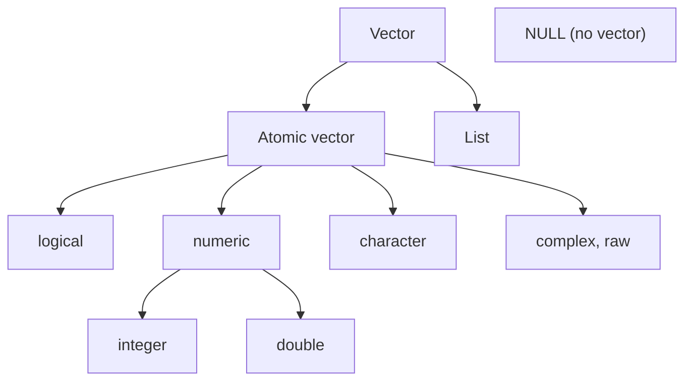
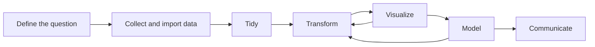

# Chapter 2 — Data Structures in R

[Repository Guide](../../README.md) | [English](Concepts_Lecture.md) | [한국어](Concepts_Lecture.ko.md)

> **Last Updated:** 2026-11-19
>
> 혼자 공부하는 R 데이터 분석, 강전희와 엄동란, Ch 2

> **Learning Objectives:**
> 1. Create and manipulate vectors, lists, and data frames
> 2. Apply indexing and subsetting operations
> 3. Convert between different R data structures
> 4. Predict the results of vector operations from the recycling rule and the order of implicit coercion
> 5. Explain the differences between tibbles and data frames, the levels of factors, and the Date class
> 6. Explain the shape of data (observations, variables, values) and the data analysis process

---

## Table of Contents

- [1. Vectors](#1-vectors)
  - [1.1 Creating Vectors](#11-creating-vectors)
  - [1.2 Vector Properties](#12-vector-properties)
  - [1.3 Vector Operations](#13-vector-operations)
  - [1.4 Types of Atomic Vectors and NULL](#14-types-of-atomic-vectors-and-null)
  - [1.5 Indexing](#15-indexing)
  - [1.6 The Recycling Rule](#16-the-recycling-rule)
  - [1.7 Implicit Coercion](#17-implicit-coercion)
  - [1.8 Sequences and Repetition](#18-sequences-and-repetition)
  - [1.9 Functions for Vectors](#19-functions-for-vectors)
- [2. Matrices](#2-matrices)
  - [2.1 Creating Matrices](#21-creating-matrices)
  - [2.2 Matrix Indexing](#22-matrix-indexing)
  - [2.3 Checking and Converting to Matrix](#23-checking-and-converting-to-matrix)
  - [2.4 Size and Names of a Matrix](#24-size-and-names-of-a-matrix)
  - [2.5 Matrix Operations](#25-matrix-operations)
- [3. Arrays](#3-arrays)
  - [3.1 Creating Arrays](#31-creating-arrays)
  - [3.2 Array vs. Matrix](#32-array-vs-matrix)
  - [3.3 Indexing Arrays](#33-indexing-arrays)
- [4. Lists](#4-lists)
  - [4.1 Creating Lists](#41-creating-lists)
  - [4.2 Named Lists](#42-named-lists)
  - [4.3 Mixed-Type Storage](#43-mixed-type-storage)
  - [4.4 Nested Lists](#44-nested-lists)
  - [4.5 Extracting List Elements](#45-extracting-list-elements)
  - [4.6 Modifying Lists](#46-modifying-lists)
- [5. Data Frames](#5-data-frames)
  - [5.1 Creating Data Frames](#51-creating-data-frames)
  - [5.2 Inspecting Data Frames](#52-inspecting-data-frames)
  - [5.3 Accessing Columns](#53-accessing-columns)
  - [5.4 Alternative: data.frame() Inline Construction](#54-alternative-dataframe-inline-construction)
  - [5.5 The Shape of Data: Observations, Variables, Values](#55-the-shape-of-data-observations-variables-values)
  - [5.6 Selecting Rows by Condition and Adding Columns](#56-selecting-rows-by-condition-and-adding-columns)
  - [5.7 Tibbles and Data Frames](#57-tibbles-and-data-frames)
- [6. Factors](#6-factors)
  - [6.1 The Concept of Factors](#61-the-concept-of-factors)
  - [6.2 Factors vs. Character Vectors](#62-factors-vs-character-vectors)
  - [6.3 Factor Behavior with Arithmetic](#63-factor-behavior-with-arithmetic)
  - [6.4 Case Sensitivity in Factors](#64-case-sensitivity-in-factors)
  - [6.5 Order of Levels and Ordered Factors](#65-order-of-levels-and-ordered-factors)
  - [6.6 Working with Levels](#66-working-with-levels)
  - [6.7 Dividing Numbers into Intervals: cut()](#67-dividing-numbers-into-intervals-cut)
- [7. Type Checking and Conversion](#7-type-checking-and-conversion)
  - [7.1 Checking Types](#71-checking-types)
  - [7.2 Type Conversion Functions](#72-type-conversion-functions)
  - [7.3 Built-in Datasets](#73-built-in-datasets)
  - [7.4 Variable Types and the Results of class()](#74-variable-types-and-the-results-of-class)
  - [7.5 Dates: The Date Class](#75-dates-the-date-class)
  - [7.6 Comparing class(), typeof(), and mode()](#76-comparing-class-typeof-and-mode)
- [8. Comparison of Data Structures](#8-comparison-of-data-structures)
- [9. The Data Analysis Process](#9-the-data-analysis-process)
- [Concept Applications](#concept-applications)
- [Glossary](#glossary)
- [Summary](#summary)
- [Self-Check Questions](#self-check-questions)
- [References](#references)

---

<br>

## 1. Vectors

### 1.1 Creating Vectors

Vectors are the most fundamental data structure in R. They are one-dimensional, ordered collections of elements of the **same type**.

```r
# Create vectors using c() function
ex_vector1 <- c(-1, 0, 1)          # Numeric vector
ex_vector2 <- c("Hello", "Hi~!")   # Character vector
a <- c(1, 2, 9)                    # Numeric vector

# Sequence generation
1:10                               # Integer sequence 1 to 10
seq(1, 9, by = 2)                  # Sequence: 1, 3, 5, 7, 9
```

### 1.2 Vector Properties

```r
mode(ex_vector1)    # "numeric"   - storage mode
mode(ex_vector2)    # "character" - storage mode

str(ex_vector1)     # num [1:3] -1 0 1
str(ex_vector2)     # chr [1:2] "Hello" "Hi~!"

length(ex_vector1)  # 3
length(ex_vector2)  # 2
```

`mode()` gives the storage mode of the values, `str()` shows on one line the type abbreviation (`num`, `chr`, `int`, `logi`), the index range `[1:n]`, and the first values, and `length()` returns the number of elements. Numbers in quotation marks become character values, and a vector made of `TRUE` and `FALSE` is logical.

```r
ex_vector3 <- c("1", "2", "3")
mode(ex_vector3); str(ex_vector3)
#> [1] "character"
#>  chr [1:3] "1" "2" "3"
ex_vector4 <- c(TRUE, FALSE, TRUE, FALSE)
mode(ex_vector4); str(ex_vector4); length(ex_vector4)
#> [1] "logical"
#>  logi [1:4] TRUE FALSE TRUE FALSE
#> [1] 4
ex_vector11 <- c(-1L, 0L, 1L)
mode(ex_vector11); str(ex_vector11)
#> [1] "numeric"
#>  int [1:3] -1 0 1
```

The elements `"1"`, `"2"`, `"3"` of `ex_vector3` look like numbers but are strings, so they are shown as `chr` and cannot be used in arithmetic. `ex_vector11` is a vector of integers created with the suffix `L`. `mode()` reports both integers and doubles as `"numeric"`, but `str()` distinguishes integers as `int` and doubles as `num`.

### 1.3 Vector Operations

```r
a <- c(1, 2, 9)
mean(a)             # 4 (arithmetic mean)

# Vectorized operations
x <- c(1, 2, 3)
x + 2               # 3, 4, 5 (element-wise addition)
x * 3               # 3, 6, 9 (element-wise multiplication)
```

> **Key Point:** R operations on vectors are **vectorized**, so they automatically apply to each element without needing explicit loops.

Vectorization applies not only to arithmetic operators but also to mathematical functions such as `sqrt()`, `round()`, and `log()` and to comparison operators. An operation between two vectors of the same length pairs up the elements at the same positions.

```r
x <- c(1, 4, 9, 16)
sqrt(x)
#> [1] 1 2 3 4
x^2
#> [1]   1  16  81 256
x / sum(x)
#> [1] 0.03333333 0.13333333 0.30000000 0.53333333
round(x / sum(x), 3)
#> [1] 0.033 0.133 0.300 0.533
x > 5
#> [1] FALSE FALSE  TRUE  TRUE
y <- c(2, 2, 3, 4)
x - y
#> [1] -1  2  6 12
x == y * y
#> [1] FALSE  TRUE  TRUE  TRUE
```

`sum(x)` is 1 + 4 + 9 + 16 = 30, so `x / sum(x)` is the proportion obtained by dividing each element by 30, and the proportions sum to 1. Here `sum(x)` is a value of length 1, so by the recycling rule (Section 1.6) the same denominator is used for all four elements. `x - y` is 1 - 2, 4 - 2, 9 - 3, 16 - 4 = -1, 2, 6, 12, and `x == y * y` checks for each element whether $`x_i = y_i^2`$. Distinguishing **summary functions** such as `mean()` and `sum()`, which reduce a whole vector to one value, from **vectorized functions** such as `sqrt()` and `+`, which give one result per element and return a vector of the same length, makes the difference between `summarise()` and `mutate()` in Chapter 5 easy to understand.

### 1.4 Types of Atomic Vectors and NULL

Vectors in R come in two kinds: **atomic vectors**, whose elements all have the same type, and **lists**, whose elements may have different types. Because a list can contain other lists as elements, it is also called a **recursive vector**.

> **Definition:** An **atomic vector** is a one-dimensional vector whose elements all have one of the types logical, integer, double, character, complex, or raw.

Of the six types of atomic vectors, integer and double together are called **numeric**. The raw type is used only for byte data and is rarely used in data analysis. Separately, **NULL** is an object representing the absence of a vector, and it behaves like a vector of length 0.



*Figure 1. Hierarchy of vector types in R*

Every vector has two key properties: its **type**, checked with `typeof()`, and its **length**, checked with `length()`.

```r
typeof(letters)
#> [1] "character"
length(letters)
#> [1] 26
typeof(c(1.5, 2))
#> [1] "double"
typeof(1:3)
#> [1] "integer"
typeof(3 + 2i)
#> [1] "complex"
typeof(as.raw(255))
#> [1] "raw"
x <- list("a", "b", 1:10)
length(x)
#> [1] 3
typeof(NULL); length(NULL)
#> [1] "NULL"
#> [1] 0
```

`letters` is a built-in character vector of the 26 lowercase letters. `list("a", "b", 1:10)` has two strings and one integer vector of length 10 as elements, so although it contains 12 values, the length of the list is its number of elements, 3. A list is the only structure that can bundle such different data into one (Section 4.3).

### 1.5 Indexing

Extracting some elements from a vector is called **indexing**, and one of positions, logical values, or names is put inside the brackets `[ ]`. Position indices in R start at 1.

```r
v <- c(10, 20, 30, 40, 50)
v[2]
#> [1] 20
v[c(1, 3)]
#> [1] 10 30
v[-1]
#> [1] 20 30 40 50
v[-c(1, 2)]
#> [1] 30 40 50
v[v > 25]
#> [1] 30 40 50
v[6]
#> [1] NA
v[0]
#> numeric(0)
names(v) <- c("a", "b", "c", "d", "e")
v["c"]
#>  c 
#> 30
v[c("e", "a")]
#>  e  a 
#> 50 10
```

| Kind of Index | Example | Result |
|:--|:--|:--|
| Positive integers | `v[c(1, 3)]` | Extracts the elements at those positions in that order |
| Negative integers | `v[-1]` | Extracts the remaining elements without those positions |
| Logical vector | `v[v > 25]` | Extracts only the elements at `TRUE` positions |
| Strings | `v["c"]` | Extracts the elements with matching names |
| Position out of range | `v[6]` | Returns `NA` |
| 0 | `v[0]` | Returns a vector of length 0 |

*Table 1. Kinds of vector indexing*

`v[v > 25]` is computed in two steps. First, `v > 25` compares each element and creates the logical vector `FALSE FALSE TRUE TRUE TRUE`; using this logical vector as the index keeps only the third, fourth, and fifth elements, 30, 40, and 50, which are `TRUE`. This way of selecting elements by a condition is the same principle by which `filter()` in Chapter 5 selects rows. Positive and negative integers cannot be mixed in one index.

### 1.6 The Recycling Rule

When an element-wise operation is applied to two vectors of different lengths, R repeats the shorter vector from the beginning to match the length of the longer one. This is called **recycling**.

> **Definition:** The **recycling rule** is the rule that, in an element-wise operation on vectors of different lengths, the shorter vector is repeated from the beginning to match the length of the longer vector.

```r
c(1, 2, 3, 4) + c(10, 20)
#> [1] 11 22 13 24
1:5 + 1:2
#> Warning in 1:5 + 1:2: longer object length is not a multiple of shorter object
#> length
#> [1] 2 4 4 6 6
c(1, 2, 3) * 2
#> [1] 2 4 6
```

In the first expression, `c(10, 20)` is extended to `c(10, 20, 10, 20)`, so the result is 1 + 10, 2 + 20, 3 + 10, 4 + 20 = 11, 22, 13, 24. In the second, lengths 5 and 2 are not multiples, so `1:2` is extended to 1, 2, 1, 2, 1 and a warning follows. The result 2, 4, 4, 6, 6 is computed, but mismatched lengths are usually a sign of a mistake, so the warning must be checked. The `* 2` in the third expression is also a case of recycling, in which the vector 2 of length 1 is extended to length 3. The arithmetic of Section 1.3 applies to a whole vector at once thanks to this rule.

### 1.7 Implicit Coercion

An atomic vector can hold elements of only one type, so when values of different types are put into `c()`, R automatically converts all elements to one type that can represent them all. This is called **implicit coercion**. Conversion always goes toward the type further to the right in the following order.

```text
logical  →  integer  →  double  →  character
 (TRUE)      (1L)        (1.5)       ("a")
```

*Figure 2. Order of implicit coercion*

```r
c(1, "a", TRUE)
#> [1] "1"    "a"    "TRUE"
c(1, TRUE, FALSE)
#> [1] 1 1 0
c(1L, 2.5)
#> [1] 1.0 2.5
typeof(c(1L, 2.5))
#> [1] "double"
sum(c(TRUE, FALSE, TRUE, TRUE))
#> [1] 3
mean(c(TRUE, FALSE, TRUE, TRUE))
#> [1] 0.75
```

`c(1, "a", TRUE)` contains a string, so every element becomes a character value: 1 becomes `"1"` and `TRUE` becomes `"TRUE"`. `c(1, TRUE, FALSE)` contains no string but a double, so the logical values turn into numbers, `TRUE` into 1 and `FALSE` into 0. Because of this, `sum()` of a logical vector is the number of `TRUE` values, 3, and `mean()` is the proportion of `TRUE`, 3 / 4 = 0.75. The idioms `sum(x > threshold)` and `mean(x > threshold)` for the count and proportion of elements satisfying a condition come from this.

Changing a type directly is **explicit coercion**, done with the `as.*()` functions (Section 7.2). A value that cannot be converted becomes `NA` with a warning.

```r
as.numeric("3.14")
#> [1] 3.14
as.numeric("abc")
#> Warning: NAs introduced by coercion
#> [1] NA
as.logical(c("TRUE", "T", "yes", "false"))
#> [1]  TRUE  TRUE    NA FALSE
as.integer(3.9)
#> [1] 3
as.character(1:3)
#> [1] "1" "2" "3"
```

`as.logical()` recognizes only fixed spellings such as `"TRUE"`, `"T"`, `"true"`, and `"False"` as logical values, so `"yes"` becomes `NA`. `as.integer(3.9)` does not round but drops the fractional part, giving 3. When rounding is needed, use `round()` first.

> **Caution:** If even one string such as `"N/A"` or `"-"` is mixed into a column of numbers, the whole column becomes character. `mean()` then returns `NA` with a warning, so the column types of imported data must first be checked with `str()` (Section 6 of Chapter 4).

### 1.8 Sequences and Repetition

Regular vectors are created with `seq()` and `rep()`.

```r
seq(0, 1, by = 0.25)
#> [1] 0.00 0.25 0.50 0.75 1.00
seq(0, 100, length.out = 5)
#> [1]   0  25  50  75 100
seq_len(4)
#> [1] 1 2 3 4
rep(c("A", "B"), times = 3)
#> [1] "A" "B" "A" "B" "A" "B"
rep(c("A", "B"), each = 3)
#> [1] "A" "A" "A" "B" "B" "B"
rep(1:2, times = c(3, 1))
#> [1] 1 1 1 2
```

`seq(from, to, by)` creates a sequence with step `by`, and `seq(from, to, length.out)` creates one with `length.out` elements. With `length.out = 5`, the range from 0 to 100 is divided into four intervals, so the step is (100 - 0) / (5 - 1) = 25. `seq_len(n)` gives the integers from 1 to n and returns an empty vector when n is 0, so it is safer than `1:n` in loops (Section 8 of Chapter 3). In `rep()`, `times` repeats the whole vector and `each` repeats each element, and giving a vector to `times` sets the number of repetitions per element.

### 1.9 Functions for Vectors

The following functions are often used to sort and search the elements of a vector.

```r
w <- c(3, 1, 4, 1, 5, 9, 2, 6)
sort(w)
#> [1] 1 1 2 3 4 5 6 9
sort(w, decreasing = TRUE)
#> [1] 9 6 5 4 3 2 1 1
order(w)
#> [1] 2 4 7 1 3 5 8 6
rev(w)
#> [1] 6 2 9 5 1 4 1 3
which(w > 3)
#> [1] 3 5 6 8
which.max(w)
#> [1] 6
unique(w)
#> [1] 3 1 4 5 9 2 6
cumsum(w)
#> [1]  3  4  8  9 14 23 25 31
4 %in% w
#> [1] TRUE
c(2, 7) %in% w
#> [1]  TRUE FALSE
```

`sort()` returns the sorted values, but `order()` returns the **positions** in sorted order. The first value 2 of `order(w)` means that the smallest value (1) is the 2nd element, and the last value 6 means that the largest value 9 is the 6th element. Therefore `w[order(w)]` equals `sort(w)`, and the rows of a data frame are sorted by a column as in `df[order(df$column), ]`. `which()` returns the positions where a condition is `TRUE`, and `which.max()` returns the position of the maximum. `unique()` removes duplicates in order of first appearance, and `cumsum()` computes cumulative sums. `%in%` returns logical values telling whether each element on the left is contained in the vector on the right.

---

<br>

## 2. Matrices

### 2.1 Creating Matrices

Matrices are two-dimensional data structures where all elements must be of the same type.

```r
x <- c(1, 2, 3, 4, 5, 6)

# Default: fills by column (column-major order)
matrix(x, nrow = 2, ncol = 3)
#      [,1] [,2] [,3]
# [1,]    1    3    5
# [2,]    2    4    6

# Fill by row
matrix(x, nrow = 2, ncol = 3, byrow = TRUE)
#      [,1] [,2] [,3]
# [1,]    1    2    3
# [2,]    4    5    6
```

### 2.2 Matrix Indexing

```r
a <- matrix(c(1,2,3,4,5,6), nrow = 2, ncol = 3)
a[1, 2]     # Element at row 1, column 2 -> 3
a[1, ]      # Entire first row
a[, 2]      # Entire second column
```

A matrix index has two positions, `[row, column]`, and leaving one empty means that whole direction. `a` is a 2 × 3 matrix whose first column is 1, 2, second column 3, 4, and third column 5, 6, so `a[1, ]` is 1, 3, 5 and `a[, 2]` is 3, 4. Selecting a single row or column turns the result into a vector rather than a matrix. To keep the matrix shape, give `drop = FALSE`, as in `a[1, , drop = FALSE]`. Each position accepts the negative integers, logical vectors, and names of Section 1.5, so `a[, -1]` is the 2 × 2 matrix without the first column.

### 2.3 Checking and Converting to Matrix

```r
a1 <- 1:10
is.matrix(a1)              # FALSE (it is a vector)

a2 <- as.matrix(1:10)
is.matrix(a2)              # TRUE

is.matrix(as.matrix(1:10)) # TRUE
```

By default, R fills matrices column by column (column-major order). Use `byrow = TRUE` to fill row by row.

> **[Computer Programming]** Two-dimensional arrays in C and C++ are stored in memory in row-major order, so the elements of the same row lie next to each other. An R matrix is a vector of elements with a dimension (`dim`) attribute, and that vector is stored in column-major order, so the elements of the same column lie next to each other. `matrix()` fills by column by default because it follows this storage order. In addition, C indices start at 0 while R indices start at 1, so the element written `a[0][1]` in C is `a[1, 2]` in R.

### 2.4 Size and Names of a Matrix

In `matrix(vector, nrow = number of rows, ncol = number of columns)`, giving only one of the two numbers is enough, because the other is determined by the number of elements. Placing the same six elements in 3 rows and 2 columns makes the first column 1, 2, 3 and the second column 4, 5, 6 in column-major order.

```r
x <- c(1, 2, 3, 4, 5, 6)
matrix(x, nrow = 3, ncol = 2)
#>      [,1] [,2]
#> [1,]    1    4
#> [2,]    2    5
#> [3,]    3    6
m <- matrix(1:6, nrow = 2)
dim(m)
#> [1] 2 3
rownames(m) <- c("r1", "r2")
colnames(m) <- c("A", "B", "C")
m
#>    A B C
#> r1 1 3 5
#> r2 2 4 6
m["r2", "B"]
#> [1] 4
t(m)
#>   r1 r2
#> A  1  2
#> B  3  4
#> C  5  6
```

`dim()` returns (number of rows, number of columns), which can also be obtained separately with `nrow()` and `ncol()`. Naming the rows and columns with `rownames()` and `colnames()` allows elements to be extracted by name, as in `m["r2", "B"]`. Marks such as `[1,]` and `[,1]` in the output are indices that R shows in place of names when there are none. `t()` returns the **transpose**, with rows and columns exchanged, so the 2 × 3 matrix becomes 3 × 2 and the row and column names are swapped as well.

### 2.5 Matrix Operations

`*` between matrices is element-wise multiplication of elements at the same positions, and the matrix product of linear algebra is computed with `%*%`.

```r
A <- matrix(1:4, nrow = 2)
B <- matrix(c(2, 0, 1, 3), nrow = 2)
A
#>      [,1] [,2]
#> [1,]    1    3
#> [2,]    2    4
B
#>      [,1] [,2]
#> [1,]    2    1
#> [2,]    0    3
A * B
#>      [,1] [,2]
#> [1,]    2    3
#> [2,]    0   12
A %*% B
#>      [,1] [,2]
#> [1,]    2   10
#> [2,]    4   14
```

In `A * B`, the element in row 1, column 2 is 3 × 1 = 3 and the element in row 2, column 2 is 4 × 3 = 12. The (i, j) element of `A %*% B` is the inner product of row i of A and column j of B, so row 1, column 1 is 1 × 2 + 3 × 0 = 2, row 1, column 2 is 1 × 1 + 3 × 3 = 10, row 2, column 1 is 2 × 2 + 4 × 0 = 4, and row 2, column 2 is 2 × 1 + 4 × 3 = 14. A matrix product is defined only when the number of columns of the first matrix equals the number of rows of the second; otherwise the error `non-conformable arguments` occurs.

> **[Linear Algebra]** The $`(i, j)`$ element of the matrix product $`AB`$ is $`\sum_k a_{ik} b_{kj}`$, and in general $`AB \ne BA`$. This operation and the transpose `t()` are used when the least-squares solution of multiple regression in Chapter 10 is written in matrix form.

To attach rows or columns to a matrix, use `rbind()` (row bind) and `cbind()` (column bind).

```r
cbind(A, 9)
#>      [,1] [,2] [,3]
#> [1,]    1    3    9
#> [2,]    2    4    9
rbind(A, c(7, 8))
#>      [,1] [,2]
#> [1,]    1    3
#> [2,]    2    4
#> [3,]    7    8
matrix(c(1, "a", 2, "b"), nrow = 2)
#>      [,1] [,2]
#> [1,] "1"  "2" 
#> [2,] "a"  "b"
```

In `cbind(A, 9)`, the 9 is recycled into a column of length 2. A matrix is an atomic vector with dimensions, so its elements have only one type. Therefore a matrix built from a mix of numbers and strings turns every element into a character value by the rule of Section 1.7. When a table with a different type in each column is needed, a data frame (Section 5), not a matrix, must be used.

---

<br>

## 3. Arrays

### 3.1 Creating Arrays

Arrays generalize matrices to any number of dimensions, and a two-dimensional array is a matrix.

```r
y <- c(1, 2, 3, 4, 5, 6)

# Create a 3D array: 2 rows x 2 cols x 3 layers
array(y, dim = c(2, 2, 3))
```

The `dim` argument specifies the dimensions.
- The first value is the number of rows.
- The second value is the number of columns.
- The third value is the number of layers (depth).

The array above has 2 × 2 × 3 = 12 cells, but `y` has only 6 elements, so R reuses `y` from the beginning to fill the remaining cells. This is called **recycling**. Each layer is filled in column-major order, like a matrix.

```text
          Layer 1        Layer 2        Layer 3
         col1 col2      col1 col2      col1 col2
        ┌────┬────┐    ┌────┬────┐    ┌────┬────┐
 row 1  │  1 │  3 │    │  5 │  1 │    │  3 │  5 │
        ├────┼────┤    ├────┼────┤    ├────┼────┤
 row 2  │  2 │  4 │    │  6 │  2 │    │  4 │  6 │
        └────┴────┘    └────┴────┘    └────┴────┘
```

*Figure 3. Three layers of a 2 × 2 × 3 array filled by recycling six elements*

### 3.2 Array vs. Matrix

```r
# Arrays are multi-dimensional; matrices are 2D arrays
is.array(matrix(1:6, 2, 3))  # TRUE (matrices are 2D arrays)
is.matrix(array(1:6, c(2,3))) # TRUE (2D arrays are matrices)
```

### 3.3 Indexing Arrays

An element of an array is extracted with as many indices as there are dimensions. The following array fills 1 to 20 into two layers of 2 rows and 5 columns.

```r
x3 <- array(1:20, dim = c(2, 5, 2))
x3
#> , , 1
#> 
#>      [,1] [,2] [,3] [,4] [,5]
#> [1,]    1    3    5    7    9
#> [2,]    2    4    6    8   10
#> 
#> , , 2
#> 
#>      [,1] [,2] [,3] [,4] [,5]
#> [1,]   11   13   15   17   19
#> [2,]   12   14   16   18   20
x3[2, 4, 2]
#> [1] 18
dim(x3)
#> [1] 2 5 2
x3[, , 1]
#>      [,1] [,2] [,3] [,4] [,5]
#> [1,]    1    3    5    7    9
#> [2,]    2    4    6    8   10
```

The `, , 1` and `, , 2` in the output mean the layers whose third index is 1 and 2. One layer holds 2 × 5 = 10 elements, so layer 1 is 1-10 and layer 2 is 11-20. `x3[2, 4, 2]` is row 2, column 4 of layer 2; counting in column-major order within layer 2, it is cell (4 - 1) × 2 + 2 = 8, so its value is 10 + 8 = 18. Leaving an index position empty means that whole dimension, so `x3[, , 1]` returns the whole first layer as a matrix.

---

<br>

## 4. Lists

### 4.1 Creating Lists

Lists are the most flexible data structure in R. Unlike vectors and matrices, lists can contain elements of **different types and different sizes**.

```r
list1 <- list(c(1, 2, 3), "Hello")
list1
# [[1]]
# [1] 1 2 3
#
# [[2]]
# [1] "Hello"

str(list1)
# List of 2
#  $ : num [1:3] 1 2 3
#  $ : chr "Hello"
```

### 4.2 Named Lists

`cars` is a data frame built into R (Section 7.3), and `cars[,1]` and `cars[,2]` are its speed (`speed`) and stopping distance (`dist`) columns.

```r
pts <- list(x = cars[,1], y = cars[,2])
is.list(pts)    # TRUE
is.matrix(pts)  # FALSE
is.array(pts)   # FALSE
```

### 4.3 Mixed-Type Storage

```r
# Only lists can bundle data of different types and lengths
x <- list("a", "b", 1:10)
length(x)  # 3 (three elements in the list)
```

> **Key Point:** Lists are the **only** data structure in R that can hold elements of different types and different lengths. This makes them essential for storing complex, heterogeneous data.

### 4.4 Nested Lists

```r
x1 <- data.frame(var1 = c(1, 2, 3), var2 = c("a", "b", "c"))
x2 <- matrix(1:12, ncol = 2)
x3 <- array(1:20, dim = c(2, 5, 2))

x4 <- list(f1 = x1, f2 = x1, f3 = x2, f4 = x3)
class(x4)   # "list"
x4$f1       # Access the first element by name
```

`x4` is a list whose elements are two data frames, a matrix, and an array. An element of a list can be any object, so different structures can be bundled together like this, and `class(x4)` is `"list"` regardless of the kinds of elements. An extracted element takes the index of its own structure. `x4$f3[2, ]` is the second row of the matrix `x2`, 2 and 8, and `x4$f4[1, 1, 2]` is row 1, column 1 of layer 2 of the array `x3`, which is 11. Results of statistical functions (for example, the regression model objects of Chapter 10) are also often lists that hold several components by name in this way.

### 4.5 Extracting List Elements

There are three ways to extract elements from a list, and the form of the result differs.

```r
x4 <- list(f1 = 1, f2 = c("a", "b"), f3 = matrix(1:4, ncol = 2))
str(x4)
#> List of 3
#>  $ f1: num 1
#>  $ f2: chr [1:2] "a" "b"
#>  $ f3: int [1:2, 1:2] 1 2 3 4
x4["f2"]
#> $f2
#> [1] "a" "b"
class(x4["f2"])
#> [1] "list"
x4[["f2"]]
#> [1] "a" "b"
class(x4[["f2"]])
#> [1] "character"
x4$f2[2]
#> [1] "b"
```

Single brackets `[ ]` return part of a list **as a list**. So the result of `x4["f2"]` is a list with one element, and `$f2` appears before the output. Double brackets `[[ ]]` **pull out** one element from the list and return the element itself, so `x4[["f2"]]` is a character vector. `$` is a shorthand for giving a name to `[[ ]]`. To access an element of an element, attach another index to the extracted result, as in `x4$f2[2]`. Thinking of a box that holds several boxes, `[ ]` returns the outer box with only some of the inner boxes left, and `[[ ]]` returns one inner box taken out.

| Notation | What It Returns | Result for `x4` |
|:--|:--|:--|
| `x4["f2"]`, `x4[2]` | A list holding the element | A list of length 1 |
| `x4[["f2"]]`, `x4[[2]]` | The element itself | The character vector `"a" "b"` |
| `x4$f2` | The element itself (same as `[[ ]]`) | The character vector `"a" "b"` |

*Table 2. Three notations for extracting list elements*

### 4.6 Modifying Lists

Assigning a value to a new name adds an element to a list, and assigning `NULL` to an existing element removes it. `unlist()` flattens all elements of a list into one atomic vector.

```r
x4$f4 <- TRUE
names(x4)
#> [1] "f1" "f2" "f3" "f4"
x4$f1 <- NULL
names(x4)
#> [1] "f2" "f3" "f4"
unlist(list(a = 1, b = 2:3))
#>  a b1 b2 
#>  1  2  3
```

`NULL` is an object of length 0, so making a list element `NULL` removes its place. To empty the value without removing the element, assign `list(NULL)` or put `NA` in it. `unlist()` creates new names such as `b1` and `b2` from the names of the elements, and if the elements have different types it converts them to one type by the order of Section 1.7. This function is often used to turn the list returned by `lapply()` in Section 9 of Chapter 3 into a vector.

---

<br>

## 5. Data Frames

### 5.1 Creating Data Frames

Data frames are the primary structure for tabular data in R. They are essentially lists of vectors of equal length, where each column can have a different type.

```r
ID <- c(1, 2, 3, 4, 5)
GENDER <- c("F", "M", "F", "M", "M")
AGE <- c(50, 40, 28, 50, 27)
AREA <- c("Seoul", "Gyeonggi", "Jeju", "Seoul", "Seoul")

dataframe_ex <- data.frame(ID, GENDER, AGE, AREA)
```

Category values entered in Korean may be garbled depending on the operating system and encoding, so it is safer to enter values in English, such as `"Seoul"` and `"F"` (Section 2.5 of Chapter 4).

### 5.2 Inspecting Data Frames

```r
dataframe_ex            # Print the data frame
str(dataframe_ex)       # Structure: types, dimensions
View(dataframe_ex)      # Open in spreadsheet viewer
nrow(dataframe_ex)      # Number of rows
ncol(dataframe_ex)      # Number of columns
```

Printing `dataframe_ex` gives a table of 5 rows and 4 columns, as in the example of Section 2 of Chapter 1, and `nrow()` and `ncol()` return 5 and 4. In the result of `str()`, `'data.frame':	5 obs. of  4 variables:`, obs. means observations (rows) and variables means variables (columns), and each line below shows a column name, its type (`num`, `chr`), and the first values. `View()` shows the table like a spreadsheet in RStudio, so it is not used when a script runs outside RStudio.

### 5.3 Accessing Columns

```r
# Using $ operator
dataframe_ex$AGE        # Returns the AGE column as a vector
mean(dataframe_ex$AGE)  # Calculate mean of AGE column

# Using bracket notation
dataframe_ex[, 3]       # Third column (AGE)
dataframe_ex[1, ]       # First row
dataframe_ex[2, 3]      # Element at row 2, column 3
```

### 5.4 Alternative: data.frame() Inline Construction

```r
x1 <- data.frame(
  var1 = c(1, 2, 3),
  var2 = c("a", "b", "c")
)
class(x1)  # "data.frame"
```

Data frames are the workhorse of data analysis in R. Each column is a variable and each row is an observation, which matches the standard tidy data format.

### 5.5 The Shape of Data: Observations, Variables, Values

Most data has the n × p form made of rows and columns, where n is the number of rows and p the number of columns.

- **Rows:** Observations. Each corresponds to one measured unit, such as one person, one region, or one point in time.
- **Columns:** Variables. Each corresponds to one characteristic measured for every observation, such as age, sex, or region.
- **Value:** The result of measuring one variable for one observation, stored in the one cell where a row and a column meet.

Every column of a data frame must have a variable name, and this structure is very similar to a spreadsheet table. `dataframe_ex` in Section 5.1 is data with n = 5 and p = 4, and the 40 in the `AGE` column of the second row is one value, the age of person 2.

```text
              Variables (columns)
              ┌────┬────────┬─────┬──────────┐
              │ ID │ GENDER │ AGE │ AREA     │
              ├────┼────────┼─────┼──────────┤
Observation → │  1 │ F      │  50 │ Seoul    │
(row)         │  2 │ M      │  40 │ Gyeonggi │ ← value 40: AGE of observation 2
              │  3 │ F      │  28 │ Jeju     │
              └────┴────────┴─────┴──────────┘
```

*Figure 4. Observations, variables, and values of a data frame*

Data in which each variable forms a column, each observation forms a row, and each type of observational unit forms a table is called **tidy data** [1]. The same information can take many table shapes. For example, putting the population of each year in its own column, such as `2020` and `2021`, scatters the variable "year" across the column names, so the table is not tidy. Most functions for data transformation and visualization in R assume tidy data as input, and Section 3 of Chapter 5 shows how to turn untidy tables into tidy data.

### 5.6 Selecting Rows by Condition and Adding Columns

Each position of the bracket index `df[row, column]` of a data frame accepts every kind of index in Section 1.5. In particular, putting a condition in the row position keeps only the rows that satisfy it.

```r
dataframe_ex[dataframe_ex$AGE >= 40, ]
#>   ID GENDER AGE     AREA
#> 1  1      F  50    Seoul
#> 2  2      M  40 Gyeonggi
#> 4  4      M  50    Seoul
dataframe_ex[dataframe_ex$AREA == "Seoul", c("ID", "AGE")]
#>   ID AGE
#> 1  1  50
#> 4  4  50
#> 5  5  27
dataframe_ex$AGE_GROUP <- ifelse(dataframe_ex$AGE >= 40, "40+", "under40")
dataframe_ex
#>   ID GENDER AGE     AREA AGE_GROUP
#> 1  1      F  50    Seoul       40+
#> 2  2      M  40 Gyeonggi       40+
#> 3  3      F  28     Jeju   under40
#> 4  4      M  50    Seoul       40+
#> 5  5      M  27    Seoul   under40
subset(dataframe_ex, AGE < 30, select = c(ID, AREA))
#>   ID  AREA
#> 3  3  Jeju
#> 5  5 Seoul
```

In the first expression, `dataframe_ex$AGE >= 40` is `TRUE TRUE FALSE TRUE FALSE`, so rows 1, 2, and 4 remain, and because the column position is empty, all columns remain. Leaving out the comma, as in `dataframe_ex[dataframe_ex$AGE >= 40]`, makes R try to select columns rather than rows, which gives an unintended result. The second expression selects only the `ID` and `AGE` columns of the rows of people living in Seoul. Assigning a value with `$` to a column name that does not exist adds a new column, as in the third expression. `ifelse(condition, value if true, value if false)` is a vectorized function that checks the condition for each element (Section 7 of Chapter 3). `subset()` lets the same task be written with column names alone, and `filter()` and `select()` in Chapter 5 provide this task in a more consistent form. The row names 1, 2, 4 in the output keep the numbers of the original rows.

### 5.7 Tibbles and Data Frames

A **tibble** is the data frame used by the tidyverse packages, and it changes the parts of the traditional data frame's behavior that easily lead to mistakes. A tibble also has the `data.frame` class, so it can be passed unchanged to functions that take data frames. An existing data frame is converted to a tibble with `as_tibble()`.

```r
library(tibble)
iris_tibble <- as_tibble(iris)
iris_tibble
#> # A tibble: 150 × 5
#>    Sepal.Length Sepal.Width Petal.Length Petal.Width Species
#>           <dbl>       <dbl>        <dbl>       <dbl> <fct>  
#>  1          5.1         3.5          1.4         0.2 setosa 
#>  2          4.9         3            1.4         0.2 setosa 
#>  3          4.7         3.2          1.3         0.2 setosa 
#>  4          4.6         3.1          1.5         0.2 setosa 
#>  5          5           3.6          1.4         0.2 setosa 
#>  6          5.4         3.9          1.7         0.4 setosa 
#>  7          4.6         3.4          1.4         0.3 setosa 
#>  8          5           3.4          1.5         0.2 setosa 
#>  9          4.4         2.9          1.4         0.2 setosa 
#> 10          4.9         3.1          1.5         0.1 setosa 
#> # ℹ 140 more rows
```

`iris` is built-in data measuring the length and width of the sepals and petals of 150 iris flowers across three species (`Species`). Printing the data frame `iris` as is pours all 150 rows onto the screen, but a tibble states its size, `150 × 5`, on the first line, shows only the first 10 rows, and then reports the number of remaining rows. Under the column names, `<dbl>` means double and `<fct>` means factor; integers are shown as `<int>`, characters as `<chr>`, and logicals as `<lgl>`. When there are more columns than fit the screen width, only the names of the columns that do not fit are listed below.

```r
df <- data.frame(abc = 1:2, xyz = c("a", "b"))
df$x
#> [1] "a" "b"
tb <- tibble(abc = 1:2, xyz = c("a", "b"))
tb$x
#> Warning: Unknown or uninitialised column: `x`.
#> NULL
class(df[, 1])
#> [1] "integer"
class(tb[, 1])
#> [1] "tbl_df"     "tbl"        "data.frame"
tb[[1]]
#> [1] 1 2
```

A data frame finds the column `xyz` even when only the beginning of the name is written, as in `df$x`. This looks convenient, but it lets a typo silently point to another column. A tibble does not do such partial matching and returns `NULL` with a warning. Also, selecting one column of a data frame with `df[, 1]` turns the result into a vector, but `[ ]` on a tibble always returns a tibble. To pull one column out of a tibble as a vector, use `tb[[1]]` or `tb$abc`.

A tibble can be created directly with `tibble()`, and `tribble()` lets a table be written row by row so that it is easy to read.

```r
tibble(x = 1:3, y = x * 2)
#> # A tibble: 3 × 2
#>       x     y
#>   <int> <dbl>
#> 1     1     2
#> 2     2     4
#> 3     3     6
tribble(
  ~name, ~score,
  "Kim", 90,
  "Lee", 85
)
#> # A tibble: 2 × 2
#>   name  score
#>   <chr> <dbl>
#> 1 Kim      90
#> 2 Lee      85
tibble(`my col` = 1:2)
#> # A tibble: 2 × 1
#>   `my col`
#>      <int>
#> 1        1
#> 2        2
```

`tibble()` can use a column created earlier in a later column, so `y = x * 2` works. `tribble()` writes the column names on the first line, each starting with `~`, and then the values in row order. A name that does not follow R's variable naming rules (Section 3 of Chapter 1), such as a name containing a space, can be used as a column name by enclosing it in backticks (`` ` ``).

| Item | Data Frame (`data.frame`) | Tibble (`tibble`) |
|:--|:--|:--|
| Printing | Prints all rows | Prints the size, column types, and first 10 rows |
| Partial matching with `$` | Finds a column from the beginning of its name | Does not, and gives a warning |
| Selecting one column with `[ , 1]` | Becomes a vector | Stays a tibble |
| String columns | Converted to factors by default before R 4.0.0 | Not converted |
| Nonsyntactic column names | Fixed, as in `my.col` | Kept as is with backticks |
| Row names | Can have them | Not used |

*Table 3. Differences between data frames and tibbles*

As for string columns in Table 3, the default of the `stringsAsFactors` argument of `data.frame()` and `read.csv()` became `FALSE` from R 4.0.0 [2]. Data frames in recent versions of R therefore do not turn strings into factors either, but the difference is worth knowing when reading older code.

---

<br>

## 6. Factors

### 6.1 The Concept of Factors

Factors represent categorical (qualitative) data with a fixed set of possible values called **levels**.

```r
blood.type <- factor(
  c("A", "B", "AB", "O", "O"),
  levels = c("A", "B", "AB", "O")
)
class(blood.type)  # "factor"
str(blood.type)    # Factor w/ 4 levels "A","B","AB","O": 1 2 3 4 4
table(blood.type)  # Frequency table
# A  B AB  O
# 1  1  1  2
```

The result of `str(blood.type)`, `Factor w/ 4 levels "A","B","AB","O": 1 2 3 4 4`, shows that this factor has four levels and that its five values are stored internally as the integer codes 1, 2, 3, 4, 4. Code 1 corresponds to the first level A and 4 to the fourth level O, so the last two values are O. `table()` counts how many times each level's code appears to build the frequency table, and the columns follow the order given in `levels`.

### 6.2 Factors vs. Character Vectors

```r
blood2 <- c("A", "B", "AB", "O", "O")
class(blood2)   # "character"
table(blood2)   # Also creates frequency table, but no fixed levels
```

In many cases there is no need to state that a structure is a factor. When a function meant for factors, such as `table()`, is applied to a string vector that was not declared a factor, R converts the vector to a factor internally. The levels are then set in alphabetical order, so the columns of `table(blood2)` above are in the order A, AB, B, O. Use `factor()` explicitly when the order of levels must be set directly or when categories that were not observed must appear with frequency 0 (Section 6.6).

### 6.3 Factor Behavior with Arithmetic

```r
var1 <- c(1, 2, 3, 1, 2)
var2 <- factor(c(1, 2, 3, 1, 2))

var1 + 2    # Works: 3, 4, 5, 3, 4
var2 + 2    # Warning! Factors are NOT numeric

mean(var1)  # 1.8
mean(var2)  # NA with warning

# Convert factor to numeric
var2_num <- as.numeric(var2)
mean(var2_num)   # Gives mean of internal codes (1, 2, 3, 1, 2)
```

`var2 + 2` returns `NA NA NA NA NA` with the warning `'+' not meaningful for factors`, and `mean(var2)` returns `NA` with the warning `argument is not numeric or logical: returning NA`. The difference between the two variables can also be seen with `levels()`.

```r
levels(var1)
#> NULL
levels(var2)
#> [1] "1" "2" "3"
```

The numeric vector `var1` has no levels, so the result is `NULL`, while the levels of the factor `var2` are the strings `"1"`, `"2"`, `"3"`. The levels of a factor are always strings, even when it was made from numbers, which connects to the conversion rule at the end of Section 6.4.

### 6.4 Case Sensitivity in Factors

```r
blood <- factor(
  c("A", "a", "B", "AB", "o", "O"),
  levels = c("A", "B", "AB", "O")
)
table(blood)
# A  B AB  O
# 1  1  1  1
# Note: "a" and "o" are excluded because they do not match any level
```

Values that are not in the list of levels become `NA`, and `table()` does not count `NA` by default, so they are left out of the frequency table.

> **Key Point:** Factors store data internally as integer codes with associated level labels. They cannot be used in arithmetic operations directly, so they must first be converted to numeric. Here `as.numeric()` returns the internal integer codes rather than the level labels, so use `as.numeric(as.character(x))` when the numbers that the labels represent are needed. In the example of Section 6.3, the levels are 1, 2, and 3, so the two results coincide.

### 6.5 Order of Levels and Ordered Factors

When `levels` is not given, the levels are the values sorted alphabetically. When the categories have a natural order, such as sizes, set the order directly with `levels`, and when sizes must be compared between categories, create an **ordered factor** with `ordered = TRUE`.

```r
size <- factor(c("small", "large", "medium", "small"))
levels(size)
#> [1] "large"  "medium" "small"
size2 <- factor(c("small", "large", "medium", "small"),
                levels = c("small", "medium", "large"))
levels(size2)
#> [1] "small"  "medium" "large"
as.integer(size2)
#> [1] 1 3 2 1
size3 <- factor(c("small", "large", "medium", "small"),
                levels = c("small", "medium", "large"), ordered = TRUE)
size3
#> [1] small  large  medium small 
#> Levels: small < medium < large
size3 < "large"
#> [1]  TRUE FALSE  TRUE  TRUE
```

The levels of `size` are in alphabetical order, large, medium, small, which does not match the meaning of size. `size2` sets the levels in the order small, medium, large, so the internal codes become small = 1, medium = 2, large = 3, and `as.integer(size2)` is 1, 3, 2, 1. The order of levels determines the column order of frequency tables, the order of axes and legends in graphs (Chapter 6), and the reference category of regression analysis (Chapter 10). The ordered factor `size3` shows `<` in the `Levels:` line of its output and allows comparison operations such as `<`. Computing `size2 < "large"` on an ordinary factor without order gives `NA` with a warning.

> **Definition:** An **ordered factor** is a factor whose levels have a defined order of greater and smaller, so that comparison operations can be applied.

### 6.6 Working with Levels

The following functions check and change the levels of a factor.

```r
var4 <- factor(c("a", "b", "b", "c"))
var4
#> [1] a b b c
#> Levels: a b c
nlevels(var4)
#> [1] 3
f <- factor(c("a", "b", "a"), levels = c("a", "b", "z"))
table(f)
#> f
#> a b z 
#> 2 1 0
droplevels(f)
#> [1] a b a
#> Levels: a b
relevel(factor(c("x", "y", "z")), ref = "z")
#> [1] x y z
#> Levels: z x y
levels(var4) <- c("A", "B", "C")
var4
#> [1] A B B C
#> Levels: A B C
table(factor(c("A", NA, "B", "A")), useNA = "ifany")
#> 
#>    A    B <NA> 
#>    2    1    1
```

When the factor `var4`, made of letters, is printed, its values have no quotation marks and a `Levels:` line appears below, which distinguishes it from a character vector. `nlevels()` is the number of levels. When there is an unobserved level such as `z` in `f`, `table()` shows that level with frequency 0. This is useful when categories without responses, like survey options, must appear in the table, but if empty categories left in a graph are unwanted, `droplevels()` removes unused levels. `relevel()` moves the given level to the first position (the reference category). `levels(x) <- new names` renames the levels in order, so the number and order of the new names must match the existing levels. `table()` does not count `NA` by default, and giving `useNA = "ifany"` also shows the number of `NA` values.

### 6.7 Dividing Numbers into Intervals: cut()

When continuous numbers such as age or income must be grouped into categories, use `cut()`. The result is a factor whose levels are the intervals to which the values belong.

```r
ages <- c(15, 22, 37, 41, 58, 63)
cut(ages, breaks = c(0, 20, 40, 60, 100))
#> [1] (0,20]   (20,40]  (20,40]  (40,60]  (40,60]  (60,100]
#> Levels: (0,20] (20,40] (40,60] (60,100]
cut(ages, breaks = c(0, 20, 40, 60, 100), labels = c("teen", "young", "middle", "senior"))
#> [1] teen   young  young  middle middle senior
#> Levels: teen young middle senior
table(cut(ages, breaks = c(0, 20, 40, 60, 100)))
#> 
#>   (0,20]  (20,40]  (40,60] (60,100] 
#>        1        2        2        1
```

Giving five boundary values to `breaks` creates four intervals. In the interval notation `(20,40]`, the parenthesis means the boundary is excluded and the bracket means it is included, so this interval is greater than 20 and at most 40. Hence age 40 falls in `(20,40]` and age 41 in `(40,60]`. A value equal to the first boundary 0 belongs to no interval in the default setting and becomes `NA`, so to include the minimum, give `include.lowest = TRUE` or set the first boundary below the minimum. `labels` names the intervals, and together with `table()` the result becomes a frequency distribution table (Section 7 of Chapter 4).

---

<br>

## 7. Type Checking and Conversion

### 7.1 Checking Types

```r
is.vector(c(1, 2, 3))     # TRUE
is.matrix(matrix(1:4, 2))  # TRUE
is.list(list(1, "a"))      # TRUE
is.data.frame(mtcars)      # TRUE
is.factor(factor("A"))     # TRUE

class(c(1, 2, 3))          # "numeric"
class(TRUE)                # "logical"
class(factor("A"))         # "factor"
```

### 7.2 Type Conversion Functions

| Function | Converts to |
|----------|------------|
| `as.numeric()` | Numeric |
| `as.character()` | Character |
| `as.logical()` | Logical |
| `as.factor()` | Factor |
| `as.Date()` | Date |
| `as.matrix()` | Matrix |
| `as.data.frame()` | Data frame |

*Table 4. Type conversion functions and their target types*

### 7.3 Built-in Datasets

R includes many built-in datasets for practice.

```r
data()         # List all available datasets
cars           # Speed and stopping distance of cars
mtcars         # Motor car data (32 cars, 11 variables)
airquality     # Air quality measurements in New York
economics      # US economic time series data
```

```r
dim(cars); dim(mtcars); dim(airquality)
#> [1] 50  2
#> [1] 32 11
#> [1] 153   6
head(airquality, 3)
#>   Ozone Solar.R Wind Temp Month Day
#> 1    41     190  7.4   67     5   1
#> 2    36     118  8.0   72     5   2
#> 3    12     149 12.6   74     5   3
```

`cars` has 50 rows and 2 columns, `mtcars` 32 rows and 11 columns, and `airquality` 153 rows and 6 columns. Each row of `airquality` is the ozone (`Ozone`), solar radiation (`Solar.R`), wind speed (`Wind`), and temperature (`Temp`) measured in New York on one day from May to September 1973, together with its date (`Month`, `Day`); `Ozone` and `Solar.R` contain missing values, so the dataset is often used as an example of missing-value handling in Section 5 of Chapter 3 and Section 4 of Chapter 5. What each column of built-in data means is checked in its help page, as in `?airquality`.

> **Caution:** `economics` is not part of base R but a dataset in the `ggplot2` package, so it is available only after the package is loaded with `library(ggplot2)`.

### 7.4 Variable Types and the Results of class()

Each function accepts different variable types, so the type of each variable must be checked before analysis and changed when necessary. Frequently used variable types are as follows.

| Type | Meaning | Example Values |
|:--|:--|:--|
| numeric | Real number | `1`, `12.3` |
| integer | Integer | `1L`, `23L` |
| complex | Complex number | `3+2i` |
| character | Character | `"male"`, `"%FEMALE"`, `"123"` |
| logical | Logical | `TRUE`, `FALSE`, `T`, `F` |
| factor | Category | A category with levels `1, 2` or `a, b` |
| Date | Date | `"2014-04-16"` converted with `as.Date()` |

*Table 5. Frequently used variable types*

```r
a1 <- 1; class(a1)
#> [1] "numeric"
a2 <- 12.3; class(a2)
#> [1] "numeric"
b1 <- 1L; class(b1)
#> [1] "integer"
c1 <- 3 + 2i; class(c1)
#> [1] "complex"
d2 <- "%female"; class(d2)
#> [1] "character"
d3 <- "123"; class(d3)
#> [1] "character"
e3 <- T; class(e3)
#> [1] "logical"
e6 <- f
#> Error: object 'f' not found
f1 <- factor(c(1, 2, 3, 1, 3)); class(f1); levels(f1)
#> [1] "factor"
#> [1] "1" "2" "3"
f2 <- factor(c(A, B, B, A, B))
#> Error: object 'A' not found
f3 <- factor(c("A", "B", "B", "A", "B")); f3; levels(f3)
#> [1] A B B A B
#> Levels: A B
#> [1] "A" "B"
```

Integers and doubles are both numbers, but `class()` distinguishes them as `"integer"` and `"numeric"`. Anything in quotation marks, such as `"%female"` or `"123"`, is character even if it consists only of symbols and digits. `T` is an abbreviation of `TRUE`, so `e3` is logical. In contrast, lowercase `f` is not an abbreviation of `FALSE`, so in `e6 <- f`, R looks for a variable named `f` and raises an error. For the same reason, `factor(c(A, B, B, A, B))` has no quotation marks and reads `A` and `B` as variable names, so it fails, and character categories must be quoted as in `f3`. The output above comes from a new session with no variables named `f`, `A`, or `B`. If variables with these names were created earlier, such as `f` in Section 6.6 or the matrices `A` and `B` in Section 2.5, their values are used without any error, which makes the mistake even harder to notice.

> **Caution:** `T` and `F` are not reserved words but variables preassigned `TRUE` and `FALSE`. They can therefore be assigned other values, as in `T <- 0`, after which code that uses `T` behaves unexpectedly. It is safest to always write `TRUE` and `FALSE` in full in scripts.

```r
T <- 0
T
#> [1] 0
isTRUE(T)
#> [1] FALSE
rm(T)
T
#> [1] TRUE
```

Removing the user-created `T` with `rm(T)` makes the original `T` defined in the base system visible again.

### 7.5 Dates: The Date Class

Dates look like strings but must support computation, so they are handled as a separate class. The base system of R provides the **Date** class, which handles dates only, and the POSIXct and POSIXlt classes, which handle dates together with times.

> **Definition:** The **Date class** is R's date format that stores a date as the number of days since the origin 1970-01-01.

```r
d1 <- "2022-09-21"
class(d1)
#> [1] "character"
d2 <- as.Date("2022-09-21")
d2
#> [1] "2022-09-21"
class(d2)
#> [1] "Date"
unclass(d2)
#> [1] 19256
unclass(as.Date("1970-01-01"))
#> [1] 0
d2 + 10
#> [1] "2022-10-01"
as.Date("2022-12-25") - d2
#> Time difference of 95 days
as.numeric(as.Date("2022-12-25") - d2)
#> [1] 95
weekdays(d2)
#> [1] "Wednesday"
format(d2, "%Y/%m/%d")
#> [1] "2022/09/21"
seq(d2, by = "month", length.out = 3)
#> [1] "2022-09-21" "2022-10-21" "2022-11-21"
class(Sys.Date())
#> [1] "Date"
```

The quoted `"2022-09-21"` is a string, so no date computation can be done with it. Converting it with `as.Date()` gives a `Date` object, which prints in the same form but stores a number internally. `unclass()` shows the underlying value without the class attribute, and 2022-09-21 is day 19,256 since 1970-01-01. Therefore `d2 + 10` is 2022-10-01, ten days later, and the difference of two dates is computed in days, 95 days until 2022-12-25. Adding 9 days from September 21 to September 30, then October's 31, November's 30, and December's 25 gives 9 + 31 + 30 + 25 = 95, the same value. `as.Date()` reads the ISO 8601 format `YYYY-MM-DD` by default, and `%Y`, `%m`, and `%d` in `format()` mean the four-digit year, two-digit month, and two-digit day. A string in another format must be described with the same symbols. `"16/04/14"`, written as day, month, and two-digit year (`%y`), becomes 2014-04-16 only when read as `as.Date("16/04/14", format = "%d/%m/%y")`; without a format, R reads it as `YYYY/MM/DD` and produces the meaningless date 0016-04-14. `Sys.Date()` returns the computer's current date as a `Date` object.

POSIXct, which also holds the time, stores the number of seconds since the origin 1970-01-01 00:00:00 UTC as one number, and POSIXlt stores components such as year, month, day, hour, minute, and second as a list. The difference between the two classes, time zones, and conversion between date formats are covered in Section 3 of Chapter 11 together with time series data.

### 7.6 Comparing class(), typeof(), and mode()

There are three functions that ask about the kind of an object, and they give different answers for the same object.

```r
x <- c(1, 2, 3)
c(class(x), typeof(x), mode(x))
#> [1] "numeric" "double"  "numeric"
m <- matrix(1:4, 2)
c(class(m), typeof(m))
#> [1] "matrix"  "array"   "integer"
df <- data.frame(a = 1)
c(class(df), typeof(df))
#> [1] "data.frame" "list"
c(class(iris$Species), typeof(iris$Species))
#> [1] "factor"  "integer"
is.numeric(1L); is.numeric(1.5); is.character("a"); is.vector(1:3)
#> [1] TRUE
#> [1] TRUE
#> [1] TRUE
#> [1] TRUE
```

`typeof()` reports the storage format, so a matrix gives the type of its elements, `"integer"`, a data frame gives `"list"` because it is a list, and a factor gives `"integer"` because it holds integer codes. `class()` reports what kind of object it is treated as, and a matrix has two classes, `"matrix"` and `"array"`. `mode()` remains for compatibility with the S language and groups integers and doubles together as `"numeric"`. In data analysis, use `class()` to judge which objects a function accepts and `typeof()` to check the storage format of numbers. `is.numeric()` returns `TRUE` for both integers and doubles.

---

<br>

## 8. Comparison of Data Structures

Table 6 compares the six data structures covered above by dimensions, allowed types, and key function.

| Data Structure | Dimensions | Types Allowed | Key Function |
|---------------|------------|---------------|--------------|
| Vector | 1D | Same type only | `c()` |
| Matrix | 2D | Same type only | `matrix()` |
| Array | nD | Same type only | `array()` |
| List | 1D (nested) | Different types | `list()` |
| Data Frame | 2D | Different types per column | `data.frame()` |
| Factor | 1D | Categorical levels | `factor()` |

*Table 6. Dimensions, allowed types, and key functions of R data structures*

The structures in Table 6 are not independent but linked by containment. Matrices and arrays are atomic vectors with a `dim` attribute, a list is a vector whose elements may differ in type, and a data frame is a list of vectors of equal length with row names and column names. A factor is an integer vector with a `levels` attribute. Knowing the rules of vector indexing (Section 1.5), recycling (Section 1.6), and coercion (Section 1.7) therefore explains most of the behavior of the other structures.

---

<br>

## 9. The Data Analysis Process

Data analysis is a sequence of steps that starts with a question and ends with communicating the conclusion. The general flow is shown in Figure 5.



*Figure 5. The general process of data analysis*

1. **Define the question:** Decide what you want to know as a concrete question. Only a question in an answerable form, such as "Does the ozone concentration rise as the temperature rises?", determines the data and analysis methods needed.
2. **Collect and import data:** Enter data directly or bring it from files, databases, or the web, and turn it into an R data frame (Chapter 4).
3. **Tidy:** Reshape the table so that each variable is a column and each observation is a row (Section 5.5, Section 3 of Chapter 5).
4. **Transform:** Select the needed rows and columns, create new variables, and summarize by group (Chapter 5). Cleaning, which handles missing and invalid values, also belongs to this step.
5. **Visualize:** Examine distributions and relationships in graphs to find the features and oddities of the data (Chapters 6 and 9).
6. **Model:** Express relationships in the data as equations, such as regression and time series models, to predict or test (Chapters 10-12).
7. **Communicate:** Deliver the conclusions of the analysis to others as tables, graphs, and reports.

Transformation, visualization, and modeling are not finished at once but repeated many times. Finding something odd in a graph leads to transforming the data again, and looking at the residuals of a model leads to creating a new variable. The arrows in Figure 5 that return from visualization and modeling to transformation represent this repetition. In practice, the early steps of importing, tidying, and transforming data take a large part of the total time, and Chapters 4 and 5 cover the tools for these steps.

---

<br>

## Concept Applications

**True/False Check:**

| Statement | Judgment and Reason |
|:--|:--|
| `c(1, "2", 3)` is a numeric vector. | **F.** If even one string is present, all elements become character, so the result is the character vector `"1" "2" "3"`. |
| `sum(x > 10)` returns the number of elements of `x` greater than 10. | **T.** Summing the logical vector from the comparison turns `TRUE` into 1 and `FALSE` into 0, so the sum is the number of `TRUE` values. |
| For a list `L`, `L["a"]` and `L[["a"]]` return the same object. | **F.** `[ ]` returns a list holding the element, and `[[ ]]` returns the element itself. |
| `1:6 + 1:4` is computed without a warning. | **F.** 6 is not a multiple of 4, so a warning about mismatched lengths follows the recycling. |
| `tb[, 1]` on a tibble returns the first column as a vector. | **F.** `[ ]` on a tibble always returns a tibble, and a vector is pulled out with `tb[[1]]` or `tb$column_name`. |
| The levels of `factor(c("10", "5", "20"))` are in the order 5, 10, 20. | **F.** Strings are sorted alphabetically, so the levels are in the order `"10"`, `"20"`, `"5"`. |
| `as.Date("2024-03-01") - as.Date("2024-02-01")` is 29 days. | **T.** 2024 is a leap year, so February has 29 days, and the difference of the two dates is 29 days. |

---

<br>

## Glossary

| English | Korean | One-Line Definition |
|:--|:--|:--|
| vectorized operation | 벡터화 연산 | An operation applied to all elements of a vector at once without a loop. |
| recursive vector | 재귀 벡터 | A vector that can hold other lists as elements, that is, a list. |
| indexing | 인덱싱 | The operation of extracting some elements of a vector by position, logical value, or name. |
| implicit coercion | 암묵적 형 변환 | R's automatic conversion of values of different types to one type when they are put into one vector. |
| transpose | 전치 행렬 | The matrix obtained by exchanging the rows and columns of a matrix. |
| observation | 관측치 | One measured unit, corresponding to one row of a data frame. |
| variable | 변수 | One characteristic measured for every observation, corresponding to one column of a data frame. |
| tidy data | 정돈 데이터 | Data in which variables are columns, observations are rows, and observational units are tables. |
| tibble | 티블 | The data frame used by the tidyverse, with refined printing and indexing behavior. |
| level | 수준 | A category value that a factor can take. |
| reference level | 기준 범주 | The first level of a factor, which serves as the baseline of comparison in models. |
| ISO 8601 | ISO 8601 | The international standard notation that writes dates in the form `YYYY-MM-DD`. |

*Table 7. Glossary*

---

<br>

## Summary

| Concept | Key Summary |
|---------|-----------|
| Vectors | A vector is the fundamental 1D structure of R, and all of its elements have the same type. |
| Atomic Vectors | Atomic vectors have six types, logical, integer, double, character, complex, and raw, and integer and double together are called numeric. |
| Indexing | Positive integers select, negative integers exclude, logical vectors keep only `TRUE` positions, and positions out of range return `NA`. |
| Recycling Rule | The shorter vector is repeated to match the length of the longer one, and a warning appears when the lengths are not multiples. |
| Implicit Coercion | Mixed types become the last type in the order logical, integer, double, character. |
| Matrices | A matrix is a 2D structure that is filled in column-major order by default and in row-major order with `byrow = TRUE`. |
| Matrix Product | `*` is the element-wise product, and `%*%` is the matrix product computed from inner products of rows and columns. |
| Lists | A list is the only structure that can hold elements of mixed types and lengths together. |
| `[` and `[[` | For a list, `[ ]` returns a list, and `[[ ]]` and `$` return the element itself. |
| Data Frames | A data frame holds tabular data in which rows are observations and columns are variables. |
| Tidy Data | Data in which each variable is a column, each observation is a row, and each type of observational unit is a table. |
| Tibbles | A tibble prints only the first 10 rows, does no partial matching, and always returns a tibble from `[ ]`. |
| Factors | A factor holds categorical data with fixed levels and cannot be used directly in arithmetic. |
| Ordered Factors | An ordered factor is created with `ordered = TRUE`, and sizes can be compared between its levels. |
| Date | A Date is stored as the number of days since 1970-01-01, so dates can be computed by addition and subtraction. |
| `$` Operator | The `$` operator accesses named elements in data frames and lists. |

---

<br>

## Self-Check Questions

1. **Matrix fill order:** Give the elements of row 2 of `matrix(1:6, nrow = 3)` and of `matrix(1:6, nrow = 3, byrow = TRUE)`.

   <details>
   <summary>Answer</summary>

   Filling in column-major order makes the first column of the 3 × 2 matrix 1, 2, 3 and the second column 4, 5, 6, so row 2 is 2, 5. With `byrow = TRUE`, the rows are filled with (1, 2), (3, 4), and (5, 6), so row 2 is 3, 4.

   </details>

2. **Array elements:** Find the value of element `[1, 2, 2]` of `array(1:6, dim = c(2, 2, 3))`.

   <details>
   <summary>Answer</summary>

   Layer 1 receives 1, 2, 3, 4 in column-major order, and layer 2 receives 5, 6 followed by 1, 2 recycled from the beginning. The cells of layer 2 are filled in the order [1, 1], [2, 1], [1, 2], [2, 2], so `[1, 2, 2]` is the third value of that layer, 1 (Figure 3).

   </details>

3. **Converting a factor to numbers:** For `f <- factor(c(10, 20, 10, 30))`, find the results of `mean(as.numeric(f))` and `mean(as.numeric(as.character(f)))`.

   <details>
   <summary>Answer</summary>

   The levels are `"10"`, `"20"`, and `"30"`, and the internal codes are 1, 2, 1, 3. `as.numeric(f)` returns the codes, so the mean is (1 + 2 + 1 + 3) / 4 = 1.75. `as.character(f)` returns the labels `"10"`, `"20"`, `"10"`, `"30"`, which become 10, 20, 10, 30 as numbers, so the mean is 70 / 4 = 17.5.

   </details>

4. **Data frame access:** For `dataframe_ex` in Section 5.1, give the results of `dataframe_ex[2, 3]`, `mean(dataframe_ex$AGE)`, and `nrow(dataframe_ex)`.

   <details>
   <summary>Answer</summary>

   Column 3 is AGE, so `dataframe_ex[2, 3]` is the age in the second row, 40. AGE is 50, 40, 28, 50, 27 with a sum of 195, so the mean is 195 / 5 = 39. There are five rows, so `nrow()` is 5.

   </details>

5. **Choosing a structure:** Which data structure should be used to hold a numeric vector of length 3 and a character vector of length 5 in one object? Explain why a data frame cannot be used, and give the `length()` of the object.

   <details>
   <summary>Answer</summary>

   A list should be used. A data frame allows a different type in each column, but all columns must have the same length, so `data.frame(1:3, c("a", "b", "c", "d", "e"))` raises an error because the numbers of rows, 3 and 5, differ. The `length()` of `list(1:3, c("a", "b", "c", "d", "e"))` is the number of elements, 2.

   </details>

6. **Recycling and coercion:** Give the results of `c(2, 4, 6, 8) * c(1, 10)`, `c(TRUE, 2L, 3.5)`, and `mean(c(5, 12, 7, 20) > 6)`.

   <details>
   <summary>Answer</summary>

   In the first expression, `c(1, 10)` is recycled to `c(1, 10, 1, 10)`, giving 2, 40, 6, 80. The second mixes logical, integer, and double, so it becomes the last type, double: 1.0, 2.0, 3.5. In the third, `c(5, 12, 7, 20) > 6` is `FALSE TRUE TRUE TRUE`, and the mean is the proportion of `TRUE`, 3 / 4 = 0.75.

   </details>

7. **Extracting from a list:** For `L <- list(a = 1:3, b = "x")`, give the results of `L["a"]`, `L[["a"]][2]`, `length(L["a"])`, and `length(L[["a"]])`.

   <details>
   <summary>Answer</summary>

   `L["a"]` is a list holding the single element `a`, and `$a` and `1 2 3` are printed. `L[["a"]]` is the vector `1:3` itself, so its second element is 2. `length(L["a"])` is 1 because the list has only one element, and `length(L[["a"]])` is 3, the length of the vector 1:3.

   </details>

8. **Date computation:** For `d <- as.Date("2025-01-31")`, find the results of `d + 30`, `unclass(as.Date("1970-01-11"))`, and `as.numeric(as.Date("2025-03-01") - d)`.

   <details>
   <summary>Answer</summary>

   Adding 30 days to January 31, 2025 passes the 28 days of February and gives 2025-03-02. 1970-01-11 is day 10 since the origin 1970-01-01, so the result is 10. 2025 is not a leap year, so February has 28 days, and there are 28 + 1 = 29 days from January 31 to March 1.

   </details>

---

<br>

## References

1. H. Wickham, "Tidy data," *Journal of Statistical Software*, vol. 59, no. 10, pp. 1-23, 2014. [Online]. Available: https://doi.org/10.18637/jss.v059.i10
2. R Core Team, "R news." [Online]. Available: https://cran.r-project.org/doc/manuals/r-release/NEWS.html
