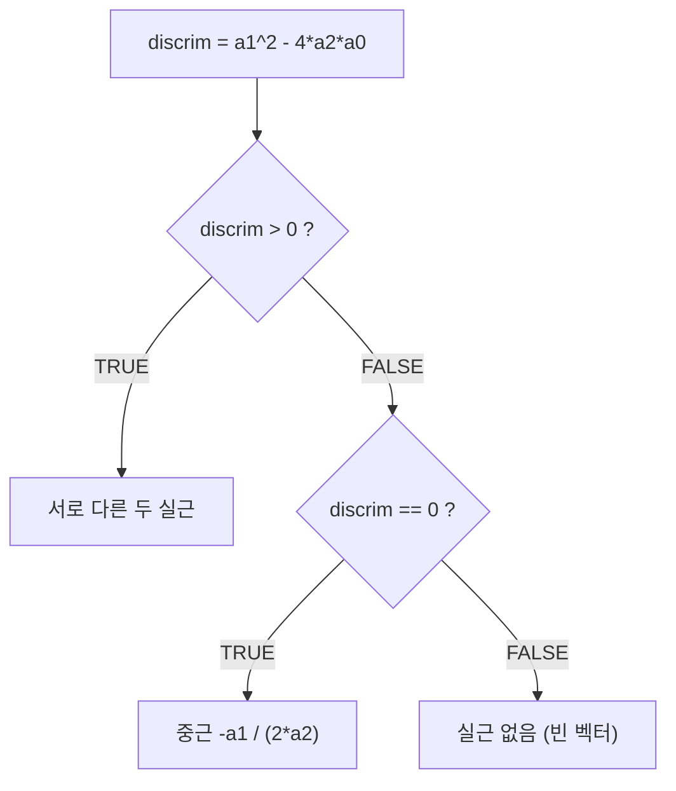

# 3장 — 함수와 제어 흐름

[레포지토리 안내](../../README.ko.md) | [English](Concepts_Lecture.md) | [한국어](Concepts_Lecture.ko.md)

> **최종 수정일:** 2026-10-26
>
> 혼자 공부하는 R 데이터 분석, 강전희와 엄동란, Ch 3

> **학습 목표:**
> 1. 적절한 매개변수 처리로 R 사용자 정의 함수를 작성할 수 있다
> 2. 제어 흐름 구조(if/else, for, while)를 적용할 수 있다
> 3. 데이터 조작을 위해 R 내장 함수를 효과적으로 사용할 수 있다

---

## 목차

- [1. 변수와 함수](#1-변수와-함수)
  - [1.1 기본 변수 할당](#11-기본-변수-할당)
  - [1.2 내장 함수](#12-내장-함수)
- [2. 출력 함수](#2-출력-함수)
  - [2.1 print() vs. cat()](#21-print-vs-cat)
- [3. 사용자 정의 함수](#3-사용자-정의-함수)
  - [3.1 함수 문법](#31-함수-문법)
  - [3.2 예제: 곱셈 함수](#32-예제-곱셈-함수)
  - [3.3 예제: 정규화(Rescale) 함수](#33-예제-정규화rescale-함수)
  - [3.4 함수를 작성해야 할 때](#34-함수를-작성해야-할-때)
- [4. 패키지](#4-패키지)
  - [4.1 패키지 설치 및 로드](#41-패키지-설치-및-로드)
  - [4.2 주요 패키지](#42-주요-패키지)
- [5. 티블](#5-티블)
  - [5.1 티블 vs. 데이터 프레임](#51-티블-vs-데이터-프레임)
  - [5.2 수동 정규화 (함수 사용 없이)](#52-수동-정규화-함수-사용-없이)
  - [5.3 NA 값 처리](#53-na-값-처리)
- [6. 연산자](#6-연산자)
  - [6.1 산술 연산자](#61-산술-연산자)
  - [6.2 관계(비교) 연산자](#62-관계비교-연산자)
  - [6.3 논리 연산자](#63-논리-연산자)
  - [6.4 벡터화된 비교](#64-벡터화된-비교)
- [7. 조건문](#7-조건문)
  - [7.1 if-else 문법](#71-if-else-문법)
  - [7.2 예제: 이차방정식 풀이](#72-예제-이차방정식-풀이)
- [8. 반복문](#8-반복문)
  - [8.1 for 반복문](#81-for-반복문)
  - [8.2 while 반복문](#82-while-반복문)
- [요약](#요약)
- [점검 문제](#점검-문제)

---

<br>

## 1. 변수와 함수

### 1.1 기본 변수 할당

```r
x <- 10        # 수치형 값 할당
y <- "HI"      # 문자형 값 할당
```

### 1.2 내장 함수

R은 일반적인 연산을 위한 많은 내장 함수를 제공한다.

```r
print("Hello World")   # 콘솔에 값 출력
sum(1:100)              # 1부터 100까지 정수의 합 -> 5050
Sys.Date()              # 현재 시스템 날짜 반환
```

> **핵심:** `sum()`, `mean()`, `min()`, `max()` 등의 함수는 R의 `base` 패키지에 포함되어 있어 별도의 라이브러리를 로드하지 않아도 항상 사용할 수 있다.

---

<br>

## 2. 출력 함수

### 2.1 print() vs. cat()

| 함수 | 동작 |
|------|------|
| `print()` | 한 번에 하나의 객체를 출력하며, 유형 서식이 포함됨 |
| `cat()` | 여러 객체를 연결하여 출력하며, 일반 텍스트로 출력됨 |

*표 1. print()와 cat()의 동작 비교*

```r
x <- c(1, 2, 3)
y <- "a"

# print()는 한 번에 하나의 객체만 처리 가능
print(x)              # [1] 1 2 3
# print(x, y)         # 오류: invalid printing digits
print(x); print(y)    # 작동: 각각 별도로 출력

# cat()은 여러 객체를 연결하여 출력
cat(x, y)             # 1 2 3 a (서식 없는 일반 텍스트)
cat("Value:", x, "\n") # 줄바꿈 문자 지원
```

`print(x, y)`가 오류를 내는 것은 `print()`의 두 번째 인수가 출력 대상이 아니라 유효 숫자 자릿수(`digits`)로 해석되기 때문이다.

> **핵심:** 단일 객체의 서식화된 출력에는 `print()`를 사용한다. 여러 값을 결합하거나 `\n`(줄바꿈) 등 사용자 정의 서식이 필요할 때는 `cat()`을 사용한다.

---

<br>

## 3. 사용자 정의 함수

### 3.1 함수 문법

사용자 정의 함수는 네 가지 구성 요소를 갖는다.

1. **함수 이름:** R 환경에 저장되며, 함수를 호출할 때 사용한다.
2. **매개변수:** 함수를 호출할 때 전달되는 입력 변수이다.
3. **함수 본문:** 함수의 로직을 구현하는 코드이다.
4. **반환 값:** 함수가 생성하는 결과이다.

```r
# 일반 문법
function_name <- function(param1, param2, ...) {
  # 함수 본문
  ...
  return(result)
}
```

### 3.2 예제: 곱셈 함수

```r
multi_f <- function(x, y, z) {
  res <- x * y * z
  return(res)
}

multi_f(3, 5, 6)   # 90을 반환

a <- multi_f(3, 5, 6)
a                    # 90
```

### 3.3 예제: 정규화(Rescale) 함수

값을 [0, 1] 범위로 정규화하는 실용적인 예제는 다음과 같다.

```r
rescale <- function(x) {
  rng <- range(x, na.rm = TRUE)
  cat("The range is ", rng, "\n")
  (x - rng[1]) / (rng[2] - rng[1])
}

rescale(c(0, 5, 10))               # 0.0 0.5 1.0
rescale(c(0, 5, 10, NA, NA))       # 0.0 0.5 1.0 NA NA
```

`range()`는 최솟값과 최댓값을 담은 길이 2의 벡터를 반환하며, `na.rm = TRUE`이면 `NA`를 무시한다. `rescale()`에는 `return()`이 없지만, R 함수는 마지막으로 평가한 식의 값을 반환하므로 `(x - rng[1]) / (rng[2] - rng[1])`의 결과가 반환값이 된다.

> **주의:** 모든 값이 같으면 `rng[2] - rng[1]`이 0이 되어 0 / 0을 계산하므로, `rescale(c(5, 5, 5))`는 `NaN NaN NaN`을 반환한다.

### 3.4 함수를 작성해야 할 때

함수를 작성할 시점에 관해 *R for Data Science*는 흔히 **세 번 규칙(Rule of Three)** 이라 부르는 다음 경험 법칙을 제시한다.

책의 표현을 옮기면 "코드 블록을 두 번 넘게 복사하여 붙여넣었다면 함수를 작성하는 것을 고려해야 한다."

함수를 만드는 세 가지 핵심 단계는 다음과 같다.
1. 함수에 설명적인 **이름**을 지정한다.
2. `function()` 안에 **인수**(입력)를 나열한다.
3. 작동하는 코드를 **본문**(`{ }` 블록)에 배치한다.

> **핵심:** 먼저 작동하는 코드를 작성한 후 이를 함수로 변환하는 것이, 함수를 먼저 만들고 작동시키려는 것보다 쉽다.

---

<br>

## 4. 패키지

### 4.1 패키지 설치 및 로드

```r
# CRAN에서 패키지 설치
install.packages("tibble")

# 현재 세션에 패키지 로드
library(tibble)

# 대안: require() 사용 (패키지를 찾지 못하면 오류 대신 FALSE 반환)
require(graphics)
```

### 4.2 주요 패키지

| 패키지 | 용도 |
|--------|------|
| `tibble` | 현대적 데이터 프레임 |
| `tidyverse` | 메타 패키지 (ggplot2, dplyr, tidyr 등 포함) |
| `ggplot2` | 데이터 시각화 |
| `dplyr` | 데이터 조작 |
| `nycflights13` | 연습용 데이터셋 (NYC 항공편) |

*표 2. 주요 패키지와 용도*

---

<br>

## 5. 티블

### 5.1 티블 vs. 데이터 프레임

**티블(tibble)** 은 `tibble` 패키지에서 제공하는 데이터 프레임의 현대적 재해석이며, `tidyverse` 생태계의 일부이다.

```r
# 정규분포 난수 데이터로 티블 생성
df <- tibble::tibble(
  a = rnorm(10),
  b = rnorm(10),
  c = rnorm(10),
  d = rnorm(10)
)
df
```

`rnorm(10)`은 표준정규분포를 따르는 난수 10개를 생성하므로, `df`는 10행 4열의 티블이다.

### 5.2 수동 정규화 (함수 사용 없이)

함수의 필요성을 보여 주는 반복적인 코드는 다음과 같다.

```r
# 각 열을 [0, 1] 범위로 정규화 (장황한 접근 방식)
df$a <- (df$a - min(df$a, na.rm = TRUE)) /
  (max(df$a, na.rm = TRUE) - min(df$a, na.rm = TRUE))
df$b <- (df$b - min(df$b, na.rm = TRUE)) /
  (max(df$b, na.rm = TRUE) - min(df$b, na.rm = TRUE))
# ... 각 열에 대해 반복
```

이러한 반복적인 패턴이 바로 `rescale()` 함수를 만들어야 하는 이유이다.

### 5.3 NA 값 처리

```r
# NA는 R에서 결측값을 나타냄
a2 <- c(5, 2, 100, 25, NA, 6)
min(a2)                   # NA (NA와의 모든 연산은 NA를 반환)
min(a2, na.rm = TRUE)     # 2 (na.rm = TRUE는 NA 값을 무시)
```

`NA`가 섞인 연산은 대부분 `NA`를 반환하지만, `NA^0`(결과 1)이나 `TRUE | NA`(결과 `TRUE`)처럼 `NA`의 실제 값과 무관하게 결과가 정해지는 연산은 예외이다.

> **핵심:** 결측값(`NA`)이 포함될 수 있는 데이터에서 결측값을 제외하고 요약 통계를 계산하려면 `na.rm = TRUE`를 지정한다.

---

<br>

## 6. 연산자

### 6.1 산술 연산자

| 연산자 | 연산 | 예시 |
|--------|------|------|
| `+` | 덧셈 | `5 + 3` -> `8` |
| `-` | 뺄셈 | `10 - 4` -> `6` |
| `*` | 곱셈 | `5 * 6` -> `30` |
| `/` | 나눗셈 | `20 / 4` -> `5` |
| `%/%` | 정수 나눗셈 | `20 %/% 7` -> `2` |
| `%%` | 나머지 연산 | `20 %% 7` -> `6` |
| `^` 또는 `**` | 거듭제곱 | `6 ^ 2` -> `36` |

*표 3. 산술 연산자*

### 6.2 관계(비교) 연산자

| 연산자 | 의미 | 예시 | 결과 |
|--------|------|------|------|
| `>` | 초과 | `5 > 3` | `TRUE` |
| `>=` | 이상 | `5 >= 6` | `FALSE` |
| `<` | 미만 | `5 < 3` | `FALSE` |
| `<=` | 이하 | `5 <= 6` | `TRUE` |
| `==` | 같음 | `5 == 5` | `TRUE` |
| `!=` | 같지 않음 | `5 != 5` | `FALSE` |
| `!` | 논리 NOT | `!5` | `FALSE` |

*표 4. 관계 연산자와 논리 부정 연산자*

표 4의 마지막 행인 `!`는 관계 연산자가 아니라 논리 연산자이다. R은 0이 아닌 수를 `TRUE`로 취급하므로 `!5`는 `FALSE`이다.

### 6.3 논리 연산자

`&`와 `|`는 두 논리 벡터에서 같은 위치의 원소끼리 AND와 OR를 계산한다.

```r
x <- 1:3
y <- 3:1

(x > 0) & (y > 1)   # 원소별 AND: TRUE TRUE FALSE
(x > 0) | (y > 1)   # 원소별 OR:  TRUE TRUE TRUE
```

### 6.4 벡터화된 비교

```r
a <- c(1, 5, 10)
a > 3    # FALSE TRUE TRUE (원소별 비교)
```

---

<br>

## 7. 조건문

### 7.1 if-else 문법

```r
if (condition) {
  # 조건이 TRUE일 때 실행되는 코드
} else {
  # 조건이 FALSE일 때 실행되는 코드
}
```

### 7.2 예제: 이차방정식 풀이

```r
# a2*x^2 + a1*x + a0 = 0의 근 구하기
rm(list = ls())

# 계수 입력
a2 <- 1
a1 <- 4
a0 <- 0

# 판별식 계산
discrim <- a1^2 - 4 * a2 * a0

# 판별식 값에 따라 근 계산
if (discrim > 0) {
  roots <- c(
    (-a1 + sqrt(a1^2 - 4*a2*a0)) / (2*a2),
    (-a1 - sqrt(a1^2 - 4*a2*a0)) / (2*a2)
  )
} else if (discrim == 0) {
  roots <- -a1 / (2 * a2)
} else {
  roots <- c()   # 실근 없음
}
show(roots)
```



*그림 1. 판별식의 부호에 따른 if-else 분기*

위 계수에서는 판별식이 $4^2 - 4 \cdot 1 \cdot 0 = 16 > 0$이므로 첫 번째 분기가 실행되어 두 근 0과 -4가 계산되고, `show(roots)`는 `[1]  0 -4`를 출력한다.

> **핵심:** 콘솔이나 스크립트의 최상위 수준에서는 `else`가 이전 블록의 닫는 중괄호 `}`와 같은 줄에 있어야 한다. 줄이 `}`에서 끝나면 R은 `if` 문이 완결되었다고 보고 다음 줄의 `else`를 구문 오류로 처리하기 때문이다. 함수 본문처럼 중괄호 블록 안에 있는 `if` 문에서는 `else`를 다음 줄에 써도 동작하며, 여는 중괄호 `{`를 `if`나 `else`와 같은 줄에 두는 것은 문법상 필수가 아니라 일반적인 작성 관례이다.

---

<br>

## 8. 반복문

### 8.1 for 반복문

```r
x_list <- seq(1, 9, by = 2)   # 1, 3, 5, 7, 9

sum_x <- 0
for (x in x_list) {
  sum_x <- sum_x + x
  cat("The current loop element is ", x, "\n")
  cat("The cumulative total is ", sum_x, "\n")
}
```

**출력:**
```text
The current loop element is  1
The cumulative total is  1
The current loop element is  3
The cumulative total is  4
...
The current loop element is  9
The cumulative total is  25
```

출력의 `...`는 원소 5와 7에 대한 반복을 생략한 부분이다. `cat()`은 인수 사이에 공백을 하나씩 넣으므로, 문자열 끝의 공백과 합쳐 숫자 앞에 공백이 두 칸 생긴다.

### 8.2 while 반복문

```r
counter <- 1
while (counter <= 5) {
  cat("Counter:", counter, "\n")
  counter <- counter + 1
}
```

`while`은 조건이 `TRUE`인 동안 본문을 반복하므로 위 코드는 `Counter: 1`부터 `Counter: 5`까지 다섯 줄을 출력한다. 본문에서 `counter`를 증가시키지 않으면 조건이 계속 `TRUE`로 남아 무한 반복에 빠진다.

---

<br>

## 요약

| 개념 | 핵심 요약 |
|------|-----------|
| `print()` vs `cat()` | `print()`는 단일 객체를 서식화하여 출력하고, `cat()`은 여러 값을 연결하여 일반 텍스트로 출력한다. |
| 사용자 정의 함수 | 사용자 정의 함수는 이름, 매개변수, 본문, 반환 값으로 구성되며, 같은 코드가 세 번 이상 반복되면 작성을 고려한다. |
| 패키지 | 패키지는 `install.packages()`로 설치하고 `library()`로 로드한다. |
| 티블 | 티블은 tidyverse에 속하는 현대적 데이터 프레임이다. |
| NA 처리 | 요약 함수에서 `na.rm = TRUE`를 지정하면 결측값을 제외하고 계산한다. |
| 연산자 | R의 연산자에는 산술(`+`, `%%`), 관계(`>`, `==`), 논리(`&`, `\|`) 연산자가 있다. |
| if-else | if-else는 조건에 따라 실행할 코드를 고르며, 최상위 수준에서는 `else`를 `}`와 같은 줄에 써야 한다. |
| for 반복문 | for 반복문은 벡터나 리스트의 원소를 차례로 꺼내 본문을 반복한다. |
| `rescale()` | `rescale()`은 반복적인 코드를 함수로 묶어 피하는 DRY(Don't Repeat Yourself) 원칙의 예이다. |

---

<br>

## 점검 문제

1. **함수 추적:** 3.3절의 `rescale()`에 대해 `rescale(c(2, 4, 10))`이 콘솔에 출력하는 문장과 반환값을 쓰라. 또 `rescale(c(5, 5, 5))`의 결과와 그 이유를 쓰라.

   <details>
   <summary>정답</summary>

   범위는 2와 10이므로 먼저 `The range is  2 10`이 출력된다. 각 값에서 2를 빼고 10 - 2 = 8로 나누면 0 / 8 = 0, 2 / 8 = 0.25, 8 / 8 = 1이므로 반환값은 0.00, 0.25, 1.00이다. `rescale(c(5, 5, 5))`는 최솟값과 최댓값이 모두 5여서 분모가 0이 되고 0 / 0을 계산하므로 `NaN NaN NaN`을 반환한다.

   </details>

2. **결측값 처리:** `a <- c(3, NA, 7, 1)`일 때 `max(a)`, `max(a, na.rm = TRUE)`, `sum(a, na.rm = TRUE)`의 결과를 쓰라.

   <details>
   <summary>정답</summary>

   `max(a)`는 `NA`가 섞여 있어 최댓값을 정할 수 없으므로 `NA`이다. `na.rm = TRUE`이면 `NA`를 제외한 3, 7, 1에서 계산하므로 `max()`는 7이고 `sum()`은 3 + 7 + 1 = 11이다.

   </details>

3. **연산자:** `10 %/% 3`, `10 %% 3`, `(1:4 > 2) & (4:1 > 1)`의 결과를 쓰라.

   <details>
   <summary>정답</summary>

   10 = 3 × 3 + 1이므로 `10 %/% 3`은 3이고 `10 %% 3`은 1이다. `1:4 > 2`는 `FALSE FALSE TRUE TRUE`, `4:1 > 1`은 `TRUE TRUE TRUE FALSE`이므로 원소별 AND의 결과는 `FALSE FALSE TRUE FALSE`이다.

   </details>

4. **조건문:** 7.2절의 코드에서 계수를 `a2 <- 1`, `a1 <- -5`, `a0 <- 6`으로 바꾸면 `roots`는 무엇이 되는가? `a2 <- 1`, `a1 <- 2`, `a0 <- 1`일 때는 어떤가?

   <details>
   <summary>정답</summary>

   첫 경우 판별식은 $(-5)^2 - 4 \cdot 1 \cdot 6 = 1 > 0$이므로 첫 번째 분기가 실행되고, 두 근은 (5 + 1) / 2 = 3과 (5 - 1) / 2 = 2이므로 `roots`는 `c(3, 2)`이다. 둘째 경우 판별식은 $2^2 - 4 \cdot 1 \cdot 1 = 0$이므로 `else if` 분기가 실행되고, `roots`는 -2 / 2 = -1이다.

   </details>

5. **반복문 추적:** 다음 코드를 실행한 뒤 `s`의 값과 본문이 실행된 횟수를 쓰라.

   ```r
   s <- 0
   for (i in seq(2, 10, by = 4)) {
     s <- s + i
   }
   ```

   <details>
   <summary>정답</summary>

   `seq(2, 10, by = 4)`는 2, 6, 10이므로 본문은 3번 실행되고, `s`는 2 + 6 + 10 = 18이다.

   </details>
