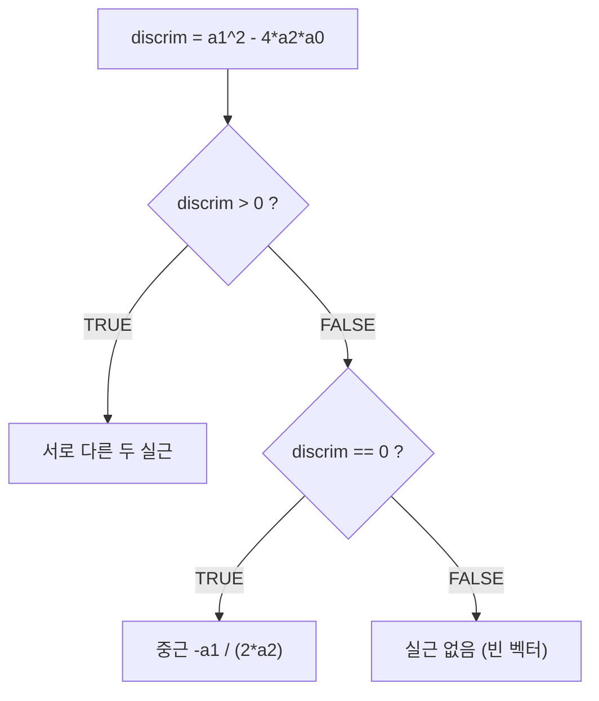
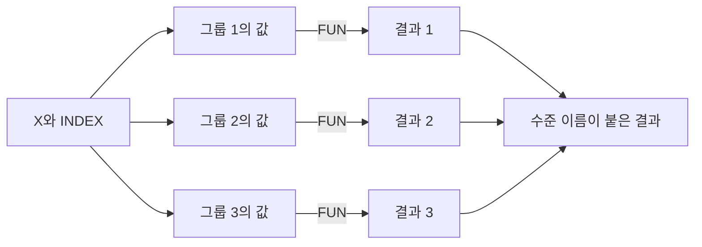

# 3장 — 함수와 제어 흐름

[레포지토리 안내](../../README.ko.md) | [English](Concepts_Lecture.md) | [한국어](Concepts_Lecture.ko.md)

> **최종 수정일:** 2026-11-27
>
> 혼자 공부하는 R 데이터 분석, 강전희와 엄동란, Ch 3

> **학습 목표:**
> 1. 적절한 매개변수 처리로 R 사용자 정의 함수를 작성할 수 있다
> 2. 제어 흐름 구조(if/else, for, while)를 적용할 수 있다
> 3. 데이터 조작을 위해 R 내장 함수를 효과적으로 사용할 수 있다
> 4. 인수의 위치 지정, 이름 지정, 기본값과 함수의 유효 범위를 설명할 수 있다
> 5. 결측값을 판별하고 제외하며, `&`와 `&&`, `if`와 `ifelse()`의 차이를 구분할 수 있다
> 6. `apply()`, `lapply()`, `sapply()`, `tapply()`로 반복문 없이 행, 열, 그룹마다 함수를 적용할 수 있다

---

## 목차

- [1. 변수와 함수](#1-변수와-함수)
  - [1.1 기본 변수 할당](#11-기본-변수-할당)
  - [1.2 내장 함수](#12-내장-함수)
  - [1.3 함수 호출과 인수](#13-함수-호출과-인수)
- [2. 출력 함수](#2-출력-함수)
  - [2.1 print() vs. cat()](#21-print-vs-cat)
  - [2.2 문자열 만들기](#22-문자열-만들기)
- [3. 사용자 정의 함수](#3-사용자-정의-함수)
  - [3.1 함수 문법](#31-함수-문법)
  - [3.2 예제: 곱셈 함수](#32-예제-곱셈-함수)
  - [3.3 예제: 정규화(Rescale) 함수](#33-예제-정규화rescale-함수)
  - [3.4 함수를 작성해야 할 때](#34-함수를-작성해야-할-때)
  - [3.5 기본값과 여러 값의 반환](#35-기본값과-여러-값의-반환)
  - [3.6 유효 범위](#36-유효-범위)
  - [3.7 입력 검사: stop()과 warning()](#37-입력-검사-stop과-warning)
  - [3.8 예제: 이차방정식의 근을 구하는 함수](#38-예제-이차방정식의-근을-구하는-함수)
- [4. 패키지](#4-패키지)
  - [4.1 패키지 설치 및 로드](#41-패키지-설치-및-로드)
  - [4.2 주요 패키지](#42-주요-패키지)
  - [4.3 이름 충돌과 :: 연산자](#43-이름-충돌과--연산자)
- [5. 티블](#5-티블)
  - [5.1 티블 vs. 데이터 프레임](#51-티블-vs-데이터-프레임)
  - [5.2 수동 정규화 (함수 사용 없이)](#52-수동-정규화-함수-사용-없이)
  - [5.3 NA 값 처리](#53-na-값-처리)
  - [5.4 결측값의 판별과 제외](#54-결측값의-판별과-제외)
- [6. 연산자](#6-연산자)
  - [6.1 산술 연산자](#61-산술-연산자)
  - [6.2 관계(비교) 연산자](#62-관계비교-연산자)
  - [6.3 논리 연산자](#63-논리-연산자)
  - [6.4 벡터화된 비교](#64-벡터화된-비교)
  - [6.5 &&와 ||의 차이](#65-와-의-차이)
  - [6.6 논리 벡터를 요약하는 함수](#66-논리-벡터를-요약하는-함수)
- [7. 조건문](#7-조건문)
  - [7.1 if-else 문법](#71-if-else-문법)
  - [7.2 예제: 이차방정식 풀이](#72-예제-이차방정식-풀이)
  - [7.3 조건의 길이와 결측값](#73-조건의-길이와-결측값)
  - [7.4 벡터화된 조건: ifelse()](#74-벡터화된-조건-ifelse)
  - [7.5 switch()](#75-switch)
- [8. 반복문](#8-반복문)
  - [8.1 for 반복문](#81-for-반복문)
  - [8.2 while 반복문](#82-while-반복문)
  - [8.3 반복 변수로 계산하기](#83-반복-변수로-계산하기)
  - [8.4 이중 for 반복문](#84-이중-for-반복문)
  - [8.5 break, next, repeat](#85-break-next-repeat)
  - [8.6 seq_along()과 미리 할당하기](#86-seq_along과-미리-할당하기)
- [9. apply 계열 함수](#9-apply-계열-함수)
  - [9.1 apply(): 행렬의 행과 열](#91-apply-행렬의-행과-열)
  - [9.2 tapply(): 그룹별 적용](#92-tapply-그룹별-적용)
  - [9.3 lapply()와 sapply(): 리스트의 원소](#93-lapply와-sapply-리스트의-원소)
  - [9.4 예제: 리스트에 사용자 정의 함수 적용](#94-예제-리스트에-사용자-정의-함수-적용)
  - [9.5 함수의 선택](#95-함수의-선택)
- [개념 적용](#개념-적용)
- [요약](#요약)
- [점검 문제](#점검-문제)
- [참고 문헌](#참고-문헌)

---

<br>

## 1. 변수와 함수

### 1.1 기본 변수 할당

```r
x <- 10        # Assign numeric value
y <- "HI"      # Assign character value
```

변수 이름의 규칙은 1장 3절과 같다. 첫 글자는 영문자나 마침표여야 하고, 숫자와 밑줄로 시작할 수 없으며, 마침표와 밑줄을 뺀 특수 문자와 공백은 쓸 수 없고, 대문자와 소문자를 구분한다. 따라서 `exam`, `.exam`, `e1axm`, `e_xam`, `e1_am`, `Exam`은 쓸 수 있지만 `1exam`, `_exam`, `$exam`, `ex a`는 쓸 수 없다.

### 1.2 내장 함수

R은 일반적인 연산을 위한 많은 내장 함수를 제공한다.

```r
print("Hello World")   # Output a value to the console
sum(1:100)              # Sum of integers from 1 to 100 -> 5050
Sys.Date()              # Get current system date
```

> **핵심:** `sum()`, `mean()`, `min()`, `max()` 등의 함수는 R의 `base` 패키지에 포함되어 있어 별도의 라이브러리를 로드하지 않아도 항상 사용할 수 있다.

### 1.3 함수 호출과 인수

> **용어 정의:** **함수(function)** 는 입력을 받아 정해진 계산을 하고 결과를 돌려주는 코드의 묶음이다.

> **용어 정의:** **인수(argument)** 는 함수를 호출할 때 함수 이름 뒤의 괄호 안에 넘기는 값이다.

인수는 두 가지 방식으로 넘긴다.

- **위치로 지정:** 도움말의 Usage에 적힌 순서대로 이름 없이 값만 쓴다. `seq(1, 10, 3)`에서 1, 10, 3은 차례로 `from`, `to`, `by`에 대응한다.
- **이름으로 지정:** `이름 = 값` 형식으로 쓴다. 이름을 쓰면 순서와 관계없이 그 인수에 값이 들어간다.

```r
x <- c(2.5, 7.1, NA, 4.4)
mean(x)
#> [1] NA
mean(x, na.rm = TRUE)
#> [1] 4.666667
mean(na.rm = TRUE, x = x)
#> [1] 4.666667
mean(x, na = TRUE)
#> [1] 4.666667
round(mean(x, na.rm = TRUE), 1)
#> [1] 4.7
seq(1, 10, 3)
#> [1]  1  4  7 10
seq(by = 3, 1, 10)
#> [1]  1  4  7 10
```

`x`에 결측값이 있으므로 `mean(x)`는 `NA`이고, `na.rm = TRUE`를 주면 2.5, 7.1, 4.4의 평균 14 / 3 = 4.666667이 된다. 셋째 줄처럼 이름을 쓰면 인수의 순서를 바꾸어도 결과가 같다. 넷째 줄의 `na = TRUE`는 `na.rm`의 앞부분만 쓴 것인데, R은 이름의 앞부분이 한 인수와만 일치하면 그 인수로 해석하는 **부분 일치(partial matching)** 를 한다. 동작은 하지만 읽는 사람이 헷갈리고 다른 인수와 겹칠 위험이 있으므로 인수 이름은 끝까지 쓰는 것이 좋다. 마지막 줄처럼 이름을 준 인수를 먼저 짝짓고 나머지를 순서대로 짝지으므로 `seq(by = 3, 1, 10)`도 `seq(1, 10, by = 3)`과 같다.

함수 호출은 다른 함수의 인수로 겹쳐 쓸 수 있으며, 안쪽부터 계산된다. `round(mean(x, na.rm = TRUE), 1)`은 먼저 평균 4.666667을 구한 뒤 이를 소수 첫째 자리로 반올림해 4.7을 돌려준다. 관례상 첫 번째 인수인 데이터는 위치로, 계산 방법을 바꾸는 나머지 인수는 이름으로 넘긴다.

---

<br>

## 2. 출력 함수

### 2.1 print() vs. cat()

| 함수 | 동작 |
|------|------|
| `print()` | 한 번에 하나의 객체를 출력하며, 유형 서식이 포함됨 |
| `cat()` | 여러 객체를 연결하여 출력하며, 일반 텍스트로 출력됨 |

*표 1. print()와 cat()의 동작 비교*

```r
x <- c(1, 2, 3)
y <- "a"

# print() can only handle one object at a time
print(x)              # [1] 1 2 3
# print(x, y)         # ERROR: invalid printing digits
print(x); print(y)    # Works: prints separately

# cat() concatenates multiple objects
cat(x, y)             # 1 2 3 a (plain text, no formatting)
cat("Value:", x, "\n") # Supports newline characters
```

`print(x, y)`가 오류를 내는 것은 `print()`의 두 번째 인수가 출력 대상이 아니라 유효 숫자 자릿수(`digits`)로 해석되기 때문이다.

> **핵심:** 단일 객체의 서식화된 출력에는 `print()`를 사용한다. 여러 값을 결합하거나 `\n`(줄바꿈) 등 사용자 정의 서식이 필요할 때는 `cat()`을 사용한다.

### 2.2 문자열 만들기

출력할 문장을 만들 때는 값을 문자열로 이어 붙이는 함수를 쓴다.

```r
name <- "Kim"; score <- 87.456
paste("Name:", name)
#> [1] "Name: Kim"
paste0("ID_", 1:3)
#> [1] "ID_1" "ID_2" "ID_3"
paste(c("a", "b"), collapse = "+")
#> [1] "a+b"
sprintf("%s scored %.1f points", name, score)
#> [1] "Kim scored 87.5 points"
sprintf("%05d", 42)
#> [1] "00042"
format(1234567.891, big.mark = ",")
#> [1] "1,234,568"
format(0.5, nsmall = 2)
#> [1] "0.50"
print(pi, digits = 3)
#> [1] 3.14
message("This is a message")
#> This is a message
```

`paste()`는 인수 사이에 공백을 넣어 잇고, `paste0()`은 구분자 없이 잇는다. 둘 다 벡터화되어 있으므로 `paste0("ID_", 1:3)`은 길이 1인 `"ID_"`를 재활용해 세 문자열을 만든다. `collapse`를 주면 벡터의 원소들을 그 구분자로 이어 문자열 하나로 합친다. `sprintf()`는 서식 문자열 안의 자리 표시자에 값을 차례로 채운다.

| 자리 표시자 | 뜻 | 예 | 결과 |
|:--|:--|:--|:--|
| `%s` | 문자열 | `sprintf("%s", "Kim")` | `"Kim"` |
| `%d` | 정수 | `sprintf("%d", 42L)` | `"42"` |
| `%.1f` | 소수 첫째 자리까지의 실수 | `sprintf("%.1f", 87.456)` | `"87.5"` |
| `%05d` | 다섯 자리, 빈자리는 0 | `sprintf("%05d", 42)` | `"00042"` |
| `%%` | 문자 % 자체 | `sprintf("%d%%", 30L)` | `"30%"` |

*표 2. sprintf()의 주요 자리 표시자*

`format()`은 수를 보기 좋게 바꾼 문자열을 돌려주며, `big.mark = ","`는 천 단위 구분 쉼표를, `nsmall = 2`는 소수점 아래 최소 자릿수를 정한다. `format(1234567.891, big.mark = ",")`의 결과가 `"1,234,568"`인 것은 R이 기본적으로 유효 숫자 7자리까지만 표시하기 때문이다. `message()`는 결과가 아닌 안내 문장을 출력할 때 쓰며, 1장 3절에서 구분한 세 알림 가운데 메시지에 해당한다.

---

<br>

## 3. 사용자 정의 함수

### 3.1 함수 문법

사용자 정의 함수는 네 가지 구성 요소를 갖는다.

1. **함수 이름:** R 환경에 저장되며, 함수를 호출할 때 사용한다.
2. **매개변수:** 함수가 받는 입력이다(아래 정의).
3. **함수 본문:** 함수의 로직을 구현하는 코드이다.
4. **반환 값:** 함수가 생성하는 결과이다.

```r
# General syntax
function_name <- function(param1, param2, ...) {
  # Function body
  ...
  return(result)
}
```

> **용어 정의:** **매개변수(parameter)** 는 함수를 정의할 때 괄호 안에 쓰는 입력의 이름으로, 함수를 호출하면 넘긴 인수의 값을 받는다.

매개변수는 정의에, 인수(1.3절)는 호출에 쓰는 말이다. 사용자 정의 함수는 사전에 정의된 내장 함수 외에 사용자가 직접 만든 함수이며, 여러 작업이 반복될 때 함수로 묶으면 작업을 자동화할 수 있다. 매개변수는 없을 수도 있고 여러 개일 수도 있으며, `return()`을 쓰지 않으면 함수 본문에서 마지막으로 평가한 식의 값이 결과가 된다.

### 3.2 예제: 곱셈 함수

```r
multi_f <- function(x, y, z) {
  res <- x * y * z
  return(res)
}

multi_f(3, 5, 6)   # Returns 90

a <- multi_f(3, 5, 6)
a                    # 90
```

### 3.3 예제: 정규화(Rescale) 함수

값을 [0, 1] 범위로 정규화하는 실용적인 예제는 다음과 같다.

```r
rescale <- function(x) {
  rng <- range(x, na.rm = TRUE)
  cat("The range is ", rng, "\n")
  (x - rng[1]) / (rng[2] - rng[1])
}

rescale(c(0, 5, 10))               # 0.0 0.5 1.0
rescale(c(0, 5, 10, NA, NA))       # 0.0 0.5 1.0 NA NA
```

`range()`는 최솟값과 최댓값을 담은 길이 2의 벡터를 반환하며, `na.rm = TRUE`이면 `NA`를 무시한다. `rescale()`에는 `return()`이 없지만, R 함수는 마지막으로 평가한 식의 값을 반환하므로 `(x - rng[1]) / (rng[2] - rng[1])`의 결과가 반환값이 된다.

> **주의:** 모든 값이 같으면 `rng[2] - rng[1]`이 0이 되어 0 / 0을 계산하므로, `rescale(c(5, 5, 5))`는 `NaN NaN NaN`을 반환한다.

### 3.4 함수를 작성해야 할 때

함수를 작성할 시점에 관해 *R for Data Science*는 흔히 **세 번 규칙(Rule of Three)** 이라 부르는 다음 경험 법칙을 제시한다.

책의 표현을 옮기면 "코드 블록을 두 번 넘게 복사하여 붙여넣었다면 함수를 작성하는 것을 고려해야 한다."

함수를 만드는 세 가지 핵심 단계는 다음과 같다.
1. 함수에 설명적인 **이름**을 지정한다.
2. `function()` 안에 **인수**(입력)를 나열한다.
3. 작동하는 코드를 **본문**(`{ }` 블록)에 배치한다.

> **핵심:** 먼저 작동하는 코드를 작성한 후 이를 함수로 변환하는 것이, 함수를 먼저 만들고 작동시키려는 것보다 쉽다.

함수로 묶으면 세 가지 이점이 있다. 첫째, 함수에 뜻이 드러나는 이름을 붙이면 코드가 하는 일을 읽기 쉬워진다. 둘째, 요구 사항이 바뀌면 여러 곳이 아니라 함수 한 곳만 고치면 된다. 셋째, 복사하여 붙여넣을 때 변수 이름을 한 곳에서만 바꾸고 다른 곳에서는 빠뜨리는 실수를 없앨 수 있다. 5.2절의 반복 코드는 이 세 번째 실수가 일어나기 쉬운 전형적인 예이다.

### 3.5 기본값과 여러 값의 반환

> **용어 정의:** **기본값(default value)** 은 함수를 정의할 때 매개변수에 `이름 = 값`으로 정해 두어, 호출에서 그 인수를 생략했을 때 쓰이는 값이다.

기본값을 정해 둔 매개변수의 인수는 호출할 때 생략할 수 있다.

```r
power <- function(x, p = 2) {
  x^p
}
power(3)
#> [1] 9
power(3, 3)
#> [1] 27
power(p = 0.5, x = 16)
#> [1] 4
```

`power(3)`은 `p`를 생략했으므로 기본값 2를 써서 $`3^2 = 9`$를 돌려준다. `power(3, 3)`은 둘째 인수가 위치로 `p`에 들어가 $`3^3 = 27`$이고, `power(p = 0.5, x = 16)`은 $`16^{0.5} = \sqrt{16} = 4`$이다. 자주 쓰는 설정을 기본값으로 두고 필요할 때만 바꾸게 하는 방식은 `mean()`의 `na.rm = FALSE`, `round()`의 `digits = 0`처럼 내장 함수에도 널리 쓰인다.

함수는 값을 하나만 돌려주므로, 여러 결과를 돌려주려면 그 결과들을 리스트(2장 4절)에 담는다.

```r
summary_stats <- function(x) {
  list(mean = mean(x), sd = sd(x), n = length(x))
}
res <- summary_stats(c(4, 8, 6, 2))
res
#> $mean
#> [1] 5
#> 
#> $sd
#> [1] 2.581989
#> 
#> $n
#> [1] 4
res$sd
#> [1] 2.581989
```

4, 8, 6, 2의 평균은 20 / 4 = 5이다. 표준편차는 평균과의 차 -1, 3, 1, -3을 제곱해 더한 1 + 9 + 1 + 9 = 20을 n - 1 = 3으로 나눈 분산 6.667의 제곱근이므로 약 2.582이다. 결과 리스트의 원소에는 `res$sd`처럼 이름으로 접근한다.

### 3.6 유효 범위

> **용어 정의:** **지역 변수(local variable)** 는 함수 안에서 만들어져 그 함수가 실행되는 동안에만 존재하는 변수이다.

> **용어 정의:** **유효 범위(scope)** 는 변수 이름이 어느 범위에서 어떤 값을 가리키는지를 정하는 규칙이다.

함수 안에서 만든 지역 변수는 함수 밖의 같은 이름의 변수에 영향을 주지 않는다.

```r
z <- 10
f <- function() {
  z <- 1
  z + 1
}
f()
#> [1] 2
z
#> [1] 10
g <- function(y) {
  y + z
}
g(5)
#> [1] 15
```

`f()` 안의 `z <- 1`은 함수 안에 새 지역 변수 `z`를 만들 뿐이므로 `f()`는 2를 돌려주고, 함수 밖의 `z`는 여전히 10이다. 반대로 `g()` 안에는 `z`가 없으므로 R은 함수가 정의된 바깥 환경에서 `z`를 찾아 10을 쓰고, `g(5)`는 15가 된다. 이처럼 R은 어휘적 유효 범위를 따른다. 함수가 바깥 변수에 기대면 그 변수가 바뀔 때마다 결과가 달라지므로, 함수에 필요한 값은 인수로 넘기는 것이 안전하다.

> **용어 정의:** **어휘적 유효 범위(lexical scoping)** 는 함수 안에 없는 이름을, 그 함수가 호출된 곳이 아니라 정의된 위치를 기준으로 바깥쪽 환경에서 차례로 찾는 유효 범위 규칙이다.

> **[프로그래밍언어]** 어휘적(정적) 유효 범위는 변수의 의미를 코드의 구조만 보고 정하는 방식이고, 동적 유효 범위는 실행 중의 호출 순서로 정하는 방식이다. R, Python, Scheme은 어휘적 유효 범위를 쓴다.

### 3.7 입력 검사: stop()과 warning()

함수가 잘못된 입력을 받았을 때 엉뚱한 결과를 내기보다 바로 알려 주는 편이 낫다. `stop()`은 오류를 내어 실행을 멈추고, `warning()`은 경고만 남기고 계산을 계속한다.

```r
safe_sqrt <- function(x) {
  if (!is.numeric(x)) stop("x must be numeric")
  if (any(x < 0)) warning("negative values give NaN")
  sqrt(x)
}
safe_sqrt(c(4, 9))
#> [1] 2 3
safe_sqrt(c(4, -1))
#> Warning in safe_sqrt(c(4, -1)): negative values give NaN
#> Warning in sqrt(x): NaNs produced
#> [1]   2 NaN
safe_sqrt("a")
#> Error in safe_sqrt("a"): x must be numeric
```

첫 호출은 모든 값이 0 이상이므로 경고 없이 2, 3을 돌려준다. 둘째 호출에는 음수가 있어 함수가 정한 경고와 `sqrt()`의 경고가 차례로 나오고, 결과의 둘째 원소는 `NaN`이다. 셋째 호출은 문자열이 들어와 `stop()`이 실행되므로 결과 없이 멈춘다. `if` 문 한 줄에 본문이 하나뿐이면 중괄호를 생략할 수 있다. `any(x < 0)`는 원소 가운데 하나라도 음수이면 `TRUE`이다(6.6절).

### 3.8 예제: 이차방정식의 근을 구하는 함수

7.2절의 이차방정식 풀이 코드는 계수를 바꿀 때마다 스크립트를 고쳐야 한다. 이를 계수를 인수로 받는 함수로 바꾸고, 2차 계수가 0인 경우까지 처리하면 다음과 같다. 함수는 $`a_2 x^2 + a_1 x + a_0 = 0`$의 근을 구한다.

```r
quad3 <- function(a0, a1, a2) {
  # find the zeros of a2*x^2 + a1*x + a0 = 0
  if (a2 == 0 && a1 == 0 && a0 == 0) {
    roots <- NA
  } else if (a2 == 0 && a1 == 0) {
    roots <- NULL
  } else if (a2 == 0) {
    roots <- -a0/a1
  } else {
    # calculate the discriminant
    discrim <- a1^2 - 4*a2*a0
    # calculate the roots depending on the value of the discriminant
    if (discrim > 0) {
      roots <- (-a1 + c(1,-1) * sqrt(a1^2 - 4*a2*a0))/(2*a2)
    } else if (discrim == 0) {
      roots <- -a1/(2*a2)
    } else {
      roots <- NULL
    }
  }
  return(roots)
}
quad3(1, 0, -1)
#> [1] -1  1
quad3(1, -2, 1)
#> [1] 1
quad3(1, 1, 1)
#> NULL
quad3(6, 2, 0)
#> [1] -3
quad3(0, 0, 0)
#> [1] NA
```

함수는 네 경우를 차례로 검사한다. 세 계수가 모두 0이면 모든 x가 방정식을 만족하므로 근을 하나로 정할 수 없다는 뜻으로 `NA`를 돌려준다. $`a_2 = a_1 = 0`$이고 $`a_0 \ne 0`$이면 $`a_0 = 0`$이라는 거짓 등식이 되어 근이 없으므로 `NULL`을 돌려준다. $`a_2 = 0`$이고 $`a_1 \ne 0`$이면 일차방정식이므로 $`x = -a_0 / a_1`$이다. 나머지 경우는 이차방정식이며 판별식의 부호로 근의 개수를 정한다.

인수 순서가 (a0, a1, a2)라는 점에 주의하면 각 호출은 다음과 같이 계산된다. `quad3(1, 0, -1)`은 $`-x^2 + 1 = 0`$이고 판별식은 $`0^2 - 4 \times (-1) \times 1 = 4 > 0`$이다. `c(1, -1)`로 부호 두 개를 한꺼번에 계산하므로 근은 $`(0 + 2) / (-2) = -1`$과 $`(0 - 2) / (-2) = 1`$이다. `quad3(1, -2, 1)`은 $`x^2 - 2x + 1 = 0`$이고 판별식이 0이므로 중근 $`2 / 2 = 1`$이다. `quad3(1, 1, 1)`은 판별식이 $`1 - 4 = -3 < 0`$이어서 실근이 없으므로 `NULL`이다. `quad3(6, 2, 0)`은 일차방정식 $`2x + 6 = 0`$이므로 -3이다. 이 함수의 조건에는 `&&`를 썼는데, 길이 1인 논리값끼리 결합하는 연산자이기 때문이다(6.5절).

---

<br>

## 4. 패키지

### 4.1 패키지 설치 및 로드

```r
# Install a package from CRAN
install.packages("tibble")

# Load a package into the current session
library(tibble)

# Alternative: use require() (returns FALSE instead of error if not found)
require(graphics)
```

### 4.2 주요 패키지

| 패키지 | 용도 |
|--------|------|
| `tibble` | 현대적 데이터 프레임 |
| `tidyverse` | 메타 패키지 (ggplot2, dplyr, tidyr 등 포함) |
| `ggplot2` | 데이터 시각화 |
| `dplyr` | 데이터 조작 |
| `nycflights13` | 연습용 데이터셋 (NYC 항공편) |

*표 3. 주요 패키지와 용도*

교재나 강의에 딸린 함수와 데이터를 묶어 배포하는 패키지도 있다. 9절에서 쓰는 `spuRs`는 Jones, Maillardet, Robinson의 *Introduction to Scientific Programming and Simulation Using R*의 함수와 데이터셋을 담은 CRAN 패키지이며, 그 가운데 `ufc`는 미국 아이다호 대학교 실험림 한 구역(Upper Flat Creek)에서 측정한 나무 336그루의 자료이다.

### 4.3 이름 충돌과 :: 연산자

> **용어 정의:** **마스킹(masking)** 은 서로 다른 패키지에 같은 이름의 함수가 있을 때, 나중에 불러온 패키지의 함수가 앞의 함수를 가리는 현상이다.

R은 패키지를 불러올 때 가려지는 함수를 알려 준다.

```r
library(dplyr)
#> 
#> Attaching package: 'dplyr'
#> The following objects are masked from 'package:stats':
#> 
#>     filter, lag
#> The following objects are masked from 'package:base':
#> 
#>     intersect, setdiff, setequal, union
stats::filter(1:5, rep(1/3, 3))
#> Time Series:
#> Start = 1 
#> End = 5 
#> Frequency = 1 
#> [1] NA  2  3  4 NA
```

`dplyr`를 불러온 뒤에는 `filter()`가 `stats` 패키지의 시계열 필터가 아니라 5장에서 쓰는 `dplyr`의 행 선택 함수를 가리킨다. 가려진 함수를 쓰려면 `패키지::함수` 형식으로 패키지를 밝힌다. 위의 `stats::filter(1:5, rep(1/3, 3))`은 연속한 세 값의 평균을 구하는 이동 평균 필터로, 2번째 값은 (1 + 2 + 3) / 3 = 2이고 양 끝은 앞뒤 값이 모자라 `NA`이다.

R이 이름을 찾는 순서는 `search()`로 확인할 수 있다. 전역 환경이 맨 앞이고, 그 뒤로 가장 최근에 불러온 패키지부터 차례로 놓인다. 이 장에서는 4.1절에서 `tibble`을, 이 절에서 `dplyr`를 불러왔으므로 `dplyr`, `tibble` 순서이다.

```r
search()[1:3]
#> [1] ".GlobalEnv"     "package:dplyr"  "package:tibble"
```

`library()`와 `require()`는 모두 패키지를 불러오지만, 설치되지 않은 패키지를 만나면 `library()`는 오류를 내고 `require()`는 경고와 함께 `FALSE`를 돌려준다. 스크립트에서는 필요한 패키지가 없을 때 바로 멈추는 `library()`가 문제를 찾기 쉽다. 설치는 한 번이면 되므로 `install.packages()`를 스크립트에 남겨 두지 않고 콘솔에서 실행한다.

---

<br>

## 5. 티블

### 5.1 티블 vs. 데이터 프레임

**티블(tibble)** 은 `tibble` 패키지에서 제공하는 데이터 프레임의 현대적 재해석이며, `tidyverse` 생태계의 일부이다.

```r
# Create a tibble with random normal data
df <- tibble::tibble(
  a = rnorm(10),
  b = rnorm(10),
  c = rnorm(10),
  d = rnorm(10)
)
df
```

`rnorm(10)`은 표준정규분포를 따르는 난수 10개를 생성하므로, `df`는 10행 4열의 티블이다.

티블의 각 열(`a`\~`d`)은 변수이고 각 행은 관측치이다. 티블과 데이터 프레임의 출력, 색인, 이름 처리의 차이는 2장 5절에 정리했다. `rnorm()`의 결과는 실행할 때마다 달라지므로, 같은 난수를 다시 얻으려면 그 앞에 `set.seed(1)`처럼 난수의 시작점을 고정한다.

### 5.2 수동 정규화 (함수 사용 없이)

함수의 필요성을 보여 주는 반복적인 코드는 다음과 같다.

```r
# Normalize each column to [0, 1] range (verbose approach)
df$a <- (df$a - min(df$a, na.rm = TRUE)) /
  (max(df$a, na.rm = TRUE) - min(df$a, na.rm = TRUE))
df$b <- (df$b - min(df$b, na.rm = TRUE)) /
  (max(df$b, na.rm = TRUE) - min(df$b, na.rm = TRUE))
# ... repeated for each column
```

이러한 반복적인 패턴이 바로 `rescale()` 함수를 만들어야 하는 이유이다.

### 5.3 NA 값 처리

```r
# NA represents missing values in R
a2 <- c(5, 2, 100, 25, NA, 6)
min(a2)                   # NA (any operation with NA returns NA)
min(a2, na.rm = TRUE)     # 2 (na.rm = TRUE ignores NA values)
```

`NA`가 섞인 연산은 대부분 `NA`를 반환하지만, `NA^0`(결과 1)이나 `TRUE | NA`(결과 `TRUE`)처럼 `NA`의 실제 값과 무관하게 결과가 정해지는 연산은 예외이다.

> **핵심:** 결측값(`NA`)이 포함될 수 있는 데이터에서 결측값을 제외하고 요약 통계를 계산하려면 `na.rm = TRUE`를 지정한다.

### 5.4 결측값의 판별과 제외

실제 데이터에서 결측값이 얼마나, 어디에 있는지 먼저 확인해야 처리 방법을 정할 수 있다. `airquality`의 오존 측정값으로 확인하면 다음과 같다.

```r
oz <- airquality$Ozone
length(oz)
#> [1] 153
anyNA(oz)
#> [1] TRUE
sum(is.na(oz))
#> [1] 37
mean(is.na(oz))
#> [1] 0.2418301
mean(oz)
#> [1] NA
mean(oz, na.rm = TRUE)
#> [1] 42.12931
head(which(is.na(oz)))
#> [1]  5 10 25 26 27 32
nrow(airquality)
#> [1] 153
nrow(na.omit(airquality))
#> [1] 111
sum(complete.cases(airquality))
#> [1] 111
```

`is.na()`는 원소마다 결측 여부를 논리값으로 돌려주므로, 2장 1.7절의 관용구에 따라 `sum(is.na(oz))`는 결측값의 개수 37, `mean(is.na(oz))`는 결측 비율 37 / 153 ≈ 0.242이다. `anyNA()`는 결측값이 하나라도 있는지만 알려 준다. `mean(oz, na.rm = TRUE)`는 결측값을 뺀 153 - 37 = 116개 값의 평균 42.13이다. `which(is.na(oz))`는 결측값의 위치이다.

데이터 프레임 단위로는 `na.omit()`이 결측값이 하나라도 있는 행을 모두 지운 데이터 프레임을 돌려주고, `complete.cases()`는 행마다 결측값이 없는지를 논리값으로 돌려준다. `airquality`의 153행 가운데 모든 열이 채워진 행은 111행이다. 오존만 보면 116개가 남지만 행 전체를 지우면 일사량(`Solar.R`)의 결측값 때문에 더 많은 행이 사라진다.

> **주의:** `na.omit()`으로 행을 지우면 분석에 쓰지 않는 열의 결측값 때문에 필요한 관측치까지 잃을 수 있다. 또 결측이 무작위로 생기지 않았다면(예: 특정 기간에 측정 장비가 고장 난 경우) 남은 자료가 전체를 대표하지 못한다. 결측값은 분석에 쓰는 열만 기준으로, 그 원인을 확인한 뒤 처리한다(5장 4절).

결측값과의 비교와 논리 연산은 1장 3절의 규칙을 따른다.

```r
NA == NA
#> [1] NA
NA & FALSE
#> [1] FALSE
NA | TRUE
#> [1] TRUE
```

알 수 없는 두 값이 같은지는 알 수 없으므로 `NA == NA`도 `NA`이다. 반면 `NA & FALSE`는 `NA`가 참이든 거짓이든 결과가 `FALSE`이고, `NA | TRUE`는 어느 경우든 `TRUE`이므로 결과가 정해진다.

---

<br>

## 6. 연산자

### 6.1 산술 연산자

| 연산자 | 연산 | 예시 |
|--------|------|------|
| `+` | 덧셈 | `5 + 3` -> `8` |
| `-` | 뺄셈 | `10 - 4` -> `6` |
| `*` | 곱셈 | `5 * 6` -> `30` |
| `/` | 나눗셈 | `20 / 4` -> `5` |
| `%/%` | 정수 나눗셈 | `20 %/% 7` -> `2` |
| `%%` | 나머지 연산 | `20 %% 7` -> `6` |
| `^` 또는 `**` | 거듭제곱 | `6 ^ 2` -> `36` |

*표 4. 산술 연산자*

### 6.2 관계(비교) 연산자

| 연산자 | 의미 | 예시 | 결과 |
|--------|------|------|------|
| `>` | 초과 | `5 > 3` | `TRUE` |
| `>=` | 이상 | `5 >= 6` | `FALSE` |
| `<` | 미만 | `5 < 3` | `FALSE` |
| `<=` | 이하 | `5 <= 6` | `TRUE` |
| `==` | 같음 | `5 == 5` | `TRUE` |
| `!=` | 같지 않음 | `5 != 5` | `FALSE` |
| `!` | 논리 NOT | `!5` | `FALSE` |

*표 5. 관계 연산자와 논리 부정 연산자*

표 5의 마지막 행인 `!`는 관계 연산자가 아니라 논리 연산자이다. R은 0이 아닌 수를 `TRUE`로 취급하므로 `!5`는 `FALSE`이다.

### 6.3 논리 연산자

`&`와 `|`는 두 논리 벡터에서 같은 위치의 원소끼리 AND와 OR를 계산한다.

```r
x <- 1:3
y <- 3:1

(x > 0) & (y > 1)   # Element-wise AND: TRUE TRUE FALSE
(x > 0) | (y > 1)   # Element-wise OR:  TRUE TRUE TRUE
```

### 6.4 벡터화된 비교

```r
a <- c(1, 5, 10)
a > 3    # FALSE TRUE TRUE (element-wise comparison)
```

### 6.5 &&와 ||의 차이

`&&`와 `||`는 길이 1인 논리값 하나끼리 결합하는 연산자이며, `if` 문의 조건처럼 참과 거짓 하나만 필요한 곳에 쓴다. `&`와 `|`가 원소마다 결과를 내는 것과 다르다.

```r
x <- 5
x > 0 && x < 10
#> [1] TRUE
c(TRUE, FALSE) & c(TRUE, TRUE)
#> [1]  TRUE FALSE
c(TRUE, FALSE) && TRUE
#> Error in c(TRUE, FALSE) && TRUE: 'length = 2' in coercion to 'logical(1)'
FALSE && stop("never evaluated")
#> [1] FALSE
y <- NULL
!is.null(y) && y > 0
#> [1] FALSE
```

> **용어 정의:** **단락 평가(short-circuit evaluation)** 는 논리 연산에서 왼쪽 피연산자만으로 결과가 정해지면 오른쪽 피연산자를 계산하지 않는 방식이다.

`&&`에 길이가 2 이상인 벡터를 주면 오류가 난다. 예전 버전에서는 첫 원소만 쓰고 넘어갔지만, R 4.3.0부터 항상 오류가 된다 [1]. 또 `&&`와 `||`는 단락 평가를 한다. `FALSE && stop(...)`은 왼쪽이 `FALSE`이므로 결과가 이미 `FALSE`로 정해져 `stop()`이 실행되지 않는다. 이 성질 덕분에 `!is.null(y) && y > 0`처럼 앞 조건이 거짓일 때 오류를 낼 수 있는 뒤 조건을 안전하게 이어 쓸 수 있다. `y`가 `NULL`이면 `y > 0`은 길이 0인 논리값이 되어 `if` 조건으로 쓸 수 없지만, 앞 조건에서 이미 `FALSE`가 정해지므로 계산되지 않는다.

| 연산자 | 입력 | 결과의 길이 | 오른쪽 계산 | 주로 쓰는 곳 |
|:--|:--|:--|:--|:--|
| `&`, `\|` | 논리 벡터 | 입력과 같은 길이 | 항상 계산 | 데이터의 행 고르기, `ifelse()` |
| `&&`, `\|\|` | 길이 1인 논리값 | 1 | 필요할 때만 계산 | `if`, `while`의 조건 |

*표 6. 원소별 논리 연산자와 단락 논리 연산자*

### 6.6 논리 벡터를 요약하는 함수

논리 벡터 전체에 대한 판단을 값 하나로 줄이는 함수도 자주 쓴다.

```r
v <- c(3, 8, -2, 5)
any(v < 0)
#> [1] TRUE
all(v > 0)
#> [1] FALSE
xor(TRUE, FALSE)
#> [1] TRUE
isTRUE(c(TRUE, TRUE))
#> [1] FALSE
3 %in% v
#> [1] TRUE
```

`any()`는 하나라도 `TRUE`이면, `all()`은 모두 `TRUE`일 때만 `TRUE`를 돌려준다. `v`에는 -2가 있으므로 `any(v < 0)`는 `TRUE`, `all(v > 0)`은 `FALSE`이다. `xor()`는 두 값 가운데 정확히 하나만 `TRUE`일 때 `TRUE`인 배타적 논리합이다. `isTRUE()`는 인수가 길이 1인 `TRUE`일 때만 `TRUE`이므로 `isTRUE(c(TRUE, TRUE))`는 `FALSE`이며, 결과가 반드시 하나여야 하는 `if` 조건을 안전하게 만들 때 쓴다. `%in%`은 2장 1.9절과 같이 포함 여부를 검사한다. `any()`와 `all()`을 `&&`, `||`와 함께 쓰면 벡터에 관한 조건을 `if` 문에 넣을 수 있다.

---

<br>

## 7. 조건문

### 7.1 if-else 문법

```r
if (condition) {
  # Code executed when condition is TRUE
} else {
  # Code executed when condition is FALSE
}
```

### 7.2 예제: 이차방정식 풀이

```r
# Find the zeros of a2*x^2 + a1*x + a0 = 0
rm(list = ls())

# Input coefficients
a2 <- 1
a1 <- 4
a0 <- 0

# Calculate the discriminant
discrim <- a1^2 - 4 * a2 * a0

# Calculate roots based on discriminant value
if (discrim > 0) {
  roots <- c(
    (-a1 + sqrt(a1^2 - 4*a2*a0)) / (2*a2),
    (-a1 - sqrt(a1^2 - 4*a2*a0)) / (2*a2)
  )
} else if (discrim == 0) {
  roots <- -a1 / (2 * a2)
} else {
  roots <- c()   # No real roots
}
show(roots)
```



*그림 1. 판별식의 부호에 따른 if-else 분기*

위 계수에서는 판별식이 $4^2 - 4 \cdot 1 \cdot 0 = 16 > 0$이므로 첫 번째 분기가 실행되어 두 근 0과 -4가 계산되고, `show(roots)`는 `[1]  0 -4`를 출력한다.

> **핵심:** 콘솔이나 스크립트의 최상위 수준에서는 `else`가 이전 블록의 닫는 중괄호 `}`와 같은 줄에 있어야 한다. 줄이 `}`에서 끝나면 R은 `if` 문이 완결되었다고 보고 다음 줄의 `else`를 구문 오류로 처리하기 때문이다. 함수 본문처럼 중괄호 블록 안에 있는 `if` 문에서는 `else`를 다음 줄에 써도 동작하며, 여는 중괄호 `{`를 `if`나 `else`와 같은 줄에 두는 것은 문법상 필수가 아니라 일반적인 작성 관례이다.

중괄호 `{ }`는 여러 식을 한 묶음으로 만들며, 묶을 식이 하나뿐이면 생략할 수 있다. `if` 문은 조건이 `TRUE`이면 첫 묶음을, `FALSE`이면 `else` 뒤의 묶음을 실행하고, `else`는 생략할 수 있다. `else if`를 이어 쓰면 위에서부터 차례로 조건을 검사해 처음으로 `TRUE`가 되는 분기 하나만 실행한다. 이 예제의 첫 줄 `rm(list = ls())`는 작업 공간을 비워 이전 계산의 변수가 섞이지 않게 한다(1장 3절).

### 7.3 조건의 길이와 결측값

`if`의 조건은 길이가 1인 `TRUE` 또는 `FALSE`여야 한다. 길이가 2 이상이거나 `NA`이면 오류가 난다.

```r
if (c(TRUE, FALSE)) print("yes")
#> Error in if (c(TRUE, FALSE)) print("yes"): the condition has length > 1
if (NA) print("yes")
#> Error in if (NA) print("yes"): missing value where TRUE/FALSE needed
```

예전 버전의 R은 길이가 2 이상인 조건에서 경고만 내고 첫 원소를 썼지만, R 4.2.0부터 오류가 된다 [1]. 이런 오류는 대개 `if (x > 0)`처럼 벡터 전체를 조건에 넣었을 때 생긴다. 원소마다 다른 결과가 필요하면 7.4절의 `ifelse()`를 쓰고, 벡터 전체에 대한 판단이 필요하면 `if (all(x > 0))`처럼 6.6절의 함수로 값 하나로 줄인다. 결측값이 조건이 될 수 있으면 `if (!is.na(x) && x > 0)`처럼 먼저 결측 여부를 검사한다.

### 7.4 벡터화된 조건: ifelse()

`ifelse(test, yes, no)`는 `test`의 원소마다 `TRUE`이면 `yes`의 값을, `FALSE`이면 `no`의 값을 고른 벡터를 돌려준다. `if` 문이 실행할 코드를 고르는 것과 달리, `ifelse()`는 값을 원소마다 고르는 함수이다.

```r
temp <- c(58, 72, 85, 91, 66)
ifelse(temp >= 80, "hot", "not hot")
#> [1] "not hot" "not hot" "hot"     "hot"     "not hot"
ifelse(temp >= 80, "hot", ifelse(temp >= 65, "mild", "cool"))
#> [1] "cool" "mild" "hot"  "hot"  "mild"
grade <- function(score) {
  if (score >= 90) {
    "A"
  } else if (score >= 80) {
    "B"
  } else {
    "C"
  }
}
grade(85)
#> [1] "B"
sapply(c(95, 85, 70), grade)
#> [1] "A" "B" "C"
```

첫 `ifelse()`에서 `temp >= 80`은 `FALSE FALSE TRUE TRUE FALSE`이므로 셋째와 넷째만 `"hot"`이 된다. 둘째 식은 `ifelse()`를 겹쳐 세 범주를 만든다. 58은 두 조건이 모두 거짓이어서 `"cool"`, 72와 66은 첫 조건만 거짓이어서 `"mild"`가 된다. `grade()`는 `if`와 `else if`로 점수 하나의 등급을 정하는 함수이므로 길이 1인 값만 받을 수 있다. 여러 점수에 적용하려면 9절의 `sapply()`로 원소마다 호출하거나, 처음부터 `ifelse()`로 쓴다. 범주가 셋 이상이면 5장의 `case_when()`이 겹친 `ifelse()`보다 읽기 쉽다.

### 7.5 switch()

`switch()`는 문자열 하나의 값에 따라 여러 식 가운데 하나를 고른다.

```r
center <- function(x, type) {
  switch(type,
         mean = mean(x),
         median = median(x),
         stop("unknown type"))
}
center(c(1, 2, 10), "mean")
#> [1] 4.333333
center(c(1, 2, 10), "median")
#> [1] 2
```

`type`이 `"mean"`이면 `mean(x)` = 13 / 3 ≈ 4.333을, `"median"`이면 가운데 값 2를 돌려준다. 이름이 붙지 않은 마지막 인수는 어느 이름과도 일치하지 않을 때 실행되므로, 위 함수는 `"mode"`처럼 정하지 않은 값이 오면 오류를 낸다. 같은 분기를 `if`와 `else if`로 쓸 수도 있지만, 고를 값이 여럿이면 `switch()`가 간결하다. 1, 2, 10의 평균 4.333은 큰 값 10의 영향으로 중앙값 2보다 크게 나오는데, 이 차이는 4장 7절의 중심 경향 측도에서 다시 다룬다.

---

<br>

## 8. 반복문

### 8.1 for 반복문

```r
x_list <- seq(1, 9, by = 2)   # 1, 3, 5, 7, 9

sum_x <- 0
for (x in x_list) {
  sum_x <- sum_x + x
  cat("The current loop element is ", x, "\n")
  cat("The cumulative total is ", sum_x, "\n")
}
```

**출력:**
```text
The current loop element is  1
The cumulative total is  1
The current loop element is  3
The cumulative total is  4
...
The current loop element is  9
The cumulative total is  25
```

출력의 `...`는 원소 5와 7에 대한 반복을 생략한 부분이다. `cat()`은 인수 사이에 공백을 하나씩 넣으므로, 문자열 끝의 공백과 합쳐 숫자 앞에 공백이 두 칸 생긴다.

`for (x in vector)`는 `vector`의 원소를 하나씩 꺼내 `x`에 넣고 중괄호 안의 식을 원소 개수만큼 반복한다. `vector` 자리에는 리스트도 올 수 있다. 누적 합 `sum_x`의 변화는 0 → 1 → 1 + 3 = 4 → 4 + 5 = 9 → 9 + 7 = 16 → 16 + 9 = 25이다. 반복이 끝난 뒤에도 `x`에는 마지막 원소 9가 남아 있다.

### 8.2 while 반복문

```r
counter <- 1
while (counter <= 5) {
  cat("Counter:", counter, "\n")
  counter <- counter + 1
}
```

`while`은 조건이 `TRUE`인 동안 본문을 반복하므로 위 코드는 `Counter: 1`부터 `Counter: 5`까지 다섯 줄을 출력한다. 본문에서 `counter`를 증가시키지 않으면 조건이 계속 `TRUE`로 남아 무한 반복에 빠진다.

### 8.3 반복 변수로 계산하기

반복 변수는 원소 자체로 쓸 수도 있고, 1부터 n까지의 번호로 쓸 수도 있다. 다음 코드는 1부터 9까지의 번호 `i`마다 `2 * i`를 계산해 출력한다.

```r
for (i in 1:9) {
  a <- 2 * i
  print(a)
}
#> [1] 2
#> [1] 4
#> [1] 6
#> [1] 8
#> [1] 10
#> [1] 12
#> [1] 14
#> [1] 16
#> [1] 18
```

반복문 안에서는 자동 출력이 일어나지 않으므로 값을 보려면 `print()`나 `cat()`을 명시해야 한다. 이 코드의 결과는 벡터 연산 `2 * (1:9)` 한 줄로도 얻을 수 있으며, 결과를 출력하지 않고 저장하려면 8.6절처럼 결과 벡터를 미리 만들어 채운다.

### 8.4 이중 for 반복문

반복문 안에 다른 반복문을 넣으면 바깥 반복의 각 단계마다 안쪽 반복 전체가 실행된다. 다음 코드는 구구단의 일부를 출력한다.

```r
for (i in 2:3) {
  for (j in 1:3) {
    print(paste(i, " * ", j, " = ", i * j))
  }
}
#> [1] "2  *  1  =  2"
#> [1] "2  *  2  =  4"
#> [1] "2  *  3  =  6"
#> [1] "3  *  1  =  3"
#> [1] "3  *  2  =  6"
#> [1] "3  *  3  =  9"
```

바깥 변수 `i`가 2일 때 안쪽 변수 `j`가 1, 2, 3으로 바뀌며 세 줄이 출력되고, 그다음 `i`가 3이 되어 다시 세 줄이 출력된다. 본문은 모두 2 × 3 = 6번 실행된다. 2단부터 9단까지 각각 1부터 9를 곱하려면 바깥을 `2:9`, 안쪽을 `1:9`로 바꾸며, 이때 본문은 8 × 9 = 72번 실행된다. `paste()`가 인수 사이에 공백을 넣으므로 `" * "`의 앞뒤 공백과 합쳐 기호 양옆에 공백이 두 칸씩 생긴다. 공백을 한 칸으로 하려면 `paste(i, "*", j, "=", i * j)`로 쓴다.

> **주의:** 반복 횟수는 바깥 반복 횟수와 안쪽 반복 횟수의 곱이므로, 큰 데이터에 이중 반복문을 쓰면 실행 시간이 빠르게 늘어난다. 행렬의 행이나 열마다 같은 계산을 하는 경우에는 9절의 `apply()`나 벡터 연산이 더 간결하고 빠르다.

### 8.5 break, next, repeat

`next`는 그 회차의 나머지 본문을 건너뛰고 다음 회차로 넘어가며, `break`는 반복문을 즉시 끝낸다. `repeat`는 조건 없이 계속 반복하는 반복문이며, 반드시 본문 안의 `break`로 끝내야 한다.

```r
for (i in 1:10) {
  if (i %% 2 == 0) next
  if (i > 7) break
  cat(i, "")
}
#> 1 3 5 7
n <- 0
repeat {
  n <- n + 1
  if (n^2 > 50) break
}
n
#> [1] 8
```

첫 반복문에서 짝수는 `next` 때문에 출력되지 않고, 홀수 9에 이르면 `i > 7`이 참이 되어 `break`로 반복이 끝나므로 1, 3, 5, 7만 출력된다. `repeat` 반복은 `n`을 1씩 늘리다가 제곱이 처음으로 50을 넘는 순간 멈춘다. $`7^2 = 49`$이고 $`8^2 = 64`$이므로 결과는 8이다.

### 8.6 seq_along()과 미리 할당하기

벡터의 원소 번호로 반복할 때 `1:length(x)`를 쓰면, `x`가 비어 있을 때 문제가 생긴다.

```r
x <- c()
1:length(x)
#> [1] 1 0
seq_along(x)
#> integer(0)
for (i in seq_along(x)) print(i)
sq <- numeric(5)
for (i in seq_along(sq)) {
  sq[i] <- i^2
}
sq
#> [1]  1  4  9 16 25
(1:5)^2
#> [1]  1  4  9 16 25
```

`x`가 비어 있으면 `length(x)`는 0이고, `1:0`은 빈 수열이 아니라 1, 0이라는 두 원소의 수열이다. 그래서 `for (i in 1:length(x))`는 원소가 없는데도 본문을 두 번 실행한다. `seq_along(x)`는 `x`의 길이만큼의 번호를 만들고, 비어 있으면 길이 0인 벡터를 돌려주므로 본문이 한 번도 실행되지 않는다.

반복문의 결과를 저장할 때는 `numeric(5)`처럼 결과 길이만큼의 벡터를 먼저 만들고 원소를 채우는 것이 좋다. `result <- c(result, 새 값)`처럼 반복마다 벡터를 늘리면 R이 매번 새 벡터를 만들어 복사하므로 반복 횟수가 많을 때 느려진다. 이 예의 계산은 벡터 연산 `(1:5)^2` 한 줄과 같으며, R에서는 가능하면 반복문보다 벡터 연산을 먼저 생각하는 것이 좋다.

---

<br>

## 9. apply 계열 함수

> **용어 정의:** **apply 계열 함수(apply family)** 는 함수 하나를 리스트나 데이터 프레임의 원소마다, 또는 행렬의 행이나 열마다 적용하는 R의 함수들로, 반복문 없이 같은 계산을 되풀이하게 한다.

### 9.1 apply(): 행렬의 행과 열

`apply(X, MARGIN, FUN, ...)`은 행렬이나 배열 `X`의 각 행(`MARGIN = 1`) 또는 각 열(`MARGIN = 2`)에 함수 `FUN`을 적용한다. `...` 자리의 추가 인수는 `FUN`에 그대로 전달된다.

```r
x <- cbind(x1 = 3, x2 = c(4:1, 2:5))
x
#>      x1 x2
#> [1,]  3  4
#> [2,]  3  3
#> [3,]  3  2
#> [4,]  3  1
#> [5,]  3  2
#> [6,]  3  3
#> [7,]  3  4
#> [8,]  3  5
dimnames(x)[[1]] <- letters[1:8]
apply(x, 2, mean, trim = .2)
#> x1 x2 
#>  3  3
col.sums <- apply(x, 2, sum)
row.sums <- apply(x, 1, sum)
col.sums
#> x1 x2 
#> 24 24
row.sums
#> a b c d e f g h 
#> 7 6 5 4 5 6 7 8
apply(x, 2, sort)
#>      x1 x2
#> [1,]  3  1
#> [2,]  3  2
#> [3,]  3  2
#> [4,]  3  3
#> [5,]  3  3
#> [6,]  3  4
#> [7,]  3  4
#> [8,]  3  5
```

`cbind(x1 = 3, x2 = c(4:1, 2:5))`는 3을 재활용한 열 `x1`과 4, 3, 2, 1, 2, 3, 4, 5인 열 `x2`로 8행 2열 행렬을 만든다. `dimnames(x)[[1]] <- letters[1:8]`은 행 이름을 a\~h로 붙인다. 행렬의 `dimnames`는 행 이름과 열 이름을 차례로 담은 리스트이므로 `[[1]]`이 행 이름이다.

`apply(x, 2, mean, trim = .2)`는 열마다 **절사 평균(trimmed mean)** 을 구한다. `trim = .2`는 `mean()`에 전달되어 정렬한 값의 양 끝에서 20%씩을 버리고 평균을 낸다. `x2`를 정렬하면 1, 2, 2, 3, 3, 4, 4, 5이고, 8 × 0.2 = 1.6의 소수 부분을 버린 1개씩을 양 끝에서 버리면 2, 2, 3, 3, 4, 4가 남아 평균은 18 / 6 = 3이다. 열 합은 `x1`이 3 × 8 = 24, `x2`가 4 + 3 + 2 + 1 + 2 + 3 + 4 + 5 = 24이고, 행 합은 a행이 3 + 4 = 7처럼 행마다 계산된다. `FUN`이 길이가 2 이상인 결과를 돌려주면 `apply()`는 그 결과를 열로 모은 행렬을 돌려주므로, `apply(x, 2, sort)`는 각 열을 따로 정렬한 행렬이 된다.

### 9.2 tapply(): 그룹별 적용

`tapply(X, INDEX, FUN)`은 벡터 `X`를 팩터 `INDEX`의 수준에 따라 그룹으로 나누고, 그룹마다 `FUN`을 적용한 결과를 수준 이름이 붙은 배열로 돌려준다. `INDEX`가 팩터가 아니면 자동으로 팩터로 바뀐다. 이 과정은 나누기, 적용하기, 합치기의 세 단계로 볼 수 있다.



*그림 2. tapply()의 나누기, 적용하기, 합치기*

> **용어 정의:** **나누기, 적용하기, 합치기(split-apply-combine)** 는 자료를 그룹으로 나누고, 그룹마다 같은 계산을 적용한 뒤, 그 결과를 하나로 합치는 작업 방식이다.

`spuRs` 패키지의 `ufc` 데이터로 수종별 평균 나무 높이를 구하면 다음과 같다.

```r
library(spuRs)
#> Loading required package: MASS
#> 
#> Attaching package: 'MASS'
#> The following object is masked from 'package:dplyr':
#> 
#>     select
#> Loading required package: lattice
data(ufc)
```

```r
str(ufc)
#> 'data.frame':	336 obs. of  5 variables:
#>  $ plot    : int  2 2 3 3 3 4 4 5 5 6 ...
#>  $ tree    : int  1 2 2 5 8 1 2 2 4 1 ...
#>  $ species : Factor w/ 4 levels "DF","GF","WC",..: 1 4 2 3 3 3 1 1 2 1 ...
#>  $ dbh.cm  : num  39 48 52 36 38 46 25 54.9 51.8 40.9 ...
#>  $ height.m: num  20.5 33 30 20.7 22.5 18 17 29.3 29 26 ...
tapply(ufc$height.m, ufc$species, mean)
#>       DF       GF       WC       WL 
#> 25.30000 24.34322 23.48777 25.47273
tapply(ufc$species, ufc$species, length)
#>  DF  GF  WC  WL 
#>  57 118 139  22
```

`library(spuRs)`는 이 패키지가 기대는 `MASS`와 `lattice`를 함께 불러온다. 4.3절에서 `dplyr`를 불러온 상태이므로 `MASS`의 `select()`가 `dplyr`의 `select()`를 가린다는 메시지도 나온다. 그 뒤로 `select()`는 `MASS`의 함수를 가리키므로, `dplyr`의 열 선택에는 `dplyr::select()`라고 써야 한다. `ufc`는 나무 336그루마다 조사 구역 번호(`plot`), 나무 번호(`tree`), 수종(`species`), 가슴높이 지름(`dbh.cm`, cm), 높이(`height.m`, m)를 기록한 데이터이다. 수종은 DF(Douglas-fir), GF(grand fir), WC(western red cedar), WL(western larch)의 네 수준을 가진 팩터이다. 첫 `tapply()`는 높이를 수종으로 나누어 그룹마다 평균을 구하며, 둘째는 수종마다 개수를 세어 DF 57그루, GF 118그루, WC 139그루, WL 22그루임을 보여 준다. 개수의 합 57 + 118 + 139 + 22 = 336은 전체 행 수와 같다. 내장 데이터 `iris`에도 같은 방법을 적용할 수 있다.

```r
tapply(iris$Sepal.Length, iris$Species, mean)
#>     setosa versicolor  virginica 
#>      5.006      5.936      6.588
```

세 품종의 꽃받침 길이 평균은 setosa 5.006 cm, versicolor 5.936 cm, virginica 6.588 cm이다. 5장의 `group_by()`와 `summarise()`는 같은 나누기, 적용하기, 합치기를 데이터 프레임 전체에 대해 수행한다.

### 9.3 lapply()와 sapply(): 리스트의 원소

`lapply(X, FUN, ...)`은 리스트 `X`의 각 원소에 `FUN`을 적용하고 결과를 같은 길이의 리스트로 돌려준다. `sapply(X, FUN, ...)`은 같은 일을 하되, 결과를 가능하면 벡터나 행렬로 단순화하고, 그럴 수 없으면 리스트로 돌려준다. 데이터 프레임은 열의 리스트이므로(2장 5절) 열마다 함수를 적용할 때 자주 쓴다.

```r
lapply(ufc[4:5], mean)
#> $dbh.cm
#> [1] 37.41369
#> 
#> $height.m
#> [1] 24.2256
sapply(ufc[4:5], mean)
#>   dbh.cm height.m 
#> 37.41369 24.22560
```

`ufc[4:5]`는 넷째와 다섯째 열인 `dbh.cm`과 `height.m`만 남긴 데이터 프레임이다. `lapply()`는 두 열의 평균을 원소 두 개짜리 리스트로, `sapply()`는 이름이 붙은 수치 벡터로 돌려준다. 결과는 같고 담는 구조만 다르다.

```r
sapply(iris[1:4], mean)
#> Sepal.Length  Sepal.Width Petal.Length  Petal.Width 
#>     5.843333     3.057333     3.758000     1.199333
vapply(iris[1:4], median, numeric(1))
#> Sepal.Length  Sepal.Width Petal.Length  Petal.Width 
#>         5.80         3.00         4.35         1.30
mapply(function(a, b) a + b, 1:3, c(10, 20, 30))
#> [1] 11 22 33
```

`vapply()`는 `sapply()`와 같지만 결과의 형태를 셋째 인수로 미리 밝힌다. `numeric(1)`은 원소마다 길이 1인 수치를 기대한다는 뜻이며, 결과가 그와 다르면 오류를 내므로 함수 안에서 쓰기에 안전하다. `mapply()`는 여러 벡터의 같은 위치 원소를 함께 함수에 넘기므로 결과는 1 + 10, 2 + 20, 3 + 30 = 11, 22, 33이다. `function(a, b) a + b`처럼 이름 없이 그 자리에서 정의한 함수를 **익명 함수(anonymous function)** 라 한다.

### 9.4 예제: 리스트에 사용자 정의 함수 적용

호주의 빅토리아 풋볼 리그(VFL)는 1897년에 창설되어 1990년에 호주 풋볼 리그(AFL)가 되었다. 다음 리스트는 팀마다 우승한 연도를 벡터로 담으며, 원소의 이름은 팀 이름이다.

```r
premierships <- list(
  Adelaide = c(1997, 1998),
  Carlton = c(1906, 1907, 1908, 1914, 1915, 1938, 1945, 1947,
              1968, 1970, 1972, 1979, 1981, 1982, 1987, 1995),
  Collingwood = c(1902, 1903, 1910, 1917, 1919, 1927, 1928, 1929,
                  1930, 1935, 1936, 1953, 1958, 1990, 2010),
  Essendon = c(1897, 1901, 1911, 1912, 1923, 1924, 1942, 1946,
               1949, 1950, 1962, 1965, 1984, 1985, 1993, 2000),
  Fitzroy_Brisbane = c(1898, 1899, 1904, 1905, 1913, 1916, 1922,
                       1944, 2001, 2002, 2003),
  Footscray_W.B. = c(1954),
  Fremantle = c(),
  Geelong = c(1925, 1931, 1937, 1951, 1952, 1963, 2007, 2009, 2011),
  Hawthorn = c(1961, 1971, 1976, 1978, 1983, 1986, 1988, 1989, 1991,
               2008, 2013),
  Melbourne = c(1900, 1926, 1939, 1940, 1941, 1948, 1955, 1956,
                1957, 1959, 1960, 1964),
  N.Melb_Kangaroos = c(1975, 1977, 1996, 1999),
  PortAdelaide = c(2004),
  Richmond = c(1920, 1921, 1932, 1934, 1943, 1967, 1969, 1973,
               1974, 1980),
  StKilda = c(1966),
  S.Melb_Sydney = c(1909, 1918, 1933, 2005, 2012),
  WestCoast = c(1992, 1994, 2006)
)
length(premierships)
#> [1] 16
sort(sapply(premierships, length), decreasing = TRUE)
#>          Carlton         Essendon      Collingwood        Melbourne 
#>               16               16               15               12 
#> Fitzroy_Brisbane         Hawthorn         Richmond          Geelong 
#>               11               11               10                9 
#>    S.Melb_Sydney N.Melb_Kangaroos        WestCoast         Adelaide 
#>                5                4                3                2 
#>   Footscray_W.B.     PortAdelaide          StKilda        Fremantle 
#>                1                1                1                0
```

원소마다 우승 횟수가 다르므로 이 자료는 데이터 프레임이 아니라 리스트로 담아야 한다. `Fremantle = c()`는 우승 기록이 없는 팀이며, `c()`는 `NULL`이므로 길이가 0이다. `sapply(premierships, length)`는 팀마다 벡터의 길이, 곧 우승 횟수를 구해 이름 붙은 벡터로 돌려주고, `sort(..., decreasing = TRUE)`가 이를 내림차순으로 정렬한다. Carlton과 Essendon이 16회로 가장 많다.

`lapply()`에는 사용자 정의 함수를 넘길 수도 있다.

```r
AFL <- function(x) x[x >= 1990]
premierships.AFL <- lapply(premierships, AFL)
str(premierships.AFL[1:4])
#> List of 4
#>  $ Adelaide   : num [1:2] 1997 1998
#>  $ Carlton    : num 1995
#>  $ Collingwood: num [1:2] 1990 2010
#>  $ Essendon   : num [1:2] 1993 2000
between.years <- function(x, a, b) x[a <= x & x <= b]
premierships.1970s <- lapply(premierships, between.years, 1970, 1979)
unlist(premierships.1970s)
#>          Carlton1          Carlton2          Carlton3         Hawthorn1 
#>              1970              1972              1979              1971 
#>         Hawthorn2         Hawthorn3 N.Melb_Kangaroos1 N.Melb_Kangaroos2 
#>              1976              1978              1975              1977 
#>         Richmond1         Richmond2 
#>              1973              1974
```

`AFL()`은 연도 벡터에서 1990년 이후, 곧 AFL 시대의 우승만 남기는 함수이며, `lapply()`가 이를 16개 팀에 각각 적용한다. 출력은 앞의 네 팀만 보인 것이다. `between.years()`는 인수 세 개를 받는데, 첫째 인수에는 리스트의 원소가 들어가고 `lapply()`의 `...` 자리에 쓴 1970과 1979가 `a`와 `b`로 전달된다. 그 결과 1970년대에 우승한 팀은 Carlton, Hawthorn, North Melbourne, Richmond이다. `unlist()`는 원소가 0개인 팀을 빼고 나머지를 하나의 벡터로 펼치며, 팀 이름 뒤에 번호를 붙여 이름을 만든다.

### 9.5 함수의 선택

| 함수 | 입력 | 적용 단위 | 결과 |
|:--|:--|:--|:--|
| `apply()` | 행렬, 배열 | 행(`1`) 또는 열(`2`) | 벡터나 행렬 |
| `lapply()` | 리스트, 데이터 프레임 | 원소(열) | 리스트 |
| `sapply()` | 리스트, 데이터 프레임 | 원소(열) | 가능하면 벡터나 행렬 |
| `vapply()` | 리스트, 데이터 프레임 | 원소(열) | 지정한 형태의 벡터 |
| `tapply()` | 벡터와 그룹 팩터 | 그룹 | 그룹 이름이 붙은 배열 |
| `mapply()` | 여러 벡터 | 같은 위치의 원소 묶음 | 가능하면 벡터 |

*표 7. apply 계열 함수의 비교*

데이터 프레임에 `apply()`를 쓰면 데이터 프레임이 먼저 행렬로 바뀌므로, 문자열 열이 하나라도 있으면 모든 값이 문자형이 되어 계산이 틀어진다(2장 2절). 데이터 프레임의 열마다 계산할 때는 `sapply()`나 `lapply()`를 쓴다. apply 계열 함수는 반복문보다 짧고, 결과를 담을 벡터를 미리 만들 필요가 없으며, 반복 변수가 작업 공간에 남지 않는다. 5장의 dplyr 함수는 데이터 프레임에 대해 이 일을 더 읽기 쉬운 형식으로 제공한다.

---

<br>

## 개념 적용

**T/F 점검:**

| 문장 | 판단과 근거 |
|:--|:--|
| 함수 안에서 `z <- 1`을 실행하면 함수 밖의 변수 `z`의 값도 1로 바뀐다. | **F.** 함수 안의 할당은 지역 변수를 만들 뿐이므로 바깥의 `z`는 그대로이다. |
| `if (x > 0)`에서 `x`가 길이 3인 벡터이면 첫 원소로만 판단한다. | **F.** R 4.2.0부터 길이가 2 이상인 조건은 오류이므로, `all()`이나 `any()`로 줄이거나 `ifelse()`를 쓴다. |
| `ifelse(c(1, -1) > 0, "pos", "neg")`는 `"pos" "neg"`를 돌려준다. | **T.** `ifelse()`는 원소마다 조건을 검사해 값을 고르는 벡터화된 함수이다. |
| `for (i in 1:length(x))`는 `x`가 비어 있으면 한 번도 실행되지 않는다. | **F.** `1:0`은 1, 0이므로 두 번 실행되며, 빈 벡터에 안전한 것은 `seq_along(x)`이다. |
| `sum(is.na(x))`는 `x`의 결측값 개수이다. | **T.** `is.na()`가 만든 논리 벡터의 `TRUE`가 1로 바뀌어 더해진다. |
| `apply(df, 2, mean)`은 문자열 열이 있는 데이터 프레임에서도 수치 열의 평균을 정상적으로 구한다. | **F.** `apply()`는 데이터 프레임을 행렬로 바꾸어 모든 값이 문자형이 되므로, 열마다 계산할 때는 `sapply()`를 쓴다. |
| `FALSE && stop("x")`는 오류를 낸다. | **F.** 왼쪽이 `FALSE`이면 결과가 정해지므로 단락 평가로 오른쪽의 `stop()`이 실행되지 않는다. |

---

<br>

## 요약

| 개념 | 핵심 요약 |
|------|-----------|
| `print()` vs `cat()` | `print()`는 단일 객체를 서식화하여 출력하고, `cat()`은 여러 값을 연결하여 일반 텍스트로 출력한다. |
| 인수 전달 | 인수는 순서로 넘기거나 `이름 = 값`으로 넘기며, 이름을 준 인수를 먼저 짝지은 뒤 나머지를 순서대로 짝짓는다. |
| 문자열 만들기 | `paste()`는 공백으로, `paste0()`은 구분자 없이 잇고, `sprintf()`는 자리 표시자에 값을 채운다. |
| 사용자 정의 함수 | 사용자 정의 함수는 이름, 매개변수, 본문, 반환 값으로 구성되며, 같은 코드가 세 번 이상 반복되면 작성을 고려한다. |
| 기본값과 반환 | 매개변수에 기본값을 두면 생략할 수 있고, 여러 결과는 리스트에 담아 돌려준다. |
| 유효 범위 | 함수 안의 변수는 지역 변수이며, 함수에 없는 이름은 함수가 정의된 바깥 환경에서 찾는다. |
| 패키지 | 패키지는 `install.packages()`로 설치하고 `library()`로 로드한다. |
| 마스킹 | 같은 이름의 함수는 나중에 불러온 패키지가 가리므로 `패키지::함수`로 구분한다. |
| 티블 | 티블은 tidyverse에 속하는 현대적 데이터 프레임이다. |
| NA 처리 | 요약 함수에서 `na.rm = TRUE`를 지정하면 결측값을 제외하고 계산한다. |
| 결측값 판별 | `sum(is.na(x))`는 결측값 개수를, `complete.cases()`는 결측이 없는 행을 알려 주며, `na.omit()`은 결측 행을 지운다. |
| 연산자 | R의 연산자에는 산술(`+`, `%%`), 관계(`>`, `==`), 논리(`&`, `\|`) 연산자가 있다. |
| `&&`와 `\|\|` | 길이 1인 값끼리 결합하고 단락 평가를 하며, 길이가 2 이상인 입력은 오류이다. |
| if-else | if-else는 조건에 따라 실행할 코드를 고르며, 최상위 수준에서는 `else`를 `}`와 같은 줄에 써야 한다. |
| `ifelse()` | 원소마다 조건을 검사해 값을 고르는 벡터화된 함수이다. |
| for 반복문 | for 반복문은 벡터나 리스트의 원소를 차례로 꺼내 본문을 반복한다. |
| 반복 제어 | `next`는 다음 회차로 넘어가고 `break`는 반복을 끝내며, 번호 반복에는 `seq_along()`을 쓴다. |
| apply 계열 | `apply()`는 행이나 열, `lapply()`와 `sapply()`는 리스트의 원소, `tapply()`는 그룹마다 함수를 적용한다. |
| `rescale()` | `rescale()`은 반복적인 코드를 함수로 묶어 피하는 DRY(Don't Repeat Yourself) 원칙의 예이다. |

---

<br>

## 점검 문제

1. **함수 추적:** 3.3절의 `rescale()`에 대해 `rescale(c(2, 4, 10))`이 콘솔에 출력하는 문장과 반환값을 쓰라. 또 `rescale(c(5, 5, 5))`의 결과와 그 이유를 쓰라.

   <details>
   <summary>정답</summary>

   범위는 2와 10이므로 먼저 `The range is  2 10`이 출력된다. 각 값에서 2를 빼고 10 - 2 = 8로 나누면 0 / 8 = 0, 2 / 8 = 0.25, 8 / 8 = 1이므로 반환값은 0.00, 0.25, 1.00이다. `rescale(c(5, 5, 5))`는 최솟값과 최댓값이 모두 5여서 분모가 0이 되고 0 / 0을 계산하므로 `NaN NaN NaN`을 반환한다.

   </details>

2. **결측값 처리:** `a <- c(3, NA, 7, 1)`일 때 `max(a)`, `max(a, na.rm = TRUE)`, `sum(a, na.rm = TRUE)`의 결과를 쓰라.

   <details>
   <summary>정답</summary>

   `max(a)`는 `NA`가 섞여 있어 최댓값을 정할 수 없으므로 `NA`이다. `na.rm = TRUE`이면 `NA`를 제외한 3, 7, 1에서 계산하므로 `max()`는 7이고 `sum()`은 3 + 7 + 1 = 11이다.

   </details>

3. **연산자:** `10 %/% 3`, `10 %% 3`, `(1:4 > 2) & (4:1 > 1)`의 결과를 쓰라.

   <details>
   <summary>정답</summary>

   10 = 3 × 3 + 1이므로 `10 %/% 3`은 3이고 `10 %% 3`은 1이다. `1:4 > 2`는 `FALSE FALSE TRUE TRUE`, `4:1 > 1`은 `TRUE TRUE TRUE FALSE`이므로 원소별 AND의 결과는 `FALSE FALSE TRUE FALSE`이다.

   </details>

4. **조건문:** 7.2절의 코드에서 계수를 `a2 <- 1`, `a1 <- -5`, `a0 <- 6`으로 바꾸면 `roots`는 무엇이 되는가? `a2 <- 1`, `a1 <- 2`, `a0 <- 1`일 때는 어떤가?

   <details>
   <summary>정답</summary>

   첫 경우 판별식은 $(-5)^2 - 4 \cdot 1 \cdot 6 = 1 > 0$이므로 첫 번째 분기가 실행되고, 두 근은 (5 + 1) / 2 = 3과 (5 - 1) / 2 = 2이므로 `roots`는 `c(3, 2)`이다. 둘째 경우 판별식은 $2^2 - 4 \cdot 1 \cdot 1 = 0$이므로 `else if` 분기가 실행되고, `roots`는 -2 / 2 = -1이다.

   </details>

5. **반복문 추적:** 다음 코드를 실행한 뒤 `s`의 값과 본문이 실행된 횟수를 쓰라.

   ```r
   s <- 0
   for (i in seq(2, 10, by = 4)) {
     s <- s + i
   }
   ```

   <details>
   <summary>정답</summary>

   `seq(2, 10, by = 4)`는 2, 6, 10이므로 본문은 3번 실행되고, `s`는 2 + 6 + 10 = 18이다.

   </details>

6. **유효 범위와 기본값:** 다음 코드를 실행했을 때 `h(2)`, `h(2, 5)`, 그리고 마지막 줄의 `k`의 값을 쓰라.

   ```r
   k <- 100
   h <- function(x, k = 3) {
     k <- k + 1
     x * k
   }
   h(2); h(2, 5); k
   ```

   <details>
   <summary>정답</summary>

   `h(2)`는 기본값 `k = 3`을 써서 함수 안의 `k`가 4가 되므로 2 × 4 = 8이다. `h(2, 5)`는 `k`가 5에서 6이 되어 2 × 6 = 12이다. 함수 안의 `k`는 매개변수이자 지역 변수이므로 함수 밖의 `k`는 바뀌지 않고 100이다.

   </details>

7. **apply 계열:** `m <- matrix(1:6, nrow = 2)`일 때 `apply(m, 1, sum)`, `apply(m, 2, max)`, `sapply(list(a = 1:3, b = 4:10), length)`의 결과를 쓰라.

   <details>
   <summary>정답</summary>

   `m`은 1행이 1, 3, 5, 2행이 2, 4, 6인 행렬이다. 행 합은 1 + 3 + 5 = 9와 2 + 4 + 6 = 12이므로 `apply(m, 1, sum)`은 9, 12이다. 열 최댓값은 2, 4, 6이다. `sapply()`는 원소의 길이를 이름 붙은 벡터로 돌려주므로 `a`가 3, `b`가 7이다.

   </details>

8. **반복 제어:** 다음 코드의 출력을 쓰라.

   ```r
   for (i in 1:6) {
     if (i == 2) next
     if (i == 5) break
     cat(i * 10, "")
   }
   ```

   <details>
   <summary>정답</summary>

   `i`가 2일 때는 `next`로 출력을 건너뛰고, 5가 되면 `break`로 반복이 끝나므로 1, 3, 4일 때만 출력된다. 출력은 `10 30 40`이다.

   </details>

---

<br>

## 참고 문헌

1. R Core Team, "R news." [Online]. Available: https://cran.r-project.org/doc/manuals/r-release/NEWS.html
