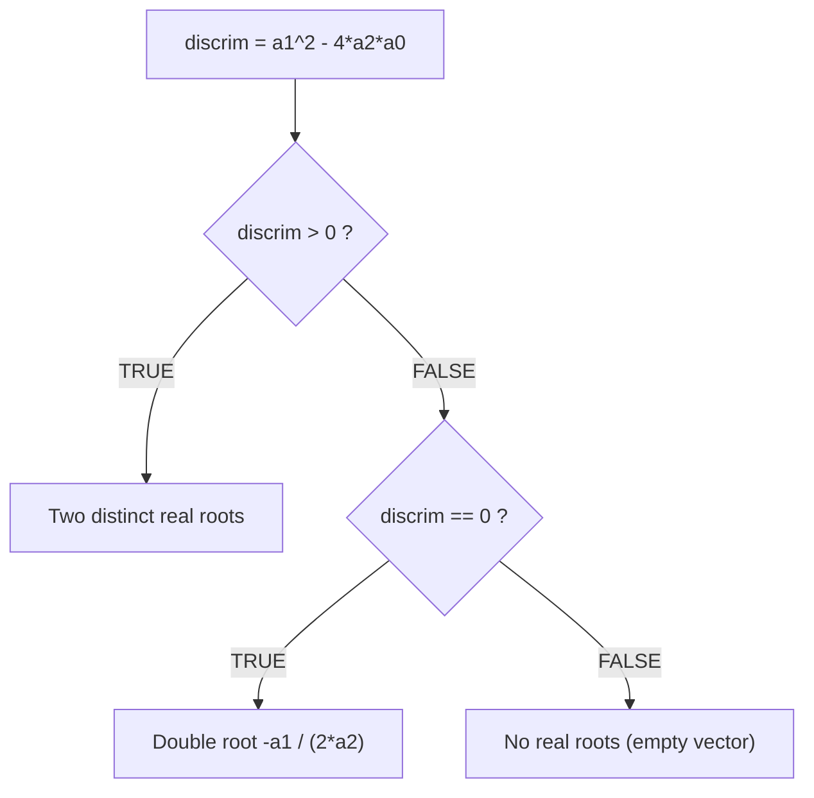

# Chapter 3 — Functions and Control Flow

[Repository Guide](../../README.md) | [English](Concepts_Lecture.md) | [한국어](Concepts_Lecture.ko.md)

> **Last Updated:** 2026-10-18
>
> 혼자 공부하는 R 데이터 분석, 강전희와 엄동란, Ch 3

> **Learning Objectives:**
> 1. Write custom functions in R with proper parameter handling
> 2. Apply control flow structures (if/else, for, while)
> 3. Use built-in R functions effectively for data manipulation

---

## Table of Contents

- [1. Variables and Functions](#1-variables-and-functions)
  - [1.1 Basic Variable Assignment](#11-basic-variable-assignment)
  - [1.2 Built-in Functions](#12-built-in-functions)
- [2. Output Functions](#2-output-functions)
  - [2.1 print() vs. cat()](#21-print-vs-cat)
- [3. User-Defined Functions](#3-user-defined-functions)
  - [3.1 Function Syntax](#31-function-syntax)
  - [3.2 Example: Multiplication Function](#32-example-multiplication-function)
  - [3.3 Example: Rescale Function](#33-example-rescale-function)
  - [3.4 When to Write a Function](#34-when-to-write-a-function)
- [4. Packages](#4-packages)
  - [4.1 Installing and Loading Packages](#41-installing-and-loading-packages)
  - [4.2 Common Packages Used in This Course](#42-common-packages-used-in-this-course)
- [5. Tibbles](#5-tibbles)
  - [5.1 Tibble vs. Data Frame](#51-tibble-vs-data-frame)
  - [5.2 Manual Normalization (Without Functions)](#52-manual-normalization-without-functions)
  - [5.3 Handling NA Values](#53-handling-na-values)
- [6. Operators](#6-operators)
  - [6.1 Arithmetic Operators](#61-arithmetic-operators)
  - [6.2 Relational (Comparison) Operators](#62-relational-comparison-operators)
  - [6.3 Logical Operators](#63-logical-operators)
  - [6.4 Vectorized Comparisons](#64-vectorized-comparisons)
- [7. Conditional Statements](#7-conditional-statements)
  - [7.1 if-else Syntax](#71-if-else-syntax)
  - [7.2 Example: Quadratic Formula Solver](#72-example-quadratic-formula-solver)
- [8. Loops](#8-loops)
  - [8.1 For Loop](#81-for-loop)
  - [8.2 While Loop](#82-while-loop)
- [Summary](#summary)
- [Self-Check Questions](#self-check-questions)

---

<br>

## 1. Variables and Functions

### 1.1 Basic Variable Assignment

```r
x <- 10        # Assign numeric value
y <- "HI"      # Assign character value
```

### 1.2 Built-in Functions

R provides many built-in functions for common operations.

```r
print("Hello World")   # Output a value to the console
sum(1:100)              # Sum of integers from 1 to 100 -> 5050
Sys.Date()              # Get current system date
```

> **Key Point:** Functions like `sum()`, `mean()`, `min()`, `max()` are part of R's `base` package and are always available without loading additional libraries.

---

<br>

## 2. Output Functions

### 2.1 print() vs. cat()

| Function | Behavior |
|----------|----------|
| `print()` | Outputs one object at a time, includes type formatting |
| `cat()` | Concatenates and outputs multiple objects, plain text |

*Table 1. Behavior of print() and cat()*

```r
x <- c(1, 2, 3)
y <- "a"

# print() can only handle one object at a time
print(x)              # [1] 1 2 3
# print(x, y)         # ERROR: invalid printing digits
print(x); print(y)    # Works: prints separately

# cat() concatenates multiple objects
cat(x, y)             # 1 2 3 a (plain text, no formatting)
cat("Value:", x, "\n") # Supports newline characters
```

`print(x, y)` raises an error because the second argument of `print()` is interpreted not as an object to print but as the number of significant digits (`digits`).

> **Key Point:** Use `print()` for formatted output of single objects. Use `cat()` when you need to combine multiple values or include custom formatting with `\n` (newline).

---

<br>

## 3. User-Defined Functions

### 3.1 Function Syntax

A user-defined function has four components.

1. **Function name:** It is stored in the R environment and used to call the function.
2. **Parameters:** They are the input variables passed when the function is called.
3. **Function body:** It is the code that implements the logic of the function.
4. **Return value:** It is the result produced by the function.

```r
# General syntax
function_name <- function(param1, param2, ...) {
  # Function body
  ...
  return(result)
}
```

### 3.2 Example: Multiplication Function

```r
multi_f <- function(x, y, z) {
  res <- x * y * z
  return(res)
}

multi_f(3, 5, 6)   # Returns 90

a <- multi_f(3, 5, 6)
a                    # 90
```

### 3.3 Example: Rescale Function

The following practical example normalizes values to the [0, 1] range.

```r
rescale <- function(x) {
  rng <- range(x, na.rm = TRUE)
  cat("The range is ", rng, "\n")
  (x - rng[1]) / (rng[2] - rng[1])
}

rescale(c(0, 5, 10))               # 0.0 0.5 1.0
rescale(c(0, 5, 10, NA, NA))       # 0.0 0.5 1.0 NA NA
```

`range()` returns a vector of length 2 that holds the minimum and the maximum, and it ignores `NA` when `na.rm = TRUE`. `rescale()` has no `return()`, but an R function returns the value of the last evaluated expression, so the result of `(x - rng[1]) / (rng[2] - rng[1])` becomes the return value.

> **Caution:** If all values are equal, `rng[2] - rng[1]` is 0 and the function computes 0 / 0, so `rescale(c(5, 5, 5))` returns `NaN NaN NaN`.

### 3.4 When to Write a Function

On when to write a function, *R for Data Science* gives the following rule of thumb, often called the **Rule of Three**.

In the words of the book, "You should consider writing a function whenever you've copied and pasted a block of code more than twice."

The three key steps to creating a function are as follows.
1. Pick a descriptive **name** for the function.
2. List the **arguments** (inputs) inside `function()`.
3. Place the working code in the **body** (the `{ }` block).

> **Key Point:** It is easier to start with working code and then turn it into a function, rather than creating a function first and then trying to make it work.

---

<br>

## 4. Packages

### 4.1 Installing and Loading Packages

```r
# Install a package from CRAN
install.packages("tibble")

# Load a package into the current session
library(tibble)

# Alternative: use require() (returns FALSE instead of error if not found)
require(graphics)
```

### 4.2 Common Packages Used in This Course

| Package | Purpose |
|---------|---------|
| `tibble` | Modern data frames |
| `tidyverse` | Meta-package (includes ggplot2, dplyr, tidyr, etc.) |
| `ggplot2` | Data visualization |
| `dplyr` | Data manipulation |
| `nycflights13` | Practice dataset (NYC flights) |

*Table 2. Common packages and their purposes*

---

<br>

## 5. Tibbles

### 5.1 Tibble vs. Data Frame

A **tibble** is a modern reimagining of the data frame from the `tibble` package, and it is part of the `tidyverse` ecosystem.

```r
# Create a tibble with random normal data
df <- tibble::tibble(
  a = rnorm(10),
  b = rnorm(10),
  c = rnorm(10),
  d = rnorm(10)
)
df
```

`rnorm(10)` generates 10 random numbers from the standard normal distribution, so `df` is a tibble with 10 rows and 4 columns.

### 5.2 Manual Normalization (Without Functions)

The following repetitive code motivates the need for functions.

```r
# Normalize each column to [0, 1] range (verbose approach)
df$a <- (df$a - min(df$a, na.rm = TRUE)) /
  (max(df$a, na.rm = TRUE) - min(df$a, na.rm = TRUE))
df$b <- (df$b - min(df$b, na.rm = TRUE)) /
  (max(df$b, na.rm = TRUE) - min(df$b, na.rm = TRUE))
# ... repeated for each column
```

This repetitive pattern is exactly the reason to create a `rescale()` function.

### 5.3 Handling NA Values

```r
# NA represents missing values in R
a2 <- c(5, 2, 100, 25, NA, 6)
min(a2)                   # NA (any operation with NA returns NA)
min(a2, na.rm = TRUE)     # 2 (na.rm = TRUE ignores NA values)
```

Most operations that involve `NA` return `NA`, but operations whose result does not depend on the actual value of `NA`, such as `NA^0` (result 1) and `TRUE | NA` (result `TRUE`), are exceptions.

> **Key Point:** To calculate summary statistics while excluding missing values (`NA`) from data that may contain them, set `na.rm = TRUE`.

---

<br>

## 6. Operators

### 6.1 Arithmetic Operators

| Operator | Operation | Example |
|----------|-----------|---------|
| `+` | Addition | `5 + 3` -> `8` |
| `-` | Subtraction | `10 - 4` -> `6` |
| `*` | Multiplication | `5 * 6` -> `30` |
| `/` | Division | `20 / 4` -> `5` |
| `%/%` | Integer division | `20 %/% 7` -> `2` |
| `%%` | Modulo (remainder) | `20 %% 7` -> `6` |
| `^` or `**` | Exponentiation | `6 ^ 2` -> `36` |

*Table 3. Arithmetic operators*

### 6.2 Relational (Comparison) Operators

| Operator | Meaning | Example | Result |
|----------|---------|---------|--------|
| `>` | Greater than | `5 > 3` | `TRUE` |
| `>=` | Greater or equal | `5 >= 6` | `FALSE` |
| `<` | Less than | `5 < 3` | `FALSE` |
| `<=` | Less or equal | `5 <= 6` | `TRUE` |
| `==` | Equal to | `5 == 5` | `TRUE` |
| `!=` | Not equal to | `5 != 5` | `FALSE` |
| `!` | Logical NOT | `!5` | `FALSE` |

*Table 4. Relational operators and the logical negation operator*

The last row of Table 4, `!`, is a logical operator rather than a relational operator. R treats any nonzero number as `TRUE`, so `!5` is `FALSE`.

### 6.3 Logical Operators

`&` and `|` compute AND and OR between the elements at the same position of two logical vectors.

```r
x <- 1:3
y <- 3:1

(x > 0) & (y > 1)   # Element-wise AND: TRUE TRUE FALSE
(x > 0) | (y > 1)   # Element-wise OR:  TRUE TRUE TRUE
```

### 6.4 Vectorized Comparisons

```r
a <- c(1, 5, 10)
a > 3    # FALSE TRUE TRUE (element-wise comparison)
```

---

<br>

## 7. Conditional Statements

### 7.1 if-else Syntax

```r
if (condition) {
  # Code executed when condition is TRUE
} else {
  # Code executed when condition is FALSE
}
```

### 7.2 Example: Quadratic Formula Solver

```r
# Find the zeros of a2*x^2 + a1*x + a0 = 0
rm(list = ls())

# Input coefficients
a2 <- 1
a1 <- 4
a0 <- 0

# Calculate the discriminant
discrim <- a1^2 - 4 * a2 * a0

# Calculate roots based on discriminant value
if (discrim > 0) {
  roots <- c(
    (-a1 + sqrt(a1^2 - 4*a2*a0)) / (2*a2),
    (-a1 - sqrt(a1^2 - 4*a2*a0)) / (2*a2)
  )
} else if (discrim == 0) {
  roots <- -a1 / (2 * a2)
} else {
  roots <- c()   # No real roots
}
show(roots)
```



*Figure 1. if-else branches by the sign of the discriminant*

With the coefficients above, the discriminant is $4^2 - 4 \cdot 1 \cdot 0 = 16 > 0$, so the first branch runs and computes the two roots 0 and -4, and `show(roots)` prints `[1]  0 -4`.

> **Key Point:** At the top level of the console or a script, `else` must be on the same line as the closing brace `}` of the previous block. If a line ends at `}`, R treats the `if` statement as complete and reports the `else` on the next line as a syntax error. In an `if` statement inside a braced block, such as a function body, `else` on the next line also works, and placing the opening brace `{` on the same line as `if` or `else` is a common style convention rather than a syntax requirement.

---

<br>

## 8. Loops

### 8.1 For Loop

```r
x_list <- seq(1, 9, by = 2)   # 1, 3, 5, 7, 9

sum_x <- 0
for (x in x_list) {
  sum_x <- sum_x + x
  cat("The current loop element is ", x, "\n")
  cat("The cumulative total is ", sum_x, "\n")
}
```

**Output:**
```text
The current loop element is  1
The cumulative total is  1
The current loop element is  3
The cumulative total is  4
...
The current loop element is  9
The cumulative total is  25
```

The `...` in the output omits the iterations for the elements 5 and 7. `cat()` inserts one space between its arguments, so together with the space at the end of the string, two spaces appear before each number.

### 8.2 While Loop

```r
counter <- 1
while (counter <= 5) {
  cat("Counter:", counter, "\n")
  counter <- counter + 1
}
```

`while` repeats its body as long as the condition is `TRUE`, so the code above prints five lines from `Counter: 1` to `Counter: 5`. If the body did not increase `counter`, the condition would stay `TRUE` and the loop would never end.

---

<br>

## Summary

| Concept | Key Summary |
|---------|-----------|
| `print()` vs `cat()` | `print()` prints a single object with formatting, and `cat()` concatenates several values into plain text. |
| User-defined functions | A user-defined function consists of a name, parameters, a body, and a return value, and it is worth writing when the same code is repeated three or more times. |
| Packages | A package is installed with `install.packages()` and loaded with `library()`. |
| Tibbles | A tibble is a modern data frame that belongs to the tidyverse. |
| NA handling | Setting `na.rm = TRUE` in summary functions excludes missing values from the calculation. |
| Operators | R has arithmetic (`+`, `%%`), relational (`>`, `==`), and logical (`&`, `\|`) operators. |
| if-else | if-else chooses the code to run by a condition, and at the top level `else` must be on the same line as `}`. |
| for loop | A for loop takes the elements of a vector or list one by one and repeats its body. |
| `rescale()` | `rescale()` is an example of the DRY (Don't Repeat Yourself) principle, which wraps repetitive code in a function. |

---

<br>

## Self-Check Questions

1. **Tracing a function:** For `rescale()` in Section 3.3, give the line that `rescale(c(2, 4, 10))` prints to the console and its return value. Also give the result of `rescale(c(5, 5, 5))` and the reason.

   <details>
   <summary>Answer</summary>

   The range is 2 to 10, so `The range is  2 10` is printed first. Subtracting 2 from each value and dividing by 10 - 2 = 8 gives 0 / 8 = 0, 2 / 8 = 0.25, and 8 / 8 = 1, so the return value is 0.00, 0.25, 1.00. For `rescale(c(5, 5, 5))`, the minimum and maximum are both 5, so the denominator is 0 and the function computes 0 / 0, which returns `NaN NaN NaN`.

   </details>

2. **Handling missing values:** For `a <- c(3, NA, 7, 1)`, give the results of `max(a)`, `max(a, na.rm = TRUE)`, and `sum(a, na.rm = TRUE)`.

   <details>
   <summary>Answer</summary>

   `max(a)` is `NA` because the maximum cannot be determined when `NA` is present. With `na.rm = TRUE`, the calculation uses 3, 7, 1 without `NA`, so `max()` is 7 and `sum()` is 3 + 7 + 1 = 11.

   </details>

3. **Operators:** Give the results of `10 %/% 3`, `10 %% 3`, and `(1:4 > 2) & (4:1 > 1)`.

   <details>
   <summary>Answer</summary>

   Since 10 = 3 × 3 + 1, `10 %/% 3` is 3 and `10 %% 3` is 1. `1:4 > 2` is `FALSE FALSE TRUE TRUE` and `4:1 > 1` is `TRUE TRUE TRUE FALSE`, so the element-wise AND is `FALSE FALSE TRUE FALSE`.

   </details>

4. **Conditional statements:** In the code of Section 7.2, what does `roots` become if the coefficients are changed to `a2 <- 1`, `a1 <- -5`, and `a0 <- 6`? What about `a2 <- 1`, `a1 <- 2`, and `a0 <- 1`?

   <details>
   <summary>Answer</summary>

   In the first case, the discriminant is $(-5)^2 - 4 \cdot 1 \cdot 6 = 1 > 0$, so the first branch runs, and the two roots are (5 + 1) / 2 = 3 and (5 - 1) / 2 = 2, so `roots` is `c(3, 2)`. In the second case, the discriminant is $2^2 - 4 \cdot 1 \cdot 1 = 0$, so the `else if` branch runs, and `roots` is -2 / 2 = -1.

   </details>

5. **Tracing a loop:** Give the value of `s` and the number of times the body runs after the following code is executed.

   ```r
   s <- 0
   for (i in seq(2, 10, by = 4)) {
     s <- s + i
   }
   ```

   <details>
   <summary>Answer</summary>

   `seq(2, 10, by = 4)` is 2, 6, 10, so the body runs 3 times, and `s` is 2 + 6 + 10 = 18.

   </details>
