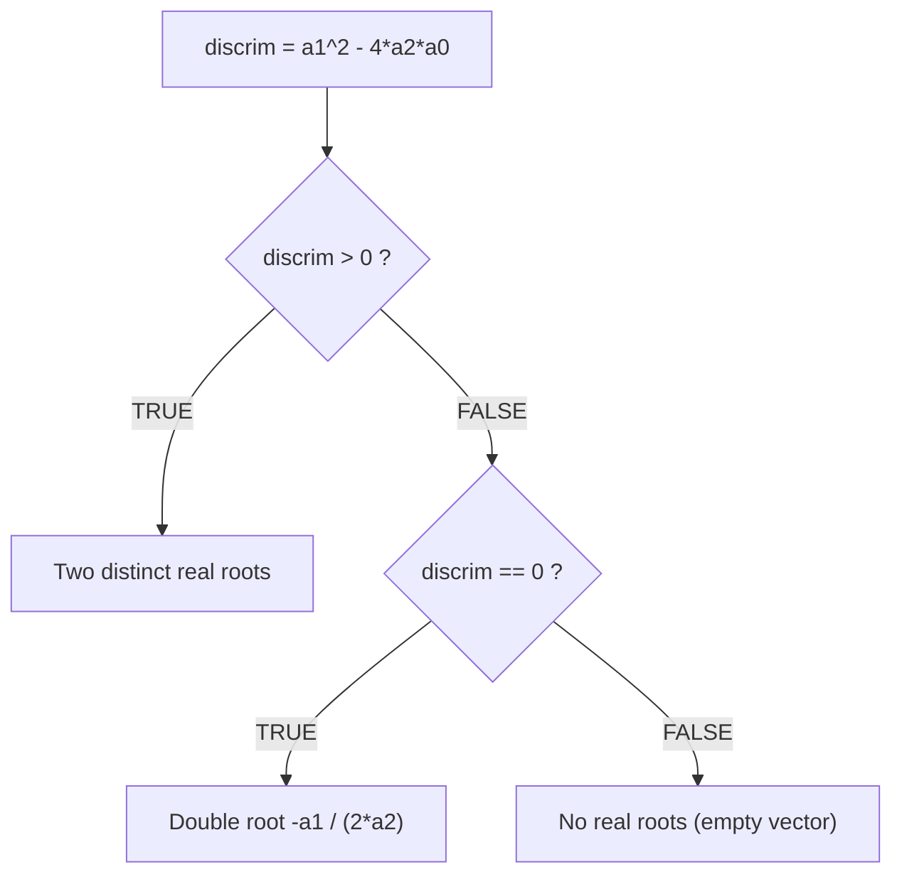
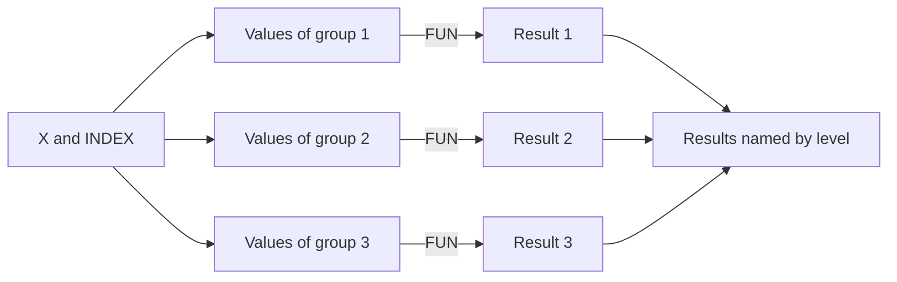

# Chapter 3 — Functions and Control Flow

[Repository Guide](../../README.md) | [English](Concepts_Lecture.md) | [한국어](Concepts_Lecture.ko.md)

> **Last Updated:** 2026-11-19
>
> 혼자 공부하는 R 데이터 분석, 강전희와 엄동란, Ch 3

> **Learning Objectives:**
> 1. Write custom functions in R with proper parameter handling
> 2. Apply control flow structures (if/else, for, while)
> 3. Use built-in R functions effectively for data manipulation
> 4. Explain positional and named arguments, default values, and the scope of functions
> 5. Detect and exclude missing values, and distinguish `&` from `&&` and `if` from `ifelse()`
> 6. Apply a function to each row, column, or group without loops using `apply()`, `lapply()`, `sapply()`, and `tapply()`

---

## Table of Contents

- [1. Variables and Functions](#1-variables-and-functions)
  - [1.1 Basic Variable Assignment](#11-basic-variable-assignment)
  - [1.2 Built-in Functions](#12-built-in-functions)
  - [1.3 Function Calls and Arguments](#13-function-calls-and-arguments)
- [2. Output Functions](#2-output-functions)
  - [2.1 print() vs. cat()](#21-print-vs-cat)
  - [2.2 Building Strings](#22-building-strings)
- [3. User-Defined Functions](#3-user-defined-functions)
  - [3.1 Function Syntax](#31-function-syntax)
  - [3.2 Example: Multiplication Function](#32-example-multiplication-function)
  - [3.3 Example: Rescale Function](#33-example-rescale-function)
  - [3.4 When to Write a Function](#34-when-to-write-a-function)
  - [3.5 Default Values and Returning Several Values](#35-default-values-and-returning-several-values)
  - [3.6 Scope](#36-scope)
  - [3.7 Input Checks: stop() and warning()](#37-input-checks-stop-and-warning)
  - [3.8 Example: A Function for the Roots of a Quadratic Equation](#38-example-a-function-for-the-roots-of-a-quadratic-equation)
- [4. Packages](#4-packages)
  - [4.1 Installing and Loading Packages](#41-installing-and-loading-packages)
  - [4.2 Common Packages](#42-common-packages)
  - [4.3 Name Conflicts and the :: Operator](#43-name-conflicts-and-the--operator)
- [5. Tibbles](#5-tibbles)
  - [5.1 Tibble vs. Data Frame](#51-tibble-vs-data-frame)
  - [5.2 Manual Normalization (Without Functions)](#52-manual-normalization-without-functions)
  - [5.3 Handling NA Values](#53-handling-na-values)
  - [5.4 Detecting and Excluding Missing Values](#54-detecting-and-excluding-missing-values)
- [6. Operators](#6-operators)
  - [6.1 Arithmetic Operators](#61-arithmetic-operators)
  - [6.2 Relational (Comparison) Operators](#62-relational-comparison-operators)
  - [6.3 Logical Operators](#63-logical-operators)
  - [6.4 Vectorized Comparisons](#64-vectorized-comparisons)
  - [6.5 Difference Between && and || Operators](#65-difference-between--and--operators)
  - [6.6 Functions That Summarize Logical Vectors](#66-functions-that-summarize-logical-vectors)
- [7. Conditional Statements](#7-conditional-statements)
  - [7.1 if-else Syntax](#71-if-else-syntax)
  - [7.2 Example: Quadratic Formula Solver](#72-example-quadratic-formula-solver)
  - [7.3 Length of the Condition and Missing Values](#73-length-of-the-condition-and-missing-values)
  - [7.4 Vectorized Conditions: ifelse()](#74-vectorized-conditions-ifelse)
  - [7.5 switch()](#75-switch)
- [8. Loops](#8-loops)
  - [8.1 For Loop](#81-for-loop)
  - [8.2 While Loop](#82-while-loop)
  - [8.3 Computing with the Loop Variable](#83-computing-with-the-loop-variable)
  - [8.4 Nested for Loops](#84-nested-for-loops)
  - [8.5 break, next, repeat](#85-break-next-repeat)
  - [8.6 seq_along() and Preallocation](#86-seq_along-and-preallocation)
- [9. The apply Family of Functions](#9-the-apply-family-of-functions)
  - [9.1 apply(): Rows and Columns of a Matrix](#91-apply-rows-and-columns-of-a-matrix)
  - [9.2 tapply(): Applying by Group](#92-tapply-applying-by-group)
  - [9.3 lapply() and sapply(): Elements of a List](#93-lapply-and-sapply-elements-of-a-list)
  - [9.4 Example: Applying User-Defined Functions to a List](#94-example-applying-user-defined-functions-to-a-list)
  - [9.5 Choosing a Function](#95-choosing-a-function)
- [Concept Applications](#concept-applications)
- [Glossary](#glossary)
- [Summary](#summary)
- [Self-Check Questions](#self-check-questions)
- [References](#references)

---

<br>

## 1. Variables and Functions

### 1.1 Basic Variable Assignment

```r
x <- 10        # Assign numeric value
y <- "HI"      # Assign character value
```

The rules for variable names are the same as in Section 3 of Chapter 1. The first character must be a letter or a period, a name cannot start with a digit or an underscore, special characters other than the period and underscore and spaces cannot be used, and upper and lower case are distinguished. So `exam`, `.exam`, `e1axm`, `e_xam`, `e1_am`, and `Exam` can be used, but `1exam`, `_exam`, `$exam`, and `ex a` cannot.

### 1.2 Built-in Functions

R provides many built-in functions for common operations.

```r
print("Hello World")   # Output a value to the console
sum(1:100)              # Sum of integers from 1 to 100 -> 5050
Sys.Date()              # Get current system date
```

> **Key Point:** Functions like `sum()`, `mean()`, `min()`, `max()` are part of R's `base` package and are always available without loading additional libraries.

### 1.3 Function Calls and Arguments

A **function** is a bundle of code that takes inputs, performs a fixed computation, and returns a result. The values passed inside the parentheses after the function name are called **arguments**, and they are passed in two ways.

- **By position:** Only the values are written, without names, in the order given in the Usage of the help page. In `seq(1, 10, 3)`, 1, 10, and 3 correspond to `from`, `to`, and `by` in turn.
- **By name:** They are written in the form `name = value`. With a name, the value goes to that argument regardless of order.

```r
x <- c(2.5, 7.1, NA, 4.4)
mean(x)
#> [1] NA
mean(x, na.rm = TRUE)
#> [1] 4.666667
mean(na.rm = TRUE, x = x)
#> [1] 4.666667
mean(x, na = TRUE)
#> [1] 4.666667
round(mean(x, na.rm = TRUE), 1)
#> [1] 4.7
seq(1, 10, 3)
#> [1]  1  4  7 10
seq(by = 3, 1, 10)
#> [1]  1  4  7 10
```

Because `x` has a missing value, `mean(x)` is `NA`, and giving `na.rm = TRUE` yields the mean of 2.5, 7.1, and 4.4, 14 / 3 = 4.666667. With names, as in the third line, changing the order of the arguments gives the same result. The `na = TRUE` in the fourth line writes only the beginning of `na.rm`, and R performs **partial matching**, interpreting a name as an argument when its beginning matches exactly one argument. It works, but it confuses readers and risks colliding with other arguments, so argument names are best written in full. As in the last line, named arguments are matched first and the rest are matched by position, so `seq(by = 3, 1, 10)` equals `seq(1, 10, by = 3)`.

A function call can be nested as the argument of another function, and it is computed from the inside out. `round(mean(x, na.rm = TRUE), 1)` first computes the mean 4.666667 and then rounds it to one decimal place, returning 4.7. By convention, the data, which is the first argument, is passed by position, and the remaining arguments that change how the computation is done are passed by name.

---

<br>

## 2. Output Functions

### 2.1 print() vs. cat()

| Function | Behavior |
|----------|----------|
| `print()` | Outputs one object at a time, includes type formatting |
| `cat()` | Concatenates and outputs multiple objects, plain text |

*Table 1. Behavior of print() and cat()*

```r
x <- c(1, 2, 3)
y <- "a"

# print() can only handle one object at a time
print(x)              # [1] 1 2 3
# print(x, y)         # ERROR: invalid printing digits
print(x); print(y)    # Works: prints separately

# cat() concatenates multiple objects
cat(x, y)             # 1 2 3 a (plain text, no formatting)
cat("Value:", x, "\n") # Supports newline characters
```

`print(x, y)` raises an error because the second argument of `print()` is interpreted not as an object to print but as the number of significant digits (`digits`).

> **Key Point:** Use `print()` for formatted output of single objects. Use `cat()` when you need to combine multiple values or include custom formatting with `\n` (newline).

### 2.2 Building Strings

To build a sentence for output, use functions that join values into strings.

```r
name <- "Kim"; score <- 87.456
paste("Name:", name)
#> [1] "Name: Kim"
paste0("ID_", 1:3)
#> [1] "ID_1" "ID_2" "ID_3"
paste(c("a", "b"), collapse = "+")
#> [1] "a+b"
sprintf("%s scored %.1f points", name, score)
#> [1] "Kim scored 87.5 points"
sprintf("%05d", 42)
#> [1] "00042"
format(1234567.891, big.mark = ",")
#> [1] "1,234,568"
format(0.5, nsmall = 2)
#> [1] "0.50"
print(pi, digits = 3)
#> [1] 3.14
message("This is a message")
#> This is a message
```

`paste()` joins its arguments with a space between them, and `paste0()` joins them without a separator. Both are vectorized, so `paste0("ID_", 1:3)` recycles the length-1 `"ID_"` to make three strings. Giving `collapse` joins the elements of a vector with that separator into a single string. `sprintf()` fills the placeholders in a format string with values in order.

| Placeholder | Meaning | Example | Result |
|:--|:--|:--|:--|
| `%s` | String | `sprintf("%s", "Kim")` | `"Kim"` |
| `%d` | Integer | `sprintf("%d", 42L)` | `"42"` |
| `%.1f` | Real number to one decimal place | `sprintf("%.1f", 87.456)` | `"87.5"` |
| `%05d` | Five digits, blanks filled with 0 | `sprintf("%05d", 42)` | `"00042"` |
| `%%` | The character % itself | `sprintf("%d%%", 30L)` | `"30%"` |

*Table 2. Main placeholders of sprintf()*

`format()` returns a string with the number made easy to read; `big.mark = ","` adds thousands separators and `nsmall = 2` sets the minimum number of decimal places. The result of `format(1234567.891, big.mark = ",")` is `"1,234,568"` because R displays only 7 significant digits by default. `message()` is used to print an informational sentence rather than a result, and it corresponds to the message among the three notices distinguished in Section 3 of Chapter 1.

---

<br>

## 3. User-Defined Functions

### 3.1 Function Syntax

A user-defined function has four components.

1. **Function name:** It is stored in the R environment and used to call the function.
2. **Parameters:** They are the input variables passed when the function is called.
3. **Function body:** It is the code that implements the logic of the function.
4. **Return value:** It is the result produced by the function.

```r
# General syntax
function_name <- function(param1, param2, ...) {
  # Function body
  ...
  return(result)
}
```

The names written in the parentheses when a function is defined are called **parameters**, and the values actually passed when the function is called are called **arguments**. A user-defined function is a function made by the user in addition to the predefined built-in functions, and bundling repeated work into a function automates it. A function may have no parameters or several, and without `return()`, the value of the last expression evaluated in the body becomes the result.

### 3.2 Example: Multiplication Function

```r
multi_f <- function(x, y, z) {
  res <- x * y * z
  return(res)
}

multi_f(3, 5, 6)   # Returns 90

a <- multi_f(3, 5, 6)
a                    # 90
```

### 3.3 Example: Rescale Function

The following practical example normalizes values to the [0, 1] range.

```r
rescale <- function(x) {
  rng <- range(x, na.rm = TRUE)
  cat("The range is ", rng, "\n")
  (x - rng[1]) / (rng[2] - rng[1])
}

rescale(c(0, 5, 10))               # 0.0 0.5 1.0
rescale(c(0, 5, 10, NA, NA))       # 0.0 0.5 1.0 NA NA
```

`range()` returns a vector of length 2 that holds the minimum and the maximum, and it ignores `NA` when `na.rm = TRUE`. `rescale()` has no `return()`, but an R function returns the value of the last evaluated expression, so the result of `(x - rng[1]) / (rng[2] - rng[1])` becomes the return value.

> **Caution:** If all values are equal, `rng[2] - rng[1]` is 0 and the function computes 0 / 0, so `rescale(c(5, 5, 5))` returns `NaN NaN NaN`.

### 3.4 When to Write a Function

On when to write a function, *R for Data Science* gives the following rule of thumb, often called the **Rule of Three**.

In the words of the book, "You should consider writing a function whenever you've copied and pasted a block of code more than twice."

The three key steps to creating a function are as follows.
1. Pick a descriptive **name** for the function.
2. List the **arguments** (inputs) inside `function()`.
3. Place the working code in the **body** (the `{ }` block).

> **Key Point:** It is easier to start with working code and then turn it into a function, rather than creating a function first and then trying to make it work.

Bundling code into a function has three benefits. First, giving the function a name that reveals its meaning makes it easy to read what the code does. Second, when requirements change, only the function needs to be changed, not many places. Third, it eliminates the mistake of changing a variable name in one place but forgetting it in another while copying and pasting. The repeated code of Section 5.2 is a typical example in which this third mistake easily happens.

### 3.5 Default Values and Returning Several Values

Setting a **default value** for a parameter with `name = value` lets that argument be omitted in calls.

```r
power <- function(x, p = 2) {
  x^p
}
power(3)
#> [1] 9
power(3, 3)
#> [1] 27
power(p = 0.5, x = 16)
#> [1] 4
```

`power(3)` omits `p`, so it uses the default 2 and returns $`3^2 = 9`$. In `power(3, 3)`, the second argument goes to `p` by position, giving $`3^3 = 27`$, and `power(p = 0.5, x = 16)` is $`16^{0.5} = \sqrt{16} = 4`$. Keeping a frequently used setting as a default and letting it be changed only when necessary is common in built-in functions too, as in `na.rm = FALSE` of `mean()` and `digits = 0` of `round()`.

A function returns only one value, so to return several results, put them in a list (Section 4 of Chapter 2).

```r
summary_stats <- function(x) {
  list(mean = mean(x), sd = sd(x), n = length(x))
}
res <- summary_stats(c(4, 8, 6, 2))
res
#> $mean
#> [1] 5
#> 
#> $sd
#> [1] 2.581989
#> 
#> $n
#> [1] 4
res$sd
#> [1] 2.581989
```

The mean of 4, 8, 6, 2 is 20 / 4 = 5. The standard deviation is the square root of the variance 6.667, obtained by squaring the differences from the mean, -1, 3, 1, -3, adding them to 1 + 9 + 1 + 9 = 20, and dividing by n - 1 = 3, so it is about 2.582. The elements of the result list are accessed by name, as in `res$sd`.

### 3.6 Scope

A variable created inside a function is a **local variable** that exists only while the function runs, and it does not affect a variable of the same name outside the function. The rule that determines which value a variable name refers to in which region is called **scope**.

```r
z <- 10
f <- function() {
  z <- 1
  z + 1
}
f()
#> [1] 2
z
#> [1] 10
g <- function(y) {
  y + z
}
g(5)
#> [1] 15
```

The `z <- 1` inside `f()` only creates a new local variable `z` inside the function, so `f()` returns 2 and the `z` outside the function is still 10. Conversely, `g()` has no `z` inside, so R looks for `z` in the outer environment where the function was defined, uses 10, and `g(5)` becomes 15. R thus searches outward for names starting from where a function is **defined**, which is called **lexical scoping**. If a function depends on an outer variable, its result changes whenever that variable changes, so it is safer to pass the values a function needs as arguments.

> **[Programming Languages]** Lexical (static) scoping determines the meaning of a variable from the structure of the code alone, and dynamic scoping determines it from the order of calls at run time. R, Python, and Scheme use lexical scoping.

### 3.7 Input Checks: stop() and warning()

When a function receives invalid input, it is better to report it at once than to produce a wrong result. `stop()` raises an error and halts execution, and `warning()` only leaves a warning and continues the computation.

```r
safe_sqrt <- function(x) {
  if (!is.numeric(x)) stop("x must be numeric")
  if (any(x < 0)) warning("negative values give NaN")
  sqrt(x)
}
safe_sqrt(c(4, 9))
#> [1] 2 3
safe_sqrt(c(4, -1))
#> Warning in safe_sqrt(c(4, -1)): negative values give NaN
#> Warning in sqrt(x): NaNs produced
#> [1]   2 NaN
safe_sqrt("a")
#> Error in safe_sqrt("a"): x must be numeric
```

The first call has no negative values, so it returns 2 and 3 without a warning. The second call contains a negative value, so the function's own warning and the warning of `sqrt()` appear in turn, and the second element of the result is `NaN`. The third call receives a string, so `stop()` runs and execution halts without a result. When an `if` statement on one line has a single body, the braces can be omitted. `any(x < 0)` is `TRUE` if at least one element is negative (Section 6.6).

### 3.8 Example: A Function for the Roots of a Quadratic Equation

The quadratic-equation code in Section 7.2 must be edited each time the coefficients change. Turning it into a function that takes the coefficients as arguments and also handling a zero second-order coefficient gives the following. The function finds the roots of $`a_2 x^2 + a_1 x + a_0 = 0`$.

```r
quad3 <- function(a0, a1, a2) {
  # find the zeros of a2*x^2 + a1*x + a0 = 0
  if (a2 == 0 && a1 == 0 && a0 == 0) {
    roots <- NA
  } else if (a2 == 0 && a1 == 0) {
    roots <- NULL
  } else if (a2 == 0) {
    roots <- -a0/a1
  } else {
    # calculate the discriminant
    discrim <- a1^2 - 4*a2*a0
    # calculate the roots depending on the value of the discriminant
    if (discrim > 0) {
      roots <- (-a1 + c(1,-1) * sqrt(a1^2 - 4*a2*a0))/(2*a2)
    } else if (discrim == 0) {
      roots <- -a1/(2*a2)
    } else {
      roots <- NULL
    }
  }
  return(roots)
}
quad3(1, 0, -1)
#> [1] -1  1
quad3(1, -2, 1)
#> [1] 1
quad3(1, 1, 1)
#> NULL
quad3(6, 2, 0)
#> [1] -3
quad3(0, 0, 0)
#> [1] NA
```

The function checks four cases in turn. If all three coefficients are 0, every x satisfies the equation, so it returns `NA` to mean that the root cannot be pinned down. If $`a_2 = a_1 = 0`$ and $`a_0 \ne 0`$, the equation becomes the false equality $`a_0 = 0`$ and has no root, so it returns `NULL`. If $`a_2 = 0`$ and $`a_1 \ne 0`$, it is a linear equation, so $`x = -a_0 / a_1`$. The remaining case is a quadratic equation, and the sign of the discriminant determines the number of roots.

Noting that the argument order is (a0, a1, a2), each call is computed as follows. `quad3(1, 0, -1)` is $`-x^2 + 1 = 0`$, and its discriminant is $`0^2 - 4 \times (-1) \times 1 = 4 > 0`$. Because `c(1, -1)` computes both signs at once, the roots are $`(0 + 2) / (-2) = -1`$ and $`(0 - 2) / (-2) = 1`$. `quad3(1, -2, 1)` is $`x^2 - 2x + 1 = 0`$, and its discriminant is 0, so it has the double root $`2 / 2 = 1`$. `quad3(1, 1, 1)` has the discriminant $`1 - 4 = -3 < 0`$ and no real root, so the result is `NULL`. `quad3(6, 2, 0)` is the linear equation $`2x + 6 = 0`$, so the result is -3. The conditions of this function use `&&`, an operator that combines logical values of length 1 (Section 6.5).

---

<br>

## 4. Packages

### 4.1 Installing and Loading Packages

```r
# Install a package from CRAN
install.packages("tibble")

# Load a package into the current session
library(tibble)

# Alternative: use require() (returns FALSE instead of error if not found)
require(graphics)
```

### 4.2 Common Packages

| Package | Purpose |
|---------|---------|
| `tibble` | Modern data frames |
| `tidyverse` | Meta-package (includes ggplot2, dplyr, tidyr, etc.) |
| `ggplot2` | Data visualization |
| `dplyr` | Data manipulation |
| `nycflights13` | Practice dataset (NYC flights) |

*Table 3. Common packages and their purposes*

Some packages bundle the functions and data that accompany a textbook or course. `spuRs`, used in Section 9, is a CRAN package containing the functions and datasets of *Introduction to Scientific Programming and Simulation Using R* by Jones, Maillardet, and Robinson, and its `ufc` dataset records 336 trees measured in one unit (Upper Flat Creek) of the University of Idaho Experimental Forest in the United States.

### 4.3 Name Conflicts and the :: Operator

Different packages may contain functions with the same name. The function of the package loaded later then hides the earlier one, which is called **masking**. R reports the hidden functions when a package is loaded.

```r
library(dplyr)
#> 
#> Attaching package: 'dplyr'
#> The following objects are masked from 'package:stats':
#> 
#>     filter, lag
#> The following objects are masked from 'package:base':
#> 
#>     intersect, setdiff, setequal, union
stats::filter(1:5, rep(1/3, 3))
#> Time Series:
#> Start = 1 
#> End = 5 
#> Frequency = 1 
#> [1] NA  2  3  4 NA
```

After `dplyr` is loaded, `filter()` refers not to the time series filter of the `stats` package but to the row selection function of `dplyr` used in Chapter 5. To use a hidden function, name its package in the form `package::function`. The `stats::filter(1:5, rep(1/3, 3))` above is a moving-average filter that averages three consecutive values; the second value is (1 + 2 + 3) / 3 = 2, and both ends are `NA` because they lack neighboring values.

The order in which R searches for names can be checked with `search()`. The global environment comes first, followed by the packages from the most recently loaded one. This chapter loaded `tibble` in Section 4.1 and `dplyr` in this section, so the order is `dplyr`, then `tibble`.

```r
search()[1:3]
#> [1] ".GlobalEnv"     "package:dplyr"  "package:tibble"
```

`library()` and `require()` both load a package, but when the package is not installed, `library()` raises an error while `require()` returns `FALSE` with a warning. In scripts, `library()`, which stops at once when a needed package is missing, makes problems easier to find. Installation is needed only once, so `install.packages()` is run in the console rather than left in scripts.

---

<br>

## 5. Tibbles

### 5.1 Tibble vs. Data Frame

A **tibble** is a modern reimagining of the data frame from the `tibble` package, and it is part of the `tidyverse` ecosystem.

```r
# Create a tibble with random normal data
df <- tibble::tibble(
  a = rnorm(10),
  b = rnorm(10),
  c = rnorm(10),
  d = rnorm(10)
)
df
```

`rnorm(10)` generates 10 random numbers from the standard normal distribution, so `df` is a tibble with 10 rows and 4 columns.

Each column of the tibble (`a`-`d`) is a variable, and each row is an observation. The differences between tibbles and data frames in printing, indexing, and name handling are summarized in Section 5 of Chapter 2. The result of `rnorm()` differs on every run, so to obtain the same random numbers again, fix the starting point of the random numbers before it, as in `set.seed(1)`.

### 5.2 Manual Normalization (Without Functions)

The following repetitive code motivates the need for functions.

```r
# Normalize each column to [0, 1] range (verbose approach)
df$a <- (df$a - min(df$a, na.rm = TRUE)) /
  (max(df$a, na.rm = TRUE) - min(df$a, na.rm = TRUE))
df$b <- (df$b - min(df$b, na.rm = TRUE)) /
  (max(df$b, na.rm = TRUE) - min(df$b, na.rm = TRUE))
# ... repeated for each column
```

This repetitive pattern is exactly the reason to create a `rescale()` function.

### 5.3 Handling NA Values

```r
# NA represents missing values in R
a2 <- c(5, 2, 100, 25, NA, 6)
min(a2)                   # NA (any operation with NA returns NA)
min(a2, na.rm = TRUE)     # 2 (na.rm = TRUE ignores NA values)
```

Most operations that involve `NA` return `NA`, but operations whose result does not depend on the actual value of `NA`, such as `NA^0` (result 1) and `TRUE | NA` (result `TRUE`), are exceptions.

> **Key Point:** To calculate summary statistics while excluding missing values (`NA`) from data that may contain them, set `na.rm = TRUE`.

### 5.4 Detecting and Excluding Missing Values

How many missing values real data has, and where, must be checked first to decide how to handle them. Checking with the ozone measurements of `airquality` gives the following.

```r
oz <- airquality$Ozone
length(oz)
#> [1] 153
anyNA(oz)
#> [1] TRUE
sum(is.na(oz))
#> [1] 37
mean(is.na(oz))
#> [1] 0.2418301
mean(oz)
#> [1] NA
mean(oz, na.rm = TRUE)
#> [1] 42.12931
head(which(is.na(oz)))
#> [1]  5 10 25 26 27 32
nrow(airquality)
#> [1] 153
nrow(na.omit(airquality))
#> [1] 111
sum(complete.cases(airquality))
#> [1] 111
```

`is.na()` returns the missingness of each element as a logical value, so by the idiom of Section 1.7 of Chapter 2, `sum(is.na(oz))` is the number of missing values, 37, and `mean(is.na(oz))` is the proportion missing, 37 / 153 ≈ 0.242. `anyNA()` reports only whether there is at least one missing value. `mean(oz, na.rm = TRUE)` is the mean of the 153 - 37 = 116 values without missing values, 42.13. `which(is.na(oz))` gives the positions of the missing values.

At the level of a data frame, `na.omit()` returns the data frame with every row containing at least one missing value removed, and `complete.cases()` returns, for each row, whether it has no missing value. Of the 153 rows of `airquality`, 111 have all columns filled. Looking at ozone alone leaves 116 values, but removing whole rows loses more because of the missing values of solar radiation (`Solar.R`).

> **Caution:** Removing rows with `na.omit()` can lose needed observations because of missing values in columns not used in the analysis. Also, if values are not missing at random (for example, when the instrument broke down during a particular period), the remaining data does not represent the whole. Handle missing values using only the columns used in the analysis, after checking their cause (Section 4 of Chapter 5).

Comparisons and logical operations with missing values follow the rules of Section 3 of Chapter 1.

```r
NA == NA
#> [1] NA
NA & FALSE
#> [1] FALSE
NA | TRUE
#> [1] TRUE
```

Whether two unknown values are equal is unknown, so `NA == NA` is also `NA`. In contrast, `NA & FALSE` is `FALSE` whether `NA` is true or false, and `NA | TRUE` is `TRUE` in either case, so their results are determined.

---

<br>

## 6. Operators

### 6.1 Arithmetic Operators

| Operator | Operation | Example |
|----------|-----------|---------|
| `+` | Addition | `5 + 3` -> `8` |
| `-` | Subtraction | `10 - 4` -> `6` |
| `*` | Multiplication | `5 * 6` -> `30` |
| `/` | Division | `20 / 4` -> `5` |
| `%/%` | Integer division | `20 %/% 7` -> `2` |
| `%%` | Modulo (remainder) | `20 %% 7` -> `6` |
| `^` or `**` | Exponentiation | `6 ^ 2` -> `36` |

*Table 4. Arithmetic operators*

### 6.2 Relational (Comparison) Operators

| Operator | Meaning | Example | Result |
|----------|---------|---------|--------|
| `>` | Greater than | `5 > 3` | `TRUE` |
| `>=` | Greater or equal | `5 >= 6` | `FALSE` |
| `<` | Less than | `5 < 3` | `FALSE` |
| `<=` | Less or equal | `5 <= 6` | `TRUE` |
| `==` | Equal to | `5 == 5` | `TRUE` |
| `!=` | Not equal to | `5 != 5` | `FALSE` |
| `!` | Logical NOT | `!5` | `FALSE` |

*Table 5. Relational operators and the logical negation operator*

The last row of Table 5, `!`, is a logical operator rather than a relational operator. R treats any nonzero number as `TRUE`, so `!5` is `FALSE`.

### 6.3 Logical Operators

`&` and `|` compute AND and OR between the elements at the same position of two logical vectors.

```r
x <- 1:3
y <- 3:1

(x > 0) & (y > 1)   # Element-wise AND: TRUE TRUE FALSE
(x > 0) | (y > 1)   # Element-wise OR:  TRUE TRUE TRUE
```

### 6.4 Vectorized Comparisons

```r
a <- c(1, 5, 10)
a > 3    # FALSE TRUE TRUE (element-wise comparison)
```

### 6.5 Difference Between && and || Operators

`&&` and `||` are operators that combine single logical values of length 1, and they are used where only one true or false value is needed, such as the condition of an `if` statement. This differs from `&` and `|`, which give a result for each element.

```r
x <- 5
x > 0 && x < 10
#> [1] TRUE
c(TRUE, FALSE) & c(TRUE, TRUE)
#> [1]  TRUE FALSE
c(TRUE, FALSE) && TRUE
#> Error in c(TRUE, FALSE) && TRUE: 'length = 2' in coercion to 'logical(1)'
FALSE && stop("never evaluated")
#> [1] FALSE
y <- NULL
!is.null(y) && y > 0
#> [1] FALSE
```

Giving a vector of length 2 or more to `&&` raises an error. Older versions used only the first element and moved on, but from R 4.3.0 it is always an error [1]. Also, `&&` and `||` do not compute the right side when the left side alone determines the result. This is called **short-circuit evaluation**. In `FALSE && stop(...)`, the left side is `FALSE`, so the result is already fixed as `FALSE` and `stop()` is not run. Thanks to this property, a later condition that could raise an error when the earlier condition is false can be chained safely, as in `!is.null(y) && y > 0`. When `y` is `NULL`, `y > 0` becomes a logical value of length 0 that cannot be used as an `if` condition, but it is not computed because the earlier condition already fixes `FALSE`.

| Operator | Input | Length of Result | Right Side Computed | Typical Use |
|:--|:--|:--|:--|:--|
| `&`, `\|` | Logical vectors | Same length as the input | Always | Selecting rows of data, `ifelse()` |
| `&&`, `\|\|` | Logical values of length 1 | 1 | Only when needed | Conditions of `if` and `while` |

*Table 6. Element-wise logical operators and short-circuit logical operators*

### 6.6 Functions That Summarize Logical Vectors

Functions that reduce a judgment about a whole logical vector to one value are also used often.

```r
v <- c(3, 8, -2, 5)
any(v < 0)
#> [1] TRUE
all(v > 0)
#> [1] FALSE
xor(TRUE, FALSE)
#> [1] TRUE
isTRUE(c(TRUE, TRUE))
#> [1] FALSE
3 %in% v
#> [1] TRUE
```

`any()` returns `TRUE` if at least one value is `TRUE`, and `all()` only when all values are `TRUE`. `v` contains -2, so `any(v < 0)` is `TRUE` and `all(v > 0)` is `FALSE`. `xor()` is the exclusive OR, `TRUE` when exactly one of two values is `TRUE`. `isTRUE()` is `TRUE` only when its argument is a single `TRUE` of length 1, so `isTRUE(c(TRUE, TRUE))` is `FALSE`; it is used to make `if` conditions safe when the result must be a single value. `%in%` tests membership as in Section 1.9 of Chapter 2. Using `any()` and `all()` with `&&` and `||` puts conditions about vectors into `if` statements.

---

<br>

## 7. Conditional Statements

### 7.1 if-else Syntax

```r
if (condition) {
  # Code executed when condition is TRUE
} else {
  # Code executed when condition is FALSE
}
```

### 7.2 Example: Quadratic Formula Solver

```r
# Find the zeros of a2*x^2 + a1*x + a0 = 0
rm(list = ls())

# Input coefficients
a2 <- 1
a1 <- 4
a0 <- 0

# Calculate the discriminant
discrim <- a1^2 - 4 * a2 * a0

# Calculate roots based on discriminant value
if (discrim > 0) {
  roots <- c(
    (-a1 + sqrt(a1^2 - 4*a2*a0)) / (2*a2),
    (-a1 - sqrt(a1^2 - 4*a2*a0)) / (2*a2)
  )
} else if (discrim == 0) {
  roots <- -a1 / (2 * a2)
} else {
  roots <- c()   # No real roots
}
show(roots)
```



*Figure 1. if-else branches by the sign of the discriminant*

With the coefficients above, the discriminant is $4^2 - 4 \cdot 1 \cdot 0 = 16 > 0$, so the first branch runs and computes the two roots 0 and -4, and `show(roots)` prints `[1]  0 -4`.

> **Key Point:** At the top level of the console or a script, `else` must be on the same line as the closing brace `}` of the previous block. If a line ends at `}`, R treats the `if` statement as complete and reports the `else` on the next line as a syntax error. In an `if` statement inside a braced block, such as a function body, `else` on the next line also works, and placing the opening brace `{` on the same line as `if` or `else` is a common style convention rather than a syntax requirement.

Braces `{ }` group several expressions into one block and can be omitted when there is only one expression. An `if` statement runs the first block when the condition is `TRUE` and the block after `else` when it is `FALSE`, and the `else` can be omitted. Chaining `else if` checks the conditions from the top in turn and runs only the first branch whose condition is `TRUE`. The first line of this example, `rm(list = ls())`, empties the workspace so that variables from earlier computations do not mix in (Section 3 of Chapter 1).

### 7.3 Length of the Condition and Missing Values

The condition of `if` must be a `TRUE` or `FALSE` of length 1. A condition of length 2 or more, or `NA`, raises an error.

```r
if (c(TRUE, FALSE)) print("yes")
#> Error in if (c(TRUE, FALSE)) print("yes"): the condition has length > 1
if (NA) print("yes")
#> Error in if (NA) print("yes"): missing value where TRUE/FALSE needed
```

Older versions of R gave only a warning for a condition of length 2 or more and used the first element, but from R 4.2.0 it is an error [1]. Such errors usually occur when a whole vector is put in the condition, as in `if (x > 0)`. When a different result is needed for each element, use `ifelse()` of Section 7.4, and when a judgment about the whole vector is needed, reduce it to one value with the functions of Section 6.6, as in `if (all(x > 0))`. When a missing value can be the condition, check for missingness first, as in `if (!is.na(x) && x > 0)`.

### 7.4 Vectorized Conditions: ifelse()

`ifelse(test, yes, no)` returns a vector that picks, for each element of `test`, the value of `yes` when it is `TRUE` and the value of `no` when it is `FALSE`. Unlike an `if` statement, which chooses the code to run, `ifelse()` is a function that chooses values element by element.

```r
temp <- c(58, 72, 85, 91, 66)
ifelse(temp >= 80, "hot", "not hot")
#> [1] "not hot" "not hot" "hot"     "hot"     "not hot"
ifelse(temp >= 80, "hot", ifelse(temp >= 65, "mild", "cool"))
#> [1] "cool" "mild" "hot"  "hot"  "mild"
grade <- function(score) {
  if (score >= 90) {
    "A"
  } else if (score >= 80) {
    "B"
  } else {
    "C"
  }
}
grade(85)
#> [1] "B"
sapply(c(95, 85, 70), grade)
#> [1] "A" "B" "C"
```

In the first `ifelse()`, `temp >= 80` is `FALSE FALSE TRUE TRUE FALSE`, so only the third and fourth become `"hot"`. The second expression nests `ifelse()` to make three categories. 58 fails both conditions and becomes `"cool"`, and 72 and 66 fail only the first and become `"mild"`. `grade()` is a function that decides the grade of one score with `if` and `else if`, so it accepts only a value of length 1. To apply it to several scores, call it for each element with `sapply()` of Section 9 or write it with `ifelse()` from the start. With three or more categories, `case_when()` of Chapter 5 is easier to read than nested `ifelse()`.

### 7.5 switch()

`switch()` chooses one of several expressions according to the value of a single string.

```r
center <- function(x, type) {
  switch(type,
         mean = mean(x),
         median = median(x),
         stop("unknown type"))
}
center(c(1, 2, 10), "mean")
#> [1] 4.333333
center(c(1, 2, 10), "median")
#> [1] 2
```

When `type` is `"mean"`, it returns `mean(x)` = 13 / 3 ≈ 4.333, and when `"median"`, the middle value 2. The last unnamed argument runs when no name matches, so the function raises an error for a value it does not define, such as `"mode"`. The same branching can be written with `if` and `else if`, but `switch()` is more concise when there are many values to choose from. The mean of 1, 2, 10, 4.333, comes out larger than the median 2 because of the large value 10, a difference revisited with the measures of central tendency in Section 7 of Chapter 4.

---

<br>

## 8. Loops

### 8.1 For Loop

```r
x_list <- seq(1, 9, by = 2)   # 1, 3, 5, 7, 9

sum_x <- 0
for (x in x_list) {
  sum_x <- sum_x + x
  cat("The current loop element is ", x, "\n")
  cat("The cumulative total is ", sum_x, "\n")
}
```

**Output:**
```text
The current loop element is  1
The cumulative total is  1
The current loop element is  3
The cumulative total is  4
...
The current loop element is  9
The cumulative total is  25
```

The `...` in the output omits the iterations for the elements 5 and 7. `cat()` inserts one space between its arguments, so together with the space at the end of the string, two spaces appear before each number.

`for (x in vector)` takes the elements of `vector` one at a time, puts each into `x`, and repeats the expressions in the braces as many times as there are elements. A list can also be used in place of `vector`. The cumulative sum `sum_x` changes as 0 → 1 → 1 + 3 = 4 → 4 + 5 = 9 → 9 + 7 = 16 → 16 + 9 = 25. After the loop ends, `x` still holds the last element, 9.

### 8.2 While Loop

```r
counter <- 1
while (counter <= 5) {
  cat("Counter:", counter, "\n")
  counter <- counter + 1
}
```

`while` repeats its body as long as the condition is `TRUE`, so the code above prints five lines from `Counter: 1` to `Counter: 5`. If the body did not increase `counter`, the condition would stay `TRUE` and the loop would never end.

### 8.3 Computing with the Loop Variable

The loop variable can be used as the element itself or as a number from 1 to n. The following code computes and prints `2 * i` for each number `i` from 1 to 9.

```r
for (i in 1:9) {
  a <- 2 * i
  print(a)
}
#> [1] 2
#> [1] 4
#> [1] 6
#> [1] 8
#> [1] 10
#> [1] 12
#> [1] 14
#> [1] 16
#> [1] 18
```

Autoprinting does not happen inside a loop, so `print()` or `cat()` must be written explicitly to see a value. The result of this code can also be obtained with the single vector operation `2 * (1:9)`, and to store the results instead of printing them, create the result vector beforehand and fill it, as in Section 8.6.

### 8.4 Nested for Loops

Putting a loop inside another loop runs the whole inner loop at each step of the outer loop. The following code prints part of a multiplication table.

```r
for (i in 2:3) {
  for (j in 1:3) {
    print(paste(i, " * ", j, " = ", i * j))
  }
}
#> [1] "2  *  1  =  2"
#> [1] "2  *  2  =  4"
#> [1] "2  *  3  =  6"
#> [1] "3  *  1  =  3"
#> [1] "3  *  2  =  6"
#> [1] "3  *  3  =  9"
```

When the outer variable `i` is 2, the inner variable `j` changes through 1, 2, 3 and three lines are printed; then `i` becomes 3 and three more lines are printed. The body runs 2 × 3 = 6 times in all. To multiply each of the tables from 2 to 9 by 1 through 9, change the outer range to `2:9` and the inner to `1:9`, and the body then runs 8 × 9 = 72 times. Because `paste()` inserts spaces between its arguments, together with the spaces around `" * "`, two spaces appear on each side of the symbols. For single spaces, write `paste(i, "*", j, "=", i * j)`.

> **Caution:** The number of iterations is the product of the outer and inner counts, so nested loops over large data increase the running time quickly. When the same computation is done for each row or column of a matrix, `apply()` of Section 9 or vector operations are more concise and faster.

### 8.5 break, next, repeat

`next` skips the rest of the body for that iteration and moves to the next one, and `break` ends the loop at once. `repeat` is a loop that repeats without a condition and must be ended by a `break` in its body.

```r
for (i in 1:10) {
  if (i %% 2 == 0) next
  if (i > 7) break
  cat(i, "")
}
#> 1 3 5 7
n <- 0
repeat {
  n <- n + 1
  if (n^2 > 50) break
}
n
#> [1] 8
```

In the first loop, even numbers are not printed because of `next`, and when the odd number 9 is reached, `i > 7` becomes true and `break` ends the loop, so only 1, 3, 5, 7 are printed. The `repeat` loop increases `n` by 1 and stops the moment its square first exceeds 50. Since $`7^2 = 49`$ and $`8^2 = 64`$, the result is 8.

### 8.6 seq_along() and Preallocation

Using `1:length(x)` to loop over the element numbers of a vector causes a problem when `x` is empty.

```r
x <- c()
1:length(x)
#> [1] 1 0
seq_along(x)
#> integer(0)
for (i in seq_along(x)) print(i)
sq <- numeric(5)
for (i in seq_along(sq)) {
  sq[i] <- i^2
}
sq
#> [1]  1  4  9 16 25
(1:5)^2
#> [1]  1  4  9 16 25
```

When `x` is empty, `length(x)` is 0, and `1:0` is not an empty sequence but the two-element sequence 1, 0. So `for (i in 1:length(x))` runs its body twice even though there are no elements. `seq_along(x)` creates as many numbers as the length of `x` and returns a vector of length 0 when it is empty, so the body is never run.

When storing the results of a loop, it is good to first create a vector of the result's length, as in `numeric(5)`, and then fill in the elements. Growing the vector at every iteration, as in `result <- c(result, new_value)`, makes R create and copy a new vector each time, which is slow for many iterations. The computation in this example equals the single vector operation `(1:5)^2`, and in R it is good to think of vector operations before loops whenever possible.

---

<br>

## 9. The apply Family of Functions

R has functions that apply one function to many elements of a list or data frame, or to each row or column of a matrix. Together they are called the **apply family**, and they let the same computation be repeated without writing loops.

### 9.1 apply(): Rows and Columns of a Matrix

`apply(X, MARGIN, FUN, ...)` applies the function `FUN` to each row (`MARGIN = 1`) or each column (`MARGIN = 2`) of a matrix or array `X`. Extra arguments in the `...` position are passed on to `FUN` unchanged.

```r
x <- cbind(x1 = 3, x2 = c(4:1, 2:5))
x
#>      x1 x2
#> [1,]  3  4
#> [2,]  3  3
#> [3,]  3  2
#> [4,]  3  1
#> [5,]  3  2
#> [6,]  3  3
#> [7,]  3  4
#> [8,]  3  5
dimnames(x)[[1]] <- letters[1:8]
apply(x, 2, mean, trim = .2)
#> x1 x2 
#>  3  3
col.sums <- apply(x, 2, sum)
row.sums <- apply(x, 1, sum)
col.sums
#> x1 x2 
#> 24 24
row.sums
#> a b c d e f g h 
#> 7 6 5 4 5 6 7 8
apply(x, 2, sort)
#>      x1 x2
#> [1,]  3  1
#> [2,]  3  2
#> [3,]  3  2
#> [4,]  3  3
#> [5,]  3  3
#> [6,]  3  4
#> [7,]  3  4
#> [8,]  3  5
```

`cbind(x1 = 3, x2 = c(4:1, 2:5))` makes an 8 × 2 matrix from the column `x1`, which recycles 3, and the column `x2`, which is 4, 3, 2, 1, 2, 3, 4, 5. `dimnames(x)[[1]] <- letters[1:8]` names the rows a-h. The `dimnames` of a matrix is a list holding the row names and the column names in turn, so `[[1]]` is the row names.

`apply(x, 2, mean, trim = .2)` computes the **trimmed mean** of each column. `trim = .2` is passed to `mean()`, which discards 20% at each end of the sorted values before averaging. Sorting `x2` gives 1, 2, 2, 3, 3, 4, 4, 5; dropping the fractional part of 8 × 0.2 = 1.6 discards one value at each end, leaving 2, 2, 3, 3, 4, 4, whose mean is 18 / 6 = 3. The column sums are 3 × 8 = 24 for `x1` and 4 + 3 + 2 + 1 + 2 + 3 + 4 + 5 = 24 for `x2`, and the row sums are computed per row, such as 3 + 4 = 7 for row a. When `FUN` returns a result of length 2 or more, `apply()` returns a matrix that collects those results as columns, so `apply(x, 2, sort)` is the matrix with each column sorted separately.

### 9.2 tapply(): Applying by Group

`tapply(X, INDEX, FUN)` splits the vector `X` into groups by the levels of the factor `INDEX`, applies `FUN` to each group, and returns the results as an array named by the levels. If `INDEX` is not a factor, it is converted to one automatically. This process can be viewed as three steps, **split-apply-combine**.



*Figure 2. Split, apply, and combine in tapply()*

Computing the mean tree height by species with the `ufc` data of the `spuRs` package gives the following.

```r
library(spuRs)
#> Loading required package: MASS
#> 
#> Attaching package: 'MASS'
#> The following object is masked from 'package:dplyr':
#> 
#>     select
#> Loading required package: lattice
data(ufc)
```

```r
str(ufc)
#> 'data.frame':	336 obs. of  5 variables:
#>  $ plot    : int  2 2 3 3 3 4 4 5 5 6 ...
#>  $ tree    : int  1 2 2 5 8 1 2 2 4 1 ...
#>  $ species : Factor w/ 4 levels "DF","GF","WC",..: 1 4 2 3 3 3 1 1 2 1 ...
#>  $ dbh.cm  : num  39 48 52 36 38 46 25 54.9 51.8 40.9 ...
#>  $ height.m: num  20.5 33 30 20.7 22.5 18 17 29.3 29 26 ...
tapply(ufc$height.m, ufc$species, mean)
#>       DF       GF       WC       WL 
#> 25.30000 24.34322 23.48777 25.47273
tapply(ufc$species, ufc$species, length)
#>  DF  GF  WC  WL 
#>  57 118 139  22
```

`library(spuRs)` also loads `MASS` and `lattice`, on which the package depends. Because `dplyr` was loaded in Section 4.3, a message also reports that `select()` of `MASS` masks `select()` of `dplyr`. From then on `select()` refers to the `MASS` function, so column selection with `dplyr` must be written as `dplyr::select()`. `ufc` records, for each of 336 trees, the plot number (`plot`), tree number (`tree`), species (`species`), diameter at breast height (`dbh.cm`, cm), and height (`height.m`, m). The species is a factor with four levels: DF (Douglas-fir), GF (grand fir), WC (western red cedar), and WL (western larch). The first `tapply()` splits the heights by species and computes the mean of each group, and the second counts each species, showing 57 DF, 118 GF, 139 WC, and 22 WL trees. The sum of the counts, 57 + 118 + 139 + 22 = 336, equals the total number of rows. The same method applies to the built-in data `iris`.

```r
tapply(iris$Sepal.Length, iris$Species, mean)
#>     setosa versicolor  virginica 
#>      5.006      5.936      6.588
```

The mean sepal lengths of the three species are 5.006 cm for setosa, 5.936 cm for versicolor, and 6.588 cm for virginica. `group_by()` and `summarise()` in Chapter 5 perform the same split, apply, and combine on a whole data frame.

### 9.3 lapply() and sapply(): Elements of a List

`lapply(X, FUN, ...)` applies `FUN` to each element of the list `X` and returns the results as a list of the same length. `sapply(X, FUN, ...)` does the same but simplifies the result to a vector or matrix when possible and returns a list otherwise. A data frame is a list of columns (Section 5 of Chapter 2), so these functions are often used to apply a function to each column.

```r
lapply(ufc[4:5], mean)
#> $dbh.cm
#> [1] 37.41369
#> 
#> $height.m
#> [1] 24.2256
sapply(ufc[4:5], mean)
#>   dbh.cm height.m 
#> 37.41369 24.22560
```

`ufc[4:5]` is the data frame that keeps only the fourth and fifth columns, `dbh.cm` and `height.m`. `lapply()` returns the means of the two columns as a list of two elements, and `sapply()` as a named numeric vector. The results are the same; only the structure holding them differs.

```r
sapply(iris[1:4], mean)
#> Sepal.Length  Sepal.Width Petal.Length  Petal.Width 
#>     5.843333     3.057333     3.758000     1.199333
vapply(iris[1:4], median, numeric(1))
#> Sepal.Length  Sepal.Width Petal.Length  Petal.Width 
#>         5.80         3.00         4.35         1.30
mapply(function(a, b) a + b, 1:3, c(10, 20, 30))
#> [1] 11 22 33
```

`vapply()` is the same as `sapply()` but states the form of the result in advance with its third argument. `numeric(1)` means that a number of length 1 is expected per element, and a different result raises an error, which makes it safe to use inside functions. `mapply()` passes the elements at the same position of several vectors to the function together, so the result is 1 + 10, 2 + 20, 3 + 30 = 11, 22, 33. A function defined on the spot without a name, such as `function(a, b) a + b`, is called an **anonymous function**.

### 9.4 Example: Applying User-Defined Functions to a List

The Victorian Football League (VFL) of Australia was founded in 1897 and became the Australian Football League (AFL) in 1990. The following list holds, for each team, the years in which it won the premiership as a vector, and the names of the elements are the team names.

```r
premierships <- list(
  Adelaide = c(1997, 1998),
  Carlton = c(1906, 1907, 1908, 1914, 1915, 1938, 1945, 1947,
              1968, 1970, 1972, 1979, 1981, 1982, 1987, 1995),
  Collingwood = c(1902, 1903, 1910, 1917, 1919, 1927, 1928, 1929,
                  1930, 1935, 1936, 1953, 1958, 1990, 2010),
  Essendon = c(1897, 1901, 1911, 1912, 1923, 1924, 1942, 1946,
               1949, 1950, 1962, 1965, 1984, 1985, 1993, 2000),
  Fitzroy_Brisbane = c(1898, 1899, 1904, 1905, 1913, 1916, 1922,
                       1944, 2001, 2002, 2003),
  Footscray_W.B. = c(1954),
  Fremantle = c(),
  Geelong = c(1925, 1931, 1937, 1951, 1952, 1963, 2007, 2009, 2011),
  Hawthorn = c(1961, 1971, 1976, 1978, 1983, 1986, 1988, 1989, 1991,
               2008, 2013),
  Melbourne = c(1900, 1926, 1939, 1940, 1941, 1948, 1955, 1956,
                1957, 1959, 1960, 1964),
  N.Melb_Kangaroos = c(1975, 1977, 1996, 1999),
  PortAdelaide = c(2004),
  Richmond = c(1920, 1921, 1932, 1934, 1943, 1967, 1969, 1973,
               1974, 1980),
  StKilda = c(1966),
  S.Melb_Sydney = c(1909, 1918, 1933, 2005, 2012),
  WestCoast = c(1992, 1994, 2006)
)
length(premierships)
#> [1] 16
sort(sapply(premierships, length), decreasing = TRUE)
#>          Carlton         Essendon      Collingwood        Melbourne 
#>               16               16               15               12 
#> Fitzroy_Brisbane         Hawthorn         Richmond          Geelong 
#>               11               11               10                9 
#>    S.Melb_Sydney N.Melb_Kangaroos        WestCoast         Adelaide 
#>                5                4                3                2 
#>   Footscray_W.B.     PortAdelaide          StKilda        Fremantle 
#>                1                1                1                0
```

Each element has a different number of premierships, so this data must be held in a list rather than a data frame. `Fremantle = c()` is a team without any premiership, and `c()` is `NULL`, so its length is 0. `sapply(premierships, length)` computes the length of each team's vector, that is, the number of premierships, and returns a named vector, which `sort(..., decreasing = TRUE)` sorts in decreasing order. Carlton and Essendon have the most, 16 each.

User-defined functions can also be passed to `lapply()`.

```r
AFL <- function(x) x[x >= 1990]
premierships.AFL <- lapply(premierships, AFL)
str(premierships.AFL[1:4])
#> List of 4
#>  $ Adelaide   : num [1:2] 1997 1998
#>  $ Carlton    : num 1995
#>  $ Collingwood: num [1:2] 1990 2010
#>  $ Essendon   : num [1:2] 1993 2000
between.years <- function(x, a, b) x[a <= x & x <= b]
premierships.1970s <- lapply(premierships, between.years, 1970, 1979)
unlist(premierships.1970s)
#>          Carlton1          Carlton2          Carlton3         Hawthorn1 
#>              1970              1972              1979              1971 
#>         Hawthorn2         Hawthorn3 N.Melb_Kangaroos1 N.Melb_Kangaroos2 
#>              1976              1978              1975              1977 
#>         Richmond1         Richmond2 
#>              1973              1974
```

`AFL()` is a function that keeps only the premierships from 1990 on, that is, of the AFL era, and `lapply()` applies it to each of the 16 teams. The output shows only the first four teams. `between.years()` takes three arguments; the first receives an element of the list, and the 1970 and 1979 written in the `...` position of `lapply()` are passed as `a` and `b`. As a result, the teams that won in the 1970s are Carlton, Hawthorn, North Melbourne, and Richmond. `unlist()` leaves out the teams with no elements, flattens the rest into one vector, and builds names by adding numbers after the team names.

### 9.5 Choosing a Function

| Function | Input | Unit of Application | Result |
|:--|:--|:--|:--|
| `apply()` | Matrix, array | Row (`1`) or column (`2`) | Vector or matrix |
| `lapply()` | List, data frame | Element (column) | List |
| `sapply()` | List, data frame | Element (column) | Vector or matrix when possible |
| `vapply()` | List, data frame | Element (column) | Vector of the stated form |
| `tapply()` | Vector and grouping factor | Group | Array named by group |
| `mapply()` | Several vectors | Elements at the same position | Vector when possible |

*Table 7. Comparison of the apply family*

Using `apply()` on a data frame first converts it to a matrix, so if even one column is a string, every value becomes character and the computation goes wrong (Section 2 of Chapter 2). To compute for each column of a data frame, use `sapply()` or `lapply()`. The apply family is shorter than loops, needs no preallocated vector for the results, and leaves no loop variable in the workspace. The dplyr functions in Chapter 5 provide this work for data frames in a more readable form.

---

<br>

## Concept Applications

**True/False Check:**

| Statement | Judgment and Reason |
|:--|:--|
| Running `z <- 1` inside a function also changes the value of the variable `z` outside the function to 1. | **F.** Assignment inside a function only creates a local variable, so the outer `z` stays the same. |
| In `if (x > 0)`, when `x` is a vector of length 3, only the first element is used. | **F.** From R 4.2.0, a condition of length 2 or more is an error, so reduce it with `all()` or `any()` or use `ifelse()`. |
| `ifelse(c(1, -1) > 0, "pos", "neg")` returns `"pos" "neg"`. | **T.** `ifelse()` is a vectorized function that checks the condition and chooses a value for each element. |
| `for (i in 1:length(x))` never runs when `x` is empty. | **F.** `1:0` is 1, 0, so it runs twice, and the form safe for empty vectors is `seq_along(x)`. |
| `sum(is.na(x))` is the number of missing values of `x`. | **T.** The `TRUE` values of the logical vector made by `is.na()` are turned into 1 and added. |
| `apply(df, 2, mean)` correctly computes the means of the numeric columns even for a data frame with a string column. | **F.** `apply()` converts the data frame to a matrix, making every value character, so use `sapply()` to compute per column. |
| `FALSE && stop("x")` raises an error. | **F.** When the left side is `FALSE`, the result is determined, so short-circuit evaluation does not run the `stop()` on the right. |

---

<br>

## Glossary

| English | Korean | One-Line Definition |
|:--|:--|:--|
| argument | 인수 | A value passed inside the parentheses when a function is called. |
| partial matching | 부분 일치 | R's behavior of finding an argument or column name from only its beginning. |
| parameter | 매개변수 | The name of an input written inside the parentheses when a function is defined. |
| default value | 기본값 | The value used for a parameter when its argument is omitted. |
| local variable | 지역 변수 | A variable created inside a function that exists only while the function runs. |
| scope | 유효 범위 | The rule that determines which value a variable name refers to in which region. |
| lexical scoping | 어휘적 유효 범위 | The rule of searching outward for names from where a function is defined. |
| masking | 마스킹 | The phenomenon in which a same-named function of a package loaded later hides an earlier one. |
| short-circuit evaluation | 단락 평가 | Evaluation that skips the right operand when the left operand alone determines the result. |
| trimmed mean | 절사 평균 | The mean computed after discarding a fixed proportion at both ends of the sorted values. |
| split-apply-combine | 나누기, 적용하기, 합치기 | The way of working that splits data into groups, computes for each group, and combines the results. |
| anonymous function | 익명 함수 | A function defined where it is used, without a name. |

*Table 8. Glossary*

---

<br>

## Summary

| Concept | Key Summary |
|---------|-----------|
| `print()` vs `cat()` | `print()` prints a single object with formatting, and `cat()` concatenates several values into plain text. |
| Passing Arguments | Arguments are passed by position or as `name = value`, and named arguments are matched first and the rest by position. |
| Building Strings | `paste()` joins with spaces, `paste0()` without a separator, and `sprintf()` fills placeholders with values. |
| User-defined functions | A user-defined function consists of a name, parameters, a body, and a return value, and it is worth writing when the same code is repeated three or more times. |
| Defaults and Returns | A parameter with a default value can be omitted, and several results are returned in a list. |
| Scope | Variables inside a function are local, and names not found in the function are looked up in the outer environment where it was defined. |
| Packages | A package is installed with `install.packages()` and loaded with `library()`. |
| Masking | Functions with the same name are hidden by the package loaded later, so they are distinguished with `package::function`. |
| Tibbles | A tibble is a modern data frame that belongs to the tidyverse. |
| NA handling | Setting `na.rm = TRUE` in summary functions excludes missing values from the calculation. |
| Detecting Missing Values | `sum(is.na(x))` gives the number of missing values, `complete.cases()` the rows without missing values, and `na.omit()` removes rows with them. |
| Operators | R has arithmetic (`+`, `%%`), relational (`>`, `==`), and logical (`&`, `\|`) operators. |
| `&&` and `\|\|` | They combine values of length 1 with short-circuit evaluation, and inputs of length 2 or more are errors. |
| if-else | if-else chooses the code to run by a condition, and at the top level `else` must be on the same line as `}`. |
| `ifelse()` | A vectorized function that checks the condition and chooses a value for each element. |
| for loop | A for loop takes the elements of a vector or list one by one and repeats its body. |
| Loop Control | `next` moves to the next iteration and `break` ends the loop, and `seq_along()` is used for numbered loops. |
| apply Family | `apply()` applies a function to rows or columns, `lapply()` and `sapply()` to the elements of a list, and `tapply()` to groups. |
| `rescale()` | `rescale()` is an example of the DRY (Don't Repeat Yourself) principle, which wraps repetitive code in a function. |

---

<br>

## Self-Check Questions

1. **Tracing a function:** For `rescale()` in Section 3.3, give the line that `rescale(c(2, 4, 10))` prints to the console and its return value. Also give the result of `rescale(c(5, 5, 5))` and the reason.

   <details>
   <summary>Answer</summary>

   The range is 2 to 10, so `The range is  2 10` is printed first. Subtracting 2 from each value and dividing by 10 - 2 = 8 gives 0 / 8 = 0, 2 / 8 = 0.25, and 8 / 8 = 1, so the return value is 0.00, 0.25, 1.00. For `rescale(c(5, 5, 5))`, the minimum and maximum are both 5, so the denominator is 0 and the function computes 0 / 0, which returns `NaN NaN NaN`.

   </details>

2. **Handling missing values:** For `a <- c(3, NA, 7, 1)`, give the results of `max(a)`, `max(a, na.rm = TRUE)`, and `sum(a, na.rm = TRUE)`.

   <details>
   <summary>Answer</summary>

   `max(a)` is `NA` because the maximum cannot be determined when `NA` is present. With `na.rm = TRUE`, the calculation uses 3, 7, 1 without `NA`, so `max()` is 7 and `sum()` is 3 + 7 + 1 = 11.

   </details>

3. **Operators:** Give the results of `10 %/% 3`, `10 %% 3`, and `(1:4 > 2) & (4:1 > 1)`.

   <details>
   <summary>Answer</summary>

   Since 10 = 3 × 3 + 1, `10 %/% 3` is 3 and `10 %% 3` is 1. `1:4 > 2` is `FALSE FALSE TRUE TRUE` and `4:1 > 1` is `TRUE TRUE TRUE FALSE`, so the element-wise AND is `FALSE FALSE TRUE FALSE`.

   </details>

4. **Conditional statements:** In the code of Section 7.2, what does `roots` become if the coefficients are changed to `a2 <- 1`, `a1 <- -5`, and `a0 <- 6`? What about `a2 <- 1`, `a1 <- 2`, and `a0 <- 1`?

   <details>
   <summary>Answer</summary>

   In the first case, the discriminant is $(-5)^2 - 4 \cdot 1 \cdot 6 = 1 > 0$, so the first branch runs, and the two roots are (5 + 1) / 2 = 3 and (5 - 1) / 2 = 2, so `roots` is `c(3, 2)`. In the second case, the discriminant is $2^2 - 4 \cdot 1 \cdot 1 = 0$, so the `else if` branch runs, and `roots` is -2 / 2 = -1.

   </details>

5. **Tracing a loop:** Give the value of `s` and the number of times the body runs after the following code is executed.

   ```r
   s <- 0
   for (i in seq(2, 10, by = 4)) {
     s <- s + i
   }
   ```

   <details>
   <summary>Answer</summary>

   `seq(2, 10, by = 4)` is 2, 6, 10, so the body runs 3 times, and `s` is 2 + 6 + 10 = 18.

   </details>

6. **Scope and default values:** When the following code is run, give the values of `h(2)`, `h(2, 5)`, and `k` on the last line.

   ```r
   k <- 100
   h <- function(x, k = 3) {
     k <- k + 1
     x * k
   }
   h(2); h(2, 5); k
   ```

   <details>
   <summary>Answer</summary>

   `h(2)` uses the default `k = 3`, so the `k` inside the function becomes 4 and the result is 2 × 4 = 8. In `h(2, 5)`, `k` goes from 5 to 6, giving 2 × 6 = 12. The `k` inside the function is a parameter and a local variable, so the `k` outside the function does not change and is 100.

   </details>

7. **The apply family:** For `m <- matrix(1:6, nrow = 2)`, give the results of `apply(m, 1, sum)`, `apply(m, 2, max)`, and `sapply(list(a = 1:3, b = 4:10), length)`.

   <details>
   <summary>Answer</summary>

   `m` is the matrix whose row 1 is 1, 3, 5 and row 2 is 2, 4, 6. The row sums are 1 + 3 + 5 = 9 and 2 + 4 + 6 = 12, so `apply(m, 1, sum)` is 9, 12. The column maxima are 2, 4, 6. `sapply()` returns the lengths of the elements as a named vector, so `a` is 3 and `b` is 7.

   </details>

8. **Loop control:** Give the output of the following code.

   ```r
   for (i in 1:6) {
     if (i == 2) next
     if (i == 5) break
     cat(i * 10, "")
   }
   ```

   <details>
   <summary>Answer</summary>

   When `i` is 2, `next` skips the output, and when it reaches 5, `break` ends the loop, so output happens only for 1, 3, and 4. The output is `10 30 40`.

   </details>

---

<br>

## References

1. R Core Team, "R news." [Online]. Available: https://cran.r-project.org/doc/manuals/r-release/NEWS.html
