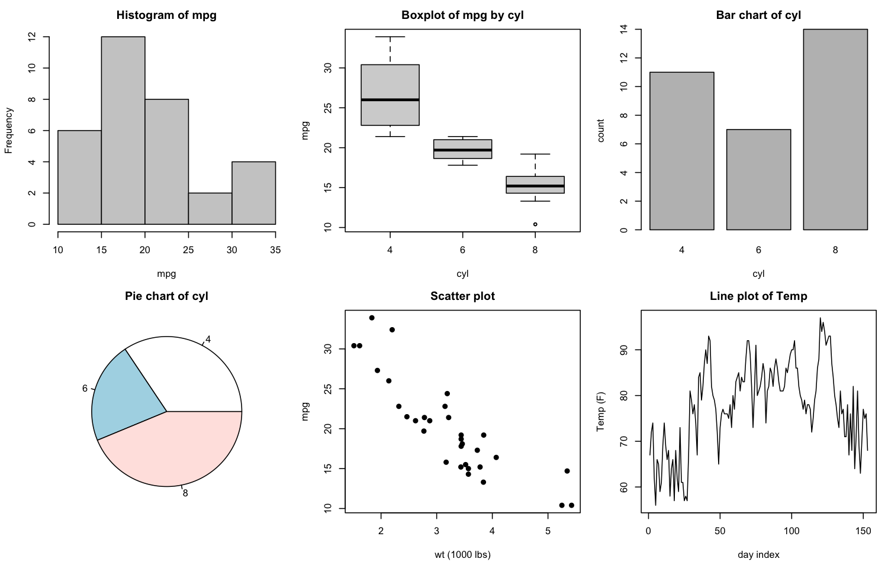

# 4장 — 데이터 입출력

[레포지토리 안내](../../README.ko.md) | [English](Concepts_Lecture.md) | [한국어](Concepts_Lecture.ko.md)

> **최종 수정일:** 2026-11-27
>
> 혼자 공부하는 R 데이터 분석, 강전희와 엄동란, Ch 4

> **학습 목표:**
> 1. 벡터로 데이터 프레임을 직접 만들고, CSV 파일과 텍스트 파일의 데이터를 R로 불러올 수 있다
> 2. 작업 디렉토리와 상대 경로를 사용하여 다른 컴퓨터에서도 동작하는 불러오기 코드를 작성할 수 있다
> 3. 불러온 데이터를 탐색 함수로 점검하고 흔한 불러오기 문제를 해결할 수 있다
> 4. `read.table()`의 주요 인수와 readr의 열 사양을 써서 열 이름, 행 범위, 결측값, 열 유형, 인코딩을 제어할 수 있다
> 5. 데이터를 CSV와 RDS 파일로 저장하고, Excel과 JSON 파일을 읽을 수 있다
> 6. 기술 통계량과 도수분포표, base 그래픽으로 데이터를 관측하고 탐색할 수 있다

---

## 목차

- [1. 수동 데이터 입력](#1-수동-데이터-입력)
  - [1.1 R에서 직접 데이터 생성](#11-r에서-직접-데이터-생성)
  - [1.2 열 이름과 직접 입력의 한계](#12-열-이름과-직접-입력의-한계)
- [2. 외부 데이터 읽기](#2-외부-데이터-읽기)
  - [2.1 불러오기 함수 개요](#21-불러오기-함수-개요)
  - [2.2 read.table() 함수](#22-readtable-함수)
  - [2.3 read.table()의 주요 인수](#23-readtable의-주요-인수)
  - [2.4 결측값 표기와 열 유형 지정](#24-결측값-표기와-열-유형-지정)
  - [2.5 문자 인코딩](#25-문자-인코딩)
- [3. CSV 파일 읽기](#3-csv-파일-읽기)
  - [3.1 기본 CSV 불러오기](#31-기본-csv-불러오기)
  - [3.2 주요 매개변수](#32-주요-매개변수)
  - [3.3 파일 경로 고려사항](#33-파일-경로-고려사항)
  - [3.4 readr의 read_csv()](#34-readr의-read_csv)
  - [3.5 데이터 저장하기](#35-데이터-저장하기)
- [4. 텍스트 파일 읽기](#4-텍스트-파일-읽기)
  - [4.1 탭 구분 파일 읽기](#41-탭-구분-파일-읽기)
  - [4.2 고정 폭 파일 읽기](#42-고정-폭-파일-읽기)
  - [4.3 read.fwf()로 글자 위치에 따라 읽기](#43-readfwf로-글자-위치에-따라-읽기)
- [5. 작업 디렉토리](#5-작업-디렉토리)
  - [5.1 작업 디렉토리 확인 및 설정](#51-작업-디렉토리-확인-및-설정)
  - [5.2 모범 사례](#52-모범-사례)
  - [5.3 경로와 파일을 다루는 함수](#53-경로와-파일을-다루는-함수)
- [6. 데이터 불러오기 후 탐색](#6-데이터-불러오기-후-탐색)
  - [6.1 유용한 탐색 함수](#61-유용한-탐색-함수)
  - [6.2 불러온 데이터의 일반적인 문제](#62-불러온-데이터의-일반적인-문제)
  - [6.3 Excel과 JSON 파일](#63-excel과-json-파일)
- [7. 데이터 관측하기: 기술 통계](#7-데이터-관측하기-기술-통계)
  - [7.1 중심 경향](#71-중심-경향)
  - [7.2 퍼짐의 정도](#72-퍼짐의-정도)
  - [7.3 분위수와 요약](#73-분위수와-요약)
  - [7.4 도수분포표와 교차표](#74-도수분포표와-교차표)
  - [7.5 두 변수의 관계: 상관계수](#75-두-변수의-관계-상관계수)
- [8. 데이터 탐색하기: base 그래픽](#8-데이터-탐색하기-base-그래픽)
  - [8.1 그래프의 종류와 함수](#81-그래프의-종류와-함수)
  - [8.2 그래프 읽기](#82-그래프-읽기)
  - [8.3 줄기 잎 그림](#83-줄기-잎-그림)
- [개념 적용](#개념-적용)
- [요약](#요약)
- [점검 문제](#점검-문제)

---

<br>

## 1. 수동 데이터 입력

### 1.1 R에서 직접 데이터 생성

외부 데이터를 불러오기 전에, 데이터 프레임을 수동으로 생성할 수 있다:

```r
ID <- c(1, 2, 3, 4, 5)
SEX <- c("F", "M", "F", "M", "F")
DATA <- data.frame(ID = ID, SEX = SEX)
View(DATA)   # 스프레드시트 뷰어에서 열기
```

`c()`로 만든 두 벡터를 `data.frame()`으로 묶으면 각 벡터가 하나의 열이 되어 5행 2열의 데이터 프레임이 만들어진다. `ID = ID`에서 등호 왼쪽은 열 이름이고 오른쪽은 그 열에 넣을 벡터이다.

> **핵심:** 수동 데이터 입력은 소규모 데이터셋이나 테스트 데이터를 만들 때 유용하지만, 실제 분석에서는 보통 외부 파일에서 데이터를 불러온다.

### 1.2 열 이름과 직접 입력의 한계

`data.frame()`에 벡터를 이름 없이 넘기면 변수 이름이 그대로 열 이름이 되고, `이름 = 벡터`로 넘기면 등호 왼쪽의 이름이 열 이름이 된다.

```r
id <- c(1, 2, 3, 4, 5)
gender <- c("F", "M", "F", "M", "F")
df1 <- data.frame(id, gender)
df1
#>   id gender
#> 1  1      F
#> 2  2      M
#> 3  3      F
#> 4  4      M
#> 5  5      F
df2 <- data.frame(x = id, y = gender)
names(df2)
#> [1] "x" "y"
data.frame(id = 1:3, gender = c("F", "M"))
#> Error in data.frame(id = 1:3, gender = c("F", "M")): arguments imply differing number of rows: 3, 2
```

`df1`의 열 이름은 `id`, `gender`이고, `df2`의 열 이름은 `x`, `y`이다. 열 이름은 나중에 `df2$x`처럼 열을 부르는 이름이 되므로, `x`, `y`처럼 뜻이 드러나지 않는 이름보다 값의 의미를 나타내는 이름을 쓰는 것이 좋다. 마지막 줄처럼 길이가 다른 벡터를 묶으면 행의 수가 맞지 않는다는 오류가 난다. 데이터 프레임은 길이가 같은 열의 리스트이기 때문이다(2장 5절). 다만 길이가 1인 값은 재활용되어 모든 행에 들어간다.

직접 입력에는 한계가 있다. 값을 손으로 치는 과정에서 오타가 생기기 쉽고, 한 사람의 정보가 여러 벡터에 흩어져 있어 한 벡터에서 값을 하나 빠뜨리면 그 뒤의 모든 행이 어긋난다. 관측치가 수백, 수천 개만 되어도 입력 자체가 불가능에 가깝다. 그래서 직접 입력은 작은 예제나 검증용 데이터에 쓰고, 실제 데이터는 파일에서 읽는다. 또 한국어 같은 비영어 문자를 데이터에 직접 넣으면 운영체제와 인코딩에 따라 글자가 깨질 수 있으므로(2.5절), 범주 값은 `"F"`, `"Seoul"`처럼 영문으로 입력하는 것이 안전하다.

---

<br>

## 2. 외부 데이터 읽기

### 2.1 불러오기 함수 개요

R은 외부 데이터를 읽기 위한 여러 함수를 제공한다:

| 함수 | 파일 유형 | 패키지 |
|------|----------|--------|
| `read.csv()` | CSV (쉼표 구분) | base |
| `read.table()` | 일반 구분자 텍스트 | base |
| `read.delim()` | 탭 구분 텍스트 | base |
| `readxl::read_excel()` | Excel (.xlsx, .xls) | readxl |
| `readr::read_csv()` | CSV (더 빠름, tidyverse) | readr |

*표 1. 외부 데이터를 불러오는 R 함수*

`readxl::read_excel()`처럼 `패키지::함수` 형식으로 쓰면 `library()`로 패키지를 불러오지 않고도 그 패키지의 함수를 호출할 수 있다. 다만 패키지는 미리 설치되어 있어야 한다.

### 2.2 read.table() 함수

`read.table()`은 표 형태 데이터를 읽기 위한 가장 범용적인 함수이다:

```r
help(read.table)

# 주요 매개변수:
# file      - 파일 경로
# header    - 첫 번째 행이 열 이름을 포함하면 TRUE
# sep       - 필드 구분 문자
# dec       - 소수점 문자
```

`read.table()`의 기본값은 `header = FALSE`, `sep = ""`, `dec = "."`이다. `sep = ""`는 공백이나 탭 같은 공백 문자가 하나 이상 이어진 곳을 구분자로 본다는 뜻이다.

### 2.3 read.table()의 주요 인수

`read.table()`의 도움말에는 인수가 20개 넘게 있지만, 데이터를 읽을 때 자주 쓰는 것은 다음과 같다.

| 인수 | 역할 | 기본값 |
|:--|:--|:--|
| `header` | 첫 행을 열 이름으로 쓸지 정한다 | `FALSE` |
| `sep` | 값을 나누는 구분 문자를 정한다 | `""` (공백 문자) |
| `skip` | 파일의 처음 몇 행을 건너뛰고 읽는다 | `0` |
| `nrows` | 최대 몇 행까지 읽을지 정한다 | `-1` (전체) |
| `col.names` | 열 이름을 직접 지정한다 | `V1`, `V2`, ... |
| `na.strings` | 결측값으로 볼 문자열을 정한다 | `"NA"` |
| `colClasses` | 열마다 유형을 지정한다 | 자동 판단 |
| `fileEncoding` | 파일의 문자 인코딩을 지정한다 | 운영체제 기본값 |
| `comment.char` | 그 뒤의 내용을 주석으로 무시할 문자를 정한다 | `"#"` |

*표 2. read.table()의 주요 인수*

인수의 효과를 확인하기 위해 내장 데이터 `airquality`의 처음 8행을 공백으로 구분한 텍스트 파일로 저장한 뒤 다시 읽어 본다. `readLines()`는 파일의 각 줄을 문자열로 읽어 원래 모습을 보여 준다.

```r
aq <- head(airquality, 8)
write.table(aq, "aq.txt", sep = " ", row.names = FALSE, quote = FALSE)
readLines("aq.txt", n = 3)
#> [1] "Ozone Solar.R Wind Temp Month Day" "41 190 7.4 67 5 1"                
#> [3] "36 118 8 72 5 2"
```

파일의 첫 줄은 열 이름이고 그 뒤로 8행의 값이 이어진다. 기본값으로 읽으면 다음과 같이 된다.

```r
read.table("aq.txt")[1:3, ]
#>      V1      V2   V3   V4    V5  V6
#> 1 Ozone Solar.R Wind Temp Month Day
#> 2    41     190  7.4   67     5   1
#> 3    36     118    8   72     5   2
d1 <- read.table("aq.txt", header = TRUE)
str(d1)
#> 'data.frame':	8 obs. of  6 variables:
#>  $ Ozone  : int  41 36 12 18 NA 28 23 19
#>  $ Solar.R: int  190 118 149 313 NA NA 299 99
#>  $ Wind   : num  7.4 8 12.6 11.5 14.3 14.9 8.6 13.8
#>  $ Temp   : int  67 72 74 62 56 66 65 59
#>  $ Month  : int  5 5 5 5 5 5 5 5
#>  $ Day    : int  1 2 3 4 5 6 7 8
```

`header = FALSE`(기본값)이면 첫 줄의 열 이름까지 값으로 읽혀 열 이름이 `V1`\~`V6`이 되고, 각 열에 문자열 `"Ozone"`이 섞이므로 모든 열이 문자형이 된다. `header = TRUE`를 주면 첫 줄이 열 이름이 되고 8행 6열의 데이터 프레임이 만들어진다. `read.table()`은 열의 값을 보고 유형을 판단하므로 소수점이 없는 열은 정수(`int`), 소수점이 있는 `Wind`는 실수(`num`)가 되며, 파일의 `NA`는 결측값으로 읽힌다.

```r
d2 <- read.table("aq.txt", header = TRUE, skip = 2)
head(d2, 2)
#>   X36 X118   X8 X72 X5 X2
#> 1  12  149 12.6  74  5  3
#> 2  18  313 11.5  62  5  4
d3 <- read.table("aq.txt", header = TRUE, nrows = 3)
d3
#>   Ozone Solar.R Wind Temp Month Day
#> 1    41     190  7.4   67     5   1
#> 2    36     118  8.0   72     5   2
#> 3    12     149 12.6   74     5   3
d4 <- read.table("aq.txt", skip = 1, nrows = 2,
                 col.names = c("oz", "sol", "wind", "temp", "mon", "day"))
d4
#>   oz sol wind temp mon day
#> 1 41 190  7.4   67   5   1
#> 2 36 118  8.0   72   5   2
```

`skip = 2`는 파일의 처음 두 줄(열 이름 줄과 첫 자료 줄)을 건너뛴다. 그런데 `header = TRUE`도 함께 주었으므로 셋째 줄인 둘째 자료 행 `36 118 8 72 5 2`가 열 이름으로 쓰인다. 숫자로 시작하는 이름은 R의 이름 규칙에 맞지 않으므로 앞에 `X`가 붙어 `X36`, `X118`처럼 바뀐다. 이처럼 `skip`과 `header`는 함께 쓸 때 어느 줄이 열 이름이 되는지 주의해야 한다. 파일 앞에 설명 문장이 여러 줄 있는 경우가 `skip`의 전형적인 용도이다. `nrows = 3`은 열 이름 줄을 뺀 자료 3행만 읽는다. `d4`처럼 열 이름 줄을 `skip = 1`로 건너뛰고 `col.names`로 새 이름을 주면, 원래 열 이름과 다른 이름으로 원하는 행만 읽을 수 있다.

### 2.4 결측값 표기와 열 유형 지정

파일마다 결측값을 표기하는 방법이 다르다. 빈칸, `.`, `-99`, `N/A`처럼 `"NA"`가 아닌 표기를 쓴 파일은 `na.strings`로 그 표기를 알려 주어야 결측값으로 읽힌다. 다음 예는 `text` 인수로 파일 대신 문자열을 직접 읽는다.

```r
txt <- "id,score,grade
1,85,B
2,-99,A
3,.,C"
read.csv(text = txt)
#>   id score grade
#> 1  1    85     B
#> 2  2   -99     A
#> 3  3     .     C
read.csv(text = txt, na.strings = c("-99", "."))
#>   id score grade
#> 1  1    85     B
#> 2  2    NA     A
#> 3  3    NA     C
str(read.csv(text = txt, na.strings = c("-99", "."), colClasses = c("integer", "numeric", "factor")))
#> 'data.frame':	3 obs. of  3 variables:
#>  $ id   : int  1 2 3
#>  $ score: num  85 NA NA
#>  $ grade: Factor w/ 3 levels "A","B","C": 2 1 3
```

첫 결과의 `score` 열에는 `.`이 섞여 있어 열 전체가 문자형이 되고, -99는 실제 점수처럼 남는다. 이 상태로 평균을 내면 경고가 나거나, -99가 들어간 엉터리 평균이 계산된다. `na.strings = c("-99", ".")`를 주면 두 표기가 모두 `NA`가 되고 `score`는 수치형으로 읽힌다. `colClasses`는 열마다 유형을 직접 정하므로, `grade`를 처음부터 팩터로 읽을 수 있다. 큰 파일에서는 `colClasses`를 주면 R이 유형을 추측하는 단계를 건너뛰어 읽는 속도도 빨라진다.

`comment.char`의 기본값 `"#"`는 그 문자 뒤의 내용을 주석으로 무시한다. 그래서 파일 앞에 `#`로 시작하는 설명 줄이 있어도 자료로 읽히지 않는다.

```r
txt2 <- "# measured in 2024
x y
1 2
3 4"
read.table(text = txt2, header = TRUE)
#>   x y
#> 1 1 2
#> 2 3 4
```

`read.csv()`는 `comment.char = ""`가 기본값이어서 `#`를 주석으로 보지 않는다. 쉼표로 구분된 자료 안에 `#`가 값으로 들어 있는 경우를 고려한 설정이다.

### 2.5 문자 인코딩

> **용어 정의:** **문자 인코딩(character encoding)** 은 컴퓨터가 글자를 숫자로 바꾸어 저장할 때 쓰는, 글자와 숫자 사이의 대응 규칙이다.

영문자와 숫자는 대부분의 인코딩에서 같은 숫자로 저장되지만, 한국어는 인코딩마다 저장 방식이 다르다. 오늘날 표준으로 쓰이는 UTF-8과, 한국어 Windows가 오래 써 온 CP949(EUC-KR을 확장한 인코딩)가 대표적이다. 파일을 만들 때의 인코딩과 읽을 때 가정한 인코딩이 다르면 한국어가 알아볼 수 없는 글자로 깨진다.

```r
kor <- c("name,city", "Kim,서울", "Lee,부산")
con <- file("kor_cp949.csv", encoding = "CP949")
writeLines(kor, con)
close(con)
read.csv("kor_cp949.csv", fileEncoding = "CP949")
#>   name city
#> 1  Kim 서울
#> 2  Lee 부산
```

위 코드는 한국어가 든 CSV 파일을 CP949로 저장한 뒤, `fileEncoding = "CP949"`로 파일의 인코딩을 알려 주어 올바르게 읽는다. `fileEncoding`은 파일을 읽으면서 그 인코딩을 R이 쓰는 인코딩으로 변환한다. 반면 `encoding` 인수는 변환하지 않고 읽은 문자열에 인코딩 표시만 붙이므로, 인코딩이 다른 파일을 바로잡는 데에는 `fileEncoding`을 쓴다. Excel에서 "CSV"로 저장한 한국어 파일은 한국어 Windows에서 CP949로 저장되는 경우가 많으며, 이런 파일을 macOS나 Linux에서 기본 설정으로 읽으면 글자가 깨진다. 새로 만드는 파일은 UTF-8로 저장하는 것이 가장 호환성이 좋다.

---

<br>

## 3. CSV 파일 읽기

### 3.1 기본 CSV 불러오기

CSV(Comma-Separated Values)는 데이터 교환에 가장 일반적으로 사용되는 형식이다:

```r
# 헤더 행이 있는 CSV 파일 읽기
ex_data <- read.csv("data/data_ex.csv", header = TRUE)
View(ex_data)
```

`read.csv()`는 `read.table()`에 CSV에 맞는 기본값(`header = TRUE`, `sep = ","` 등)을 지정한 함수이므로, 위 코드의 `header = TRUE`는 기본값을 명시한 것이다.

Excel에서 표를 CSV로 저장하려면 파일 메뉴의 다른 이름으로 저장에서 파일 형식을 CSV(쉼표로 분리)로 고른다. 저장된 파일을 메모장 같은 텍스트 편집기로 열면 각 행이 한 줄에, 각 칸의 값이 쉼표로 구분되어 적혀 있다. CSV는 서식, 수식, 여러 시트를 담지 못하고 값만 담지만, 거의 모든 프로그램이 읽을 수 있어 데이터를 주고받는 표준처럼 쓰인다.

### 3.2 주요 매개변수

```r
read.csv(
  file,                    # 파일 경로 (절대 경로 또는 상대 경로)
  header = TRUE,           # 첫 번째 행이 열 이름
  sep = ",",               # 구분자 (CSV의 경우 쉼표)
  stringsAsFactors = FALSE # 문자열을 팩터로 변환하지 않음
)
```

R 4.0.0부터 `stringsAsFactors`의 기본값은 `FALSE`이다. 이 인수는 이전 버전의 R에서도 같은 결과를 얻거나 의도를 분명히 하려고 지정한다.

### 3.3 파일 경로 고려사항

파일을 읽을 때는 파일이 있는 위치를 경로로 알려 주며, 경로를 쓰는 방식에는 두 가지가 있다.

> **용어 정의:** **절대 경로(absolute path)** 는 파일 시스템의 맨 위(루트)에서 시작해 파일의 위치를 끝까지 밝힌 경로이다.

> **용어 정의:** **작업 디렉토리(working directory)** 는 R이 현재 작업 중인 기준 폴더로, `getwd()`로 확인하고 `setwd()`로 바꾼다.

> **용어 정의:** **상대 경로(relative path)** 는 작업 디렉토리를 기준으로 파일의 위치를 나타낸 경로이다.

```r
# 절대 경로 (플랫폼에 따라 다름)
read.csv("/Users/username/Desktop/data_ex.csv", header = TRUE)

# 상대 경로 (작업 디렉토리 기준)
read.csv("data/data_ex.csv", header = TRUE)
```

예를 들어 작업 디렉토리가 `/Users/username/Desktop/project/`이면 `"data/data_ex.csv"`는 그림 1의 파일을 가리킨다.

```text
/Users/username/Desktop/project/   ← 작업 디렉토리 (getwd()의 결과)
└── data/
    ├── data_ex.csv                ← "data/data_ex.csv"가 가리키는 파일
    ├── data_ex-1.txt
    └── data_ex_col.txt
```

*그림 1. 작업 디렉토리를 기준으로 한 상대 경로의 해석*

> **핵심:** 상대 경로를 사용하면 다른 컴퓨터 간에 코드의 이식성이 높아진다. 작업 디렉토리를 프로젝트 루트로 설정하고 거기서부터 상대 경로를 사용하는 것이 좋다.

Windows의 경로는 `C:\Users\kim\data.csv`처럼 역슬래시(`\`)로 폴더를 구분하지만, R의 문자열에서 역슬래시는 `\n`(줄바꿈)처럼 특수 문자를 만드는 기호이다. 그래서 Windows 경로를 R에 쓸 때는 `"C:/Users/kim/data.csv"`처럼 슬래시로 바꾸거나 `"C:\\Users\\kim\\data.csv"`처럼 역슬래시를 두 번 쓴다. 슬래시는 모든 운영체제에서 동작한다.

### 3.4 readr의 read_csv()

tidyverse의 `readr` 패키지는 `read.csv()`와 비슷한 `read_csv()`를 제공한다. 결과가 티블이고(2장 5절), 열의 유형을 어떻게 판단했는지 알려 주며, 큰 파일을 더 빨리 읽는다. 다음 예는 `readr`에 예제로 들어 있는 `mtcars`의 CSV 파일을 읽는다.

```r
library(readr)
```

```r
path <- readr_example("mtcars.csv")
cars_tb <- read_csv(path)
#> Rows: 32 Columns: 11
#> ── Column specification ────────────────────────────────────────────────────────
#> Delimiter: ","
#> dbl (11): mpg, cyl, disp, hp, drat, wt, qsec, vs, am, gear, carb
#> 
#> ℹ Use `spec()` to retrieve the full column specification for this data.
#> ℹ Specify the column types or set `show_col_types = FALSE` to quiet this message.
cars_tb
#> # A tibble: 32 × 11
#>      mpg   cyl  disp    hp  drat    wt  qsec    vs    am  gear  carb
#>    <dbl> <dbl> <dbl> <dbl> <dbl> <dbl> <dbl> <dbl> <dbl> <dbl> <dbl>
#>  1  21       6  160    110  3.9   2.62  16.5     0     1     4     4
#>  2  21       6  160    110  3.9   2.88  17.0     0     1     4     4
#>  3  22.8     4  108     93  3.85  2.32  18.6     1     1     4     1
#>  4  21.4     6  258    110  3.08  3.22  19.4     1     0     3     1
#>  5  18.7     8  360    175  3.15  3.44  17.0     0     0     3     2
#>  6  18.1     6  225    105  2.76  3.46  20.2     1     0     3     1
#>  7  14.3     8  360    245  3.21  3.57  15.8     0     0     3     4
#>  8  24.4     4  147.    62  3.69  3.19  20       1     0     4     2
#>  9  22.8     4  141.    95  3.92  3.15  22.9     1     0     4     2
#> 10  19.2     6  168.   123  3.92  3.44  18.3     1     0     4     4
#> # ℹ 22 more rows
```

> **용어 정의:** **열 사양(column specification)** 은 `read_csv()`가 열마다 정하거나 추측한 자료 유형의 목록이다.

`readr_example()`은 패키지에 들어 있는 예제 파일의 경로를 돌려준다. `read_csv()`는 읽은 뒤 열 사양을 메시지로 알려 준다. 위 메시지는 32행 11열을 읽었고 11개 열이 모두 실수(`dbl`)라는 뜻이다. `read_csv()`는 처음 1,000행의 값을 보고 유형을 추측하므로, 그 뒤에 다른 유형의 값이 나오면 판단이 틀릴 수 있다. 티블은 화면 너비에 맞추어 유효 숫자를 줄여 보여 주므로 `disp`의 146.7이 `147.`처럼 표시된다. 값 자체가 바뀐 것은 아니다.

```r
spec(cars_tb)
#> cols(
#>   mpg = col_double(),
#>   cyl = col_double(),
#>   disp = col_double(),
#>   hp = col_double(),
#>   drat = col_double(),
#>   wt = col_double(),
#>   qsec = col_double(),
#>   vs = col_double(),
#>   am = col_double(),
#>   gear = col_double(),
#>   carb = col_double()
#> )
read_csv(path, col_types = cols(cyl = col_integer(), .default = col_double()), n_max = 3)
#> # A tibble: 3 × 11
#>     mpg   cyl  disp    hp  drat    wt  qsec    vs    am  gear  carb
#>   <dbl> <int> <dbl> <dbl> <dbl> <dbl> <dbl> <dbl> <dbl> <dbl> <dbl>
#> 1  21       6   160   110  3.9   2.62  16.5     0     1     4     4
#> 2  21       6   160   110  3.9   2.88  17.0     0     1     4     4
#> 3  22.8     4   108    93  3.85  2.32  18.6     1     1     4     1
read_csv(I("a,b\n1,x\n2,y"), show_col_types = FALSE)
#> # A tibble: 2 × 2
#>       a b    
#>   <dbl> <chr>
#> 1     1 x    
#> 2     2 y
```

`spec()`은 추측한 열 사양을 코드 형태로 보여 주므로, 이를 복사해 `col_types`에 넣으면 같은 파일을 항상 같은 유형으로 읽을 수 있다. 둘째 호출은 `cyl`만 정수(`col_integer()`)로, 나머지는 `.default`로 실수로 지정하고, `n_max = 3`으로 처음 3행만 읽는다. 열 머리 아래가 `<int>`로 바뀐 것을 볼 수 있다. 셋째 호출처럼 `I()`로 감싼 문자열은 파일 경로가 아니라 자료 자체로 읽히며, `show_col_types = FALSE`는 열 사양 메시지를 끈다.

지정한 유형으로 바꿀 수 없는 값이 있으면 `read_csv()`는 그 값을 `NA`로 두고 경고를 내며, `problems()`로 어느 행의 어떤 값이 문제였는지 확인할 수 있다.

```r
df_bad <- read_csv(I("x\n1\n2\nthree"), col_types = cols(x = col_double()))
#> Warning: One or more parsing issues, call `problems()` on your data frame for details,
#> e.g.:
#>   dat <- vroom(...)
#>   problems(dat)
problems(df_bad)[, 1:4]
#> # A tibble: 1 × 4
#>     row   col expected actual
#>   <int> <int> <chr>    <chr> 
#> 1     4     1 a double three
parse_number(c("$1,200", "45%", "3.5 kg"))
#> [1] 1200.0   45.0    3.5
```

`problems()`의 결과는 파일의 4번째 줄(열 이름 줄을 포함해 센 번호), 1번째 열에서 실수를 기대했지만 `three`가 있었다는 뜻이다. `parse_number()`는 통화 기호, 천 단위 쉼표, 단위 같은 문자를 무시하고 숫자 부분만 읽어 낸다. 금액이나 백분율이 문자열로 저장된 열을 수치로 바꿀 때 유용하다.

| 항목 | `read.csv()` | `readr::read_csv()` |
|:--|:--|:--|
| 결과 | 데이터 프레임 | 티블 |
| 열 유형 판단 | 모든 행을 보고 판단한다 | 처음 1,000행으로 추측하고 사양을 보고한다 |
| 유형 지정 | `colClasses` | `col_types = cols(...)` |
| 변환 실패 | 열 전체가 문자형이 되기 쉽다 | 그 값만 `NA`로 두고 `problems()`로 알린다 |
| 열 이름 | 규칙에 맞게 고친다(`my col` → `my.col`) | 그대로 둔다 |
| 속도 | 큰 파일에서 느리다 | 빠르다 |

*표 3. read.csv()와 read_csv()의 비교*

### 3.5 데이터 저장하기

가공한 데이터는 파일로 저장해 다른 프로그램에서 쓰거나 다음 분석에서 다시 불러온다. 텍스트 파일로 저장하는 함수는 `write.csv()`, `write.table()`, `readr::write_csv()`이고, R의 객체를 그대로 저장하는 함수는 `saveRDS()`이다.

```r
out <- data.frame(id = 1:3, when = as.Date(c("2024-01-01", "2024-02-01", "2024-03-01")),
                  grp = factor(c("b", "a", "b")))
write.csv(out, "out1.csv")
readLines("out1.csv")
#> [1] "\"\",\"id\",\"when\",\"grp\"" "\"1\",1,2024-01-01,\"b\""    
#> [3] "\"2\",2,2024-02-01,\"a\""     "\"3\",3,2024-03-01,\"b\""
write.csv(out, "out2.csv", row.names = FALSE)
readLines("out2.csv")
#> [1] "\"id\",\"when\",\"grp\"" "1,2024-01-01,\"b\""     
#> [3] "2,2024-02-01,\"a\""      "3,2024-03-01,\"b\""
str(read.csv("out2.csv"))
#> 'data.frame':	3 obs. of  3 variables:
#>  $ id  : int  1 2 3
#>  $ when: chr  "2024-01-01" "2024-02-01" "2024-03-01"
#>  $ grp : chr  "b" "a" "b"
saveRDS(out, "out.rds")
str(readRDS("out.rds"))
#> 'data.frame':	3 obs. of  3 variables:
#>  $ id  : int  1 2 3
#>  $ when: Date, format: "2024-01-01" "2024-02-01" ...
#>  $ grp : Factor w/ 2 levels "a","b": 2 1 2
write_csv(out, "out3.csv")
readLines("out3.csv", n = 2)
#> [1] "id,when,grp"    "1,2024-01-01,b"
```

`write.csv()`는 기본으로 행 이름을 첫 열로 함께 저장한다. `out1.csv`의 첫 줄이 빈 이름 `""`으로 시작하고 각 줄 앞에 `"1"`, `"2"`가 붙은 것이 그 행 이름이다. 이 파일을 다시 읽으면 `X`라는 쓸모없는 열이 생기므로, 보통 `row.names = FALSE`를 준다. `readLines()` 출력의 `\"`는 파일 안의 큰따옴표를 문자열 속에 표시한 것이다.

CSV로 저장한 뒤 다시 읽은 `out2.csv`에서는 날짜 열 `when`과 팩터 열 `grp`가 모두 문자형이 되었다. CSV는 값만 담는 텍스트이므로 R의 클래스 정보가 사라지기 때문이다. `saveRDS()`로 저장한 `.rds` 파일은 R 객체를 그대로 담으므로 `readRDS()`로 읽으면 `Date`와 팩터의 수준까지 그대로 돌아온다. `write_csv()`는 행 이름을 쓰지 않고 필요할 때만 따옴표를 붙이며, 항상 UTF-8로 저장한다.

| 형식 | 저장 함수 | 읽기 함수 | 특징 |
|:--|:--|:--|:--|
| CSV | `write.csv()`, `write_csv()` | `read.csv()`, `read_csv()` | 모든 프로그램이 읽지만 유형 정보가 사라진다 |
| RDS | `saveRDS()` | `readRDS()` | R 객체 하나를 유형까지 그대로 저장한다 |
| RData | `save()` | `load()` | 여러 객체를 이름과 함께 저장하며, 불러오면 같은 이름의 변수를 덮어쓴다 |

*표 4. 데이터 저장 형식의 비교*

`readRDS()`는 읽은 객체를 돌려주므로 `x <- readRDS("out.rds")`처럼 원하는 이름에 담을 수 있다. 반면 `load()`는 저장할 때의 이름으로 작업 공간에 변수를 만들어, 같은 이름의 기존 변수를 알리지 않고 덮어쓴다. 분석의 중간 결과는 RDS로, 다른 사람이나 다른 프로그램과 주고받을 데이터는 CSV로 저장하는 것이 일반적이다.

---

<br>

## 4. 텍스트 파일 읽기

### 4.1 탭 구분 파일 읽기

탭 구분 파일은 `read.table()`에 `sep = "\t"`를 지정하거나 `read.delim()`으로 읽는다. `read.delim()`은 `header = TRUE`, `sep = "\t"`가 기본값이다.

```r
# 적절한 구분자를 지정한 read.table()
data_txt <- read.table("data/data_ex-1.txt", header = TRUE, sep = "\t")

# 탭 구분 파일의 단축 함수인 read.delim()
data_txt <- read.delim("data/data_ex-1.txt", header = TRUE)
```

### 4.2 고정 폭 파일 읽기

`data_ex_col.txt`에는 열 이름 행이 없고 첫 행부터 자료가 들어 있다. 따라서 `header = FALSE`로 모든 행을 자료로 읽고, `col.names`로 열 이름을 지정한다. `header = TRUE`로 읽으면 첫 자료 행이 열 이름이 되어 자료가 한 행 줄어든다.

```r
# 열이 정렬된 텍스트 파일의 경우
data_col <- read.table("data/data_ex_col.txt", header = FALSE, col.names = c("ID", "SEX", "AGE", "AREA"))
```

> **주의:** `read.table()`은 기본값 `sep = ""`에서 공백 문자를 구분자로 쓰므로, 열 사이에 공백이나 탭이 있어 열이 정렬된 파일을 읽을 수 있다. 구분자 없이 글자 위치로만 열을 나누는 엄밀한 의미의 고정 폭 파일은 열 너비를 지정하는 `read.fwf()`로 읽는다.

### 4.3 read.fwf()로 글자 위치에 따라 읽기

> **용어 정의:** **고정 폭 파일(fixed-width file)** 은 구분 문자 없이 각 열이 정해진 글자 수를 차지하는 텍스트 파일이다.

오래된 행정 자료나 측정 장비의 출력은 고정 폭 파일인 경우가 많다. `read.fwf()`의 `widths`에 열마다 글자 수를 주면 그 위치에서 잘라 읽는다.

```r
fwf_txt <- c("01F50Seoul", "02M40Busan", "03F28Jeju ")
writeLines(fwf_txt, "fixed.txt")
read.fwf("fixed.txt", widths = c(2, 1, 2, 5), col.names = c("id", "sex", "age", "city"))
#>   id sex age  city
#> 1  1   F  50 Seoul
#> 2  2   M  40 Busan
#> 3  3   F  28 Jeju
```

`widths = c(2, 1, 2, 5)`는 각 줄의 1\~2번째 글자를 `id`, 3번째 글자를 `sex`, 4\~5번째 글자를 `age`, 6\~10번째 글자를 `city`로 읽으라는 뜻이다. 첫 줄 `01F50Seoul`은 `01`, `F`, `50`, `Seoul`로 나뉘며, `01`은 수로 읽혀 1이 된다. 한 줄 안에 구분자가 전혀 없으므로 글자 수가 하나라도 어긋나면 모든 열이 밀려 읽힌다. 그래서 고정 폭 파일은 열 너비를 정의한 문서(코드북)와 함께 배포되는 것이 일반적이다.

---

<br>

## 5. 작업 디렉토리

### 5.1 작업 디렉토리 확인 및 설정

```r
# 현재 작업 디렉토리 확인
getwd()

# 작업 디렉토리 설정
setwd("/Users/username/Desktop/project/")

# 이제 상대 경로를 사용할 수 있다
data <- read.csv("data/data_ex.csv", header = TRUE)
```

`setwd()`로 작업 디렉토리를 바꾸면 그 뒤의 상대 경로는 새 작업 디렉토리를 기준으로 해석된다.

### 5.2 모범 사례

- RStudio 프로젝트(`.Rproj` 파일)를 사용하여 작업 디렉토리를 자동으로 관리한다.
- 스크립트에 절대 경로를 하드코딩하지 않는다.
- 견고한 경로 구성을 위해 `here` 패키지를 사용한다. `here()`는 `.Rproj` 파일 같은 표지로 찾은 프로젝트 루트를 기준으로 경로를 만들므로, 그 뒤에 작업 디렉토리가 바뀌어도 같은 파일을 가리킨다:
  ```r
  # install.packages("here")
  library(here)
  data <- read.csv(here("data", "data_ex.csv"))
  ```

### 5.3 경로와 파일을 다루는 함수

경로를 문자열로 직접 이어 붙이는 대신 다음 함수를 쓰면 운영체제와 관계없이 동작하는 코드를 쓸 수 있다.

```r
file.path("data", "raw", "survey.csv")
#> [1] "data/raw/survey.csv"
file.exists("aq.txt")
#> [1] TRUE
file.exists("nothing.csv")
#> [1] FALSE
list.files(pattern = "\\.csv$")
#> [1] "kor_cp949.csv" "out1.csv"      "out2.csv"      "out3.csv"
basename("/Users/kim/project/data/aq.txt")
#> [1] "aq.txt"
dirname("/Users/kim/project/data/aq.txt")
#> [1] "/Users/kim/project/data"
```

`file.path()`는 폴더 이름과 파일 이름을 운영체제에 맞는 구분자로 잇는다. `file.exists()`는 파일이 있는지 확인하므로, 읽기 전에 경로가 맞는지 검사할 때 쓴다. `list.files()`는 작업 디렉토리의 파일 목록을 돌려주며, `pattern`에 정규 표현식 `"\\.csv$"`를 주면 이름이 `.csv`로 끝나는 파일만 고른다. 위 결과는 이 장의 예제가 만든 CSV 파일들이다. `basename()`과 `dirname()`은 경로에서 파일 이름과 폴더 부분을 떼어 낸다. 폴더 안의 여러 파일을 한꺼번에 읽을 때는 `list.files()`로 파일 이름을 얻고 3장 9절의 `lapply()`로 각 파일에 `read.csv()`를 적용한다.

---

<br>

## 6. 데이터 불러오기 후 탐색

### 6.1 유용한 탐색 함수

데이터를 불러온 후에는 항상 데이터를 점검해야 한다:

```r
# 구조 및 요약
str(data)        # 구조의 간결한 표시
summary(data)    # 각 열의 통계 요약
head(data)       # 처음 6행
tail(data)       # 마지막 6행
dim(data)        # 차원 (행 x 열)
nrow(data)       # 행의 수
ncol(data)       # 열의 수
names(data)      # 열 이름
class(data)      # 객체 클래스

# 시각화
View(data)       # RStudio의 스프레드시트 뷰어
```

`head()`와 `tail()`은 기본으로 6행을 보여 주며 `head(data, 10)`처럼 행 수를 바꿀 수 있다. `summary()`는 수치 열에는 최솟값, 사분위수, 평균, 최댓값을, 팩터 열에는 수준별 빈도를, 문자형 열에는 길이와 유형만 보여 준다. 그래서 범주를 담은 문자형 열의 빈도를 보려면 `table()`을 쓰거나 팩터로 바꾼 뒤 `summary()`를 쓴다. `names()`는 열 이름을 문자형 벡터로 돌려주므로 `names(data)[2] <- "age"`처럼 열 이름을 바꾸는 데에도 쓴다.

### 6.2 불러온 데이터의 일반적인 문제

| 문제 | 해결 방법 |
|------|----------|
| 잘못된 열 유형 | `stringsAsFactors = FALSE` 또는 `colClasses` 사용 |
| 결측값 | `sum(is.na(data))`로 확인 |
| 인코딩 문제 | `encoding = "UTF-8"` 지정 (파일의 인코딩을 변환하며 읽으려면 `fileEncoding = "CP949"`처럼 지정) |
| 잘못된 구분자 | `readLines(file, n = 5)`로 원시 내용을 검사하여 확인 |

*표 5. 불러온 데이터의 흔한 문제와 해결 방법*

불러온 데이터를 점검할 때는 다음 순서로 확인하면 빠뜨리는 것이 적다. 먼저 `dim()`으로 행과 열의 수가 원래 파일과 같은지 본다. 행이 하나 적으면 열 이름 줄의 처리(2.3절)를, 열이 하나뿐이면 구분자를 의심한다. 다음으로 `str()`로 각 열의 유형을 보고, 숫자여야 할 열이 문자형이면 결측값 표기나 단위 같은 문자가 섞였는지(2.4절) 확인한다. 마지막으로 `summary()`로 각 열의 최솟값과 최댓값, 결측값 개수를 보아 -99나 999처럼 결측을 뜻하는 수가 실제 값처럼 남아 있지 않은지 살핀다.

### 6.3 Excel과 JSON 파일

Excel 파일(`.xlsx`, `.xls`)은 `readxl` 패키지의 `read_excel()`로 읽는다. `readxl`은 Excel 프로그램이 없어도 동작하며, 결과는 티블이다.

```r
library(readxl)
xl <- readxl_example("datasets.xlsx")
excel_sheets(xl)
#> [1] "mtcars"   "chickwts" "quakes"
read_excel(xl, sheet = "quakes", n_max = 3)
#> # A tibble: 3 × 5
#>     lat  long depth   mag stations
#>   <dbl> <dbl> <dbl> <dbl>    <dbl>
#> 1 -20.4  182.   562   4.8       41
#> 2 -20.6  181.   650   4.2       15
#> 3 -26    184.    42   5.4       43
read_excel(xl, sheet = "mtcars", range = "A1:C4")
#> # A tibble: 3 × 3
#>     mpg   cyl  disp
#>   <dbl> <dbl> <dbl>
#> 1  21       6   160
#> 2  21       6   160
#> 3  22.8     4   108
```

`excel_sheets()`는 통합 문서에 든 시트의 이름을 돌려준다. `read_excel()`의 `sheet`는 읽을 시트를 이름이나 번호로 고르고, `n_max`는 읽을 행 수를, `range`는 `"A1:C4"`처럼 Excel의 셀 범위를 지정한다. 범위의 첫 행 A1:C1이 열 이름이 되므로 자료는 3행이다. Excel 파일에는 병합된 셀, 여러 줄의 제목, 서식으로만 표시한 정보가 들어 있는 경우가 많으므로, 읽기 전에 `range`나 `skip`으로 표 부분만 고르는 것이 좋다.

**JSON**(JavaScript Object Notation)은 웹 서비스가 데이터를 주고받을 때 흔히 쓰는 반정형 형식이다(1장 1절). `{ }` 안에 `"이름": 값` 쌍을 나열해 객체 하나를 나타내고, `[ ]` 안에 객체를 나열해 목록을 나타낸다. `jsonlite` 패키지의 `fromJSON()`은 같은 이름을 가진 객체들의 목록을 데이터 프레임으로 바꾸고, `toJSON()`은 그 반대로 바꾼다.

```r
library(jsonlite)
js <- '[{"id":1,"score":90},{"id":2,"score":75}]'
fromJSON(js)
#>   id score
#> 1  1    90
#> 2  2    75
toJSON(data.frame(a = 1:2, b = c("x", "y")))
#> [{"a":1,"b":"x"},{"a":2,"b":"y"}]
```

JSON 문자열 안에 큰따옴표가 있으므로 R 문자열은 작은따옴표로 감쌌다. 목록의 객체 하나가 데이터 프레임의 행 하나가 되고, 이름 `id`, `score`가 열 이름이 된다. XML 형식은 `xml2` 패키지로 읽는다.

---

<br>

## 7. 데이터 관측하기: 기술 통계

데이터를 불러와 점검했으면, 각 변수의 값이 어디에 모여 있고 얼마나 퍼져 있는지를 몇 개의 수로 요약한다.

> **용어 정의:** **기술 통계량(descriptive statistic)** 은 자료의 중심 위치, 흩어진 정도, 분포의 모양을 요약하는 수이다.

### 7.1 중심 경향

> **용어 정의:** **중심 경향(central tendency)** 은 자료가 모여 있는 중심의 위치이다.

> **용어 정의:** **표본 평균(sample mean)** 은 n개의 값을 모두 더해 n으로 나눈 값이다.

중심 경향의 대표적인 측도는 평균, 중앙값, 최빈값이다. n개의 값 $`x_1, \dots, x_n`$의 표본 평균은 다음과 같다.

```math
\bar{x} = \frac{1}{n} \sum_{i=1}^{n} x_i
```

> **용어 정의:** **중앙값(median)** 은 값을 크기순으로 늘어놓았을 때 가운데에 오는 값으로, 값의 개수가 짝수이면 가운데 두 값의 평균이다.

> **용어 정의:** **최빈값(mode)** 은 자료에서 가장 자주 나타나는 값이다.

다음 자료로 세 측도를 계산한다.

```r
x <- c(2, 4, 4, 5, 7, 9, 30)
mean(x)
#> [1] 8.714286
median(x)
#> [1] 5
tab <- table(x)
tab
#> x
#>  2  4  5  7  9 30 
#>  1  2  1  1  1  1
names(tab)[tab == max(tab)]
#> [1] "4"
mean(x, trim = 0.2)
#> [1] 5.8
```

값 7개의 합은 2 + 4 + 4 + 5 + 7 + 9 + 30 = 61이므로 평균은 61 / 7 ≈ 8.714이다. 크기순으로 넷째 값이 가운데이므로 중앙값은 5이다. 평균이 중앙값보다 훨씬 큰 것은 값 30 하나가 평균을 끌어올렸기 때문이다. 이처럼 평균은 극단값에 민감하지만 중앙값은 로버스트하다. 소득이나 집값처럼 한쪽으로 긴 꼬리를 가진 자료에서는 중앙값이 보통 수준의 값을 더 잘 나타낸다.

> **용어 정의:** **로버스트(robust)** 는 통계량이 극단값의 영향을 적게 받는 성질이다.

R에는 최빈값을 구하는 내장 함수가 없으므로 `table()`로 빈도를 센 뒤 빈도가 가장 큰 값의 이름을 고른다. `mode()`는 2장 7절에서 본 저장 모드를 돌려주는 함수이며 최빈값과 관계가 없다. 절사 평균 `mean(x, trim = 0.2)`는 양 끝에서 7 × 0.2 = 1.4의 소수 부분을 버린 1개씩, 곧 2와 30을 버리고 남은 4, 4, 5, 7, 9의 평균 29 / 5 = 5.8이다(3장 9절).

### 7.2 퍼짐의 정도

> **용어 정의:** **퍼짐(dispersion)** 은 값들이 중심에서 흩어진 정도이다.

> **용어 정의:** **표본 분산(sample variance)** 은 각 값과 표본 평균의 차이(편차)를 제곱해 더한 합을 n - 1로 나눈 값이다.

> **용어 정의:** **표본 표준편차(sample standard deviation)** 는 표본 분산의 제곱근으로, 퍼짐을 원래 자료의 단위로 나타낸다.

중심이 같아도 값들이 중심 근처에 모여 있는 자료와 넓게 흩어진 자료는 다르다. 퍼짐의 대표적인 측도는 범위, 분산, 표준편차, 사분위수 범위이다. 표본 분산과 표본 표준편차는 다음과 같다.

```math
s^2 = \frac{1}{n-1} \sum_{i=1}^{n} (x_i - \bar{x})^2, \qquad s = \sqrt{s^2}
```

```r
y <- c(2, 4, 4, 5, 7, 9)
mean(y)
#> [1] 5.166667
var(y)
#> [1] 6.166667
sd(y)
#> [1] 2.483277
range(y)
#> [1] 2 9
diff(range(y))
#> [1] 7
```

`y`의 평균은 31 / 6 ≈ 5.167이다. 각 값과 평균의 차(편차)는 -3.167, -1.167, -1.167, -0.167, 1.833, 3.833이고, 이를 제곱하면 10.028, 1.361, 1.361, 0.028, 3.361, 14.694이다. 그 합 30.833을 n - 1 = 5로 나눈 6.167이 분산이며, 그 제곱근 2.483이 표준편차이다. 편차를 단순히 더하면 항상 0이 되므로 제곱해서 더하고, 제곱으로 커진 단위를 원래 단위로 되돌리려고 제곱근을 취한다. `range()`는 최솟값과 최댓값을 함께 돌려주며, 범위(최댓값 - 최솟값)는 `diff(range(y))` = 9 - 2 = 7이다.

> **주의:** `var()`와 `sd()`는 n이 아니라 n - 1로 나눈 표본 분산과 표본 표준편차를 계산한다. 표본으로 모집단의 분산을 추정할 때 n으로 나누면 평균적으로 작게 추정되기 때문이다. 자료 전체를 모집단으로 보고 n으로 나눈 분산이 필요하면 `var(y) * (n - 1) / n`으로 고친다.

### 7.3 분위수와 요약

> **용어 정의:** **분위수(quantile)** 는 자료를 크기순으로 늘어놓았을 때 아래에서부터 일정 비율에 해당하는 위치의 값이다.

> **용어 정의:** **사분위수(quartile)** 는 자료를 크기순으로 늘어놓았을 때 25%, 50%, 75% 위치의 값으로, 각각 제1사분위수 $`Q_1`$, 중앙값, 제3사분위수 $`Q_3`$이다.

> **용어 정의:** **사분위수 범위(interquartile range, IQR)** 는 제3사분위수와 제1사분위수의 차 $`\mathrm{IQR} = Q_3 - Q_1`$이다.

`quantile()`과 `IQR()`로 계산하면 다음과 같다.

```r
quantile(y)
#>   0%  25%  50%  75% 100% 
#>  2.0  4.0  4.5  6.5  9.0
IQR(y)
#> [1] 2.5
quantile(y, probs = c(0.1, 0.9))
#> 10% 90% 
#>   3   8
```

분위수를 계산하는 방법은 여러 가지이며, R의 `quantile()`은 기본으로 다음 방법을 쓴다. 정렬한 값 $`x_{(1)} \le \dots \le x_{(n)}`$에서 비율 p의 위치를 $`h = (n - 1)p + 1`$로 정하고, h가 정수가 아니면 이웃한 두 값 사이를 직선으로 보간한다.

```math
Q(p) = x_{(\lfloor h \rfloor)} + (h - \lfloor h \rfloor)\,\big(x_{(\lfloor h \rfloor + 1)} - x_{(\lfloor h \rfloor)}\big)
```

`y`는 n = 6이므로 25% 위치는 h = 5 × 0.25 + 1 = 2.25이고, 둘째와 셋째 값 4와 4 사이이므로 $`Q_1 = 4 + 0.25 \times 0 = 4`$이다. 50% 위치는 h = 3.5이므로 4 + 0.5 × (5 - 4) = 4.5, 75% 위치는 h = 4.75이므로 5 + 0.75 × (7 - 5) = 6.5이다. 따라서 IQR = 6.5 - 4 = 2.5이다. 같은 방법으로 10% 위치는 h = 1.5여서 2 + 0.5 × (4 - 2) = 3이다. 교재나 다른 프로그램은 다른 방법을 쓸 수 있어 작은 자료에서는 사분위수 값이 조금씩 다르며, `quantile()`의 `type` 인수로 방법을 바꿀 수 있다.

`summary()`는 수치 변수의 최솟값, 제1사분위수, 중앙값, 평균, 제3사분위수, 최댓값을 한 번에 보여 주고, 결측값이 있으면 그 개수도 알려 준다.

```r
summary(mtcars$mpg)
#>    Min. 1st Qu.  Median    Mean 3rd Qu.    Max. 
#>   10.40   15.43   19.20   20.09   22.80   33.90
summary(airquality[, c("Ozone", "Temp")])
#>      Ozone             Temp      
#>  Min.   :  1.00   Min.   :56.00  
#>  1st Qu.: 18.00   1st Qu.:72.00  
#>  Median : 31.50   Median :79.00  
#>  Mean   : 42.13   Mean   :77.88  
#>  3rd Qu.: 63.25   3rd Qu.:85.00  
#>  Max.   :168.00   Max.   :97.00  
#>  NA's   :37
```

`mtcars`의 연비(`mpg`, 갤런당 마일)는 10.4에서 33.9까지이며 평균 20.09가 중앙값 19.2보다 조금 크다. 데이터 프레임에 `summary()`를 쓰면 열마다 요약이 나란히 출력된다. `Ozone`은 평균 42.13이 중앙값 31.5보다 크고 최댓값 168이 제3사분위수 63.25보다 훨씬 커서, 큰 값 쪽으로 꼬리가 긴 분포임을 짐작할 수 있다. `NA's: 37`은 3장 5절에서 센 결측값 개수와 같다.

| 함수 | 계산하는 값 |
|:--|:--|
| `mean()`, `median()` | 평균, 중앙값 |
| `var()`, `sd()` | 표본 분산, 표본 표준편차 (n - 1로 나눔) |
| `min()`, `max()`, `range()` | 최솟값, 최댓값, 둘을 함께 |
| `quantile()`, `IQR()` | 분위수, 사분위수 범위 |
| `summary()` | 최솟값, 사분위수, 중앙값, 평균, 최댓값, 결측값 개수 |
| `table()`, `prop.table()` | 빈도, 상대 빈도 |
| `cor()` | 상관계수 |

*표 6. 기술 통계량을 계산하는 함수*

### 7.4 도수분포표와 교차표

> **용어 정의:** **도수분포표(frequency table)** 는 범주나 구간마다 관측치의 수(빈도)를 정리한 표이다.

범주형 변수는 평균 대신 범주마다 몇 개의 관측치가 있는지로 요약한다. 도수분포표에서 빈도를 전체 개수로 나눈 것이 **상대 빈도(relative frequency)** 이다.

```r
table(mtcars$cyl)
#> 
#>  4  6  8 
#> 11  7 14
prop.table(table(mtcars$cyl))
#> 
#>       4       6       8 
#> 0.34375 0.21875 0.43750
round(prop.table(table(mtcars$cyl)) * 100, 1)
#> 
#>    4    6    8 
#> 34.4 21.9 43.8
```

`mtcars`의 자동차 32대 가운데 실린더가 4개인 차는 11대, 6개는 7대, 8개는 14대이다. 상대 빈도는 11 / 32 = 0.34375처럼 계산되며, 100을 곱해 반올림하면 백분율이 된다. 상대 빈도의 합은 항상 1이다.

> **용어 정의:** **교차표(contingency table)** 는 두 범주형 변수의 값의 조합마다 빈도를 정리한 표이다.

`table()`에 두 변수를 함께 넘기면 교차표가 만들어진다.

```r
table(mtcars$cyl, mtcars$am)
#>    
#>      0  1
#>   4  3  8
#>   6  4  3
#>   8 12  2
addmargins(table(cyl = mtcars$cyl, am = mtcars$am))
#>      am
#> cyl    0  1 Sum
#>   4    3  8  11
#>   6    4  3   7
#>   8   12  2  14
#>   Sum 19 13  32
round(prop.table(table(mtcars$cyl, mtcars$am), margin = 1), 3)
#>    
#>         0     1
#>   4 0.273 0.727
#>   6 0.571 0.429
#>   8 0.857 0.143
```

`am`은 변속기 종류로 0은 자동, 1은 수동이다. 교차표의 각 칸은 두 조건을 모두 만족하는 차의 수이며, 실린더 4개이면서 수동인 차는 8대이다. `addmargins()`는 행 합과 열 합을 덧붙여 각 범주의 전체 빈도(주변 빈도)를 보여 준다. `prop.table()`에 `margin = 1`을 주면 행마다 합이 1이 되도록 나누므로, 실린더 수별로 수동 변속기의 비율을 비교할 수 있다. 4기통은 8 / 11 ≈ 0.727이 수동이지만 8기통은 2 / 14 ≈ 0.143만 수동이다. `margin = 2`는 열마다 나눈다.

### 7.5 두 변수의 관계: 상관계수

두 수치 변수가 함께 커지거나 작아지는 정도는 Pearson 상관계수로 나타낸다.

```math
r = \frac{\sum_{i=1}^{n} (x_i - \bar{x})(y_i - \bar{y})}{\sqrt{\sum_{i=1}^{n} (x_i - \bar{x})^2}\,\sqrt{\sum_{i=1}^{n} (y_i - \bar{y})^2}}
```

r은 -1에서 1 사이의 값이며, 1에 가까우면 강한 양의 선형 관계, -1에 가까우면 강한 음의 선형 관계, 0에 가까우면 선형 관계가 약함을 뜻한다.

> **용어 정의:** **Pearson 상관계수(Pearson correlation coefficient)** 는 두 수치 변수의 선형 관계의 방향과 강도를 나타내는 계수이다.

```r
cor(mtcars$wt, mtcars$mpg)
#> [1] -0.8676594
cor(mtcars[, c("mpg", "wt", "hp")])
#>            mpg         wt         hp
#> mpg  1.0000000 -0.8676594 -0.7761684
#> wt  -0.8676594  1.0000000  0.6587479
#> hp  -0.7761684  0.6587479  1.0000000
```

차의 무게(`wt`, 1,000파운드 단위)와 연비의 상관계수는 -0.868로, 무거운 차일수록 연비가 낮은 강한 음의 관계가 있다. 데이터 프레임을 주면 모든 열 쌍의 상관계수를 행렬로 돌려주며, 대각 원소는 자기 자신과의 상관이므로 1이다. 무게와 마력(`hp`)은 0.659의 양의 상관이 있다.

> **주의:** 상관계수는 직선 관계의 강도만 잰다. U자 모양처럼 뚜렷한 곡선 관계가 있어도 r은 0에 가까울 수 있으므로, 상관계수는 반드시 산점도(8절)와 함께 해석한다. 또 상관이 강하다고 해서 한 변수가 다른 변수의 원인이라는 뜻은 아니다.

---

<br>

## 8. 데이터 탐색하기: base 그래픽

### 8.1 그래프의 종류와 함수

> **용어 정의:** **이상치(outlier)** 는 다른 관측치와 동떨어진 값이다.

> **용어 정의:** **산점도(scatter plot)** 는 두 수치 변수의 값 쌍을 점으로 찍어 관계를 보여 주는 그래프이다.

수치 요약만으로는 분포의 모양, 이상치, 변수 사이의 관계를 놓치기 쉬우므로 그래프로 데이터를 함께 살핀다. R의 기본 시스템에 든 `graphics` 패키지(base 그래픽)는 함수 하나로 그래프 하나를 그린다. 현대 데이터 시각화에서 더 널리 쓰이는 ggplot2는 6장에서 다루며, 여기서는 탐색에 자주 쓰는 base 그래픽 함수를 정리한다.

```r
par(mfrow = c(2, 3), mar = c(4.2, 4.2, 2.5, 1))
hist(mtcars$mpg, breaks = 8, main = "Histogram of mpg", xlab = "mpg", col = "grey80")
boxplot(mpg ~ cyl, data = mtcars, main = "Boxplot of mpg by cyl", xlab = "cyl", ylab = "mpg")
barplot(table(mtcars$cyl), main = "Bar chart of cyl", xlab = "cyl", ylab = "count")
pie(table(mtcars$cyl), main = "Pie chart of cyl")
plot(mtcars$wt, mtcars$mpg, main = "Scatter plot", xlab = "wt (1000 lbs)", ylab = "mpg", pch = 19)
plot(airquality$Temp, type = "l", main = "Line plot of Temp", xlab = "day index", ylab = "Temp (F)")
```



*그림 2. base 그래픽으로 그린 여섯 가지 그래프*

`par(mfrow = c(2, 3))`은 그래프 창을 2행 3열로 나누어 이어지는 그래프를 차례로 채우게 하고, `mar`는 그래프 둘레의 여백을 정한다. 모든 그래프 함수는 공통으로 `main`(제목), `xlab`과 `ylab`(축 이름), `col`(색)을 인수로 받는다.

| 함수 | 그래프 | 알맞은 자료 | 주요 인수 |
|:--|:--|:--|:--|
| `hist()` | 히스토그램 | 수치 변수 하나의 분포 | `breaks` (구간의 수나 경계) |
| `boxplot()` | 상자 그림 | 수치 변수의 분포, 그룹 비교 | 수식 `y ~ group`, `data` |
| `barplot()` | 막대 그래프 | 범주형 변수의 빈도 | `table()`의 결과 |
| `pie()` | 원 그래프 | 범주의 비율 | `table()`의 결과 |
| `plot(x, y)` | 산점도 | 두 수치 변수의 관계 | `pch` (점 모양) |
| `plot(y, type = "l")` | 선 그래프 | 순서가 있는 값의 변화 | `type` (`"p"` 점, `"l"` 선, `"b"` 둘 다) |
| `stem()` | 줄기 잎 그림 | 작은 수치 자료의 분포 | `scale` |

*표 7. base 그래픽의 주요 함수*

### 8.2 그래프 읽기

> **용어 정의:** **히스토그램(histogram)** 은 수치 변수의 범위를 같은 폭의 구간으로 나누고 구간마다 관측치의 수를 이어진 막대의 높이로 나타낸 그래프이다.

히스토그램의 막대 사이에 빈틈이 없는 것은 구간이 이어져 있기 때문이다. 그림 2의 히스토그램이 쓴 구간과 빈도는 다음과 같다.

```r
h <- hist(mtcars$mpg, breaks = 8, plot = FALSE)
h$breaks
#> [1] 10 15 20 25 30 35
h$counts
#> [1]  6 12  8  2  4
```

`breaks = 8`은 구간 수의 제안일 뿐이며, R은 보기 좋은 경계를 찾아 폭 5인 구간 다섯 개를 만들었다. 연비 15 초과 20 이하인 차가 12대로 가장 많고, 30을 넘는 차가 4대 있다. 기본 설정에서 구간은 왼쪽 경계를 포함하지 않고 오른쪽 경계를 포함하며, 첫 구간만 왼쪽 경계 10도 포함한다. 구간 폭을 바꾸면 분포의 모양이 달라 보일 수 있으므로 몇 가지 폭으로 그려 보는 것이 좋다.

히스토그램에서 먼저 읽을 것은 분포의 모양이다. 가운데가 높고 양쪽이 비슷하게 낮아지는 분포를 **대칭 분포**라 하며, 이때 평균과 중앙값은 거의 같다. 오른쪽으로 꼬리가 길게 늘어진 분포를 **오른쪽으로 치우친 분포(right-skewed distribution)** 라 하며, 소수의 큰 값이 평균을 끌어올리므로 평균이 중앙값보다 크다. 왼쪽으로 꼬리가 긴 분포는 반대로 평균이 중앙값보다 작다. 그림 2의 연비 분포는 15\~20 구간에 몰려 있고 30을 넘는 값이 몇 개 있어 오른쪽으로 조금 치우쳤으며, 7.3절에서 평균 20.09가 중앙값 19.2보다 컸던 것과 맞는다. 봉우리가 둘인 분포는 성질이 다른 두 집단이 섞여 있다는 신호일 수 있으므로, 그룹을 나누어 다시 그려 볼 필요가 있다.

> **용어 정의:** **상자 그림(box plot)** 은 사분위수로 그린 상자, 상자 안의 중앙값 선, 상자 밖으로 뻗은 수염, 따로 찍은 이상치 후보로 수치 변수의 분포를 보여 주는 그래프이다.

상자의 아래 변과 위 변은 사분위수, 상자 안의 굵은 선은 중앙값이고, 상자에서 뻗은 수염은 상자에서 1.5 × IQR 안에 있는 가장 먼 관측치까지 이어진다. 그 밖의 점은 따로 찍어 이상치 후보로 표시한다. 그림 2에서 8기통 자동차의 상자 아래에 점 하나가 찍혀 있는데, 이를 계산으로 확인하면 다음과 같다.

```r
boxplot.stats(mtcars$mpg[mtcars$cyl == 8])$stats
#> [1] 13.3 14.3 15.2 16.4 19.2
boxplot.stats(mtcars$mpg[mtcars$cyl == 8])$out
#> [1] 10.4 10.4
quantile(mtcars$mpg[mtcars$cyl == 8])
#>    0%   25%   50%   75%  100% 
#> 10.40 14.40 15.20 16.25 19.20
```

`boxplot.stats()`의 `stats`는 차례로 아래 수염 끝, 상자 아래 변, 중앙값, 상자 위 변, 위 수염 끝이다. 상자의 두 변 14.3과 16.4의 차는 2.1이므로 아래 경계는 14.3 - 1.5 × 2.1 = 11.15이다. 10.4는 이보다 작으므로 이상치로 표시되며, 같은 값을 가진 차가 두 대여서 점이 겹쳐 하나로 보인다. 아래 수염은 경계 안의 가장 작은 값 13.3에서 끝난다.

> **참고:** **상자의 경계와 사분위수.** `boxplot()`이 그리는 상자의 두 변은 `quantile()`의 기본 사분위수(14.40, 16.25)가 아니라 Tukey의 힌지(hinge)이다. 힌지는 정렬한 자료를 중앙값으로 반씩 나눈 뒤 각 절반의 중앙값으로 정하므로, 작은 자료에서는 7.3절의 사분위수와 조금 다르다. 자료가 크면 두 값의 차이는 무시할 만큼 작아진다.

**막대 그래프(bar chart)** 는 범주마다 빈도를 막대 높이로 나타내며, 범주 사이에 순서나 연속성이 없으므로 막대를 떨어뜨려 그린다. **원 그래프(pie chart)** 는 전체에서 각 범주가 차지하는 비율을 부채꼴의 각도로 나타낸다. 그러나 사람의 눈은 각도와 면적보다 길이를 더 정확히 비교하므로, 비율을 비교할 때는 원 그래프보다 막대 그래프가 낫다. 그림 2에서도 4기통과 8기통의 차이는 막대 그래프에서 더 분명하다.

그림 2의 산점도는 무게가 클수록 연비가 낮아지는 음의 관계를 보여 주며, 이는 7.5절의 상관계수 -0.868과 일치한다. **선 그래프(line plot)** 는 시간처럼 순서가 있는 값의 변화를 선으로 이어 보여 주며, 그림 2의 기온 그래프에서는 5월에서 7, 8월로 가며 기온이 오르고 9월에 다시 내려가는 계절 변화가 보인다.

### 8.3 줄기 잎 그림

> **용어 정의:** **줄기 잎 그림(stem-and-leaf plot)** 은 각 값을 줄기(앞자리)와 잎(뒷자리)으로 나누어 텍스트로 나타낸 분포 그림이다.

줄기 잎 그림은 히스토그램처럼 분포의 모양을 보여 주면서도 원래 값을 대부분 복원할 수 있다.

```r
stem(mtcars$mpg)
#> 
#>   The decimal point is at the |
#> 
#>   10 | 44
#>   12 | 3
#>   14 | 3702258
#>   16 | 438
#>   18 | 17227
#>   20 | 00445
#>   22 | 88
#>   24 | 4
#>   26 | 03
#>   28 | 
#>   30 | 44
#>   32 | 49
```

`The decimal point is at the |`는 세로선 자리가 소수점이라는 뜻이다. 이 그림은 줄기 하나가 2 단위의 구간을 맡으므로, 줄기 10의 잎 `44`는 10.4가 두 개, 줄기 14의 잎 `3702258` 가운데 `37`은 14.3과 14.7, 그 뒤의 `02258`은 다음 단위인 15의 값 15.0, 15.2, 15.2, 15.5, 15.8이다. 잎은 소수 첫째 자리까지만 쓰므로 그보다 아래 자리는 반올림된다. 줄기 28의 잎이 비어 있는 것은 28 이상 30 미만의 차가 없다는 뜻이다. 줄기 잎 그림은 자료가 수십 개 이하일 때 알맞다.

---

<br>

## 개념 적용

**T/F 점검:**

| 문장 | 판단과 근거 |
|:--|:--|
| `read.table()`로 첫 줄이 열 이름인 파일을 읽으면 열 이름이 자동으로 인식된다. | **F.** `read.table()`의 기본값은 `header = FALSE`이므로 첫 줄도 자료로 읽힌다. `header = TRUE`를 주어야 한다. |
| 결측값이 `-99`로 기록된 파일은 `na.strings = "-99"`를 주어야 결측값으로 읽힌다. | **T.** 기본값은 `"NA"`만 결측으로 보므로, 다른 표기는 `na.strings`로 알려 주어야 한다. |
| CSV로 저장했다가 다시 읽으면 팩터와 날짜의 유형이 그대로 유지된다. | **F.** CSV는 값만 담는 텍스트이므로 문자형으로 돌아온다. 유형을 유지하려면 `saveRDS()`를 쓴다. |
| `var()`는 편차 제곱합을 n으로 나눈 값이다. | **F.** 표본 분산이므로 n - 1로 나눈다. |
| 극단값이 있는 자료에서는 중앙값이 평균보다 덜 영향을 받는다. | **T.** 중앙값은 순서상 가운데 값이므로 큰 값 하나가 더 커져도 바뀌지 않는다. |
| 상관계수가 0에 가까우면 두 변수 사이에 아무 관계도 없다. | **F.** 상관계수는 선형 관계만 재므로 곡선 관계가 있어도 0에 가까울 수 있다. |
| 범주의 비율을 비교할 때는 원 그래프가 막대 그래프보다 정확하다. | **F.** 사람의 눈은 각도보다 길이를 더 정확히 비교하므로 막대 그래프가 낫다. |

---

<br>

## 요약

| 개념 | 핵심 요약 |
|------|-----------|
| `data.frame()` | 벡터로부터 데이터 프레임을 직접 만든다. |
| `read.csv()` | 쉼표로 구분된 파일을 불러오며, `header = TRUE`(기본값)이면 첫 행을 열 이름으로 읽는다. |
| `read.table()` | 범용 텍스트 파일 읽기 함수이며, 구분자를 `sep`로 지정한다. |
| 읽기 범위 | `skip`은 처음 몇 행을 건너뛰고 `nrows`는 읽을 행 수를 정하며, `skip`과 `header`를 함께 쓰면 건너뛴 다음 줄이 열 이름이 된다. |
| 결측 표기와 유형 | `na.strings`로 `NA`가 아닌 결측 표기를 알려 주고, `colClasses`나 `col_types`로 열 유형을 지정한다. |
| 인코딩 | 파일의 인코딩과 읽을 때의 인코딩이 다르면 한국어가 깨지므로 `fileEncoding`으로 파일의 인코딩을 알려 준다. |
| `read_csv()` | 티블을 돌려주고 열 사양을 보고하며, 변환에 실패한 값은 `problems()`로 확인한다. |
| 저장 | CSV는 값만 저장하고 RDS는 R 객체를 유형까지 그대로 저장하며, `write.csv()`에는 보통 `row.names = FALSE`를 준다. |
| 작업 디렉토리 | `getwd()`로 확인하고 `setwd()`로 설정하며, 상대 경로를 쓰는 편이 좋다. |
| 데이터 점검 | 불러온 뒤에는 항상 `str()`, `summary()`, `head()`로 데이터를 확인한다. |
| `View()` | RStudio의 스프레드시트 뷰어에서 데이터를 연다. |
| 파일 경로 | 상대 경로는 절대 경로보다 이식성이 높다. |
| 중심 경향 | 평균은 극단값에 민감하고 중앙값은 로버스트하며, 최빈값은 `table()`로 구한다. |
| 퍼짐 | 분산과 표준편차는 n - 1로 나누어 계산하고, IQR은 제3사분위수와 제1사분위수의 차이다. |
| 빈도와 교차표 | `table()`은 빈도를, `prop.table()`은 상대 빈도를, 두 변수를 넣은 `table()`은 교차표를 만든다. |
| 상관계수 | 선형 관계의 방향과 강도를 -1\~1로 나타내며 산점도와 함께 해석한다. |
| base 그래픽 | `hist()`, `boxplot()`, `barplot()`, `pie()`, `plot()`, `stem()`으로 분포와 관계를 탐색한다. |

---

<br>

## 점검 문제

1. **기본값 비교:** `read.csv()`와 `read.table()`의 `header`와 `sep` 기본값을 각각 쓰고, 쉼표로 구분되며 첫 행이 열 이름인 파일을 `read.table()`로 읽으려면 어떤 인수를 지정해야 하는지 쓰라.

   <details>
   <summary>정답</summary>

   `read.csv()`는 `header = TRUE`, `sep = ","`가 기본값이고, `read.table()`은 `header = FALSE`, `sep = ""`(공백 문자)가 기본값이다. 따라서 이 파일을 `read.table()`로 읽으려면 `header = TRUE, sep = ","`를 지정해야 한다.

   </details>

2. **상대 경로:** 작업 디렉토리가 `/Users/username/Desktop/project/`일 때 `read.csv("data/data_ex.csv")`가 읽는 파일의 절대 경로를 쓰고, 상대 경로가 절대 경로보다 이식성이 높은 이유를 설명하라.

   <details>
   <summary>정답</summary>

   읽는 파일은 `/Users/username/Desktop/project/data/data_ex.csv`이다. 상대 경로는 작업 디렉토리를 기준으로 해석되므로, 프로젝트 폴더를 다른 컴퓨터나 다른 위치로 옮겨도 작업 디렉토리만 프로젝트 루트로 맞추면 코드를 고치지 않고 실행할 수 있다. 절대 경로는 사용자 이름이나 폴더 구조가 다른 컴퓨터에서는 존재하지 않는 경로가 된다.

   </details>

3. **열 이름 행이 없는 파일:** 첫 행이 `1`, `F`, `50`, `서울`로 시작하는 10행 4열 파일 `data_ex_col.txt`를 `read.table("data/data_ex_col.txt", header = TRUE)`로 읽으면 결과가 어떻게 되는지 쓰고, 올바르게 읽는 코드를 쓰라.

   <details>
   <summary>정답</summary>

   첫 자료 행이 열 이름으로 쓰여 행이 9개만 남고, 열 이름은 `X1`, `F`, `X50`, `서울`이 된다. 숫자로 시작하는 이름은 R이 앞에 `X`를 붙여 유효한 이름으로 바꾸기 때문이다. 올바른 코드는 `read.table("data/data_ex_col.txt", header = FALSE, col.names = c("ID", "SEX", "AGE", "AREA"))`이며, 10행 4열의 데이터 프레임이 만들어진다.

   </details>

4. **불러온 데이터 점검:** 데이터 프레임 `data`를 불러온 뒤 (a) 행 수와 열 수, (b) 각 열의 자료형, (c) 전체 결측값 개수를 확인하는 함수 호출을 각각 쓰라.

   <details>
   <summary>정답</summary>

   (a)는 `dim(data)`이며, `nrow(data)`와 `ncol(data)`로 따로 확인할 수도 있다. (b)는 `str(data)`이며, 각 열의 자료형과 앞부분 값을 보여 준다. (c)는 `sum(is.na(data))`이며, `is.na()`가 만든 논리값에서 `TRUE`의 개수를 세어 결측값 개수를 구한다.

   </details>

5. **skip과 nrows:** 2.3절의 `aq.txt`(첫 줄은 열 이름, 그 뒤 8행의 자료)를 `read.table("aq.txt", header = TRUE, skip = 3, nrows = 2)`로 읽으면 열 이름과 행 수가 어떻게 되는지 쓰라.

   <details>
   <summary>정답</summary>

   처음 세 줄(열 이름 줄과 자료 두 행)을 건너뛰므로 넷째 줄인 셋째 자료 행 `12 149 12.6 74 5 3`이 열 이름이 되어 `X12`, `X149`, `X12.6`, `X74`, `X5`, `X3`이 된다. 그 뒤로 자료 2행(넷째, 다섯째 자료 행)을 읽으므로 2행 6열이다.

   </details>

6. **분산과 사분위수:** `z <- c(1, 3, 3, 7)`의 평균, 표본 분산, `quantile(z, 0.25)`를 손으로 계산하라.

   <details>
   <summary>정답</summary>

   평균은 14 / 4 = 3.5이다. 편차는 -2.5, -0.5, -0.5, 3.5이고 제곱의 합은 6.25 + 0.25 + 0.25 + 12.25 = 19이므로 표본 분산은 19 / 3 ≈ 6.333이다. 25% 위치는 h = (4 - 1) × 0.25 + 1 = 1.75이므로 첫째와 둘째 값 사이에서 1 + 0.75 × (3 - 1) = 2.5이다.

   </details>

7. **교차표 읽기:** 7.4절의 교차표에서 수동 변속기(`am = 1`) 자동차 가운데 4기통의 비율을 구하고, 이것이 `prop.table(..., margin = 1)`과 `margin = 2` 가운데 어느 쪽에서 나오는 값인지 쓰라.

   <details>
   <summary>정답</summary>

   수동 변속기 자동차는 8 + 3 + 2 = 13대이고 그 가운데 4기통이 8대이므로 비율은 8 / 13 ≈ 0.615이다. 열(`am`)마다 합이 1이 되도록 나누는 값이므로 `margin = 2`에서 나온다.

   </details>

8. **상자 그림의 이상치:** 어떤 자료의 상자 두 변이 20과 30이고 관측치 가운데 가장 큰 세 값이 42, 44, 47이다. 상자 그림에서 이상치로 따로 찍히는 값과 위 수염의 끝을 구하라.

   <details>
   <summary>정답</summary>

   상자의 폭은 30 - 20 = 10이므로 위 경계는 30 + 1.5 × 10 = 45이다. 47만 경계를 넘으므로 이상치로 찍히고, 위 수염은 경계 안의 가장 큰 값인 44에서 끝난다.

   </details>
