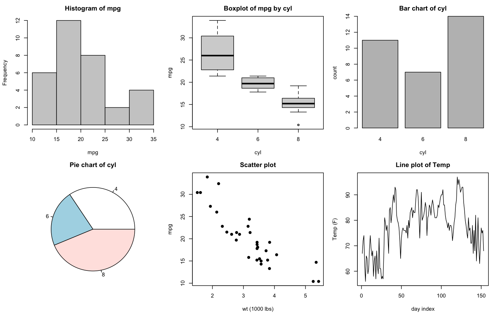

# Chapter 4 — Data Import and Export

[Repository Guide](../../README.md) | [English](Concepts_Lecture.md) | [한국어](Concepts_Lecture.ko.md)

> **Last Updated:** 2026-11-26
>
> 혼자 공부하는 R 데이터 분석, 강전희와 엄동란, Ch 4

> **Learning Objectives:**
> 1. Create data frames directly from vectors and import data from CSV and text files into R
> 2. Use the working directory and relative paths to write import code that runs on other computers
> 3. Inspect imported data with exploration functions and resolve common import problems
> 4. Control column names, row ranges, missing values, column types, and encodings with the main arguments of `read.table()` and readr's column specifications
> 5. Save data as CSV and RDS files, and read Excel and JSON files
> 6. Observe and explore data with descriptive statistics, frequency tables, and base graphics

---

## Table of Contents

- [1. Manual Data Entry](#1-manual-data-entry)
  - [1.1 Creating Data Directly in R](#11-creating-data-directly-in-r)
  - [1.2 Column Names and the Limits of Manual Entry](#12-column-names-and-the-limits-of-manual-entry)
- [2. Reading External Data](#2-reading-external-data)
  - [2.1 Overview of Import Functions](#21-overview-of-import-functions)
  - [2.2 read.table() Function](#22-readtable-function)
  - [2.3 Main Arguments of read.table()](#23-main-arguments-of-readtable)
  - [2.4 Missing-Value Codes and Column Types](#24-missing-value-codes-and-column-types)
  - [2.5 Character Encoding](#25-character-encoding)
- [3. Reading CSV Files](#3-reading-csv-files)
  - [3.1 Basic CSV Import](#31-basic-csv-import)
  - [3.2 Important Parameters](#32-important-parameters)
  - [3.3 File Path Considerations](#33-file-path-considerations)
  - [3.4 read_csv() of readr](#34-read_csv-of-readr)
  - [3.5 Saving Data](#35-saving-data)
- [4. Reading Text Files](#4-reading-text-files)
  - [4.1 Reading Tab-Delimited Files](#41-reading-tab-delimited-files)
  - [4.2 Reading Fixed-Width Files](#42-reading-fixed-width-files)
  - [4.3 Reading by Character Position with read.fwf()](#43-reading-by-character-position-with-readfwf)
- [5. Working Directories](#5-working-directories)
  - [5.1 Getting and Setting the Working Directory](#51-getting-and-setting-the-working-directory)
  - [5.2 Best Practices](#52-best-practices)
  - [5.3 Functions for Paths and Files](#53-functions-for-paths-and-files)
- [6. Data Exploration After Import](#6-data-exploration-after-import)
  - [6.1 Useful Exploration Functions](#61-useful-exploration-functions)
  - [6.2 Common Issues with Imported Data](#62-common-issues-with-imported-data)
  - [6.3 Excel and JSON Files](#63-excel-and-json-files)
- [7. Observing Data: Descriptive Statistics](#7-observing-data-descriptive-statistics)
  - [7.1 Central Tendency](#71-central-tendency)
  - [7.2 Dispersion](#72-dispersion)
  - [7.3 Quantiles and Summaries](#73-quantiles-and-summaries)
  - [7.4 Frequency Tables and Contingency Tables](#74-frequency-tables-and-contingency-tables)
  - [7.5 Relationship of Two Variables: The Correlation Coefficient](#75-relationship-of-two-variables-the-correlation-coefficient)
- [8. Exploring Data: Base Graphics](#8-exploring-data-base-graphics)
  - [8.1 Types of Graphs and Their Functions](#81-types-of-graphs-and-their-functions)
  - [8.2 Reading Graphs](#82-reading-graphs)
  - [8.3 Stem-and-Leaf Plots](#83-stem-and-leaf-plots)
- [Concept Applications](#concept-applications)
- [Summary](#summary)
- [Self-Check Questions](#self-check-questions)

---

<br>

## 1. Manual Data Entry

### 1.1 Creating Data Directly in R

Before importing external data, we can create data frames manually:

```r
ID <- c(1, 2, 3, 4, 5)
SEX <- c("F", "M", "F", "M", "F")
DATA <- data.frame(ID = ID, SEX = SEX)
View(DATA)   # Open in spreadsheet viewer
```

Combining the two vectors created with `c()` through `data.frame()` turns each vector into one column, producing a data frame with 5 rows and 2 columns. In `ID = ID`, the left side of the equals sign is the column name and the right side is the vector placed in that column.

> **Key Point:** Manual data entry is useful for small datasets or for creating test data, but for real-world analysis, data is typically imported from external files.

### 1.2 Column Names and the Limits of Manual Entry

When vectors are passed to `data.frame()` without names, the variable names become the column names, and when they are passed as `name = vector`, the name on the left of the equals sign becomes the column name.

```r
id <- c(1, 2, 3, 4, 5)
gender <- c("F", "M", "F", "M", "F")
df1 <- data.frame(id, gender)
df1
#>   id gender
#> 1  1      F
#> 2  2      M
#> 3  3      F
#> 4  4      M
#> 5  5      F
df2 <- data.frame(x = id, y = gender)
names(df2)
#> [1] "x" "y"
data.frame(id = 1:3, gender = c("F", "M"))
#> Error in data.frame(id = 1:3, gender = c("F", "M")): arguments imply differing number of rows: 3, 2
```

The column names of `df1` are `id` and `gender`, and those of `df2` are `x` and `y`. A column name later becomes the name used to call the column, as in `df2$x`, so names that express the meaning of the values are better than uninformative names such as `x` and `y`. Combining vectors of different lengths, as in the last line, gives an error that the numbers of rows differ, because a data frame is a list of columns of equal length (Section 5 of Chapter 2). A value of length 1, however, is recycled into every row.

Manual entry has limits. Typing values by hand easily introduces typos, and because the information about one person is scattered across several vectors, dropping one value from one vector misaligns all the rows after it. With only hundreds or thousands of observations, entry itself becomes nearly impossible. Manual entry is therefore used for small examples or test data, and real data is read from files. Also, putting non-English characters such as Korean directly into the data can break them depending on the operating system and encoding (Section 2.5), so category values are safer entered in English, as in `"F"` and `"Seoul"`.

---

<br>

## 2. Reading External Data

### 2.1 Overview of Import Functions

R provides several functions to read external data:

| Function | File Type | Package |
|----------|-----------|---------|
| `read.csv()` | CSV (comma-separated) | base |
| `read.table()` | General delimited text | base |
| `read.delim()` | Tab-delimited text | base |
| `readxl::read_excel()` | Excel (.xlsx, .xls) | readxl |
| `readr::read_csv()` | CSV (faster, tidyverse) | readr |

*Table 1. R functions for importing external data*

Writing a call in the `package::function` form, as in `readxl::read_excel()`, calls a function of that package without loading the package with `library()`. The package must still be installed beforehand.

### 2.2 read.table() Function

`read.table()` is the most general function for reading tabular data:

```r
help(read.table)

# Key parameters:
# file      - path to the file
# header    - TRUE if first row contains column names
# sep       - field separator character
# dec       - decimal point character
```

The defaults of `read.table()` are `header = FALSE`, `sep = ""`, and `dec = "."`. `sep = ""` means that any run of one or more white-space characters, such as spaces or tabs, is treated as a separator.

### 2.3 Main Arguments of read.table()

The help page of `read.table()` lists more than 20 arguments, but those used most often when reading data are the following.

| Argument | Role | Default |
|:--|:--|:--|
| `header` | Decides whether to use the first row as column names | `FALSE` |
| `sep` | Sets the separator character between values | `""` (white space) |
| `skip` | Skips the first rows of the file before reading | `0` |
| `nrows` | Sets the maximum number of rows to read | `-1` (all) |
| `col.names` | Specifies the column names directly | `V1`, `V2`, ... |
| `na.strings` | Sets the strings to be treated as missing values | `"NA"` |
| `colClasses` | Specifies the type of each column | Automatic |
| `fileEncoding` | Specifies the character encoding of the file | Operating system default |
| `comment.char` | Sets the character after which content is ignored as a comment | `"#"` |

*Table 2. Main arguments of read.table()*

To see the effect of the arguments, save the first 8 rows of the built-in data `airquality` as a space-separated text file and read it back. `readLines()` reads each line of a file as a string and shows the file as it is.

```r
aq <- head(airquality, 8)
write.table(aq, "aq.txt", sep = " ", row.names = FALSE, quote = FALSE)
readLines("aq.txt", n = 3)
#> [1] "Ozone Solar.R Wind Temp Month Day" "41 190 7.4 67 5 1"                
#> [3] "36 118 8 72 5 2"
```

The first line of the file is the column names, followed by 8 rows of values. Reading it with the defaults gives the following.

```r
read.table("aq.txt")[1:3, ]
#>      V1      V2   V3   V4    V5  V6
#> 1 Ozone Solar.R Wind Temp Month Day
#> 2    41     190  7.4   67     5   1
#> 3    36     118    8   72     5   2
d1 <- read.table("aq.txt", header = TRUE)
str(d1)
#> 'data.frame':	8 obs. of  6 variables:
#>  $ Ozone  : int  41 36 12 18 NA 28 23 19
#>  $ Solar.R: int  190 118 149 313 NA NA 299 99
#>  $ Wind   : num  7.4 8 12.6 11.5 14.3 14.9 8.6 13.8
#>  $ Temp   : int  67 72 74 62 56 66 65 59
#>  $ Month  : int  5 5 5 5 5 5 5 5
#>  $ Day    : int  1 2 3 4 5 6 7 8
```

With `header = FALSE` (the default), even the column names on the first line are read as values, so the column names become `V1`-`V6`, and because strings such as `"Ozone"` mix into each column, every column becomes character. Giving `header = TRUE` makes the first line the column names and produces a data frame of 8 rows and 6 columns. `read.table()` decides types from the values of each column, so columns without decimal points become integers (`int`), `Wind`, which has decimal points, becomes double (`num`), and the `NA` in the file is read as a missing value.

```r
d2 <- read.table("aq.txt", header = TRUE, skip = 2)
head(d2, 2)
#>   X36 X118   X8 X72 X5 X2
#> 1  12  149 12.6  74  5  3
#> 2  18  313 11.5  62  5  4
d3 <- read.table("aq.txt", header = TRUE, nrows = 3)
d3
#>   Ozone Solar.R Wind Temp Month Day
#> 1    41     190  7.4   67     5   1
#> 2    36     118  8.0   72     5   2
#> 3    12     149 12.6   74     5   3
d4 <- read.table("aq.txt", skip = 1, nrows = 2,
                 col.names = c("oz", "sol", "wind", "temp", "mon", "day"))
d4
#>   oz sol wind temp mon day
#> 1 41 190  7.4   67   5   1
#> 2 36 118  8.0   72   5   2
```

`skip = 2` skips the first two lines of the file (the column-name line and the first data line). But because `header = TRUE` was also given, the third line, the second data row `36 118 8 72 5 2`, is used as the column names. Names starting with a digit do not follow R's naming rules, so `X` is prefixed, as in `X36` and `X118`. When `skip` and `header` are used together, it is necessary to check which line becomes the column names. The typical use of `skip` is a file that begins with several lines of description. `nrows = 3` reads only 3 data rows, not counting the column-name line. As in `d4`, skipping the column-name line with `skip = 1` and giving new names with `col.names` reads only the wanted rows with names different from the original ones.

### 2.4 Missing-Value Codes and Column Types

Files record missing values in different ways. In a file that uses a code other than `"NA"`, such as a blank, `.`, `-99`, or `N/A`, that code must be given with `na.strings` for it to be read as missing. The following example reads a string directly instead of a file through the `text` argument.

```r
txt <- "id,score,grade
1,85,B
2,-99,A
3,.,C"
read.csv(text = txt)
#>   id score grade
#> 1  1    85     B
#> 2  2   -99     A
#> 3  3     .     C
read.csv(text = txt, na.strings = c("-99", "."))
#>   id score grade
#> 1  1    85     B
#> 2  2    NA     A
#> 3  3    NA     C
str(read.csv(text = txt, na.strings = c("-99", "."), colClasses = c("integer", "numeric", "factor")))
#> 'data.frame':	3 obs. of  3 variables:
#>  $ id   : int  1 2 3
#>  $ score: num  85 NA NA
#>  $ grade: Factor w/ 3 levels "A","B","C": 2 1 3
```

In the first result, the `score` column contains `.`, so the whole column becomes character, and -99 remains as if it were a real score. Taking the mean in this state gives a warning, or a bogus mean that includes -99. Giving `na.strings = c("-99", ".")` turns both codes into `NA`, and `score` is read as numeric. `colClasses` sets the type of each column directly, so `grade` can be read as a factor from the start. For large files, giving `colClasses` also speeds up reading, because R skips the step of guessing types.

The default `"#"` of `comment.char` ignores the content after that character as a comment. So even if a file begins with description lines starting with `#`, they are not read as data.

```r
txt2 <- "# measured in 2024
x y
1 2
3 4"
read.table(text = txt2, header = TRUE)
#>   x y
#> 1 1 2
#> 2 3 4
```

`read.csv()` has `comment.char = ""` as its default and does not treat `#` as a comment. The setting allows for `#` appearing as a value inside comma-separated data.

### 2.5 Character Encoding

> **Definition:** A **character encoding** is the rule that maps characters to the numbers a computer stores them as.

English letters and digits are stored as the same numbers in most encodings, but Korean is stored differently by each encoding. UTF-8, the standard today, and CP949 (an extension of EUC-KR), long used by Korean Windows, are typical. If the encoding used when a file was created differs from the encoding assumed when reading it, Korean text breaks into unreadable characters.

```r
kor <- c("name,city", "Kim,서울", "Lee,부산")
con <- file("kor_cp949.csv", encoding = "CP949")
writeLines(kor, con)
close(con)
read.csv("kor_cp949.csv", fileEncoding = "CP949")
#>   name city
#> 1  Kim 서울
#> 2  Lee 부산
```

The code above saves a CSV file containing Korean in CP949 and then reads it correctly by stating the file's encoding with `fileEncoding = "CP949"`. `fileEncoding` converts the file's encoding to the one R uses while reading. In contrast, the `encoding` argument does not convert but only marks the strings read with an encoding, so `fileEncoding` is the argument for fixing a file in a different encoding. A Korean file saved as "CSV" in Excel is often saved in CP949 on Korean Windows, and reading such a file with the default settings on macOS or Linux breaks the characters. Saving new files in UTF-8 gives the best compatibility.

---

<br>

## 3. Reading CSV Files

### 3.1 Basic CSV Import

CSV (Comma-Separated Values) is the most common format for data exchange:

```r
# Read a CSV file with header row
ex_data <- read.csv("data/data_ex.csv", header = TRUE)
View(ex_data)
```

`read.csv()` is `read.table()` with defaults suited to CSV (`header = TRUE`, `sep = ","`, and others), so `header = TRUE` in the code above states the default explicitly.

To save a table as CSV in Excel, choose CSV (Comma delimited) as the file type in Save As in the File menu. Opening the saved file in a text editor such as Notepad shows each row on one line, with the values of the cells separated by commas. CSV cannot hold formatting, formulas, or multiple sheets and holds only values, but almost every program can read it, so it serves as a de facto standard for exchanging data.

### 3.2 Important Parameters

```r
read.csv(
  file,                    # File path (absolute or relative)
  header = TRUE,           # First row is column names
  sep = ",",               # Separator (comma for CSV)
  stringsAsFactors = FALSE # Do not convert strings to factors
)
```

Since R 4.0.0, the default of `stringsAsFactors` is `FALSE`. The argument is specified to get the same result in earlier versions of R or to make the intent clear.

### 3.3 File Path Considerations

When reading a file, its location is given as a path, and there are two ways to write a path.

> **Definition:** An **absolute path** gives the full location of a file starting from the top (root) of the file system.

> **Definition:** The **working directory** is the folder R is currently working in; `getwd()` shows it and `setwd()` changes it.

> **Definition:** A **relative path** gives the location of a file relative to the working directory.

```r
# Absolute path (platform-specific)
read.csv("/Users/username/Desktop/data_ex.csv", header = TRUE)

# Relative path (relative to working directory)
read.csv("data/data_ex.csv", header = TRUE)
```

For example, if the working directory is `/Users/username/Desktop/project/`, `"data/data_ex.csv"` points to the file in Figure 1.

```text
/Users/username/Desktop/project/   ← working directory (result of getwd())
└── data/
    ├── data_ex.csv                ← file that "data/data_ex.csv" points to
    ├── data_ex-1.txt
    └── data_ex_col.txt
```

*Figure 1. Resolving a relative path against the working directory*

> **Key Point:** Using relative paths makes your code more portable across different computers. Set your working directory to the project root and use relative paths from there.

Windows paths separate folders with backslashes (`\`), as in `C:\Users\kim\data.csv`, but in R strings the backslash is the symbol that creates special characters such as `\n` (newline). So when writing a Windows path in R, change it to slashes, as in `"C:/Users/kim/data.csv"`, or double the backslashes, as in `"C:\\Users\\kim\\data.csv"`. Slashes work on every operating system.

### 3.4 read_csv() of readr

The `readr` package of the tidyverse provides `read_csv()`, which is similar to `read.csv()`. Its result is a tibble (Section 5 of Chapter 2), it reports how it decided the type of each column, and it reads large files faster. The following example reads a CSV file of `mtcars` included as an example in `readr`.

```r
library(readr)
```

```r
path <- readr_example("mtcars.csv")
cars_tb <- read_csv(path)
#> Rows: 32 Columns: 11
#> ── Column specification ────────────────────────────────────────────────────────
#> Delimiter: ","
#> dbl (11): mpg, cyl, disp, hp, drat, wt, qsec, vs, am, gear, carb
#> 
#> ℹ Use `spec()` to retrieve the full column specification for this data.
#> ℹ Specify the column types or set `show_col_types = FALSE` to quiet this message.
cars_tb
#> # A tibble: 32 × 11
#>      mpg   cyl  disp    hp  drat    wt  qsec    vs    am  gear  carb
#>    <dbl> <dbl> <dbl> <dbl> <dbl> <dbl> <dbl> <dbl> <dbl> <dbl> <dbl>
#>  1  21       6  160    110  3.9   2.62  16.5     0     1     4     4
#>  2  21       6  160    110  3.9   2.88  17.0     0     1     4     4
#>  3  22.8     4  108     93  3.85  2.32  18.6     1     1     4     1
#>  4  21.4     6  258    110  3.08  3.22  19.4     1     0     3     1
#>  5  18.7     8  360    175  3.15  3.44  17.0     0     0     3     2
#>  6  18.1     6  225    105  2.76  3.46  20.2     1     0     3     1
#>  7  14.3     8  360    245  3.21  3.57  15.8     0     0     3     4
#>  8  24.4     4  147.    62  3.69  3.19  20       1     0     4     2
#>  9  22.8     4  141.    95  3.92  3.15  22.9     1     0     4     2
#> 10  19.2     6  168.   123  3.92  3.44  18.3     1     0     4     4
#> # ℹ 22 more rows
```

> **Definition:** The **column specification** is the list of data types that `read_csv()` set or guessed for each column.

`readr_example()` returns the path of an example file included in the package. After reading, `read_csv()` reports the column specification as a message. The message above means that 32 rows and 11 columns were read and that all 11 columns are doubles (`dbl`). `read_csv()` guesses types from the values of the first 1,000 rows, so the guess can be wrong if values of another type appear later. A tibble shortens significant digits to fit the screen width, so the 146.7 of `disp` appears as `147.`. The value itself has not changed.

```r
spec(cars_tb)
#> cols(
#>   mpg = col_double(),
#>   cyl = col_double(),
#>   disp = col_double(),
#>   hp = col_double(),
#>   drat = col_double(),
#>   wt = col_double(),
#>   qsec = col_double(),
#>   vs = col_double(),
#>   am = col_double(),
#>   gear = col_double(),
#>   carb = col_double()
#> )
read_csv(path, col_types = cols(cyl = col_integer(), .default = col_double()), n_max = 3)
#> # A tibble: 3 × 11
#>     mpg   cyl  disp    hp  drat    wt  qsec    vs    am  gear  carb
#>   <dbl> <int> <dbl> <dbl> <dbl> <dbl> <dbl> <dbl> <dbl> <dbl> <dbl>
#> 1  21       6   160   110  3.9   2.62  16.5     0     1     4     4
#> 2  21       6   160   110  3.9   2.88  17.0     0     1     4     4
#> 3  22.8     4   108    93  3.85  2.32  18.6     1     1     4     1
read_csv(I("a,b\n1,x\n2,y"), show_col_types = FALSE)
#> # A tibble: 2 × 2
#>       a b    
#>   <dbl> <chr>
#> 1     1 x    
#> 2     2 y
```

`spec()` shows the guessed column specification in the form of code, so copying it into `col_types` reads the same file with the same types every time. The second call sets only `cyl` to integer (`col_integer()`) and the rest to double through `.default`, and reads only the first 3 rows with `n_max = 3`. The header under the column name has changed to `<int>`. A string wrapped in `I()`, as in the third call, is read as the data itself rather than a file path, and `show_col_types = FALSE` turns off the column specification message.

When a value cannot be converted to the specified type, `read_csv()` leaves it as `NA` with a warning, and `problems()` shows which value in which row was the problem.

```r
df_bad <- read_csv(I("x\n1\n2\nthree"), col_types = cols(x = col_double()))
#> Warning: One or more parsing issues, call `problems()` on your data frame for details,
#> e.g.:
#>   dat <- vroom(...)
#>   problems(dat)
problems(df_bad)[, 1:4]
#> # A tibble: 1 × 4
#>     row   col expected actual
#>   <int> <int> <chr>    <chr> 
#> 1     4     1 a double three
parse_number(c("$1,200", "45%", "3.5 kg"))
#> [1] 1200.0   45.0    3.5
```

The result of `problems()` means that at line 4 of the file (counting the column-name line) and column 1, a double was expected but `three` was found. `parse_number()` ignores characters such as currency symbols, thousands separators, and units, and reads only the numeric part. It is useful for turning columns that store amounts or percentages as strings into numbers.

| Item | `read.csv()` | `readr::read_csv()` |
|:--|:--|:--|
| Result | Data frame | Tibble |
| Deciding column types | Looks at all rows | Guesses from the first 1,000 rows and reports the specification |
| Specifying types | `colClasses` | `col_types = cols(...)` |
| Failed conversion | The whole column tends to become character | Leaves only that value as `NA` and reports it with `problems()` |
| Column names | Fixes them to follow the rules (`my col` → `my.col`) | Keeps them as is |
| Speed | Slow for large files | Fast |

*Table 3. Comparison of read.csv() and read_csv()*

### 3.5 Saving Data

Transformed data is saved to a file to be used in other programs or reloaded in the next analysis. The functions that save text files are `write.csv()`, `write.table()`, and `readr::write_csv()`, and the function that saves an R object as it is is `saveRDS()`.

```r
out <- data.frame(id = 1:3, when = as.Date(c("2024-01-01", "2024-02-01", "2024-03-01")),
                  grp = factor(c("b", "a", "b")))
write.csv(out, "out1.csv")
readLines("out1.csv")
#> [1] "\"\",\"id\",\"when\",\"grp\"" "\"1\",1,2024-01-01,\"b\""    
#> [3] "\"2\",2,2024-02-01,\"a\""     "\"3\",3,2024-03-01,\"b\""
write.csv(out, "out2.csv", row.names = FALSE)
readLines("out2.csv")
#> [1] "\"id\",\"when\",\"grp\"" "1,2024-01-01,\"b\""     
#> [3] "2,2024-02-01,\"a\""      "3,2024-03-01,\"b\""
str(read.csv("out2.csv"))
#> 'data.frame':	3 obs. of  3 variables:
#>  $ id  : int  1 2 3
#>  $ when: chr  "2024-01-01" "2024-02-01" "2024-03-01"
#>  $ grp : chr  "b" "a" "b"
saveRDS(out, "out.rds")
str(readRDS("out.rds"))
#> 'data.frame':	3 obs. of  3 variables:
#>  $ id  : int  1 2 3
#>  $ when: Date, format: "2024-01-01" "2024-02-01" ...
#>  $ grp : Factor w/ 2 levels "a","b": 2 1 2
write_csv(out, "out3.csv")
readLines("out3.csv", n = 2)
#> [1] "id,when,grp"    "1,2024-01-01,b"
```

`write.csv()` saves the row names as the first column by default. The first line of `out1.csv` starting with the empty name `""` and the `"1"`, `"2"` before each line are those row names. Reading this file back creates a useless column named `X`, so `row.names = FALSE` is usually given. The `\"` in the output of `readLines()` shows the double quotation marks in the file inside a string.

In `out2.csv`, read back after saving as CSV, both the date column `when` and the factor column `grp` have become character. CSV is text that holds only values, so R's class information is lost. An `.rds` file saved with `saveRDS()` holds the R object as it is, so reading it with `readRDS()` brings back even the `Date` class and the factor levels. `write_csv()` writes no row names, adds quotation marks only when needed, and always saves in UTF-8.

| Format | Saving Function | Reading Function | Feature |
|:--|:--|:--|:--|
| CSV | `write.csv()`, `write_csv()` | `read.csv()`, `read_csv()` | Every program can read it, but type information is lost |
| RDS | `saveRDS()` | `readRDS()` | Saves one R object as it is, including types |
| RData | `save()` | `load()` | Saves several objects with their names and overwrites variables of the same names when loaded |

*Table 4. Comparison of data saving formats*

`readRDS()` returns the object it reads, so it can be put into any name, as in `x <- readRDS("out.rds")`. In contrast, `load()` creates variables in the workspace with the names used when saving and silently overwrites existing variables with the same names. It is common to save intermediate results of an analysis as RDS and data to exchange with other people or programs as CSV.

---

<br>

## 4. Reading Text Files

### 4.1 Reading Tab-Delimited Files

A tab-delimited file is read with `read.table()` and `sep = "\t"`, or with `read.delim()`. The defaults of `read.delim()` are `header = TRUE` and `sep = "\t"`.

```r
# read.table() with appropriate separator
data_txt <- read.table("data/data_ex-1.txt", header = TRUE, sep = "\t")

# read.delim() is a shortcut for tab-delimited files
data_txt <- read.delim("data/data_ex-1.txt", header = TRUE)
```

### 4.2 Reading Fixed-Width Files

`data_ex_col.txt` has no column-name row, and its data starts on the first row. It is therefore read with `header = FALSE` so that every row is data, and `col.names` supplies the column names. Reading it with `header = TRUE` turns the first data row into column names and loses one row of data.

```r
# For column-aligned text files
data_col <- read.table("data/data_ex_col.txt", header = FALSE, col.names = c("ID", "SEX", "AGE", "AREA"))
```

> **Caution:** With its default `sep = ""`, `read.table()` uses white space as the separator, so it can read files whose columns are aligned with spaces or tabs between them. A true fixed-width file, which separates columns only by character position without any separator, is read with `read.fwf()`, which takes the column widths.

### 4.3 Reading by Character Position with read.fwf()

> **Definition:** A **fixed-width file** is a text file in which each column occupies a fixed number of characters without separator characters.

Old administrative data and the output of measuring instruments are often fixed-width files. Giving the number of characters per column to `widths` of `read.fwf()` cuts and reads at those positions.

```r
fwf_txt <- c("01F50Seoul", "02M40Busan", "03F28Jeju ")
writeLines(fwf_txt, "fixed.txt")
read.fwf("fixed.txt", widths = c(2, 1, 2, 5), col.names = c("id", "sex", "age", "city"))
#>   id sex age  city
#> 1  1   F  50 Seoul
#> 2  2   M  40 Busan
#> 3  3   F  28 Jeju
```

`widths = c(2, 1, 2, 5)` means to read characters 1-2 of each line as `id`, character 3 as `sex`, characters 4-5 as `age`, and characters 6-10 as `city`. The first line `01F50Seoul` is split into `01`, `F`, `50`, and `Seoul`, and `01` is read as a number and becomes 1. Because there is no separator at all within a line, a single misplaced character shifts every column. That is why fixed-width files are usually distributed with a document (codebook) that defines the column widths.

---

<br>

## 5. Working Directories

### 5.1 Getting and Setting the Working Directory

```r
# Check current working directory
getwd()

# Set working directory
setwd("/Users/username/Desktop/project/")

# Now you can use relative paths
data <- read.csv("data/data_ex.csv", header = TRUE)
```

After `setwd()` changes the working directory, later relative paths are resolved against the new working directory.

### 5.2 Best Practices

- Use RStudio Projects (`.Rproj` files) to manage working directories automatically.
- Avoid hardcoding absolute paths in scripts.
- Use the `here` package for robust path construction. `here()` builds paths from the project root, which it locates by markers such as an `.Rproj` file, so the paths point to the same files even if the working directory changes later:
  ```r
  # install.packages("here")
  library(here)
  data <- read.csv(here("data", "data_ex.csv"))
  ```

### 5.3 Functions for Paths and Files

Instead of joining paths as strings directly, the following functions let code work regardless of the operating system.

```r
file.path("data", "raw", "survey.csv")
#> [1] "data/raw/survey.csv"
file.exists("aq.txt")
#> [1] TRUE
file.exists("nothing.csv")
#> [1] FALSE
list.files(pattern = "\\.csv$")
#> [1] "kor_cp949.csv" "out1.csv"      "out2.csv"      "out3.csv"
basename("/Users/kim/project/data/aq.txt")
#> [1] "aq.txt"
dirname("/Users/kim/project/data/aq.txt")
#> [1] "/Users/kim/project/data"
```

`file.path()` joins folder names and a file name with the separator of the operating system. `file.exists()` checks whether a file exists, so it is used to verify a path before reading. `list.files()` returns the list of files in the working directory, and giving the regular expression `"\\.csv$"` to `pattern` selects only files whose names end in `.csv`. The result above is the CSV files created by the examples in this chapter. `basename()` and `dirname()` separate the file name and the folder part from a path. To read many files in a folder at once, get the file names with `list.files()` and apply `read.csv()` to each file with `lapply()` of Section 9 of Chapter 3.

---

<br>

## 6. Data Exploration After Import

### 6.1 Useful Exploration Functions

After importing data, always inspect it:

```r
# Structure and summary
str(data)        # Compact display of structure
summary(data)    # Statistical summary of each column
head(data)       # First 6 rows
tail(data)       # Last 6 rows
dim(data)        # Dimensions (rows x columns)
nrow(data)       # Number of rows
ncol(data)       # Number of columns
names(data)      # Column names
class(data)      # Object class

# Visualization
View(data)       # Spreadsheet viewer in RStudio
```

`head()` and `tail()` show 6 rows by default, and the number of rows can be changed as in `head(data, 10)`. `summary()` shows the minimum, quartiles, mean, and maximum for numeric columns, the frequencies by level for factor columns, and only the length and type for character columns. So to see the frequencies of a character column holding categories, use `table()` or convert it to a factor before using `summary()`. `names()` returns the column names as a character vector, so it is also used to rename columns, as in `names(data)[2] <- "age"`.

### 6.2 Common Issues with Imported Data

| Issue | Solution |
|-------|----------|
| Wrong column types | Use `stringsAsFactors = FALSE` or `colClasses` |
| Missing values | Check with `sum(is.na(data))` |
| Encoding issues | Specify `encoding = "UTF-8"` (to convert the file's encoding while reading, specify something like `fileEncoding = "CP949"`) |
| Wrong separator | Verify with `readLines(file, n = 5)` to inspect raw content |

*Table 5. Common issues with imported data and their solutions*

Checking imported data in the following order leaves little out. First, check with `dim()` that the numbers of rows and columns match the original file. If there is one row fewer, suspect the handling of the column-name line (Section 2.3); if there is only one column, suspect the separator. Next, look at the type of each column with `str()`, and if a column that should be numeric is character, check whether missing-value codes or characters such as units have mixed in (Section 2.4). Finally, look at the minimum, maximum, and number of missing values of each column with `summary()` to make sure numbers meaning missing, such as -99 or 999, do not remain as if they were real values.

### 6.3 Excel and JSON Files

Excel files (`.xlsx`, `.xls`) are read with `read_excel()` of the `readxl` package. `readxl` works without the Excel program, and its result is a tibble.

```r
library(readxl)
xl <- readxl_example("datasets.xlsx")
excel_sheets(xl)
#> [1] "mtcars"   "chickwts" "quakes"
read_excel(xl, sheet = "quakes", n_max = 3)
#> # A tibble: 3 × 5
#>     lat  long depth   mag stations
#>   <dbl> <dbl> <dbl> <dbl>    <dbl>
#> 1 -20.4  182.   562   4.8       41
#> 2 -20.6  181.   650   4.2       15
#> 3 -26    184.    42   5.4       43
read_excel(xl, sheet = "mtcars", range = "A1:C4")
#> # A tibble: 3 × 3
#>     mpg   cyl  disp
#>   <dbl> <dbl> <dbl>
#> 1  21       6   160
#> 2  21       6   160
#> 3  22.8     4   108
```

`excel_sheets()` returns the names of the sheets in a workbook. In `read_excel()`, `sheet` chooses the sheet to read by name or number, `n_max` the number of rows to read, and `range` an Excel cell range such as `"A1:C4"`. The first row of the range, A1:C1, becomes the column names, so there are 3 rows of data. Excel files often contain merged cells, multi-line titles, and information shown only by formatting, so it is good to select only the table part with `range` or `skip` before reading.

**JSON** (JavaScript Object Notation) is a semi-structured format commonly used when web services exchange data (Section 1 of Chapter 1). It lists `"name": value` pairs inside `{ }` to represent one object and lists objects inside `[ ]` to represent a list. `fromJSON()` of the `jsonlite` package turns a list of objects with the same names into a data frame, and `toJSON()` does the reverse.

```r
library(jsonlite)
js <- '[{"id":1,"score":90},{"id":2,"score":75}]'
fromJSON(js)
#>   id score
#> 1  1    90
#> 2  2    75
toJSON(data.frame(a = 1:2, b = c("x", "y")))
#> [{"a":1,"b":"x"},{"a":2,"b":"y"}]
```

The JSON string contains double quotation marks, so the R string is enclosed in single quotation marks. One object of the list becomes one row of the data frame, and the names `id` and `score` become the column names. The XML format is read with the `xml2` package.

---

<br>

## 7. Observing Data: Descriptive Statistics

Once the data is imported and checked, summarize with a few numbers where the values of each variable gather and how widely they spread.

> **Definition:** A **descriptive statistic** is a number that summarizes the center, the scatter, or the shape of the distribution of data.

### 7.1 Central Tendency

> **Definition:** **Central tendency** is the location of the center around which the data gathers.

> **Definition:** The **sample mean** is the sum of n values divided by n.

The typical measures of central tendency are the mean, median, and mode. The sample mean of n values $`x_1, \dots, x_n`$ is as follows.

```math
\bar{x} = \frac{1}{n} \sum_{i=1}^{n} x_i
```

> **Definition:** The **median** is the value in the middle when the values are arranged in order of size; when their number is even, it is the mean of the two middle values.

> **Definition:** The **mode** is the most frequent value in the data.

The three measures are computed for the following data.

```r
x <- c(2, 4, 4, 5, 7, 9, 30)
mean(x)
#> [1] 8.714286
median(x)
#> [1] 5
tab <- table(x)
tab
#> x
#>  2  4  5  7  9 30 
#>  1  2  1  1  1  1
names(tab)[tab == max(tab)]
#> [1] "4"
mean(x, trim = 0.2)
#> [1] 5.8
```

The sum of the 7 values is 2 + 4 + 4 + 5 + 7 + 9 + 30 = 61, so the mean is 61 / 7 ≈ 8.714. The fourth value in order of size is in the middle, so the median is 5. The mean is much larger than the median because the single value 30 pulls the mean up. The mean is thus sensitive to extreme values while the median is robust. For data with a long tail on one side, such as income or house prices, the median represents a typical value better.

> **Definition:** **Robust** describes a statistic that is little affected by extreme values.

R has no built-in function for the mode, so count the frequencies with `table()` and pick the name of the value with the largest frequency. `mode()` is the function that returns the storage mode seen in Section 7 of Chapter 2 and has nothing to do with the statistical mode. The trimmed mean `mean(x, trim = 0.2)` drops the fractional part of 7 × 0.2 = 1.4, discards one value at each end, 2 and 30, and averages the remaining 4, 4, 5, 7, 9 to give 29 / 5 = 5.8 (Section 9 of Chapter 3).

### 7.2 Dispersion

> **Definition:** **Dispersion** is the degree to which values are scattered around the center.

> **Definition:** The **sample variance** is the sum of the squared differences (deviations) between each value and the sample mean, divided by n - 1.

> **Definition:** The **sample standard deviation** is the square root of the sample variance, expressing dispersion in the units of the data.

Even with the same center, data whose values gather near the center differs from data that is widely scattered. Typical measures of dispersion are the range, variance, standard deviation, and interquartile range. The sample variance and sample standard deviation are as follows.

```math
s^2 = \frac{1}{n-1} \sum_{i=1}^{n} (x_i - \bar{x})^2, \qquad s = \sqrt{s^2}
```

```r
y <- c(2, 4, 4, 5, 7, 9)
mean(y)
#> [1] 5.166667
var(y)
#> [1] 6.166667
sd(y)
#> [1] 2.483277
range(y)
#> [1] 2 9
diff(range(y))
#> [1] 7
```

The mean of `y` is 31 / 6 ≈ 5.167. The differences between each value and the mean (deviations) are -3.167, -1.167, -1.167, -0.167, 1.833, 3.833, and their squares are 10.028, 1.361, 1.361, 0.028, 3.361, 14.694. Their sum, 30.833, divided by n - 1 = 5 gives the variance 6.167, and its square root 2.483 is the standard deviation. Simply adding the deviations always gives 0, so they are squared before adding, and the square root returns the squared units to the original units. `range()` returns the minimum and maximum together, and the range (maximum - minimum) is `diff(range(y))` = 9 - 2 = 7.

> **Caution:** `var()` and `sd()` compute the sample variance and sample standard deviation, dividing by n - 1 rather than n. Dividing by n underestimates the variance on average when the population variance is estimated from a sample. When the variance dividing by n, treating the data as the whole population, is needed, correct it as `var(y) * (n - 1) / n`.

### 7.3 Quantiles and Summaries

> **Definition:** A **quantile** is the value at the position corresponding to a given proportion from the bottom when the data is arranged in order of size.

> **Definition:** The **quartiles** are the values at the 25%, 50%, and 75% positions when the data is arranged in order of size: the first quartile $`Q_1`$, the median, and the third quartile $`Q_3`$.

> **Definition:** The **interquartile range (IQR)** is the difference $`\mathrm{IQR} = Q_3 - Q_1`$ between the third and first quartiles.

Computed with `quantile()` and `IQR()`:

```r
quantile(y)
#>   0%  25%  50%  75% 100% 
#>  2.0  4.0  4.5  6.5  9.0
IQR(y)
#> [1] 2.5
quantile(y, probs = c(0.1, 0.9))
#> 10% 90% 
#>   3   8
```

There are several ways to compute quantiles, and R's `quantile()` uses the following by default. In the sorted values $`x_{(1)} \le \dots \le x_{(n)}`$, the position for proportion p is set to $`h = (n - 1)p + 1`$, and when h is not an integer, the value is interpolated linearly between the two neighboring values.

```math
Q(p) = x_{(\lfloor h \rfloor)} + (h - \lfloor h \rfloor)\,\big(x_{(\lfloor h \rfloor + 1)} - x_{(\lfloor h \rfloor)}\big)
```

`y` has n = 6, so the 25% position is h = 5 × 0.25 + 1 = 2.25, between the second and third values 4 and 4, and $`Q_1 = 4 + 0.25 \times 0 = 4`$. The 50% position is h = 3.5, giving 4 + 0.5 × (5 - 4) = 4.5, and the 75% position is h = 4.75, giving 5 + 0.75 × (7 - 5) = 6.5. Therefore IQR = 6.5 - 4 = 2.5. In the same way, the 10% position is h = 1.5, giving 2 + 0.5 × (4 - 2) = 3. Textbooks and other programs may use other methods, so quartiles of small data differ slightly, and the method can be changed with the `type` argument of `quantile()`.

`summary()` shows the minimum, first quartile, median, mean, third quartile, and maximum of a numeric variable at once, and also the number of missing values if there are any.

```r
summary(mtcars$mpg)
#>    Min. 1st Qu.  Median    Mean 3rd Qu.    Max. 
#>   10.40   15.43   19.20   20.09   22.80   33.90
summary(airquality[, c("Ozone", "Temp")])
#>      Ozone             Temp      
#>  Min.   :  1.00   Min.   :56.00  
#>  1st Qu.: 18.00   1st Qu.:72.00  
#>  Median : 31.50   Median :79.00  
#>  Mean   : 42.13   Mean   :77.88  
#>  3rd Qu.: 63.25   3rd Qu.:85.00  
#>  Max.   :168.00   Max.   :97.00  
#>  NA's   :37
```

The fuel efficiency of `mtcars` (`mpg`, miles per gallon) ranges from 10.4 to 33.9, and the mean 20.09 is slightly larger than the median 19.2. Applying `summary()` to a data frame prints the summaries of the columns side by side. For `Ozone`, the mean 42.13 is larger than the median 31.5 and the maximum 168 is far above the third quartile 63.25, suggesting a distribution with a long tail toward large values. `NA's: 37` equals the number of missing values counted in Section 5 of Chapter 3.

| Function | Value Computed |
|:--|:--|
| `mean()`, `median()` | Mean, median |
| `var()`, `sd()` | Sample variance, sample standard deviation (divided by n - 1) |
| `min()`, `max()`, `range()` | Minimum, maximum, both together |
| `quantile()`, `IQR()` | Quantiles, interquartile range |
| `summary()` | Minimum, quartiles, median, mean, maximum, number of missing values |
| `table()`, `prop.table()` | Frequencies, relative frequencies |
| `cor()` | Correlation coefficient |

*Table 6. Functions that compute descriptive statistics*

### 7.4 Frequency Tables and Contingency Tables

> **Definition:** A **frequency table** is a table of the number of observations (frequency) in each category or interval.

A categorical variable is summarized not by its mean but by how many observations fall in each category. In a frequency table, the frequency divided by the total count is the **relative frequency**.

```r
table(mtcars$cyl)
#> 
#>  4  6  8 
#> 11  7 14
prop.table(table(mtcars$cyl))
#> 
#>       4       6       8 
#> 0.34375 0.21875 0.43750
round(prop.table(table(mtcars$cyl)) * 100, 1)
#> 
#>    4    6    8 
#> 34.4 21.9 43.8
```

Of the 32 cars in `mtcars`, 11 have 4 cylinders, 7 have 6, and 14 have 8. The relative frequency is computed as 11 / 32 = 0.34375, and multiplying by 100 and rounding gives a percentage. The relative frequencies always sum to 1.

> **Definition:** A **contingency table** is a table of the frequencies of each combination of the values of two categorical variables.

Passing two variables to `table()` together produces a contingency table.

```r
table(mtcars$cyl, mtcars$am)
#>    
#>      0  1
#>   4  3  8
#>   6  4  3
#>   8 12  2
addmargins(table(cyl = mtcars$cyl, am = mtcars$am))
#>      am
#> cyl    0  1 Sum
#>   4    3  8  11
#>   6    4  3   7
#>   8   12  2  14
#>   Sum 19 13  32
round(prop.table(table(mtcars$cyl, mtcars$am), margin = 1), 3)
#>    
#>         0     1
#>   4 0.273 0.727
#>   6 0.571 0.429
#>   8 0.857 0.143
```

`am` is the transmission type, where 0 is automatic and 1 is manual. Each cell of the contingency table is the number of cars satisfying both conditions, and 8 cars have 4 cylinders and a manual transmission. `addmargins()` adds the row and column sums to show the total frequency of each category (the marginal frequencies). Giving `margin = 1` to `prop.table()` divides so that each row sums to 1, which compares the proportion of manual transmissions by number of cylinders. For 4-cylinder cars, 8 / 11 ≈ 0.727 are manual, but for 8-cylinder cars only 2 / 14 ≈ 0.143 are. `margin = 2` divides by column.

### 7.5 Relationship of Two Variables: The Correlation Coefficient

The degree to which two numeric variables increase or decrease together is expressed with the Pearson correlation coefficient.

```math
r = \frac{\sum_{i=1}^{n} (x_i - \bar{x})(y_i - \bar{y})}{\sqrt{\sum_{i=1}^{n} (x_i - \bar{x})^2}\,\sqrt{\sum_{i=1}^{n} (y_i - \bar{y})^2}}
```

r is a value between -1 and 1; a value near 1 means a strong positive linear relationship, near -1 a strong negative linear relationship, and near 0 a weak linear relationship.

> **Definition:** The **Pearson correlation coefficient** expresses the direction and strength of the linear relationship between two numeric variables.

```r
cor(mtcars$wt, mtcars$mpg)
#> [1] -0.8676594
cor(mtcars[, c("mpg", "wt", "hp")])
#>            mpg         wt         hp
#> mpg  1.0000000 -0.8676594 -0.7761684
#> wt  -0.8676594  1.0000000  0.6587479
#> hp  -0.7761684  0.6587479  1.0000000
```

The correlation coefficient between car weight (`wt`, in units of 1,000 pounds) and fuel efficiency is -0.868, a strong negative relationship in which heavier cars have lower fuel efficiency. Giving a data frame returns the correlation coefficients of all pairs of columns as a matrix, and the diagonal elements are 1 because they are correlations with themselves. Weight and horsepower (`hp`) have a positive correlation of 0.659.

> **Caution:** The correlation coefficient measures only the strength of a straight-line relationship. Even with a clear curved relationship, such as a U shape, r can be close to 0, so the correlation coefficient must always be interpreted together with a scatter plot (Section 8). A strong correlation also does not mean that one variable causes the other.

---

<br>

## 8. Exploring Data: Base Graphics

### 8.1 Types of Graphs and Their Functions

> **Definition:** An **outlier** is a value far from the other observations.

> **Definition:** A **scatter plot** is a graph that draws the pairs of values of two numeric variables as points to show their relationship.

Numerical summaries alone easily miss the shape of a distribution, outliers, and relationships between variables, so data is examined with graphs as well. The `graphics` package of the base system (base graphics) draws one graph with one function. ggplot2, more widely used in modern data visualization, is covered in Chapter 6; here the base graphics functions often used for exploration are summarized.

```r
par(mfrow = c(2, 3), mar = c(4.2, 4.2, 2.5, 1))
hist(mtcars$mpg, breaks = 8, main = "Histogram of mpg", xlab = "mpg", col = "grey80")
boxplot(mpg ~ cyl, data = mtcars, main = "Boxplot of mpg by cyl", xlab = "cyl", ylab = "mpg")
barplot(table(mtcars$cyl), main = "Bar chart of cyl", xlab = "cyl", ylab = "count")
pie(table(mtcars$cyl), main = "Pie chart of cyl")
plot(mtcars$wt, mtcars$mpg, main = "Scatter plot", xlab = "wt (1000 lbs)", ylab = "mpg", pch = 19)
plot(airquality$Temp, type = "l", main = "Line plot of Temp", xlab = "day index", ylab = "Temp (F)")
```



*Figure 2. Six graphs drawn with base graphics*

`par(mfrow = c(2, 3))` divides the graph window into 2 rows and 3 columns so that the following graphs fill it in turn, and `mar` sets the margins around each graph. Every graph function accepts `main` (title), `xlab` and `ylab` (axis labels), and `col` (color) as common arguments.

| Function | Graph | Suitable Data | Main Arguments |
|:--|:--|:--|:--|
| `hist()` | Histogram | Distribution of one numeric variable | `breaks` (number or boundaries of bins) |
| `boxplot()` | Box plot | Distribution of a numeric variable, group comparison | Formula `y ~ group`, `data` |
| `barplot()` | Bar chart | Frequencies of a categorical variable | Result of `table()` |
| `pie()` | Pie chart | Proportions of categories | Result of `table()` |
| `plot(x, y)` | Scatter plot | Relationship of two numeric variables | `pch` (point shape) |
| `plot(y, type = "l")` | Line plot | Change of ordered values | `type` (`"p"` points, `"l"` lines, `"b"` both) |
| `stem()` | Stem-and-leaf plot | Distribution of small numeric data | `scale` |

*Table 7. Main functions of base graphics*

### 8.2 Reading Graphs

> **Definition:** A **histogram** is a graph that divides the range of a numeric variable into bins of equal width and shows the number of observations in each bin as the height of contiguous bars.

A histogram's bars have no gaps because the bins are contiguous. The bins and frequencies used by the histogram in Figure 2 are as follows.

```r
h <- hist(mtcars$mpg, breaks = 8, plot = FALSE)
h$breaks
#> [1] 10 15 20 25 30 35
h$counts
#> [1]  6 12  8  2  4
```

`breaks = 8` is only a suggestion for the number of bins, and R found pleasant boundaries and made five bins of width 5. Cars with fuel efficiency above 15 and at most 20 are the most numerous at 12, and 4 cars exceed 30. In the default setting, a bin excludes its left boundary and includes its right boundary, and only the first bin also includes its left boundary 10. Changing the bin width can change how the distribution looks, so it is good to draw it with several widths.

The first thing to read from a histogram is the shape of the distribution. A distribution that is high in the middle and falls off similarly on both sides is called a **symmetric distribution**, and in it the mean and median are nearly equal. A distribution with a long tail stretching to the right is called a **right-skewed distribution**; a few large values pull the mean up, so the mean is larger than the median. A distribution with a long tail to the left has, conversely, a mean smaller than the median. The fuel efficiency distribution in Figure 2 is concentrated in the 15-20 bin and has a few values above 30, so it is slightly right-skewed, consistent with the mean 20.09 being larger than the median 19.2 in Section 7.3. A distribution with two peaks may be a sign that two groups of different nature are mixed, so it is worth drawing it again with the groups separated.

> **Definition:** A **box plot** is a graph that shows the distribution of a numeric variable with a box drawn at the quartiles, a line at the median, whiskers extending from the box, and separately drawn outlier candidates.

The lower and upper edges of the box are the quartiles, the thick line in the box is the median, and the whiskers extending from the box reach the farthest observations within 1.5 × IQR of the box. Points beyond them are drawn separately as outlier candidates. In Figure 2, one point is drawn below the box of the 8-cylinder cars; checking it by computation gives the following.

```r
boxplot.stats(mtcars$mpg[mtcars$cyl == 8])$stats
#> [1] 13.3 14.3 15.2 16.4 19.2
boxplot.stats(mtcars$mpg[mtcars$cyl == 8])$out
#> [1] 10.4 10.4
quantile(mtcars$mpg[mtcars$cyl == 8])
#>    0%   25%   50%   75%  100% 
#> 10.40 14.40 15.20 16.25 19.20
```

The `stats` of `boxplot.stats()` are, in order, the end of the lower whisker, the lower edge of the box, the median, the upper edge of the box, and the end of the upper whisker. The difference between the two edges of the box, 14.3 and 16.4, is 2.1, so the lower fence is 14.3 - 1.5 × 2.1 = 11.15. 10.4 is below it and is shown as an outlier, and because two cars have the same value, their points overlap and look like one. The lower whisker ends at 13.3, the smallest value within the fence.

> **Note:** **Box edges and quartiles.** The two edges of the box drawn by `boxplot()` are not the default quartiles of `quantile()` (14.40, 16.25) but Tukey's hinges. The hinges are found by splitting the sorted data in half at the median and taking the median of each half, so for small data they differ slightly from the quartiles of Section 7.3. For large data the difference becomes negligible.

A **bar chart** shows the frequency of each category as the bar height, and the bars are drawn apart because there is no order or continuity between categories. A **pie chart** shows the proportion of each category in the whole as the angle of a sector. But the human eye compares lengths more accurately than angles and areas, so a bar chart is better than a pie chart for comparing proportions. In Figure 2 as well, the difference between 4- and 8-cylinder cars is clearer in the bar chart.

The scatter plot in Figure 2 shows a negative relationship in which fuel efficiency falls as weight rises, consistent with the correlation coefficient -0.868 of Section 7.5. A **line plot** connects ordered values, such as values over time, with lines to show their change, and the temperature graph in Figure 2 shows a seasonal change in which the temperature rises from May toward July and August and falls again in September.

### 8.3 Stem-and-Leaf Plots

> **Definition:** A **stem-and-leaf plot** is a text plot of a distribution that splits each value into a stem (leading digits) and a leaf (trailing digit).

Like a histogram, a stem-and-leaf plot shows the shape of the distribution, but it also lets most of the original values be recovered.

```r
stem(mtcars$mpg)
#> 
#>   The decimal point is at the |
#> 
#>   10 | 44
#>   12 | 3
#>   14 | 3702258
#>   16 | 438
#>   18 | 17227
#>   20 | 00445
#>   22 | 88
#>   24 | 4
#>   26 | 03
#>   28 | 
#>   30 | 44
#>   32 | 49
```

`The decimal point is at the |` means that the vertical bar is at the position of the decimal point. In this plot each stem covers an interval of 2 units, so the leaves `44` on stem 10 are two values of 10.4, and of the leaves `3702258` on stem 14, `37` are 14.3 and 14.7, while the following `02258` are the values of the next unit, 15: 15.0, 15.2, 15.2, 15.5, 15.8. Leaves are written only to the first decimal place, so lower digits are rounded. The empty leaves of stem 28 mean that no car is at least 28 and below 30. A stem-and-leaf plot is suited to data of a few dozen values or fewer.

---

<br>

## Concept Applications

**True/False Check:**

| Statement | Judgment and Reason |
|:--|:--|
| Reading a file whose first line is the column names with `read.table()` recognizes the column names automatically. | **F.** The default of `read.table()` is `header = FALSE`, so the first line is also read as data. `header = TRUE` must be given. |
| A file that records missing values as `-99` must be read with `na.strings = "-99"` for them to be missing values. | **T.** The default treats only `"NA"` as missing, so other codes must be given with `na.strings`. |
| Saving as CSV and reading back keeps the types of factors and dates. | **F.** CSV is text that holds only values, so they come back as character. Use `saveRDS()` to keep types. |
| `var()` is the sum of squared deviations divided by n. | **F.** It is the sample variance, so it divides by n - 1. |
| In data with extreme values, the median is less affected than the mean. | **T.** The median is the middle value in order, so it does not change when one large value becomes larger. |
| A correlation coefficient near 0 means there is no relationship at all between the two variables. | **F.** The correlation coefficient measures only linear relationships, so it can be near 0 even with a curved relationship. |
| A pie chart is more accurate than a bar chart for comparing the proportions of categories. | **F.** The human eye compares lengths more accurately than angles, so a bar chart is better. |

---

<br>

## Summary

| Concept | Key Summary |
|---------|-------------|
| `data.frame()` | It creates a data frame directly from vectors. |
| `read.csv()` | It imports comma-separated files and, with `header = TRUE` (the default), reads the first row as column names. |
| `read.table()` | It is a general-purpose text file reader, and the separator is specified with `sep`. |
| Reading Range | `skip` skips the first rows and `nrows` sets the number of rows to read, and with `skip` and `header` together the line after the skipped ones becomes the column names. |
| Missing Codes and Types | `na.strings` states missing-value codes other than `NA`, and `colClasses` or `col_types` specifies column types. |
| Encoding | Korean breaks when the file's encoding differs from the one assumed when reading, so `fileEncoding` states the file's encoding. |
| `read_csv()` | It returns a tibble and reports the column specification, and values that failed to convert are checked with `problems()`. |
| Saving | CSV saves only values while RDS saves an R object with its types, and `write.csv()` is usually given `row.names = FALSE`. |
| Working directory | It is checked with `getwd()` and set with `setwd()`, and relative paths are preferred. |
| Data inspection | After import, the data is always checked with `str()`, `summary()`, and `head()`. |
| `View()` | It opens data in RStudio's spreadsheet viewer. |
| File paths | Relative paths are more portable than absolute paths. |
| Central Tendency | The mean is sensitive to extreme values, the median is robust, and the mode is found with `table()`. |
| Dispersion | The variance and standard deviation are computed dividing by n - 1, and the IQR is the difference between the third and first quartiles. |
| Frequencies and Contingency Tables | `table()` gives frequencies, `prop.table()` relative frequencies, and `table()` with two variables a contingency table. |
| Correlation Coefficient | It expresses the direction and strength of a linear relationship from -1 to 1 and is interpreted together with a scatter plot. |
| Base Graphics | `hist()`, `boxplot()`, `barplot()`, `pie()`, `plot()`, and `stem()` explore distributions and relationships. |

---

<br>

## Self-Check Questions

1. **Comparing defaults:** Give the default values of `header` and `sep` for `read.csv()` and for `read.table()`, and state which arguments must be specified to read a comma-separated file whose first row holds column names with `read.table()`.

   <details>
   <summary>Answer</summary>

   The defaults of `read.csv()` are `header = TRUE` and `sep = ","`, and those of `read.table()` are `header = FALSE` and `sep = ""` (white space). To read this file with `read.table()`, `header = TRUE, sep = ","` must therefore be specified.

   </details>

2. **Relative paths:** When the working directory is `/Users/username/Desktop/project/`, give the absolute path of the file that `read.csv("data/data_ex.csv")` reads, and explain why relative paths are more portable than absolute paths.

   <details>
   <summary>Answer</summary>

   The file read is `/Users/username/Desktop/project/data/data_ex.csv`. A relative path is resolved against the working directory, so even if the project folder moves to another computer or location, the code runs unchanged once the working directory is set to the project root. An absolute path does not exist on a computer with a different user name or folder structure.

   </details>

3. **A file without a column-name row:** The file `data_ex_col.txt` has 10 rows and 4 columns, and its first row starts with `1`, `F`, `50`, `서울`. Describe the result of reading it with `read.table("data/data_ex_col.txt", header = TRUE)`, and write code that reads it correctly.

   <details>
   <summary>Answer</summary>

   The first data row is used as column names, so only 9 rows remain, and the column names become `X1`, `F`, `X50`, and `서울`. R prefixes names that start with a digit with `X` to make them valid names. The correct code is `read.table("data/data_ex_col.txt", header = FALSE, col.names = c("ID", "SEX", "AGE", "AREA"))`, which produces a data frame with 10 rows and 4 columns.

   </details>

4. **Inspecting imported data:** After importing a data frame `data`, write the function calls that check (a) the numbers of rows and columns, (b) the data type of each column, and (c) the total number of missing values.

   <details>
   <summary>Answer</summary>

   (a) is `dim(data)`, and `nrow(data)` and `ncol(data)` check them separately. (b) is `str(data)`, which shows the data type and first values of each column. (c) is `sum(is.na(data))`, which counts the `TRUE` values in the logical result of `is.na()` to obtain the number of missing values.

   </details>

5. **skip and nrows:** Describe the column names and number of rows obtained by reading `aq.txt` of Section 2.3 (column names on the first line, then 8 rows of data) with `read.table("aq.txt", header = TRUE, skip = 3, nrows = 2)`.

   <details>
   <summary>Answer</summary>

   The first three lines (the column-name line and two data rows) are skipped, so the fourth line, the third data row `12 149 12.6 74 5 3`, becomes the column names `X12`, `X149`, `X12.6`, `X74`, `X5`, and `X3`. Then 2 data rows (the fourth and fifth data rows) are read, giving 2 rows and 6 columns.

   </details>

6. **Variance and quartiles:** By hand, compute the mean, sample variance, and `quantile(z, 0.25)` of `z <- c(1, 3, 3, 7)`.

   <details>
   <summary>Answer</summary>

   The mean is 14 / 4 = 3.5. The deviations are -2.5, -0.5, -0.5, 3.5, and the sum of their squares is 6.25 + 0.25 + 0.25 + 12.25 = 19, so the sample variance is 19 / 3 ≈ 6.333. The 25% position is h = (4 - 1) × 0.25 + 1 = 1.75, so between the first and second values it is 1 + 0.75 × (3 - 1) = 2.5.

   </details>

7. **Reading a contingency table:** In the contingency table of Section 7.4, compute the proportion of 4-cylinder cars among cars with a manual transmission (`am = 1`), and state whether this value comes from `prop.table(..., margin = 1)` or `margin = 2`.

   <details>
   <summary>Answer</summary>

   There are 8 + 3 + 2 = 13 cars with a manual transmission, of which 8 have 4 cylinders, so the proportion is 8 / 13 ≈ 0.615. It is a value divided so that each column (`am`) sums to 1, so it comes from `margin = 2`.

   </details>

8. **Outliers in a box plot:** In some data, the two edges of the box are 20 and 30, and the three largest observations are 42, 44, and 47. Find the values drawn separately as outliers in the box plot and the end of the upper whisker.

   <details>
   <summary>Answer</summary>

   The width of the box is 30 - 20 = 10, so the upper fence is 30 + 1.5 × 10 = 45. Only 47 exceeds the fence and is drawn as an outlier, and the upper whisker ends at 44, the largest value within the fence.

   </details>
