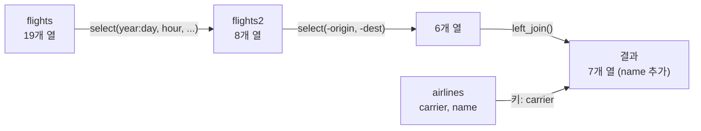

# 5장 — ggplot2를 활용한 데이터 시각화

[레포지토리 안내](../../README.ko.md) | [English](Concepts_Lecture.md) | [한국어](Concepts_Lecture.ko.md)

> **최종 수정일:** 2026-10-18
>
> 혼자 공부하는 R 데이터 분석, 강전희와 엄동란, Ch 5, 6

> **학습 목표:**
> 1. ggplot2 그래픽 문법의 구성 요소를 설명하고 산점도, 선 그래프, 막대 그래프, 상자 그림을 그릴 수 있다
> 2. 미적 매핑과 패싯을 사용하고, 여러 geom을 레이어로 쌓아 기준선과 텍스트 주석을 더할 수 있다
> 3. dplyr의 핵심 함수와 파이프 연산자로 데이터를 선택, 변환, 요약할 수 있다
> 4. `left_join()`으로 공통 키 열을 기준으로 두 데이터 프레임을 결합할 수 있다

---

## 목차

- [1. ggplot2 소개](#1-ggplot2-소개)
  - [1.1 그래픽 문법](#11-그래픽-문법)
  - [1.2 기본 문법](#12-기본-문법)
- [2. dplyr을 활용한 데이터 조작](#2-dplyr을-활용한-데이터-조작)
  - [2.1 dplyr 핵심 동사](#21-dplyr-핵심-동사)
  - [2.2 filter(): 행 선택](#22-filter-행-선택)
  - [2.3 arrange(): 정렬](#23-arrange-정렬)
  - [2.4 select(): 열 선택](#24-select-열-선택)
  - [2.5 mutate(): 새로운 열 생성](#25-mutate-새로운-열-생성)
  - [2.6 summarise()와 group_by()](#26-summarise와-group_by)
- [3. 기본 그래프 유형](#3-기본-그래프-유형)
  - [3.1 산점도 (geom_point())](#31-산점도-geom_point)
  - [3.2 선 그래프 (geom_line())](#32-선-그래프-geom_line)
  - [3.3 막대 그래프 (geom_bar())](#33-막대-그래프-geom_bar)
  - [3.4 상자 그림 (geom_boxplot())](#34-상자-그림-geom_boxplot)
  - [3.5 선버스트 차트 (극좌표)](#35-선버스트-차트-극좌표)
- [4. 미적 매핑](#4-미적-매핑)
  - [4.1 색상 매핑](#41-색상-매핑)
  - [4.2 알파(투명도) 매핑](#42-알파투명도-매핑)
  - [4.3 모양 매핑](#43-모양-매핑)
- [5. 패싯](#5-패싯)
  - [5.1 facet_wrap()](#51-facet_wrap)
- [6. 기준선과 주석](#6-기준선과-주석)
  - [6.1 기준선 추가](#61-기준선-추가)
  - [6.2 텍스트 주석](#62-텍스트-주석)
- [7. 데이터 결합](#7-데이터-결합)
  - [7.1 left_join()](#71-left_join)
  - [7.2 중복 카운트 및 필터링](#72-중복-카운트-및-필터링)
- [요약](#요약)
- [점검 문제](#점검-문제)

---

<br>

## 1. ggplot2 소개

### 1.1 그래픽 문법

`ggplot2`는 **그래픽 문법(Grammar of Graphics)** 개념에 기반하며, 모든 그래프는 다음으로 구성된다:

- **데이터(Data)**: 시각화할 데이터셋이다.
- **미적 요소(Aesthetics)** (`aes()`): 데이터 변수를 시각적 속성(x, y, 색상, 크기, 모양)에 매핑한다.
- **기하 객체(Geometries)** (`geom_*`): 점, 선, 막대 같은 시각적 요소이다.
- **통계 변환(Statistics)** (`stat_*`): 개수 세기처럼 그리기 전에 데이터를 요약하거나 변환한다. `geom_bar()`는 기본으로 개수를 센다.
- **척도(Scales)**: 데이터 값이 미적 요소 값에 매핑되는 방식이다.
- **좌표계(Coordinates)** (`coord_*`): 위치를 평면에 배치하는 방식이다. 기본은 직교 좌표계이고, `coord_polar()`는 극좌표계이다.
- **패싯(Facets)**: 데이터를 하위 그래프로 분할한다.
- **테마(Themes)**: 글꼴, 색상, 배경 같은 시각적 외관이다.

### 1.2 기본 문법

```r
library(ggplot2)

ggplot(data, aes(x = variable1, y = variable2)) +
  geom_point()   # 기하 레이어 추가
```

> **핵심:** ggplot2는 `+` 연산자를 사용하여 레이어별로 그래프를 구축한다. `ggplot()` 호출이 캔버스를 생성하고, `geom_*()` 함수가 시각적 요소를 추가한다.

---

<br>

## 2. dplyr을 활용한 데이터 조작

### 2.1 dplyr 핵심 동사

`dplyr` 패키지는 데이터 조작을 위한 다섯 가지 핵심 함수를 제공한다:

| 함수 | 용도 | 예시 |
|------|------|------|
| `filter()` | 조건에 따른 행 선택 | `filter(flights, month == 1)` |
| `arrange()` | 행 정렬 | `arrange(flights, dep_delay)` |
| `select()` | 열 선택 | `select(flights, year, month, day)` |
| `mutate()` | 새로운 열 생성 | `mutate(data, speed = distance/time)` |
| `summarise()` | 데이터 집계 | `summarise(data, avg = mean(x))` |

*표 1. dplyr의 다섯 가지 핵심 함수*

### 2.2 filter(): 행 선택

`nycflights13` 패키지의 `flights`는 2013년에 뉴욕의 세 공항(JFK, LGA, EWR)에서 출발한 항공편 336,776편의 데이터이고, `mtcars`는 1974년 Motor Trend 잡지에 실린 자동차 32종의 연비와 설계 자료이다. `filter()`에 쉼표로 나열한 여러 조건은 `&`로 묶은 것과 같아서, 모든 조건을 만족하는 행만 남는다.

```r
library(tidyverse)
library(nycflights13)

# 1월 1일 항공편 필터링
filter(flights, month == 1, day == 1)

# 결과를 변수에 할당
jan1 <- filter(flights, month == 1, day == 1)

# 괄호로 감싸서 필터링과 출력을 동시에 수행
(dec25 <- filter(flights, month == 12, day == 25))

# 복수 조건으로 필터링
filter(mtcars, cyl == 4)
filter(mtcars, cyl >= 6 & mpg > 20)
```

### 2.3 arrange(): 정렬

`arrange()`에 여러 열을 주면 앞의 열로 먼저 정렬하고, 값이 같은 행끼리는 다음 열로 정렬한다. `desc()`는 그 열을 내림차순으로 바꾸며, 결측값은 정렬 방향과 관계없이 끝에 놓인다.

```r
arrange(flights, year, month, day)         # 오름차순 정렬
arrange(flights, desc(dep_delay))          # 내림차순 정렬

head(arrange(mtcars, wt))                  # 무게(wt) 기준 오름차순 정렬
head(arrange(mtcars, mpg, desc(wt)))       # mpg 기준 정렬 후 무게 내림차순
```

### 2.4 select(): 열 선택

`year:day`는 `year`부터 `day`까지 연속된 열을, `-(year:day)`는 그 열들을 뺀 나머지 열을 뜻한다. `ends_with()` 외에도 `starts_with()`, `contains()` 같은 도우미 함수가 있다.

```r
select(flights, year, month, day)          # 특정 열 선택
select(flights, year:day)                  # 열 범위 선택
select(flights, -(year:day))               # 열 범위 제외

# 도우미 함수
select(flights, ends_with("delay"))        # "delay"로 끝나는 열
```

### 2.5 mutate(): 새로운 열 생성

`gain`은 출발 지연에서 도착 지연을 뺀 값으로, 비행 중에 만회한 시간(분)이다. `distance`는 마일 단위이고 `air_time`은 분 단위이므로 `distance / air_time * 60`은 시속(마일)이다.

```r
flights_sml <- select(flights,
  year:day, ends_with("delay"), distance, air_time
)

mutate(flights_sml,
  gain = dep_delay - arr_delay,
  speed = distance / air_time * 60
)

# 새 열은 다른 새 열을 참조할 수 있다
mutate(flights_sml,
  gain = dep_delay - arr_delay,
  hours = air_time / 60,
  gain_per_hour = gain / hours
)
```

### 2.6 summarise()와 group_by()

`group_by()`는 데이터를 그룹으로 나누고, 그 뒤의 `summarise()`는 그룹마다 한 행씩 요약 결과를 만든다. `n()`은 그룹의 행 수를 센다. `na.rm = TRUE`는 결측값을 빼고 평균을 구하며, 이를 지정하지 않으면 결측값이 하나라도 있을 때 결과가 `NA`가 된다.

```r
# 단순 요약
summarise(flights, delay = mean(dep_delay, na.rm = TRUE))

# 그룹별 요약
by_day <- group_by(flights, year, month, day)
summarise(by_day, delay = mean(dep_delay, na.rm = TRUE))

# 파이프 연산자 (%>%) 사용
group_by(mtcars, cyl) %>% summarise(n())

# 다중 요약 통계
summarise(mtcars,
  cyl_mean = mean(cyl),
  cyl_min = min(cyl),
  cyl_max = max(cyl)
)
```

> **핵심:** 파이프 연산자 `%>%`는 왼쪽 표현식의 결과를 오른쪽 함수의 첫 번째 인수로 전달한다. 이를 통해 연산 체인이 읽기 쉬워진다: `data %>% filter() %>% summarise()`.

---

<br>

## 3. 기본 그래프 유형

### 3.1 산점도 (`geom_point()`)

`airquality`는 1973년 5\~9월 뉴욕의 일별 대기 질 측정값이다. `Day`는 그 달의 날짜(1\~31)이고 `Temp`는 일 최고 기온(화씨)이므로, 아래 그래프에서 각 날짜에는 다섯 달의 점이 함께 찍힌다.

```r
# 기본 산점도
ggplot(airquality, aes(x = Day, y = Temp)) +
  geom_point()

# 크기와 색상을 사용자 정의한 산점도
ggplot(airquality, aes(x = Day, y = Temp)) +
  geom_point(size = 3, color = "red")
# 기본 점 크기는 1.5
```

### 3.2 선 그래프 (`geom_line()`)

```r
ggplot(airquality, aes(x = Day, y = Temp)) +
  geom_line()
```

### 3.3 막대 그래프 (`geom_bar()`)

`geom_bar()`는 x의 값마다 행의 수를 세어 막대 높이로 쓴다. 숫자형 `cyl`을 그대로 x에 주면 x축이 연속형이 되어 4, 6, 8 사이에 5와 7 같은 빈 눈금이 생기고, `factor()`로 범주형으로 바꾸면 실제 값 4, 6, 8만 막대로 나타난다. `fill = factor(gear)`는 막대를 기어 수별로 나누어 색을 칠한다.

```r
# 단순 막대 그래프 (x축만 필요; y축은 자동으로 개수를 셈)
ggplot(mtcars, aes(x = cyl)) +
  geom_bar(width = 0.5)

# factor()를 사용하여 비어 있는 범주 제외 (예: 5, 7 실린더)
ggplot(mtcars, aes(x = factor(cyl))) +
  geom_bar(width = 0.5)

# 채움 색상이 있는 누적 막대 그래프
ggplot(mtcars, aes(x = factor(cyl))) +
  geom_bar(aes(fill = factor(gear)))
```

### 3.4 상자 그림 (`geom_boxplot()`)

`Day`가 숫자형이므로 `group = Day`를 지정해야 날짜마다 따로 상자가 그려진다. 지정하지 않으면 모든 자료가 하나의 상자로 그려진다.

```r
# 그룹화된 상자 그림
ggplot(airquality, aes(x = Day, y = Temp, group = Day)) +
  geom_boxplot()
```

> **핵심:** 상자 그림은 1사분위수 $Q_1$보다 $1.5 \times \mathrm{IQR}$ 넘게 작거나 3사분위수 $Q_3$보다 $1.5 \times \mathrm{IQR}$ 넘게 큰 점, 곧 $Q_1 - 1.5 \times \mathrm{IQR}$보다 작거나 $Q_3 + 1.5 \times \mathrm{IQR}$보다 큰 점을 이상치(outlier)로 표시한다. 사분위수 범위는 $\mathrm{IQR} = Q_3 - Q_1$이다. 상자 그림은 이상치를 평균과 표준편차로 정의하지 **않는다**. 평균과 표준편차는 극단값 자체의 영향을 크게 받기 때문이다.

### 3.5 선버스트 차트 (극좌표)

```r
# 누적 막대 그래프를 coord_polar()로 선버스트 차트로 변환
ggplot(mtcars, aes(x = factor(cyl))) +
  geom_bar(aes(fill = factor(gear))) +
  coord_polar()

# 도넛 형태의 선버스트 차트
ggplot(mtcars, aes(x = factor(cyl))) +
  geom_bar(aes(fill = factor(gear))) +
  coord_polar(theta = "y")
```

> **참고:** **극좌표 변환의 두 방식.** `coord_polar()`의 기본값 `theta = "x"`는 x의 범주를 각도에, 막대 높이를 반지름에 대응시키므로 Nightingale의 장미 도표(coxcomb)와 같은 모양이 된다. `theta = "y"`는 개수를 각도에, 범주를 반지름에 대응시키므로 범주마다 고리가 하나씩 생기는 도넛 모양이 된다. 엄밀한 의미의 선버스트 차트는 계층 구조의 상위 범주를 안쪽 고리에, 하위 범주를 바깥 고리에 나누어 보이는 차트이며, 여기서는 그와 비슷한 모양이라는 뜻으로 부른다.

---

<br>

## 4. 미적 매핑

### 4.1 색상 매핑

```r
# class를 색상에 매핑: 각 class가 다른 색상을 갖는다
ggplot(data = mpg) +
  geom_point(mapping = aes(x = displ, y = hwy, color = class))
```

### 4.2 알파(투명도) 매핑

투명도는 정도의 크고 작음을 나타내는 속성이므로, 순서가 없는 범주형 변수에 매핑하면 ggplot2가 권장하지 않는다는 경고를 출력한다.

```r
# class를 투명도에 매핑
ggplot(data = mpg) +
  geom_point(mapping = aes(x = displ, y = hwy, alpha = class))
```

### 4.3 모양 매핑

기본 모양 팔레트는 범주를 최대 6개까지만 구분한다. 범주가 7개인 `class`를 모양에 매핑하면 일곱 번째 범주인 `suv`의 점 62개는 경고와 함께 그려지지 않는다.

```r
# class를 점 모양에 매핑
ggplot(data = mpg) +
  geom_point(mapping = aes(x = displ, y = hwy, shape = class))
```

> **핵심:** 미적 요소가 `aes()` **안에** 배치되면 변수를 미적 요소에 매핑한다. `aes()` **밖에** 배치되면 고정된 값을 설정한다 (예: `color = "red"`는 모든 점을 빨간색으로 만든다).

---

<br>

## 5. 패싯

### 5.1 facet_wrap()

범주형 변수에 따라 데이터를 하위 그래프로 분할한다. `~ class`는 `class`의 값마다 하위 그래프를 하나씩 만들라는 공식이고, `nrow = 2`는 하위 그래프 7개를 2행으로 배치한다:

```r
ggplot(data = mpg) +
  geom_point(mapping = aes(x = displ, y = hwy)) +
  facet_wrap(~ class, nrow = 2)
```

---

<br>

## 6. 기준선과 주석

### 6.1 기준선 추가

```r
library(ggplot2)

# 절편과 기울기를 가진 대각선
ggplot(economics, aes(x = date, y = psavert)) +
  geom_line() +
  geom_abline(intercept = 12.18671, slope = -0.0005444)

# 평균값에 수평 기준선
ggplot(economics, aes(x = date, y = psavert)) +
  geom_line() +
  geom_hline(yintercept = mean(economics$psavert))

# 특정 날짜에 수직 기준선
ggplot(economics, aes(x = date, y = psavert)) +
  geom_line() +
  geom_vline(xintercept = as.Date("2005-07-01"))
```

`psavert`는 미국의 개인 저축률(%)이다. `geom_abline()`은 절편 `intercept`와 기울기 `slope`로 정해지는 직선 $y = \text{intercept} + \text{slope} \times x$를 그린다. 날짜 축은 내부적으로 1970-01-01부터의 일수로 저장되므로, 기울기 `-0.0005444`는 저축률이 하루에 0.0005444%p, 1년에 약 0.2%p씩 줄어드는 추세를 뜻한다. `geom_hline()`과 `geom_vline()`은 지정한 y 값과 x 값의 위치에 수평선과 수직선을 긋는다. 2005-07-01은 저축률이 2.2%로 가장 낮은 달이다.

### 6.2 텍스트 주석

```r
ggplot(airquality, aes(x = Day, y = Temp)) +
  geom_point() +
  geom_text(aes(label = Temp, vjust = 0, hjust = 0))
```

`label = Temp`는 각 점에 기온 값을 글자로 표시한다. `vjust = 0`과 `hjust = 0`은 글자의 왼쪽 아래 모서리를 점의 위치에 맞추므로 글자가 점의 오른쪽 위에 놓인다. 두 값은 변수가 아닌 상수이므로 `aes()` 밖에 써도 결과가 같다.

---

<br>

## 7. 데이터 결합

### 7.1 left_join()

```r
library(nycflights13)

flights2 <- flights %>%
  select(year:day, hour, origin, dest, tailnum, carrier)

flights2 %>%
  select(-origin, -dest) %>%
  left_join(airlines, by = "carrier")
```

`left_join(x, y, by = "carrier")`는 왼쪽 데이터 `x`의 모든 행을 유지하면서, `y`에서 `carrier` 값이 같은 행의 나머지 열을 붙인다. `y`에 짝이 없는 행은 새 열이 `NA`가 된다. `airlines`는 항공사 코드(`carrier`)와 이름(`name`) 두 열로 이루어진 16행의 표이므로, 결과는 `flights2`의 336,776행을 그대로 유지하고 `name` 열이 더해진 7열 데이터가 된다.



*그림 1. 파이프로 이어진 열 선택과 left_join()의 흐름*

### 7.2 중복 카운트 및 필터링

결합하기 전에는 키가 각 행을 하나로 식별하는지, 곧 기본 키인지 확인한다. `count()`로 키 조합마다 행 수를 세고 `n > 1`인 조합만 남기면 중복된 키가 드러난다.

```r
planes %>%
  count(tailnum) %>%
  filter(n > 1)

weather %>%
  count(year, month, day, hour, origin) %>%
  filter(n > 1)
```

`planes`의 `tailnum`은 결과가 0행이므로 기본 키이다. `weather`의 (`year`, `month`, `day`, `hour`, `origin`)은 서머타임이 끝난 2013-11-03 1시에 세 공항에서 2행씩 기록되어 3개의 조합이 중복되므로 엄밀한 기본 키가 아니다. 중복된 키로 결합하면 짝이 맞는 행이 키가 중복된 수만큼 복제된다.

---

<br>

## 요약

| 개념 | 핵심 요약 |
|------|-----------|
| ggplot2 | 레이어 기반 그래픽 문법을 따르며, `ggplot() + geom_*()` 형태로 그래프를 만든다. |
| `aes()` | 데이터 변수를 시각적 속성(x, y, color, size, shape)에 매핑한다. |
| `geom_point()` | 산점도를 그리며, 기본 점 크기는 1.5이다. |
| `geom_bar()` | 막대 그래프를 그리며, `factor()`로 x를 범주형으로 바꾸면 비어 있는 값이 축에서 빠진다. |
| `geom_boxplot()` | 상자 그림을 그리며, $Q_1 - 1.5 \times \mathrm{IQR}$보다 작거나 $Q_3 + 1.5 \times \mathrm{IQR}$보다 큰 점을 이상치로 표시한다. |
| `facet_wrap()` | 변수의 값에 따라 그래프를 하위 그래프로 분할한다. |
| dplyr 동사 | `filter()`, `arrange()`, `select()`, `mutate()`, `summarise()`가 행 선택, 정렬, 열 선택, 열 생성, 집계를 맡는다. |
| `%>%` 파이프 | 왼쪽 결과를 오른쪽 함수의 첫 번째 인수로 전달하여 연산을 체인으로 잇는다. |
| `group_by()` | `summarise()`와 함께 사용하여 데이터를 그룹별로 집계한다. |
| `left_join()` | 공통 키 열을 기준으로 데이터 프레임을 병합하며, 왼쪽 데이터의 모든 행을 유지한다. |

---

<br>

## 점검 문제

1. **aes() 안과 밖:** `geom_point(aes(color = "red"))`와 `geom_point(color = "red")`의 결과가 어떻게 다른지 설명하라.

   <details>
   <summary>정답</summary>

   `geom_point(color = "red")`는 `aes()` 밖에서 고정값을 지정하므로 모든 점이 빨간색이 된다. `geom_point(aes(color = "red"))`는 문자열 `"red"` 하나만 값으로 가진 변수를 색상에 매핑하므로, 점은 기본 팔레트의 첫 번째 색(`#F8766D`, 연한 붉은색)으로 칠해지고 `red`라는 항목 하나만 있는 범례가 생긴다.

   </details>

2. **막대 그래프의 x축:** `mtcars`에서 `cyl`이 4, 6, 8인 자동차는 각각 11대, 7대, 14대이다. `aes(x = cyl)`로 그린 막대 그래프와 `aes(x = factor(cyl))`로 그린 막대 그래프의 막대 높이와 x축을 비교하라.

   <details>
   <summary>정답</summary>

   두 그래프 모두 막대 높이는 11, 7, 14이다. `cyl`은 숫자형이므로 `aes(x = cyl)`에서는 x축이 연속형이 되어 5와 7을 포함한 눈금이 표시되고 그 위치는 비어 있다. `factor(cyl)`은 범주형 축을 만들어 4, 6, 8 세 범주만 나란히 표시한다.

   </details>

3. **이상치 경계:** 어떤 그룹의 1사분위수가 10, 3사분위수가 20일 때 상자 그림의 이상치 경계를 구하고, 값 -6, 34, 36 가운데 이상치로 표시되는 값을 모두 고르라.

   <details>
   <summary>정답</summary>

   $\mathrm{IQR} = 20 - 10 = 10$이므로 아래 경계는 $10 - 1.5 \times 10 = -5$, 위 경계는 $20 + 1.5 \times 10 = 35$이다. -6은 -5보다 작고 36은 35보다 크므로 이상치이며, 34는 경계 안에 있으므로 이상치가 아니다.

   </details>

4. **파이프 연산자:** `summarise(group_by(mtcars, cyl), n())`를 파이프 연산자 `%>%`로 다시 쓰고, 결과가 몇 행인지와 각 행의 `n()` 값을 쓰라. 2번 문제의 대수를 이용한다.

   <details>
   <summary>정답</summary>

   `mtcars %>% group_by(cyl) %>% summarise(n())`이다. `cyl`의 값이 4, 6, 8 세 가지이므로 그룹마다 한 행씩 3행이 나오고, `n()` 값은 차례로 11, 7, 14이다.

   </details>

5. **left_join()의 행 수:** `flights2`(336,776행)를 `airlines`와 `carrier`로 `left_join()`할 때 결과의 행 수가 `flights2`와 같으려면 `airlines`의 `carrier`가 어떤 조건을 만족해야 하는가? 또 `flights2`의 `carrier` 값이 `airlines`에 없으면 그 행은 어떻게 되는가?

   <details>
   <summary>정답</summary>

   `airlines`의 `carrier`가 중복 없이 각 행을 하나로 식별하는 기본 키여야 한다. 키가 중복되면 짝이 맞는 `flights2`의 행이 그 수만큼 복제되어 행이 늘어난다. 짝이 없는 행은 삭제되지 않고 유지되며 `name` 열이 `NA`가 된다. 실제 결과는 336,776행이고 `name`이 `NA`인 행은 없다.

   </details>
