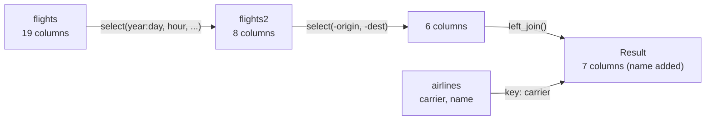

# Chapter 5 — Data Visualization with ggplot2

[Repository Guide](../../README.md) | [English](Concepts_Lecture.md) | [한국어](Concepts_Lecture.ko.md)

> **Last Updated:** 2026-10-18
>
> 혼자 공부하는 R 데이터 분석, 강전희와 엄동란, Ch 5, 6

> **Learning Objectives:**
> 1. Explain the components of the ggplot2 grammar of graphics and draw scatter plots, line plots, bar charts, and box plots
> 2. Use aesthetic mappings and facets, and stack multiple geoms as layers to add reference lines and text annotations
> 3. Select, transform, and summarize data with the core dplyr functions and the pipe operator
> 4. Combine two data frames by a common key column with `left_join()`

---

## Table of Contents

- [1. Introduction to ggplot2](#1-introduction-to-ggplot2)
  - [1.1 The Grammar of Graphics](#11-the-grammar-of-graphics)
  - [1.2 Basic Syntax](#12-basic-syntax)
- [2. Data Manipulation with dplyr](#2-data-manipulation-with-dplyr)
  - [2.1 Core dplyr Verbs](#21-core-dplyr-verbs)
  - [2.2 filter(): Row Selection](#22-filter-row-selection)
  - [2.3 arrange(): Sorting](#23-arrange-sorting)
  - [2.4 select(): Column Selection](#24-select-column-selection)
  - [2.5 mutate(): Create New Columns](#25-mutate-create-new-columns)
  - [2.6 summarise() and group_by()](#26-summarise-and-group_by)
- [3. Basic Plot Types](#3-basic-plot-types)
  - [3.1 Scatter Plot (geom_point())](#31-scatter-plot-geom_point)
  - [3.2 Line Plot (geom_line())](#32-line-plot-geom_line)
  - [3.3 Bar Chart (geom_bar())](#33-bar-chart-geom_bar)
  - [3.4 Box Plot (geom_boxplot())](#34-box-plot-geom_boxplot)
  - [3.5 Sunburst Chart (Polar Coordinates)](#35-sunburst-chart-polar-coordinates)
- [4. Aesthetic Mappings](#4-aesthetic-mappings)
  - [4.1 Color Mapping](#41-color-mapping)
  - [4.2 Alpha (Transparency) Mapping](#42-alpha-transparency-mapping)
  - [4.3 Shape Mapping](#43-shape-mapping)
- [5. Faceting](#5-faceting)
  - [5.1 facet_wrap()](#51-facet_wrap)
- [6. Reference Lines and Annotations](#6-reference-lines-and-annotations)
  - [6.1 Adding Reference Lines](#61-adding-reference-lines)
  - [6.2 Text Annotations](#62-text-annotations)
- [7. Joining Data](#7-joining-data)
  - [7.1 left_join()](#71-left_join)
  - [7.2 Counting and Filtering Duplicates](#72-counting-and-filtering-duplicates)
- [Summary](#summary)
- [Self-Check Questions](#self-check-questions)

---

<br>

## 1. Introduction to ggplot2

### 1.1 The Grammar of Graphics

`ggplot2` is based on the **Grammar of Graphics** concept, where every plot is composed of:

- **Data**: The dataset being plotted.
- **Aesthetics** (`aes()`): Mappings from data variables to visual properties (x, y, color, size, shape).
- **Geometries** (`geom_*`): The visual elements, such as points, lines, and bars.
- **Statistics** (`stat_*`): Summaries or transformations of the data before drawing, such as counting. `geom_bar()` counts by default.
- **Scales**: How data values map to aesthetic values.
- **Coordinates** (`coord_*`): How positions are placed on the plane. The default is the Cartesian coordinate system, and `coord_polar()` gives polar coordinates.
- **Facets**: Splitting data into subplots.
- **Themes**: Visual appearance, such as fonts, colors, and backgrounds.

### 1.2 Basic Syntax

```r
library(ggplot2)

ggplot(data, aes(x = variable1, y = variable2)) +
  geom_point()   # Add a geometry layer
```

> **Key Point:** ggplot2 builds plots layer by layer using the `+` operator. The `ggplot()` call creates the canvas, and `geom_*()` functions add visual elements.

---

<br>

## 2. Data Manipulation with dplyr

### 2.1 Core dplyr Verbs

The `dplyr` package provides five core functions for data manipulation:

| Function | Purpose | Example |
|----------|---------|---------|
| `filter()` | Select rows by condition | `filter(flights, month == 1)` |
| `arrange()` | Sort rows | `arrange(flights, dep_delay)` |
| `select()` | Choose columns | `select(flights, year, month, day)` |
| `mutate()` | Create new columns | `mutate(data, speed = distance/time)` |
| `summarise()` | Aggregate data | `summarise(data, avg = mean(x))` |

*Table 1. Five core dplyr functions*

### 2.2 filter(): Row Selection

`flights` in the `nycflights13` package holds 336,776 flights that departed the three New York airports (JFK, LGA, EWR) in 2013, and `mtcars` holds fuel economy and design data for 32 cars from the 1974 Motor Trend magazine. Several conditions separated by commas in `filter()` act as if joined with `&`, so only rows that satisfy all of them remain.

```r
library(tidyverse)
library(nycflights13)

# Filter flights on January 1st
filter(flights, month == 1, day == 1)

# Assign result to variable
jan1 <- filter(flights, month == 1, day == 1)

# Filter and print in one step (wrapping with parentheses)
(dec25 <- filter(flights, month == 12, day == 25))

# Filter with multiple conditions
filter(mtcars, cyl == 4)
filter(mtcars, cyl >= 6 & mpg > 20)
```

### 2.3 arrange(): Sorting

Given several columns, `arrange()` sorts by the first column and breaks ties with the next. `desc()` switches a column to descending order, and missing values are placed at the end regardless of the sort direction.

```r
arrange(flights, year, month, day)         # Ascending order
arrange(flights, desc(dep_delay))          # Descending order

head(arrange(mtcars, wt))                  # Sort by weight (ascending)
head(arrange(mtcars, mpg, desc(wt)))       # Sort by mpg, then desc weight
```

### 2.4 select(): Column Selection

`year:day` means the consecutive columns from `year` to `day`, and `-(year:day)` means all other columns. Besides `ends_with()`, helper functions include `starts_with()` and `contains()`.

```r
select(flights, year, month, day)          # Select specific columns
select(flights, year:day)                  # Select range of columns
select(flights, -(year:day))               # Exclude range of columns

# Helper functions
select(flights, ends_with("delay"))        # Columns ending with "delay"
```

### 2.5 mutate(): Create New Columns

`gain` is the departure delay minus the arrival delay, the time (in minutes) made up in flight. `distance` is in miles and `air_time` is in minutes, so `distance / air_time * 60` is the speed in miles per hour.

```r
flights_sml <- select(flights,
  year:day, ends_with("delay"), distance, air_time
)

mutate(flights_sml,
  gain = dep_delay - arr_delay,
  speed = distance / air_time * 60
)

# New columns can reference other new columns
mutate(flights_sml,
  gain = dep_delay - arr_delay,
  hours = air_time / 60,
  gain_per_hour = gain / hours
)
```

### 2.6 summarise() and group_by()

`group_by()` splits the data into groups, and a following `summarise()` produces one summary row per group. `n()` counts the rows of a group. `na.rm = TRUE` drops missing values before averaging; without it, a single missing value makes the result `NA`.

```r
# Simple summary
summarise(flights, delay = mean(dep_delay, na.rm = TRUE))

# Grouped summary
by_day <- group_by(flights, year, month, day)
summarise(by_day, delay = mean(dep_delay, na.rm = TRUE))

# Using pipe operator (%>%)
group_by(mtcars, cyl) %>% summarise(n())

# Multiple summary statistics
summarise(mtcars,
  cyl_mean = mean(cyl),
  cyl_min = min(cyl),
  cyl_max = max(cyl)
)
```

> **Key Point:** The pipe operator `%>%` passes the result of the left expression as the first argument to the right function. It makes chains of operations readable: `data %>% filter() %>% summarise()`.

---

<br>

## 3. Basic Plot Types

### 3.1 Scatter Plot (`geom_point()`)

`airquality` holds daily air quality measurements in New York from May to September 1973. `Day` is the day of the month (1-31) and `Temp` is the daily maximum temperature (Fahrenheit), so each day in the plots below carries points from five months.

```r
# Basic scatter plot
ggplot(airquality, aes(x = Day, y = Temp)) +
  geom_point()

# Scatter plot with custom size and color
ggplot(airquality, aes(x = Day, y = Temp)) +
  geom_point(size = 3, color = "red")
# Default point size is 1.5
```

### 3.2 Line Plot (`geom_line()`)

```r
ggplot(airquality, aes(x = Day, y = Temp)) +
  geom_line()
```

### 3.3 Bar Chart (`geom_bar()`)

`geom_bar()` counts the rows for each value of x and uses the counts as bar heights. Passing the numeric `cyl` directly as x makes the x-axis continuous, leaving empty ticks such as 5 and 7 between 4, 6, and 8; converting it to a categorical variable with `factor()` shows bars only for the actual values 4, 6, and 8. `fill = factor(gear)` splits each bar by number of gears and colors the parts.

```r
# Simple bar chart (only x-axis needed; y counts automatically)
ggplot(mtcars, aes(x = cyl)) +
  geom_bar(width = 0.5)

# Use factor() to exclude empty categories (e.g., 5 and 7 cylinders)
ggplot(mtcars, aes(x = factor(cyl))) +
  geom_bar(width = 0.5)

# Stacked bar chart with fill color
ggplot(mtcars, aes(x = factor(cyl))) +
  geom_bar(aes(fill = factor(gear)))
```

### 3.4 Box Plot (`geom_boxplot()`)

Because `Day` is numeric, `group = Day` is needed to draw a separate box for each day. Without it, all the data is drawn as a single box.

```r
# Box plot with grouping
ggplot(airquality, aes(x = Day, y = Temp, group = Day)) +
  geom_boxplot()
```

> **Key Point:** A box plot marks as outliers the points that lie more than $1.5 \times \mathrm{IQR}$ below the first quartile $Q_1$ or more than $1.5 \times \mathrm{IQR}$ above the third quartile $Q_3$, that is, points below $Q_1 - 1.5 \times \mathrm{IQR}$ or above $Q_3 + 1.5 \times \mathrm{IQR}$. The interquartile range is $\mathrm{IQR} = Q_3 - Q_1$. A box plot does **not** define outliers using the mean and standard deviation. The mean and standard deviation are strongly affected by the extreme values themselves.

### 3.5 Sunburst Chart (Polar Coordinates)

```r
# Stacked bar chart converted to sunburst using coord_polar()
ggplot(mtcars, aes(x = factor(cyl))) +
  geom_bar(aes(fill = factor(gear))) +
  coord_polar()

# Donut-shaped sunburst chart
ggplot(mtcars, aes(x = factor(cyl))) +
  geom_bar(aes(fill = factor(gear))) +
  coord_polar(theta = "y")
```

> **Note:** **Two ways of polar conversion.** The default `theta = "x"` of `coord_polar()` maps the x categories to angle and the bar heights to radius, which gives a shape like Nightingale's rose diagram (coxcomb). `theta = "y"` maps the counts to angle and the categories to radius, which gives a donut shape with one ring per category. A sunburst chart in the strict sense shows a hierarchy with higher-level categories in the inner ring and lower-level categories in the outer rings; here the name means a similar shape.

---

<br>

## 4. Aesthetic Mappings

### 4.1 Color Mapping

```r
# Map class to color: each class gets a different color
ggplot(data = mpg) +
  geom_point(mapping = aes(x = displ, y = hwy, color = class))
```

### 4.2 Alpha (Transparency) Mapping

Transparency expresses a degree from low to high, so mapping it to an unordered categorical variable makes ggplot2 print a warning that this is not advised.

```r
# Map class to transparency
ggplot(data = mpg) +
  geom_point(mapping = aes(x = displ, y = hwy, alpha = class))
```

### 4.3 Shape Mapping

The default shape palette distinguishes at most 6 categories. When `class`, which has 7 categories, is mapped to shape, the 62 points of the seventh category `suv` are not drawn, and a warning is printed.

```r
# Map class to point shape
ggplot(data = mpg) +
  geom_point(mapping = aes(x = displ, y = hwy, shape = class))
```

> **Key Point:** When an aesthetic is placed **inside** `aes()`, it maps a variable to the aesthetic. When placed **outside** `aes()`, it sets a constant value (e.g., `color = "red"` makes all points red).

---

<br>

## 5. Faceting

### 5.1 facet_wrap()

Splits data into subplots based on a categorical variable. `~ class` is a formula that asks for one subplot per value of `class`, and `nrow = 2` arranges the 7 subplots in 2 rows:

```r
ggplot(data = mpg) +
  geom_point(mapping = aes(x = displ, y = hwy)) +
  facet_wrap(~ class, nrow = 2)
```

---

<br>

## 6. Reference Lines and Annotations

### 6.1 Adding Reference Lines

```r
library(ggplot2)

# Diagonal line with intercept and slope
ggplot(economics, aes(x = date, y = psavert)) +
  geom_line() +
  geom_abline(intercept = 12.18671, slope = -0.0005444)

# Horizontal reference line at the mean
ggplot(economics, aes(x = date, y = psavert)) +
  geom_line() +
  geom_hline(yintercept = mean(economics$psavert))

# Vertical reference line at a specific date
ggplot(economics, aes(x = date, y = psavert)) +
  geom_line() +
  geom_vline(xintercept = as.Date("2005-07-01"))
```

`psavert` is the US personal savings rate (%). `geom_abline()` draws the line $y = \text{intercept} + \text{slope} \times x$ defined by `intercept` and `slope`. A date axis is stored internally as the number of days since 1970-01-01, so the slope `-0.0005444` describes a trend in which the savings rate falls by 0.0005444 percentage points per day, or about 0.2 percentage points per year. `geom_hline()` and `geom_vline()` draw horizontal and vertical lines at the given y and x values. 2005-07-01 is the month with the lowest savings rate, 2.2%.

### 6.2 Text Annotations

```r
ggplot(airquality, aes(x = Day, y = Temp)) +
  geom_point() +
  geom_text(aes(label = Temp, vjust = 0, hjust = 0))
```

`label = Temp` writes each point's temperature as text. `vjust = 0` and `hjust = 0` align the bottom-left corner of the text with the point, so the text sits above and to the right of the point. Both values are constants rather than variables, so writing them outside `aes()` gives the same result.

---

<br>

## 7. Joining Data

### 7.1 left_join()

```r
library(nycflights13)

flights2 <- flights %>%
  select(year:day, hour, origin, dest, tailnum, carrier)

flights2 %>%
  select(-origin, -dest) %>%
  left_join(airlines, by = "carrier")
```

`left_join(x, y, by = "carrier")` keeps every row of the left data `x` and attaches the remaining columns of the row of `y` with the same `carrier` value. Rows without a match in `y` get `NA` in the new columns. `airlines` is a 16-row table with two columns, the carrier code (`carrier`) and the name (`name`), so the result keeps all 336,776 rows of `flights2` and has 7 columns with `name` added.



*Figure 1. Column selection and left_join() chained with pipes*

### 7.2 Counting and Filtering Duplicates

Before joining, check whether the key identifies each row uniquely, that is, whether it is a primary key. Counting rows per key combination with `count()` and keeping only combinations with `n > 1` reveals duplicated keys.

```r
planes %>%
  count(tailnum) %>%
  filter(n > 1)

weather %>%
  count(year, month, day, hour, origin) %>%
  filter(n > 1)
```

`tailnum` in `planes` gives 0 rows, so it is a primary key. In `weather`, (`year`, `month`, `day`, `hour`, `origin`) has 3 duplicated combinations, because two rows were recorded at each of the three airports at 1 a.m. on 2013-11-03, when daylight saving time ended, so it is not strictly a primary key. Joining on a duplicated key copies each matching row as many times as the key is duplicated.

---

<br>

## Summary

| Concept | Key Summary |
|---------|-------------|
| ggplot2 | It follows a layer-based grammar of graphics and builds plots in the form `ggplot() + geom_*()`. |
| `aes()` | It maps data variables to visual properties (x, y, color, size, shape). |
| `geom_point()` | It draws scatter plots, and the default point size is 1.5. |
| `geom_bar()` | It draws bar charts, and converting x to a categorical variable with `factor()` removes empty values from the axis. |
| `geom_boxplot()` | It draws box plots and marks points below $Q_1 - 1.5 \times \mathrm{IQR}$ or above $Q_3 + 1.5 \times \mathrm{IQR}$ as outliers. |
| `facet_wrap()` | It splits a plot into subplots by the values of a variable. |
| dplyr verbs | `filter()`, `arrange()`, `select()`, `mutate()`, and `summarise()` handle row selection, sorting, column selection, column creation, and aggregation. |
| `%>%` pipe | It chains operations by passing the left result as the first argument to the right function. |
| `group_by()` | It is used with `summarise()` to aggregate data by group. |
| `left_join()` | It merges data frames by a common key column and keeps every row of the left data. |

---

<br>

## Self-Check Questions

1. **Inside and outside aes():** Explain how the results of `geom_point(aes(color = "red"))` and `geom_point(color = "red")` differ.

   <details>
   <summary>Answer</summary>

   `geom_point(color = "red")` sets a constant outside `aes()`, so every point is red. `geom_point(aes(color = "red"))` maps to color a variable whose only value is the string `"red"`, so the points take the first color of the default palette (`#F8766D`, a light red), and a legend with a single entry `red` appears.

   </details>

2. **The x-axis of a bar chart:** In `mtcars`, 11 cars have `cyl` equal to 4, 7 have 6, and 14 have 8. Compare the bar heights and x-axes of the bar charts drawn with `aes(x = cyl)` and with `aes(x = factor(cyl))`.

   <details>
   <summary>Answer</summary>

   In both charts the bar heights are 11, 7, and 14. `cyl` is numeric, so with `aes(x = cyl)` the x-axis is continuous, ticks including 5 and 7 are shown, and those positions are empty. `factor(cyl)` creates a categorical axis that shows only the three categories 4, 6, and 8 side by side.

   </details>

3. **Outlier fences:** A group has first quartile 10 and third quartile 20. Find the outlier fences of the box plot, and choose all values among -6, 34, and 36 that are marked as outliers.

   <details>
   <summary>Answer</summary>

   $\mathrm{IQR} = 20 - 10 = 10$, so the lower fence is $10 - 1.5 \times 10 = -5$ and the upper fence is $20 + 1.5 \times 10 = 35$. -6 is below -5 and 36 is above 35, so both are outliers, while 34 lies within the fences and is not an outlier.

   </details>

4. **The pipe operator:** Rewrite `summarise(group_by(mtcars, cyl), n())` with the pipe operator `%>%`, and give the number of rows in the result and the `n()` value of each row. Use the counts from Question 2.

   <details>
   <summary>Answer</summary>

   It is `mtcars %>% group_by(cyl) %>% summarise(n())`. `cyl` has three values, 4, 6, and 8, so the result has 3 rows, one per group, with `n()` values 11, 7, and 14 in order.

   </details>

5. **Rows after left_join():** When `flights2` (336,776 rows) is joined with `airlines` on `carrier` using `left_join()`, what condition must `carrier` in `airlines` satisfy for the result to have the same number of rows as `flights2`? What happens to a row of `flights2` whose `carrier` value is not in `airlines`?

   <details>
   <summary>Answer</summary>

   `carrier` in `airlines` must be a primary key that identifies each row uniquely without duplicates. If a key is duplicated, each matching row of `flights2` is copied that many times, and the number of rows grows. A row without a match is kept rather than deleted, and its `name` column becomes `NA`. The actual result has 336,776 rows, and no row has `NA` in `name`.

   </details>
