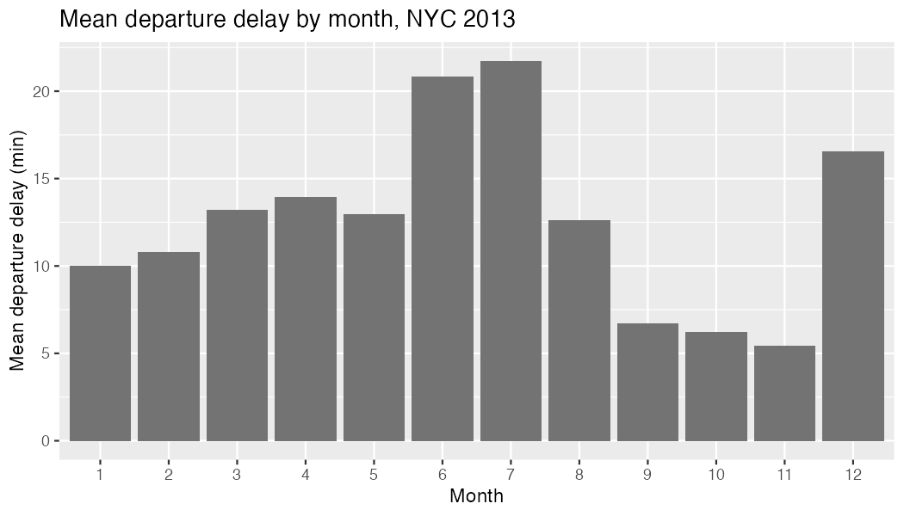
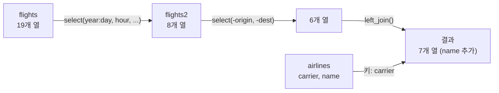
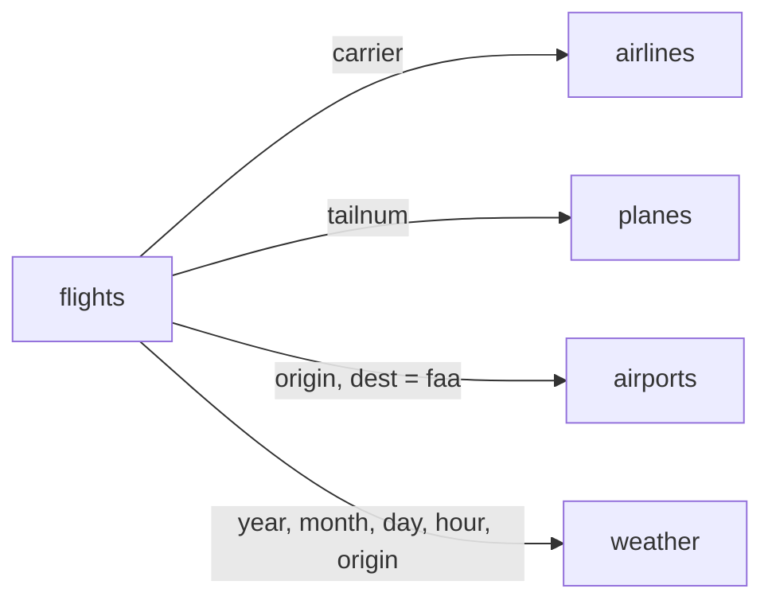

# 5장 — dplyr을 활용한 데이터 가공

[레포지토리 안내](../../README.ko.md) | [English](Concepts_Lecture.md) | [한국어](Concepts_Lecture.ko.md)

> **최종 수정일:** 2026-11-19
>
> 혼자 공부하는 R 데이터 분석, 강전희와 엄동란, Ch 5

> **학습 목표:**
> 1. dplyr의 핵심 함수와 파이프 연산자로 데이터를 선택, 변환, 요약할 수 있다
> 2. `left_join()`으로 공통 키 열을 기준으로 두 데이터 프레임을 결합할 수 있다
> 3. `count()`로 결합에 쓸 키가 각 행을 하나로 식별하는 기본 키인지 확인할 수 있다
> 4. `filter()`와 `arrange()`의 결측값 처리, `group_by()`가 이후 동사에 미치는 영향을 설명할 수 있다
> 5. 네 가지 변경 조인과 두 가지 필터링 조인의 결과 행을 예측할 수 있다
> 6. 정돈 데이터의 규칙에 따라 `pivot_longer()`와 `pivot_wider()`로 표의 모양을 바꾸고, 결측값과 이상치를 근거 있게 정제할 수 있다

---

## 목차

- [1. dplyr을 활용한 데이터 조작](#1-dplyr을-활용한-데이터-조작)
  - [1.1 dplyr 핵심 동사](#11-dplyr-핵심-동사)
  - [1.2 filter(): 행 선택](#12-filter-행-선택)
  - [1.3 arrange(): 정렬](#13-arrange-정렬)
  - [1.4 select(): 열 선택](#14-select-열-선택)
  - [1.5 mutate(): 새로운 열 생성](#15-mutate-새로운-열-생성)
  - [1.6 summarise()와 group_by()](#16-summarise와-group_by)
  - [1.7 동사의 공통 규칙과 flights 데이터](#17-동사의-공통-규칙과-flights-데이터)
  - [1.8 filter()의 조건과 결측값](#18-filter의-조건과-결측값)
  - [1.9 arrange()와 결측값](#19-arrange와-결측값)
  - [1.10 select()의 도우미와 열 이름 바꾸기](#110-select의-도우미와-열-이름-바꾸기)
  - [1.11 mutate()에 쓰는 함수](#111-mutate에-쓰는-함수)
  - [1.12 그룹별 요약의 동작](#112-그룹별-요약의-동작)
  - [1.13 중복 제거, 개수 세기, 표본 추출](#113-중복-제거-개수-세기-표본-추출)
  - [1.14 파이프 연산자](#114-파이프-연산자)
- [2. 데이터 결합](#2-데이터-결합)
  - [2.1 left_join()](#21-left_join)
  - [2.2 중복 카운트 및 필터링](#22-중복-카운트-및-필터링)
  - [2.3 관계형 데이터와 키](#23-관계형-데이터와-키)
  - [2.4 변경 조인의 네 종류](#24-변경-조인의-네-종류)
  - [2.5 결합 키 지정하기](#25-결합-키-지정하기)
  - [2.6 필터링 조인](#26-필터링-조인)
  - [2.7 중복된 키와 다대다 결합](#27-중복된-키와-다대다-결합)
  - [2.8 행과 열 이어 붙이기](#28-행과-열-이어-붙이기)
- [3. 데이터 구조 변형하기](#3-데이터-구조-변형하기)
  - [3.1 정돈 데이터의 세 규칙](#31-정돈-데이터의-세-규칙)
  - [3.2 pivot_longer(): 넓은 형식에서 긴 형식으로](#32-pivot_longer-넓은-형식에서-긴-형식으로)
  - [3.3 pivot_wider(): 긴 형식에서 넓은 형식으로](#33-pivot_wider-긴-형식에서-넓은-형식으로)
  - [3.4 열 나누기와 합치기](#34-열-나누기와-합치기)
- [4. 데이터 정제하기](#4-데이터-정제하기)
  - [4.1 결측값 확인과 제외](#41-결측값-확인과-제외)
  - [4.2 결측값 대체와 그 영향](#42-결측값-대체와-그-영향)
  - [4.3 이상치 탐지](#43-이상치-탐지)
  - [4.4 값과 유형 바로잡기](#44-값과-유형-바로잡기)
- [개념 적용](#개념-적용)
- [용어 사전](#용어-사전)
- [요약](#요약)
- [점검 문제](#점검-문제)
- [참고 문헌](#참고-문헌)

---

<br>

## 1. dplyr을 활용한 데이터 조작

### 1.1 dplyr 핵심 동사

`dplyr` 패키지는 데이터 조작을 위한 다섯 가지 핵심 함수를 제공한다:

| 함수 | 용도 | 예시 |
|------|------|------|
| `filter()` | 조건에 따른 행 선택 | `filter(flights, month == 1)` |
| `arrange()` | 행 정렬 | `arrange(flights, dep_delay)` |
| `select()` | 열 선택 | `select(flights, year, month, day)` |
| `mutate()` | 새로운 열 생성 | `mutate(data, speed = distance/time)` |
| `summarise()` | 데이터 집계 | `summarise(data, avg = mean(x))` |

*표 1. dplyr의 다섯 가지 핵심 함수*

`dplyr`은 Hadley Wickham이 만든 데이터 처리 패키지이며, R로만 작성되어 처리 속도가 느렸던 이전의 `plyr` 패키지를 C++로 개선해 데이터 프레임을 더 빠르고 사용자 친화적으로 조작할 수 있게 한 것이다. 다섯 함수에 `group_by()`를 더한 여섯 함수가 데이터 조작 언어의 **동사(verb)** 역할을 한다. `group_by()`는 각 함수가 데이터 전체가 아니라 그룹마다 동작하도록 범위를 바꾼다(1.6절, 1.12절).

### 1.2 filter(): 행 선택

`nycflights13` 패키지의 `flights`는 2013년에 뉴욕의 세 공항(JFK, LGA, EWR)에서 출발한 항공편 336,776편의 데이터이고, `mtcars`는 1974년 Motor Trend 잡지에 실린 자동차 32종의 연비와 설계 자료이다. `filter()`에 쉼표로 나열한 여러 조건은 `&`로 묶은 것과 같아서, 모든 조건을 만족하는 행만 남는다.

```r
library(tidyverse)
library(nycflights13)

# 1월 1일 항공편 필터링
filter(flights, month == 1, day == 1)

# 결과를 변수에 할당
jan1 <- filter(flights, month == 1, day == 1)

# 괄호로 감싸서 필터링과 출력을 동시에 수행
(dec25 <- filter(flights, month == 12, day == 25))

# 복수 조건으로 필터링
filter(mtcars, cyl == 4)
filter(mtcars, cyl >= 6 & mpg > 20)
```

1월 1일 항공편은 842편, 12월 25일 항공편은 719편이다. `filter()`는 원래 데이터를 바꾸지 않고 새 데이터 프레임을 돌려주므로, 결과를 쓰려면 `jan1`처럼 변수에 할당해야 한다. `mtcars`에서 4기통 차는 11대이고, 6기통 이상이면서 연비가 20을 넘는 차는 Mazda RX4, Mazda RX4 Wag, Hornet 4 Drive의 3대이다.

### 1.3 arrange(): 정렬

`arrange()`에 여러 열을 주면 앞의 열로 먼저 정렬하고, 값이 같은 행끼리는 다음 열로 정렬한다. `desc()`는 그 열을 내림차순으로 바꾸며, 결측값은 정렬 방향과 관계없이 끝에 놓인다.

```r
arrange(flights, year, month, day)         # 오름차순 정렬
arrange(flights, desc(dep_delay))          # 내림차순 정렬

head(arrange(mtcars, wt))                  # 무게(wt) 기준 오름차순 정렬
head(arrange(mtcars, mpg, desc(wt)))       # mpg 기준 정렬 후 무게 내림차순
```

`arrange(flights, desc(dep_delay))`의 첫 행은 1월 9일에 1,301분(약 21.7시간) 늦게 출발한 항공편이다. `arrange(mtcars, wt)`는 가장 가벼운 Lotus Europa(1.513, 곧 1,513파운드)부터 나열한다. `arrange(mtcars, mpg, desc(wt))`에서는 연비가 10.4로 같은 Lincoln Continental(5.424)과 Cadillac Fleetwood(5.250) 가운데 더 무거운 Lincoln Continental이 앞에 온다.

### 1.4 select(): 열 선택

`year:day`는 `year`부터 `day`까지 연속된 열을, `-(year:day)`는 그 열들을 뺀 나머지 열을 뜻한다. `ends_with()` 외에도 `starts_with()`, `contains()` 같은 도우미 함수가 있다.

```r
select(flights, year, month, day)          # 특정 열 선택
select(flights, year:day)                  # 열 범위 선택
select(flights, -(year:day))               # 열 범위 제외

# 도우미 함수
select(flights, ends_with("delay"))        # "delay"로 끝나는 열
```

열이 수백, 수천 개인 데이터에서 관심 있는 변수만 남기면 출력을 읽기 쉽고 계산도 가벼워진다. `flights`는 19개 열이므로 `select(flights, -(year:day))`의 결과는 16개 열이다.

### 1.5 mutate(): 새로운 열 생성

`gain`은 출발 지연에서 도착 지연을 뺀 값으로, 비행 중에 만회한 시간(분)이다. `distance`는 마일 단위이고 `air_time`은 분 단위이므로 `distance / air_time * 60`은 시속(마일)이다.

```r
flights_sml <- select(flights,
  year:day, ends_with("delay"), distance, air_time
)

mutate(flights_sml,
  gain = dep_delay - arr_delay,
  speed = distance / air_time * 60
)

# 새 열은 다른 새 열을 참조할 수 있다
mutate(flights_sml,
  gain = dep_delay - arr_delay,
  hours = air_time / 60,
  gain_per_hour = gain / hours
)
```

`mutate()`는 새 열을 데이터의 맨 끝에 붙인다. 첫 항공편은 출발이 2분, 도착이 11분 늦었으므로 `gain`은 2 - 11 = -9분이고, 거리 1,400마일을 227분에 날았으므로 `speed`는 1400 / 227 × 60 ≈ 370마일이다. 둘째 `mutate()`는 같은 호출 안에서 먼저 만든 `gain`과 `hours`를 곧바로 `gain_per_hour`에 쓴다.

### 1.6 summarise()와 group_by()

`group_by()`는 데이터를 그룹으로 나누고, 그 뒤의 `summarise()`는 그룹마다 한 행씩 요약 결과를 만든다. `n()`은 그룹의 행 수를 센다. `na.rm = TRUE`는 결측값을 빼고 평균을 구하며, 이를 지정하지 않으면 결측값이 하나라도 있을 때 결과가 `NA`가 된다.

```r
# 단순 요약
summarise(flights, delay = mean(dep_delay, na.rm = TRUE))

# 그룹별 요약
by_day <- group_by(flights, year, month, day)
summarise(by_day, delay = mean(dep_delay, na.rm = TRUE))

# 파이프 연산자 (%>%) 사용
group_by(mtcars, cyl) %>% summarise(n())

# 다중 요약 통계
summarise(mtcars,
  cyl_mean = mean(cyl),
  cyl_min = min(cyl),
  cyl_max = max(cyl)
)
```

> **핵심:** 파이프 연산자 `%>%`는 왼쪽 표현식의 결과를 오른쪽 함수의 첫 번째 인수로 전달한다. 이를 통해 연산 체인이 읽기 쉬워진다: `data %>% filter() %>% summarise()`.

전체 항공편의 평균 출발 지연은 12.6분이다. `summarise()`만 쓰면 데이터 전체가 한 행으로 줄어들지만, `group_by()` 뒤에 쓰면 날짜별로 365행이 만들어지므로 날짜마다 평균 지연을 비교할 수 있다.

### 1.7 동사의 공통 규칙과 flights 데이터

dplyr의 동사는 모두 같은 규칙으로 동작한다.

1. 첫 번째 인수는 데이터 프레임이다.
2. 그다음 인수들은 열 이름을 따옴표 없이 써서 데이터 프레임으로 무엇을 할지 기술한다.
3. 결과는 새 데이터 프레임이다.

이 세 규칙 덕분에 간단한 단계를 차례로 이어 복잡한 결과를 만들 수 있다. 셋째 규칙 때문에 원래 데이터는 바뀌지 않으며, 둘째 규칙 덕분에 `flights$month`가 아니라 `month`라고만 써도 된다. `flights`를 출력하면 다음과 같다.

```r
flights
#> # A tibble: 336,776 × 19
#>     year month   day dep_time sched_dep_time dep_delay arr_time sched_arr_time
#>    <int> <int> <int>    <int>          <int>     <dbl>    <int>          <int>
#>  1  2013     1     1      517            515         2      830            819
#>  2  2013     1     1      533            529         4      850            830
#>  3  2013     1     1      542            540         2      923            850
#>  4  2013     1     1      544            545        -1     1004           1022
#>  5  2013     1     1      554            600        -6      812            837
#>  6  2013     1     1      554            558        -4      740            728
#>  7  2013     1     1      555            600        -5      913            854
#>  8  2013     1     1      557            600        -3      709            723
#>  9  2013     1     1      557            600        -3      838            846
#> 10  2013     1     1      558            600        -2      753            745
#> # ℹ 336,766 more rows
#> # ℹ 11 more variables: arr_delay <dbl>, carrier <chr>, flight <int>,
#> #   tailnum <chr>, origin <chr>, dest <chr>, air_time <dbl>, distance <dbl>,
#> #   hour <dbl>, minute <dbl>, time_hour <dttm>
```

`flights`는 티블이므로 처음 10행과 화면에 들어가는 열만 보이고, 나머지 11개 변수는 이름과 유형만 아래에 나열된다. `dep_time`과 `arr_time`은 실제 출발, 도착 시각을 `HHMM` 형식의 수로 나타낸 것이어서 517은 오전 5시 17분이다. `sched_dep_time`, `sched_arr_time`은 예정 시각이고, `dep_delay`, `arr_delay`는 출발, 도착 지연(분)이며 음수는 일찍 출발하거나 도착했다는 뜻이다. `carrier`는 항공사 코드, `tailnum`은 항공기 등록 번호, `origin`과 `dest`는 출발지와 목적지 공항, `air_time`은 비행 시간(분), `distance`는 거리(마일), `time_hour`는 예정 출발 시각을 날짜와 시각으로 나타낸 값이다.

열 이름 아래의 세 글자 약어는 각 변수의 유형이다.

| 약어 | 유형 |
|:--|:--|
| `int` | 정수 |
| `dbl` | 실수(double) |
| `chr` | 문자형 벡터, 곧 문자열 |
| `dttm` | 날짜와 시각(date-time) |
| `lgl` | `TRUE`와 `FALSE`만 담는 논리형 |
| `fct` | 고정된 범주를 가진 팩터 |
| `date` | 날짜 |

*표 2. 티블 출력의 열 유형 약어*

### 1.8 filter()의 조건과 결측값

`filter()`의 조건에는 비교 연산자(`>`, `>=`, `<`, `<=`, `!=`, `==`)와 논리 연산자(`&`, `|`, `!`)를 쓴다(3장 6절). 여러 값 가운데 하나와 같은지는 `%in%`으로 간결하게 쓴다.

```r
nrow(flights)
#> [1] 336776
nrow(filter(flights, month == 1, day == 1))
#> [1] 842
nrow(filter(flights, month == 11 | month == 12))
#> [1] 55403
nrow(filter(flights, month %in% c(11, 12)))
#> [1] 55403
nrow(filter(flights, !(arr_delay > 120 | dep_delay > 120)))
#> [1] 316050
nrow(filter(flights, arr_delay <= 120, dep_delay <= 120))
#> [1] 316050
```

11월이나 12월에 출발한 항공편은 `month == 11 | month == 12`와 `month %in% c(11, 12)` 어느 쪽으로 써도 55,403편이다. 이를 `month == 11 | 12`로 쓰면 R은 `(month == 11) | 12`로 읽고, 0이 아닌 수 12는 `TRUE`이므로 모든 행이 남는다. 마지막 두 식은 드모르간의 법칙 $`\lnot(A \lor B) = \lnot A \land \lnot B`$에 따라 같은 조건이므로 결과가 같다. 다만 이 두 식은 지연이 결측인 항공편을 모두 뺀 개수라는 점에 주의해야 한다.

조건에 `==` 대신 `=`를 쓰면 dplyr이 실수를 알려 준다.

```r
filter(flights, month = 1)
#> Error in `filter()`:
#> ! We detected a named input.
#> ℹ This usually means that you've used `=` instead of `==`.
#> ℹ Did you mean `month == 1`?
```

실수의 비교에는 1장 3절의 부동소수점 문제가 그대로 적용되므로, `==` 대신 오차를 허용하는 `near()`를 쓴다.

```r
sqrt(2)^2 == 2
#> [1] FALSE
near(sqrt(2)^2, 2)
#> [1] TRUE
```

`filter()`는 조건이 `TRUE`인 행만 남기고, `FALSE`인 행과 함께 조건이 `NA`인 행도 버린다. 결측값을 남기려면 `is.na()`로 명시해야 한다.

```r
df <- tibble(x = c(1, NA, 3))
filter(df, x > 1)
#> # A tibble: 1 × 1
#>       x
#>   <dbl>
#> 1     3
filter(df, is.na(x) | x > 1)
#> # A tibble: 2 × 1
#>       x
#>   <dbl>
#> 1    NA
#> 2     3
sum(is.na(flights$dep_time))
#> [1] 8255
nrow(filter(flights, is.na(dep_time)))
#> [1] 8255
filter(df, between(x, 1, 2))
#> # A tibble: 1 × 1
#>       x
#>   <dbl>
#> 1     1
```

`NA > 1`은 `NA`이므로 첫 결과에는 3만 남는다. `flights`에서 `dep_time`이 결측인 8,255편은 실제로 출발하지 않은, 곧 결항된 항공편으로 볼 수 있다. `between(x, a, b)`는 `x >= a & x <= b`를 줄여 쓴 것이다.

### 1.9 arrange()와 결측값

`arrange()`는 결측값을 항상 맨 뒤에 놓는다. 내림차순으로 정렬해도 마찬가지이다.

```r
df2 <- tibble(x = c(5, 2, NA))
arrange(df2, x)
#> # A tibble: 3 × 1
#>       x
#>   <dbl>
#> 1     2
#> 2     5
#> 3    NA
arrange(df2, desc(x))
#> # A tibble: 3 × 1
#>       x
#>   <dbl>
#> 1     5
#> 2     2
#> 3    NA
```

결측값을 맨 앞으로 보내려면 `arrange(df2, desc(is.na(x)), x)`처럼 결측 여부를 첫 정렬 기준으로 쓴다. `is.na(x)`가 `TRUE`인 행이 내림차순으로 먼저 오기 때문이다.

### 1.10 select()의 도우미와 열 이름 바꾸기

`select()` 안에서는 열의 이름 패턴이나 유형으로 열을 고르는 도우미 함수를 쓸 수 있다.

```r
select(flights, starts_with("dep"), contains("arr")) |> head(3)
#> # A tibble: 3 × 6
#>   dep_time dep_delay arr_time sched_arr_time arr_delay carrier
#>      <int>     <dbl>    <int>          <int>     <dbl> <chr>  
#> 1      517         2      830            819        11 UA     
#> 2      533         4      850            830        20 UA     
#> 3      542         2      923            850        33 AA
select(flights, time_hour, air_time, everything()) |> names() |> head(5)
#> [1] "time_hour" "air_time"  "year"      "month"     "day"
rename(select(flights, year:day), yr = year) |> head(2)
#> # A tibble: 2 × 3
#>      yr month   day
#>   <int> <int> <int>
#> 1  2013     1     1
#> 2  2013     1     1
relocate(select(flights, year:day, carrier), carrier) |> head(2)
#> # A tibble: 2 × 4
#>   carrier  year month   day
#>   <chr>   <int> <int> <int>
#> 1 UA       2013     1     1
#> 2 UA       2013     1     1
select(mtcars, where(is.numeric)) |> ncol()
#> [1] 11
```

`contains("arr")`는 이름에 `arr`가 들어 있는 모든 열을 고르므로 도착 관련 열뿐 아니라 `carrier`까지 골랐다. 도우미는 이름의 글자만 보므로 이런 우연한 일치가 생길 수 있다. `everything()`은 나머지 모든 열을 뜻하므로, 몇 개의 열을 앞으로 옮기고 나머지를 그대로 둘 때 쓴다. `rename(새 이름 = 기존 이름)`은 열 이름만 바꾸고 모든 열을 유지하며, `relocate()`는 열의 순서만 바꾼다. `where(is.numeric)`은 수치형인 열을 고르며, `mtcars`는 11개 열이 모두 수치형이다. 그 밖에 `ends_with()`, `matches()`(정규 표현식), `num_range("x", 1:3)`(x1, x2, x3)도 있다.

### 1.11 mutate()에 쓰는 함수

`mutate()`에는 입력과 같은 길이의 결과를 돌려주는 벡터화 함수(2장 1절)를 쓴다. 상수 하나를 주면 모든 행에 재활용되고, 순위 함수를 주면 각 행의 순위가 붙는다.

```r
head(mutate(mtcars, years = "1974"), 3)
#>                mpg cyl disp  hp drat    wt  qsec vs am gear carb years
#> Mazda RX4     21.0   6  160 110 3.90 2.620 16.46  0  1    4    4  1974
#> Mazda RX4 Wag 21.0   6  160 110 3.90 2.875 17.02  0  1    4    4  1974
#> Datsun 710    22.8   4  108  93 3.85 2.320 18.61  1  1    4    1  1974
head(mutate(mtcars, mpg_rank = rank(mpg)), 3)
#>                mpg cyl disp  hp drat    wt  qsec vs am gear carb mpg_rank
#> Mazda RX4     21.0   6  160 110 3.90 2.620 16.46  0  1    4    4     19.5
#> Mazda RX4 Wag 21.0   6  160 110 3.90 2.875 17.02  0  1    4    4     19.5
#> Datsun 710    22.8   4  108  93 3.85 2.320 18.61  1  1    4    1     24.5
```

`rank()`는 같은 값에 평균 순위를 준다. 연비 21.0은 오름차순으로 19번째와 20번째 자리를 함께 차지하므로 두 차 모두 (19 + 20) / 2 = 19.5위이다. 같은 값을 처리하는 방식이 다른 순위 함수를 비교하면 다음과 같다.

```r
v <- c(10, 20, 20, 30, NA)
rank(v)
#> [1] 1.0 2.5 2.5 4.0 5.0
min_rank(v)
#> [1]  1  2  2  4 NA
dense_rank(v)
#> [1]  1  2  2  3 NA
row_number(v)
#> [1]  1  2  3  4 NA
min_rank(desc(v))
#> [1]  4  2  2  1 NA
```

`min_rank()`는 같은 값에 가장 작은 순위를 주고 다음 순위를 건너뛰므로(1, 2, 2, 4) 운동 경기의 순위 방식과 같다. `dense_rank()`는 건너뛰지 않고(1, 2, 2, 3), `row_number()`는 같은 값에도 나온 순서대로 서로 다른 순위를 준다. 기본 R의 `rank()`는 `NA`를 맨 뒤 순위로 두지만 dplyr의 순위 함수는 `NA`를 그대로 둔다. 큰 값부터 순위를 매기려면 `desc()`를 쓴다.

이전 값이나 다음 값과 비교하는 함수, 누적 계산 함수도 자주 쓴다.

```r
w <- c(3, 5, 4, 8)
lag(w)
#> [1] NA  3  5  4
lead(w)
#> [1]  5  4  8 NA
w - lag(w)
#> [1] NA  2 -1  4
cumsum(w)
#> [1]  3  8 12 20
cummean(w)
#> [1] 3 4 4 5
```

`lag()`는 값을 한 칸 뒤로 밀어 각 위치에 바로 앞의 값을 놓고, `lead()`는 바로 뒤의 값을 놓는다. 그래서 `w - lag(w)`는 직전 값과의 차이이며, 시계열 자료의 변화량을 구할 때 쓴다(11장). `cummean()`은 누적 평균으로, 셋째 값은 (3 + 5 + 4) / 3 = 4이다.

조건에 따라 값을 정할 때는 `if_else()`와 `case_when()`을 쓴다.

```r
cars_small <- select(head(mtcars, 6), mpg, cyl, hp)
mutate(cars_small,
       eff = if_else(mpg >= 20, "high", "low"),
       size = case_when(cyl == 4 ~ "small",
                        cyl == 6 ~ "medium",
                        .default = "large"))
#>                    mpg cyl  hp  eff   size
#> Mazda RX4         21.0   6 110 high medium
#> Mazda RX4 Wag     21.0   6 110 high medium
#> Datsun 710        22.8   4  93 high  small
#> Hornet 4 Drive    21.4   6 110 high medium
#> Hornet Sportabout 18.7   8 175  low  large
#> Valiant           18.1   6 105  low medium
```

`if_else()`는 3장 7절의 `ifelse()`와 같지만, 참일 때와 거짓일 때의 값이 같은 유형이어야 한다는 점을 검사해 실수를 막는다. `case_when()`은 `조건 ~ 값`을 위에서부터 차례로 검사해 처음으로 참인 조건의 값을 쓰며, 어느 조건에도 맞지 않는 행에는 `.default`의 값을 쓴다. `.default`를 생략하면 그런 행은 `NA`가 된다.

`transmute()`는 새로 만든 열만 남기고, `mutate()`의 `.keep = "used"`는 계산에 쓴 열과 새 열만 남긴다.

```r
transmute(head(mtcars, 3), wt_kg = wt * 1000 * 0.4536)
#>                  wt_kg
#> Mazda RX4     1188.432
#> Mazda RX4 Wag 1304.100
#> Datsun 710    1052.352
mutate(head(mtcars, 3), ratio = hp / wt, .keep = "used")
#>                hp    wt    ratio
#> Mazda RX4     110 2.620 41.98473
#> Mazda RX4 Wag 110 2.875 38.26087
#> Datsun 710     93 2.320 40.08621
```

`wt`는 1,000파운드 단위이고 1파운드는 약 0.4536 kg이므로, Mazda RX4의 무게는 2.62 × 1000 × 0.4536 ≈ 1,188 kg이다.

### 1.12 그룹별 요약의 동작

`summarise()` 안에는 벡터 하나를 값 하나로 줄이는 요약 함수를 쓴다. 이름을 붙이지 않으면 식 자체가 열 이름이 된다.

```r
summarise(mtcars, cyl_mean = mean(cyl), cyl_min = min(cyl), cyl_max = max(cyl))
#>   cyl_mean cyl_min cyl_max
#> 1   6.1875       4       8
summarise(mtcars, mean(cyl), min(cyl), max(cyl))
#>   mean(cyl) min(cyl) max(cyl)
#> 1    6.1875        4        8
gr_cyl <- group_by(mtcars, cyl)
summarise(gr_cyl, n())
#> # A tibble: 3 × 2
#>     cyl `n()`
#>   <dbl> <int>
#> 1     4    11
#> 2     6     7
#> 3     8    14
summarise(gr_cyl, n_distinct(gear))
#> # A tibble: 3 × 2
#>     cyl `n_distinct(gear)`
#>   <dbl>              <int>
#> 1     4                  3
#> 2     6                  3
#> 3     8                  2
```

`n()`은 그룹의 행 수를, `n_distinct()`는 서로 다른 값의 개수를 센다. 4기통과 6기통 차에는 기어 수가 3, 4, 5인 차가 모두 있지만 8기통 차는 기어 수가 3과 5뿐이어서 2이다. 자주 쓰는 요약 함수는 다음과 같다.

| 종류 | 함수 |
|:--|:--|
| 개수 | `n()`, `n_distinct(x)`, `sum(!is.na(x))` |
| 중심 | `mean(x)`, `median(x)` |
| 퍼짐 | `sd(x)`, `IQR(x)`, `mad(x)` |
| 위치 | `min(x)`, `max(x)`, `quantile(x, 0.25)`, `first(x)`, `last(x)`, `nth(x, 2)` |
| 개수와 비율 | `sum(x > 10)`, `mean(x > 10)` |

*표 3. summarise()에 쓰는 요약 함수*

그룹별 요약을 단계별로 따라가 본다. 다음 코드는 실린더 수별로 차의 수, 평균 연비, 연비의 표준편차, 마력의 중앙값을 구한다.

```r
mtcars |>
  group_by(cyl) |>
  summarise(n = n(), mean_mpg = mean(mpg), sd_mpg = sd(mpg),
            median_hp = median(hp))
#> # A tibble: 3 × 5
#>     cyl     n mean_mpg sd_mpg median_hp
#>   <dbl> <int>    <dbl>  <dbl>     <dbl>
#> 1     4    11     26.7   4.51       91 
#> 2     6     7     19.7   1.45      110 
#> 3     8    14     15.1   2.56      192.
mean(mtcars$mpg[mtcars$cyl == 4])
#> [1] 26.66364
```

`group_by(cyl)`은 32행을 4기통 11행, 6기통 7행, 8기통 14행의 세 그룹으로 나눈다(나누기). `summarise()`는 그룹마다 네 요약 함수를 계산하고(적용하기), 그룹마다 한 행씩 모아 3행의 티블을 만든다(합치기). 3장 9절의 `tapply()`와 같은 과정이며, 4기통의 평균 연비 26.7은 마지막 줄처럼 직접 고른 11개 값의 평균 26.66과 같다. 실린더가 많을수록 평균 연비가 낮고, 8기통의 마력 중앙값 192.5는 4기통의 91보다 두 배 이상 크다.

그룹을 여러 열로 나누면, `summarise()`는 계산이 끝난 뒤 마지막 그룹 변수 하나를 벗긴 그룹 구조를 남긴다.

```r
by_day <- group_by(flights, year, month, day)
daily <- summarise(by_day, delay = mean(dep_delay, na.rm = TRUE))
#> `summarise()` has grouped output by 'year', 'month'. You can override using the
#> `.groups` argument.
daily
#> # A tibble: 365 × 4
#> # Groups:   year, month [12]
#>     year month   day delay
#>    <int> <int> <int> <dbl>
#>  1  2013     1     1 11.5 
#>  2  2013     1     2 13.9 
#>  3  2013     1     3 11.0 
#>  4  2013     1     4  8.95
#>  5  2013     1     5  5.73
#>  6  2013     1     6  7.15
#>  7  2013     1     7  5.42
#>  8  2013     1     8  2.55
#>  9  2013     1     9  2.28
#> 10  2013     1    10  2.84
#> # ℹ 355 more rows
monthly <- summarise(daily, delay = mean(delay))
#> `summarise()` has grouped output by 'year'. You can override using the
#> `.groups` argument.
monthly |> head(3)
#> # A tibble: 3 × 3
#> # Groups:   year [1]
#>    year month delay
#>   <int> <int> <dbl>
#> 1  2013     1  10.0
#> 2  2013     2  11.1
#> 3  2013     3  13.6
```

결과 `daily`는 날짜별 365행이고, 메시지와 출력의 `# Groups: year, month [12]`는 이 결과가 아직 연과 월로 12개 그룹에 묶여 있다는 뜻이다. 그래서 `daily`에 다시 `summarise()`를 쓰면 월별로 요약되어 12행이 된다. 열은 변수의 수를 나타내므로 `daily`의 변수는 `year`, `month`, `day`, `delay`의 4개이다.

> **주의:** `monthly`의 1월 값 10.0은 날짜별 평균 31개의 평균이며, 1월의 모든 항공편을 직접 평균한 값과 같지 않을 수 있다. 날마다 항공편 수가 다르기 때문이다. `flights`에서 2월의 모든 항공편을 직접 평균하면 10.8로(그림 1), 날짜별 평균의 평균 11.1과 다르다. 평균의 평균은 각 그룹의 크기가 같을 때만 전체 평균과 같다.

그룹이 남아 있으면 이후의 동사도 그룹마다 동작하므로, 의도하지 않은 결과를 피하려면 `summarise()`의 `.groups = "drop"`이나 `ungroup()`으로 그룹을 푼다.

```r
flights |>
  group_by(month) |>
  summarise(n = n(), delay = mean(dep_delay, na.rm = TRUE), .groups = "drop") |>
  arrange(desc(delay)) |>
  head(3)
#> # A tibble: 3 × 3
#>   month     n delay
#>   <int> <int> <dbl>
#> 1     7 29425  21.7
#> 2     6 28243  20.8
#> 3    12 28135  16.6
```

월별로 직접 요약하면 평균 출발 지연이 가장 긴 달은 7월(21.7분), 6월(20.8분), 12월(16.6분)이다. 열두 달의 평균 지연을 막대 그래프로 그리면 그림 1과 같다. 그래프를 그리는 방법은 6장에서 다룬다.



*그림 1. 2013년 뉴욕 세 공항의 월별 평균 출발 지연*

여름(6, 7월)과 12월에 지연이 길고 가을(9\~11월)에 짧다. 이처럼 그룹별 요약은 자료 전체의 평균 12.6분 뒤에 숨은 차이를 드러낸다.

`group_by()`는 `mutate()`와 `filter()`의 동작도 바꾼다. 그룹이 있으면 `mean()`, `max()` 같은 요약 함수가 그룹마다 계산된다.

```r
mtcars |>
  select(mpg, cyl) |>
  group_by(cyl) |>
  mutate(dev = mpg - mean(mpg)) |>
  ungroup() |>
  head(4)
#> # A tibble: 4 × 3
#>     mpg   cyl   dev
#>   <dbl> <dbl> <dbl>
#> 1  21       6  1.26
#> 2  21       6  1.26
#> 3  22.8     4 -3.86
#> 4  21.4     6  1.66
mtcars |>
  group_by(cyl) |>
  filter(mpg == max(mpg)) |>
  select(cyl, mpg)
#> # A tibble: 3 × 2
#> # Groups:   cyl [3]
#>     cyl   mpg
#>   <dbl> <dbl>
#> 1     6  21.4
#> 2     4  33.9
#> 3     8  19.2
```

첫 결과의 `dev`는 각 차의 연비에서 **그 실린더 그룹의** 평균을 뺀 값이다. 6기통 평균은 19.74이므로 21.0 - 19.74 = 1.26이고, 4기통 평균은 26.66이므로 22.8 - 26.66 = -3.86이다. 그룹 없이 계산했다면 전체 평균 20.09를 뺐을 것이다. 둘째 결과는 그룹마다 연비가 가장 높은 차만 남긴다. 결과에 그룹 표시가 남아 있으므로, 이어서 다른 계산을 하기 전에는 `ungroup()`을 쓰는 것이 안전하다.

### 1.13 중복 제거, 개수 세기, 표본 추출

`distinct()`는 지정한 열의 값 조합 가운데 중복을 없앤 행을 돌려주고, `count()`는 값 조합마다 행 수를 센다.

```r
distinct(mtcars, cyl)
#>                   cyl
#> Mazda RX4           6
#> Datsun 710          4
#> Hornet Sportabout   8
distinct(mtcars, cyl, gear) |> nrow()
#> [1] 8
count(mtcars, cyl)
#>   cyl  n
#> 1   4 11
#> 2   6  7
#> 3   8 14
count(mtcars, cyl, gear, sort = TRUE) |> head(3)
#>   cyl gear  n
#> 1   8    3 12
#> 2   4    4  8
#> 3   6    4  4
```

`distinct(mtcars, cyl)`은 실린더 수가 처음 나온 행만 남기므로 6, 4, 8의 3행이다. 실린더 수와 기어 수의 조합은 3 × 3 = 9가지가 가능하지만, 8기통 4단 기어 차가 없으므로 실제 조합은 8가지이다. `count(데이터, 열)`은 `group_by(열) |> summarise(n = n())`과 같고, `sort = TRUE`는 개수가 많은 순서로 정렬한다.

데이터의 일부를 무작위로 뽑을 때는 `slice_sample()`을 쓴다. 이전에 쓰던 `sample_n()`과 `sample_frac()`은 같은 일을 하지만, 지금은 `slice_sample(n = )`, `slice_sample(prop = )`로 대체된 함수이다.

```r
set.seed(2025)
slice_sample(mtcars, n = 3)
#>                 mpg cyl  disp  hp drat    wt  qsec vs am gear carb
#> Merc 450SL     17.3   8 275.8 180 3.07 3.730 17.60  0  0    3    3
#> Merc 450SE     16.4   8 275.8 180 3.07 4.070 17.40  0  0    3    3
#> Hornet 4 Drive 21.4   6 258.0 110 3.08 3.215 19.44  1  0    3    1
set.seed(2025)
sample_n(mtcars, 3)
#>                 mpg cyl  disp  hp drat    wt  qsec vs am gear carb
#> Merc 450SL     17.3   8 275.8 180 3.07 3.730 17.60  0  0    3    3
#> Merc 450SE     16.4   8 275.8 180 3.07 4.070 17.40  0  0    3    3
#> Hornet 4 Drive 21.4   6 258.0 110 3.08 3.215 19.44  1  0    3    1
slice_max(mtcars, mpg, n = 2)
#>                 mpg cyl disp hp drat    wt  qsec vs am gear carb
#> Toyota Corolla 33.9   4 71.1 65 4.22 1.835 19.90  1  1    4    1
#> Fiat 128       32.4   4 78.7 66 4.08 2.200 19.47  1  1    4    1
slice_head(mtcars, n = 2)
#>               mpg cyl disp  hp drat    wt  qsec vs am gear carb
#> Mazda RX4      21   6  160 110  3.9 2.620 16.46  0  1    4    4
#> Mazda RX4 Wag  21   6  160 110  3.9 2.875 17.02  0  1    4    4
```

무작위 추출의 결과는 실행할 때마다 달라지지만, 앞에 `set.seed()`로 난수의 시작점을 고정하면 같은 결과를 다시 얻을 수 있다. 같은 시작점에서 두 함수가 같은 행을 뽑은 것은 둘이 같은 방식으로 추출하기 때문이다. `slice_max(데이터, 열, n = )`은 그 열의 값이 큰 행 n개를, `slice_min()`은 작은 행을, `slice_head()`와 `slice_tail()`은 처음과 마지막 행을 고른다. 그룹이 있으면 모두 그룹마다 동작한다.

### 1.14 파이프 연산자

여러 동사를 이어 쓸 때 중간 결과를 변수에 저장하거나 함수 호출을 겹쳐 쓰면 코드를 읽기 어렵다. 파이프 연산자는 왼쪽의 결과를 오른쪽 함수의 첫 인수로 넘겨, 작업을 일어나는 순서대로 위에서 아래로 쓰게 한다.

```r
mp_rank <- mutate(mtcars, mpg_rank = rank(mpg))
head(arrange(mp_rank, mpg_rank), 3)
#>                      mpg cyl disp  hp drat    wt  qsec vs am gear carb mpg_rank
#> Cadillac Fleetwood  10.4   8  472 205 2.93 5.250 17.98  0  0    3    4      1.5
#> Lincoln Continental 10.4   8  460 215 3.00 5.424 17.82  0  0    3    4      1.5
#> Camaro Z28          13.3   8  350 245 3.73 3.840 15.41  0  0    3    4      3.0
mtcars %>% mutate(mpg_rank = rank(mpg)) %>% arrange(mpg_rank) %>% head(3)
#>                      mpg cyl disp  hp drat    wt  qsec vs am gear carb mpg_rank
#> Cadillac Fleetwood  10.4   8  472 205 2.93 5.250 17.98  0  0    3    4      1.5
#> Lincoln Continental 10.4   8  460 215 3.00 5.424 17.82  0  0    3    4      1.5
#> Camaro Z28          13.3   8  350 245 3.73 3.840 15.41  0  0    3    4      3.0
mtcars |> filter(am == 1) |> summarise(mean_mpg = mean(mpg))
#>   mean_mpg
#> 1 24.39231
```

첫 방식은 중간 결과 `mp_rank`를 만든 뒤 정렬하고, 둘째 방식은 같은 일을 파이프 하나로 잇는다. 결과는 같다. `x %>% f(y)`는 `f(x, y)`와 같으므로, 둘째 줄은 "mtcars에서, 순위를 만들고, 순위로 정렬하고, 처음 3행을 보인다"로 읽힌다. 연비가 가장 낮은 두 차는 10.4로 같으므로 순위가 (1 + 2) / 2 = 1.5이다.

`%>%`는 magrittr 패키지에서 온 연산자이며 dplyr을 불러오면 쓸 수 있다. R 4.1.0부터는 패키지 없이 쓸 수 있는 기본 파이프 `|>`가 추가되었다 [1]. 마지막 줄의 `|>`는 수동 변속기 차 13대의 평균 연비 24.39를 구한다. 두 파이프는 대부분의 경우 같게 동작하므로 이 장의 뒷부분은 `|>`를 쓴다. RStudio에서는 Ctrl + Shift + M(macOS는 Cmd + Shift + M)으로 파이프를 입력하며, Global Options의 Code 항목에서 기본 파이프를 쓰도록 바꿀 수 있다.

> **주의:** 파이프는 결과를 오른쪽 함수의 **첫 번째** 인수로 넘긴다. 그래서 `mtcars |> lm(mpg ~ wt)`는 `lm(mtcars, mpg ~ wt)`가 되어 오류를 낸다. 첫 인수가 데이터가 아닌 함수에는 R 4.2.0부터 쓸 수 있는 자리 표시자 `_`를 `mtcars |> lm(mpg ~ wt, data = _)`처럼 이름을 붙인 인수에 쓰거나(`%>%`에서는 `data = .`) [1], 파이프를 끊고 일반 호출로 쓴다.

---

<br>

## 2. 데이터 결합

### 2.1 left_join()

```r
library(nycflights13)

flights2 <- flights %>%
  select(year:day, hour, origin, dest, tailnum, carrier)

flights2 %>%
  select(-origin, -dest) %>%
  left_join(airlines, by = "carrier")
```

`left_join(x, y, by = "carrier")`는 왼쪽 데이터 `x`의 모든 행을 유지하면서, `y`에서 `carrier` 값이 같은 행의 나머지 열을 붙인다. `y`에 짝이 없는 행은 새 열이 `NA`가 된다. `airlines`는 항공사 코드(`carrier`)와 이름(`name`) 두 열로 이루어진 16행의 표이므로, 결과는 `flights2`의 336,776행을 그대로 유지하고 `name` 열이 더해진 7열 데이터가 된다.



*그림 2. 파이프로 이어진 열 선택과 left_join()의 흐름*

`by`에는 기준이 되는 열 이름만 따옴표로 묶어 쓴다. 결과의 첫 행은 2013년 1월 1일 5시의 UA 항공편이며, 붙은 `name`은 United Air Lines Inc.이다. 원래의 `flights`에는 항공사 코드만 있으므로, 이름을 알려면 다른 표를 결합해야 한다.

### 2.2 중복 카운트 및 필터링

결합하기 전에는 키가 각 행을 하나로 식별하는지, 곧 기본 키인지 확인한다. `count()`로 키 조합마다 행 수를 세고 `n > 1`인 조합만 남기면 중복된 키가 드러난다.

```r
planes %>%
  count(tailnum) %>%
  filter(n > 1)

weather %>%
  count(year, month, day, hour, origin) %>%
  filter(n > 1)
```

`planes`의 `tailnum`은 결과가 0행이므로 기본 키이다. `weather`의 (`year`, `month`, `day`, `hour`, `origin`)은 서머타임이 끝난 2013-11-03 1시에 세 공항에서 2행씩 기록되어 3개의 조합이 중복되므로 엄밀한 기본 키가 아니다. 중복된 키로 결합하면 짝이 맞는 행이 키가 중복된 수만큼 복제된다.

> **[데이터베이스]** 관계형 데이터베이스에서 기본 키(primary key)는 테이블의 각 행을 하나로 식별하는 열이나 열의 조합이고, 다른 테이블의 기본 키를 가리키는 열은 외래 키(foreign key)이다. `flights`의 `carrier`는 `airlines`의 기본 키 `carrier`를 가리키는 외래 키에 해당하며, `left_join()`은 SQL의 `LEFT OUTER JOIN`처럼 왼쪽 테이블의 모든 행을 남기고 짝이 없는 행의 오른쪽 열을 `NULL`(R에서는 `NA`)로 채운다.

### 2.3 관계형 데이터와 키

분석에 필요한 정보가 표 하나에 모두 들어 있는 경우는 드물다. 여러 표에 나뉜 데이터를 표 사이의 관계와 함께 다룰 때 이를 **관계형 데이터(relational data)** 라 한다. 관계는 항상 두 표 사이에서 정의되며, 세 개 이상의 표 사이의 관계는 두 표 사이의 관계를 이어 붙인 것이다. `nycflights13`에는 `flights` 외에 네 개의 표가 있다.

```r
airlines |> head(3)
#> # A tibble: 3 × 2
#>   carrier name                  
#>   <chr>   <chr>                 
#> 1 9E      Endeavor Air Inc.     
#> 2 AA      American Airlines Inc.
#> 3 AS      Alaska Airlines Inc.
airports |> select(faa, name, lat, lon) |> head(3)
#> # A tibble: 3 × 4
#>   faa   name                            lat   lon
#>   <chr> <chr>                         <dbl> <dbl>
#> 1 04G   Lansdowne Airport              41.1 -80.6
#> 2 06A   Moton Field Municipal Airport  32.5 -85.7
#> 3 06C   Schaumburg Regional            42.0 -88.1
planes |> select(tailnum, year, manufacturer, seats) |> head(3)
#> # A tibble: 3 × 4
#>   tailnum  year manufacturer     seats
#>   <chr>   <int> <chr>            <int>
#> 1 N10156   2004 EMBRAER             55
#> 2 N102UW   1998 AIRBUS INDUSTRIE   182
#> 3 N103US   1999 AIRBUS INDUSTRIE   182
weather |> select(origin, year, month, day, hour, temp) |> head(3)
#> # A tibble: 3 × 6
#>   origin  year month   day  hour  temp
#>   <chr>  <int> <int> <int> <int> <dbl>
#> 1 EWR     2013     1     1     1  39.0
#> 2 EWR     2013     1     1     2  39.0
#> 3 EWR     2013     1     1     3  39.0
c(nrow(airlines), nrow(airports), nrow(planes), nrow(weather))
#> [1]    16  1458  3322 26115
```

`airlines`는 항공사 코드로 항공사의 전체 이름을, `airports`는 FAA 공항 코드(`faa`)로 공항의 이름과 위치를, `planes`는 등록 번호(`tailnum`)로 항공기의 제작 연도, 제조사, 좌석 수를, `weather`는 공항(`origin`)과 시각마다의 날씨를 알려 준다. 다섯 표의 관계는 그림 3과 같다.



*그림 3. nycflights13의 다섯 표와 그 사이를 잇는 변수*

`flights`는 `planes`와 변수 하나 `tailnum`으로, `airlines`와 `carrier`로 이어진다. `airports`와는 출발지 `origin`과 목적지 `dest` 두 가지 방식으로 이어지며, 두 변수 모두 `airports`의 `faa`에 대응한다. `weather`와는 위치(`origin`)와 시각(`year`, `month`, `day`, `hour`)으로 이어진다.

> **용어 정의:** **키(key)** 는 두 표를 잇는 데 쓰는 변수나 변수의 조합으로, 한 관측치를 유일하게 식별한다.

키에는 두 종류가 있다. **기본 키(primary key)** 는 자기 표의 관측치를 유일하게 식별하며, `planes$tailnum`은 `planes`의 각 항공기를 하나로 정하므로 기본 키이다. **외래 키(foreign key)** 는 다른 표의 관측치를 유일하게 식별하며, `flights$tailnum`은 각 항공편을 항공기 하나에 대응시키므로 외래 키이다. 한 변수가 두 역할을 함께 할 수도 있다. `origin`은 `weather`의 기본 키의 일부이면서 `airports`를 가리키는 외래 키이다.

```r
airlines |> count(carrier) |> filter(n > 1)
#> # A tibble: 0 × 2
#> # ℹ 2 variables: carrier <chr>, n <int>
flights |> count(year, month, day, flight) |> filter(n > 1) |> nrow()
#> [1] 29768
```

`airlines`의 `carrier`는 중복이 없으므로 기본 키이다. 반면 `flights`에는 날짜와 편명(`flight`)을 합쳐도 중복되는 조합이 29,768개 있다. 항공사마다 편명을 따로 매기므로 같은 날 같은 번호의 항공편이 여러 개 있기 때문이다. 이처럼 자연스러운 기본 키가 없는 표에는 `mutate(id = row_number())`처럼 행 번호를 붙인 **대리 키(surrogate key)** 를 만들 수 있다.

### 2.4 변경 조인의 네 종류

**변경 조인(mutating join)** 은 두 표의 관측치를 키로 짝지은 뒤 한 표의 변수를 다른 표에 더한다. `mutate()`처럼 열을 오른쪽에 붙이기 때문에 이런 이름이 붙었다. 짝이 없는 관측치를 어떻게 처리하느냐에 따라 네 종류가 있다. 다음 두 작은 표로 차이를 확인한다.

```r
A <- tibble(ID = c(1, 2, 3), city = c("Seoul", "Busan", "Jeju"))
B <- tibble(ID = c(1, 2, 4), sex = c("M", "F", "M"))
left_join(A, B, by = "ID")
#> # A tibble: 3 × 3
#>      ID city  sex  
#>   <dbl> <chr> <chr>
#> 1     1 Seoul M    
#> 2     2 Busan F    
#> 3     3 Jeju  <NA>
inner_join(A, B, by = "ID")
#> # A tibble: 2 × 3
#>      ID city  sex  
#>   <dbl> <chr> <chr>
#> 1     1 Seoul M    
#> 2     2 Busan F
right_join(A, B, by = "ID")
#> # A tibble: 3 × 3
#>      ID city  sex  
#>   <dbl> <chr> <chr>
#> 1     1 Seoul M    
#> 2     2 Busan F    
#> 3     4 <NA>  M
full_join(A, B, by = "ID")
#> # A tibble: 4 × 3
#>      ID city  sex  
#>   <dbl> <chr> <chr>
#> 1     1 Seoul M    
#> 2     2 Busan F    
#> 3     3 Jeju  <NA> 
#> 4     4 <NA>  M
```

`A`의 ID는 1, 2, 3이고 `B`의 ID는 1, 2, 4이므로, 두 표에 모두 있는 ID는 1과 2이다.

- `left_join(A, B)`는 첫 번째 표 `A`의 모든 행을 기준으로 결합한다. ID 3은 `B`에 없으므로 `sex`에 `NA`가 들어간다.
- `inner_join(A, B)`는 ID가 일치할 때만 결합하므로 ID 1, 2의 두 행만 남는다. 이를 **내부 조인(inner join)** 이라 한다.
- `right_join(A, B)`는 두 번째 표 `B`의 모든 행을 기준으로 하므로 ID 4가 남고 `city`가 `NA`이다.
- `full_join(A, B)`는 ID를 기준으로 두 표의 모든 행을 남기므로 ID 1\~4의 네 행이 된다.

내부 조인을 뺀 세 가지를 **외부 조인(outer join)** 이라 한다. 외부 조인은 짝이 없는 행에 모든 값이 `NA`인 가상의 짝을 붙인 것으로 생각할 수 있다.

```text
A (ID: 1 2 3)      B (ID: 1 2 4)
          left_join  : 1 2 3      (A의 모든 행)
          inner_join : 1 2        (두 표에 모두 있는 행)
          right_join : 1 2 4      (B의 모든 행)
          full_join  : 1 2 3 4    (어느 한 표에라도 있는 행)
```

*그림 4. 네 변경 조인이 남기는 ID*

| 함수 | 남는 행 | 짝이 없을 때 |
|:--|:--|:--|
| `inner_join(x, y)` | 두 표 모두에 키가 있는 행 | 버린다 |
| `left_join(x, y)` | `x`의 모든 행 | `y`의 열을 `NA`로 채운다 |
| `right_join(x, y)` | `y`의 모든 행 | `x`의 열을 `NA`로 채운다 |
| `full_join(x, y)` | 두 표의 모든 행 | 없는 쪽의 열을 `NA`로 채운다 |

*표 4. 변경 조인의 종류*

가장 자주 쓰는 것은 `left_join()`이다. 다른 표에서 정보를 더해 올 때 원래 표의 관측치를 잃지 않기 때문이다. `inner_join()`은 짝이 없는 행을 조용히 버리므로, 결합 뒤 행 수가 줄었다면 키 값이 맞지 않는 행이 있었는지 확인해야 한다.

### 2.5 결합 키 지정하기

`by`를 생략하면 두 표에 공통으로 있는 모든 이름의 변수를 키로 쓰는 **자연 조인(natural join)** 이 되며, dplyr은 어떤 키를 썼는지 메시지로 알려 준다.

```r
flights2 <- flights |> select(year:day, hour, origin, dest, tailnum, carrier)
flights2 |> left_join(weather) |> select(year:day, hour, origin, temp) |> head(3)
#> Joining with `by = join_by(year, month, day, hour, origin)`
#> # A tibble: 3 × 6
#>    year month   day  hour origin  temp
#>   <int> <int> <int> <dbl> <chr>  <dbl>
#> 1  2013     1     1     5 EWR     39.0
#> 2  2013     1     1     5 LGA     39.9
#> 3  2013     1     1     5 JFK     39.0
flights2 |> left_join(planes, by = "tailnum") |> select(tailnum, year.x, year.y, model) |> head(3)
#> # A tibble: 3 × 4
#>   tailnum year.x year.y model  
#>   <chr>    <int>  <int> <chr>  
#> 1 N14228    2013   1999 737-824
#> 2 N24211    2013   1998 737-824
#> 3 N619AA    2013   1990 757-223
flights2 |> left_join(airports, by = c("dest" = "faa")) |> select(dest, name) |> head(3)
#> # A tibble: 3 × 2
#>   dest  name                        
#>   <chr> <chr>                       
#> 1 IAH   George Bush Intercontinental
#> 2 IAH   George Bush Intercontinental
#> 3 MIA   Miami Intl
flights2 |> left_join(airports, join_by(dest == faa)) |> nrow()
#> [1] 336776
```

`flights2`와 `weather`는 `year`, `month`, `day`, `hour`, `origin`을 함께 가지므로 자연 조인이 이 다섯 변수로 결합해 항공편마다 출발 시각의 기온을 붙인다. 그러나 이름이 같다고 뜻까지 같은 것은 아니다. `flights`의 `year`는 운항 연도이고 `planes`의 `year`는 항공기의 제작 연도이므로, 둘을 자연 조인하면 엉뚱한 결합이 된다. 이때는 `by = "tailnum"`으로 키를 하나만 지정한다. 그러면 키가 아닌 같은 이름의 열 `year`가 결과에 둘 다 남는데, 구분하기 위해 접미사 `.x`(왼쪽 표)와 `.y`(오른쪽 표)가 붙는다. 첫 항공편은 2013년에 1999년산 항공기로 운항했다.

두 표의 키 이름이 다르면 `by = c("dest" = "faa")`처럼 왼쪽 표의 이름과 오른쪽 표의 이름을 짝지어 쓴다. `join_by(dest == faa)`는 같은 뜻을 `join_by()` 형식으로 쓴 것이다. 출발지 공항의 정보를 붙이려면 `by = c("origin" = "faa")`로 바꾼다. `airports`의 `faa`는 기본 키이므로 결합 뒤에도 행 수는 336,776으로 그대로이다.

### 2.6 필터링 조인

**필터링 조인(filtering join)** 은 열을 더하지 않고, 다른 표에 짝이 있는지에 따라 행만 고른다.

```r
semi_join(A, B, by = "ID")
#> # A tibble: 2 × 2
#>      ID city 
#>   <dbl> <chr>
#> 1     1 Seoul
#> 2     2 Busan
anti_join(A, B, by = "ID")
#> # A tibble: 1 × 2
#>      ID city 
#>   <dbl> <chr>
#> 1     3 Jeju
flights |> anti_join(planes, by = "tailnum") |> nrow()
#> [1] 52606
flights |> anti_join(planes, by = "tailnum") |> count(carrier, sort = TRUE) |> head(3)
#> # A tibble: 3 × 2
#>   carrier     n
#>   <chr>   <int>
#> 1 MQ      25397
#> 2 AA      22558
#> 3 UA       1693
```

`semi_join(A, B)`는 `B`에 짝이 있는 `A`의 행만, `anti_join(A, B)`는 짝이 없는 행만 남기며, 결과의 열은 `A`의 열뿐이다. `inner_join()`과 달리 `B`의 열이 붙지 않고, `B`에 같은 키가 여러 번 있어도 `A`의 행이 복제되지 않는다. `anti_join()`은 결합에서 빠질 행을 미리 찾는 데 유용하다. `flights` 가운데 52,606편은 `planes`에 등록 번호가 없으며, 그 대부분은 MQ와 AA 항공편이다. 이 항공편들은 `left_join()`으로 항공기 정보를 붙이면 그 열이 모두 `NA`가 된다.

### 2.7 중복된 키와 다대다 결합

키가 한 표에서만 중복되는 것은 흔하며 문제가 없다. `flights`에 같은 `carrier`가 여러 번 나와도 `airlines`의 `carrier`가 기본 키이면, 각 항공편에 항공사 이름 하나가 붙는다(일대다 관계). 그러나 두 표 모두에서 키가 중복되면 짝이 되는 모든 조합이 만들어진다.

```r
x <- tibble(key = c(1, 1, 2), val_x = c("x1", "x2", "x3"))
y <- tibble(key = c(1, 1, 2), val_y = c("y1", "y2", "y3"))
left_join(x, y, by = "key")
#> Warning in left_join(x, y, by = "key"): Detected an unexpected many-to-many relationship between `x` and `y`.
#> ℹ Row 1 of `x` matches multiple rows in `y`.
#> ℹ Row 1 of `y` matches multiple rows in `x`.
#> ℹ If a many-to-many relationship is expected, set `relationship =
#>   "many-to-many"` to silence this warning.
#> # A tibble: 5 × 3
#>     key val_x val_y
#>   <dbl> <chr> <chr>
#> 1     1 x1    y1   
#> 2     1 x1    y2   
#> 3     1 x2    y1   
#> 4     1 x2    y2   
#> 5     2 x3    y3
```

키 1이 `x`에 2번, `y`에 2번 있으므로 2 × 2 = 4행이 만들어지고, 키 2의 1행과 합쳐 결과는 5행이다. 대부분의 경우 이런 결합은 키를 잘못 고른 결과이므로 dplyr은 경고를 낸다. 결합 전에 2.2절처럼 `count()`로 키의 중복을 확인하면 이런 실수를 막을 수 있다.

### 2.8 행과 열 이어 붙이기

키로 짝짓지 않고 표를 그대로 이어 붙일 때는 `bind_rows()`와 `bind_cols()`를 쓴다.

```r
part1 <- tibble(id = 1:2, score = c(80, 90))
part2 <- tibble(id = 3, score = 75)
bind_rows(part1, part2)
#> # A tibble: 3 × 2
#>      id score
#>   <dbl> <dbl>
#> 1     1    80
#> 2     2    90
#> 3     3    75
bind_cols(part1, grade = c("B", "A"))
#> # A tibble: 2 × 3
#>      id score grade
#>   <int> <dbl> <chr>
#> 1     1    80 B    
#> 2     2    90 A
intersect(c(1, 2, 3), c(2, 3, 4))
#> [1] 2 3
union(c(1, 2, 3), c(2, 3, 4))
#> [1] 1 2 3 4
setdiff(c(1, 2, 3), c(2, 3, 4))
#> [1] 1
```

`bind_rows()`는 열 이름이 같은 표를 위아래로 쌓으며, 여러 파일로 나뉜 같은 형식의 자료를 합칠 때 쓴다. `part1`의 `id`는 정수, `part2`의 `id`는 실수이므로 결과는 실수가 되었다. `bind_cols()`는 행 수가 같은 표나 벡터를 옆으로 붙이지만 행의 짝을 확인하지 않으므로, 행의 순서가 같다는 것이 확실할 때만 쓴다. `intersect()`, `union()`, `setdiff()`는 교집합, 합집합, 차집합을 구하며, 데이터 프레임에도 쓸 수 있어 모든 열의 값이 같은 행을 하나의 원소로 본다.

---

<br>

## 3. 데이터 구조 변형하기

### 3.1 정돈 데이터의 세 규칙

같은 정보도 여러 모양의 표로 담을 수 있다. `tidyr` 패키지에 들어 있는 다음 네 표는 모두 세 나라(아프가니스탄, 브라질, 중국)의 1999년과 2000년 결핵 환자 수(`cases`)와 인구(`population`)를 담고 있지만 모양이 다르다.

```r
table1
#> # A tibble: 6 × 4
#>   country      year  cases population
#>   <chr>       <dbl>  <dbl>      <dbl>
#> 1 Afghanistan  1999    745   19987071
#> 2 Afghanistan  2000   2666   20595360
#> 3 Brazil       1999  37737  172006362
#> 4 Brazil       2000  80488  174504898
#> 5 China        1999 212258 1272915272
#> 6 China        2000 213766 1280428583
table2
#> # A tibble: 12 × 4
#>    country      year type            count
#>    <chr>       <dbl> <chr>           <dbl>
#>  1 Afghanistan  1999 cases             745
#>  2 Afghanistan  1999 population   19987071
#>  3 Afghanistan  2000 cases            2666
#>  4 Afghanistan  2000 population   20595360
#>  5 Brazil       1999 cases           37737
#>  6 Brazil       1999 population  172006362
#>  7 Brazil       2000 cases           80488
#>  8 Brazil       2000 population  174504898
#>  9 China        1999 cases          212258
#> 10 China        1999 population 1272915272
#> 11 China        2000 cases          213766
#> 12 China        2000 population 1280428583
table3
#> # A tibble: 6 × 3
#>   country      year rate             
#>   <chr>       <dbl> <chr>            
#> 1 Afghanistan  1999 745/19987071     
#> 2 Afghanistan  2000 2666/20595360    
#> 3 Brazil       1999 37737/172006362  
#> 4 Brazil       2000 80488/174504898  
#> 5 China        1999 212258/1272915272
#> 6 China        2000 213766/1280428583
table4a
#> # A tibble: 3 × 3
#>   country     `1999` `2000`
#>   <chr>        <dbl>  <dbl>
#> 1 Afghanistan    745   2666
#> 2 Brazil       37737  80488
#> 3 China       212258 213766
```

이 가운데 분석하기 가장 쉬운 것은 `table1`이다. `table1`은 다음 세 규칙을 만족하는 **정돈 데이터(tidy data)** 이기 때문이다 [2]. Wickham [3]은 정돈 데이터를 처음 정의할 때 셋째 규칙을 관측 단위의 종류마다 표 하나를 이룬다는 것으로 두었으며(2장 5.5절), 아래의 셋째 규칙은 한 칸에 값 하나만 둔다는 조건을 따로 밝힌 형태이다.

1. 각 변수는 자신의 열을 가진다.
2. 각 관측치는 자신의 행을 가진다.
3. 각 값은 자신의 칸을 가진다.

`table2`는 한 관측치(나라와 연도)가 두 행에 흩어져 있고, `cases`와 `population`이라는 두 변수가 `type` 열의 값으로 들어가 있어 규칙 1, 2를 어긴다. `table3`은 두 변수의 값을 한 칸에 `"745/19987071"`처럼 넣어 규칙 3을 어긴다. `table4a`는 변수 `year`의 값 1999와 2000이 열 이름이 되어 있어 규칙 1을 어긴다.

정돈 데이터에서는 변수가 열이므로, 2장에서 본 R의 벡터화 연산과 dplyr 동사를 그대로 적용할 수 있다.

```r
table1 |> mutate(rate = cases / population * 10000)
#> # A tibble: 6 × 5
#>   country      year  cases population  rate
#>   <chr>       <dbl>  <dbl>      <dbl> <dbl>
#> 1 Afghanistan  1999    745   19987071 0.373
#> 2 Afghanistan  2000   2666   20595360 1.29 
#> 3 Brazil       1999  37737  172006362 2.19 
#> 4 Brazil       2000  80488  174504898 4.61 
#> 5 China        1999 212258 1272915272 1.67 
#> 6 China        2000 213766 1280428583 1.67
```

인구 1만 명당 환자 수는 아프가니스탄의 1999년이 745 / 19,987,071 × 10,000 ≈ 0.373명이다. 같은 계산을 `table2`에서 하려면 먼저 `cases`와 `population`이 열이 되도록 표의 모양을 바꾸어야 한다. 실제 데이터는 입력하기 쉽거나 보기 좋은 모양으로 만들어지는 경우가 많으므로, 분석 전에 정돈 데이터로 바꾸는 단계가 거의 항상 필요하다.

### 3.2 pivot_longer(): 넓은 형식에서 긴 형식으로

`table4a`처럼 변수의 값이 열 이름이 된 표를 **넓은 형식(wide format)** 이라 하며, `pivot_longer()`로 열 이름을 한 변수의 값으로 내려 행을 늘린다. 결과처럼 행이 많고 열이 적은 표를 **긴 형식(long format)** 이라 한다.

```r
table4a |>
  pivot_longer(cols = c(`1999`, `2000`), names_to = "year", values_to = "cases")
#> # A tibble: 6 × 3
#>   country     year   cases
#>   <chr>       <chr>  <dbl>
#> 1 Afghanistan 1999     745
#> 2 Afghanistan 2000    2666
#> 3 Brazil      1999   37737
#> 4 Brazil      2000   80488
#> 5 China       1999  212258
#> 6 China       2000  213766
```

`pivot_longer()`에는 세 가지를 알려 준다. `cols`는 값으로 내릴 열이며, 이름이 숫자로 시작해 R의 이름 규칙에 맞지 않으므로 백틱으로 감쌌다. `names_to`는 열 이름들을 담을 새 변수의 이름이고, `values_to`는 칸의 값들을 담을 새 변수의 이름이다. 그 결과 3행 2열의 값 6개가 6행이 되었다. 새 `year` 열은 열 이름에서 왔으므로 문자형이며, 수가 필요하면 `names_transform = list(year = as.integer)`를 주거나 이어서 `mutate()`로 바꾼다.

```text
넓은 형식 (table4a)                     긴 형식
country       1999    2000              country      year   cases
Afghanistan    745    2666     →        Afghanistan  1999     745
Brazil       37737   80488              Afghanistan  2000    2666
China       212258  213766              Brazil       1999   37737
                                        ... (6행)
```

*그림 5. pivot_longer()가 열 이름을 변수의 값으로 내리는 과정*

열이 많을 때는 `cols`에 남길 열을 빼는 방식으로 쓴다. 다음 `relig_income`은 종교별로 소득 구간마다 응답자 수를 담은 넓은 형식의 표이다.

```r
relig_income |> head(3)
#> # A tibble: 3 × 11
#>   religion `<$10k` `$10-20k` `$20-30k` `$30-40k` `$40-50k` `$50-75k` `$75-100k`
#>   <chr>      <dbl>     <dbl>     <dbl>     <dbl>     <dbl>     <dbl>      <dbl>
#> 1 Agnostic      27        34        60        81        76       137        122
#> 2 Atheist       12        27        37        52        35        70         73
#> 3 Buddhist      27        21        30        34        33        58         62
#> # ℹ 3 more variables: `$100-150k` <dbl>, `>150k` <dbl>,
#> #   `Don't know/refused` <dbl>
relig_income |> pivot_longer(cols = !religion, names_to = "income", values_to = "count") |> head(4)
#> # A tibble: 4 × 3
#>   religion income  count
#>   <chr>    <chr>   <dbl>
#> 1 Agnostic <$10k      27
#> 2 Agnostic $10-20k    34
#> 3 Agnostic $20-30k    60
#> 4 Agnostic $30-40k    81
```

`cols = !religion`은 `religion`을 뺀 나머지 10개 열을 뜻한다. 열 이름의 소득 구간이 `income`이라는 한 변수의 값이 되었으므로, 이제 소득 구간별로 `group_by()`하거나 6장의 ggplot2에서 소득 구간을 색이나 축에 대응시킬 수 있다.

### 3.3 pivot_wider(): 긴 형식에서 넓은 형식으로

`pivot_wider()`는 반대로 한 변수의 값을 열 이름으로 올려 열을 늘린다. `table2`처럼 한 관측치가 여러 행에 흩어진 표를 정돈할 때 쓴다.

```r
table2 |>
  pivot_wider(names_from = type, values_from = count)
#> # A tibble: 6 × 4
#>   country      year  cases population
#>   <chr>       <dbl>  <dbl>      <dbl>
#> 1 Afghanistan  1999    745   19987071
#> 2 Afghanistan  2000   2666   20595360
#> 3 Brazil       1999  37737  172006362
#> 4 Brazil       2000  80488  174504898
#> 5 China        1999 212258 1272915272
#> 6 China        2000 213766 1280428583
```

`names_from`은 새 열 이름이 될 값을 담은 변수이고, `values_from`은 그 칸에 들어갈 값을 담은 변수이다. `type`의 값 `cases`와 `population`이 열 이름이 되어 12행이 6행으로 줄었고, 결과는 `table1`과 같다. 나머지 열 `country`와 `year`의 조합이 결과의 행 하나를 정한다. 같은 조합에 값이 여러 개 있으면 `pivot_wider()`는 경고와 함께 값을 리스트로 묶으므로, `values_fn = sum`처럼 값을 합칠 함수를 지정한다.

`pivot_longer()`와 `pivot_wider()`는 서로 반대 작업이다. 분석과 시각화에는 긴 형식이 편하고, 사람이 읽는 보고서의 표에는 넓은 형식이 편한 경우가 많으므로, 필요에 따라 두 형식을 오간다. 두 함수가 나오기 전에는 tidyr의 `gather()`와 `spread()`, `reshape2` 패키지의 `melt()`와 `dcast()`가 같은 일을 했다. 오래된 코드에서 `gather()`나 `melt()`를 만나면 긴 형식으로, `spread()`나 `dcast()`를 만나면 넓은 형식으로 바꾸는 함수로 읽으면 된다.

### 3.4 열 나누기와 합치기

`table3`처럼 한 칸에 여러 값이 들어 있으면 그 열을 여러 열로 나눈다.

```r
table3 |> separate_wider_delim(rate, delim = "/", names = c("cases", "population"))
#> # A tibble: 6 × 4
#>   country      year cases  population
#>   <chr>       <dbl> <chr>  <chr>     
#> 1 Afghanistan  1999 745    19987071  
#> 2 Afghanistan  2000 2666   20595360  
#> 3 Brazil       1999 37737  172006362 
#> 4 Brazil       2000 80488  174504898 
#> 5 China        1999 212258 1272915272
#> 6 China        2000 213766 1280428583
table3 |> separate(rate, into = c("cases", "population"), convert = TRUE)
#> # A tibble: 6 × 4
#>   country      year  cases population
#>   <chr>       <dbl>  <int>      <int>
#> 1 Afghanistan  1999    745   19987071
#> 2 Afghanistan  2000   2666   20595360
#> 3 Brazil       1999  37737  172006362
#> 4 Brazil       2000  80488  174504898
#> 5 China        1999 212258 1272915272
#> 6 China        2000 213766 1280428583
table1 |> unite(cy, country, year, sep = "_") |> head(2)
#> # A tibble: 2 × 3
#>   cy               cases population
#>   <chr>            <dbl>      <dbl>
#> 1 Afghanistan_1999   745   19987071
#> 2 Afghanistan_2000  2666   20595360
```

`separate_wider_delim()`은 구분자 `/`에서 값을 잘라 `names`의 두 열로 나눈다. 나뉜 값은 원래 열의 유형인 문자형으로 남으므로, 계산하려면 수치형으로 바꾸어야 한다. 이전부터 쓰인 `separate()`는 숫자나 문자가 아닌 기호를 구분자로 찾아 나누고, `convert = TRUE`를 주면 유형까지 알맞게 바꾼다. 지금은 `separate_wider_delim()`처럼 나누는 방식을 이름으로 밝힌 함수가 권장된다. `unite()`는 반대로 여러 열을 `sep`으로 이어 한 열로 합친다.

---

<br>

## 4. 데이터 정제하기

실제 데이터에는 결측값, 잘못 입력된 값, 다른 값과 동떨어진 값, 표기가 통일되지 않은 범주가 섞여 있다. 이런 문제를 찾아 분석에 쓸 수 있게 고치는 작업을 **데이터 정제(data cleaning)** 라 한다. 정제에는 정답이 하나로 정해진 방법이 없으며, 같은 결측값이나 이상치라도 그 원인에 따라 처리가 달라진다. 이 절은 dplyr과 tidyr로 문제를 찾고 처리하는 방법과, 각 방법이 분석 결과에 미치는 영향을 함께 다룬다.

### 4.1 결측값 확인과 제외

`airquality`의 오존(`Ozone`)과 일사량(`Solar.R`)에는 결측값이 있다(3장 5절). dplyr과 tidyr에서는 다음과 같이 확인하고 제외한다.

```r
aq <- as_tibble(airquality)
aq |> filter(!is.na(Ozone)) |> nrow()
#> [1] 116
aq |> drop_na() |> nrow()
#> [1] 111
aq |> drop_na(Ozone) |> nrow()
#> [1] 116
aq |> summarise(n_na = sum(is.na(Ozone)), mean_oz = mean(Ozone, na.rm = TRUE))
#> # A tibble: 1 × 2
#>    n_na mean_oz
#>   <int>   <dbl>
#> 1    37    42.1
aq |> replace_na(list(Ozone = 0)) |> summarise(mean_oz = mean(Ozone))
#> # A tibble: 1 × 1
#>   mean_oz
#>     <dbl>
#> 1    31.9
coalesce(c(NA, 2, NA), 0)
#> [1] 0 2 0
```

`filter(!is.na(Ozone))`와 `drop_na(Ozone)`은 오존이 결측인 행만 지워 116행을 남긴다. 열을 지정하지 않은 `drop_na()`는 어느 열에든 결측값이 있는 행을 모두 지워 111행이 되므로, 분석에 쓰지 않는 열 때문에 행을 잃지 않으려면 열을 지정한다. `replace_na()`와 `coalesce()`는 결측값을 다른 값으로 바꾼다.

> **주의:** 결측값을 0으로 바꾸는 것은 "측정하지 못했다"를 "측정값이 0이었다"로 바꾸는 일이다. 위 예에서 오존의 평균은 42.1에서 31.9로 크게 줄었는데, 실제 오존 농도가 낮아진 것이 아니라 37개의 가짜 0이 평균을 끌어내린 결과이다. 0이 실제로 의미가 있는 경우(예: 구매 기록이 없으면 구매액 0)에만 결측값을 0으로 바꾼다.

### 4.2 결측값 대체와 그 영향

결측값을 지우지 않고 그럴듯한 값으로 채우는 것을 **대체(imputation)** 라 한다. 가장 단순한 방법은 관측된 값의 평균으로 채우는 평균 대체이다.

```r
oz <- airquality$Ozone
oz_imp <- ifelse(is.na(oz), mean(oz, na.rm = TRUE), oz)
c(mean(oz, na.rm = TRUE), mean(oz_imp))
#> [1] 42.12931 42.12931
c(sd(oz, na.rm = TRUE), sd(oz_imp))
#> [1] 32.98788 28.69337
```

평균으로 채우면 평균은 42.13으로 그대로이지만, 표준편차는 32.99에서 28.69로 줄어든다. 채운 37개 값이 모두 평균과 정확히 같아 편차가 0이므로, 자료가 실제보다 덜 퍼져 보이는 것이다. 표준편차가 작아지면 이후의 신뢰 구간이 좁아지고 검정 결과가 실제보다 확실해 보이게 된다. 또 오존은 기온이 높은 날 높으므로, 기온과 상관없이 같은 값으로 채우면 두 변수의 관계도 약해진다.

결측값을 처리하기 전에는 결측이 생긴 이유부터 확인해야 한다. 결측이 다른 변수와 무관하게 무작위로 생겼다면 결측 행을 지워도 남은 자료가 전체를 대표하지만, 특정 조건(예: 장비가 고장 난 기간, 소득이 높은 응답자의 무응답)에서 몰려 생겼다면 지우거나 평균으로 채우는 것 모두 결과를 치우치게 한다. 그런 경우에는 다른 변수로 결측값을 예측하는 회귀 대체나 다중 대체 같은 방법을 쓴다.

### 4.3 이상치 탐지

**이상치(outlier)** 는 다른 관측치와 동떨어진 값이다. 이상치는 입력 오류일 수도 있고, 실제로 드물게 일어난 중요한 현상일 수도 있다. 통계학에서 이상치를 찾는 기본 규칙은 4장 8절의 상자 그림이 쓰는 사분위수 범위의 규칙이며, $`Q_1 - 1.5 \times \mathrm{IQR}`$보다 작거나 $`Q_3 + 1.5 \times \mathrm{IQR}`$보다 큰 값을 이상치 후보로 본다.

```r
q <- quantile(oz, c(0.25, 0.75), na.rm = TRUE)
iqr <- q[2] - q[1]
c(q, lower = q[1] - 1.5 * iqr, upper = q[2] + 1.5 * iqr)
#>       25%       75% lower.25% upper.75% 
#>    18.000    63.250   -49.875   131.125
aq |> filter(Ozone > q[2] + 1.5 * iqr) |> select(Month, Day, Ozone, Temp)
#> # A tibble: 2 × 4
#>   Month   Day Ozone  Temp
#>   <int> <int> <int> <int>
#> 1     7     1   135    84
#> 2     8    25   168    81
m <- mean(oz, na.rm = TRUE); s <- sd(oz, na.rm = TRUE)
c(m - 2 * s, m + 2 * s)
#> [1] -23.84646 108.10508
```

오존의 사분위수는 $`Q_1 = 18`$, $`Q_3 = 63.25`$이므로 IQR = 45.25이고, 위 경계는 63.25 + 1.5 × 45.25 = 131.125이다. 이 경계를 넘는 날은 7월 1일(135)과 8월 25일(168)의 두 날이다. 아래 경계는 음수이므로 오존 농도에서는 아래쪽 이상치가 생기지 않는다.

> **주의:** 이상치를 "평균에서 표준편차의 몇 배 이상 떨어진 값"으로 정하는 방식은 이상치 탐지의 기준으로 쓰지 않는다. 평균과 표준편차가 바로 그 극단값의 영향을 크게 받기 때문이다. 위 예에서 평균 ± 2 × 표준편차의 위 경계는 108.1이어서 6개 값이 걸리지만, 이 경계 자체가 168 같은 큰 값 때문에 넓어진 것이다. 분포가 치우친 자료에서는 사분위수처럼 극단값에 로버스트한 측도로 기준을 정한다.

찾아낸 이상치를 어떻게 처리할지는 원인으로 정한다. 측정 단위를 잘못 적었거나(예: kg 대신 g) 불가능한 값(예: 나이 250)이면 입력 오류이므로 바로잡거나 `NA`로 바꾼다. 실제로 일어난 값이면 지우지 않고 남기며, 이상치가 결과에 미치는 영향을 줄이려면 중앙값이나 절사 평균처럼 로버스트한 통계량을 쓰거나, 이상치를 넣은 분석과 뺀 분석을 함께 보고한다. 값이 크다는 이유만으로 지우면 자료가 실제보다 고르게 보이게 된다.

### 4.4 값과 유형 바로잡기

문자열로 저장된 수, 표기가 섞인 범주, 중복된 행도 정제의 대상이다.

```r
survey <- tibble(id = 1:5,
                 income = c("$1,200", "$950", "unknown", "$2,300", "$1,200"),
                 gender = c("M", "female", "F", "m", "M"))
survey |>
  mutate(income = parse_number(income, na = "unknown"),
         gender = case_when(tolower(gender) %in% c("m", "male") ~ "M",
                            tolower(gender) %in% c("f", "female") ~ "F"))
#> # A tibble: 5 × 3
#>      id income gender
#>   <int>  <dbl> <chr> 
#> 1     1   1200 M     
#> 2     2    950 F     
#> 3     3     NA F     
#> 4     4   2300 M     
#> 5     5   1200 M
```

`readr`의 `parse_number()`(4장 3절)는 `$`와 쉼표를 무시해 수를 읽고, `na = "unknown"`은 그 문자열을 결측값으로 처리한다. 성별은 `M`, `m`, `female`, `F`처럼 표기가 섞여 있으므로 `tolower()`로 소문자로 통일한 뒤 `case_when()`으로 두 범주로 정리한다. 이런 표기 차이를 그대로 두면 `count(gender)`가 네 개의 범주를 세어 결과가 틀린다.

여러 열에 같은 처리를 할 때는 `across()`를 쓴다.

```r
aq |> summarise(across(c(Ozone, Solar.R, Wind), \(x) mean(x, na.rm = TRUE)))
#> # A tibble: 1 × 3
#>   Ozone Solar.R  Wind
#>   <dbl>   <dbl> <dbl>
#> 1  42.1    186.  9.96
```

`across(열들, 함수)`는 지정한 각 열에 함수를 적용한다. `\(x) mean(x, na.rm = TRUE)`는 `function(x) mean(x, na.rm = TRUE)`를 줄여 쓴 익명 함수이다(3장 9절). 중복된 행은 `distinct()`(1.13절)로 지우며, 모든 열이 같은 행만 중복으로 볼지, 키 열만 같으면 중복으로 볼지를 먼저 정해야 한다.

정제의 각 단계는 반드시 스크립트로 남긴다. 원본 파일을 직접 고치면 무엇을 바꾸었는지 확인할 수 없고, 같은 정제를 새 자료에 다시 적용할 수도 없다. 원본은 그대로 두고 정제한 결과를 새 파일(예: RDS, 4장 3절)로 저장하는 것이 좋다.

---

<br>

## 개념 적용

**T/F 점검:**

| 문장 | 판단과 근거 |
|:--|:--|
| `filter(df, x > 1)`은 `x`가 결측인 행도 결과에 남긴다. | **F.** `filter()`는 조건이 `TRUE`인 행만 남기므로 조건이 `NA`인 행은 버린다. 남기려면 `is.na(x) \| x > 1`로 쓴다. |
| `filter(flights, month == 11 \| 12)`는 11월과 12월 항공편을 고른다. | **F.** `(month == 11) \| 12`로 계산되어 모든 행이 남는다. `month %in% c(11, 12)`로 써야 한다. |
| `arrange(df, desc(x))`는 결측값을 맨 앞에 놓는다. | **F.** `arrange()`는 정렬 방향과 관계없이 결측값을 맨 뒤에 놓는다. |
| 그룹이 있는 데이터에 `mutate(z = x - mean(x))`를 쓰면 그룹마다의 평균을 뺀다. | **T.** `group_by()`가 남아 있으면 요약 함수가 그룹마다 계산된다. |
| `inner_join()`의 결과 행 수는 왼쪽 표의 행 수보다 클 수 없다. | **F.** 오른쪽 표의 키가 중복되면 짝이 맞는 왼쪽 행이 복제되어 행이 늘어날 수 있다. |
| `semi_join(x, y)`는 `y`의 열을 `x`에 붙인다. | **F.** 필터링 조인은 짝이 있는 `x`의 행만 고르며 `y`의 열은 붙이지 않는다. |
| 결측값을 평균으로 대체하면 평균은 그대로이고 표준편차는 작아진다. | **T.** 채운 값의 편차가 모두 0이므로 퍼짐이 실제보다 작게 계산된다. |
| 평균 ± 2 × 표준편차를 벗어난 값을 이상치로 정하는 것이 가장 로버스트한 방법이다. | **F.** 평균과 표준편차가 극단값의 영향을 받으므로, 사분위수 범위에 기초한 규칙이 더 로버스트하다. |

---

<br>

## 용어 사전

| 영문 | 한국어 | 한 줄 정의 |
|:--|:--|:--|
| verb | 동사 | 데이터 프레임을 받아 새 데이터 프레임을 돌려주는 dplyr의 핵심 함수이다. |
| pipe operator | 파이프 연산자 | 왼쪽의 결과를 오른쪽 함수의 첫 인수로 넘기는 연산자 `%>%`, `\|>`이다. |
| window function | 윈도 함수 | `lag()`, `rank()`처럼 입력과 같은 길이의 결과를 돌려주는 함수이다. |
| grouped summary | 그룹별 요약 | 데이터를 그룹으로 나누어 그룹마다 요약 통계를 계산한 결과이다. |
| relational data | 관계형 데이터 | 서로 관계로 이어진 여러 표로 이루어진 데이터이다. |
| primary key | 기본 키 | 자기 표의 각 관측치를 유일하게 식별하는 변수나 변수의 조합이다. |
| foreign key | 외래 키 | 다른 표의 관측치를 유일하게 식별하는 변수이다. |
| surrogate key | 대리 키 | 자연스러운 기본 키가 없을 때 행 번호 등으로 만든 키이다. |
| mutating join | 변경 조인 | 키로 짝지은 다른 표의 변수를 더하는 결합이다. |
| inner join | 내부 조인 | 두 표 모두에 키가 있는 관측치만 남기는 결합이다. |
| outer join | 외부 조인 | 한쪽이나 양쪽 표의 관측치를 모두 남기는 결합이다. |
| natural join | 자연 조인 | 두 표에 공통으로 있는 모든 변수를 키로 쓰는 결합이다. |
| filtering join | 필터링 조인 | 다른 표에 짝이 있는지에 따라 행만 고르는 결합이다. |
| wide format | 넓은 형식 | 변수의 값이 열 이름으로 펼쳐진 표의 모양이다. |
| long format | 긴 형식 | 그런 값을 한 변수의 값으로 내려 행이 많아진 표의 모양이다. |
| data cleaning | 데이터 정제 | 결측값, 오류, 이상치, 불일치를 찾아 분석에 쓸 수 있게 고치는 작업이다. |
| imputation | 대체 | 결측값을 추정한 값으로 채우는 것이다. |
| outlier | 이상치 | 다른 관측치와 동떨어진 값이다. |

*표 5. 용어 사전*

---

<br>

## 요약

| 개념 | 핵심 요약 |
|------|-----------|
| dplyr 동사 | `filter()`, `arrange()`, `select()`, `mutate()`, `summarise()`가 행 선택, 정렬, 열 선택, 열 생성, 집계를 맡는다. |
| `%>%` 파이프 | 왼쪽 결과를 오른쪽 함수의 첫 번째 인수로 전달하여 연산을 체인으로 잇는다. |
| `group_by()` | `summarise()`와 함께 사용하여 데이터를 그룹별로 집계한다. |
| `left_join()` | 공통 키 열을 기준으로 데이터 프레임을 병합하며, 왼쪽 데이터의 모든 행을 유지한다. |
| 기본 키 확인 | 결합하기 전에 `count()`로 키 조합마다 행 수를 세어 `n > 1`인 조합이 없는지 확인하며, 중복된 키로 결합하면 짝이 맞는 행이 복제된다. |
| 동사의 공통 규칙 | 첫 인수는 데이터 프레임, 그다음은 따옴표 없는 열 이름, 결과는 새 데이터 프레임이다. |
| `filter()`와 결측값 | 조건이 `TRUE`인 행만 남기므로 결측값을 남기려면 `is.na()`를 명시하며, 실수 비교에는 `near()`를 쓴다. |
| `select()` 도우미 | `starts_with()`, `ends_with()`, `contains()`, `everything()`, `where()`로 열을 고르고 `rename()`, `relocate()`로 이름과 순서를 바꾼다. |
| `mutate()` 함수 | 순위(`min_rank()`), 이웃 값(`lag()`, `lead()`), 누적(`cumsum()`), 조건(`if_else()`, `case_when()`) 함수를 쓴다. |
| 그룹의 효과 | 여러 변수로 묶은 `summarise()`는 마지막 그룹을 벗기고, 그룹이 남으면 이후의 `mutate()`와 `filter()`도 그룹마다 동작한다. |
| 중복과 표본 | `distinct()`는 중복을 없애고 `count()`는 조합마다 개수를 세며 `slice_sample()`은 무작위 표본을 뽑는다. |
| 관계형 데이터 | 기본 키는 자기 표의, 외래 키는 다른 표의 관측치를 식별하며 두 키로 표를 잇는다. |
| 변경 조인 | `inner_join()`은 공통 행만, `left_join()`과 `right_join()`은 한쪽의 모든 행을, `full_join()`은 모든 행을 남긴다. |
| 필터링 조인 | `semi_join()`은 짝이 있는 행만, `anti_join()`은 짝이 없는 행만 남기며 열을 더하지 않는다. |
| 정돈 데이터 | 변수는 열, 관측치는 행, 값은 칸 하나를 차지하며, `pivot_longer()`와 `pivot_wider()`로 표의 모양을 바꾼다. |
| 결측값 정제 | 결측의 원인을 먼저 확인하며, 0이나 평균으로 채우면 평균이나 퍼짐이 왜곡된다. |
| 이상치 | 사분위수 범위의 1.5배 규칙으로 후보를 찾고, 원인에 따라 바로잡거나 남긴다. |

---

<br>

## 점검 문제

1. **파이프 연산자:** `summarise(group_by(mtcars, cyl), n())`를 파이프 연산자 `%>%`로 다시 쓰고, 결과가 몇 행인지와 각 행의 `n()` 값을 쓰라. `mtcars`에서 `cyl`이 4, 6, 8인 자동차는 각각 11대, 7대, 14대이다.

   <details>
   <summary>정답</summary>

   `mtcars %>% group_by(cyl) %>% summarise(n())`이다. `cyl`의 값이 4, 6, 8 세 가지이므로 그룹마다 한 행씩 3행이 나오고, `n()` 값은 차례로 11, 7, 14이다.

   </details>

2. **left_join()의 행 수:** `flights2`(336,776행)를 `airlines`와 `carrier`로 `left_join()`할 때 결과의 행 수가 `flights2`와 같으려면 `airlines`의 `carrier`가 어떤 조건을 만족해야 하는가? 또 `flights2`의 `carrier` 값이 `airlines`에 없으면 그 행은 어떻게 되는가?

   <details>
   <summary>정답</summary>

   `airlines`의 `carrier`가 중복 없이 각 행을 하나로 식별하는 기본 키여야 한다. 키가 중복되면 짝이 맞는 `flights2`의 행이 그 수만큼 복제되어 행이 늘어난다. 짝이 없는 행은 삭제되지 않고 유지되며 `name` 열이 `NA`가 된다. 실제 결과는 336,776행이고 `name`이 `NA`인 행은 없다.

   </details>

3. **filter()와 결측값:** `d <- tibble(x = c(2, NA, 5, 8))`일 때 `filter(d, x != 5)`와 `filter(d, !(x %in% 5))`의 결과 행 수를 각각 쓰고 차이의 이유를 설명하라.

   <details>
   <summary>정답</summary>

   `x != 5`는 2, `NA`, 5, 8에 대해 `TRUE`, `NA`, `FALSE`, `TRUE`이므로 2와 8의 2행이 남는다. `x %in% 5`는 `NA`에 대해서도 `FALSE`를 돌려주므로 `!(x %in% 5)`는 `TRUE`, `TRUE`, `FALSE`, `TRUE`이고, 결측 행을 포함한 3행이 남는다. `%in%`은 결측값을 비교 불가능한 값이 아니라 집합에 없는 값으로 다루기 때문이다.

   </details>

4. **순위 함수:** `s <- c(70, 85, 85, 90)`일 때 `min_rank(desc(s))`, `dense_rank(desc(s))`, `rank(s)`의 결과를 쓰라.

   <details>
   <summary>정답</summary>

   큰 값부터 순위를 매기면 90이 1위이고 85 두 개가 공동 2위이다. `min_rank(desc(s))`는 다음 순위를 건너뛰므로 70이 4위가 되어 4, 2, 2, 1이다. `dense_rank(desc(s))`는 건너뛰지 않으므로 3, 2, 2, 1이다. `rank(s)`는 작은 값부터 평균 순위를 주므로 70이 1, 85 두 개가 (2 + 3) / 2 = 2.5, 90이 4로 1, 2.5, 2.5, 4이다.

   </details>

5. **그룹별 계산:** 다음 코드의 결과에서 4기통 그룹의 `n`과 `prop`를 구하라.

   ```r
   mtcars |> count(cyl) |> mutate(prop = n / sum(n))
   ```

   <details>
   <summary>정답</summary>

   `count(cyl)`은 실린더 수마다 개수를 세어 4기통 11, 6기통 7, 8기통 14의 3행을 만든다. 그룹이 없으므로 `sum(n)`은 전체 32이고, 4기통의 `prop`는 11 / 32 = 0.34375이다.

   </details>

6. **조인의 행 수:** `x <- tibble(k = c(1, 2, 2, 3))`, `y <- tibble(k = c(2, 3, 4), v = c("a", "b", "c"))`일 때 `inner_join(x, y, by = "k")`, `left_join(x, y, by = "k")`, `full_join(x, y, by = "k")`, `anti_join(x, y, by = "k")`의 행 수를 구하라.

   <details>
   <summary>정답</summary>

   `y`의 `k`는 중복이 없으므로 `x`의 각 행은 짝이 많아야 하나이다. 짝이 있는 `x`의 행은 k = 2인 두 행과 k = 3인 한 행이므로 `inner_join()`은 3행이다. `left_join()`은 `x`의 4행을 모두 남기며 k = 1의 `v`가 `NA`이다. `full_join()`은 그 4행에 `y`에만 있는 k = 4의 행을 더해 5행이다. `anti_join()`은 짝이 없는 k = 1의 1행이다.

   </details>

7. **표의 모양 바꾸기:** 다음 넓은 형식의 표 `score`를 학생, 과목, 점수의 세 열을 가진 긴 형식으로 바꾸는 코드를 쓰고, 결과의 행 수를 구하라.

   ```r
   score <- tibble(student = c("A", "B", "C"),
                   math = c(90, 70, 85), eng = c(80, 95, 75))
   ```

   <details>
   <summary>정답</summary>

   `score |> pivot_longer(cols = c(math, eng), names_to = "subject", values_to = "score")`이다. 학생 3명마다 과목 2개의 값이 한 행씩 되므로 3 × 2 = 6행이다. 다시 넓은 형식으로 돌리려면 `pivot_wider(names_from = subject, values_from = score)`를 쓴다.

   </details>

8. **이상치 경계:** 어떤 변수의 사분위수가 $`Q_1 = 40`$, $`Q_3 = 60`$이고 값 5, 12, 95, 88이 관측되었다. IQR 규칙으로 이상치 후보를 모두 고르라.

   <details>
   <summary>정답</summary>

   IQR = 60 - 40 = 20이므로 아래 경계는 40 - 1.5 × 20 = 10, 위 경계는 60 + 1.5 × 20 = 90이다. 5는 10보다 작고 95는 90보다 크므로 이상치 후보이며, 12와 88은 경계 안에 있다.

   </details>

---

<br>

## 참고 문헌

1. R Core Team, "R news." [Online]. Available: https://cran.r-project.org/doc/manuals/r-release/NEWS.html
2. H. Wickham, M. Çetinkaya-Rundel, and G. Grolemund, "Data tidying," in *R for Data Science*, 2nd ed., ch. 5. [Online]. Available: https://r4ds.hadley.nz/data-tidy.html
3. H. Wickham, "Tidy data," *Journal of Statistical Software*, vol. 59, no. 10, pp. 1-23, 2014. [Online]. Available: https://doi.org/10.18637/jss.v059.i10
