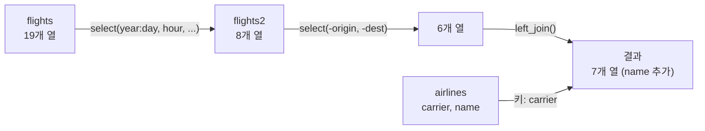

# 5장 — dplyr을 활용한 데이터 가공

[레포지토리 안내](../../README.ko.md) | [English](Concepts_Lecture.md) | [한국어](Concepts_Lecture.ko.md)

> **최종 수정일:** 2026-11-18
>
> 혼자 공부하는 R 데이터 분석, 강전희와 엄동란, Ch 5

> **학습 목표:**
> 1. dplyr의 핵심 함수와 파이프 연산자로 데이터를 선택, 변환, 요약할 수 있다
> 2. `left_join()`으로 공통 키 열을 기준으로 두 데이터 프레임을 결합할 수 있다
> 3. `count()`로 결합에 쓸 키가 각 행을 하나로 식별하는 기본 키인지 확인할 수 있다

---

## 목차

- [1. dplyr을 활용한 데이터 조작](#1-dplyr을-활용한-데이터-조작)
  - [1.1 dplyr 핵심 동사](#11-dplyr-핵심-동사)
  - [1.2 filter(): 행 선택](#12-filter-행-선택)
  - [1.3 arrange(): 정렬](#13-arrange-정렬)
  - [1.4 select(): 열 선택](#14-select-열-선택)
  - [1.5 mutate(): 새로운 열 생성](#15-mutate-새로운-열-생성)
  - [1.6 summarise()와 group_by()](#16-summarise와-group_by)
- [2. 데이터 결합](#2-데이터-결합)
  - [2.1 left_join()](#21-left_join)
  - [2.2 중복 카운트 및 필터링](#22-중복-카운트-및-필터링)
- [요약](#요약)
- [점검 문제](#점검-문제)

---

<br>

## 1. dplyr을 활용한 데이터 조작

### 1.1 dplyr 핵심 동사

`dplyr` 패키지는 데이터 조작을 위한 다섯 가지 핵심 함수를 제공한다:

| 함수 | 용도 | 예시 |
|------|------|------|
| `filter()` | 조건에 따른 행 선택 | `filter(flights, month == 1)` |
| `arrange()` | 행 정렬 | `arrange(flights, dep_delay)` |
| `select()` | 열 선택 | `select(flights, year, month, day)` |
| `mutate()` | 새로운 열 생성 | `mutate(data, speed = distance/time)` |
| `summarise()` | 데이터 집계 | `summarise(data, avg = mean(x))` |

*표 1. dplyr의 다섯 가지 핵심 함수*

### 1.2 filter(): 행 선택

`nycflights13` 패키지의 `flights`는 2013년에 뉴욕의 세 공항(JFK, LGA, EWR)에서 출발한 항공편 336,776편의 데이터이고, `mtcars`는 1974년 Motor Trend 잡지에 실린 자동차 32종의 연비와 설계 자료이다. `filter()`에 쉼표로 나열한 여러 조건은 `&`로 묶은 것과 같아서, 모든 조건을 만족하는 행만 남는다.

```r
library(tidyverse)
library(nycflights13)

# 1월 1일 항공편 필터링
filter(flights, month == 1, day == 1)

# 결과를 변수에 할당
jan1 <- filter(flights, month == 1, day == 1)

# 괄호로 감싸서 필터링과 출력을 동시에 수행
(dec25 <- filter(flights, month == 12, day == 25))

# 복수 조건으로 필터링
filter(mtcars, cyl == 4)
filter(mtcars, cyl >= 6 & mpg > 20)
```

### 1.3 arrange(): 정렬

`arrange()`에 여러 열을 주면 앞의 열로 먼저 정렬하고, 값이 같은 행끼리는 다음 열로 정렬한다. `desc()`는 그 열을 내림차순으로 바꾸며, 결측값은 정렬 방향과 관계없이 끝에 놓인다.

```r
arrange(flights, year, month, day)         # 오름차순 정렬
arrange(flights, desc(dep_delay))          # 내림차순 정렬

head(arrange(mtcars, wt))                  # 무게(wt) 기준 오름차순 정렬
head(arrange(mtcars, mpg, desc(wt)))       # mpg 기준 정렬 후 무게 내림차순
```

### 1.4 select(): 열 선택

`year:day`는 `year`부터 `day`까지 연속된 열을, `-(year:day)`는 그 열들을 뺀 나머지 열을 뜻한다. `ends_with()` 외에도 `starts_with()`, `contains()` 같은 도우미 함수가 있다.

```r
select(flights, year, month, day)          # 특정 열 선택
select(flights, year:day)                  # 열 범위 선택
select(flights, -(year:day))               # 열 범위 제외

# 도우미 함수
select(flights, ends_with("delay"))        # "delay"로 끝나는 열
```

### 1.5 mutate(): 새로운 열 생성

`gain`은 출발 지연에서 도착 지연을 뺀 값으로, 비행 중에 만회한 시간(분)이다. `distance`는 마일 단위이고 `air_time`은 분 단위이므로 `distance / air_time * 60`은 시속(마일)이다.

```r
flights_sml <- select(flights,
  year:day, ends_with("delay"), distance, air_time
)

mutate(flights_sml,
  gain = dep_delay - arr_delay,
  speed = distance / air_time * 60
)

# 새 열은 다른 새 열을 참조할 수 있다
mutate(flights_sml,
  gain = dep_delay - arr_delay,
  hours = air_time / 60,
  gain_per_hour = gain / hours
)
```

### 1.6 summarise()와 group_by()

`group_by()`는 데이터를 그룹으로 나누고, 그 뒤의 `summarise()`는 그룹마다 한 행씩 요약 결과를 만든다. `n()`은 그룹의 행 수를 센다. `na.rm = TRUE`는 결측값을 빼고 평균을 구하며, 이를 지정하지 않으면 결측값이 하나라도 있을 때 결과가 `NA`가 된다.

```r
# 단순 요약
summarise(flights, delay = mean(dep_delay, na.rm = TRUE))

# 그룹별 요약
by_day <- group_by(flights, year, month, day)
summarise(by_day, delay = mean(dep_delay, na.rm = TRUE))

# 파이프 연산자 (%>%) 사용
group_by(mtcars, cyl) %>% summarise(n())

# 다중 요약 통계
summarise(mtcars,
  cyl_mean = mean(cyl),
  cyl_min = min(cyl),
  cyl_max = max(cyl)
)
```

> **핵심:** 파이프 연산자 `%>%`는 왼쪽 표현식의 결과를 오른쪽 함수의 첫 번째 인수로 전달한다. 이를 통해 연산 체인이 읽기 쉬워진다: `data %>% filter() %>% summarise()`.

---

<br>

## 2. 데이터 결합

### 2.1 left_join()

```r
library(nycflights13)

flights2 <- flights %>%
  select(year:day, hour, origin, dest, tailnum, carrier)

flights2 %>%
  select(-origin, -dest) %>%
  left_join(airlines, by = "carrier")
```

`left_join(x, y, by = "carrier")`는 왼쪽 데이터 `x`의 모든 행을 유지하면서, `y`에서 `carrier` 값이 같은 행의 나머지 열을 붙인다. `y`에 짝이 없는 행은 새 열이 `NA`가 된다. `airlines`는 항공사 코드(`carrier`)와 이름(`name`) 두 열로 이루어진 16행의 표이므로, 결과는 `flights2`의 336,776행을 그대로 유지하고 `name` 열이 더해진 7열 데이터가 된다.



*그림 1. 파이프로 이어진 열 선택과 left_join()의 흐름*

### 2.2 중복 카운트 및 필터링

결합하기 전에는 키가 각 행을 하나로 식별하는지, 곧 기본 키인지 확인한다. `count()`로 키 조합마다 행 수를 세고 `n > 1`인 조합만 남기면 중복된 키가 드러난다.

```r
planes %>%
  count(tailnum) %>%
  filter(n > 1)

weather %>%
  count(year, month, day, hour, origin) %>%
  filter(n > 1)
```

`planes`의 `tailnum`은 결과가 0행이므로 기본 키이다. `weather`의 (`year`, `month`, `day`, `hour`, `origin`)은 서머타임이 끝난 2013-11-03 1시에 세 공항에서 2행씩 기록되어 3개의 조합이 중복되므로 엄밀한 기본 키가 아니다. 중복된 키로 결합하면 짝이 맞는 행이 키가 중복된 수만큼 복제된다.

> **[데이터베이스]** 관계형 데이터베이스에서 기본 키(primary key)는 테이블의 각 행을 하나로 식별하는 열이나 열의 조합이고, 다른 테이블의 기본 키를 가리키는 열은 외래 키(foreign key)이다. `flights`의 `carrier`는 `airlines`의 기본 키 `carrier`를 가리키는 외래 키에 해당하며, `left_join()`은 SQL의 `LEFT OUTER JOIN`처럼 왼쪽 테이블의 모든 행을 남기고 짝이 없는 행의 오른쪽 열을 `NULL`(R에서는 `NA`)로 채운다.

---

<br>

## 요약

| 개념 | 핵심 요약 |
|------|-----------|
| dplyr 동사 | `filter()`, `arrange()`, `select()`, `mutate()`, `summarise()`가 행 선택, 정렬, 열 선택, 열 생성, 집계를 맡는다. |
| `%>%` 파이프 | 왼쪽 결과를 오른쪽 함수의 첫 번째 인수로 전달하여 연산을 체인으로 잇는다. |
| `group_by()` | `summarise()`와 함께 사용하여 데이터를 그룹별로 집계한다. |
| `left_join()` | 공통 키 열을 기준으로 데이터 프레임을 병합하며, 왼쪽 데이터의 모든 행을 유지한다. |
| 기본 키 확인 | 결합하기 전에 `count()`로 키 조합마다 행 수를 세어 `n > 1`인 조합이 없는지 확인하며, 중복된 키로 결합하면 짝이 맞는 행이 복제된다. |

---

<br>

## 점검 문제

1. **파이프 연산자:** `summarise(group_by(mtcars, cyl), n())`를 파이프 연산자 `%>%`로 다시 쓰고, 결과가 몇 행인지와 각 행의 `n()` 값을 쓰라. `mtcars`에서 `cyl`이 4, 6, 8인 자동차는 각각 11대, 7대, 14대이다.

   <details>
   <summary>정답</summary>

   `mtcars %>% group_by(cyl) %>% summarise(n())`이다. `cyl`의 값이 4, 6, 8 세 가지이므로 그룹마다 한 행씩 3행이 나오고, `n()` 값은 차례로 11, 7, 14이다.

   </details>

2. **left_join()의 행 수:** `flights2`(336,776행)를 `airlines`와 `carrier`로 `left_join()`할 때 결과의 행 수가 `flights2`와 같으려면 `airlines`의 `carrier`가 어떤 조건을 만족해야 하는가? 또 `flights2`의 `carrier` 값이 `airlines`에 없으면 그 행은 어떻게 되는가?

   <details>
   <summary>정답</summary>

   `airlines`의 `carrier`가 중복 없이 각 행을 하나로 식별하는 기본 키여야 한다. 키가 중복되면 짝이 맞는 `flights2`의 행이 그 수만큼 복제되어 행이 늘어난다. 짝이 없는 행은 삭제되지 않고 유지되며 `name` 열이 `NA`가 된다. 실제 결과는 336,776행이고 `name`이 `NA`인 행은 없다.

   </details>
