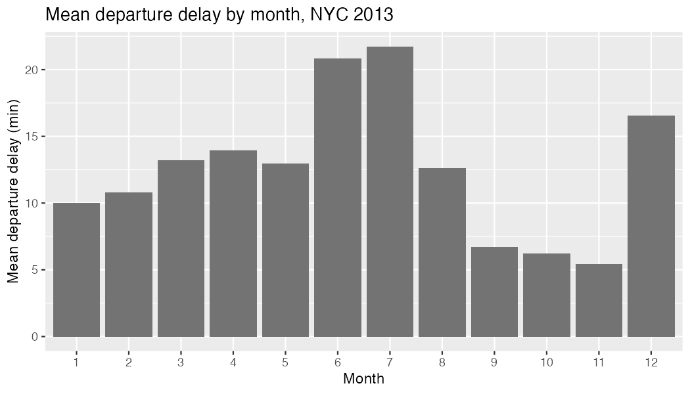
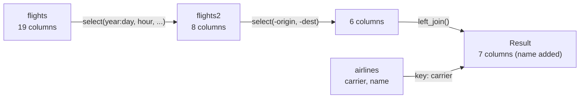
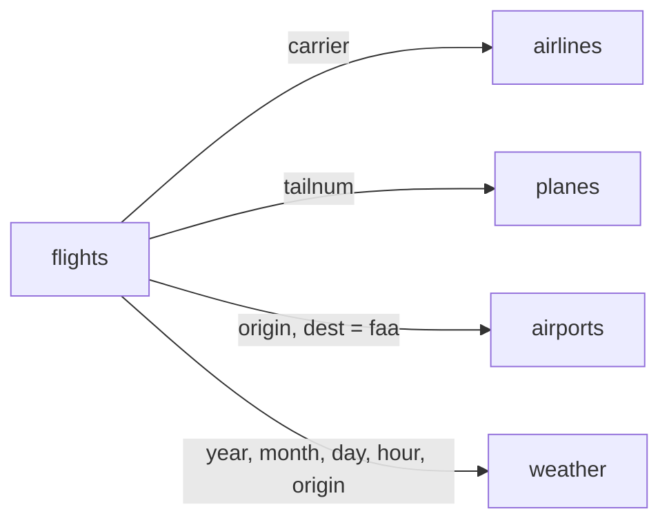

# Chapter 5 — Data Wrangling with dplyr

[Repository Guide](../../README.md) | [English](Concepts_Lecture.md) | [한국어](Concepts_Lecture.ko.md)

> **Last Updated:** 2026-11-19
>
> 혼자 공부하는 R 데이터 분석, 강전희와 엄동란, Ch 5

> **Learning Objectives:**
> 1. Select, transform, and summarize data with the core dplyr functions and the pipe operator
> 2. Combine two data frames by a common key column with `left_join()`
> 3. Check with `count()` whether a join key is a primary key that identifies each row uniquely
> 4. Explain how `filter()` and `arrange()` treat missing values and how `group_by()` affects the verbs that follow it
> 5. Predict the resulting rows of the four mutating joins and the two filtering joins
> 6. Reshape tables with `pivot_longer()` and `pivot_wider()` following the rules of tidy data, and clean missing values and outliers on sound grounds

---

## Table of Contents

- [1. Data Manipulation with dplyr](#1-data-manipulation-with-dplyr)
  - [1.1 Core dplyr Verbs](#11-core-dplyr-verbs)
  - [1.2 filter(): Row Selection](#12-filter-row-selection)
  - [1.3 arrange(): Sorting](#13-arrange-sorting)
  - [1.4 select(): Column Selection](#14-select-column-selection)
  - [1.5 mutate(): Create New Columns](#15-mutate-create-new-columns)
  - [1.6 summarise() and group_by()](#16-summarise-and-group_by)
  - [1.7 Common Rules of the Verbs and the flights Data](#17-common-rules-of-the-verbs-and-the-flights-data)
  - [1.8 Conditions and Missing Values in filter()](#18-conditions-and-missing-values-in-filter)
  - [1.9 arrange() and Missing Values](#19-arrange-and-missing-values)
  - [1.10 Helpers of select() and Renaming Columns](#110-helpers-of-select-and-renaming-columns)
  - [1.11 Functions Used in mutate()](#111-functions-used-in-mutate)
  - [1.12 How Grouped Summaries Work](#112-how-grouped-summaries-work)
  - [1.13 Removing Duplicates, Counting, and Sampling](#113-removing-duplicates-counting-and-sampling)
  - [1.14 The Pipe Operator](#114-the-pipe-operator)
- [2. Joining Data](#2-joining-data)
  - [2.1 left_join()](#21-left_join)
  - [2.2 Counting and Filtering Duplicates](#22-counting-and-filtering-duplicates)
  - [2.3 Relational Data and Keys](#23-relational-data-and-keys)
  - [2.4 Four Kinds of Mutating Joins](#24-four-kinds-of-mutating-joins)
  - [2.5 Specifying the Join Key](#25-specifying-the-join-key)
  - [2.6 Filtering Joins](#26-filtering-joins)
  - [2.7 Duplicated Keys and Many-to-Many Joins](#27-duplicated-keys-and-many-to-many-joins)
  - [2.8 Binding Rows and Columns](#28-binding-rows-and-columns)
- [3. Reshaping Data](#3-reshaping-data)
  - [3.1 Three Rules of Tidy Data](#31-three-rules-of-tidy-data)
  - [3.2 pivot_longer(): From Wide to Long Format](#32-pivot_longer-from-wide-to-long-format)
  - [3.3 pivot_wider(): From Long to Wide Format](#33-pivot_wider-from-long-to-wide-format)
  - [3.4 Splitting and Combining Columns](#34-splitting-and-combining-columns)
- [4. Cleaning Data](#4-cleaning-data)
  - [4.1 Checking and Excluding Missing Values](#41-checking-and-excluding-missing-values)
  - [4.2 Imputing Missing Values and Its Effects](#42-imputing-missing-values-and-its-effects)
  - [4.3 Detecting Outliers](#43-detecting-outliers)
  - [4.4 Correcting Values and Types](#44-correcting-values-and-types)
- [Concept Applications](#concept-applications)
- [Glossary](#glossary)
- [Summary](#summary)
- [Self-Check Questions](#self-check-questions)
- [References](#references)

---

<br>

## 1. Data Manipulation with dplyr

### 1.1 Core dplyr Verbs

The `dplyr` package provides five core functions for data manipulation:

| Function | Purpose | Example |
|----------|---------|---------|
| `filter()` | Select rows by condition | `filter(flights, month == 1)` |
| `arrange()` | Sort rows | `arrange(flights, dep_delay)` |
| `select()` | Choose columns | `select(flights, year, month, day)` |
| `mutate()` | Create new columns | `mutate(data, speed = distance/time)` |
| `summarise()` | Aggregate data | `summarise(data, avg = mean(x))` |

*Table 1. Five core dplyr functions*

`dplyr` is a data processing package created by Hadley Wickham; it improved the earlier `plyr` package, which was written only in R and was slow, by rewriting it in C++ so that data frames can be manipulated faster and in a more user-friendly way. The five functions plus `group_by()` serve as the six **verbs** of a language for data manipulation. `group_by()` changes the scope of each function so that it works group by group rather than on the whole data (Sections 1.6 and 1.12).

### 1.2 filter(): Row Selection

`flights` in the `nycflights13` package holds 336,776 flights that departed the three New York airports (JFK, LGA, EWR) in 2013, and `mtcars` holds fuel economy and design data for 32 cars from the 1974 Motor Trend magazine. Several conditions separated by commas in `filter()` act as if joined with `&`, so only rows that satisfy all of them remain.

```r
library(tidyverse)
library(nycflights13)

# Filter flights on January 1st
filter(flights, month == 1, day == 1)

# Assign result to variable
jan1 <- filter(flights, month == 1, day == 1)

# Filter and print in one step (wrapping with parentheses)
(dec25 <- filter(flights, month == 12, day == 25))

# Filter with multiple conditions
filter(mtcars, cyl == 4)
filter(mtcars, cyl >= 6 & mpg > 20)
```

There are 842 flights on January 1 and 719 on December 25. `filter()` does not change the original data but returns a new data frame, so to use the result it must be assigned to a variable, as with `jan1`. In `mtcars`, 11 cars have 4 cylinders, and 3 cars have 6 or more cylinders with fuel efficiency above 20: Mazda RX4, Mazda RX4 Wag, and Hornet 4 Drive.

### 1.3 arrange(): Sorting

Given several columns, `arrange()` sorts by the first column and breaks ties with the next. `desc()` switches a column to descending order, and missing values are placed at the end regardless of the sort direction.

```r
arrange(flights, year, month, day)         # Ascending order
arrange(flights, desc(dep_delay))          # Descending order

head(arrange(mtcars, wt))                  # Sort by weight (ascending)
head(arrange(mtcars, mpg, desc(wt)))       # Sort by mpg, then desc weight
```

The first row of `arrange(flights, desc(dep_delay))` is a flight on January 9 that departed 1,301 minutes (about 21.7 hours) late. `arrange(mtcars, wt)` lists from the lightest car, Lotus Europa (1.513, that is, 1,513 pounds). In `arrange(mtcars, mpg, desc(wt))`, of Lincoln Continental (5.424) and Cadillac Fleetwood (5.250), which share fuel efficiency 10.4, the heavier Lincoln Continental comes first.

### 1.4 select(): Column Selection

`year:day` means the consecutive columns from `year` to `day`, and `-(year:day)` means all other columns. Besides `ends_with()`, helper functions include `starts_with()` and `contains()`.

```r
select(flights, year, month, day)          # Select specific columns
select(flights, year:day)                  # Select range of columns
select(flights, -(year:day))               # Exclude range of columns

# Helper functions
select(flights, ends_with("delay"))        # Columns ending with "delay"
```

In data with hundreds or thousands of columns, keeping only the variables of interest makes the output easier to read and the computation lighter. `flights` has 19 columns, so the result of `select(flights, -(year:day))` has 16 columns.

### 1.5 mutate(): Create New Columns

`gain` is the departure delay minus the arrival delay, the time (in minutes) made up in flight. `distance` is in miles and `air_time` is in minutes, so `distance / air_time * 60` is the speed in miles per hour.

```r
flights_sml <- select(flights,
  year:day, ends_with("delay"), distance, air_time
)

mutate(flights_sml,
  gain = dep_delay - arr_delay,
  speed = distance / air_time * 60
)

# New columns can reference other new columns
mutate(flights_sml,
  gain = dep_delay - arr_delay,
  hours = air_time / 60,
  gain_per_hour = gain / hours
)
```

`mutate()` adds new columns at the end of the data. The first flight departed 2 minutes late and arrived 11 minutes late, so `gain` is 2 - 11 = -9 minutes, and it flew 1,400 miles in 227 minutes, so `speed` is 1400 / 227 × 60 ≈ 370 miles per hour. The second `mutate()` uses `gain` and `hours`, created earlier in the same call, directly in `gain_per_hour`.

### 1.6 summarise() and group_by()

`group_by()` splits the data into groups, and a following `summarise()` produces one summary row per group. `n()` counts the rows of a group. `na.rm = TRUE` drops missing values before averaging; without it, a single missing value makes the result `NA`.

```r
# Simple summary
summarise(flights, delay = mean(dep_delay, na.rm = TRUE))

# Grouped summary
by_day <- group_by(flights, year, month, day)
summarise(by_day, delay = mean(dep_delay, na.rm = TRUE))

# Using pipe operator (%>%)
group_by(mtcars, cyl) %>% summarise(n())

# Multiple summary statistics
summarise(mtcars,
  cyl_mean = mean(cyl),
  cyl_min = min(cyl),
  cyl_max = max(cyl)
)
```

> **Key Point:** The pipe operator `%>%` passes the result of the left expression as the first argument to the right function. It makes chains of operations readable: `data %>% filter() %>% summarise()`.

The mean departure delay of all flights is 12.6 minutes. Using `summarise()` alone reduces the whole data to one row, but using it after `group_by()` creates 365 rows, one per date, so the mean delay can be compared across dates.

### 1.7 Common Rules of the Verbs and the flights Data

All dplyr verbs work by the same rules.

1. The first argument is a data frame.
2. The following arguments describe what to do with the data frame, using column names without quotation marks.
3. The result is a new data frame.

Thanks to these three rules, simple steps can be chained to produce a complex result. Because of the third rule the original data does not change, and thanks to the second rule writing just `month` is enough instead of `flights$month`. Printing `flights` gives the following.

```r
flights
#> # A tibble: 336,776 × 19
#>     year month   day dep_time sched_dep_time dep_delay arr_time sched_arr_time
#>    <int> <int> <int>    <int>          <int>     <dbl>    <int>          <int>
#>  1  2013     1     1      517            515         2      830            819
#>  2  2013     1     1      533            529         4      850            830
#>  3  2013     1     1      542            540         2      923            850
#>  4  2013     1     1      544            545        -1     1004           1022
#>  5  2013     1     1      554            600        -6      812            837
#>  6  2013     1     1      554            558        -4      740            728
#>  7  2013     1     1      555            600        -5      913            854
#>  8  2013     1     1      557            600        -3      709            723
#>  9  2013     1     1      557            600        -3      838            846
#> 10  2013     1     1      558            600        -2      753            745
#> # ℹ 336,766 more rows
#> # ℹ 11 more variables: arr_delay <dbl>, carrier <chr>, flight <int>,
#> #   tailnum <chr>, origin <chr>, dest <chr>, air_time <dbl>, distance <dbl>,
#> #   hour <dbl>, minute <dbl>, time_hour <dttm>
```

`flights` is a tibble, so only the first 10 rows and the columns that fit the screen are shown, and the remaining 11 variables are listed below by name and type only. `dep_time` and `arr_time` are the actual departure and arrival times written as numbers in `HHMM` form, so 517 is 5:17 a.m. `sched_dep_time` and `sched_arr_time` are the scheduled times, and `dep_delay` and `arr_delay` are the departure and arrival delays in minutes, where negative values mean early departure or arrival. `carrier` is the airline code, `tailnum` the aircraft registration number, `origin` and `dest` the origin and destination airports, `air_time` the flight time in minutes, `distance` the distance in miles, and `time_hour` the scheduled departure time as a date and time.

The three-letter abbreviations under the column names are the types of the variables.

| Abbreviation | Type |
|:--|:--|
| `int` | Integer |
| `dbl` | Double (real number) |
| `chr` | Character vector, that is, strings |
| `dttm` | Date and time (date-time) |
| `lgl` | Logical, holding only `TRUE` and `FALSE` |
| `fct` | Factor with fixed categories |
| `date` | Date |

*Table 2. Column type abbreviations in tibble output*

### 1.8 Conditions and Missing Values in filter()

Conditions in `filter()` use comparison operators (`>`, `>=`, `<`, `<=`, `!=`, `==`) and logical operators (`&`, `|`, `!`) (Section 6 of Chapter 3). Whether a value equals one of several values is written concisely with `%in%`.

```r
nrow(flights)
#> [1] 336776
nrow(filter(flights, month == 1, day == 1))
#> [1] 842
nrow(filter(flights, month == 11 | month == 12))
#> [1] 55403
nrow(filter(flights, month %in% c(11, 12)))
#> [1] 55403
nrow(filter(flights, !(arr_delay > 120 | dep_delay > 120)))
#> [1] 316050
nrow(filter(flights, arr_delay <= 120, dep_delay <= 120))
#> [1] 316050
```

Flights that departed in November or December number 55,403 whether written as `month == 11 | month == 12` or as `month %in% c(11, 12)`. Writing it as `month == 11 | 12` makes R read `(month == 11) | 12`, and the nonzero number 12 is `TRUE`, so every row remains. The last two expressions are the same condition by De Morgan's law $`\lnot(A \lor B) = \lnot A \land \lnot B`$, so their results are equal. Note, however, that both counts leave out all flights whose delays are missing.

Writing `=` instead of `==` in a condition makes dplyr point out the mistake.

```r
filter(flights, month = 1)
#> Error in `filter()`:
#> ! We detected a named input.
#> ℹ This usually means that you've used `=` instead of `==`.
#> ℹ Did you mean `month == 1`?
```

The floating-point problem of Section 3 of Chapter 1 applies directly to comparisons of doubles, so use `near()`, which allows a tolerance, instead of `==`.

```r
sqrt(2)^2 == 2
#> [1] FALSE
near(sqrt(2)^2, 2)
#> [1] TRUE
```

`filter()` keeps only the rows where the condition is `TRUE` and discards rows where it is `NA` along with rows where it is `FALSE`. To keep missing values, state them explicitly with `is.na()`.

```r
df <- tibble(x = c(1, NA, 3))
filter(df, x > 1)
#> # A tibble: 1 × 1
#>       x
#>   <dbl>
#> 1     3
filter(df, is.na(x) | x > 1)
#> # A tibble: 2 × 1
#>       x
#>   <dbl>
#> 1    NA
#> 2     3
sum(is.na(flights$dep_time))
#> [1] 8255
nrow(filter(flights, is.na(dep_time)))
#> [1] 8255
filter(df, between(x, 1, 2))
#> # A tibble: 1 × 1
#>       x
#>   <dbl>
#> 1     1
```

`NA > 1` is `NA`, so only 3 remains in the first result. The 8,255 flights of `flights` with missing `dep_time` can be regarded as flights that never departed, that is, canceled flights. `between(x, a, b)` is shorthand for `x >= a & x <= b`.

### 1.9 arrange() and Missing Values

`arrange()` always places missing values at the end, even when sorting in descending order.

```r
df2 <- tibble(x = c(5, 2, NA))
arrange(df2, x)
#> # A tibble: 3 × 1
#>       x
#>   <dbl>
#> 1     2
#> 2     5
#> 3    NA
arrange(df2, desc(x))
#> # A tibble: 3 × 1
#>       x
#>   <dbl>
#> 1     5
#> 2     2
#> 3    NA
```

To move missing values to the front, use missingness as the first sort key, as in `arrange(df2, desc(is.na(x)), x)`, because rows where `is.na(x)` is `TRUE` come first in descending order.

### 1.10 Helpers of select() and Renaming Columns

Inside `select()`, helper functions choose columns by name pattern or type.

```r
select(flights, starts_with("dep"), contains("arr")) |> head(3)
#> # A tibble: 3 × 6
#>   dep_time dep_delay arr_time sched_arr_time arr_delay carrier
#>      <int>     <dbl>    <int>          <int>     <dbl> <chr>  
#> 1      517         2      830            819        11 UA     
#> 2      533         4      850            830        20 UA     
#> 3      542         2      923            850        33 AA
select(flights, time_hour, air_time, everything()) |> names() |> head(5)
#> [1] "time_hour" "air_time"  "year"      "month"     "day"
rename(select(flights, year:day), yr = year) |> head(2)
#> # A tibble: 2 × 3
#>      yr month   day
#>   <int> <int> <int>
#> 1  2013     1     1
#> 2  2013     1     1
relocate(select(flights, year:day, carrier), carrier) |> head(2)
#> # A tibble: 2 × 4
#>   carrier  year month   day
#>   <chr>   <int> <int> <int>
#> 1 UA       2013     1     1
#> 2 UA       2013     1     1
select(mtcars, where(is.numeric)) |> ncol()
#> [1] 11
```

`contains("arr")` selects every column whose name contains `arr`, so it picked not only the arrival columns but also `carrier`. Helpers look only at the letters of names, so such accidental matches can happen. `everything()` means all remaining columns, so it is used to move a few columns to the front and leave the rest as they are. `rename(new_name = old_name)` changes only a column name and keeps all columns, and `relocate()` changes only the order of columns. `where(is.numeric)` selects numeric columns, and all 11 columns of `mtcars` are numeric. Other helpers include `ends_with()`, `matches()` (regular expressions), and `num_range("x", 1:3)` (x1, x2, x3).

### 1.11 Functions Used in mutate()

`mutate()` uses vectorized functions (Section 1 of Chapter 2) that return a result of the same length as the input. A single constant is recycled into every row, and a ranking function attaches the rank of each row.

```r
head(mutate(mtcars, years = "1974"), 3)
#>                mpg cyl disp  hp drat    wt  qsec vs am gear carb years
#> Mazda RX4     21.0   6  160 110 3.90 2.620 16.46  0  1    4    4  1974
#> Mazda RX4 Wag 21.0   6  160 110 3.90 2.875 17.02  0  1    4    4  1974
#> Datsun 710    22.8   4  108  93 3.85 2.320 18.61  1  1    4    1  1974
head(mutate(mtcars, mpg_rank = rank(mpg)), 3)
#>                mpg cyl disp  hp drat    wt  qsec vs am gear carb mpg_rank
#> Mazda RX4     21.0   6  160 110 3.90 2.620 16.46  0  1    4    4     19.5
#> Mazda RX4 Wag 21.0   6  160 110 3.90 2.875 17.02  0  1    4    4     19.5
#> Datsun 710    22.8   4  108  93 3.85 2.320 18.61  1  1    4    1     24.5
```

`rank()` gives tied values their average rank. A fuel efficiency of 21.0 occupies the 19th and 20th positions in ascending order together, so both cars rank (19 + 20) / 2 = 19.5. Comparing ranking functions that treat ties differently gives the following.

```r
v <- c(10, 20, 20, 30, NA)
rank(v)
#> [1] 1.0 2.5 2.5 4.0 5.0
min_rank(v)
#> [1]  1  2  2  4 NA
dense_rank(v)
#> [1]  1  2  2  3 NA
row_number(v)
#> [1]  1  2  3  4 NA
min_rank(desc(v))
#> [1]  4  2  2  1 NA
```

`min_rank()` gives tied values the smallest rank and skips the next ranks (1, 2, 2, 4), the same as ranking in sports competitions. `dense_rank()` does not skip (1, 2, 2, 3), and `row_number()` gives different ranks even to ties, in order of appearance. Base R's `rank()` puts `NA` at the last rank, but dplyr's ranking functions leave `NA` as is. To rank from the largest value, use `desc()`.

Functions that compare with the previous or next value and cumulative functions are also used often.

```r
w <- c(3, 5, 4, 8)
lag(w)
#> [1] NA  3  5  4
lead(w)
#> [1]  5  4  8 NA
w - lag(w)
#> [1] NA  2 -1  4
cumsum(w)
#> [1]  3  8 12 20
cummean(w)
#> [1] 3 4 4 5
```

`lag()` shifts values one position back so that each position holds the value just before it, and `lead()` holds the value just after it. So `w - lag(w)` is the difference from the previous value, used to compute changes in time series data (Chapter 11). `cummean()` is the cumulative mean, and its third value is (3 + 5 + 4) / 3 = 4.

To set values by conditions, use `if_else()` and `case_when()`.

```r
cars_small <- select(head(mtcars, 6), mpg, cyl, hp)
mutate(cars_small,
       eff = if_else(mpg >= 20, "high", "low"),
       size = case_when(cyl == 4 ~ "small",
                        cyl == 6 ~ "medium",
                        .default = "large"))
#>                    mpg cyl  hp  eff   size
#> Mazda RX4         21.0   6 110 high medium
#> Mazda RX4 Wag     21.0   6 110 high medium
#> Datsun 710        22.8   4  93 high  small
#> Hornet 4 Drive    21.4   6 110 high medium
#> Hornet Sportabout 18.7   8 175  low  large
#> Valiant           18.1   6 105  low medium
```

`if_else()` is the same as `ifelse()` in Section 7 of Chapter 3, but it checks that the true and false values have the same type, which prevents mistakes. `case_when()` checks `condition ~ value` pairs from the top in turn and uses the value of the first true condition, and rows matching no condition get the value of `.default`. If `.default` is omitted, such rows become `NA`.

`transmute()` keeps only the newly created columns, and `.keep = "used"` in `mutate()` keeps only the columns used in the computation and the new columns.

```r
transmute(head(mtcars, 3), wt_kg = wt * 1000 * 0.4536)
#>                  wt_kg
#> Mazda RX4     1188.432
#> Mazda RX4 Wag 1304.100
#> Datsun 710    1052.352
mutate(head(mtcars, 3), ratio = hp / wt, .keep = "used")
#>                hp    wt    ratio
#> Mazda RX4     110 2.620 41.98473
#> Mazda RX4 Wag 110 2.875 38.26087
#> Datsun 710     93 2.320 40.08621
```

`wt` is in units of 1,000 pounds and one pound is about 0.4536 kg, so Mazda RX4 weighs 2.62 × 1000 × 0.4536 ≈ 1,188 kg.

### 1.12 How Grouped Summaries Work

Inside `summarise()`, use summary functions that reduce a vector to one value. Without a name, the expression itself becomes the column name.

```r
summarise(mtcars, cyl_mean = mean(cyl), cyl_min = min(cyl), cyl_max = max(cyl))
#>   cyl_mean cyl_min cyl_max
#> 1   6.1875       4       8
summarise(mtcars, mean(cyl), min(cyl), max(cyl))
#>   mean(cyl) min(cyl) max(cyl)
#> 1    6.1875        4        8
gr_cyl <- group_by(mtcars, cyl)
summarise(gr_cyl, n())
#> # A tibble: 3 × 2
#>     cyl `n()`
#>   <dbl> <int>
#> 1     4    11
#> 2     6     7
#> 3     8    14
summarise(gr_cyl, n_distinct(gear))
#> # A tibble: 3 × 2
#>     cyl `n_distinct(gear)`
#>   <dbl>              <int>
#> 1     4                  3
#> 2     6                  3
#> 3     8                  2
```

`n()` counts the rows of a group, and `n_distinct()` counts the distinct values. 4- and 6-cylinder cars include cars with 3, 4, and 5 gears, but 8-cylinder cars have only 3 or 5 gears, so the count is 2. Frequently used summary functions are as follows.

| Kind | Functions |
|:--|:--|
| Counts | `n()`, `n_distinct(x)`, `sum(!is.na(x))` |
| Center | `mean(x)`, `median(x)` |
| Spread | `sd(x)`, `IQR(x)`, `mad(x)` |
| Position | `min(x)`, `max(x)`, `quantile(x, 0.25)`, `first(x)`, `last(x)`, `nth(x, 2)` |
| Counts and proportions | `sum(x > 10)`, `mean(x > 10)` |

*Table 3. Summary functions used in summarise()*

Let us follow a grouped summary step by step. The following code computes, for each number of cylinders, the number of cars, the mean fuel efficiency, the standard deviation of fuel efficiency, and the median horsepower.

```r
mtcars |>
  group_by(cyl) |>
  summarise(n = n(), mean_mpg = mean(mpg), sd_mpg = sd(mpg),
            median_hp = median(hp))
#> # A tibble: 3 × 5
#>     cyl     n mean_mpg sd_mpg median_hp
#>   <dbl> <int>    <dbl>  <dbl>     <dbl>
#> 1     4    11     26.7   4.51       91 
#> 2     6     7     19.7   1.45      110 
#> 3     8    14     15.1   2.56      192.
mean(mtcars$mpg[mtcars$cyl == 4])
#> [1] 26.66364
```

`group_by(cyl)` splits the 32 rows into three groups: 11 rows of 4-cylinder cars, 7 of 6-cylinder cars, and 14 of 8-cylinder cars (split). `summarise()` computes the four summary functions for each group (apply) and collects one row per group into a tibble of 3 rows (combine). It is the same process as `tapply()` in Section 9 of Chapter 3, and the mean fuel efficiency of the 4-cylinder group, 26.7, equals the mean of the 11 values selected directly in the last line, 26.66. The more cylinders, the lower the mean fuel efficiency, and the median horsepower of 8-cylinder cars, 192.5, is more than twice the 91 of 4-cylinder cars.

When the groups are defined by several columns, `summarise()` leaves a grouping structure with the last grouping variable peeled off after the computation.

```r
by_day <- group_by(flights, year, month, day)
daily <- summarise(by_day, delay = mean(dep_delay, na.rm = TRUE))
#> `summarise()` has grouped output by 'year', 'month'. You can override using the
#> `.groups` argument.
daily
#> # A tibble: 365 × 4
#> # Groups:   year, month [12]
#>     year month   day delay
#>    <int> <int> <int> <dbl>
#>  1  2013     1     1 11.5 
#>  2  2013     1     2 13.9 
#>  3  2013     1     3 11.0 
#>  4  2013     1     4  8.95
#>  5  2013     1     5  5.73
#>  6  2013     1     6  7.15
#>  7  2013     1     7  5.42
#>  8  2013     1     8  2.55
#>  9  2013     1     9  2.28
#> 10  2013     1    10  2.84
#> # ℹ 355 more rows
monthly <- summarise(daily, delay = mean(delay))
#> `summarise()` has grouped output by 'year'. You can override using the
#> `.groups` argument.
monthly |> head(3)
#> # A tibble: 3 × 3
#> # Groups:   year [1]
#>    year month delay
#>   <int> <int> <dbl>
#> 1  2013     1  10.0
#> 2  2013     2  11.1
#> 3  2013     3  13.6
```

The result `daily` has 365 rows, one per date, and the message and the `# Groups: year, month [12]` in the output mean that the result is still grouped into 12 groups by year and month. So applying `summarise()` to `daily` again summarizes by month and gives 12 rows. The columns are the variables, so `daily` has 4 variables: `year`, `month`, `day`, and `delay`.

> **Caution:** The January value 10.0 in `monthly` is the mean of 31 daily means and may not equal the mean of all January flights computed directly, because the number of flights differs from day to day. The mean of all February flights computed directly from `flights` is 10.8 (Figure 1), which differs from the mean of daily means, 11.1. A mean of means equals the overall mean only when all groups have the same size.

When groups remain, later verbs also work group by group, so to avoid unintended results, release the groups with `.groups = "drop"` in `summarise()` or with `ungroup()`.

```r
flights |>
  group_by(month) |>
  summarise(n = n(), delay = mean(dep_delay, na.rm = TRUE), .groups = "drop") |>
  arrange(desc(delay)) |>
  head(3)
#> # A tibble: 3 × 3
#>   month     n delay
#>   <int> <int> <dbl>
#> 1     7 29425  21.7
#> 2     6 28243  20.8
#> 3    12 28135  16.6
```

Summarizing by month directly, the months with the longest mean departure delays are July (21.7 minutes), June (20.8 minutes), and December (16.6 minutes). Drawing the mean delays of the twelve months as a bar chart gives Figure 1. How to draw graphs is covered in Chapter 6.



*Figure 1. Mean departure delay by month at the three New York airports in 2013*

Delays are long in summer (June and July) and December and short in autumn (September-November). A grouped summary thus reveals the differences hidden behind the overall mean of 12.6 minutes.

`group_by()` also changes how `mutate()` and `filter()` work. With groups, summary functions such as `mean()` and `max()` are computed per group.

```r
mtcars |>
  select(mpg, cyl) |>
  group_by(cyl) |>
  mutate(dev = mpg - mean(mpg)) |>
  ungroup() |>
  head(4)
#> # A tibble: 4 × 3
#>     mpg   cyl   dev
#>   <dbl> <dbl> <dbl>
#> 1  21       6  1.26
#> 2  21       6  1.26
#> 3  22.8     4 -3.86
#> 4  21.4     6  1.66
mtcars |>
  group_by(cyl) |>
  filter(mpg == max(mpg)) |>
  select(cyl, mpg)
#> # A tibble: 3 × 2
#> # Groups:   cyl [3]
#>     cyl   mpg
#>   <dbl> <dbl>
#> 1     6  21.4
#> 2     4  33.9
#> 3     8  19.2
```

`dev` in the first result is each car's fuel efficiency minus the mean of **its cylinder group**. The 6-cylinder mean is 19.74, so 21.0 - 19.74 = 1.26, and the 4-cylinder mean is 26.66, so 22.8 - 26.66 = -3.86. Without groups, the overall mean 20.09 would have been subtracted. The second result keeps only the car with the highest fuel efficiency in each group. The result still carries the grouping, so it is safer to use `ungroup()` before continuing with other computations.

### 1.13 Removing Duplicates, Counting, and Sampling

`distinct()` returns the rows with duplicate value combinations of the given columns removed, and `count()` counts the rows for each value combination.

```r
distinct(mtcars, cyl)
#>                   cyl
#> Mazda RX4           6
#> Datsun 710          4
#> Hornet Sportabout   8
distinct(mtcars, cyl, gear) |> nrow()
#> [1] 8
count(mtcars, cyl)
#>   cyl  n
#> 1   4 11
#> 2   6  7
#> 3   8 14
count(mtcars, cyl, gear, sort = TRUE) |> head(3)
#>   cyl gear  n
#> 1   8    3 12
#> 2   4    4  8
#> 3   6    4  4
```

`distinct(mtcars, cyl)` keeps only the row where each number of cylinders first appears, giving 3 rows for 6, 4, and 8. Combinations of the number of cylinders and gears could number 3 × 3 = 9, but there is no 8-cylinder car with 4 gears, so there are 8 actual combinations. `count(data, column)` is the same as `group_by(column) |> summarise(n = n())`, and `sort = TRUE` sorts by decreasing count.

To draw part of the data at random, use `slice_sample()`. The older `sample_n()` and `sample_frac()` do the same, but they have now been superseded by `slice_sample(n = )` and `slice_sample(prop = )`.

```r
set.seed(2025)
slice_sample(mtcars, n = 3)
#>                 mpg cyl  disp  hp drat    wt  qsec vs am gear carb
#> Merc 450SL     17.3   8 275.8 180 3.07 3.730 17.60  0  0    3    3
#> Merc 450SE     16.4   8 275.8 180 3.07 4.070 17.40  0  0    3    3
#> Hornet 4 Drive 21.4   6 258.0 110 3.08 3.215 19.44  1  0    3    1
set.seed(2025)
sample_n(mtcars, 3)
#>                 mpg cyl  disp  hp drat    wt  qsec vs am gear carb
#> Merc 450SL     17.3   8 275.8 180 3.07 3.730 17.60  0  0    3    3
#> Merc 450SE     16.4   8 275.8 180 3.07 4.070 17.40  0  0    3    3
#> Hornet 4 Drive 21.4   6 258.0 110 3.08 3.215 19.44  1  0    3    1
slice_max(mtcars, mpg, n = 2)
#>                 mpg cyl disp hp drat    wt  qsec vs am gear carb
#> Toyota Corolla 33.9   4 71.1 65 4.22 1.835 19.90  1  1    4    1
#> Fiat 128       32.4   4 78.7 66 4.08 2.200 19.47  1  1    4    1
slice_head(mtcars, n = 2)
#>               mpg cyl disp  hp drat    wt  qsec vs am gear carb
#> Mazda RX4      21   6  160 110  3.9 2.620 16.46  0  1    4    4
#> Mazda RX4 Wag  21   6  160 110  3.9 2.875 17.02  0  1    4    4
```

The result of random sampling differs on every run, but fixing the starting point of the random numbers with `set.seed()` beforehand reproduces the same result. The two functions drew the same rows from the same starting point because they sample in the same way. `slice_max(data, column, n = )` selects the n rows with the largest values of that column, `slice_min()` the smallest, and `slice_head()` and `slice_tail()` the first and last rows. With groups, all of them work per group.

### 1.14 The Pipe Operator

When several verbs are chained, storing intermediate results in variables or nesting function calls makes code hard to read. The pipe operator passes the result on the left as the first argument of the function on the right, so the work is written from top to bottom in the order it happens.

```r
mp_rank <- mutate(mtcars, mpg_rank = rank(mpg))
head(arrange(mp_rank, mpg_rank), 3)
#>                      mpg cyl disp  hp drat    wt  qsec vs am gear carb mpg_rank
#> Cadillac Fleetwood  10.4   8  472 205 2.93 5.250 17.98  0  0    3    4      1.5
#> Lincoln Continental 10.4   8  460 215 3.00 5.424 17.82  0  0    3    4      1.5
#> Camaro Z28          13.3   8  350 245 3.73 3.840 15.41  0  0    3    4      3.0
mtcars %>% mutate(mpg_rank = rank(mpg)) %>% arrange(mpg_rank) %>% head(3)
#>                      mpg cyl disp  hp drat    wt  qsec vs am gear carb mpg_rank
#> Cadillac Fleetwood  10.4   8  472 205 2.93 5.250 17.98  0  0    3    4      1.5
#> Lincoln Continental 10.4   8  460 215 3.00 5.424 17.82  0  0    3    4      1.5
#> Camaro Z28          13.3   8  350 245 3.73 3.840 15.41  0  0    3    4      3.0
mtcars |> filter(am == 1) |> summarise(mean_mpg = mean(mpg))
#>   mean_mpg
#> 1 24.39231
```

The first approach creates the intermediate result `mp_rank` and then sorts it, and the second chains the same work with pipes. The results are the same. `x %>% f(y)` is the same as `f(x, y)`, so the second line reads "from mtcars, create the rank, sort by the rank, and show the first 3 rows." The two cars with the lowest fuel efficiency share 10.4, so their rank is (1 + 2) / 2 = 1.5.

`%>%` is an operator from the magrittr package and is available once dplyr is loaded. From R 4.1.0, the native pipe `|>`, usable without any package, was added [1]. The `|>` in the last line computes the mean fuel efficiency of the 13 cars with manual transmissions, 24.39. The two pipes behave the same in most cases, so the rest of this chapter uses `|>`. In RStudio a pipe is typed with Ctrl + Shift + M (Cmd + Shift + M on macOS), and the Code item of Global Options can switch it to the native pipe.

> **Caution:** A pipe passes the result as the **first** argument of the function on the right. So `mtcars |> lm(mpg ~ wt)` becomes `lm(mtcars, mpg ~ wt)` and raises an error. For a function whose first argument is not the data, use the placeholder `_`, available from R 4.2.0, in a named argument, as in `mtcars |> lm(mpg ~ wt, data = _)` (with `%>%`, `data = .`) [1], or break the pipe and write an ordinary call.

---

<br>

## 2. Joining Data

### 2.1 left_join()

```r
library(nycflights13)

flights2 <- flights %>%
  select(year:day, hour, origin, dest, tailnum, carrier)

flights2 %>%
  select(-origin, -dest) %>%
  left_join(airlines, by = "carrier")
```

`left_join(x, y, by = "carrier")` keeps every row of the left data `x` and attaches the remaining columns of the row of `y` with the same `carrier` value. Rows without a match in `y` get `NA` in the new columns. `airlines` is a 16-row table with two columns, the carrier code (`carrier`) and the name (`name`), so the result keeps all 336,776 rows of `flights2` and has 7 columns with `name` added.



*Figure 2. Column selection and left_join() chained with pipes*

In `by`, only the name of the key column is written in quotation marks. The first row of the result is a UA flight at 5 a.m. on January 1, 2013, and the attached `name` is United Air Lines Inc. The original `flights` has only the airline codes, so knowing the names requires joining another table.

### 2.2 Counting and Filtering Duplicates

Before joining, check whether the key identifies each row uniquely, that is, whether it is a primary key. Counting rows per key combination with `count()` and keeping only combinations with `n > 1` reveals duplicated keys.

```r
planes %>%
  count(tailnum) %>%
  filter(n > 1)

weather %>%
  count(year, month, day, hour, origin) %>%
  filter(n > 1)
```

`tailnum` in `planes` gives 0 rows, so it is a primary key. In `weather`, (`year`, `month`, `day`, `hour`, `origin`) has 3 duplicated combinations, because two rows were recorded at each of the three airports at 1 a.m. on 2013-11-03, when daylight saving time ended, so it is not strictly a primary key. Joining on a duplicated key copies each matching row as many times as the key is duplicated.

> **[Databases]** In a relational database, a primary key is a column or a combination of columns that identifies each row of a table uniquely, and a column that refers to the primary key of another table is a foreign key. `carrier` in `flights` acts as a foreign key that refers to the primary key `carrier` of `airlines`, and `left_join()`, like `LEFT OUTER JOIN` in SQL, keeps every row of the left table and fills the right-table columns of unmatched rows with `NULL` (`NA` in R).

### 2.3 Relational Data and Keys

It is rare for all the information needed for an analysis to be in one table. Data spread over several tables, handled together with the relationships between the tables, is called **relational data**. A relationship is always defined between two tables, and a relationship among three or more tables is a chain of relationships between pairs. Besides `flights`, `nycflights13` has four tables.

```r
airlines |> head(3)
#> # A tibble: 3 × 2
#>   carrier name                  
#>   <chr>   <chr>                 
#> 1 9E      Endeavor Air Inc.     
#> 2 AA      American Airlines Inc.
#> 3 AS      Alaska Airlines Inc.
airports |> select(faa, name, lat, lon) |> head(3)
#> # A tibble: 3 × 4
#>   faa   name                            lat   lon
#>   <chr> <chr>                         <dbl> <dbl>
#> 1 04G   Lansdowne Airport              41.1 -80.6
#> 2 06A   Moton Field Municipal Airport  32.5 -85.7
#> 3 06C   Schaumburg Regional            42.0 -88.1
planes |> select(tailnum, year, manufacturer, seats) |> head(3)
#> # A tibble: 3 × 4
#>   tailnum  year manufacturer     seats
#>   <chr>   <int> <chr>            <int>
#> 1 N10156   2004 EMBRAER             55
#> 2 N102UW   1998 AIRBUS INDUSTRIE   182
#> 3 N103US   1999 AIRBUS INDUSTRIE   182
weather |> select(origin, year, month, day, hour, temp) |> head(3)
#> # A tibble: 3 × 6
#>   origin  year month   day  hour  temp
#>   <chr>  <int> <int> <int> <int> <dbl>
#> 1 EWR     2013     1     1     1  39.0
#> 2 EWR     2013     1     1     2  39.0
#> 3 EWR     2013     1     1     3  39.0
c(nrow(airlines), nrow(airports), nrow(planes), nrow(weather))
#> [1]    16  1458  3322 26115
```

`airlines` gives the full name of an airline from its code, `airports` the name and location of an airport from its FAA code (`faa`), `planes` the year of manufacture, manufacturer, and number of seats of an aircraft from its registration number (`tailnum`), and `weather` the weather at each airport (`origin`) and hour. The relationships among the five tables are shown in Figure 3.



*Figure 3. The five tables of nycflights13 and the variables connecting them*

`flights` connects to `planes` through the single variable `tailnum` and to `airlines` through `carrier`. It connects to `airports` in two ways, through the origin `origin` and the destination `dest`, both of which correspond to `faa` in `airports`. It connects to `weather` through location (`origin`) and time (`year`, `month`, `day`, `hour`).

> **Definition:** A **key** is a variable or combination of variables used to connect two tables, and it uniquely identifies an observation.

There are two kinds of keys. A **primary key** uniquely identifies an observation in its own table; `planes$tailnum` pins down each aircraft in `planes`, so it is a primary key. A **foreign key** uniquely identifies an observation in another table; `flights$tailnum` maps each flight to one aircraft, so it is a foreign key. A variable can play both roles. `origin` is part of the primary key of `weather` and also a foreign key referring to `airports`.

```r
airlines |> count(carrier) |> filter(n > 1)
#> # A tibble: 0 × 2
#> # ℹ 2 variables: carrier <chr>, n <int>
flights |> count(year, month, day, flight) |> filter(n > 1) |> nrow()
#> [1] 29768
```

`carrier` of `airlines` has no duplicates, so it is a primary key. In contrast, `flights` has 29,768 combinations that are duplicated even when the date and the flight number (`flight`) are combined, because each airline numbers its flights separately, so there are several flights with the same number on the same day. For a table without a natural primary key like this, a **surrogate key** that attaches row numbers can be created, as in `mutate(id = row_number())`.

### 2.4 Four Kinds of Mutating Joins

A **mutating join** matches the observations of two tables by key and then adds the variables of one table to the other. It is so named because, like `mutate()`, it attaches columns to the right. There are four kinds, depending on how observations without a match are handled. The following two small tables show the differences.

```r
A <- tibble(ID = c(1, 2, 3), city = c("Seoul", "Busan", "Jeju"))
B <- tibble(ID = c(1, 2, 4), sex = c("M", "F", "M"))
left_join(A, B, by = "ID")
#> # A tibble: 3 × 3
#>      ID city  sex  
#>   <dbl> <chr> <chr>
#> 1     1 Seoul M    
#> 2     2 Busan F    
#> 3     3 Jeju  <NA>
inner_join(A, B, by = "ID")
#> # A tibble: 2 × 3
#>      ID city  sex  
#>   <dbl> <chr> <chr>
#> 1     1 Seoul M    
#> 2     2 Busan F
right_join(A, B, by = "ID")
#> # A tibble: 3 × 3
#>      ID city  sex  
#>   <dbl> <chr> <chr>
#> 1     1 Seoul M    
#> 2     2 Busan F    
#> 3     4 <NA>  M
full_join(A, B, by = "ID")
#> # A tibble: 4 × 3
#>      ID city  sex  
#>   <dbl> <chr> <chr>
#> 1     1 Seoul M    
#> 2     2 Busan F    
#> 3     3 Jeju  <NA> 
#> 4     4 <NA>  M
```

The IDs of `A` are 1, 2, 3 and those of `B` are 1, 2, 4, so the IDs in both tables are 1 and 2.

- `left_join(A, B)` joins on all rows of the first table `A`. ID 3 is not in `B`, so `NA` goes into `sex`.
- `inner_join(A, B)` joins only when the IDs match, so only the two rows with IDs 1 and 2 remain. This is called an **inner join**.
- `right_join(A, B)` is based on all rows of the second table `B`, so ID 4 remains with `city` as `NA`.
- `full_join(A, B)` keeps all rows of both tables by ID, giving four rows for IDs 1-4.

The three other than the inner join are called **outer joins**. An outer join can be thought of as attaching a virtual match whose values are all `NA` to rows without a match.

```text
A (ID: 1 2 3)      B (ID: 1 2 4)
          left_join  : 1 2 3      (all rows of A)
          inner_join : 1 2        (rows in both tables)
          right_join : 1 2 4      (all rows of B)
          full_join  : 1 2 3 4    (rows in either table)
```

*Figure 4. IDs kept by the four mutating joins*

| Function | Rows Kept | Without a Match |
|:--|:--|:--|
| `inner_join(x, y)` | Rows whose key is in both tables | Dropped |
| `left_join(x, y)` | All rows of `x` | Columns of `y` filled with `NA` |
| `right_join(x, y)` | All rows of `y` | Columns of `x` filled with `NA` |
| `full_join(x, y)` | All rows of both tables | Columns of the missing side filled with `NA` |

*Table 4. Kinds of mutating joins*

The most frequently used is `left_join()`, because it does not lose observations of the original table when adding information from another table. `inner_join()` silently drops rows without a match, so if the number of rows decreased after a join, check whether some key values did not match.

### 2.5 Specifying the Join Key

Omitting `by` gives a **natural join**, which uses every variable whose name appears in both tables as the key, and dplyr reports which key it used in a message.

```r
flights2 <- flights |> select(year:day, hour, origin, dest, tailnum, carrier)
flights2 |> left_join(weather) |> select(year:day, hour, origin, temp) |> head(3)
#> Joining with `by = join_by(year, month, day, hour, origin)`
#> # A tibble: 3 × 6
#>    year month   day  hour origin  temp
#>   <int> <int> <int> <dbl> <chr>  <dbl>
#> 1  2013     1     1     5 EWR     39.0
#> 2  2013     1     1     5 LGA     39.9
#> 3  2013     1     1     5 JFK     39.0
flights2 |> left_join(planes, by = "tailnum") |> select(tailnum, year.x, year.y, model) |> head(3)
#> # A tibble: 3 × 4
#>   tailnum year.x year.y model  
#>   <chr>    <int>  <int> <chr>  
#> 1 N14228    2013   1999 737-824
#> 2 N24211    2013   1998 737-824
#> 3 N619AA    2013   1990 757-223
flights2 |> left_join(airports, by = c("dest" = "faa")) |> select(dest, name) |> head(3)
#> # A tibble: 3 × 2
#>   dest  name                        
#>   <chr> <chr>                       
#> 1 IAH   George Bush Intercontinental
#> 2 IAH   George Bush Intercontinental
#> 3 MIA   Miami Intl
flights2 |> left_join(airports, join_by(dest == faa)) |> nrow()
#> [1] 336776
```

`flights2` and `weather` share `year`, `month`, `day`, `hour`, and `origin`, so the natural join joins on these five variables and attaches the temperature at the departure hour to each flight. But a shared name does not mean a shared meaning. `year` in `flights` is the year of operation and `year` in `planes` is the year the aircraft was built, so a natural join of the two gives a nonsensical join. In that case, specify only one key with `by = "tailnum"`. The non-key column with the same name, `year`, then remains twice in the result, distinguished by the suffixes `.x` (left table) and `.y` (right table). The first flight was operated in 2013 by an aircraft built in 1999.

When the key names of the two tables differ, pair the name in the left table with the name in the right table, as in `by = c("dest" = "faa")`. `join_by(dest == faa)` writes the same meaning in the `join_by()` form. To attach information about the origin airport instead, change it to `by = c("origin" = "faa")`. `faa` of `airports` is a primary key, so the number of rows stays at 336,776 after the join.

### 2.6 Filtering Joins

A **filtering join** adds no columns and only selects rows according to whether they have a match in another table.

```r
semi_join(A, B, by = "ID")
#> # A tibble: 2 × 2
#>      ID city 
#>   <dbl> <chr>
#> 1     1 Seoul
#> 2     2 Busan
anti_join(A, B, by = "ID")
#> # A tibble: 1 × 2
#>      ID city 
#>   <dbl> <chr>
#> 1     3 Jeju
flights |> anti_join(planes, by = "tailnum") |> nrow()
#> [1] 52606
flights |> anti_join(planes, by = "tailnum") |> count(carrier, sort = TRUE) |> head(3)
#> # A tibble: 3 × 2
#>   carrier     n
#>   <chr>   <int>
#> 1 MQ      25397
#> 2 AA      22558
#> 3 UA       1693
```

`semi_join(A, B)` keeps only the rows of `A` that have a match in `B`, and `anti_join(A, B)` only those without a match; the result has only the columns of `A`. Unlike `inner_join()`, the columns of `B` are not attached, and the rows of `A` are not copied even if `B` contains the same key several times. `anti_join()` is useful for finding in advance the rows that a join will miss. 52,606 flights in `flights` have registration numbers that are not in `planes`, and most of them are MQ and AA flights. Attaching aircraft information to these flights with `left_join()` fills those columns entirely with `NA`.

### 2.7 Duplicated Keys and Many-to-Many Joins

A key duplicated in only one table is common and causes no problem. Even if the same `carrier` appears many times in `flights`, as long as `carrier` of `airlines` is a primary key, each flight receives one airline name (a one-to-many relationship). But when the key is duplicated in both tables, every matching combination is created.

```r
x <- tibble(key = c(1, 1, 2), val_x = c("x1", "x2", "x3"))
y <- tibble(key = c(1, 1, 2), val_y = c("y1", "y2", "y3"))
left_join(x, y, by = "key")
#> Warning in left_join(x, y, by = "key"): Detected an unexpected many-to-many relationship between `x` and `y`.
#> ℹ Row 1 of `x` matches multiple rows in `y`.
#> ℹ Row 1 of `y` matches multiple rows in `x`.
#> ℹ If a many-to-many relationship is expected, set `relationship =
#>   "many-to-many"` to silence this warning.
#> # A tibble: 5 × 3
#>     key val_x val_y
#>   <dbl> <chr> <chr>
#> 1     1 x1    y1   
#> 2     1 x1    y2   
#> 3     1 x2    y1   
#> 4     1 x2    y2   
#> 5     2 x3    y3
```

Key 1 appears twice in `x` and twice in `y`, so 2 × 2 = 4 rows are created, and with the 1 row for key 2 the result has 5 rows. In most cases such a join results from choosing the wrong key, so dplyr gives a warning. Checking key duplicates with `count()` before joining, as in Section 2.2, prevents this mistake.

### 2.8 Binding Rows and Columns

To attach tables as they are without matching by key, use `bind_rows()` and `bind_cols()`.

```r
part1 <- tibble(id = 1:2, score = c(80, 90))
part2 <- tibble(id = 3, score = 75)
bind_rows(part1, part2)
#> # A tibble: 3 × 2
#>      id score
#>   <dbl> <dbl>
#> 1     1    80
#> 2     2    90
#> 3     3    75
bind_cols(part1, grade = c("B", "A"))
#> # A tibble: 2 × 3
#>      id score grade
#>   <int> <dbl> <chr>
#> 1     1    80 B    
#> 2     2    90 A
intersect(c(1, 2, 3), c(2, 3, 4))
#> [1] 2 3
union(c(1, 2, 3), c(2, 3, 4))
#> [1] 1 2 3 4
setdiff(c(1, 2, 3), c(2, 3, 4))
#> [1] 1
```

`bind_rows()` stacks tables with the same column names on top of each other and is used to combine data of the same format split across several files. `id` of `part1` is integer and `id` of `part2` is double, so the result is double. `bind_cols()` attaches tables or vectors with the same number of rows side by side but does not check that the rows match, so use it only when the rows are certainly in the same order. `intersect()`, `union()`, and `setdiff()` compute the intersection, union, and set difference, and they also work on data frames, treating a row whose values in all columns are equal as one element.

---

<br>

## 3. Reshaping Data

### 3.1 Three Rules of Tidy Data

The same information can be held in tables of many shapes. The following four tables included in the `tidyr` package all hold the number of tuberculosis cases (`cases`) and the population (`population`) of three countries (Afghanistan, Brazil, and China) in 1999 and 2000, but their shapes differ.

```r
table1
#> # A tibble: 6 × 4
#>   country      year  cases population
#>   <chr>       <dbl>  <dbl>      <dbl>
#> 1 Afghanistan  1999    745   19987071
#> 2 Afghanistan  2000   2666   20595360
#> 3 Brazil       1999  37737  172006362
#> 4 Brazil       2000  80488  174504898
#> 5 China        1999 212258 1272915272
#> 6 China        2000 213766 1280428583
table2
#> # A tibble: 12 × 4
#>    country      year type            count
#>    <chr>       <dbl> <chr>           <dbl>
#>  1 Afghanistan  1999 cases             745
#>  2 Afghanistan  1999 population   19987071
#>  3 Afghanistan  2000 cases            2666
#>  4 Afghanistan  2000 population   20595360
#>  5 Brazil       1999 cases           37737
#>  6 Brazil       1999 population  172006362
#>  7 Brazil       2000 cases           80488
#>  8 Brazil       2000 population  174504898
#>  9 China        1999 cases          212258
#> 10 China        1999 population 1272915272
#> 11 China        2000 cases          213766
#> 12 China        2000 population 1280428583
table3
#> # A tibble: 6 × 3
#>   country      year rate             
#>   <chr>       <dbl> <chr>            
#> 1 Afghanistan  1999 745/19987071     
#> 2 Afghanistan  2000 2666/20595360    
#> 3 Brazil       1999 37737/172006362  
#> 4 Brazil       2000 80488/174504898  
#> 5 China        1999 212258/1272915272
#> 6 China        2000 213766/1280428583
table4a
#> # A tibble: 3 × 3
#>   country     `1999` `2000`
#>   <chr>        <dbl>  <dbl>
#> 1 Afghanistan    745   2666
#> 2 Brazil       37737  80488
#> 3 China       212258 213766
```

Of these, `table1` is the easiest to analyze, because it is **tidy data** that satisfies the following three rules [2]. When Wickham [3] first defined tidy data, the third rule was that each type of observational unit forms a table (Section 5.5 of Chapter 2); the third rule below states separately the condition that each cell holds a single value.

1. Each variable has its own column.
2. Each observation has its own row.
3. Each value has its own cell.

`table2` spreads one observation (a country and a year) over two rows and puts the two variables `cases` and `population` into the values of the `type` column, breaking rules 1 and 2. `table3` puts the values of two variables into one cell, as in `"745/19987071"`, breaking rule 3. `table4a` turns the values 1999 and 2000 of the variable `year` into column names, breaking rule 1.

In tidy data the variables are columns, so R's vectorized operations seen in Chapter 2 and the dplyr verbs apply directly.

```r
table1 |> mutate(rate = cases / population * 10000)
#> # A tibble: 6 × 5
#>   country      year  cases population  rate
#>   <chr>       <dbl>  <dbl>      <dbl> <dbl>
#> 1 Afghanistan  1999    745   19987071 0.373
#> 2 Afghanistan  2000   2666   20595360 1.29 
#> 3 Brazil       1999  37737  172006362 2.19 
#> 4 Brazil       2000  80488  174504898 4.61 
#> 5 China        1999 212258 1272915272 1.67 
#> 6 China        2000 213766 1280428583 1.67
```

The number of cases per 10,000 people for Afghanistan in 1999 is 745 / 19,987,071 × 10,000 ≈ 0.373. To do the same computation with `table2`, the table must first be reshaped so that `cases` and `population` become columns. Real data is often created in a shape that is easy to enter or pleasant to look at, so a step that turns it into tidy data is almost always needed before analysis.

### 3.2 pivot_longer(): From Wide to Long Format

A table like `table4a`, in which values of a variable have become column names, is called the **wide format**, and `pivot_longer()` brings the column names down into the values of one variable, lengthening the rows. A table with many rows and few columns, like the result, is called the **long format**.

```r
table4a |>
  pivot_longer(cols = c(`1999`, `2000`), names_to = "year", values_to = "cases")
#> # A tibble: 6 × 3
#>   country     year   cases
#>   <chr>       <chr>  <dbl>
#> 1 Afghanistan 1999     745
#> 2 Afghanistan 2000    2666
#> 3 Brazil      1999   37737
#> 4 Brazil      2000   80488
#> 5 China       1999  212258
#> 6 China       2000  213766
```

`pivot_longer()` is told three things. `cols` is the columns to bring down into values, enclosed in backticks because their names start with digits and do not follow R's naming rules. `names_to` is the name of the new variable that holds the column names, and `values_to` is the name of the new variable that holds the cell values. As a result, the 6 values in 3 rows and 2 columns became 6 rows. The new `year` column came from column names, so it is character; if numbers are needed, give `names_transform = list(year = as.integer)` or convert it with `mutate()` afterward.

```text
Wide format (table4a)                   Long format
country       1999    2000              country      year   cases
Afghanistan    745    2666     →        Afghanistan  1999     745
Brazil       37737   80488              Afghanistan  2000    2666
China       212258  213766              Brazil       1999   37737
                                        ... (6 rows)
```

*Figure 5. pivot_longer() bringing column names down into the values of a variable*

With many columns, `cols` is written by excluding the columns to keep. The following `relig_income` is a wide table holding the number of respondents in each income bracket by religion.

```r
relig_income |> head(3)
#> # A tibble: 3 × 11
#>   religion `<$10k` `$10-20k` `$20-30k` `$30-40k` `$40-50k` `$50-75k` `$75-100k`
#>   <chr>      <dbl>     <dbl>     <dbl>     <dbl>     <dbl>     <dbl>      <dbl>
#> 1 Agnostic      27        34        60        81        76       137        122
#> 2 Atheist       12        27        37        52        35        70         73
#> 3 Buddhist      27        21        30        34        33        58         62
#> # ℹ 3 more variables: `$100-150k` <dbl>, `>150k` <dbl>,
#> #   `Don't know/refused` <dbl>
relig_income |> pivot_longer(cols = !religion, names_to = "income", values_to = "count") |> head(4)
#> # A tibble: 4 × 3
#>   religion income  count
#>   <chr>    <chr>   <dbl>
#> 1 Agnostic <$10k      27
#> 2 Agnostic $10-20k    34
#> 3 Agnostic $20-30k    60
#> 4 Agnostic $30-40k    81
```

`cols = !religion` means the remaining 10 columns other than `religion`. The income brackets in the column names have become values of a single variable, `income`, so now the data can be grouped by income bracket with `group_by()` or the income bracket can be mapped to a color or axis in ggplot2 of Chapter 6.

### 3.3 pivot_wider(): From Long to Wide Format

`pivot_wider()` conversely raises the values of a variable into column names, widening the columns. It is used to tidy a table like `table2`, in which one observation is spread over several rows.

```r
table2 |>
  pivot_wider(names_from = type, values_from = count)
#> # A tibble: 6 × 4
#>   country      year  cases population
#>   <chr>       <dbl>  <dbl>      <dbl>
#> 1 Afghanistan  1999    745   19987071
#> 2 Afghanistan  2000   2666   20595360
#> 3 Brazil       1999  37737  172006362
#> 4 Brazil       2000  80488  174504898
#> 5 China        1999 212258 1272915272
#> 6 China        2000 213766 1280428583
```

`names_from` is the variable holding the values that become new column names, and `values_from` is the variable holding the values to put in those cells. The values `cases` and `population` of `type` became column names, the 12 rows shrank to 6, and the result equals `table1`. The combination of the remaining columns, `country` and `year`, determines one row of the result. If a combination has several values, `pivot_wider()` bundles them into a list with a warning, so specify a function to combine them, as in `values_fn = sum`.

`pivot_longer()` and `pivot_wider()` are inverse operations. The long format is often convenient for analysis and visualization, and the wide format for tables in reports read by people, so the two formats are switched as needed. Before these two functions appeared, `gather()` and `spread()` in tidyr and `melt()` and `dcast()` in the `reshape2` package did the same job. When `gather()` or `melt()` appears in older code, read it as a function that converts to the long format, and `spread()` or `dcast()` as one that converts to the wide format.

### 3.4 Splitting and Combining Columns

When one cell holds several values, as in `table3`, split that column into several columns.

```r
table3 |> separate_wider_delim(rate, delim = "/", names = c("cases", "population"))
#> # A tibble: 6 × 4
#>   country      year cases  population
#>   <chr>       <dbl> <chr>  <chr>     
#> 1 Afghanistan  1999 745    19987071  
#> 2 Afghanistan  2000 2666   20595360  
#> 3 Brazil       1999 37737  172006362 
#> 4 Brazil       2000 80488  174504898 
#> 5 China        1999 212258 1272915272
#> 6 China        2000 213766 1280428583
table3 |> separate(rate, into = c("cases", "population"), convert = TRUE)
#> # A tibble: 6 × 4
#>   country      year  cases population
#>   <chr>       <dbl>  <int>      <int>
#> 1 Afghanistan  1999    745   19987071
#> 2 Afghanistan  2000   2666   20595360
#> 3 Brazil       1999  37737  172006362
#> 4 Brazil       2000  80488  174504898
#> 5 China        1999 212258 1272915272
#> 6 China        2000 213766 1280428583
table1 |> unite(cy, country, year, sep = "_") |> head(2)
#> # A tibble: 2 × 3
#>   cy               cases population
#>   <chr>            <dbl>      <dbl>
#> 1 Afghanistan_1999   745   19987071
#> 2 Afghanistan_2000  2666   20595360
```

`separate_wider_delim()` cuts the values at the separator `/` and splits them into the two columns of `names`. The split values remain character, the type of the original column, so they must be converted to numeric for computation. The older `separate()` splits at any symbol that is not a digit or letter, and with `convert = TRUE` it also converts the types appropriately. Functions that state the splitting method in their names, such as `separate_wider_delim()`, are now recommended. `unite()` conversely joins several columns into one with `sep`.

---

<br>

## 4. Cleaning Data

Real data contains missing values, wrongly entered values, values far from the others, and categories with inconsistent spellings. Finding such problems and fixing them so that the data can be analyzed is called **data cleaning**. Cleaning has no single correct method, and even the same missing value or outlier is handled differently depending on its cause. This section covers how to find and handle problems with dplyr and tidyr, together with the effect of each method on the results of an analysis.

### 4.1 Checking and Excluding Missing Values

The ozone (`Ozone`) and solar radiation (`Solar.R`) of `airquality` have missing values (Section 5 of Chapter 3). In dplyr and tidyr they are checked and excluded as follows.

```r
aq <- as_tibble(airquality)
aq |> filter(!is.na(Ozone)) |> nrow()
#> [1] 116
aq |> drop_na() |> nrow()
#> [1] 111
aq |> drop_na(Ozone) |> nrow()
#> [1] 116
aq |> summarise(n_na = sum(is.na(Ozone)), mean_oz = mean(Ozone, na.rm = TRUE))
#> # A tibble: 1 × 2
#>    n_na mean_oz
#>   <int>   <dbl>
#> 1    37    42.1
aq |> replace_na(list(Ozone = 0)) |> summarise(mean_oz = mean(Ozone))
#> # A tibble: 1 × 1
#>   mean_oz
#>     <dbl>
#> 1    31.9
coalesce(c(NA, 2, NA), 0)
#> [1] 0 2 0
```

`filter(!is.na(Ozone))` and `drop_na(Ozone)` remove only the rows with missing ozone, leaving 116 rows. `drop_na()` without columns removes every row with a missing value in any column, leaving 111 rows, so specify the columns to avoid losing rows because of columns not used in the analysis. `replace_na()` and `coalesce()` replace missing values with other values.

> **Caution:** Replacing missing values with 0 turns "could not be measured" into "the measurement was 0." In the example above, the mean ozone dropped sharply from 42.1 to 31.9, not because the real ozone concentration fell but because 37 fake zeros pulled the mean down. Replace missing values with 0 only when 0 is actually meaningful (for example, a purchase amount of 0 when there is no purchase record).

### 4.2 Imputing Missing Values and Its Effects

Filling missing values with plausible values instead of removing them is called **imputation**. The simplest method is mean imputation, which fills them with the mean of the observed values.

```r
oz <- airquality$Ozone
oz_imp <- ifelse(is.na(oz), mean(oz, na.rm = TRUE), oz)
c(mean(oz, na.rm = TRUE), mean(oz_imp))
#> [1] 42.12931 42.12931
c(sd(oz, na.rm = TRUE), sd(oz_imp))
#> [1] 32.98788 28.69337
```

Filling with the mean keeps the mean at 42.13, but the standard deviation shrinks from 32.99 to 28.69. All 37 filled values are exactly equal to the mean and have zero deviation, so the data looks less spread than it actually is. A smaller standard deviation makes later confidence intervals narrower and test results look more certain than they are. Also, ozone is high on hot days, so filling with the same value regardless of temperature weakens the relationship between the two variables as well.

Before handling missing values, first check why they are missing. If values are missing at random, independently of other variables, removing the missing rows leaves data that still represents the whole; but if they cluster under particular conditions (for example, a period when an instrument was broken, or nonresponse by high-income respondents), both removing them and filling them with the mean bias the results. In such cases, methods such as regression imputation, which predicts missing values from other variables, or multiple imputation are used.

### 4.3 Detecting Outliers

An **outlier** is a value far from the other observations. An outlier may be an entry error or a rare but important real phenomenon. The basic rule for finding outliers in statistics is the interquartile range rule used by the box plot in Section 8 of Chapter 4, which treats values below $`Q_1 - 1.5 \times \mathrm{IQR}`$ or above $`Q_3 + 1.5 \times \mathrm{IQR}`$ as outlier candidates.

```r
q <- quantile(oz, c(0.25, 0.75), na.rm = TRUE)
iqr <- q[2] - q[1]
c(q, lower = q[1] - 1.5 * iqr, upper = q[2] + 1.5 * iqr)
#>       25%       75% lower.25% upper.75% 
#>    18.000    63.250   -49.875   131.125
aq |> filter(Ozone > q[2] + 1.5 * iqr) |> select(Month, Day, Ozone, Temp)
#> # A tibble: 2 × 4
#>   Month   Day Ozone  Temp
#>   <int> <int> <int> <int>
#> 1     7     1   135    84
#> 2     8    25   168    81
m <- mean(oz, na.rm = TRUE); s <- sd(oz, na.rm = TRUE)
c(m - 2 * s, m + 2 * s)
#> [1] -23.84646 108.10508
```

The quartiles of ozone are $`Q_1 = 18`$ and $`Q_3 = 63.25`$, so IQR = 45.25 and the upper fence is 63.25 + 1.5 × 45.25 = 131.125. The days exceeding this fence are July 1 (135) and August 25 (168). The lower fence is negative, so no low outliers occur for ozone concentration.

> **Caution:** Defining outliers as "values more than some multiple of the standard deviation from the mean" is not used as a criterion for outlier detection, because the mean and standard deviation are themselves strongly affected by those extreme values. In the example above, the upper limit of the mean ± 2 × standard deviation is 108.1 and catches 6 values, but this limit itself has been widened by large values such as 168. For skewed data, set the criterion with measures robust to extreme values, such as quartiles.

How to handle the outliers found depends on their cause. If a unit was recorded wrongly (for example, g instead of kg) or the value is impossible (for example, an age of 250), it is an entry error, so correct it or change it to `NA`. If the value actually occurred, keep it; to reduce its influence on the results, use robust statistics such as the median or the trimmed mean, or report the analyses with and without the outliers together. Removing values just because they are large makes the data look more uniform than it is.

### 4.4 Correcting Values and Types

Numbers stored as strings, categories with mixed spellings, and duplicated rows are also targets of cleaning.

```r
survey <- tibble(id = 1:5,
                 income = c("$1,200", "$950", "unknown", "$2,300", "$1,200"),
                 gender = c("M", "female", "F", "m", "M"))
survey |>
  mutate(income = parse_number(income, na = "unknown"),
         gender = case_when(tolower(gender) %in% c("m", "male") ~ "M",
                            tolower(gender) %in% c("f", "female") ~ "F"))
#> # A tibble: 5 × 3
#>      id income gender
#>   <int>  <dbl> <chr> 
#> 1     1   1200 M     
#> 2     2    950 F     
#> 3     3     NA F     
#> 4     4   2300 M     
#> 5     5   1200 M
```

`parse_number()` of `readr` (Section 3 of Chapter 4) reads numbers ignoring `$` and commas, and `na = "unknown"` treats that string as missing. Gender has mixed spellings such as `M`, `m`, `female`, and `F`, so it is unified to lower case with `tolower()` and then arranged into two categories with `case_when()`. Leaving such spelling differences in place makes `count(gender)` count four categories and gives a wrong result.

To apply the same processing to several columns, use `across()`.

```r
aq |> summarise(across(c(Ozone, Solar.R, Wind), \(x) mean(x, na.rm = TRUE)))
#> # A tibble: 1 × 3
#>   Ozone Solar.R  Wind
#>   <dbl>   <dbl> <dbl>
#> 1  42.1    186.  9.96
```

`across(columns, function)` applies the function to each specified column. `\(x) mean(x, na.rm = TRUE)` is an anonymous function, shorthand for `function(x) mean(x, na.rm = TRUE)` (Section 9 of Chapter 3). Duplicated rows are removed with `distinct()` (Section 1.13), after first deciding whether only rows equal in all columns count as duplicates or rows equal in the key columns do.

Every step of cleaning must be recorded in a script. Editing the original file directly makes it impossible to check what was changed and to apply the same cleaning to new data. It is good to leave the original as it is and save the cleaned result to a new file (for example, RDS, Section 3 of Chapter 4).

---

<br>

## Concept Applications

**True/False Check:**

| Statement | Judgment and Reason |
|:--|:--|
| `filter(df, x > 1)` also keeps rows where `x` is missing. | **F.** `filter()` keeps only rows where the condition is `TRUE`, so it drops rows where the condition is `NA`. To keep them, write `is.na(x) \| x > 1`. |
| `filter(flights, month == 11 \| 12)` selects November and December flights. | **F.** It is computed as `(month == 11) \| 12`, so every row remains. It must be written `month %in% c(11, 12)`. |
| `arrange(df, desc(x))` places missing values first. | **F.** `arrange()` places missing values last regardless of the sort direction. |
| Using `mutate(z = x - mean(x))` on grouped data subtracts the mean of each group. | **T.** While `group_by()` remains, summary functions are computed per group. |
| The number of rows from `inner_join()` cannot exceed the number of rows of the left table. | **F.** If keys in the right table are duplicated, matching left rows are copied and the number of rows can increase. |
| `semi_join(x, y)` attaches the columns of `y` to `x`. | **F.** A filtering join only selects the rows of `x` with a match and does not attach the columns of `y`. |
| Imputing missing values with the mean keeps the mean and shrinks the standard deviation. | **T.** The filled values all have zero deviation, so the spread is computed smaller than it actually is. |
| Defining values outside the mean ± 2 × standard deviation as outliers is the most robust method. | **F.** The mean and standard deviation are affected by extreme values, so the rule based on the interquartile range is more robust. |

---

<br>

## Glossary

| English | Korean | One-Line Definition |
|:--|:--|:--|
| verb | 동사 | A core dplyr function that takes a data frame and returns a new data frame. |
| pipe operator | 파이프 연산자 | The operator `%>%` or `\|>` that passes the result on the left as the first argument of the function on the right. |
| window function | 윈도 함수 | A function such as `lag()` or `rank()` that returns a result of the same length as its input. |
| grouped summary | 그룹별 요약 | The result of splitting data into groups and computing summary statistics for each group. |
| relational data | 관계형 데이터 | Data made of several tables connected by relationships. |
| primary key | 기본 키 | A variable or combination of variables that uniquely identifies each observation in its own table. |
| foreign key | 외래 키 | A variable that uniquely identifies an observation in another table. |
| surrogate key | 대리 키 | A key created from row numbers or the like when there is no natural primary key. |
| mutating join | 변경 조인 | A join that adds variables from another table matched by key. |
| inner join | 내부 조인 | A join that keeps only observations whose key is in both tables. |
| outer join | 외부 조인 | A join that keeps all observations of one or both tables. |
| natural join | 자연 조인 | A join that uses every variable common to both tables as the key. |
| filtering join | 필터링 조인 | A join that only selects rows according to whether they have a match in another table. |
| wide format | 넓은 형식 | The shape of a table in which values of a variable are spread out as column names. |
| long format | 긴 형식 | The shape of a table in which such values are brought down into a variable, giving more rows. |
| data cleaning | 데이터 정제 | The work of finding missing values, errors, outliers, and inconsistencies and fixing them for analysis. |
| imputation | 대체 | Filling missing values with estimated values. |
| outlier | 이상치 | A value far from the other observations. |

*Table 5. Glossary*

---

<br>

## Summary

| Concept | Key Summary |
|---------|-------------|
| dplyr verbs | `filter()`, `arrange()`, `select()`, `mutate()`, and `summarise()` handle row selection, sorting, column selection, column creation, and aggregation. |
| `%>%` pipe | It chains operations by passing the left result as the first argument to the right function. |
| `group_by()` | It is used with `summarise()` to aggregate data by group. |
| `left_join()` | It merges data frames by a common key column and keeps every row of the left data. |
| Primary key check | Before a join, `count()` counts the rows for each key combination to confirm that no combination has `n > 1`, and a join on a duplicated key replicates the matching rows. |
| Common Rules of the Verbs | The first argument is a data frame, the following ones are unquoted column names, and the result is a new data frame. |
| `filter()` and Missing Values | It keeps only rows where the condition is `TRUE`, so `is.na()` must be stated to keep missing values, and `near()` is used to compare doubles. |
| `select()` Helpers | `starts_with()`, `ends_with()`, `contains()`, `everything()`, and `where()` choose columns, and `rename()` and `relocate()` change names and order. |
| `mutate()` Functions | Ranking (`min_rank()`), neighboring values (`lag()`, `lead()`), cumulative (`cumsum()`), and conditional (`if_else()`, `case_when()`) functions are used. |
| Effect of Groups | `summarise()` grouped by several variables peels off the last group, and remaining groups make later `mutate()` and `filter()` work per group. |
| Duplicates and Samples | `distinct()` removes duplicates, `count()` counts each combination, and `slice_sample()` draws a random sample. |
| Relational Data | A primary key identifies observations in its own table and a foreign key in another table, and the two connect tables. |
| Mutating Joins | `inner_join()` keeps only common rows, `left_join()` and `right_join()` all rows of one side, and `full_join()` all rows. |
| Filtering Joins | `semi_join()` keeps only rows with a match and `anti_join()` only rows without one, adding no columns. |
| Tidy Data | Variables are columns, observations are rows, and each value occupies one cell; `pivot_longer()` and `pivot_wider()` reshape tables. |
| Cleaning Missing Values | The cause of missingness is checked first, and filling with 0 or the mean distorts the mean or the spread. |
| Outliers | Candidates are found with the 1.5 × IQR rule and are corrected or kept according to their cause. |

---

<br>

## Self-Check Questions

1. **The pipe operator:** Rewrite `summarise(group_by(mtcars, cyl), n())` with the pipe operator `%>%`, and give the number of rows in the result and the `n()` value of each row. In `mtcars`, 11 cars have `cyl` equal to 4, 7 have 6, and 14 have 8.

   <details>
   <summary>Answer</summary>

   It is `mtcars %>% group_by(cyl) %>% summarise(n())`. `cyl` has three values, 4, 6, and 8, so the result has 3 rows, one per group, with `n()` values 11, 7, and 14 in order.

   </details>

2. **Rows after left_join():** When `flights2` (336,776 rows) is joined with `airlines` on `carrier` using `left_join()`, what condition must `carrier` in `airlines` satisfy for the result to have the same number of rows as `flights2`? What happens to a row of `flights2` whose `carrier` value is not in `airlines`?

   <details>
   <summary>Answer</summary>

   `carrier` in `airlines` must be a primary key that identifies each row uniquely without duplicates. If a key is duplicated, each matching row of `flights2` is copied that many times, and the number of rows grows. A row without a match is kept rather than deleted, and its `name` column becomes `NA`. The actual result has 336,776 rows, and no row has `NA` in `name`.

   </details>

3. **filter() and missing values:** For `d <- tibble(x = c(2, NA, 5, 8))`, give the number of rows in the results of `filter(d, x != 5)` and `filter(d, !(x %in% 5))`, and explain the reason for the difference.

   <details>
   <summary>Answer</summary>

   `x != 5` is `TRUE`, `NA`, `FALSE`, `TRUE` for 2, `NA`, 5, 8, so the 2 rows with 2 and 8 remain. `x %in% 5` returns `FALSE` even for `NA`, so `!(x %in% 5)` is `TRUE`, `TRUE`, `FALSE`, `TRUE`, and 3 rows remain, including the missing row. `%in%` treats a missing value not as an incomparable value but as a value that is not in the set.

   </details>

4. **Ranking functions:** For `s <- c(70, 85, 85, 90)`, give the results of `min_rank(desc(s))`, `dense_rank(desc(s))`, and `rank(s)`.

   <details>
   <summary>Answer</summary>

   Ranking from the largest value, 90 is first and the two 85s tie for second. `min_rank(desc(s))` skips the next rank, so 70 becomes fourth: 4, 2, 2, 1. `dense_rank(desc(s))` does not skip: 3, 2, 2, 1. `rank(s)` gives average ranks from the smallest value, so 70 is 1, the two 85s are (2 + 3) / 2 = 2.5, and 90 is 4: 1, 2.5, 2.5, 4.

   </details>

5. **Computing by group:** In the result of the following code, find `n` and `prop` for the 4-cylinder group.

   ```r
   mtcars |> count(cyl) |> mutate(prop = n / sum(n))
   ```

   <details>
   <summary>Answer</summary>

   `count(cyl)` counts each number of cylinders and makes 3 rows: 11 for 4 cylinders, 7 for 6, and 14 for 8. There are no groups, so `sum(n)` is the total 32, and `prop` for 4 cylinders is 11 / 32 = 0.34375.

   </details>

6. **Rows after joins:** For `x <- tibble(k = c(1, 2, 2, 3))` and `y <- tibble(k = c(2, 3, 4), v = c("a", "b", "c"))`, find the number of rows of `inner_join(x, y, by = "k")`, `left_join(x, y, by = "k")`, `full_join(x, y, by = "k")`, and `anti_join(x, y, by = "k")`.

   <details>
   <summary>Answer</summary>

   `k` of `y` has no duplicates, so each row of `x` has at most one match. The rows of `x` with a match are the two rows with k = 2 and the one row with k = 3, so `inner_join()` gives 3 rows. `left_join()` keeps all 4 rows of `x`, with `v` as `NA` for k = 1. `full_join()` adds the row with k = 4, which is only in `y`, to those 4 rows, giving 5 rows. `anti_join()` gives the 1 row with k = 1, which has no match.

   </details>

7. **Reshaping a table:** Write code that turns the following wide table `score` into a long format with three columns, student, subject, and score, and find the number of rows of the result.

   ```r
   score <- tibble(student = c("A", "B", "C"),
                   math = c(90, 70, 85), eng = c(80, 95, 75))
   ```

   <details>
   <summary>Answer</summary>

   It is `score |> pivot_longer(cols = c(math, eng), names_to = "subject", values_to = "score")`. Each of the 3 students has values for 2 subjects, one row each, giving 3 × 2 = 6 rows. To return to the wide format, use `pivot_wider(names_from = subject, values_from = score)`.

   </details>

8. **Outlier fences:** A variable has quartiles $`Q_1 = 40`$ and $`Q_3 = 60`$, and the values 5, 12, 95, and 88 were observed. Select all outlier candidates by the IQR rule.

   <details>
   <summary>Answer</summary>

   IQR = 60 - 40 = 20, so the lower fence is 40 - 1.5 × 20 = 10 and the upper fence is 60 + 1.5 × 20 = 90. 5 is below 10 and 95 is above 90, so they are outlier candidates, while 12 and 88 are within the fences.

   </details>

---

<br>

## References

1. R Core Team, "R news." [Online]. Available: https://cran.r-project.org/doc/manuals/r-release/NEWS.html
2. H. Wickham, M. Çetinkaya-Rundel, and G. Grolemund, "Data tidying," in *R for Data Science*, 2nd ed., ch. 5. [Online]. Available: https://r4ds.hadley.nz/data-tidy.html
3. H. Wickham, "Tidy data," *Journal of Statistical Software*, vol. 59, no. 10, pp. 1-23, 2014. [Online]. Available: https://doi.org/10.18637/jss.v059.i10
