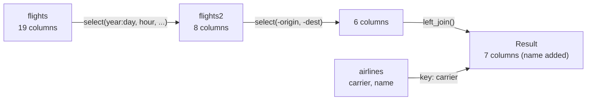

# Chapter 5 — Data Wrangling with dplyr

[Repository Guide](../../README.md) | [English](Concepts_Lecture.md) | [한국어](Concepts_Lecture.ko.md)

> **Last Updated:** 2026-11-18
>
> 혼자 공부하는 R 데이터 분석, 강전희와 엄동란, Ch 5

> **Learning Objectives:**
> 1. Select, transform, and summarize data with the core dplyr functions and the pipe operator
> 2. Combine two data frames by a common key column with `left_join()`
> 3. Check with `count()` whether a join key is a primary key that identifies each row uniquely

---

## Table of Contents

- [1. Data Manipulation with dplyr](#1-data-manipulation-with-dplyr)
  - [1.1 Core dplyr Verbs](#11-core-dplyr-verbs)
  - [1.2 filter(): Row Selection](#12-filter-row-selection)
  - [1.3 arrange(): Sorting](#13-arrange-sorting)
  - [1.4 select(): Column Selection](#14-select-column-selection)
  - [1.5 mutate(): Create New Columns](#15-mutate-create-new-columns)
  - [1.6 summarise() and group_by()](#16-summarise-and-group_by)
- [2. Joining Data](#2-joining-data)
  - [2.1 left_join()](#21-left_join)
  - [2.2 Counting and Filtering Duplicates](#22-counting-and-filtering-duplicates)
- [Summary](#summary)
- [Self-Check Questions](#self-check-questions)

---

<br>

## 1. Data Manipulation with dplyr

### 1.1 Core dplyr Verbs

The `dplyr` package provides five core functions for data manipulation:

| Function | Purpose | Example |
|----------|---------|---------|
| `filter()` | Select rows by condition | `filter(flights, month == 1)` |
| `arrange()` | Sort rows | `arrange(flights, dep_delay)` |
| `select()` | Choose columns | `select(flights, year, month, day)` |
| `mutate()` | Create new columns | `mutate(data, speed = distance/time)` |
| `summarise()` | Aggregate data | `summarise(data, avg = mean(x))` |

*Table 1. Five core dplyr functions*

### 1.2 filter(): Row Selection

`flights` in the `nycflights13` package holds 336,776 flights that departed the three New York airports (JFK, LGA, EWR) in 2013, and `mtcars` holds fuel economy and design data for 32 cars from the 1974 Motor Trend magazine. Several conditions separated by commas in `filter()` act as if joined with `&`, so only rows that satisfy all of them remain.

```r
library(tidyverse)
library(nycflights13)

# Filter flights on January 1st
filter(flights, month == 1, day == 1)

# Assign result to variable
jan1 <- filter(flights, month == 1, day == 1)

# Filter and print in one step (wrapping with parentheses)
(dec25 <- filter(flights, month == 12, day == 25))

# Filter with multiple conditions
filter(mtcars, cyl == 4)
filter(mtcars, cyl >= 6 & mpg > 20)
```

### 1.3 arrange(): Sorting

Given several columns, `arrange()` sorts by the first column and breaks ties with the next. `desc()` switches a column to descending order, and missing values are placed at the end regardless of the sort direction.

```r
arrange(flights, year, month, day)         # Ascending order
arrange(flights, desc(dep_delay))          # Descending order

head(arrange(mtcars, wt))                  # Sort by weight (ascending)
head(arrange(mtcars, mpg, desc(wt)))       # Sort by mpg, then desc weight
```

### 1.4 select(): Column Selection

`year:day` means the consecutive columns from `year` to `day`, and `-(year:day)` means all other columns. Besides `ends_with()`, helper functions include `starts_with()` and `contains()`.

```r
select(flights, year, month, day)          # Select specific columns
select(flights, year:day)                  # Select range of columns
select(flights, -(year:day))               # Exclude range of columns

# Helper functions
select(flights, ends_with("delay"))        # Columns ending with "delay"
```

### 1.5 mutate(): Create New Columns

`gain` is the departure delay minus the arrival delay, the time (in minutes) made up in flight. `distance` is in miles and `air_time` is in minutes, so `distance / air_time * 60` is the speed in miles per hour.

```r
flights_sml <- select(flights,
  year:day, ends_with("delay"), distance, air_time
)

mutate(flights_sml,
  gain = dep_delay - arr_delay,
  speed = distance / air_time * 60
)

# New columns can reference other new columns
mutate(flights_sml,
  gain = dep_delay - arr_delay,
  hours = air_time / 60,
  gain_per_hour = gain / hours
)
```

### 1.6 summarise() and group_by()

`group_by()` splits the data into groups, and a following `summarise()` produces one summary row per group. `n()` counts the rows of a group. `na.rm = TRUE` drops missing values before averaging; without it, a single missing value makes the result `NA`.

```r
# Simple summary
summarise(flights, delay = mean(dep_delay, na.rm = TRUE))

# Grouped summary
by_day <- group_by(flights, year, month, day)
summarise(by_day, delay = mean(dep_delay, na.rm = TRUE))

# Using pipe operator (%>%)
group_by(mtcars, cyl) %>% summarise(n())

# Multiple summary statistics
summarise(mtcars,
  cyl_mean = mean(cyl),
  cyl_min = min(cyl),
  cyl_max = max(cyl)
)
```

> **Key Point:** The pipe operator `%>%` passes the result of the left expression as the first argument to the right function. It makes chains of operations readable: `data %>% filter() %>% summarise()`.

---

<br>

## 2. Joining Data

### 2.1 left_join()

```r
library(nycflights13)

flights2 <- flights %>%
  select(year:day, hour, origin, dest, tailnum, carrier)

flights2 %>%
  select(-origin, -dest) %>%
  left_join(airlines, by = "carrier")
```

`left_join(x, y, by = "carrier")` keeps every row of the left data `x` and attaches the remaining columns of the row of `y` with the same `carrier` value. Rows without a match in `y` get `NA` in the new columns. `airlines` is a 16-row table with two columns, the carrier code (`carrier`) and the name (`name`), so the result keeps all 336,776 rows of `flights2` and has 7 columns with `name` added.



*Figure 1. Column selection and left_join() chained with pipes*

### 2.2 Counting and Filtering Duplicates

Before joining, check whether the key identifies each row uniquely, that is, whether it is a primary key. Counting rows per key combination with `count()` and keeping only combinations with `n > 1` reveals duplicated keys.

```r
planes %>%
  count(tailnum) %>%
  filter(n > 1)

weather %>%
  count(year, month, day, hour, origin) %>%
  filter(n > 1)
```

`tailnum` in `planes` gives 0 rows, so it is a primary key. In `weather`, (`year`, `month`, `day`, `hour`, `origin`) has 3 duplicated combinations, because two rows were recorded at each of the three airports at 1 a.m. on 2013-11-03, when daylight saving time ended, so it is not strictly a primary key. Joining on a duplicated key copies each matching row as many times as the key is duplicated.

> **[Databases]** In a relational database, a primary key is a column or a combination of columns that identifies each row of a table uniquely, and a column that refers to the primary key of another table is a foreign key. `carrier` in `flights` acts as a foreign key that refers to the primary key `carrier` of `airlines`, and `left_join()`, like `LEFT OUTER JOIN` in SQL, keeps every row of the left table and fills the right-table columns of unmatched rows with `NULL` (`NA` in R).

---

<br>

## Summary

| Concept | Key Summary |
|---------|-------------|
| dplyr verbs | `filter()`, `arrange()`, `select()`, `mutate()`, and `summarise()` handle row selection, sorting, column selection, column creation, and aggregation. |
| `%>%` pipe | It chains operations by passing the left result as the first argument to the right function. |
| `group_by()` | It is used with `summarise()` to aggregate data by group. |
| `left_join()` | It merges data frames by a common key column and keeps every row of the left data. |
| Primary key check | Before a join, `count()` counts the rows for each key combination to confirm that no combination has `n > 1`, and a join on a duplicated key replicates the matching rows. |

---

<br>

## Self-Check Questions

1. **The pipe operator:** Rewrite `summarise(group_by(mtcars, cyl), n())` with the pipe operator `%>%`, and give the number of rows in the result and the `n()` value of each row. In `mtcars`, 11 cars have `cyl` equal to 4, 7 have 6, and 14 have 8.

   <details>
   <summary>Answer</summary>

   It is `mtcars %>% group_by(cyl) %>% summarise(n())`. `cyl` has three values, 4, 6, and 8, so the result has 3 rows, one per group, with `n()` values 11, 7, and 14 in order.

   </details>

2. **Rows after left_join():** When `flights2` (336,776 rows) is joined with `airlines` on `carrier` using `left_join()`, what condition must `carrier` in `airlines` satisfy for the result to have the same number of rows as `flights2`? What happens to a row of `flights2` whose `carrier` value is not in `airlines`?

   <details>
   <summary>Answer</summary>

   `carrier` in `airlines` must be a primary key that identifies each row uniquely without duplicates. If a key is duplicated, each matching row of `flights2` is copied that many times, and the number of rows grows. A row without a match is kept rather than deleted, and its `name` column becomes `NA`. The actual result has 336,776 rows, and no row has `NA` in `name`.

   </details>
