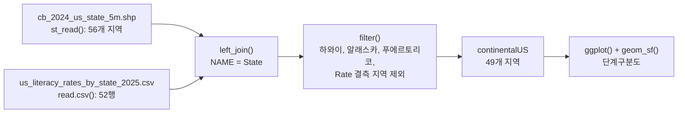

# 6장 — 고급 시각화

[레포지토리 안내](../../README.ko.md) | [English](Concepts_Lecture.md) | [한국어](Concepts_Lecture.ko.md)

> **최종 수정일:** 2026-10-26
>
> Modern Data Visualization with R, Kabacoff, Ch 5, 6, 7, 8

> **학습 목표:**
> 1. 병렬 막대 그래프, 밀도 그래프, 상자 그림, 능선 그래프, 스트립 그래프로 범주와 분포를 비교할 수 있다
> 2. 색상, 모양, 크기 매핑과 적합선으로 여러 변수의 관계를 한 그래프에 나타낼 수 있다
> 3. 패싯을 사용하여 다중 패널 그래프를 구성할 수 있다
> 4. sf와 mapview로 인터랙티브 지도를 만들고, 단계구분도로 지역별 값을 나타낼 수 있다
> 5. 덤벨 차트, 기울기 그래프, 영역 차트, 스트림 그래프로 시간에 따른 변화를 나타낼 수 있다
> 6. 척도, 레이블, 테마를 지정하여 출판 품질의 그래프를 만들 수 있다

---

## 목차

- [1. 그룹화된 막대 그래프](#1-그룹화된-막대-그래프)
  - [1.1 병렬 막대 그래프](#11-병렬-막대-그래프)
- [2. 고급 미적 요소를 활용한 산점도](#2-고급-미적-요소를-활용한-산점도)
  - [2.1 커스터마이징된 산점도](#21-커스터마이징된-산점도)
  - [2.2 주요 미적 요소 매개변수](#22-주요-미적-요소-매개변수)
- [3. 선 그래프](#3-선-그래프)
  - [3.1 시계열 선 그래프](#31-시계열-선-그래프)
- [4. 분포 그래프](#4-분포-그래프)
  - [4.1 그룹별 커널 밀도 그래프](#41-그룹별-커널-밀도-그래프)
  - [4.2 병렬 상자 그림](#42-병렬-상자-그림)
  - [4.3 능선 그래프(Ridgeline Plot)](#43-능선-그래프ridgeline-plot)
  - [4.4 스트립 그래프(지터링)](#44-스트립-그래프지터링)
- [5. 그룹화 및 다변량 시각화](#5-그룹화-및-다변량-시각화)
  - [5.1 그룹별 색상 매핑](#51-그룹별-색상-매핑)
  - [5.2 색상 + 모양 매핑](#52-색상--모양-매핑)
  - [5.3 색상 + 크기 매핑](#53-색상--크기-매핑)
  - [5.4 적합선이 포함된 산점도](#54-적합선이-포함된-산점도)
- [6. 패싯을 활용한 다중 패널 그래프](#6-패싯을-활용한-다중-패널-그래프)
  - [6.1 그룹별 히스토그램](#61-그룹별-히스토그램)
  - [6.2 적합선이 포함된 패싯 산점도](#62-적합선이-포함된-패싯-산점도)
  - [6.3 다국가 기대수명](#63-다국가-기대수명)
- [7. GIS 시각화](#7-gis-시각화)
  - [7.1 mapview를 활용한 인터랙티브 지도](#71-mapview를-활용한-인터랙티브-지도)
  - [7.2 국가별 단계구분도(Choropleth Map)](#72-국가별-단계구분도choropleth-map)
  - [7.3 셰이프파일을 활용한 미국 주별 단계구분도](#73-셰이프파일을-활용한-미국-주별-단계구분도)
- [8. 시간 기반 시각화](#8-시간-기반-시각화)
  - [8.1 평활화를 적용한 시계열](#81-평활화를-적용한-시계열)
  - [8.2 덤벨 차트](#82-덤벨-차트)
  - [8.3 기울기 그래프(Slope Graph)](#83-기울기-그래프slope-graph)
  - [8.4 영역 차트 및 스트림 그래프](#84-영역-차트-및-스트림-그래프)
- [요약](#요약)
- [점검 문제](#점검-문제)

---

<br>

## 1. 그룹화된 막대 그래프

### 1.1 병렬 막대 그래프

`position = "dodge"`를 사용하면 막대를 쌓지 않고 나란히 배치할 수 있다:

```r
library(ggplot2)

ggplot(mpg, aes(x = class, fill = drv)) +
  geom_bar(position = "dodge")
```

이 그래프는 각 차량 유형 내에서 구동 방식(전륜, 후륜, 4WD)의 분포를 보여 준다. `drv`의 값 `f`, `r`, `4`가 각각 전륜, 후륜, 사륜 구동이며, 기본값 `position = "stack"`은 같은 자료를 한 막대에 쌓는다. 한 차량 유형에 없는 구동 방식은 자리가 비지 않고 남은 막대가 넓어지므로(예: 후륜만 있는 `2seater`), 막대 너비를 같게 유지하려면 `position_dodge(preserve = "single")`을 쓴다.

---

<br>

## 2. 고급 미적 요소를 활용한 산점도

### 2.1 커스터마이징된 산점도

`carData` 패키지의 `Salaries`는 2008~2009학년도 미국 한 대학의 조교수, 부교수, 교수 397명의 9개월 급여 자료이다. `rank`는 직급, `discipline`은 학과 유형(A: 이론, B: 응용), `yrs.since.phd`는 박사 학위 취득 후 연수, `yrs.service`는 재직 연수, `sex`는 성별, `salary`는 급여(달러)이다.

```r
library(ggplot2)
data(Salaries, package = "carData")

ggplot(Salaries,
       aes(x = yrs.since.phd, y = salary)) +
  geom_point(color = "cornflowerblue", size = 2, alpha = 0.8) +
  scale_y_continuous(label = scales::dollar, limits = c(50000, 250000)) +
  scale_x_continuous(breaks = seq(0, 60, 10), limits = c(0, 60)) +
  labs(x = "Years Since PhD",
       y = "",
       title = "Experience vs. Salary",
       subtitle = "9-month salary for 2008-2009")
```

`label = scales::dollar`은 `labels` 인수를 부분 일치로 지정한 것으로, y축 눈금을 `$100,000`처럼 달러 형식으로 표시한다. `limits`는 축의 범위를, `breaks`는 눈금의 위치를 정한다. `labs()`는 축 제목, 제목, 부제목을 지정하며, `y = ""`는 y축 제목을 비운다.

### 2.2 주요 미적 요소 매개변수

| 매개변수 | 설명 | 예시 |
|----------|------|------|
| `color` | 점이나 선의 색상 | `"cornflowerblue"` |
| `size` | 점 크기 | `2` (기본값: 1.5) |
| `alpha` | 투명도 (0~1) | `0.8` |
| `shape` | 점 모양 | `16` (채워진 원) |

*표 1. 산점도의 주요 미적 요소 매개변수*

2.1절의 코드는 이 값들을 `aes()` 밖에 지정했으므로, 5장 4절에서 본 것처럼 모든 점에 같은 고정값이 적용된다.

---

<br>

## 3. 선 그래프

### 3.1 시계열 선 그래프

`gapminder` 패키지의 `gapminder`는 142개국의 기대수명(`lifeExp`), 인구, 1인당 GDP를 1952년부터 2007년까지 5년 간격으로 담은 자료이다. `filter()`는 dplyr의 함수이므로 `library(dplyr)`로 패키지를 먼저 불러온다.

```r
data(gapminder, package = "gapminder")
library(dplyr)
plotdata <- filter(gapminder, country == "United States")

ggplot(plotdata, aes(x = year, y = lifeExp)) +
  geom_line(linewidth = 1.5, color = "lightgrey") +
  geom_point(size = 3, color = "steelblue") +
  labs(y = "Life Expectancy (years)",
       x = "Year",
       title = "Life expectancy changes over time",
       subtitle = "United States (1952-2007)",
       caption = "Source: http://www.gapminder.org/data/")
```

레이어는 코드에 쓴 순서대로 그려지므로, 나중에 더한 `geom_point()`의 점이 연한 회색 선 위에 놓인다.

> **핵심:** `geom_line()`과 `geom_point()`를 결합하면 추세와 개별 데이터 포인트를 모두 보여 주는 효과적인 시각화를 만들 수 있다.

---

<br>

## 4. 분포 그래프

### 4.1 그룹별 커널 밀도 그래프

`geom_density()`는 커널 밀도 추정으로 분포를 매끄러운 곡선으로 그리고, `alpha = 0.4`는 겹친 부분도 보이도록 반투명하게 칠한다.

```r
data(Salaries, package = "carData")

ggplot(Salaries, aes(x = salary, fill = rank)) +
  geom_density(alpha = 0.4) +
  labs(title = "Salary distribution by rank")
```

### 4.2 병렬 상자 그림

```r
ggplot(Salaries, aes(x = rank, y = salary)) +
  geom_boxplot() +
  labs(title = "Salary distribution by rank")
```

### 4.3 능선 그래프(Ridgeline Plot)

능선 그래프는 그룹마다 밀도 곡선을 세로로 조금씩 어긋나게 겹쳐 놓아 많은 그룹의 분포를 한눈에 비교한다. `cty`는 도시 주행 연비(갤런당 마일)이다.

```r
library(ggridges)

ggplot(mpg, aes(x = cty, y = class, fill = class)) +
  geom_density_ridges() +
  theme_ridges() +
  labs(title = "City mileage by auto class") +
  theme(legend.position = "none")
```

### 4.4 스트립 그래프(지터링)

`geom_jitter()`는 점의 위치를 무작위로 조금씩 흩뜨려 겹친 점이 보이게 한다. `factor(rank, labels = ...)`는 직급 이름을 두 줄짜리 이름으로 바꾸며, `\n`은 줄바꿈 문자이다.

```r
library(scales)

ggplot(Salaries,
       aes(y = factor(rank,
                      labels = c("Assistant\nProfessor",
                                 "Associate\nProfessor",
                                 "Full\nProfessor")),
           x = salary, color = rank)) +
  geom_jitter(alpha = 0.7) +
  scale_x_continuous(label = dollar) +
  labs(title = "Academic Salary by Rank",
       subtitle = "9-month salary for 2008-2009",
       x = "", y = "") +
  theme_minimal() +
  theme(legend.position = "none")
```

---

<br>

## 5. 그룹화 및 다변량 시각화

### 5.1 그룹별 색상 매핑

```r
ggplot(Salaries, aes(x = yrs.since.phd, y = salary, color = rank)) +
  geom_point() +
  labs(title = "Academic salary by rank and years since degree")
```

### 5.2 색상 + 모양 매핑

```r
ggplot(Salaries, aes(x = yrs.since.phd, y = salary,
                     color = rank, shape = sex)) +
  geom_point(size = 3, alpha = 0.6) +
  labs(title = "Academic salary by rank, sex, and years since degree")
```

### 5.3 색상 + 크기 매핑

```r
ggplot(Salaries, aes(x = yrs.since.phd, y = salary,
                     color = rank, size = yrs.service)) +
  geom_point(alpha = 0.6) +
  labs(title = "Academic salary by rank, years of service, and years since degree")
```

이처럼 위치(x, y)와 색상, 모양, 크기에 서로 다른 변수를 매핑하면 한 그래프에 넷 이상의 변수를 나타낼 수 있다. 다만 매핑이 많아질수록 그래프를 읽기 어려워진다.

### 5.4 적합선이 포함된 산점도

`method = "lm"`과 `formula = y ~ poly(x, 2)`는 그룹마다 2차 다항 회귀 곡선을 적합하고, `se = FALSE`는 신뢰 구간 띠를 그리지 않는다. `color = sex`가 `ggplot()`의 `aes()`에 있으므로 점과 적합선이 모두 성별로 나뉜다.

```r
ggplot(Salaries,
       aes(x = yrs.since.phd, y = salary, color = sex)) +
  geom_point(alpha = 0.4, size = 3) +
  geom_smooth(se = FALSE, method = "lm",
              formula = y ~ poly(x, 2), linewidth = 1.5) +
  labs(x = "Years Since Ph.D.",
       title = "Academic Salary by Sex and Years Experience",
       subtitle = "9-month salary for 2008-2009",
       y = "", color = "Sex") +
  scale_y_continuous(label = scales::dollar) +
  scale_color_brewer(palette = "Set1") +
  theme_minimal()
```

---

<br>

## 6. 패싯을 활용한 다중 패널 그래프

### 6.1 그룹별 히스토그램

`facet_wrap(~rank, ncol = 1)`은 직급마다 히스토그램을 하나씩 만들어 한 열로 쌓는다. `geom_histogram()`은 구간 수를 지정하지 않으면 `bins = 30`을 쓰고, 더 나은 값을 고르라는 메시지를 출력한다.

```r
ggplot(Salaries, aes(x = salary)) +
  geom_histogram() +
  facet_wrap(~rank, ncol = 1) +
  labs(title = "Salary histograms by rank")
```

### 6.2 적합선이 포함된 패싯 산점도

`discipline`의 수준 A와 B는 각각 이론 학과와 응용 학과이므로, `labels`로 이름을 바꾸어 패싯 제목에 쓴다. `geom_smooth(method = "lm")`은 패싯과 성별마다 직선 회귀선을 그린다.

```r
ggplot(Salaries, aes(x = yrs.since.phd, y = salary, color = sex)) +
  geom_point(size = 2, alpha = 0.5) +
  geom_smooth(method = "lm", se = FALSE, linewidth = 1.5) +
  facet_wrap(~factor(discipline,
                     labels = c("Theoretical", "Applied")),
             ncol = 1) +
  scale_y_continuous(labels = scales::dollar) +
  theme_minimal() +
  scale_color_brewer(palette = "Set1") +
  labs(title = "Relationship of salary and years since degree by sex and discipline",
       subtitle = "9-month salary for 2008-2009",
       color = "Gender",
       x = "Years since Ph.D.",
       y = "Academic Salary")
```

### 6.3 다국가 기대수명

`facet_wrap(~country)`는 아메리카 대륙 25개국마다 패널을 하나씩 만든다. `theme_minimal(base_size = 9)`는 글자 크기를 줄이고, `element_text(angle = 45, hjust = 1)`은 x축 눈금 글자를 45도 기울인다.

```r
data(gapminder, package = "gapminder")
plotdata <- dplyr::filter(gapminder, continent == "Americas")

ggplot(plotdata, aes(x = year, y = lifeExp)) +
  geom_line(color = "grey") +
  geom_point(color = "blue") +
  facet_wrap(~country) +
  theme_minimal(base_size = 9) +
  theme(axis.text.x = element_text(angle = 45, hjust = 1)) +
  labs(title = "Changes in Life Expectancy",
       x = "Year",
       y = "Life Expectancy")
```

---

<br>

## 7. GIS 시각화

### 7.1 mapview를 활용한 인터랙티브 지도

`ggmap` 패키지의 `crime`은 2010년 1~8월 미국 휴스턴의 범죄 기록 86,314건이며, 아래 코드는 그중 `offense`가 `murder`인 157건을 고른다. `st_as_sf()`는 경도(`lon`)와 위도(`lat`) 열을 점 도형으로 바꾸어 sf 객체를 만들고, `crs = 4326`은 좌표가 WGS 84 경위도 좌표계(EPSG:4326)임을 지정한다. `mapview()`는 Leaflet 기반의 인터랙티브 지도를 띄우며, 지도를 확대하고 이동하거나 점을 눌러 속성을 볼 수 있다.

```r
library(ggmap)
library(dplyr)
library(mapview)
library(sf)

homicide <- filter(crime, offense == "murder") %>%
  select(date, offense, address, lon, lat)

mymap <- st_as_sf(homicide, coords = c("lon", "lat"), crs = 4326)
mapview(mymap)
```

### 7.2 국가별 단계구분도(Choropleth Map)

`country_choropleth()`는 `region`과 `value` 두 열을 가진 데이터를 받아 국가마다 색을 칠한다. 그래서 `rename()`으로 `country`를 `region`으로, `lifeExp`를 `value`로 바꾸고, `tolower()`로 국가 이름을 소문자로 바꾸어 패키지의 지역 이름 형식에 맞춘다. `num_colors = 9`는 값을 9개 구간으로 나누어 칠하고, `scale_fill_brewer(palette = "YlOrRd")`는 노랑에서 빨강으로 이어지는 색 구성을 쓴다.

```r
library(choroplethr)
data(gapminder, package = "gapminder")

plotdata <- gapminder %>%
  filter(year == 2007) %>%
  rename(region = country, value = lifeExp) %>%
  mutate(region = tolower(region))

country_choropleth(plotdata, num_colors = 9) +
  scale_fill_brewer(palette = "YlOrRd") +
  labs(title = "Life expectancy by country",
       subtitle = "Gapminder 2007 data",
       fill = "Years")
```

> **참고:** **국가 이름 맞추기.** gapminder의 국가 이름 가운데 `"united states"`, `"korea, rep."`처럼 choroplethr의 지역 이름과 표기가 다른 국가는 짝을 찾지 못해 지도에서 빈칸으로 남고, 그 목록이 콘솔에 출력된다. 아래 코드는 `recode()`로 이름을 맞추는 단계를 더한 수정 버전이며, 그 뒤의 `country_choropleth()` 호출은 위와 같다. 바레인, 싱가포르처럼 지도에 지역이 없는 작은 국가는 이름을 맞추어도 칠해지지 않는다.

```r
data(country.map, package = "choroplethrMaps")   # 지역 이름 확인용

plotdata <- gapminder %>%
  filter(year == 2007) %>%
  rename(region = country, value = lifeExp) %>%
  mutate(region = tolower(region)) %>%
  mutate(region =
           recode(region,
                  "united states"    = "united states of america",
                  "congo, dem. rep." = "democratic republic of the congo",
                  "congo, rep."      = "republic of congo",
                  "korea, dem. rep." = "north korea",
                  "korea, rep."      = "south korea",
                  "tanzania"         = "united republic of tanzania",
                  "serbia"           = "republic of serbia",
                  "slovak republic"  = "slovakia",
                  "yemen, rep."      = "yemen"))
```

### 7.3 셰이프파일을 활용한 미국 주별 단계구분도

셰이프파일(shapefile)은 도형을 담은 `.shp`와 함께 `.shx`(도형 색인), `.dbf`(속성 표), `.prj`(좌표계) 같은 파일이 한 묶음으로 같은 폴더에 있어야 한다. `st_read()`는 이 묶음을 읽어 지역마다 한 행인 sf 객체를 만든다. `cb_2024_us_state_5m`은 미국 인구조사국의 2024년 주 경계 파일로, 50개 주와 워싱턴 D.C., 푸에르토리코를 비롯한 5개 자치령을 합한 56개 지역을 담는다.

```r
library(tidyverse)
library(sf)

USMap <- st_read("data/cb_2024_us_state_5m.shp")
litRates <- read.csv("data/us_literacy_rates_by_state_2025.csv")

continentalUS <- USMap %>%
  left_join(litRates, by = c("NAME" = "State")) %>%
  filter(NAME != "Hawaii" & NAME != "Alaska" &
         NAME != "Puerto Rico" & !is.na(Rate))

ggplot(continentalUS, aes(geometry = geometry, fill = Rate)) +
  geom_sf() +
  coord_sf()
```

`left_join()`은 지도의 주 이름 열 `NAME`과 CSV의 `State` 열을 키로 삼아 `Rate` 열을 붙이며, 왼쪽 데이터가 sf 객체이므로 결과도 sf 객체이다. `filter()`는 본토에서 떨어진 하와이, 알래스카, 푸에르토리코와 `Rate`가 없는 지역을 빼므로 본토 48개 주와 워싱턴 D.C.의 49개 지역이 남는다. `geom_sf()`는 각 행의 `geometry` 열에 담긴 도형을 그리고, `fill = Rate`는 값에 따라 색을 칠한다.



*그림 1. 셰이프파일과 CSV를 결합하여 단계구분도를 그리는 과정*

---

<br>

## 8. 시간 기반 시각화

### 8.1 평활화를 적용한 시계열

`geom_smooth()`는 방법을 지정하지 않으면 자료가 1,000개 미만일 때 LOESS(국소 회귀)를 쓰므로, 574개월 자료인 `economics`에는 LOESS 곡선과 신뢰 구간 띠가 그려진다. `date_breaks = "5 years"`는 5년마다 눈금을 두고, `date_format("%b-%y")`는 눈금을 월 약칭과 두 자리 연도로 표시한다.

```r
library(scales)

ggplot(economics, aes(x = date, y = psavert)) +
  geom_line(color = "indianred3", linewidth = 1) +
  geom_smooth() +
  scale_x_date(date_breaks = "5 years", labels = date_format("%b-%y")) +
  labs(title = "Personal Savings Rate",
       subtitle = "1967 to 2015",
       x = "", y = "Personal Savings Rate") +
  theme_minimal()
```

### 8.2 덤벨 차트

`pivot_wider()`는 국가와 연도마다 한 행인 긴 형식의 자료를 연도를 열로 펼친 넓은 형식으로 바꾼다. 열 이름을 `y1952`, `y2007`로 바꾸는 이유는 숫자로 시작하는 열 이름을 `aes()`에서 백틱 없이 쓰기 위해서이다. `geom_dumbbell()`은 `x`에서 `xend`까지 선으로 이어 두 시점의 값을 비교한다.

```r
library(ggalt)
library(tidyr)

plotdata_long <- filter(gapminder,
  continent == "Americas" & year %in% c(1952, 2007)) %>%
  select(country, year, lifeExp)

plotdata_wide <- pivot_wider(plotdata_long,
  names_from = year, values_from = lifeExp)
names(plotdata_wide) <- c("country", "y1952", "y2007")

ggplot(plotdata_wide, aes(y = country, x = y1952, xend = y2007)) +
  geom_dumbbell()
```

### 8.3 기울기 그래프(Slope Graph)

`newggslopegraph()`는 데이터, 시점 열, 값 열, 그룹 열을 차례로 받아 시점마다 값을 세로로 놓고 그룹별로 선을 잇는다. `year`를 factor로 바꾸는 것은 시점을 범주로 다루기 위해서이고, `lifeExp`를 반올림하는 것은 그래프에 표시되는 값을 정수로 만들기 위해서이다.

```r
library(CGPfunctions)

df <- gapminder %>%
  filter(year %in% c(1992, 1997, 2002, 2007) &
         country %in% c("Panama", "Costa Rica", "Nicaragua",
                         "Honduras", "El Salvador", "Guatemala", "Belize")) %>%
  mutate(year = factor(year), lifeExp = round(lifeExp))

newggslopegraph(df, year, lifeExp, country) +
  labs(title = "Life Expectancy by Country",
       subtitle = "Central America",
       caption = "source: gapminder")
```

### 8.4 영역 차트 및 스트림 그래프

`geom_area()`는 선 아래를 칠해 값의 크기를 면적으로 보인다. 스트림 그래프는 여러 그룹의 영역을 가운데 축을 중심으로 위아래로 쌓아 흐름처럼 보이게 한다. `uspopage`는 1900~2002년 미국 인구를 연령대별로 천 명 단위로 담은 자료이며, `Thousands/1000`은 백만 명 단위로 바꾼 값이다. `fct_rev()`는 연령대의 순서를 뒤집어 쌓는 순서와 범례 순서를 바꾼다.

```r
# 영역 차트
ggplot(economics, aes(x = date, y = psavert)) +
  geom_area(fill = "lightblue", color = "black") +
  labs(title = "Personal Savings Rate", x = "Date", y = "Personal Savings Rate")

# 스트림 그래프
library(ggstream)
data(uspopage, package = "gcookbook")

ggplot(uspopage, aes(x = Year, y = Thousands/1000,
                     fill = forcats::fct_rev(AgeGroup))) +
  geom_stream() +
  labs(title = "US Population by age", subtitle = "1900 to 2002",
       x = "Year", y = "", fill = "Age Group") +
  scale_fill_brewer(palette = "Set2") +
  theme_minimal()
```

---

<br>

## 요약

| 개념 | 핵심 요약 |
|------|-----------|
| 그룹화된 막대 그래프 | `position = "dodge"`로 막대를 쌓지 않고 나란히 놓는다. |
| 다변량 미적 요소 | 변수를 color, shape, size, alpha에 동시에 매핑하여 여러 변수를 한 그래프에 나타낸다. |
| 패싯(Faceting) | `facet_wrap()`으로 범주형 변수의 값마다 하위 그래프를 만든다. |
| 분포 그래프 | 밀도 그래프, 상자 그림, 능선 그래프, 스트립(지터) 그래프로 분포를 비교한다. |
| `geom_smooth()` | 선형, 다항, LOESS 같은 적합선을 추가한다. |
| GIS 지도 | `sf`와 `mapview`로 인터랙티브 지도를, `geom_sf()`로 정적 지도를 그린다. |
| 단계구분도(Choropleth) | 데이터 변수의 값에 따라 지리적 영역을 색으로 채운다. |
| 시간 시각화 | 덤벨 차트, 기울기 그래프, 영역 차트, 스트림 그래프로 시간에 따른 변화를 나타낸다. |
| `theme_minimal()` | 출판 품질의 그래프에 어울리는 깔끔하고 간결한 테마이다. |

---

<br>

## 점검 문제

1. **dodge와 stack:** `ggplot(mpg, aes(x = class, fill = drv)) + geom_bar()`와 `geom_bar(position = "dodge")`를 쓴 그래프의 차이를 설명하라.

   <details>
   <summary>정답</summary>

   기본값 `position = "stack"`은 한 차량 유형의 구동 방식별 개수를 한 막대에 쌓으므로, 막대 전체의 높이가 그 유형의 차량 수가 된다. `position = "dodge"`는 구동 방식별 막대를 나란히 놓으므로, 한 유형 안에서 구동 방식끼리 개수를 직접 비교하기 쉽다.

   </details>

2. **2차 적합선:** 5.4절의 `geom_smooth(se = FALSE, method = "lm", formula = y ~ poly(x, 2))`가 그리는 선을 설명하고, 적합선이 두 개 그려지는 이유를 쓰라.

   <details>
   <summary>정답</summary>

   각 그룹에서 `salary`를 `yrs.since.phd`의 2차 다항식 $y = \beta_0 + \beta_1 x + \beta_2 x^2$으로 최소제곱 회귀한 곡선이며, `se = FALSE`이므로 신뢰 구간 띠는 그리지 않는다. `color = sex`가 `ggplot()`의 `aes()`에 있어 모든 레이어에 적용되므로 자료가 성별(Female, Male)로 나뉘고, 그룹마다 곡선이 하나씩 그려진다.

   </details>

3. **패싯 개수:** `Salaries`의 `rank`는 AsstProf, AssocProf, Prof 세 수준을 가진다. 6.1절의 `facet_wrap(~rank, ncol = 1)`이 만드는 패널의 수와 배치를 쓰라.

   <details>
   <summary>정답</summary>

   `rank`의 수준마다 패널이 하나씩 생기므로 패널은 3개이다. `ncol = 1`이므로 세 패널이 한 열로 위아래로 쌓인다.

   </details>

4. **긴 형식과 넓은 형식:** `gapminder`의 아메리카 대륙 국가는 25개이다. 8.2절의 `plotdata_long`과 `plotdata_wide`의 행 수와 열을 각각 쓰라.

   <details>
   <summary>정답</summary>

   `plotdata_long`은 국가마다 1952년과 2007년의 두 행이 있으므로 $25 \times 2 = 50$행이고, 열은 `country`, `year`, `lifeExp` 세 개이다. `plotdata_wide`는 국가마다 한 행이므로 25행이고, 열은 `country`, `1952`, `2007` 세 개이며 이름을 바꾼 뒤에는 `country`, `y1952`, `y2007`이 된다.

   </details>

5. **지도 결합과 필터:** `cb_2024_us_state_5m`에는 50개 주, 워싱턴 D.C., 5개 자치령의 56개 지역이 있고, CSV에는 50개 주, 워싱턴 D.C., `United States`의 52행이 있다. `continentalUS`에 남는 지역 수를 구하고, `!is.na(Rate)` 조건이 필요한 이유를 쓰라.

   <details>
   <summary>정답</summary>

   `left_join()`은 지도의 56개 지역을 모두 유지하고, CSV에 없는 5개 자치령은 `Rate`가 `NA`가 된다. `filter()`가 하와이, 알래스카, 푸에르토리코와 `Rate`가 `NA`인 나머지 자치령을 빼므로, 본토 48개 주와 워싱턴 D.C.의 49개 지역이 남는다. `!is.na(Rate)`가 없으면 괌 같은 자치령이 결측값의 회색으로 함께 그려져 지도의 범위가 태평양까지 넓어진다.

   </details>
