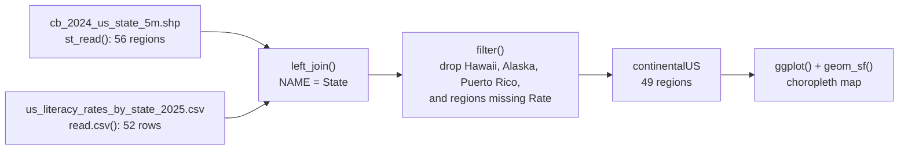

# Chapter 6 — Advanced Visualization

[Repository Guide](../../README.md) | [English](Concepts_Lecture.md) | [한국어](Concepts_Lecture.ko.md)

> **Last Updated:** 2026-10-18
>
> Modern Data Visualization with R, Kabacoff, Ch 5, 6, 7, 8

> **Learning Objectives:**
> 1. Compare categories and distributions with side-by-side bar charts, density plots, box plots, ridgeline plots, and strip plots
> 2. Show the relationships among several variables in one plot with color, shape, and size mappings and fitted lines
> 3. Build multi-panel plots using faceting
> 4. Create interactive maps with sf and mapview, and show regional values with choropleth maps
> 5. Show change over time with dumbbell charts, slope graphs, area charts, and stream graphs
> 6. Produce publication-quality plots by specifying scales, labels, and themes

---

## Table of Contents

- [1. Grouped Bar Charts](#1-grouped-bar-charts)
  - [1.1 Side-by-Side Bar Chart](#11-side-by-side-bar-chart)
- [2. Scatter Plots with Advanced Aesthetics](#2-scatter-plots-with-advanced-aesthetics)
  - [2.1 Customized Scatter Plot](#21-customized-scatter-plot)
  - [2.2 Key Aesthetic Parameters](#22-key-aesthetic-parameters)
- [3. Line Plots](#3-line-plots)
  - [3.1 Time Series Line Plot](#31-time-series-line-plot)
- [4. Distribution Plots](#4-distribution-plots)
  - [4.1 Grouped Kernel Density Plots](#41-grouped-kernel-density-plots)
  - [4.2 Side-by-Side Box Plots](#42-side-by-side-box-plots)
  - [4.3 Ridgeline Plots](#43-ridgeline-plots)
  - [4.4 Strip Plots (Jittered)](#44-strip-plots-jittered)
- [5. Grouping and Multi-Variable Visualization](#5-grouping-and-multi-variable-visualization)
  - [5.1 Color Mapping by Group](#51-color-mapping-by-group)
  - [5.2 Color + Shape Mapping](#52-color--shape-mapping)
  - [5.3 Color + Size Mapping](#53-color--size-mapping)
  - [5.4 Scatter Plot with Fit Lines](#54-scatter-plot-with-fit-lines)
- [6. Faceting for Multi-Panel Plots](#6-faceting-for-multi-panel-plots)
  - [6.1 Histograms by Group](#61-histograms-by-group)
  - [6.2 Faceted Scatter Plot with Fit Lines](#62-faceted-scatter-plot-with-fit-lines)
  - [6.3 Multi-Country Life Expectancy](#63-multi-country-life-expectancy)
- [7. GIS Visualization](#7-gis-visualization)
  - [7.1 Interactive Maps with mapview](#71-interactive-maps-with-mapview)
  - [7.2 Choropleth Maps by Country](#72-choropleth-maps-by-country)
  - [7.3 US State Choropleth with Shapefiles](#73-us-state-choropleth-with-shapefiles)
- [8. Time-Based Visualization](#8-time-based-visualization)
  - [8.1 Time Series with Smoothing](#81-time-series-with-smoothing)
  - [8.2 Dumbbell Charts](#82-dumbbell-charts)
  - [8.3 Slope Graphs](#83-slope-graphs)
  - [8.4 Area Charts and Stream Graphs](#84-area-charts-and-stream-graphs)
- [Summary](#summary)
- [Self-Check Questions](#self-check-questions)

---

<br>

## 1. Grouped Bar Charts

### 1.1 Side-by-Side Bar Chart

Use `position = "dodge"` to place bars side by side instead of stacking:

```r
library(ggplot2)

ggplot(mpg, aes(x = class, fill = drv)) +
  geom_bar(position = "dodge")
```

This shows the distribution of drive types (front, rear, 4WD) within each vehicle class. The `drv` values `f`, `r`, and `4` stand for front-wheel, rear-wheel, and four-wheel drive, and the default `position = "stack"` stacks the same data in one bar. A drive type missing from a vehicle class leaves no gap; instead the remaining bars become wider (e.g., `2seater`, which has only rear-wheel drive), so `position_dodge(preserve = "single")` keeps bar widths equal.

---

<br>

## 2. Scatter Plots with Advanced Aesthetics

### 2.1 Customized Scatter Plot

`Salaries` in the `carData` package holds the nine-month salaries of 397 assistant professors, associate professors, and professors at a US college in the 2008-2009 academic year. `rank` is the academic rank, `discipline` is the department type (A: theoretical, B: applied), `yrs.since.phd` is the years since the PhD, `yrs.service` is the years of service, `sex` is the sex, and `salary` is the salary (in dollars).

```r
library(ggplot2)
data(Salaries, package = "carData")

ggplot(Salaries,
       aes(x = yrs.since.phd, y = salary)) +
  geom_point(color = "cornflowerblue", size = 2, alpha = 0.8) +
  scale_y_continuous(label = scales::dollar, limits = c(50000, 250000)) +
  scale_x_continuous(breaks = seq(0, 60, 10), limits = c(0, 60)) +
  labs(x = "Years Since PhD",
       y = "",
       title = "Experience vs. Salary",
       subtitle = "9-month salary for 2008-2009")
```

`label = scales::dollar` specifies the `labels` argument through partial matching and formats the y-axis ticks as dollars, such as `$100,000`. `limits` sets the axis range, and `breaks` sets the tick positions. `labs()` sets the axis titles, title, and subtitle, and `y = ""` leaves the y-axis title empty.

### 2.2 Key Aesthetic Parameters

| Parameter | Description | Example |
|-----------|-------------|---------|
| `color` | Point or line color | `"cornflowerblue"` |
| `size` | Point size | `2` (default: 1.5) |
| `alpha` | Transparency (0-1) | `0.8` |
| `shape` | Point shape | `16` (filled circle) |

*Table 1. Key aesthetic parameters of a scatter plot*

The code in Section 2.1 sets these values outside `aes()`, so, as shown in Chapter 5, Section 4, the same constant applies to every point.

---

<br>

## 3. Line Plots

### 3.1 Time Series Line Plot

`gapminder` in the `gapminder` package holds the life expectancy (`lifeExp`), population, and GDP per capita of 142 countries from 1952 to 2007 at five-year intervals. `filter()` is a dplyr function, so the package is loaded first with `library(dplyr)`.

```r
data(gapminder, package = "gapminder")
library(dplyr)
plotdata <- filter(gapminder, country == "United States")

ggplot(plotdata, aes(x = year, y = lifeExp)) +
  geom_line(linewidth = 1.5, color = "lightgrey") +
  geom_point(size = 3, color = "steelblue") +
  labs(y = "Life Expectancy (years)",
       x = "Year",
       title = "Life expectancy changes over time",
       subtitle = "United States (1952-2007)",
       caption = "Source: http://www.gapminder.org/data/")
```

Layers are drawn in the order they appear in the code, so the points of the later `geom_point()` sit on top of the light grey line.

> **Key Point:** Combining `geom_line()` and `geom_point()` creates an effective visualization that shows both the trend and individual data points.

---

<br>

## 4. Distribution Plots

### 4.1 Grouped Kernel Density Plots

`geom_density()` draws a distribution as a smooth curve by kernel density estimation, and `alpha = 0.4` fills it semi-transparently so that overlapping parts remain visible.

```r
data(Salaries, package = "carData")

ggplot(Salaries, aes(x = salary, fill = rank)) +
  geom_density(alpha = 0.4) +
  labs(title = "Salary distribution by rank")
```

### 4.2 Side-by-Side Box Plots

```r
ggplot(Salaries, aes(x = rank, y = salary)) +
  geom_boxplot() +
  labs(title = "Salary distribution by rank")
```

### 4.3 Ridgeline Plots

A ridgeline plot overlaps the density curves of the groups with a small vertical offset, so that the distributions of many groups can be compared at a glance. `cty` is the city fuel economy (miles per gallon).

```r
library(ggridges)

ggplot(mpg, aes(x = cty, y = class, fill = class)) +
  geom_density_ridges() +
  theme_ridges() +
  labs(title = "City mileage by auto class") +
  theme(legend.position = "none")
```

### 4.4 Strip Plots (Jittered)

`geom_jitter()` scatters point positions slightly at random so that overlapping points become visible. `factor(rank, labels = ...)` replaces the rank names with two-line names, and `\n` is the newline character.

```r
library(scales)

ggplot(Salaries,
       aes(y = factor(rank,
                      labels = c("Assistant\nProfessor",
                                 "Associate\nProfessor",
                                 "Full\nProfessor")),
           x = salary, color = rank)) +
  geom_jitter(alpha = 0.7) +
  scale_x_continuous(label = dollar) +
  labs(title = "Academic Salary by Rank",
       subtitle = "9-month salary for 2008-2009",
       x = "", y = "") +
  theme_minimal() +
  theme(legend.position = "none")
```

---

<br>

## 5. Grouping and Multi-Variable Visualization

### 5.1 Color Mapping by Group

```r
ggplot(Salaries, aes(x = yrs.since.phd, y = salary, color = rank)) +
  geom_point() +
  labs(title = "Academic salary by rank and years since degree")
```

### 5.2 Color + Shape Mapping

```r
ggplot(Salaries, aes(x = yrs.since.phd, y = salary,
                     color = rank, shape = sex)) +
  geom_point(size = 3, alpha = 0.6) +
  labs(title = "Academic salary by rank, sex, and years since degree")
```

### 5.3 Color + Size Mapping

```r
ggplot(Salaries, aes(x = yrs.since.phd, y = salary,
                     color = rank, size = yrs.service)) +
  geom_point(alpha = 0.6) +
  labs(title = "Academic salary by rank, years of service, and years since degree")
```

Mapping different variables to position (x, y), color, shape, and size in this way shows four or more variables in one plot. The more mappings there are, however, the harder the plot becomes to read.

### 5.4 Scatter Plot with Fit Lines

`method = "lm"` with `formula = y ~ poly(x, 2)` fits a quadratic polynomial regression curve for each group, and `se = FALSE` omits the confidence band. Because `color = sex` is in the `aes()` of `ggplot()`, both the points and the fitted lines are split by sex.

```r
ggplot(Salaries,
       aes(x = yrs.since.phd, y = salary, color = sex)) +
  geom_point(alpha = 0.4, size = 3) +
  geom_smooth(se = FALSE, method = "lm",
              formula = y ~ poly(x, 2), linewidth = 1.5) +
  labs(x = "Years Since Ph.D.",
       title = "Academic Salary by Sex and Years Experience",
       subtitle = "9-month salary for 2008-2009",
       y = "", color = "Sex") +
  scale_y_continuous(label = scales::dollar) +
  scale_color_brewer(palette = "Set1") +
  theme_minimal()
```

---

<br>

## 6. Faceting for Multi-Panel Plots

### 6.1 Histograms by Group

`facet_wrap(~rank, ncol = 1)` draws one histogram per rank and stacks them in one column. Without a specified number of bins, `geom_histogram()` uses `bins = 30` and prints a message suggesting a better value.

```r
ggplot(Salaries, aes(x = salary)) +
  geom_histogram() +
  facet_wrap(~rank, ncol = 1) +
  labs(title = "Salary histograms by rank")
```

### 6.2 Faceted Scatter Plot with Fit Lines

The levels A and B of `discipline` stand for theoretical and applied departments, so `labels` renames them for the facet titles. `geom_smooth(method = "lm")` draws a straight regression line for each facet and sex.

```r
ggplot(Salaries, aes(x = yrs.since.phd, y = salary, color = sex)) +
  geom_point(size = 2, alpha = 0.5) +
  geom_smooth(method = "lm", se = FALSE, linewidth = 1.5) +
  facet_wrap(~factor(discipline,
                     labels = c("Theoretical", "Applied")),
             ncol = 1) +
  scale_y_continuous(labels = scales::dollar) +
  theme_minimal() +
  scale_color_brewer(palette = "Set1") +
  labs(title = "Relationship of salary and years since degree by sex and discipline",
       subtitle = "9-month salary for 2008-2009",
       color = "Gender",
       x = "Years since Ph.D.",
       y = "Academic Salary")
```

### 6.3 Multi-Country Life Expectancy

`facet_wrap(~country)` creates one panel for each of the 25 countries in the Americas. `theme_minimal(base_size = 9)` reduces the text size, and `element_text(angle = 45, hjust = 1)` tilts the x-axis tick labels by 45 degrees.

```r
data(gapminder, package = "gapminder")
plotdata <- dplyr::filter(gapminder, continent == "Americas")

ggplot(plotdata, aes(x = year, y = lifeExp)) +
  geom_line(color = "grey") +
  geom_point(color = "blue") +
  facet_wrap(~country) +
  theme_minimal(base_size = 9) +
  theme(axis.text.x = element_text(angle = 45, hjust = 1)) +
  labs(title = "Changes in Life Expectancy",
       x = "Year",
       y = "Life Expectancy")
```

---

<br>

## 7. GIS Visualization

### 7.1 Interactive Maps with mapview

`crime` in the `ggmap` package holds 86,314 crime records from Houston, Texas, from January to August 2010, and the code below selects the 157 records whose `offense` is `murder`. `st_as_sf()` turns the longitude (`lon`) and latitude (`lat`) columns into point geometries to create an sf object, and `crs = 4326` declares that the coordinates are in the WGS 84 longitude-latitude system (EPSG:4326). `mapview()` opens an interactive Leaflet-based map that can be zoomed and panned, and clicking a point shows its attributes.

```r
library(ggmap)
library(dplyr)
library(mapview)
library(sf)

homicide <- filter(crime, offense == "murder") %>%
  select(date, offense, address, lon, lat)

mymap <- st_as_sf(homicide, coords = c("lon", "lat"), crs = 4326)
mapview(mymap)
```

### 7.2 Choropleth Maps by Country

`country_choropleth()` takes data with two columns, `region` and `value`, and colors each country. `rename()` therefore renames `country` to `region` and `lifeExp` to `value`, and `tolower()` converts the country names to lowercase to match the package's region name format. `num_colors = 9` divides the values into 9 classes for coloring, and `scale_fill_brewer(palette = "YlOrRd")` uses a color scheme running from yellow to red.

```r
library(choroplethr)
data(gapminder, package = "gapminder")

plotdata <- gapminder %>%
  filter(year == 2007) %>%
  rename(region = country, value = lifeExp) %>%
  mutate(region = tolower(region))

country_choropleth(plotdata, num_colors = 9) +
  scale_fill_brewer(palette = "YlOrRd") +
  labs(title = "Life expectancy by country",
       subtitle = "Gapminder 2007 data",
       fill = "Years")
```

> **Note:** **Matching country names.** Countries whose gapminder names differ from choroplethr's region names, such as `"united states"` and `"korea, rep."`, find no match, remain blank on the map, and are listed in the console. The code below is a corrected version that adds a step matching the names with `recode()`; the `country_choropleth()` call that follows is the same as above. Small countries without a region on the map, such as Bahrain and Singapore, stay uncolored even after their names are matched.

```r
data(country.map, package = "choroplethrMaps")   # for checking region names

plotdata <- gapminder %>%
  filter(year == 2007) %>%
  rename(region = country, value = lifeExp) %>%
  mutate(region = tolower(region)) %>%
  mutate(region =
           recode(region,
                  "united states"    = "united states of america",
                  "congo, dem. rep." = "democratic republic of the congo",
                  "congo, rep."      = "republic of congo",
                  "korea, dem. rep." = "north korea",
                  "korea, rep."      = "south korea",
                  "tanzania"         = "united republic of tanzania",
                  "serbia"           = "republic of serbia",
                  "slovak republic"  = "slovakia",
                  "yemen, rep."      = "yemen"))
```

### 7.3 US State Choropleth with Shapefiles

A shapefile consists of a `.shp` file with the geometries together with files such as `.shx` (geometry index), `.dbf` (attribute table), and `.prj` (coordinate system), which must sit in the same folder as one set. `st_read()` reads the set into an sf object with one row per region. `cb_2024_us_state_5m` is the 2024 state boundary file of the US Census Bureau and holds 56 regions: the 50 states, Washington, D.C., and 5 territories including Puerto Rico.

```r
library(tidyverse)
library(sf)

USMap <- st_read("data/cb_2024_us_state_5m.shp")
litRates <- read.csv("data/us_literacy_rates_by_state_2025.csv")

continentalUS <- USMap %>%
  left_join(litRates, by = c("NAME" = "State")) %>%
  filter(NAME != "Hawaii" & NAME != "Alaska" &
         NAME != "Puerto Rico" & !is.na(Rate))

ggplot(continentalUS, aes(geometry = geometry, fill = Rate)) +
  geom_sf() +
  coord_sf()
```

`left_join()` uses the map's state name column `NAME` and the CSV's `State` column as the key to attach the `Rate` column, and because the left data is an sf object, the result is also an sf object. `filter()` removes Hawaii, Alaska, and Puerto Rico, which lie apart from the mainland, and the regions without `Rate`, leaving 49 regions: the 48 contiguous states and Washington, D.C. `geom_sf()` draws the geometry stored in the `geometry` column of each row, and `fill = Rate` colors it by value.



*Figure 1. Joining a shapefile and a CSV file to draw a choropleth map*

---

<br>

## 8. Time-Based Visualization

### 8.1 Time Series with Smoothing

Without a specified method, `geom_smooth()` uses LOESS (local regression) when there are fewer than 1,000 observations, so for `economics`, which has 574 months, it draws a LOESS curve with a confidence band. `date_breaks = "5 years"` places a tick every 5 years, and `date_format("%b-%y")` labels the ticks with the abbreviated month and a two-digit year.

```r
library(scales)

ggplot(economics, aes(x = date, y = psavert)) +
  geom_line(color = "indianred3", linewidth = 1) +
  geom_smooth() +
  scale_x_date(date_breaks = "5 years", labels = date_format("%b-%y")) +
  labs(title = "Personal Savings Rate",
       subtitle = "1967 to 2015",
       x = "", y = "Personal Savings Rate") +
  theme_minimal()
```

### 8.2 Dumbbell Charts

`pivot_wider()` converts long-format data, with one row per country and year, into wide format with the years spread into columns. The columns are renamed to `y1952` and `y2007` so that `aes()` can use them without backticks, since the original names start with a digit. `geom_dumbbell()` connects `x` to `xend` with a line to compare the values at the two time points.

```r
library(ggalt)
library(tidyr)

plotdata_long <- filter(gapminder,
  continent == "Americas" & year %in% c(1952, 2007)) %>%
  select(country, year, lifeExp)

plotdata_wide <- pivot_wider(plotdata_long,
  names_from = year, values_from = lifeExp)
names(plotdata_wide) <- c("country", "y1952", "y2007")

ggplot(plotdata_wide, aes(y = country, x = y1952, xend = y2007)) +
  geom_dumbbell()
```

### 8.3 Slope Graphs

`newggslopegraph()` takes the data, the time column, the value column, and the group column in that order, places the values vertically at each time point, and connects them with a line per group. `year` is converted to a factor to treat the time points as categories, and `lifeExp` is rounded so that the values shown on the plot are integers.

```r
library(CGPfunctions)

df <- gapminder %>%
  filter(year %in% c(1992, 1997, 2002, 2007) &
         country %in% c("Panama", "Costa Rica", "Nicaragua",
                         "Honduras", "El Salvador", "Guatemala", "Belize")) %>%
  mutate(year = factor(year), lifeExp = round(lifeExp))

newggslopegraph(df, year, lifeExp, country) +
  labs(title = "Life Expectancy by Country",
       subtitle = "Central America",
       caption = "source: gapminder")
```

### 8.4 Area Charts and Stream Graphs

`geom_area()` fills the area under the line to show magnitude as area. A stream graph stacks the areas of several groups above and below a central axis so that they look like a flowing stream. `uspopage` holds the US population by age group from 1900 to 2002 in thousands, and `Thousands/1000` converts it to millions. `fct_rev()` reverses the order of the age groups, which changes the stacking order and the legend order.

```r
# Area chart
ggplot(economics, aes(x = date, y = psavert)) +
  geom_area(fill = "lightblue", color = "black") +
  labs(title = "Personal Savings Rate", x = "Date", y = "Personal Savings Rate")

# Stream graph
library(ggstream)
data(uspopage, package = "gcookbook")

ggplot(uspopage, aes(x = Year, y = Thousands/1000,
                     fill = forcats::fct_rev(AgeGroup))) +
  geom_stream() +
  labs(title = "US Population by age", subtitle = "1900 to 2002",
       x = "Year", y = "", fill = "Age Group") +
  scale_fill_brewer(palette = "Set2") +
  theme_minimal()
```

---

<br>

## Summary

| Concept | Key Summary |
|---------|-------------|
| Grouped bar chart | `position = "dodge"` places bars side by side instead of stacking them. |
| Multi-variable aesthetics | Mapping variables to color, shape, size, and alpha at once shows several variables in one plot. |
| Faceting | `facet_wrap()` creates a subplot for each value of a categorical variable. |
| Distribution plots | Density plots, box plots, ridgeline plots, and strip (jitter) plots compare distributions. |
| `geom_smooth()` | It adds fitted lines such as linear, polynomial, and LOESS fits. |
| GIS maps | `sf` and `mapview` draw interactive maps, and `geom_sf()` draws static maps. |
| Choropleth | It fills geographic regions with colors according to the values of a data variable. |
| Time visualization | Dumbbell charts, slope graphs, area charts, and stream graphs show change over time. |
| `theme_minimal()` | It is a clean, minimal theme suited to publication-quality plots. |

---

<br>

## Self-Check Questions

1. **Dodge and stack:** Explain how the plots drawn with `ggplot(mpg, aes(x = class, fill = drv)) + geom_bar()` and with `geom_bar(position = "dodge")` differ.

   <details>
   <summary>Answer</summary>

   The default `position = "stack"` stacks the counts of the drive types of a vehicle class in one bar, so the total height of the bar is the number of vehicles in that class. `position = "dodge"` places the bars of the drive types side by side, which makes it easier to compare the counts of drive types directly within a class.

   </details>

2. **Quadratic fit lines:** Describe the line drawn by `geom_smooth(se = FALSE, method = "lm", formula = y ~ poly(x, 2))` in Section 5.4, and explain why two fitted lines are drawn.

   <details>
   <summary>Answer</summary>

   For each group, it is the least-squares regression curve of `salary` on a quadratic polynomial of `yrs.since.phd`, $y = \beta_0 + \beta_1 x + \beta_2 x^2$, and `se = FALSE` omits the confidence band. Because `color = sex` is in the `aes()` of `ggplot()`, it applies to every layer, so the data is split by sex (Female, Male), and one curve is drawn per group.

   </details>

3. **Number of facets:** `rank` in `Salaries` has three levels, AsstProf, AssocProf, and Prof. Give the number and arrangement of the panels created by `facet_wrap(~rank, ncol = 1)` in Section 6.1.

   <details>
   <summary>Answer</summary>

   One panel is created per level of `rank`, so there are 3 panels. With `ncol = 1`, the three panels are stacked vertically in one column.

   </details>

4. **Long and wide formats:** `gapminder` has 25 countries in the Americas. Give the number of rows and the columns of `plotdata_long` and `plotdata_wide` in Section 8.2.

   <details>
   <summary>Answer</summary>

   `plotdata_long` has two rows per country, for 1952 and 2007, so it has $25 \times 2 = 50$ rows, and its columns are `country`, `year`, and `lifeExp`. `plotdata_wide` has one row per country, so it has 25 rows, and its three columns are `country`, `1952`, and `2007`, which become `country`, `y1952`, and `y2007` after renaming.

   </details>

5. **Joining and filtering the map:** `cb_2024_us_state_5m` has 56 regions (50 states, Washington, D.C., and 5 territories), and the CSV has 52 rows (50 states, Washington, D.C., and `United States`). Find the number of regions left in `continentalUS`, and explain why the condition `!is.na(Rate)` is needed.

   <details>
   <summary>Answer</summary>

   `left_join()` keeps all 56 regions of the map, and the 5 territories missing from the CSV get `NA` for `Rate`. `filter()` removes Hawaii, Alaska, Puerto Rico, and the remaining territories whose `Rate` is `NA`, leaving 49 regions: the 48 contiguous states and Washington, D.C. Without `!is.na(Rate)`, territories such as Guam would be drawn in the grey used for missing values, and the extent of the map would stretch across the Pacific.

   </details>
