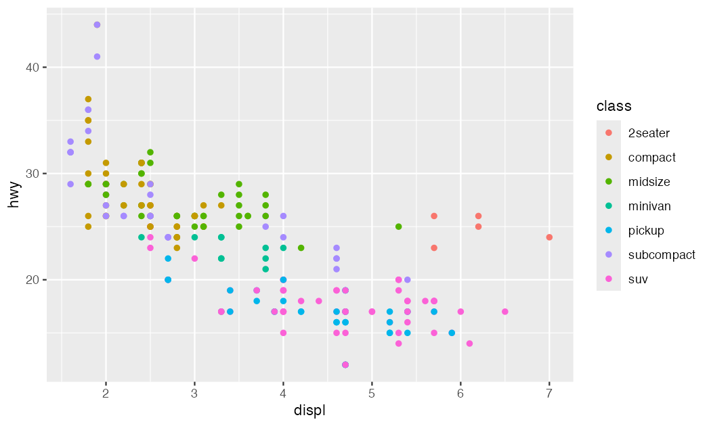
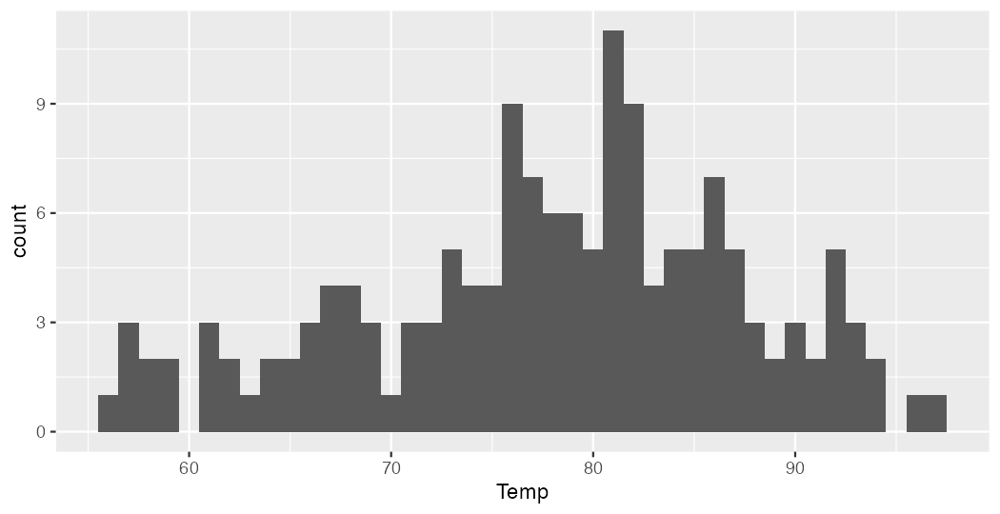
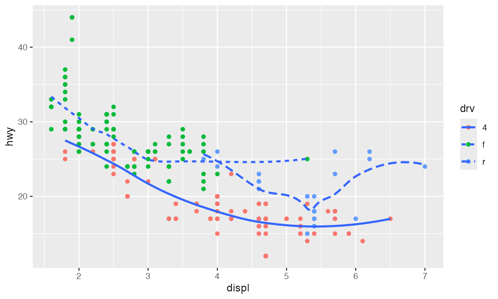
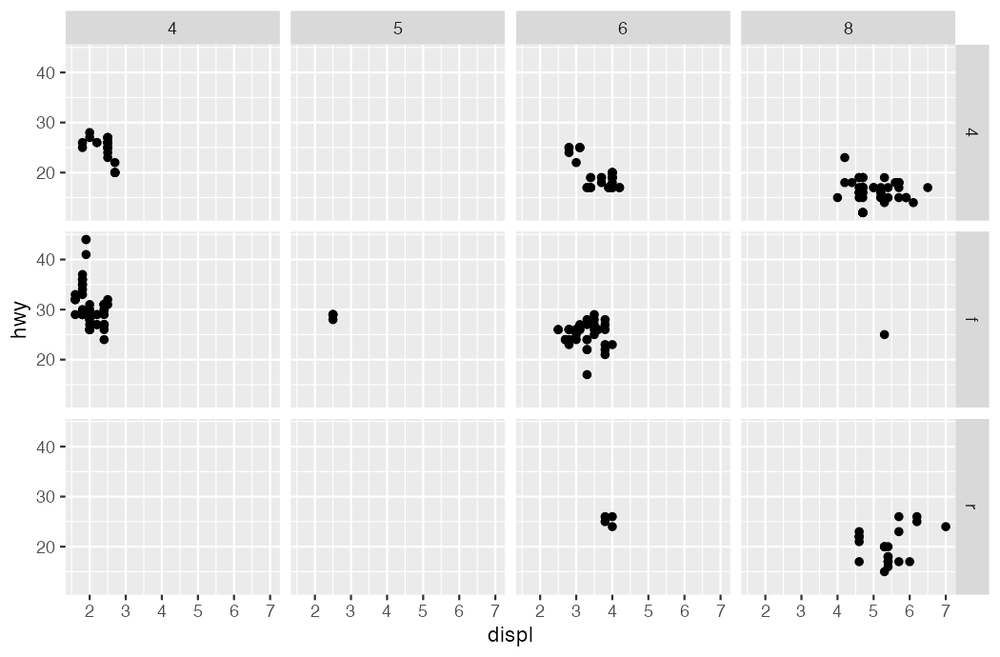
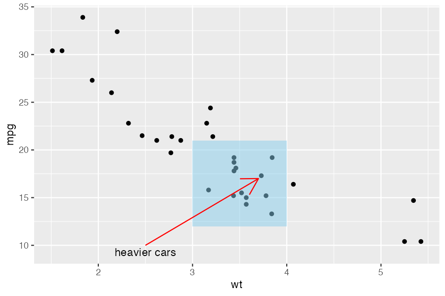
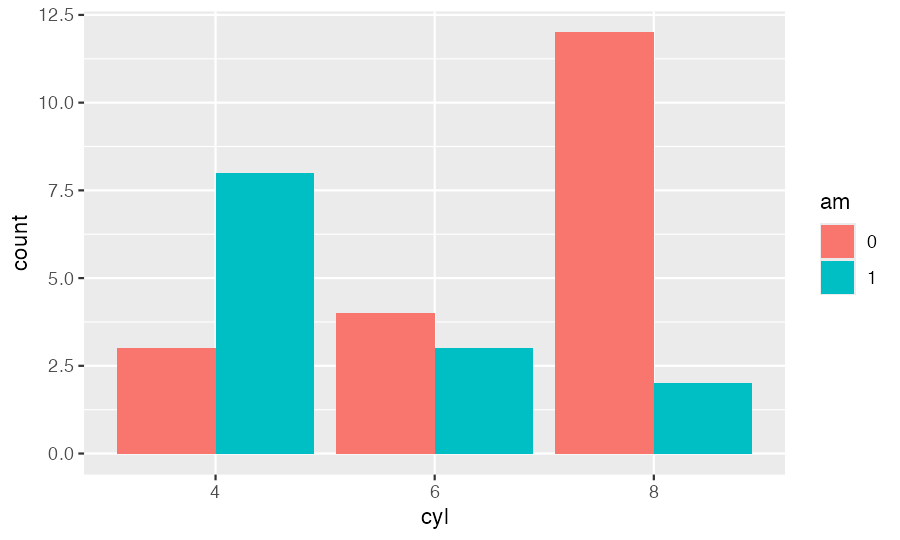
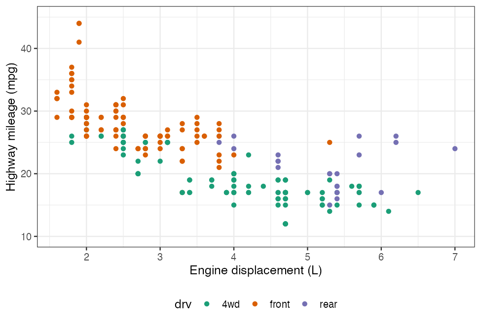
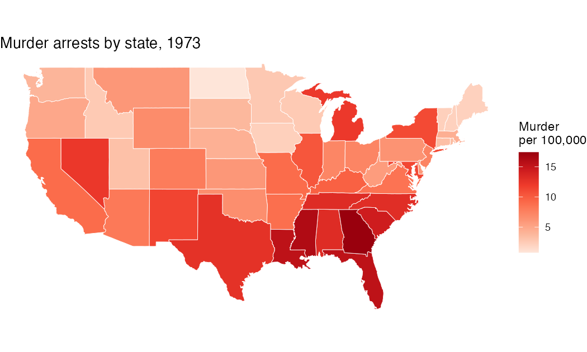

# 6장 — ggplot2를 활용한 데이터 시각화

[레포지토리 안내](../../README.ko.md) | [English](Concepts_Lecture.md) | [한국어](Concepts_Lecture.ko.md)

> **최종 수정일:** 2026-11-27
>
> 혼자 공부하는 R 데이터 분석, 강전희와 엄동란, Ch 6

> **학습 목표:**
> 1. ggplot2 그래픽 문법의 구성 요소를 설명하고 산점도, 선 그래프, 막대 그래프, 상자 그림을 그릴 수 있다
> 2. 미적 매핑과 패싯을 사용하고, 여러 기하 객체를 레이어로 쌓아 기준선과 텍스트 주석을 더할 수 있다
> 3. 상자 그림이 이상치를 표시하는 기준을 사분위수 범위(IQR)로 설명할 수 있다
> 4. 통계 변환과 위치 조정이 그래프에 그려지는 값을 어떻게 바꾸는지 설명할 수 있다
> 5. 척도, 좌표계, 테마로 축, 범례, 색, 확대 범위, 외관을 제어할 수 있다
> 6. 다각형 지도 데이터에 속성 값을 결합해 단계구분도를 그릴 수 있다

---

## 목차

- [1. ggplot2 소개](#1-ggplot2-소개)
  - [1.1 그래픽 문법](#11-그래픽-문법)
  - [1.2 기본 문법](#12-기본-문법)
  - [1.3 층 문법의 구성 요소](#13-층-문법의-구성-요소)
  - [1.4 그래프 객체와 저장](#14-그래프-객체와-저장)
  - [1.5 mpg 데이터로 그리는 첫 그래프](#15-mpg-데이터로-그리는-첫-그래프)
- [2. 기본 그래프 유형](#2-기본-그래프-유형)
  - [2.1 산점도 (geom_point())](#21-산점도-geom_point)
  - [2.2 선 그래프 (geom_line())](#22-선-그래프-geom_line)
  - [2.3 막대 그래프 (geom_bar())](#23-막대-그래프-geom_bar)
  - [2.4 상자 그림 (geom_boxplot())](#24-상자-그림-geom_boxplot)
  - [2.5 sunburst chart (극좌표)](#25-sunburst-chart-극좌표)
  - [2.6 히스토그램 (geom_histogram())](#26-히스토그램-geom_histogram)
  - [2.7 geom_bar()와 geom_col()](#27-geom_bar와-geom_col)
  - [2.8 여러 기하 객체 겹치기와 geom_smooth()](#28-여러-기하-객체-겹치기와-geom_smooth)
  - [2.9 변수의 종류에 따른 그래프 선택](#29-변수의-종류에-따른-그래프-선택)
- [3. 미적 매핑](#3-미적-매핑)
  - [3.1 색상 매핑](#31-색상-매핑)
  - [3.2 알파(투명도) 매핑](#32-알파투명도-매핑)
  - [3.3 모양 매핑](#33-모양-매핑)
  - [3.4 크기 매핑과 변수의 종류](#34-크기-매핑과-변수의-종류)
  - [3.5 전역 매핑과 지역 매핑](#35-전역-매핑과-지역-매핑)
- [4. 패싯](#4-패싯)
  - [4.1 facet_wrap()](#41-facet_wrap)
  - [4.2 facet_grid()](#42-facet_grid)
- [5. 기준선과 주석](#5-기준선과-주석)
  - [5.1 기준선 추가](#51-기준선-추가)
  - [5.2 텍스트 주석](#52-텍스트-주석)
  - [5.3 회귀선과 시계열 그래프의 주의점](#53-회귀선과-시계열-그래프의-주의점)
  - [5.4 도형과 화살표: annotate()](#54-도형과-화살표-annotate)
  - [5.5 제목과 축 이름: labs()](#55-제목과-축-이름-labs)
- [6. 통계 변환과 위치 조정](#6-통계-변환과-위치-조정)
  - [6.1 통계 변환](#61-통계-변환)
  - [6.2 위치 조정](#62-위치-조정)
- [7. 척도](#7-척도)
- [8. 좌표계](#8-좌표계)
- [9. 테마](#9-테마)
- [10. 지도 시각화](#10-지도-시각화)
- [개념 적용](#개념-적용)
- [요약](#요약)
- [점검 문제](#점검-문제)
- [참고 문헌](#참고-문헌)

---

<br>

## 1. ggplot2 소개

### 1.1 그래픽 문법

`ggplot2`는 그래픽 문법에 기반하며, 모든 그래프는 데이터, 미적 매핑(`aes()`), 기하 객체(`geom_*`), 통계 변환(`stat_*`), 척도, 좌표계(`coord_*`), 패싯, 테마로 구성된다.

> **용어 정의:** **그래픽 문법(grammar of graphics)** 은 그래프를 데이터와 몇 가지 독립된 구성 요소의 조합으로 설명하는 체계로, ggplot2는 이 체계에 기반한다.

> **용어 정의:** **미적 매핑(aesthetic mapping)** 은 데이터의 변수를 x와 y의 위치, 색, 크기, 모양 같은 그래프의 시각적 속성에 대응시키는 것으로, ggplot2에서는 `aes()` 안에 쓴다.

> **용어 정의:** **기하 객체(geometric object, geom)** 는 점, 선, 막대처럼 그래프에서 데이터를 나타내는 시각적 대상으로, ggplot2에서는 `geom_*()` 함수로 정한다.

> **용어 정의:** **통계 변환(statistical transformation)** 은 원래 데이터를 그래프에 그릴 값으로 바꾸는 계산으로, 개수 세기, 구간별 개수, 평활 곡선의 예측값처럼 그리기 전에 새 값을 계산한다. 예를 들어 `geom_bar()`는 기본으로 개수를 센다.

> **용어 정의:** **척도(scale)** 는 데이터의 값을 위치, 색, 크기 같은 미적 속성의 값으로 바꾸는 규칙으로, 축과 범례가 그 규칙을 보여 준다.

> **용어 정의:** **좌표계(coordinate system)** 는 x와 y의 위치를 그래프 평면에 놓는 방식으로, 기본은 직교 좌표계이고, `coord_polar()`는 극좌표계이다.

> **용어 정의:** **패싯(facet)** 은 변수의 값에 따라 데이터를 부분집합으로 나누어 여러 패널에 그린 하위 그래프이다.

> **용어 정의:** **테마(theme)** 는 배경색, 격자선, 글꼴, 범례의 위치처럼 데이터와 관계없는 그래프의 외관이다.

`ggplot2`는 `reshape2`, `dplyr` 패키지를 만든 Hadley Wickham이 만든 패키지로, R에서 가장 널리 쓰이는 시각화 패키지이다. 4장 8절의 base 그래픽은 그래프의 종류마다 다른 함수(`hist()`, `boxplot()`, `barplot()`)를 쓰지만, ggplot2는 모든 그래프를 같은 구성 요소의 조합으로 만든다. 그래서 산점도를 그리는 법을 알면 같은 문법으로 막대 그래프, 지도, 패싯 그래프까지 그릴 수 있다.

### 1.2 기본 문법

```r
library(ggplot2)

ggplot(data, aes(x = variable1, y = variable2)) +
  geom_point()   # 기하 레이어 추가
```

> **핵심:** ggplot2는 `+` 연산자를 사용하여 레이어별로 그래프를 구축한다. `ggplot()` 호출이 캔버스를 생성하고, `geom_*()` 함수가 시각적 요소를 추가한다.

`ggplot()`에 데이터와 `aes()`만 주면 축과 눈금만 있는 빈 그래프 틀이 Plots 창에 나타난다. `ggplot()`의 첫 인수는 데이터 세트이고, `aes()` 안에서 x축과 y축에 쓸 **변수**를 지정한다. 그 위에 `+`로 `geom_point()` 같은 레이어를 더해야 점이나 선이 그려진다. ggplot2를 처음 쓸 때는 `install.packages("ggplot2")`로 설치하고, 세션마다 `library(ggplot2)`로 불러온다. 이 장의 예제는 개수와 요약을 구할 때 5장의 `dplyr` 함수(`count()`, `filter()`, `summarise()` 등)도 쓰므로 `library(dplyr)`도 함께 실행해 둔다.

> **용어 정의:** **레이어(layer)** 는 기하 객체 하나와 통계 변환 하나, 겹치는 객체를 배치하는 방식 하나에 선택적인 데이터와 매핑을 묶은, 그래프의 한 층이다.

### 1.3 층 문법의 구성 요소

ggplot2는 Wilkinson의 그래픽 문법을 R에서 구현하면서 확장한 층 문법을 따른다 [1]. 층 문법은 그래프 하나를 다음 요소의 조합으로 정의한다 [1].

| 구성 요소 | 하는 일 | ggplot2 함수 |
|:--|:--|:--|
| 기본 데이터와 매핑 | 그래프 전체에 쓸 데이터 프레임과 변수에서 미적 속성으로의 대응 | `ggplot(data, aes(...))` |
| 레이어 (하나 이상) | 기하 객체 하나, 통계 변환 하나, 위치 조정 하나와 선택적인 데이터와 매핑의 묶음 | `geom_*()`, `stat_*()` |
| 척도 | 매핑에 쓴 미적 속성마다 하나씩, 데이터 값을 색, 크기, 위치로 바꾸는 규칙과 그 범례나 축 | `scale_*()` |
| 좌표계 | 위치를 평면에 놓는 방식 | `coord_*()` |
| 패싯 | 데이터를 부분집합으로 나누어 여러 패널에 그리는 방식 | `facet_*()` |

*표 1. 층 문법이 정의하는 그래프의 구성 요소*

> **용어 정의:** **위치 조정(position adjustment)** 은 같은 위치에 겹치는 기하 객체를 어떻게 배치할지, 곧 그대로 겹칠지, 쌓을지, 옆으로 나란히 놓을지, 조금씩 흩뜨릴지를 정하는 레이어의 구성 요소이다.

> **용어 정의:** **층 문법(layered grammar of graphics)** 은 그래프 하나를 기본 데이터와 매핑, 하나 이상의 레이어, 척도, 좌표계, 패싯의 조합으로 정의한 ggplot2의 그래픽 문법이다.

테마는 데이터와 관계없는 글꼴, 배경, 격자선 같은 외관을 정하며, 층 문법의 구성 요소와 별도로 `theme()`으로 지정한다(9절). 이 구성 요소를 모두 쓰면 ggplot2의 그래프는 다음 틀로 쓸 수 있다.

```r
ggplot(data = <DATA>) +
  <GEOM_FUNCTION>(
    mapping = aes(<MAPPINGS>),
    stat = <STAT>,
    position = <POSITION>
  ) +
  <COORDINATE_FUNCTION> +
  <FACET_FUNCTION> +
  <SCALE_FUNCTION> +
  <THEME_FUNCTION>
```

실제로는 대부분의 요소에 알맞은 기본값이 있으므로 데이터, 매핑, 기하 객체 세 가지만 써도 그래프가 완성된다. 예를 들어 `geom_point()`의 통계 변환은 값을 그대로 쓰는 `"identity"`, 위치 조정도 `"identity"`이고, 좌표계는 직교 좌표계, 척도는 변수의 유형에 맞는 기본 척도이다. 기본값과 다른 그래프가 필요할 때만 해당 요소를 더한다.

### 1.4 그래프 객체와 저장

`ggplot()`의 결과는 그래프를 그리는 데 필요한 정보를 담은 객체이므로 변수에 저장할 수 있다. 저장한 객체에 `+`로 레이어를 더하거나, 이름을 입력해 출력하면 그때 그래프가 그려진다.

```r
p <- ggplot(data = mpg) +
  geom_point(mapping = aes(x = displ, y = hwy, color = class))
p                                   # 그래프 출력
ggsave("mpg_scatter.png", p, width = 7, height = 4.2, dpi = 150)
```

`ggsave()`는 그래프를 파일로 저장하며, 확장자(`.png`, `.pdf`, `.svg`)로 형식을 정한다. `width`와 `height`의 기본 단위는 인치이고, `dpi`는 인치당 화소 수이므로 위 파일은 7 × 150 = 1,050화소 너비의 이미지가 된다. 그래프 객체를 주지 않으면 마지막으로 출력한 그래프를 저장한다. 함수나 반복문 안에서는 자동 출력이 일어나지 않으므로(3장 8절) 그래프를 보려면 `print(p)`를 명시해야 한다.

### 1.5 mpg 데이터로 그리는 첫 그래프

ggplot2에 들어 있는 `mpg`는 미국 환경보호청이 수집한 38개 자동차 모델의 연비 자료이다. "엔진이 큰 차는 작은 차보다 연료를 더 많이 쓰는가?"라는 질문에 데이터로 답해 본다.

```r
mpg
#> # A tibble: 234 × 11
#>    manufacturer model      displ  year   cyl trans drv     cty   hwy fl    class
#>    <chr>        <chr>      <dbl> <int> <int> <chr> <chr> <int> <int> <chr> <chr>
#>  1 audi         a4           1.8  1999     4 auto… f        18    29 p     comp…
#>  2 audi         a4           1.8  1999     4 manu… f        21    29 p     comp…
#>  3 audi         a4           2    2008     4 manu… f        20    31 p     comp…
#>  4 audi         a4           2    2008     4 auto… f        21    30 p     comp…
#>  5 audi         a4           2.8  1999     6 auto… f        16    26 p     comp…
#>  6 audi         a4           2.8  1999     6 manu… f        18    26 p     comp…
#>  7 audi         a4           3.1  2008     6 auto… f        18    27 p     comp…
#>  8 audi         a4 quattro   1.8  1999     4 manu… 4        18    26 p     comp…
#>  9 audi         a4 quattro   1.8  1999     4 auto… 4        16    25 p     comp…
#> 10 audi         a4 quattro   2    2008     4 manu… 4        20    28 p     comp…
#> # ℹ 224 more rows
```

`mpg`는 234행 11열의 티블이다. `displ`은 엔진 배기량(리터)이고, `hwy`는 고속도로 연비(갤런당 마일)이며 값이 클수록 연료를 적게 쓴다. `cty`는 도시 연비, `drv`는 구동 방식(`f` 전륜, `r` 후륜, `4` 사륜), `class`는 차종이다. 열이 화면보다 넓으므로 `trans`와 `class`의 값은 줄임표 `…`로 잘려 보인다. `displ`을 x축, `hwy`를 y축에 놓고 `class`를 색에 매핑하면 그림 1이 그려진다.



*그림 1. mpg의 배기량과 고속도로 연비, 차종별 색*

그림 1은 배기량이 클수록 고속도로 연비가 낮아지는 음의 관계를 보여 주므로, 엔진이 큰 차는 연료를 더 많이 쓴다고 답할 수 있다. 그런데 배기량이 5\~7리터로 큰데도 연비가 25 안팎으로 높은 점 몇 개가 직선 경향에서 벗어나 있다. 색을 보면 이 점들은 대부분 `2seater`, 곧 엔진은 크지만 차체가 가벼운 스포츠카이다. 이처럼 미적 매핑으로 세 번째 변수를 더하면 두 변수만으로는 설명되지 않는 점의 정체를 찾을 수 있다.

---

<br>

## 2. 기본 그래프 유형

### 2.1 산점도 (`geom_point()`)

`airquality`는 1973년 5\~9월 뉴욕의 일별 대기 질 측정값이다. `Day`는 그 달의 날짜(1\~31)이고 `Temp`는 일 최고 기온(화씨)이므로, 아래 그래프에서 각 날짜에는 다섯 달의 점이 함께 찍힌다.

```r
# 기본 산점도
ggplot(airquality, aes(x = Day, y = Temp)) +
  geom_point()

# 크기와 색상을 사용자 정의한 산점도
ggplot(airquality, aes(x = Day, y = Temp)) +
  geom_point(size = 3, color = "red")
# 기본 점 크기는 1.5
```

첫 그래프는 각 날짜에 다섯 점이 세로로 늘어선 모양이며 날짜에 따른 뚜렷한 경향이 보이지 않는다. 실제로 두 변수의 상관계수는 `cor(airquality$Day, airquality$Temp)` = -0.131로 0에 가깝다. 날짜(1\~31)는 그 달 안의 위치일 뿐 계절을 나타내지 않으므로, 기온의 변화를 보려면 `Month`를 함께 쓰거나 날짜를 연속된 시간 축으로 바꾸어야 한다. 둘째 그래프의 `size = 3`과 `color = "red"`는 `aes()` 밖에 쓴 고정값이므로 모든 점이 같은 크기와 색으로 그려지고 범례가 생기지 않는다(3.3절).

### 2.2 선 그래프 (`geom_line()`)

```r
ggplot(airquality, aes(x = Day, y = Temp)) +
  geom_line()
```

`geom_line()`은 x값의 순서대로 점을 선으로 잇는다. 이 그래프는 날짜(`Day`)마다 다섯 달의 기온이 있으므로, 같은 x에 놓인 다섯 점이 세로로 이어지며 톱니 모양의 선이 된다. 달마다 따로 선을 그리려면 `aes(group = Month)`나 `aes(color = factor(Month))`로 그룹을 알려 주어야 한다. 선 그래프는 한 x값에 y값이 하나뿐인 자료, 곧 시간에 따른 한 계열의 변화에 알맞다.

### 2.3 막대 그래프 (`geom_bar()`)

`geom_bar()`는 x의 값마다 행의 수를 세어 막대 높이로 쓴다. `mtcars`(5장 1.2절)의 숫자형 `cyl`을 그대로 x에 주면 x축이 연속형이 되어 4, 6, 8 사이에 5와 7 같은 빈 눈금이 생기고, `factor()`로 범주형으로 바꾸면 실제 값 4, 6, 8만 막대로 나타난다. `fill = factor(gear)`는 막대를 기어 수별로 나누어 색을 칠한다.

```r
# 단순 막대 그래프 (x축만 필요; y축은 자동으로 개수를 셈)
ggplot(mtcars, aes(x = cyl)) +
  geom_bar(width = 0.5)

# factor()를 사용하여 비어 있는 범주 제외 (예: 5, 7 실린더)
ggplot(mtcars, aes(x = factor(cyl))) +
  geom_bar(width = 0.5)

# 채움 색상이 있는 누적 막대 그래프
ggplot(mtcars, aes(x = factor(cyl))) +
  geom_bar(aes(fill = factor(gear)))
```

누적 막대 그래프는 실린더 수별 빈도를 파악하면서 그 안에서 기어 수별 빈도까지 보여 준다. 8기통 막대 14대는 3단 기어 12대와 5단 기어 2대로 나뉘어 칠해진다. 막대를 나란히 놓거나 비율로 바꾸는 방법은 6.2절에서 다룬다.

### 2.4 상자 그림 (`geom_boxplot()`)

`Day`가 숫자형이므로 `group = Day`를 지정해야 날짜마다 따로 상자가 그려진다. 지정하지 않으면 모든 자료가 하나의 상자로 그려진다.

```r
# 그룹화된 상자 그림
ggplot(airquality, aes(x = Day, y = Temp, group = Day)) +
  geom_boxplot()
```

> **핵심:** 상자 그림은 1사분위수 $Q_1$보다 $1.5 \times \mathrm{IQR}$ 넘게 작거나 3사분위수 $Q_3$보다 $1.5 \times \mathrm{IQR}$ 넘게 큰 점, 곧 $Q_1 - 1.5 \times \mathrm{IQR}$보다 작거나 $Q_3 + 1.5 \times \mathrm{IQR}$보다 큰 점을 이상치(outlier)로 표시한다. 사분위수 범위는 $\mathrm{IQR} = Q_3 - Q_1$이다. 상자 그림은 이상치를 평균과 표준편차로 정의하지 **않는다**. 평균과 표준편차는 극단값 자체의 영향을 크게 받기 때문이다.

상자 그림의 각 부분을 읽는 방법과 수염의 끝을 계산하는 예는 4장 8절에 있다. 상자의 수가 31개로 많은 이 그래프보다는, 달마다 기온 분포를 비교하는 `aes(x = factor(Month), y = Temp)`가 7월(84도)과 8월(82도)에 기온의 중앙값이 가장 높고 5월(66도)과 9월(76도)에 낮은 모습을 더 잘 보여 준다.

### 2.5 sunburst chart (극좌표)

```r
# 누적 막대 그래프를 coord_polar()로 sunburst chart로 변환
ggplot(mtcars, aes(x = factor(cyl))) +
  geom_bar(aes(fill = factor(gear))) +
  coord_polar()

# 도넛 형태의 sunburst chart
ggplot(mtcars, aes(x = factor(cyl))) +
  geom_bar(aes(fill = factor(gear))) +
  coord_polar(theta = "y")
```

> **참고:** **극좌표 변환의 두 방식.** `coord_polar()`의 기본값 `theta = "x"`는 x의 범주를 각도에, 막대 높이를 반지름에 대응시키므로 Nightingale의 장미 도표(coxcomb)와 같은 모양이 된다. `theta = "y"`는 개수를 각도에, 범주를 반지름에 대응시키므로 범주마다 고리가 하나씩 생기는 도넛 모양이 된다. 엄밀한 의미의 sunburst chart는 계층 구조의 상위 범주를 안쪽 고리에, 하위 범주를 바깥 고리에 나누어 보이는 차트이며, 여기서는 그와 비슷한 모양이라는 뜻으로 부른다.

sunburst chart는 계층 구조의 데이터를 범주별로 비율을 표시하는 그래프이며, 위 코드는 누적 막대 그래프 코드에 `coord_polar()` 한 줄만 더해 만든다. 같은 레이어에 좌표계만 바꾸어 전혀 다른 모양의 그래프를 얻는다는 점이 층 문법의 특징을 잘 보여 준다. 다만 원 그래프와 마찬가지로 각도와 면적은 길이보다 비교하기 어려우므로(4장 8절) 정확한 비교에는 막대 그래프가 낫다.

### 2.6 히스토그램 (`geom_histogram()`)

`geom_histogram()`은 x축만 매핑하면 연속형 변수의 범위를 구간으로 나누어 구간마다 관측치의 수를 센다.

```r
ggplot(airquality, aes(Temp)) + geom_histogram()
#> `stat_bin()` using `bins = 30`. Pick better value `binwidth`.
h1 <- ggplot(airquality, aes(Temp)) + geom_histogram(binwidth = 1)
range(airquality$Temp)
#> [1] 56 97
```

구간을 지정하지 않으면 ggplot2는 범위를 30개 구간(`bins = 30`)으로 나누고, 더 알맞은 값을 고르라는 메시지를 낸다. 30은 자료와 관계없이 정한 기본값일 뿐이므로, 자료의 단위에 맞게 `binwidth`(구간 폭)나 `bins`(구간 수)를 직접 정하는 것이 좋다. 기온은 화씨 정수로 기록되고 범위가 56\~97이므로, `binwidth = 1`이면 정수 기온마다 막대 하나가 생긴다(그림 2).



*그림 2. 구간 폭 1로 그린 일 최고 기온의 히스토그램*

그림 2에서 기온은 75\~85도 부근에 몰려 있고 60도 안팎의 낮은 기온 쪽으로 꼬리가 길다. 폭 1의 구간은 정수 값의 빈도를 그대로 보여 주지만 막대가 들쭉날쭉해 전체 모양을 읽기 어려우므로, 분포의 모양을 볼 때는 `binwidth = 5`처럼 더 넓은 폭도 함께 그려 본다.

### 2.7 geom_bar()와 geom_col()

`geom_bar()`는 행의 수를 직접 세지만, 이미 개수를 센 표가 있으면 그 값을 막대 높이로 쓰는 `geom_col()`을 쓴다.

```r
cyl_count <- count(mtcars, cyl)
cyl_count
#>   cyl  n
#> 1   4 11
#> 2   6  7
#> 3   8 14
b <- ggplot(cyl_count, aes(x = factor(cyl), y = n)) + geom_col()
layer_data(b)[, c("x", "y")]
#>   x  y
#> 1 1 11
#> 2 2  7
#> 3 3 14
layer_data(ggplot(mtcars, aes(factor(cyl))) + geom_bar())[, c("x", "count", "prop")]
#>   x count prop
#> 1 1    11    1
#> 2 2     7    1
#> 3 3    14    1
```

`layer_data()`는 레이어가 실제로 그리는 데 쓴 데이터를 보여 준다. `geom_col()`은 표의 `n` 값 11, 7, 14를 그대로 y로 쓰고, `geom_bar()`는 원래 데이터 32행에서 실린더 수마다 개수를 세어 같은 값 11, 7, 14를 만든다. 두 그래프는 같은 모양이지만, 앞의 것은 y를 매핑해야 하고 뒤의 것은 y를 매핑하지 않는다. 범주형 x는 내부에서 1, 2, 3의 위치로 바뀌어 그려진다. `geom_bar()`가 개수를 세는 이 과정이 통계 변환이며 6.1절에서 다시 다룬다.

### 2.8 여러 기하 객체 겹치기와 geom_smooth()

같은 x, y를 써도 기하 객체가 다르면 데이터를 다른 시각적 대상으로 나타낸다. `geom_point()`는 각 관측치를 점으로, `geom_smooth()`는 데이터에 맞춘 매끄러운 곡선으로 나타낸다. 한 그래프에 여러 기하 객체를 `+`로 겹쳐 그릴 수 있다.

```r
s <- ggplot(mpg, aes(x = displ, y = hwy)) +
  geom_point(aes(color = drv)) +
  geom_smooth(aes(linetype = drv), se = FALSE)
s
#> `geom_smooth()` using method = 'loess' and formula = 'y ~ x'
count(mpg, drv)
#> # A tibble: 3 × 2
#>   drv       n
#>   <chr> <int>
#> 1 4       103
#> 2 f       106
#> 3 r        25
```



*그림 3. 구동 방식별 점과 평활 곡선*

`geom_smooth()`는 `linetype = drv`에 따라 구동 방식마다 선 모양이 다른 곡선을 하나씩 그린다. 메시지는 관측치가 1,000개보다 적어 국소 회귀(loess)로 곡선을 맞추었음을 알린다. `se = FALSE`는 곡선 둘레의 신뢰 구간 띠를 그리지 않게 한다. 그림 3에서 사륜구동(`4`)의 곡선은 배기량이 커질수록 연비가 꾸준히 낮아지고, 전륜구동(`f`)은 배기량이 작은 쪽에 몰려 있으며, 후륜구동(`r`)은 배기량이 크지만 연비가 다시 오르는 구간이 있다. 후륜구동은 25대뿐이어서 곡선이 몇 개의 점에 크게 흔들리므로 해석에 주의해야 한다.

> **용어 정의:** **국소 회귀(loess)** 는 x의 각 위치마다 그 근처의 점들에 가까울수록 큰 가중치를 주어 낮은 차수의 다항식(직선이나 2차식)을 맞추고, 그 적합값들을 이어 매끄러운 곡선을 만드는 회귀 방법이다.

> **주의:** 매끄러운 곡선은 점들의 경향을 요약할 뿐 원인을 설명하지 않는다. 또 점이 적은 구간에서는 곡선이 몇 개의 값에 끌려 크게 휘므로, 곡선을 그릴 때는 원래 점을 함께 그려 곡선이 어디에서 근거가 약한지 확인한다.

### 2.9 변수의 종류에 따른 그래프 선택

어떤 그래프를 그릴지는 보려는 변수의 개수와 종류로 정한다.

| 보려는 것 | 변수의 종류 | 알맞은 기하 객체 |
|:--|:--|:--|
| 한 변수의 분포 | 수치형 | `geom_histogram()`, `geom_density()`, `geom_boxplot()` |
| 한 변수의 분포 | 범주형 | `geom_bar()` |
| 두 변수의 관계 | 수치형과 수치형 | `geom_point()`, `geom_smooth()`, 시간 순서가 있으면 `geom_line()` |
| 그룹별 분포 비교 | 수치형과 범주형 | `geom_boxplot()`, `geom_violin()`, 그룹별 히스토그램 패싯 |
| 두 범주의 조합 | 범주형과 범주형 | 쌓은 막대, 나란한 막대, 비율 막대(6.2절) |

*표 2. 변수의 종류에 따른 그래프 선택*

이 표는 출발점일 뿐이며, 같은 변수도 질문에 따라 다른 그래프가 낫다. 예를 들어 차종별 고속도로 연비를 비교할 때 평균만 보려면 막대 하나씩이면 되지만, 분포의 퍼짐과 이상치까지 보려면 상자 그림이 낫다. 세 번째 변수는 색이나 모양의 미적 매핑(3절)으로, 네 번째 변수는 패싯(4절)으로 더하는 것이 일반적이다.

---

<br>

## 3. 미적 매핑

### 3.1 색상 매핑

```r
# class를 색상에 매핑: 각 class가 다른 색상을 갖는다
ggplot(data = mpg) +
  geom_point(mapping = aes(x = displ, y = hwy, color = class))
```

`ggplot2`의 기하 함수는 모두 `mapping` 인수를 받으며, 이 인수는 데이터의 변수가 시각적 속성에 어떻게 대응하는지 정한다. `mapping`은 항상 `aes()`와 함께 쓰고, `aes()`의 `x`, `y`는 x축과 y축에 쓸 변수를 지정한다. `color = class`를 더하면 ggplot2가 `class`의 7개 값마다 다른 색을 고르고, 어떤 색이 어떤 값인지 알려 주는 범례를 만든다(그림 1). 영국식 철자 `colour`도 같은 뜻으로 쓸 수 있다.

### 3.2 알파(투명도) 매핑

투명도는 정도의 크고 작음을 나타내는 속성이므로, 순서가 없는 범주형 변수에 매핑하면 ggplot2가 권장하지 않는다는 경고를 출력한다.

```r
# class를 투명도에 매핑
ggplot(data = mpg) +
  geom_point(mapping = aes(x = displ, y = hwy, alpha = class))
```

실행하면 경고 `Using alpha for a discrete variable is not advised.`가 나오고, `class`의 값마다 다른 투명도로 점이 찍힌다. 투명도의 차이로는 7개 범주를 구별하기 어렵고, 알파벳 순서상 앞의 범주가 더 투명하게 보이는 까닭에 범주 사이에 없는 순서가 있는 것처럼 읽힌다.

### 3.3 모양 매핑

기본 모양 팔레트는 범주를 최대 6개까지만 구분한다. 범주가 7개인 `class`를 모양에 매핑하면 일곱 번째 범주인 `suv`의 점 62개는 경고와 함께 그려지지 않는다.

```r
# class를 점 모양에 매핑
ggplot(data = mpg) +
  geom_point(mapping = aes(x = displ, y = hwy, shape = class))
```

> **핵심:** 미적 요소가 `aes()` **안에** 배치되면 변수를 미적 요소에 매핑한다. `aes()` **밖에** 배치되면 고정된 값을 설정한다 (예: `color = "red"`는 모든 점을 빨간색으로 만든다).

이때 나오는 경고는 두 가지이다. 첫째는 모양 팔레트가 6개 넘는 값을 다루지 못한다는 경고이고, 둘째는 `Removed 62 rows containing missing values or values outside the scale range`, 곧 62행이 그려지지 않았다는 경고이다. 그래프를 보고는 점이 빠진 것을 알아차리기 어려우므로 경고를 반드시 읽어야 한다. 7개 이상의 모양이 반드시 필요하면 `scale_shape_manual(values = ...)`로 모양을 직접 정한다.

### 3.4 크기 매핑과 변수의 종류

크기(`size`)에 범주형 변수를 매핑해도 알파와 같은 경고가 나온다.

```r
ggplot(mpg) + geom_point(aes(x = displ, y = hwy, size = class))
#> Warning: Using size for a discrete variable is not advised.
```

크기와 투명도는 "더 크다", "더 진하다"처럼 순서를 전달하므로 순서가 있는 변수나 연속형 변수에 알맞고, 색상과 모양은 순서 없는 범주를 구별하는 데 알맞다. 연속형 변수를 색에 매핑하면 ggplot2는 범주마다 색을 고르지 않고 값의 크기에 따라 색이 연속적으로 변하는 그러데이션을 쓴다.

```r
ggplot(mpg, aes(displ, hwy, color = cty)) + geom_point() -> pc
layer_data(pc)$colour[1:3]
#> [1] "#29567D" "#306591" "#2E608A"
```

도시 연비 `cty`는 정수형 수치이므로 연속형 척도가 쓰이며, 첫 세 점에는 값의 크기에 따라 조금씩 다른 파란색 계열의 색이 칠해진다. 반대로 연속형 변수를 모양에 매핑하면 오류가 난다. 모양에는 크기의 순서가 없기 때문이다. 정리하면 다음과 같다.

- **범주형 변수(순서 없음):** 색상(`color`, `fill`), 모양(`shape`), 선 모양(`linetype`)
- **순서형 변수와 연속형 변수:** 위치(`x`, `y`), 크기(`size`), 투명도(`alpha`), 연속적인 색상

### 3.5 전역 매핑과 지역 매핑

> **용어 정의:** **전역 매핑(global mapping)** 은 `ggplot()` 안의 `aes()`에 써서 그 그래프의 모든 레이어가 물려받는 미적 매핑이다.

> **용어 정의:** **지역 매핑(local mapping)** 은 한 레이어의 `geom_*()` 안의 `aes()`에 써서 그 레이어에만 적용되는 미적 매핑이다.

다음 코드는 두 매핑을 함께 쓴다.

```r
ggplot(mpg, aes(x = displ, y = hwy)) +
  geom_point(aes(color = class)) +
  geom_smooth()
#> `geom_smooth()` using method = 'loess' and formula = 'y ~ x'
```

위 코드에서 `x`와 `y`는 두 레이어가 함께 쓰지만 `color = class`는 점 레이어에만 적용된다. 그래서 점은 차종별로 칠해지고, 평활 곡선은 모든 점에 대해 하나만 그려진다. `color = class`를 `ggplot()`으로 옮기면 `geom_smooth()`도 이를 물려받아 차종마다 곡선 7개를 그리게 된다. 같은 원리로 레이어마다 다른 데이터를 줄 수도 있다. `geom_smooth(data = filter(mpg, class == "subcompact"))`는 소형차만으로 곡선을 맞추고 점은 모든 차를 그린다.

---

<br>

## 4. 패싯

### 4.1 facet_wrap()

범주형 변수에 따라 데이터를 하위 그래프로 분할한다. `~ class`는 `class`의 값마다 하위 그래프를 하나씩 만들라는 공식이고, `nrow = 2`는 하위 그래프 7개를 2행으로 배치한다:

```r
ggplot(data = mpg) +
  geom_point(mapping = aes(x = displ, y = hwy)) +
  facet_wrap(~ class, nrow = 2)
```

미적 매핑은 변수를 한 그래프 안의 색이나 모양으로 구분하지만, 패싯은 변수의 값마다 그래프를 따로 그린다. 범주가 많아 색으로 구분하기 어렵거나 점이 서로 겹칠 때 특히 유용하다. 하위 그래프들은 기본적으로 같은 축 범위를 쓰므로 패널 사이의 위치를 바로 비교할 수 있다. `facet_wrap()`에 넘기는 변수는 범주형이어야 하며, 연속형 변수를 주면 서로 다른 값마다 패널이 생겨 패널이 지나치게 많아진다.

### 4.2 facet_grid()

두 변수의 조합으로 패널을 나누려면 `facet_grid(행 변수 ~ 열 변수)`를 쓴다.

```r
g <- ggplot(mpg, aes(displ, hwy)) + geom_point() + facet_grid(drv ~ cyl)
table(mpg$drv, mpg$cyl)
#>    
#>      4  5  6  8
#>   4 23  0 32 48
#>   f 58  4 43  1
#>   r  0  0  4 21
```



*그림 4. 구동 방식(행)과 실린더 수(열)로 나눈 패싯*

`drv ~ cyl`은 구동 방식 3개를 행으로, 실린더 수 4개를 열로 하는 3 × 4 = 12개의 패널을 만든다. 교차표에서 0인 조합(예: 후륜구동 4기통)은 그림 4에서 빈 패널로 나타나며, 5기통 차는 전륜구동 4대뿐이다. 한쪽 방향으로만 나누려면 `facet_grid(. ~ cyl)`처럼 다른 쪽에 `.`을 쓴다. 패널마다 값의 범위가 크게 다르면 `scales = "free_y"`나 `scales = "free"`로 패널별 축을 허용할 수 있지만, 그러면 패널 사이의 높이를 직접 비교할 수 없게 된다.

---

<br>

## 5. 기준선과 주석

### 5.1 기준선 추가

```r
library(ggplot2)

# 절편과 기울기를 가진 대각선
ggplot(economics, aes(x = date, y = psavert)) +
  geom_line() +
  geom_abline(intercept = 12.18671, slope = -0.0005444)

# 평균값에 수평 기준선
ggplot(economics, aes(x = date, y = psavert)) +
  geom_line() +
  geom_hline(yintercept = mean(economics$psavert))

# 특정 날짜에 수직 기준선
ggplot(economics, aes(x = date, y = psavert)) +
  geom_line() +
  geom_vline(xintercept = as.Date("2005-07-01"))
```

`psavert`는 미국의 개인 저축률(%)이다. `geom_abline()`은 절편 `intercept`와 기울기 `slope`로 정해지는 직선 $y = \text{intercept} + \text{slope} \times x$를 그린다. 날짜 축은 내부적으로 1970-01-01부터의 일수로 저장되므로, 기울기 `-0.0005444`는 저축률이 하루에 0.0005444%p, 1년에 약 0.2%p씩 줄어드는 추세를 뜻한다. `geom_hline()`과 `geom_vline()`은 지정한 y 값과 x 값의 위치에 수평선과 수직선을 긋는다. 2005-07-01은 저축률이 2.2%로 가장 낮은 달이다.

`economics`는 ggplot2에 들어 있는 미국 경제 지표의 월별 시계열이며, 1967년 7월부터 574개월의 개인 소비 지출(`pce`), 인구(`pop`), 개인 저축률(`psavert`), 실업 기간의 중앙값(`uempmed`), 실업자 수(`unemploy`)를 담는다.

```r
str(economics)
#> spc_tbl_ [574 × 6] (S3: spec_tbl_df/tbl_df/tbl/data.frame)
#>  $ date    : Date[1:574], format: "1967-07-01" "1967-08-01" ...
#>  $ pce     : num [1:574] 507 510 516 512 517 ...
#>  $ pop     : num [1:574] 198712 198911 199113 199311 199498 ...
#>  $ psavert : num [1:574] 12.6 12.6 11.9 12.9 12.8 11.8 11.7 12.3 11.7 12.3 ...
#>  $ uempmed : num [1:574] 4.5 4.7 4.6 4.9 4.7 4.8 5.1 4.5 4.1 4.6 ...
#>  $ unemploy: num [1:574] 2944 2945 2958 3143 3066 ...
mean(economics$psavert)
#> [1] 8.567247
filter(economics, psavert == min(economics$psavert))$date
#> [1] "2005-07-01"
```

`geom_hline()`의 위치는 전체 기간의 평균 저축률 8.57%이다. 수직선의 날짜는 직접 쓰는 대신 dplyr의 `filter()`로 저축률이 최소인 행을 찾아 그 `date`를 꺼내 쓸 수 있으며, 결과는 2005-07-01이다. `economics$psavert == min(economics$psavert)` 자체는 574개의 논리값이고, 그 가운데 `TRUE`는 하나뿐이다.

### 5.2 텍스트 주석

```r
ggplot(airquality, aes(x = Day, y = Temp)) +
  geom_point() +
  geom_text(aes(label = Temp, vjust = 0, hjust = 0))
```

`label = Temp`는 각 점에 기온 값을 글자로 표시한다. `vjust = 0`과 `hjust = 0`은 글자의 왼쪽 아래 모서리를 점의 위치에 맞추므로 글자가 점의 오른쪽 위에 놓인다. 두 값은 변수가 아닌 상수이므로 `aes()` 밖에 써도 결과가 같다.

`geom_text()`는 그래프 제목이나 축 제목과 달리 그래프 위에 데이터마다 텍스트를 직접 표현하며, 레이블이나 수치 값을 표시할 때 주로 쓴다. 이 그래프처럼 점이 153개나 되면 글자가 겹쳐 읽기 어려우므로, 실제로는 눈여겨볼 몇 개의 점만 고른 데이터를 `geom_text(data = ...)`에 주어 레이블을 붙이는 것이 좋다.

### 5.3 회귀선과 시계열 그래프의 주의점

`stat_smooth()`(또는 `geom_smooth()`)에 `method = "lm"`을 주면 최소제곱법으로 맞춘 직선을 그린다.

```r
ggplot(economics, aes(x = date, y = psavert)) +
  geom_line() +
  stat_smooth(method = "lm", col = "red")
#> `geom_smooth()` using formula = 'y ~ x'
coef(lm(psavert ~ as.numeric(date), data = economics))
#>      (Intercept) as.numeric(date) 
#>    12.4117258255    -0.0004924778
```

`lm()`으로 직접 계산한 최소제곱 직선의 절편은 12.41, 기울기는 하루에 -0.000492%p, 곧 1년에 약 0.18%p이다. 5.1절의 `geom_abline()`에 준 절편과 기울기는 사용자가 정한 값이므로 이 최소제곱 직선과 정확히 같지 않다. 직선 둘레의 회색 띠는 회귀선의 95% 신뢰 구간이며 `se = FALSE`로 끌 수 있다. 회귀 분석 자체는 10장에서 다룬다.

> **주의:** 시계열 자료에 직선 하나를 그어 추세를 판단하는 것은 적절한 통계 분석 방법이 아니다. 저축률은 1975년 5월에 17.3%로 가장 높았다가 2005년까지 내려가고 그 뒤 다시 오르는 등 시기마다 다른 움직임을 보이며, 이웃한 달의 값끼리 서로 관련되어 있어(자기상관) 일반 회귀의 가정이 성립하지 않는다. 이 절의 예는 절편과 기울기로 선을 긋는 방법을 보이는 것이고, 시계열 자료의 분석은 11장의 시계열 분석 방법으로 한다.

### 5.4 도형과 화살표: annotate()

`annotate()`는 데이터 프레임의 변수와 관계없이 지정한 좌표에 도형, 선, 글자를 하나씩 그려 그래프의 특정 영역을 강조한다. 첫 인수로 그릴 것의 종류(`"rect"`, `"segment"`, `"text"` 등)를 정하고, 그 위치를 좌표로 준다.

```r
an <- ggplot(mtcars, aes(x = wt, y = mpg)) +
  geom_point() +
  annotate("rect", xmin = 3, xmax = 4, ymin = 12, ymax = 21, alpha = 0.5, fill = "skyblue") +
  annotate("segment", x = 2.5, xend = 3.7, y = 10, yend = 17, color = "red", arrow = arrow()) +
  annotate("text", x = 2.5, y = 9.3, label = "heavier cars")
sum(mtcars$wt >= 3 & mtcars$wt <= 4 & mtcars$mpg >= 12 & mtcars$mpg <= 21)
#> [1] 13
```



*그림 5. annotate()로 영역과 화살표를 더한 산점도*

`"rect"`는 x가 3\~4(3,000\~4,000파운드), y가 12\~21인 사각형을 반투명한 하늘색으로 칠한다. 이 영역에는 13대의 차가 들어 있어, 무게가 중간 정도인 차들이 연비 15\~20에 몰려 있음을 강조한다. `"segment"`는 (2.5, 10)에서 (3.7, 17)까지 선분을 긋고 `arrow = arrow()`로 끝에 화살표를 단다. `"text"`는 화살표가 시작하는 곳 아래에 설명 문구를 쓴다. `alpha = 0.5`는 사각형을 반투명하게 만들어 그 아래의 점이 가려지지 않게 한다.

### 5.5 제목과 축 이름: labs()

`labs()`는 그래프 제목(`title`), 부제목(`subtitle`), 축 이름(`x`, `y`), 범례 제목(`color`, `fill` 등), 출처(`caption`)를 한꺼번에 정한다.

```r
lb <- ggplot(mtcars, aes(x = gear)) + geom_bar() +
  labs(x = "Number of gears", y = "Number of cars", title = "Cars by number of gears")
table(mtcars$gear)
#> 
#>  3  4  5 
#> 15 12  5
```

이 그래프는 기어 수별 자동차 수를 막대로 나타내며, 막대 높이는 15, 12, 5이다. 축 이름을 정하지 않으면 변수 이름 `gear`와 통계 변환이 만든 `count`가 그대로 쓰인다. 다른 사람이 볼 그래프에는 변수 이름 대신 단위까지 밝힌 설명적인 이름을 붙이는 것이 좋다. 한국어 제목도 쓸 수 있지만, 운영체제에 따라 한글 글꼴을 따로 지정해야 글자가 네모로 깨지지 않는다(9절).

---

<br>

## 6. 통계 변환과 위치 조정

### 6.1 통계 변환

통계 변환이 하는 계산은 그래프마다 다르다. 산점도는 각 값을 그대로 그리지만, 막대 그래프, 히스토그램, 평활 곡선은 그리기 전에 새 값을 계산한다. `geom_bar()`는 `stat_count()`로 개수를, `geom_histogram()`은 `stat_bin()`으로 구간별 개수를, `geom_smooth()`는 `stat_smooth()`로 예측값을, `geom_boxplot()`은 `stat_boxplot()`으로 사분위수와 수염 끝을 계산한다.

통계 변환이 계산한 변수는 `after_stat()`으로 꺼내 다른 미적 속성에 쓸 수 있다. 예를 들어 막대 높이를 개수 대신 비율로 그리려면 다음과 같이 쓴다.

```r
layer_data(ggplot(mtcars, aes(factor(cyl))) + geom_bar(aes(y = after_stat(prop), group = 1)))[, c("x", "count", "prop")]
#>   x count    prop
#> 1 1    11 0.34375
#> 2 2     7 0.21875
#> 3 3    14 0.43750
```

`stat_count()`는 개수(`count`)와 함께 비율(`prop`)도 계산한다. 비율은 그룹 안에서 계산되므로, `group = 1`로 모든 막대를 한 그룹으로 묶어야 전체에 대한 비율 11 / 32 = 0.34375가 나온다. 2.7절의 출력에서 `group`을 지정하지 않았을 때 `prop`가 모두 1이었던 것은 막대마다 그룹이 달라 각 그룹 안의 비율을 계산했기 때문이다.

`stat_summary()`는 x의 값마다 y를 요약한 값을 그린다.

```r
ggplot(mpg, aes(class, hwy)) + stat_summary(fun = mean, geom = "point") -> ps
layer_data(ps)[, c("x", "y")]
#>   x        y
#> 1 1 24.80000
#> 2 2 28.29787
#> 3 3 27.29268
#> 4 4 22.36364
#> 5 5 16.87879
#> 6 6 28.14286
#> 7 7 18.12903
mpg |> group_by(class) |> summarise(hwy = mean(hwy))
#> # A tibble: 7 × 2
#>   class        hwy
#>   <chr>      <dbl>
#> 1 2seater     24.8
#> 2 compact     28.3
#> 3 midsize     27.3
#> 4 minivan     22.4
#> 5 pickup      16.9
#> 6 subcompact  28.1
#> 7 suv         18.1
```

`stat_summary(fun = mean)`이 그린 차종별 점의 y값은 5장의 `group_by()`와 `summarise()`로 구한 차종별 평균과 같다. 그래프 안에서 요약하는 방법과 데이터를 먼저 요약한 뒤 `geom_point()`나 `geom_col()`로 그리는 방법은 결과가 같으며, 요약한 표를 따로 확인할 수 있다는 점에서 뒤의 방법이 오류를 찾기 쉽다.

### 6.2 위치 조정

막대 그래프에서 `fill`에 다른 변수를 매핑하면 기본으로 막대가 위로 쌓인다(`position = "stack"`, 2.3절).

```r
pos <- ggplot(mtcars, aes(x = factor(cyl), fill = factor(am))) +
  geom_bar(position = "dodge") +
  labs(x = "cyl", fill = "am")
layer_data(ggplot(mtcars, aes(factor(cyl), fill = factor(am))) + geom_bar(position = "fill"))[, c("x", "group", "count", "ymin", "ymax")]
#>   x group count      ymin      ymax
#> 1 1     1     3 0.7272727 1.0000000
#> 2 1     2     8 0.0000000 0.7272727
#> 3 2     3     4 0.4285714 1.0000000
#> 4 2     4     3 0.0000000 0.4285714
#> 5 3     5    12 0.1428571 1.0000000
#> 6 3     6     2 0.0000000 0.1428571
```



*그림 6. 실린더 수별 변속기 종류의 나란한 막대 그래프*

`position = "dodge"`는 같은 x의 막대들을 옆으로 나란히 놓아 그룹 안의 개수를 직접 비교하게 한다(그림 6). `position = "fill"`은 막대를 쌓되 높이를 1로 맞추어 비율을 비교하게 한다. 출력에서 4기통(x = 1)의 수동 변속기(8대)는 0에서 0.727까지, 자동 변속기(3대)는 0.727에서 1까지를 차지하며, 이는 5장의 교차표에서 계산한 비율 8 / 11 ≈ 0.727과 같다.

| 위치 조정 | 배치 | 알맞은 용도 |
|:--|:--|:--|
| `"stack"` | 위로 쌓는다 (막대의 기본값) | 전체 크기와 그 구성 |
| `"dodge"` | 옆으로 나란히 놓는다 | 그룹 안의 개수 비교 |
| `"fill"` | 쌓되 높이를 1로 맞춘다 | 그룹 안의 비율 비교 |
| `"identity"` | 조정하지 않는다 (점의 기본값) | 겹쳐도 되는 객체 |
| `"jitter"` | 점에 작은 무작위 이동을 더한다 | 같은 위치에 겹친 점 |

*표 3. 주요 위치 조정*

산점도에서는 같은 값을 가진 점들이 정확히 겹쳐 하나로 보이는 **과대 겹침(overplotting)** 이 생긴다.

```r
nrow(distinct(mpg, displ, hwy))
#> [1] 126
nrow(mpg)
#> [1] 234
```

`mpg`는 234행이지만 (배기량, 연비) 조합은 126가지뿐이므로, 그림 1의 점 가운데 108개는 다른 점과 겹쳐 보이지 않는다. `geom_point(position = "jitter")` 또는 `geom_jitter()`는 각 점을 무작위로 조금씩 옮겨 겹친 점을 드러낸다. 그래프를 조금 덜 정확하게 만드는 대신 점이 몰린 곳을 보이게 하는 것이며, `width`와 `height`로 이동 범위를 줄일 수 있다.

---

<br>

## 7. 척도

ggplot2는 매핑마다 변수의 유형에 맞는 척도를 자동으로 고르며, 기본 척도를 바꾸려면 `scale_<미적 속성>_<종류>()` 형식의 함수를 더한다.

```r
sc <- ggplot(mpg, aes(displ, hwy, color = drv)) +
  geom_point() +
  scale_x_continuous(breaks = seq(2, 7, by = 1), name = "Engine displacement (L)") +
  scale_y_continuous(limits = c(10, 45), name = "Highway mileage (mpg)") +
  scale_color_brewer(palette = "Dark2", labels = c("4wd", "front", "rear")) +
  theme_bw(base_size = 12) +
  theme(legend.position = "bottom")
```



*그림 7. 척도와 테마를 바꾼 산점도*

`scale_x_continuous()`의 `breaks`는 눈금의 위치를 2부터 7까지 1 간격으로, `name`은 축 이름을 정한다. `scale_y_continuous()`의 `limits`는 축의 범위를 10\~45로 정한다. `scale_color_brewer()`는 ColorBrewer의 색 구성(`"Dark2"`)으로 색을 바꾸고, `labels`로 범례의 이름을 구동 방식의 뜻에 맞게 바꾼다. 마지막 두 줄은 9절의 테마이다.

| 함수 | 바꾸는 것 |
|:--|:--|
| `scale_x_continuous()`, `scale_y_continuous()` | 연속형 축의 눈금(`breaks`), 눈금 이름(`labels`), 범위(`limits`) |
| `scale_x_log10()`, `scale_y_log10()` | 축을 로그 척도로 바꾼다 |
| `scale_x_discrete()` | 범주형 축의 순서와 이름 |
| `scale_color_brewer()`, `scale_fill_brewer()` | 범주형 변수의 색을 ColorBrewer 색 구성으로 |
| `scale_color_manual()`, `scale_fill_manual()` | 색을 직접 지정 (`values = c(...)`) |
| `scale_color_gradient()`, `scale_fill_distiller()` | 연속형 변수의 색 그러데이션 |

*표 4. 자주 쓰는 척도 함수*

값의 범위가 수십 배 이상 넓은 변수는 로그 척도로 그리면 작은 값과 큰 값을 함께 볼 수 있다.

```r
ggplot(diamonds, aes(carat, price)) + geom_point() + scale_y_log10() -> dl
range(diamonds$price)
#> [1]   326 18823
log10(range(diamonds$price))
#> [1] 2.513218 4.274689
```

ggplot2의 `diamonds`는 다이아몬드 약 54,000개의 가격과 특성 자료이다. 가격은 326달러에서 18,823달러까지 약 58배 차이가 나므로 일반 축에서는 싼 다이아몬드가 바닥에 몰린다. 로그 척도에서는 $`\log_{10}`$ 값 2.51\~4.27의 범위로 펼쳐지며, 같은 간격이 같은 배율(예: 10배)을 뜻하게 된다. 축의 눈금에는 로그 값이 아니라 원래 가격이 표시된다.

범주형 축의 순서도 척도가 정한다. 기본 순서는 팩터의 수준 순서이고, 문자형 변수는 알파벳 순서이다(2장 6절). 상자 그림이나 막대 그래프는 범주를 값의 크기 순으로 놓으면 비교하기 쉽다.

```r
sort(tapply(mpg$hwy, mpg$class, median))
#>     pickup        suv    minivan    2seater subcompact    compact    midsize 
#>       17.0       17.5       23.0       25.0       26.0       27.0       27.0
ggplot(mpg, aes(x = reorder(class, hwy, FUN = median), y = hwy)) +
  geom_boxplot() +
  labs(x = "class")
```

`reorder(class, hwy, FUN = median)`은 `class`를 차종별 `hwy`의 중앙값 순서로 수준을 다시 정한 팩터로 바꾼다. 그래서 상자 그림의 x축이 알파벳 순서(2seater, compact, ...)가 아니라 중앙값이 작은 pickup(17.0)부터 midsize(27.0)까지의 순서로 놓이고, 연비가 낮은 차종과 높은 차종이 한눈에 나뉜다. 중앙값이 같은 compact와 midsize는 원래 수준 순서를 따른다. 수준의 순서를 직접 정하려면 `scale_x_discrete(limits = c(...))`를 쓴다.

---

<br>

## 8. 좌표계

기본 좌표계는 직교 좌표계(`coord_cartesian()`)이다.

| 함수 | 하는 일 |
|:--|:--|
| `coord_cartesian(xlim, ylim)` | 직교 좌표계에서 데이터는 그대로 두고 보이는 범위만 확대한다 |
| `coord_flip()` | x축과 y축을 바꾼다 |
| `coord_fixed(ratio)` | x와 y의 한 단위가 화면에서 같은 길이가 되게 비율을 고정한다 |
| `coord_polar()` | 극좌표계로 바꾼다 (2.5절) |
| `coord_quickmap()` | 경도와 위도의 비율을 맞추어 지도가 찌그러지지 않게 한다 (10절) |

*표 5. 주요 좌표계 함수*

척도의 `limits`와 좌표계의 `xlim`은 둘 다 축의 범위를 좁히지만 결과가 다르다.

```r
base <- ggplot(mpg, aes(displ, hwy)) + geom_point() + geom_smooth(method = "lm", formula = y ~ x)
p_scale <- base + scale_x_continuous(limits = c(2, 5))
p_coord <- base + coord_cartesian(xlim = c(2, 5))
nrow(layer_data(p_scale, 1))
#> Warning: Removed 58 rows containing non-finite outside the scale range
#> (`stat_smooth()`).
#> [1] 234
nrow(layer_data(p_coord, 1))
#> [1] 234
```

`scale_x_continuous(limits = c(2, 5))`는 범위 밖에 있는 58개 관측치의 x를 결측값으로 바꾸므로, 경고에서 보듯이 회귀선을 계산할 때 그 관측치가 빠진다. 배기량 2\~5리터의 차만으로 맞춘 직선의 기울기는 -4.31로, 모든 차로 맞춘 기울기 -3.53과 다르다. 반면 `coord_cartesian(xlim = c(2, 5))`는 모든 데이터로 계산한 뒤 그 부분만 확대해 보여 주므로 회귀선이 바뀌지 않는다. 그래프의 일부를 자세히 보고 싶을 뿐이라면 좌표계로 확대해야 한다.

`coord_flip()`은 범주의 이름이 길거나 범주가 많아 x축에 겹칠 때 쓴다.

```r
ggplot(mpg, aes(class, hwy)) + geom_boxplot() + coord_flip() -> pf
```

위 코드는 차종별 고속도로 연비의 상자 그림을 가로로 눕혀 그리므로, `subcompact` 같은 긴 이름이 세로축에 겹치지 않고 나열된다. 같은 결과를 `aes(x = hwy, y = class)`로 처음부터 축을 바꾸어 얻을 수도 있다.

---

<br>

## 9. 테마

테마를 바꿀 때는 미리 만들어진 완성 테마를 고르고, 필요한 부분만 `theme()`으로 고치는 것이 일반적이다.

```r
ggplot(mpg, aes(displ, hwy)) + geom_point() + theme_bw()
ggplot(mpg, aes(displ, hwy)) + geom_point() + theme_minimal(base_size = 14)
ggplot(mpg, aes(displ, hwy, color = drv)) + geom_point() +
  theme(legend.position = "bottom",
        axis.title = element_text(size = 13, face = "bold"),
        panel.grid.minor = element_blank())
```

기본 테마 `theme_gray()`는 회색 배경에 흰 격자선이고, `theme_bw()`는 흰 배경에 회색 격자선과 테두리, `theme_minimal()`은 테두리와 배경 없이 격자선만, `theme_classic()`은 격자선 없이 축선만 그린다. `base_size`는 모든 글자의 기준 크기이다. `theme()` 안에서 텍스트 요소는 `element_text()`로, 선 요소는 `element_line()`으로 바꾸며, `element_blank()`는 그 요소를 지운다. 그림 7은 `theme_bw(base_size = 12)`에 범례를 아래로 옮긴 결과이다. 한글 제목을 쓸 때는 `theme(text = element_text(family = "AppleGothic"))`처럼 운영체제에 설치된 한글 글꼴을 지정해야 글자가 깨지지 않는다.

테마는 그래프의 정보를 바꾸지 않지만 읽기 쉬움에 큰 영향을 준다. 보고서나 논문에 넣을 그래프는 배경과 격자선을 줄여 데이터가 돋보이게 하고, 축 이름과 범례를 충분히 크게 하며, 같은 문서의 그래프들에 같은 테마를 쓰는 것이 좋다. `theme_set(theme_bw())`를 한 번 실행하면 그 뒤의 모든 그래프에 같은 테마가 적용된다.

---

<br>

## 10. 지도 시각화

지도도 ggplot2에서는 점들을 이은 다각형을 그린 그래프이다. `map_data()`는 `maps` 패키지에 든 경계 자료를 ggplot2에서 쓰기 좋은 데이터 프레임으로 돌려준다.

```r
us <- map_data("state")
head(us, 3)
#>        long      lat group order  region subregion
#> 1 -87.46201 30.38968     1     1 alabama      <NA>
#> 2 -87.48493 30.37249     1     2 alabama      <NA>
#> 3 -87.52503 30.37249     1     3 alabama      <NA>
length(unique(us$group))
#> [1] 63
```

각 행은 경계선 위의 점 하나이며, `long`과 `lat`은 경도와 위도, `order`는 점을 잇는 순서, `region`은 주의 이름이다. `group`은 하나의 닫힌 다각형을 나타내는데, 섬처럼 떨어진 부분이 있는 주는 다각형이 여러 개이므로 주는 49개(본토 48개 주와 워싱턴 D.C.)이지만 그룹은 63개이다. `geom_polygon()`에 `group = group`을 주지 않으면 서로 다른 다각형의 점들까지 하나의 선으로 이어져 지도가 엉망이 된다.

> **용어 정의:** **단계구분도(choropleth map)** 는 지역마다 값의 크기를 색으로 칠한 지도이다.

경계 자료에 주마다의 속성 값을 결합하면 단계구분도를 그릴 수 있다. 내장 데이터 `USArrests`는 1973년 미국 50개 주의 주민 10만 명당 살인, 폭행, 강간 체포 건수와 도시 인구 비율을 담고 있다.

```r
arrests <- USArrests |>
  mutate(region = tolower(rownames(USArrests))) |>
  select(region, Murder)
head(arrests, 3)
#>          region Murder
#> Alabama alabama   13.2
#> Alaska   alaska   10.0
#> Arizona arizona    8.1
choro <- left_join(us, arrests, by = "region")
m <- ggplot(choro, aes(long, lat, group = group, fill = Murder)) +
  geom_polygon(color = "white", linewidth = 0.2) +
  coord_quickmap() +
  scale_fill_distiller(palette = "Reds", direction = 1) +
  labs(fill = "Murder\nper 100,000", title = "Murder arrests by state, 1973") +
  theme_void()
arrests |> arrange(desc(Murder)) |> head(3)
#>                  region Murder
#> Georgia         georgia   17.4
#> Mississippi mississippi   16.1
#> Florida         florida   15.4
```



*그림 8. 1973년 미국 주별 살인 체포율의 단계구분도*

`USArrests`의 주 이름은 행 이름에 대문자로 들어 있으므로, `tolower()`로 소문자로 바꾸어 `map_data()`의 `region`과 형식을 맞춘 뒤 5장의 `left_join()`으로 결합한다. 경계 자료의 모든 점에 그 주의 `Murder` 값이 붙고, `fill = Murder`가 값의 크기를 빨간색의 짙기로 나타낸다. `coord_quickmap()`은 위도에 따라 경도 1도의 실제 길이가 짧아지는 것(1장 4절)을 근사적으로 보정해 지도가 옆으로 늘어나지 않게 하고, `theme_void()`는 지도에 필요 없는 축과 격자선을 지운다. 그림 8에서 살인 체포율은 조지아(17.4), 미시시피(16.1), 플로리다(15.4) 같은 남동부 주에서 높다. 워싱턴 D.C.는 `USArrests`에 없으므로 결합 뒤 값이 `NA`가 되고, 알래스카와 하와이는 경계 자료에 없어 그려지지 않는다.

> **참고:** **ggmap과 sf.** 구글 지도 같은 배경 지도 위에 점을 찍을 때는 `ggmap` 패키지를 쓸 수 있는데, 이 패키지로 구글 지도를 받으려면 구글 지도 플랫폼에서 API 키를 발급받아 `register_google()`로 등록해야 한다. 좌표계까지 정확히 다루어야 하는 공간 자료는 1장 4절의 `sf` 객체로 만든 뒤 `geom_sf()`로 그리며, 9장의 단계구분도와 인터랙티브 지도가 이 방법을 쓴다.

단계구분도는 값을 지역의 면적에 칠하므로, 면적이 큰 지역이 실제 중요도와 관계없이 눈에 크게 띈다. 또 인구가 많은 지역일수록 사건 수가 많으므로, 지역을 비교할 때는 이 예처럼 인구 10만 명당 같은 비율로 바꾼 값을 칠해야 한다.

---

<br>

## 개념 적용

**T/F 점검:**

| 문장 | 판단과 근거 |
|:--|:--|
| `geom_point(aes(color = "blue"))`는 모든 점을 파란색으로 칠한다. | **F.** `aes()` 안의 `"blue"`는 값 하나뿐인 변수로 매핑되어 기본 팔레트의 첫 색으로 칠해지고 범례가 생긴다. 고정색은 `aes()` 밖에 쓴다. |
| `geom_bar()`에는 y를 매핑하지 않는다. | **T.** `geom_bar()`는 통계 변환으로 x마다 개수를 세어 y를 만든다. 이미 센 값을 쓰려면 `geom_col()`을 쓴다. |
| `ggplot()` 안의 `aes()`에 쓴 매핑은 그 그래프의 모든 레이어에 적용된다. | **T.** 전역 매핑은 레이어가 물려받으며, 레이어 안의 `aes()`는 그 레이어에만 적용된다. |
| 범주가 7개인 변수를 모양에 매핑하면 모든 점이 다른 모양으로 그려진다. | **F.** 기본 모양 팔레트는 6개까지만 구분하므로 일곱 번째 범주의 점은 경고와 함께 그려지지 않는다. |
| `scale_x_continuous(limits = ...)`와 `coord_cartesian(xlim = ...)`는 항상 같은 그래프를 만든다. | **F.** 척도의 범위는 범위 밖 데이터를 결측으로 바꾸어 통계 계산에서 빼지만, 좌표계의 범위는 모든 데이터로 계산한 뒤 확대만 한다. |
| 시계열 자료에 `stat_smooth(method = "lm")`로 직선을 그리면 추세를 검정한 것이 된다. | **F.** 직선 하나는 시기별 변화와 자기상관을 무시하므로 적절한 분석이 아니며, 시계열 분석 방법을 써야 한다(11장). |
| `map_data()`로 그린 지도에서 `group = group`을 빠뜨리면 다각형이 잘못 이어진다. | **T.** 서로 다른 다각형의 점들까지 한 선으로 이어지기 때문이다. |

---

<br>

## 요약

| 개념 | 핵심 요약 |
|------|-----------|
| ggplot2 | 레이어 기반 그래픽 문법을 따르며, `ggplot() + geom_*()` 형태로 그래프를 만든다. |
| `aes()` | 데이터 변수를 시각적 속성(x, y, color, size, shape)에 매핑한다. |
| `geom_point()` | 산점도를 그리며, 기본 점 크기는 1.5이다. |
| `geom_bar()` | 막대 그래프를 그리며, `factor()`로 x를 범주형으로 바꾸면 비어 있는 값이 축에서 빠진다. |
| `geom_boxplot()` | 상자 그림을 그리며, $Q_1 - 1.5 \times \mathrm{IQR}$보다 작거나 $Q_3 + 1.5 \times \mathrm{IQR}$보다 큰 점을 이상치로 표시한다. |
| `facet_wrap()` | 변수의 값에 따라 그래프를 하위 그래프로 분할한다. |
| 층 문법 | 그래프는 기본 데이터와 매핑, 하나 이상의 레이어, 척도, 좌표계, 패싯으로 이루어지고 테마는 외관을 정한다. |
| 히스토그램 | `geom_histogram()`은 기본 30개 구간으로 나누므로 `binwidth`나 `bins`를 자료에 맞게 정한다. |
| 기하 객체 겹치기 | 여러 `geom`을 `+`로 겹치며, `geom_smooth()`는 경향을 매끄러운 곡선이나 회귀 직선으로 요약한다. |
| 매핑과 변수의 종류 | 색과 모양은 순서 없는 범주에, 크기와 투명도는 순서가 있는 값에 알맞으며, 전역 매핑은 모든 레이어가 물려받는다. |
| `facet_grid()` | 두 변수의 조합으로 행과 열의 패널을 만든다. |
| 주석 | `geom_hline()`, `geom_vline()`, `geom_abline()`, `annotate()`, `labs()`로 기준선, 도형, 제목을 더한다. |
| 통계 변환 | `geom_bar()`의 개수, `stat_summary()`의 요약처럼 그리기 전에 값을 계산하며 `after_stat()`으로 꺼내 쓴다. |
| 위치 조정 | `"stack"`, `"dodge"`, `"fill"`, `"jitter"`로 겹치는 객체의 배치를 바꾼다. |
| 척도와 좌표계 | 척도는 축과 범례와 색을, 좌표계는 평면 배치와 확대를 정하며, 척도의 `limits`는 범위 밖 데이터를 빼고 `coord_cartesian()`은 확대만 한다. |
| 테마 | 완성 테마를 고르고 `theme()`으로 범례 위치, 글자, 격자선을 고친다. |
| 지도 | `map_data()`의 다각형을 `group`별로 `geom_polygon()`으로 그리고, 속성을 결합해 단계구분도를 만든다. |

---

<br>

## 점검 문제

1. **aes() 안과 밖:** `geom_point(aes(color = "red"))`와 `geom_point(color = "red")`의 결과가 어떻게 다른지 설명하라.

   <details>
   <summary>정답</summary>

   `geom_point(color = "red")`는 `aes()` 밖에서 고정값을 지정하므로 모든 점이 빨간색이 된다. `geom_point(aes(color = "red"))`는 문자열 `"red"` 하나만 값으로 가진 변수를 색상에 매핑하므로, 점은 기본 팔레트의 첫 번째 색(`#F8766D`, 연한 붉은색)으로 칠해지고 `red`라는 항목 하나만 있는 범례가 생긴다.

   </details>

2. **막대 그래프의 x축:** `mtcars`에서 `cyl`이 4, 6, 8인 자동차는 각각 11대, 7대, 14대이다. `aes(x = cyl)`로 그린 막대 그래프와 `aes(x = factor(cyl))`로 그린 막대 그래프의 막대 높이와 x축을 비교하라.

   <details>
   <summary>정답</summary>

   두 그래프 모두 막대 높이는 11, 7, 14이다. `cyl`은 숫자형이므로 `aes(x = cyl)`에서는 x축이 연속형이 되어 5와 7을 포함한 눈금이 표시되고 그 위치는 비어 있다. `factor(cyl)`은 범주형 축을 만들어 4, 6, 8 세 범주만 나란히 표시한다.

   </details>

3. **이상치 경계:** 어떤 그룹의 1사분위수가 10, 3사분위수가 20일 때 상자 그림의 이상치 경계를 구하고, 값 -6, 34, 36 가운데 이상치로 표시되는 값을 모두 고르라.

   <details>
   <summary>정답</summary>

   $\mathrm{IQR} = 20 - 10 = 10$이므로 아래 경계는 $10 - 1.5 \times 10 = -5$, 위 경계는 $20 + 1.5 \times 10 = 35$이다. -6은 -5보다 작고 36은 35보다 크므로 이상치이며, 34는 경계 안에 있으므로 이상치가 아니다.

   </details>

4. **전역 매핑과 지역 매핑:** 다음 두 코드가 그리는 평활 곡선의 개수를 각각 쓰고 이유를 설명하라.

   ```r
   ggplot(mpg, aes(displ, hwy, color = drv)) + geom_point() + geom_smooth()
   ggplot(mpg, aes(displ, hwy)) + geom_point(aes(color = drv)) + geom_smooth()
   ```

   <details>
   <summary>정답</summary>

   첫 코드는 `color = drv`가 전역 매핑이므로 `geom_smooth()`도 이를 물려받아 구동 방식 3개마다 곡선을 하나씩, 모두 3개 그린다. 둘째 코드는 `color = drv`가 점 레이어의 지역 매핑이므로 곡선 레이어는 그룹 없이 모든 점에 대해 곡선 1개를 그린다.

   </details>

5. **히스토그램의 구간:** 값의 범위가 56\~97인 변수를 `geom_histogram(binwidth = 5)`로 그리면 막대는 대략 몇 개인가? 기본 설정으로 그릴 때 나오는 메시지의 뜻은 무엇인가?

   <details>
   <summary>정답</summary>

   범위의 폭은 97 - 56 = 41이므로 폭 5인 구간은 41 / 5 ≈ 8.2개, 곧 양 끝을 덮으려면 9개 안팎의 막대가 필요하다(구간의 시작점에 따라 하나쯤 달라질 수 있다). 기본 설정에서는 자료와 관계없이 30개 구간을 쓰므로, 더 알맞은 `binwidth`를 고르라는 메시지가 나온다.

   </details>

6. **위치 조정:** `mtcars`에서 4기통 차 11대 가운데 수동 변속기가 8대, 자동 변속기가 3대이다. `geom_bar(position = "fill")`로 그렸을 때 4기통 막대에서 수동 변속기가 차지하는 높이와, `position = "dodge"`일 때 두 막대의 높이를 쓰라.

   <details>
   <summary>정답</summary>

   `"fill"`은 막대 전체를 1로 맞추므로 수동 변속기는 8 / 11 ≈ 0.727의 높이를 차지하고 자동 변속기가 나머지 0.273을 차지한다. `"dodge"`는 개수를 그대로 두고 옆으로 나란히 놓으므로 두 막대의 높이는 8과 3이다.

   </details>

7. **단계구분도:** 지역별 사건 수를 그대로 칠한 단계구분도가 오해를 부를 수 있는 이유를 두 가지 쓰라.

   <details>
   <summary>정답</summary>

   첫째, 인구가 많은 지역은 사건 수도 많으므로 사건 수를 그대로 칠하면 위험도가 아니라 인구 규모를 보여 주게 된다. 인구 10만 명당 같은 비율로 바꾸어 칠해야 한다. 둘째, 면적이 큰 지역이 색으로 칠해진 넓이 때문에 눈에 크게 띄어, 실제 값이나 인구와 관계없이 중요해 보인다.

   </details>

---

<br>

## 참고 문헌

1. H. Wickham, "A layered grammar of graphics," *Journal of Computational and Graphical Statistics*, vol. 19, no. 1, pp. 3-28, 2010. [Online]. Available: https://doi.org/10.1198/jcgs.2009.07098
