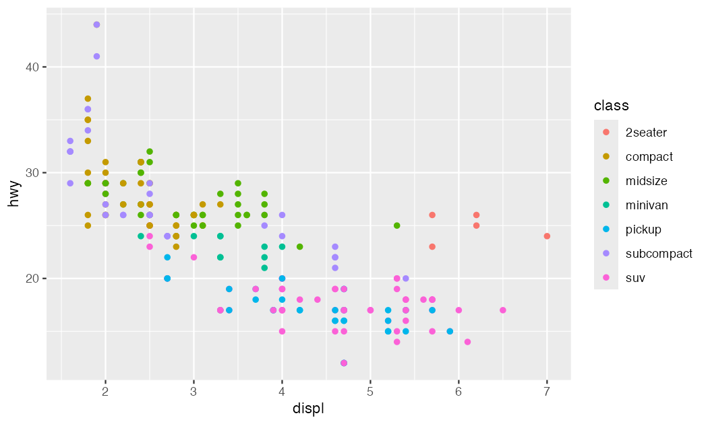
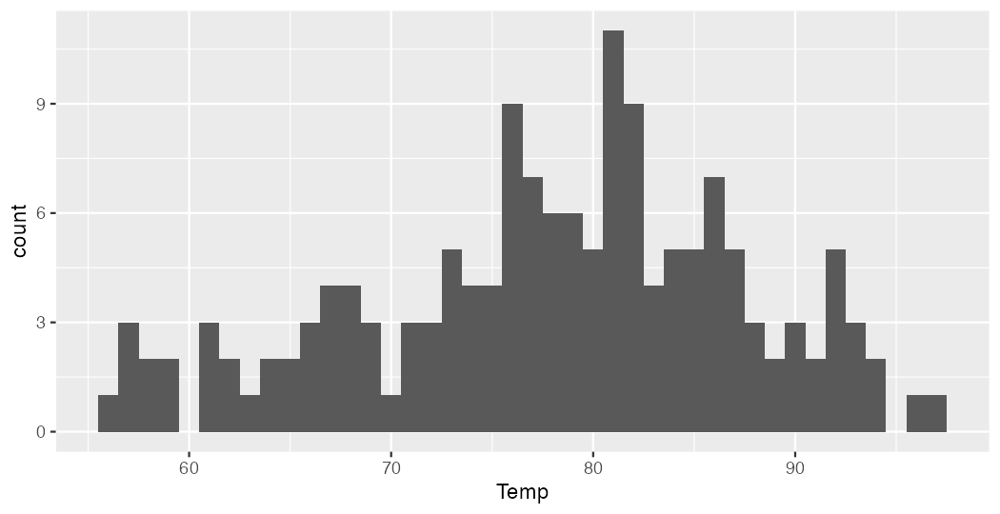
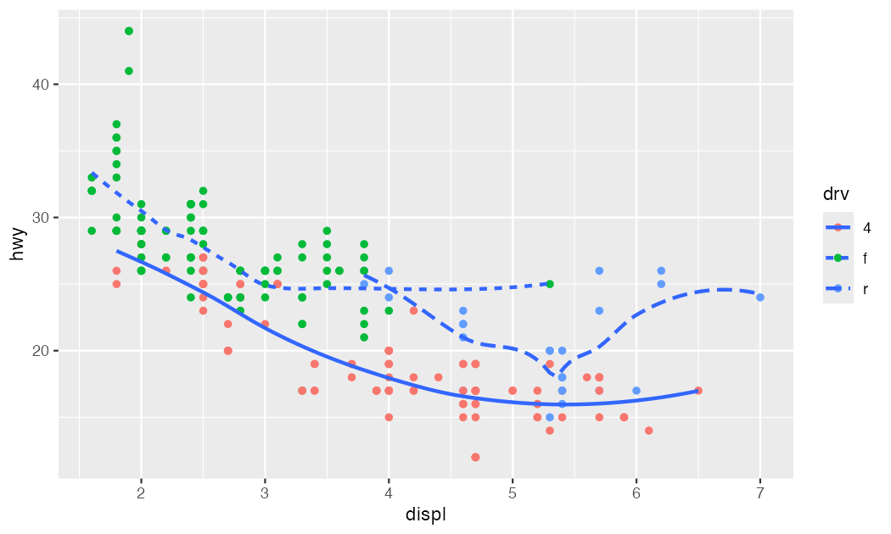
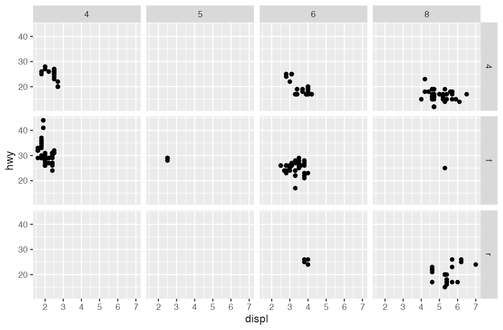
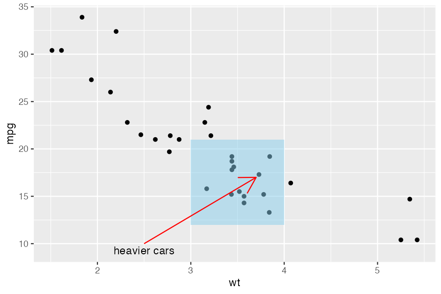
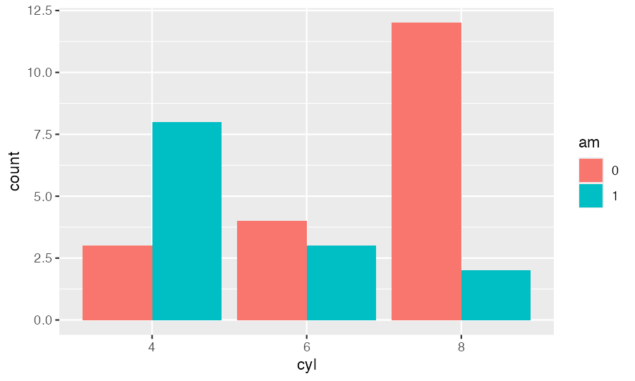
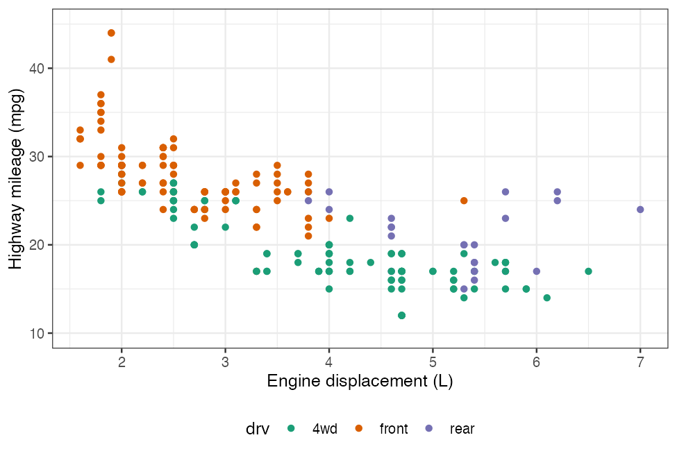
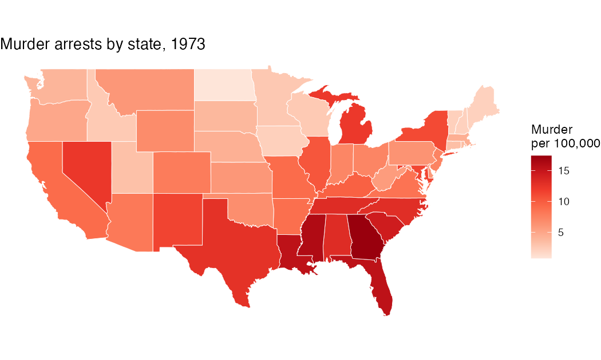

# Chapter 6 — Data Visualization with ggplot2

[Repository Guide](../../README.md) | [English](Concepts_Lecture.md) | [한국어](Concepts_Lecture.ko.md)

> **Last Updated:** 2026-11-19
>
> 혼자 공부하는 R 데이터 분석, 강전희와 엄동란, Ch 6

> **Learning Objectives:**
> 1. Explain the components of the ggplot2 grammar of graphics and draw scatter plots, line plots, bar charts, and box plots
> 2. Use aesthetic mappings and facets, and stack multiple geoms as layers to add reference lines and text annotations
> 3. Explain, in terms of the interquartile range (IQR), the rule by which a box plot marks outliers
> 4. Explain how statistical transformations and position adjustments change the values drawn in a plot
> 5. Control axes, legends, colors, zoom ranges, and appearance with scales, coordinate systems, and themes
> 6. Draw a choropleth map by joining attribute values to polygon map data

---

## Table of Contents

- [1. Introduction to ggplot2](#1-introduction-to-ggplot2)
  - [1.1 The Grammar of Graphics](#11-the-grammar-of-graphics)
  - [1.2 Basic Syntax](#12-basic-syntax)
  - [1.3 Components of the Layered Grammar](#13-components-of-the-layered-grammar)
  - [1.4 Plot Objects and Saving](#14-plot-objects-and-saving)
  - [1.5 A First Plot with the mpg Data](#15-a-first-plot-with-the-mpg-data)
- [2. Basic Plot Types](#2-basic-plot-types)
  - [2.1 Scatter Plot (geom_point())](#21-scatter-plot-geom_point)
  - [2.2 Line Plot (geom_line())](#22-line-plot-geom_line)
  - [2.3 Bar Chart (geom_bar())](#23-bar-chart-geom_bar)
  - [2.4 Box Plot (geom_boxplot())](#24-box-plot-geom_boxplot)
  - [2.5 Sunburst Chart (Polar Coordinates)](#25-sunburst-chart-polar-coordinates)
  - [2.6 Histogram (geom_histogram())](#26-histogram-geom_histogram)
  - [2.7 geom_bar() and geom_col()](#27-geom_bar-and-geom_col)
  - [2.8 Layering Geoms and geom_smooth()](#28-layering-geoms-and-geom_smooth)
  - [2.9 Choosing a Plot by Variable Type](#29-choosing-a-plot-by-variable-type)
- [3. Aesthetic Mappings](#3-aesthetic-mappings)
  - [3.1 Color Mapping](#31-color-mapping)
  - [3.2 Alpha (Transparency) Mapping](#32-alpha-transparency-mapping)
  - [3.3 Shape Mapping](#33-shape-mapping)
  - [3.4 Size Mapping and Kinds of Variables](#34-size-mapping-and-kinds-of-variables)
  - [3.5 Global and Local Mappings](#35-global-and-local-mappings)
- [4. Faceting](#4-faceting)
  - [4.1 facet_wrap()](#41-facet_wrap)
  - [4.2 facet_grid()](#42-facet_grid)
- [5. Reference Lines and Annotations](#5-reference-lines-and-annotations)
  - [5.1 Adding Reference Lines](#51-adding-reference-lines)
  - [5.2 Text Annotations](#52-text-annotations)
  - [5.3 Regression Lines and Cautions for Time Series Plots](#53-regression-lines-and-cautions-for-time-series-plots)
  - [5.4 Shapes and Arrows: annotate()](#54-shapes-and-arrows-annotate)
  - [5.5 Titles and Axis Labels: labs()](#55-titles-and-axis-labels-labs)
- [6. Statistical Transformations and Position Adjustments](#6-statistical-transformations-and-position-adjustments)
  - [6.1 Statistical Transformations](#61-statistical-transformations)
  - [6.2 Position Adjustments](#62-position-adjustments)
- [7. Scales](#7-scales)
- [8. Coordinate Systems](#8-coordinate-systems)
- [9. Themes](#9-themes)
- [10. Map Visualization](#10-map-visualization)
- [Concept Applications](#concept-applications)
- [Glossary](#glossary)
- [Summary](#summary)
- [Self-Check Questions](#self-check-questions)
- [References](#references)

---

<br>

## 1. Introduction to ggplot2

### 1.1 The Grammar of Graphics

`ggplot2` is based on the **Grammar of Graphics** concept, where every plot is composed of:

- **Data**: The dataset being plotted.
- **Aesthetics** (`aes()`): Mappings from data variables to visual properties (x, y, color, size, shape).
- **Geometries** (`geom_*`): The visual elements, such as points, lines, and bars.
- **Statistics** (`stat_*`): Summaries or transformations of the data before drawing, such as counting. `geom_bar()` counts by default.
- **Scales**: How data values map to aesthetic values.
- **Coordinates** (`coord_*`): How positions are placed on the plane. The default is the Cartesian coordinate system, and `coord_polar()` gives polar coordinates.
- **Facets**: Splitting data into subplots.
- **Themes**: Visual appearance, such as fonts, colors, and backgrounds.

`ggplot2` was created by Hadley Wickham, who also created the `reshape2` and `dplyr` packages, and it is the most widely used visualization package in R. The base graphics of Section 8 of Chapter 4 use a different function for each kind of graph (`hist()`, `boxplot()`, `barplot()`), but ggplot2 builds every graph from combinations of the same components. So knowing how to draw a scatter plot means that bar charts, maps, and faceted plots can be drawn with the same grammar.

### 1.2 Basic Syntax

```r
library(ggplot2)

ggplot(data, aes(x = variable1, y = variable2)) +
  geom_point()   # Add a geometry layer
```

> **Key Point:** ggplot2 builds plots layer by layer using the `+` operator. The `ggplot()` call creates the canvas, and `geom_*()` functions add visual elements.

Giving `ggplot()` only the data and `aes()` shows an empty plot frame with only axes and ticks in the Plots pane. The first argument of `ggplot()` is the dataset, and inside `aes()` the **variables** for the x- and y-axes are specified. Points or lines are drawn only after a layer such as `geom_point()` is added with `+`. When using ggplot2 for the first time, install it with `install.packages("ggplot2")`, and load it with `library(ggplot2)` in each session. The examples in this chapter also use the `dplyr` functions of Chapter 5 (`count()`, `filter()`, `summarise()`, and others) for counts and summaries, so run `library(dplyr)` as well.

### 1.3 Components of the Layered Grammar

ggplot2 follows the **layered grammar of graphics**, which extends Wilkinson's grammar of graphics while implementing it in R [1]. The layered grammar defines a plot as a combination of the following components [1].

| Component | What It Does | ggplot2 Function |
|:--|:--|:--|
| Default data and mappings | The data frame used for the whole plot and the correspondence from variables to aesthetics | `ggplot(data, aes(...))` |
| Layers (one or more) | A bundle of one geometric object, one statistical transformation, one position adjustment, and optional data and mappings | `geom_*()`, `stat_*()` |
| Scales | One for each aesthetic used in the mappings, the rule turning data values into colors, sizes, or positions, with its legend or axis | `scale_*()` |
| Coordinate system | How positions are placed on the plane | `coord_*()` |
| Facets | How the data is split into subsets drawn in several panels | `facet_*()` |

*Table 1. Components of a plot defined by the layered grammar*

The theme sets data-independent appearance such as fonts, backgrounds, and grid lines, and it is specified with `theme()` separately from the components of the layered grammar (Section 9). Using all of these components, a ggplot2 plot can be written in the following template.

```r
ggplot(data = <DATA>) +
  <GEOM_FUNCTION>(
    mapping = aes(<MAPPINGS>),
    stat = <STAT>,
    position = <POSITION>
  ) +
  <COORDINATE_FUNCTION> +
  <FACET_FUNCTION> +
  <SCALE_FUNCTION> +
  <THEME_FUNCTION>
```

In practice, most components have suitable defaults, so writing only three of them, the data, the mappings, and a geometric object, completes a plot. For example, the statistical transformation of `geom_point()` is `"identity"`, which uses values as they are, its position adjustment is also `"identity"`, the coordinate system is Cartesian, and the scales are the defaults suited to the variable types. A component is added only when a plot different from the defaults is needed.

### 1.4 Plot Objects and Saving

The result of `ggplot()` is an object holding the information needed to draw the plot, so it can be stored in a variable. Layers can be added to the stored object with `+`, and the plot is drawn when its name is entered to print it.

```r
p <- ggplot(data = mpg) +
  geom_point(mapping = aes(x = displ, y = hwy, color = class))
p                                   # Print the plot
ggsave("mpg_scatter.png", p, width = 7, height = 4.2, dpi = 150)
```

`ggsave()` saves a plot to a file, and the extension (`.png`, `.pdf`, `.svg`) sets the format. The default unit of `width` and `height` is inches, and `dpi` is pixels per inch, so the file above is an image 7 × 150 = 1,050 pixels wide. Without a plot object, it saves the last plot printed. Autoprinting does not happen inside functions or loops (Section 8 of Chapter 3), so `print(p)` must be stated to see the plot there.

### 1.5 A First Plot with the mpg Data

`mpg`, included in ggplot2, holds fuel economy data on 38 car models collected by the US Environmental Protection Agency. Let us answer the question "Do cars with big engines use more fuel than cars with small engines?" with data.

```r
mpg
#> # A tibble: 234 × 11
#>    manufacturer model      displ  year   cyl trans drv     cty   hwy fl    class
#>    <chr>        <chr>      <dbl> <int> <int> <chr> <chr> <int> <int> <chr> <chr>
#>  1 audi         a4           1.8  1999     4 auto… f        18    29 p     comp…
#>  2 audi         a4           1.8  1999     4 manu… f        21    29 p     comp…
#>  3 audi         a4           2    2008     4 manu… f        20    31 p     comp…
#>  4 audi         a4           2    2008     4 auto… f        21    30 p     comp…
#>  5 audi         a4           2.8  1999     6 auto… f        16    26 p     comp…
#>  6 audi         a4           2.8  1999     6 manu… f        18    26 p     comp…
#>  7 audi         a4           3.1  2008     6 auto… f        18    27 p     comp…
#>  8 audi         a4 quattro   1.8  1999     4 manu… 4        18    26 p     comp…
#>  9 audi         a4 quattro   1.8  1999     4 auto… 4        16    25 p     comp…
#> 10 audi         a4 quattro   2    2008     4 manu… 4        20    28 p     comp…
#> # ℹ 224 more rows
```

`mpg` is a tibble of 234 rows and 11 columns. `displ` is the engine displacement (liters), and `hwy` is the highway fuel efficiency (miles per gallon), where larger values mean less fuel used. `cty` is the city fuel efficiency, `drv` the drive type (`f` front, `r` rear, `4` four-wheel), and `class` the car type. The columns are wider than the screen, so the values of `trans` and `class` are cut off with the ellipsis `…`. Putting `displ` on the x-axis and `hwy` on the y-axis and mapping `class` to color draws Figure 1.



*Figure 1. Engine displacement and highway mileage of mpg, colored by class*

Figure 1 shows a negative relationship in which highway fuel efficiency falls as displacement rises, so the answer is that cars with big engines use more fuel. However, a few points with large displacements of 5-7 liters and high fuel efficiency of about 25 depart from the linear trend. Their colors show that most of them are `2seater`, sports cars with big engines but light bodies. Adding a third variable with an aesthetic mapping like this reveals the identity of points that the two variables alone cannot explain.

---

<br>

## 2. Basic Plot Types

### 2.1 Scatter Plot (`geom_point()`)

`airquality` holds daily air quality measurements in New York from May to September 1973. `Day` is the day of the month (1-31) and `Temp` is the daily maximum temperature (Fahrenheit), so each day in the plots below carries points from five months.

```r
# Basic scatter plot
ggplot(airquality, aes(x = Day, y = Temp)) +
  geom_point()

# Scatter plot with custom size and color
ggplot(airquality, aes(x = Day, y = Temp)) +
  geom_point(size = 3, color = "red")
# Default point size is 1.5
```

The first plot has five points stacked vertically at each day and shows no clear trend by day. In fact the correlation coefficient of the two variables is `cor(airquality$Day, airquality$Temp)` = -0.131, close to 0. The day (1-31) is only a position within the month and does not represent the season, so to see changes in temperature, `Month` must be used as well or the days must be turned into a continuous time axis. The `size = 3` and `color = "red"` of the second plot are constants written outside `aes()`, so all points are drawn with the same size and color and no legend is created (Section 3.3).

### 2.2 Line Plot (`geom_line()`)

```r
ggplot(airquality, aes(x = Day, y = Temp)) +
  geom_line()
```

`geom_line()` connects points with lines in order of their x values. This plot has temperatures from five months for each day (`Day`), so the five points at the same x are connected vertically and the line becomes jagged. To draw a separate line for each month, the groups must be given with `aes(group = Month)` or `aes(color = factor(Month))`. A line plot suits data with only one y value per x value, that is, the change of a single series over time.

### 2.3 Bar Chart (`geom_bar()`)

`geom_bar()` counts the rows for each value of x and uses the counts as bar heights. Passing the numeric `cyl` of `mtcars` (Chapter 5, Section 1.2) directly as x makes the x-axis continuous, leaving empty ticks such as 5 and 7 between 4, 6, and 8; converting it to a categorical variable with `factor()` shows bars only for the actual values 4, 6, and 8. `fill = factor(gear)` splits each bar by number of gears and colors the parts.

```r
# Simple bar chart (only x-axis needed; y counts automatically)
ggplot(mtcars, aes(x = cyl)) +
  geom_bar(width = 0.5)

# Use factor() to exclude empty categories (e.g., 5 and 7 cylinders)
ggplot(mtcars, aes(x = factor(cyl))) +
  geom_bar(width = 0.5)

# Stacked bar chart with fill color
ggplot(mtcars, aes(x = factor(cyl))) +
  geom_bar(aes(fill = factor(gear)))
```

A stacked bar chart shows the frequency by number of cylinders together with the frequency by number of gears within it. The 8-cylinder bar of 14 cars is colored in two parts, 12 cars with 3 gears and 2 with 5 gears. Placing bars side by side or turning them into proportions is covered in Section 6.2.

### 2.4 Box Plot (`geom_boxplot()`)

Because `Day` is numeric, `group = Day` is needed to draw a separate box for each day. Without it, all the data is drawn as a single box.

```r
# Box plot with grouping
ggplot(airquality, aes(x = Day, y = Temp, group = Day)) +
  geom_boxplot()
```

> **Key Point:** A box plot marks as outliers the points that lie more than $1.5 \times \mathrm{IQR}$ below the first quartile $Q_1$ or more than $1.5 \times \mathrm{IQR}$ above the third quartile $Q_3$, that is, points below $Q_1 - 1.5 \times \mathrm{IQR}$ or above $Q_3 + 1.5 \times \mathrm{IQR}$. The interquartile range is $\mathrm{IQR} = Q_3 - Q_1$. A box plot does **not** define outliers using the mean and standard deviation. The mean and standard deviation are strongly affected by the extreme values themselves.

How to read each part of a box plot and an example of computing the whisker ends are in Section 8 of Chapter 4. Rather than this plot with as many as 31 boxes, `aes(x = factor(Month), y = Temp)`, which compares the temperature distributions by month, better shows that the median temperature is highest in July (84 degrees) and August (82 degrees) and low in May (66 degrees) and September (76 degrees).

### 2.5 Sunburst Chart (Polar Coordinates)

```r
# Stacked bar chart converted to sunburst using coord_polar()
ggplot(mtcars, aes(x = factor(cyl))) +
  geom_bar(aes(fill = factor(gear))) +
  coord_polar()

# Donut-shaped sunburst chart
ggplot(mtcars, aes(x = factor(cyl))) +
  geom_bar(aes(fill = factor(gear))) +
  coord_polar(theta = "y")
```

> **Note:** **Two ways of polar conversion.** The default `theta = "x"` of `coord_polar()` maps the x categories to angle and the bar heights to radius, which gives a shape like Nightingale's rose diagram (coxcomb). `theta = "y"` maps the counts to angle and the categories to radius, which gives a donut shape with one ring per category. A sunburst chart in the strict sense shows a hierarchy with higher-level categories in the inner ring and lower-level categories in the outer rings; here the name means a similar shape.

A sunburst chart displays the proportions of hierarchical data by category, and the code above makes one by adding a single line, `coord_polar()`, to the stacked bar chart code. Obtaining a completely different shape by changing only the coordinate system of the same layer shows a characteristic of the layered grammar well. Still, as with pie charts, angles and areas are harder to compare than lengths (Section 8 of Chapter 4), so bar charts are better for precise comparison.

### 2.6 Histogram (`geom_histogram()`)

`geom_histogram()` needs only the x mapping; it divides the range of a continuous variable into bins and counts the observations in each bin.

```r
ggplot(airquality, aes(Temp)) + geom_histogram()
#> `stat_bin()` using `bins = 30`. Pick better value `binwidth`.
h1 <- ggplot(airquality, aes(Temp)) + geom_histogram(binwidth = 1)
range(airquality$Temp)
#> [1] 56 97
```

Without bins specified, ggplot2 divides the range into 30 bins (`bins = 30`) and gives a message to pick a better value. 30 is only a default chosen without regard to the data, so it is better to set `binwidth` (bin width) or `bins` (number of bins) to suit the units of the data. Temperatures are recorded as whole Fahrenheit degrees and range from 56 to 97, so `binwidth = 1` gives one bar per integer temperature (Figure 2).



*Figure 2. Histogram of daily maximum temperature with bin width 1*

In Figure 2, temperatures cluster around 75-85 degrees, and the tail is long toward low temperatures around 60 degrees. Bins of width 1 show the frequencies of the integer values as they are, but the uneven bars make the overall shape hard to read, so to see the shape of the distribution, also draw it with a wider width such as `binwidth = 5`.

### 2.7 geom_bar() and geom_col()

`geom_bar()` counts the rows itself, but when there is already a table of counts, use `geom_col()`, which uses those values as bar heights.

```r
cyl_count <- count(mtcars, cyl)
cyl_count
#>   cyl  n
#> 1   4 11
#> 2   6  7
#> 3   8 14
b <- ggplot(cyl_count, aes(x = factor(cyl), y = n)) + geom_col()
layer_data(b)[, c("x", "y")]
#>   x  y
#> 1 1 11
#> 2 2  7
#> 3 3 14
layer_data(ggplot(mtcars, aes(factor(cyl))) + geom_bar())[, c("x", "count", "prop")]
#>   x count prop
#> 1 1    11    1
#> 2 2     7    1
#> 3 3    14    1
```

`layer_data()` shows the data a layer actually used for drawing. `geom_col()` uses the `n` values of the table, 11, 7, 14, as y directly, and `geom_bar()` counts the 32 rows of the original data by number of cylinders to produce the same values 11, 7, 14. The two plots look the same, but the first needs y mapped and the second does not. A categorical x is converted internally to positions 1, 2, 3 for drawing. This counting by `geom_bar()` is a statistical transformation, revisited in Section 6.1.

### 2.8 Layering Geoms and geom_smooth()

Even with the same x and y, different geometric objects represent the data as different visual objects. `geom_point()` represents each observation as a point, and `geom_smooth()` as a smooth curve fitted to the data. Several geometric objects can be layered in one plot with `+`.

```r
s <- ggplot(mpg, aes(x = displ, y = hwy)) +
  geom_point(aes(color = drv)) +
  geom_smooth(aes(linetype = drv), se = FALSE)
s
#> `geom_smooth()` using method = 'loess' and formula = 'y ~ x'
count(mpg, drv)
#> # A tibble: 3 × 2
#>   drv       n
#>   <chr> <int>
#> 1 4       103
#> 2 f       106
#> 3 r        25
```



*Figure 3. Points and smooth curves by drive type*

`geom_smooth()` draws one curve per drive type, with a different line type for each, according to `linetype = drv`. The message reports that, with fewer than 1,000 observations, the curve was fitted by local regression (loess). `se = FALSE` omits the confidence band around the curve. In Figure 3, the curve for four-wheel drive (`4`) declines steadily as displacement increases, front-wheel drive (`f`) is concentrated at small displacements, and rear-wheel drive (`r`) has large displacements but a stretch where fuel efficiency rises again. Rear-wheel drive has only 25 cars, so its curve is pulled strongly by a few points and must be interpreted with care.

> **Caution:** A smooth curve only summarizes the trend of the points and does not explain causes. Also, where points are few, the curve bends strongly under a few values, so when drawing a curve, draw the original points together to see where the curve has weak support.

### 2.9 Choosing a Plot by Variable Type

Which plot to draw is decided by the number and kinds of variables to look at.

| What to See | Kinds of Variables | Suitable Geometric Objects |
|:--|:--|:--|
| Distribution of one variable | Numeric | `geom_histogram()`, `geom_density()`, `geom_boxplot()` |
| Distribution of one variable | Categorical | `geom_bar()` |
| Relationship of two variables | Numeric and numeric | `geom_point()`, `geom_smooth()`, and `geom_line()` when there is a time order |
| Comparing distributions by group | Numeric and categorical | `geom_boxplot()`, `geom_violin()`, faceted histograms by group |
| Combinations of two categories | Categorical and categorical | Stacked, side-by-side, or proportion bars (Section 6.2) |

*Table 2. Choosing a plot by variable type*

This table is only a starting point, and even for the same variables a different plot can be better depending on the question. For example, to compare highway fuel efficiency by car type, one bar per type suffices to see only the means, but a box plot is better to see the spread and outliers as well. A third variable is usually added with an aesthetic mapping such as color or shape (Section 3), and a fourth with facets (Section 4).

---

<br>

## 3. Aesthetic Mappings

### 3.1 Color Mapping

```r
# Map class to color: each class gets a different color
ggplot(data = mpg) +
  geom_point(mapping = aes(x = displ, y = hwy, color = class))
```

Every geom function in `ggplot2` takes a `mapping` argument, which sets how the variables of the data correspond to visual properties. `mapping` is always used with `aes()`, and `x` and `y` of `aes()` specify the variables for the x- and y-axes. Adding `color = class` makes ggplot2 choose a different color for each of the 7 values of `class` and create a legend that tells which color is which value (Figure 1). The British spelling `colour` can also be used with the same meaning.

### 3.2 Alpha (Transparency) Mapping

Transparency expresses a degree from low to high, so mapping it to an unordered categorical variable makes ggplot2 print a warning that this is not advised.

```r
# Map class to transparency
ggplot(data = mpg) +
  geom_point(mapping = aes(x = displ, y = hwy, alpha = class))
```

Running it gives the warning `Using alpha for a discrete variable is not advised.`, and the points are drawn with a different transparency for each value of `class`. Differences in transparency make 7 categories hard to tell apart, and because categories earlier in alphabetical order look more transparent, they read as if there were an order among the categories that does not exist.

### 3.3 Shape Mapping

The default shape palette distinguishes at most 6 categories. When `class`, which has 7 categories, is mapped to shape, the 62 points of the seventh category `suv` are not drawn, and a warning is printed.

```r
# Map class to point shape
ggplot(data = mpg) +
  geom_point(mapping = aes(x = displ, y = hwy, shape = class))
```

> **Key Point:** When an aesthetic is placed **inside** `aes()`, it maps a variable to the aesthetic. When placed **outside** `aes()`, it sets a constant value (e.g., `color = "red"` makes all points red).

Two warnings appear here. The first says that the shape palette cannot handle more than 6 values, and the second, `Removed 62 rows containing missing values or values outside the scale range`, says that 62 rows were not drawn. It is hard to notice missing points by looking at the plot, so the warnings must always be read. If 7 or more shapes are required, set the shapes directly with `scale_shape_manual(values = ...)`.

### 3.4 Size Mapping and Kinds of Variables

Mapping a categorical variable to size gives the same kind of warning as alpha.

```r
ggplot(mpg) + geom_point(aes(x = displ, y = hwy, size = class))
#> Warning: Using size for a discrete variable is not advised.
```

Size and transparency convey order, as in "larger" and "darker," so they suit ordered or continuous variables, while color and shape suit distinguishing unordered categories. Mapping a continuous variable to color makes ggplot2 use, instead of one color per category, a gradient in which the color changes continuously with the size of the value.

```r
ggplot(mpg, aes(displ, hwy, color = cty)) + geom_point() -> pc
layer_data(pc)$colour[1:3]
#> [1] "#29567D" "#306591" "#2E608A"
```

City fuel efficiency `cty` is an integer numeric variable, so a continuous scale is used, and the first three points are colored slightly different shades of blue according to their values. Conversely, mapping a continuous variable to shape gives an error, because shapes have no order of size. In summary:

- **Categorical variables (unordered):** color (`color`, `fill`), shape (`shape`), line type (`linetype`)
- **Ordered and continuous variables:** position (`x`, `y`), size (`size`), transparency (`alpha`), continuous color

### 3.5 Global and Local Mappings

A mapping written in `aes()` inside `ggplot()` is a **global mapping** inherited by every layer of the plot, and a mapping written in `aes()` inside `geom_*()` is a **local mapping** applied only to that layer.

```r
ggplot(mpg, aes(x = displ, y = hwy)) +
  geom_point(aes(color = class)) +
  geom_smooth()
#> `geom_smooth()` using method = 'loess' and formula = 'y ~ x'
```

In the code above, `x` and `y` are shared by both layers, but `color = class` applies only to the point layer. So the points are colored by car type, and a single smooth curve is drawn for all points. Moving `color = class` into `ggplot()` makes `geom_smooth()` inherit it too and draw 7 curves, one per car type. By the same principle, each layer can be given different data. `geom_smooth(data = filter(mpg, class == "subcompact"))` fits the curve to subcompact cars only while the points show all cars.

---

<br>

## 4. Faceting

### 4.1 facet_wrap()

Splits data into subplots based on a categorical variable. `~ class` is a formula that asks for one subplot per value of `class`, and `nrow = 2` arranges the 7 subplots in 2 rows:

```r
ggplot(data = mpg) +
  geom_point(mapping = aes(x = displ, y = hwy)) +
  facet_wrap(~ class, nrow = 2)
```

An aesthetic mapping distinguishes a variable by color or shape within one plot, but faceting draws a separate plot for each value of the variable. It is especially useful when there are too many categories to distinguish by color or when points overlap. The subplots share the same axis ranges by default, so positions can be compared across panels directly. The variable passed to `facet_wrap()` must be categorical; giving a continuous variable creates a panel for every distinct value, which makes far too many panels.

### 4.2 facet_grid()

To split panels by combinations of two variables, use `facet_grid(row_variable ~ column_variable)`.

```r
g <- ggplot(mpg, aes(displ, hwy)) + geom_point() + facet_grid(drv ~ cyl)
table(mpg$drv, mpg$cyl)
#>    
#>      4  5  6  8
#>   4 23  0 32 48
#>   f 58  4 43  1
#>   r  0  0  4 21
```



*Figure 4. Facets split by drive type (rows) and number of cylinders (columns)*

`drv ~ cyl` creates 3 × 4 = 12 panels, with the 3 drive types as rows and the 4 numbers of cylinders as columns. Combinations that are 0 in the contingency table (for example, rear-wheel drive with 4 cylinders) appear as empty panels in Figure 4, and the only 5-cylinder cars are 4 front-wheel-drive cars. To split in only one direction, use `.` on the other side, as in `facet_grid(. ~ cyl)`. When value ranges differ greatly across panels, `scales = "free_y"` or `scales = "free"` allows axes per panel, but then heights can no longer be compared directly across panels.

---

<br>

## 5. Reference Lines and Annotations

### 5.1 Adding Reference Lines

```r
library(ggplot2)

# Diagonal line with intercept and slope
ggplot(economics, aes(x = date, y = psavert)) +
  geom_line() +
  geom_abline(intercept = 12.18671, slope = -0.0005444)

# Horizontal reference line at the mean
ggplot(economics, aes(x = date, y = psavert)) +
  geom_line() +
  geom_hline(yintercept = mean(economics$psavert))

# Vertical reference line at a specific date
ggplot(economics, aes(x = date, y = psavert)) +
  geom_line() +
  geom_vline(xintercept = as.Date("2005-07-01"))
```

`psavert` is the US personal savings rate (%). `geom_abline()` draws the line $y = \text{intercept} + \text{slope} \times x$ defined by `intercept` and `slope`. A date axis is stored internally as the number of days since 1970-01-01, so the slope `-0.0005444` describes a trend in which the savings rate falls by 0.0005444 percentage points per day, or about 0.2 percentage points per year. `geom_hline()` and `geom_vline()` draw horizontal and vertical lines at the given y and x values. 2005-07-01 is the month with the lowest savings rate, 2.2%.

`economics`, included in ggplot2, is a monthly time series of US economic indicators, holding personal consumption expenditures (`pce`), population (`pop`), the personal savings rate (`psavert`), the median duration of unemployment (`uempmed`), and the number of unemployed (`unemploy`) for 574 months from July 1967.

```r
str(economics)
#> spc_tbl_ [574 × 6] (S3: spec_tbl_df/tbl_df/tbl/data.frame)
#>  $ date    : Date[1:574], format: "1967-07-01" "1967-08-01" ...
#>  $ pce     : num [1:574] 507 510 516 512 517 ...
#>  $ pop     : num [1:574] 198712 198911 199113 199311 199498 ...
#>  $ psavert : num [1:574] 12.6 12.6 11.9 12.9 12.8 11.8 11.7 12.3 11.7 12.3 ...
#>  $ uempmed : num [1:574] 4.5 4.7 4.6 4.9 4.7 4.8 5.1 4.5 4.1 4.6 ...
#>  $ unemploy: num [1:574] 2944 2945 2958 3143 3066 ...
mean(economics$psavert)
#> [1] 8.567247
filter(economics, psavert == min(economics$psavert))$date
#> [1] "2005-07-01"
```

The position of `geom_hline()` is the mean savings rate over the whole period, 8.57%. Instead of writing the date of the vertical line directly, the row with the minimum savings rate can be found with dplyr's `filter()` and its `date` extracted, which gives 2005-07-01. `economics$psavert == min(economics$psavert)` itself is 574 logical values, of which only one is `TRUE`.

### 5.2 Text Annotations

```r
ggplot(airquality, aes(x = Day, y = Temp)) +
  geom_point() +
  geom_text(aes(label = Temp, vjust = 0, hjust = 0))
```

`label = Temp` writes each point's temperature as text. `vjust = 0` and `hjust = 0` align the bottom-left corner of the text with the point, so the text sits above and to the right of the point. Both values are constants rather than variables, so writing them outside `aes()` gives the same result.

Unlike a plot title or axis title, `geom_text()` writes text directly on the plot for each data point and is mainly used to show labels or numeric values. When there are as many as 153 points, as in this plot, the text overlaps and is hard to read, so in practice it is better to give `geom_text(data = ...)` data containing only a few points of interest and label them.

### 5.3 Regression Lines and Cautions for Time Series Plots

Giving `method = "lm"` to `stat_smooth()` (or `geom_smooth()`) draws a straight line fitted by least squares.

```r
ggplot(economics, aes(x = date, y = psavert)) +
  geom_line() +
  stat_smooth(method = "lm", col = "red")
#> `geom_smooth()` using formula = 'y ~ x'
coef(lm(psavert ~ as.numeric(date), data = economics))
#>      (Intercept) as.numeric(date) 
#>    12.4117258255    -0.0004924778
```

The least-squares line computed directly with `lm()` has intercept 12.41 and slope -0.000492 percentage points per day, or about 0.18 percentage points per year. The intercept and slope given to `geom_abline()` in Section 5.1 are values set by the user, so they are not exactly this least-squares line. The gray band around the line is the 95% confidence interval of the regression line and can be turned off with `se = FALSE`. Regression analysis itself is covered in Chapter 10.

> **Caution:** Drawing a single straight line through time series data to judge its trend is not a proper statistical analysis. The savings rate peaked at 17.3% in May 1975, fell until 2005, and then rose again, moving differently in different periods, and values of neighboring months are related to each other (autocorrelation), so the assumptions of ordinary regression do not hold. The example in this section only shows how to draw a line from an intercept and a slope; time series data is analyzed with the time series methods of Chapter 11.

### 5.4 Shapes and Arrows: annotate()

`annotate()` draws a shape, line, or text at given coordinates, independently of the variables of the data frame, to highlight a particular region of the plot. Its first argument sets the kind of object to draw (`"rect"`, `"segment"`, `"text"`, and so on), and its position is given as coordinates.

```r
an <- ggplot(mtcars, aes(x = wt, y = mpg)) +
  geom_point() +
  annotate("rect", xmin = 3, xmax = 4, ymin = 12, ymax = 21, alpha = 0.5, fill = "skyblue") +
  annotate("segment", x = 2.5, xend = 3.7, y = 10, yend = 17, color = "red", arrow = arrow()) +
  annotate("text", x = 2.5, y = 9.3, label = "heavier cars")
sum(mtcars$wt >= 3 & mtcars$wt <= 4 & mtcars$mpg >= 12 & mtcars$mpg <= 21)
#> [1] 13
```



*Figure 5. Scatter plot with a region and an arrow added by annotate()*

`"rect"` fills the rectangle with x from 3 to 4 (3,000-4,000 pounds) and y from 12 to 21 in semi-transparent sky blue. This region contains 13 cars, highlighting that cars of medium weight cluster at fuel efficiency 15-20. `"segment"` draws a segment from (2.5, 10) to (3.7, 17), and `arrow = arrow()` puts an arrowhead at its end. `"text"` writes an explanation below the start of the arrow. `alpha = 0.5` makes the rectangle semi-transparent so that the points beneath it are not hidden.

### 5.5 Titles and Axis Labels: labs()

`labs()` sets the plot title (`title`), subtitle (`subtitle`), axis labels (`x`, `y`), legend titles (`color`, `fill`, and so on), and source note (`caption`) at once.

```r
lb <- ggplot(mtcars, aes(x = gear)) + geom_bar() +
  labs(x = "Number of gears", y = "Number of cars", title = "Cars by number of gears")
table(mtcars$gear)
#> 
#>  3  4  5 
#> 15 12  5
```

This plot shows the number of cars by number of gears as bars of heights 15, 12, and 5. Without axis labels, the variable name `gear` and the `count` created by the statistical transformation are used as they are. For plots that others will see, it is good to use descriptive labels that state the units instead of variable names. Korean titles can also be used, but depending on the operating system a Korean font must be specified so that the characters do not break into boxes (Section 9).

---

<br>

## 6. Statistical Transformations and Position Adjustments

### 6.1 Statistical Transformations

A **statistical transformation** is a computation that turns the original data into the values drawn in the plot. A scatter plot draws each value as it is, but bar charts, histograms, and smooth curves compute new values before drawing. `geom_bar()` computes counts with `stat_count()`, `geom_histogram()` counts per bin with `stat_bin()`, `geom_smooth()` predicted values with `stat_smooth()`, and `geom_boxplot()` quartiles and whisker ends with `stat_boxplot()`.

Variables computed by a statistical transformation can be taken out with `after_stat()` and used for other aesthetics. For example, to draw bar heights as proportions instead of counts, write the following.

```r
layer_data(ggplot(mtcars, aes(factor(cyl))) + geom_bar(aes(y = after_stat(prop), group = 1)))[, c("x", "count", "prop")]
#>   x count    prop
#> 1 1    11 0.34375
#> 2 2     7 0.21875
#> 3 3    14 0.43750
```

`stat_count()` computes the proportion (`prop`) along with the count (`count`). The proportion is computed within groups, so all bars must be put into one group with `group = 1` to get the proportion of the whole, 11 / 32 = 0.34375. In the output of Section 2.7, `prop` was 1 for every bar without `group` because each bar was a different group and the proportion was computed within each group.

`stat_summary()` draws a summary of y for each value of x.

```r
ggplot(mpg, aes(class, hwy)) + stat_summary(fun = mean, geom = "point") -> ps
layer_data(ps)[, c("x", "y")]
#>   x        y
#> 1 1 24.80000
#> 2 2 28.29787
#> 3 3 27.29268
#> 4 4 22.36364
#> 5 5 16.87879
#> 6 6 28.14286
#> 7 7 18.12903
mpg |> group_by(class) |> summarise(hwy = mean(hwy))
#> # A tibble: 7 × 2
#>   class        hwy
#>   <chr>      <dbl>
#> 1 2seater     24.8
#> 2 compact     28.3
#> 3 midsize     27.3
#> 4 minivan     22.4
#> 5 pickup      16.9
#> 6 subcompact  28.1
#> 7 suv         18.1
```

The y values of the points per car type drawn by `stat_summary(fun = mean)` equal the means per car type computed with `group_by()` and `summarise()` of Chapter 5. Summarizing inside the plot and summarizing the data first and then drawing with `geom_point()` or `geom_col()` give the same result, and the latter makes errors easier to find because the summary table can be checked separately.

### 6.2 Position Adjustments

A **position adjustment** decides how to arrange geometric objects that overlap at the same position. In a bar chart, mapping another variable to `fill` stacks the bars upward by default (`position = "stack"`, Section 2.3).

```r
pos <- ggplot(mtcars, aes(x = factor(cyl), fill = factor(am))) +
  geom_bar(position = "dodge") +
  labs(x = "cyl", fill = "am")
layer_data(ggplot(mtcars, aes(factor(cyl), fill = factor(am))) + geom_bar(position = "fill"))[, c("x", "group", "count", "ymin", "ymax")]
#>   x group count      ymin      ymax
#> 1 1     1     3 0.7272727 1.0000000
#> 2 1     2     8 0.0000000 0.7272727
#> 3 2     3     4 0.4285714 1.0000000
#> 4 2     4     3 0.0000000 0.4285714
#> 5 3     5    12 0.1428571 1.0000000
#> 6 3     6     2 0.0000000 0.1428571
```



*Figure 6. Side-by-side bar chart of transmission type by number of cylinders*

`position = "dodge"` places the bars at the same x side by side so that counts within a group can be compared directly (Figure 6). `position = "fill"` stacks the bars but scales the height to 1 so that proportions can be compared. In the output, for 4 cylinders (x = 1), manual transmissions (8 cars) occupy 0 to 0.727 and automatic transmissions (3 cars) 0.727 to 1, the same as the proportion 8 / 11 ≈ 0.727 computed from the contingency table in Chapter 5.

| Position Adjustment | Arrangement | Suitable Use |
|:--|:--|:--|
| `"stack"` | Stacks upward (default for bars) | Total size and its composition |
| `"dodge"` | Places side by side | Comparing counts within a group |
| `"fill"` | Stacks with height scaled to 1 | Comparing proportions within a group |
| `"identity"` | No adjustment (default for points) | Objects that may overlap |
| `"jitter"` | Adds a small random shift to points | Points overlapping at the same position |

*Table 3. Main position adjustments*

In a scatter plot, points with the same values overlap exactly and look like one, which is called **overplotting**.

```r
nrow(distinct(mpg, displ, hwy))
#> [1] 126
nrow(mpg)
#> [1] 234
```

`mpg` has 234 rows, but there are only 126 combinations of (displacement, fuel efficiency), so 108 of the points in Figure 1 are hidden behind other points. `geom_point(position = "jitter")` or `geom_jitter()` moves each point slightly at random to reveal overlapping points. It makes the plot a little less exact in exchange for showing where points cluster, and `width` and `height` reduce the range of movement.

---

<br>

## 7. Scales

A **scale** is the rule that turns data values into aesthetic values, and axes and legends show that rule. ggplot2 automatically chooses a scale suited to the variable type for each mapping, and to change a default scale, add a function of the form `scale_<aesthetic>_<kind>()`.

```r
sc <- ggplot(mpg, aes(displ, hwy, color = drv)) +
  geom_point() +
  scale_x_continuous(breaks = seq(2, 7, by = 1), name = "Engine displacement (L)") +
  scale_y_continuous(limits = c(10, 45), name = "Highway mileage (mpg)") +
  scale_color_brewer(palette = "Dark2", labels = c("4wd", "front", "rear")) +
  theme_bw(base_size = 12) +
  theme(legend.position = "bottom")
```



*Figure 7. Scatter plot with modified scales and theme*

`breaks` of `scale_x_continuous()` sets the tick positions from 2 to 7 at intervals of 1, and `name` sets the axis label. `limits` of `scale_y_continuous()` sets the axis range to 10-45. `scale_color_brewer()` changes the colors to a ColorBrewer color scheme (`"Dark2"`), and `labels` renames the legend entries to match the meaning of the drive types. The last two lines are the theme of Section 9.

| Function | What It Changes |
|:--|:--|
| `scale_x_continuous()`, `scale_y_continuous()` | Ticks (`breaks`), tick labels (`labels`), and range (`limits`) of a continuous axis |
| `scale_x_log10()`, `scale_y_log10()` | Turns the axis into a logarithmic scale |
| `scale_x_discrete()` | Order and labels of a categorical axis |
| `scale_color_brewer()`, `scale_fill_brewer()` | Colors of a categorical variable from a ColorBrewer scheme |
| `scale_color_manual()`, `scale_fill_manual()` | Colors specified directly (`values = c(...)`) |
| `scale_color_gradient()`, `scale_fill_distiller()` | Color gradients for a continuous variable |

*Table 4. Frequently used scale functions*

A variable whose values span a range of several tens of times or more can show small and large values together when drawn on a logarithmic scale.

```r
ggplot(diamonds, aes(carat, price)) + geom_point() + scale_y_log10() -> dl
range(diamonds$price)
#> [1]   326 18823
log10(range(diamonds$price))
#> [1] 2.513218 4.274689
```

ggplot2's `diamonds` holds the prices and characteristics of about 54,000 diamonds. Prices range from 326 to 18,823 dollars, a factor of about 58, so on an ordinary axis the cheap diamonds crowd at the bottom. On a logarithmic scale they spread over the $`\log_{10}`$ range 2.51-4.27, and equal spacing means an equal ratio (for example, a factor of 10). The axis ticks show the original prices, not the logarithms.

The order of a categorical axis is also set by the scale. The default order is the level order of a factor, and alphabetical order for a character variable (Section 6 of Chapter 2). Box plots and bar charts are easier to compare when the categories are placed in order of their values.

```r
sort(tapply(mpg$hwy, mpg$class, median))
#>     pickup        suv    minivan    2seater subcompact    compact    midsize 
#>       17.0       17.5       23.0       25.0       26.0       27.0       27.0
ggplot(mpg, aes(x = reorder(class, hwy, FUN = median), y = hwy)) +
  geom_boxplot() +
  labs(x = "class")
```

`reorder(class, hwy, FUN = median)` turns `class` into a factor whose levels are reordered by the median `hwy` of each car type. So the x-axis of the box plot is ordered not alphabetically (2seater, compact, ...) but from pickup (17.0), with the smallest median, to midsize (27.0), and car types with low and high fuel efficiency separate at a glance. compact and midsize, which have the same median, keep their original level order. To set the level order directly, use `scale_x_discrete(limits = c(...))`.

---

<br>

## 8. Coordinate Systems

A **coordinate system** is how x and y positions are placed on the plot plane. The default is the Cartesian coordinate system (`coord_cartesian()`).

| Function | What It Does |
|:--|:--|
| `coord_cartesian(xlim, ylim)` | In Cartesian coordinates, zooms the visible range while leaving the data as is |
| `coord_flip()` | Swaps the x- and y-axes |
| `coord_fixed(ratio)` | Fixes the ratio so that one unit of x and y has the same length on screen |
| `coord_polar()` | Changes to polar coordinates (Section 2.5) |
| `coord_quickmap()` | Matches the ratio of longitude and latitude so that maps are not distorted (Section 10) |

*Table 5. Main coordinate system functions*

`limits` of a scale and `xlim` of a coordinate system both narrow the axis range, but with different results.

```r
base <- ggplot(mpg, aes(displ, hwy)) + geom_point() + geom_smooth(method = "lm", formula = y ~ x)
p_scale <- base + scale_x_continuous(limits = c(2, 5))
p_coord <- base + coord_cartesian(xlim = c(2, 5))
nrow(layer_data(p_scale, 1))
#> Warning: Removed 58 rows containing non-finite outside the scale range
#> (`stat_smooth()`).
#> [1] 234
nrow(layer_data(p_coord, 1))
#> [1] 234
```

`scale_x_continuous(limits = c(2, 5))` turns the x of the 58 observations outside the range into missing values, so, as the warning shows, those observations are left out when the regression line is computed. The slope of the line fitted only to cars with displacements of 2-5 liters is -4.31, which differs from the slope -3.53 fitted to all cars. In contrast, `coord_cartesian(xlim = c(2, 5))` computes with all the data and then shows only that part enlarged, so the regression line does not change. If the goal is only to look at part of the plot in detail, zoom with the coordinate system.

`coord_flip()` is used when category names are long or categories are many and they overlap on the x-axis.

```r
ggplot(mpg, aes(class, hwy)) + geom_boxplot() + coord_flip() -> pf
```

The code above draws the box plots of highway fuel efficiency by car type lying horizontally, so long names such as `subcompact` are listed on the vertical axis without overlapping. The same result can be obtained by swapping the axes from the start with `aes(x = hwy, y = class)`.

---

<br>

## 9. Themes

A **theme** sets the data-independent appearance of a plot, that is, the background color, grid lines, fonts, and legend position. It is common to choose a ready-made complete theme and adjust only the needed parts with `theme()`.

```r
ggplot(mpg, aes(displ, hwy)) + geom_point() + theme_bw()
ggplot(mpg, aes(displ, hwy)) + geom_point() + theme_minimal(base_size = 14)
ggplot(mpg, aes(displ, hwy, color = drv)) + geom_point() +
  theme(legend.position = "bottom",
        axis.title = element_text(size = 13, face = "bold"),
        panel.grid.minor = element_blank())
```

The default theme `theme_gray()` has white grid lines on a gray background, `theme_bw()` gray grid lines and a border on a white background, `theme_minimal()` only grid lines without border or background, and `theme_classic()` only axis lines without grid lines. `base_size` is the base size of all text. Inside `theme()`, text elements are changed with `element_text()` and line elements with `element_line()`, and `element_blank()` removes the element. Figure 7 is the result of `theme_bw(base_size = 12)` with the legend moved to the bottom. When using Korean titles, specify a Korean font installed on the operating system, as in `theme(text = element_text(family = "AppleGothic"))`, so that the characters do not break.

A theme does not change the information in a plot but strongly affects how easy it is to read. For plots in reports or papers, reduce the background and grid lines so that the data stands out, make axis labels and legends large enough, and use the same theme for the plots of the same document. Running `theme_set(theme_bw())` once applies the same theme to all subsequent plots.

---

<br>

## 10. Map Visualization

In ggplot2, a map is also a plot of polygons made by connecting points. `map_data()` returns the boundary data of the `maps` package as a data frame convenient for ggplot2.

```r
us <- map_data("state")
head(us, 3)
#>        long      lat group order  region subregion
#> 1 -87.46201 30.38968     1     1 alabama      <NA>
#> 2 -87.48493 30.37249     1     2 alabama      <NA>
#> 3 -87.52503 30.37249     1     3 alabama      <NA>
length(unique(us$group))
#> [1] 63
```

Each row is one point on a boundary; `long` and `lat` are longitude and latitude, `order` the order in which points are connected, and `region` the name of the state. `group` represents one closed polygon, and states with detached parts such as islands have several polygons, so there are 49 states (the 48 contiguous states and Washington, D.C.) but 63 groups. Without `group = group` in `geom_polygon()`, even points of different polygons are connected by one line and the map becomes a mess.

Joining an attribute value for each state to the boundary data gives a **choropleth map**, which colors regions by the size of their values. The built-in data `USArrests` holds, for each of the 50 US states in 1973, the arrests per 100,000 residents for murder, assault, and rape, and the percentage of the urban population.

```r
arrests <- USArrests |>
  mutate(region = tolower(rownames(USArrests))) |>
  select(region, Murder)
head(arrests, 3)
#>          region Murder
#> Alabama alabama   13.2
#> Alaska   alaska   10.0
#> Arizona arizona    8.1
choro <- left_join(us, arrests, by = "region")
m <- ggplot(choro, aes(long, lat, group = group, fill = Murder)) +
  geom_polygon(color = "white", linewidth = 0.2) +
  coord_quickmap() +
  scale_fill_distiller(palette = "Reds", direction = 1) +
  labs(fill = "Murder\nper 100,000", title = "Murder arrests by state, 1973") +
  theme_void()
arrests |> arrange(desc(Murder)) |> head(3)
#>                  region Murder
#> Georgia         georgia   17.4
#> Mississippi mississippi   16.1
#> Florida         florida   15.4
```



*Figure 8. Choropleth map of murder arrest rates by US state in 1973*

The state names of `USArrests` are in the row names with capital letters, so they are converted to lower case with `tolower()` to match the format of `region` of `map_data()` and then joined with `left_join()` of Chapter 5. Every point of the boundary data receives the `Murder` value of its state, and `fill = Murder` shows the size of the value as the depth of red. `coord_quickmap()` approximately corrects for the real length of one degree of longitude shrinking with latitude (Section 4 of Chapter 1) so that the map is not stretched sideways, and `theme_void()` removes the axes and grid lines that a map does not need. In Figure 8, murder arrest rates are high in southeastern states such as Georgia (17.4), Mississippi (16.1), and Florida (15.4). Washington, D.C. is not in `USArrests`, so its value becomes `NA` after the join, and Alaska and Hawaii are not drawn because they are not in the boundary data.

> **Note:** **ggmap and sf.** To place points on a background map such as Google Maps, the `ggmap` package can be used, but to download Google maps with it, an API key must be obtained from the Google Maps Platform and registered with `register_google()`. Spatial data whose coordinate reference system must be handled exactly is made into an `sf` object of Section 4 of Chapter 1 and drawn with `geom_sf()`; the choropleth and interactive maps of Chapter 9 use this approach.

A choropleth map paints values over the area of each region, so regions with large areas catch the eye regardless of their actual importance. Also, regions with more people have more incidents, so when comparing regions, paint values converted to rates such as per 100,000 people, as in this example.

---

<br>

## Concept Applications

**True/False Check:**

| Statement | Judgment and Reason |
|:--|:--|
| `geom_point(aes(color = "blue"))` colors every point blue. | **F.** The `"blue"` inside `aes()` is mapped as a variable with a single value, so the points take the first color of the default palette and a legend appears. A constant color is written outside `aes()`. |
| `geom_bar()` is not given a y mapping. | **T.** `geom_bar()` makes y by counting each x through a statistical transformation. To use values already counted, use `geom_col()`. |
| A mapping written in `aes()` inside `ggplot()` applies to every layer of the plot. | **T.** Layers inherit global mappings, and `aes()` inside a layer applies only to that layer. |
| Mapping a variable with 7 categories to shape draws every point with a different shape. | **F.** The default shape palette distinguishes only up to 6, so the points of the seventh category are not drawn, with a warning. |
| `scale_x_continuous(limits = ...)` and `coord_cartesian(xlim = ...)` always make the same plot. | **F.** Scale limits turn data outside the range into missing values and leave them out of statistical computations, while coordinate limits compute with all the data and only zoom. |
| Drawing a line through time series data with `stat_smooth(method = "lm")` amounts to testing the trend. | **F.** A single line ignores changes across periods and autocorrelation, so it is not a proper analysis; time series methods must be used (Chapter 11). |
| On a map drawn with `map_data()`, omitting `group = group` connects the polygons wrongly. | **T.** Even points of different polygons are connected by one line. |

---

<br>

## Glossary

| English | Korean | One-Line Definition |
|:--|:--|:--|
| grammar of graphics | 그래픽 문법 | A system that describes a plot as a combination of components such as data, mappings, and geometric objects. |
| layered grammar of graphics | 층 문법 | ggplot2's grammar of graphics, which defines a plot as a combination of layers, scales, a coordinate system, and facets. |
| aesthetic mapping | 미적 매핑 | Assigning variables of the data to visual properties such as position, color, size, and shape. |
| geometric object (geom) | 기하 객체 | A visual object such as a point, line, or bar that represents the data. |
| layer | 레이어 | One layer of a plot that bundles a geometric object, a statistical transformation, and a position adjustment. |
| facet | 패싯 | A subplot drawn in one of several panels after splitting the data by the values of a variable. |
| global mapping | 전역 매핑 | A mapping written in `ggplot()` and inherited by all layers. |
| local mapping | 지역 매핑 | A mapping written inside one layer and applied only to that layer. |
| loess | 국소 회귀 | A smooth curve fitted by weighting the points near each location. |
| statistical transformation | 통계 변환 | A computation that turns data into the values drawn in a plot. |
| position adjustment | 위치 조정 | The way geometric objects overlapping at the same position are arranged. |
| overplotting | 과대 겹침 | The phenomenon in which several points overlap at the same position and look like one. |
| scale | 척도 | The rule that turns data values into aesthetic values, together with its axis or legend. |
| coordinate system | 좌표계 | The way x and y positions are placed on the plot plane. |
| theme | 테마 | The data-independent appearance of a plot, such as background, grid lines, and fonts. |
| choropleth map | 단계구분도 | A map that colors each region by the size of its value. |

*Table 6. Glossary*

---

<br>

## Summary

| Concept | Key Summary |
|---------|-------------|
| ggplot2 | It follows a layer-based grammar of graphics and builds plots in the form `ggplot() + geom_*()`. |
| `aes()` | It maps data variables to visual properties (x, y, color, size, shape). |
| `geom_point()` | It draws scatter plots, and the default point size is 1.5. |
| `geom_bar()` | It draws bar charts, and converting x to a categorical variable with `factor()` removes empty values from the axis. |
| `geom_boxplot()` | It draws box plots and marks points below $Q_1 - 1.5 \times \mathrm{IQR}$ or above $Q_3 + 1.5 \times \mathrm{IQR}$ as outliers. |
| `facet_wrap()` | It splits a plot into subplots by the values of a variable. |
| Layered Grammar | A plot consists of default data and mappings, one or more layers, scales, a coordinate system, and facets, and the theme sets its appearance. |
| Histogram | `geom_histogram()` divides into 30 bins by default, so `binwidth` or `bins` is set to suit the data. |
| Layering Geoms | Several `geom`s are layered with `+`, and `geom_smooth()` summarizes a trend as a smooth curve or regression line. |
| Mappings and Kinds of Variables | Color and shape suit unordered categories, size and transparency ordered values, and global mappings are inherited by all layers. |
| `facet_grid()` | It makes row and column panels from combinations of two variables. |
| Annotations | `geom_hline()`, `geom_vline()`, `geom_abline()`, `annotate()`, and `labs()` add reference lines, shapes, and titles. |
| Statistical Transformations | Values are computed before drawing, like the counts of `geom_bar()` or the summaries of `stat_summary()`, and are taken out with `after_stat()`. |
| Position Adjustments | `"stack"`, `"dodge"`, `"fill"`, and `"jitter"` change the arrangement of overlapping objects. |
| Scales and Coordinates | Scales set axes, legends, and colors, and coordinates set placement and zoom; scale `limits` drop data outside the range while `coord_cartesian()` only zooms. |
| Themes | A complete theme is chosen and `theme()` adjusts the legend position, text, and grid lines. |
| Maps | Polygons from `map_data()` are drawn by `group` with `geom_polygon()`, and joining attributes makes a choropleth map. |

---

<br>

## Self-Check Questions

1. **Inside and outside aes():** Explain how the results of `geom_point(aes(color = "red"))` and `geom_point(color = "red")` differ.

   <details>
   <summary>Answer</summary>

   `geom_point(color = "red")` sets a constant outside `aes()`, so every point is red. `geom_point(aes(color = "red"))` maps to color a variable whose only value is the string `"red"`, so the points take the first color of the default palette (`#F8766D`, a light red), and a legend with a single entry `red` appears.

   </details>

2. **The x-axis of a bar chart:** In `mtcars`, 11 cars have `cyl` equal to 4, 7 have 6, and 14 have 8. Compare the bar heights and x-axes of the bar charts drawn with `aes(x = cyl)` and with `aes(x = factor(cyl))`.

   <details>
   <summary>Answer</summary>

   In both charts the bar heights are 11, 7, and 14. `cyl` is numeric, so with `aes(x = cyl)` the x-axis is continuous, ticks including 5 and 7 are shown, and those positions are empty. `factor(cyl)` creates a categorical axis that shows only the three categories 4, 6, and 8 side by side.

   </details>

3. **Outlier fences:** A group has first quartile 10 and third quartile 20. Find the outlier fences of the box plot, and choose all values among -6, 34, and 36 that are marked as outliers.

   <details>
   <summary>Answer</summary>

   $\mathrm{IQR} = 20 - 10 = 10$, so the lower fence is $10 - 1.5 \times 10 = -5$ and the upper fence is $20 + 1.5 \times 10 = 35$. -6 is below -5 and 36 is above 35, so both are outliers, while 34 lies within the fences and is not an outlier.

   </details>

4. **Global and local mappings:** Give the number of smooth curves drawn by each of the following two pieces of code and explain why.

   ```r
   ggplot(mpg, aes(displ, hwy, color = drv)) + geom_point() + geom_smooth()
   ggplot(mpg, aes(displ, hwy)) + geom_point(aes(color = drv)) + geom_smooth()
   ```

   <details>
   <summary>Answer</summary>

   In the first, `color = drv` is a global mapping, so `geom_smooth()` inherits it and draws one curve per drive type, 3 in all. In the second, `color = drv` is a local mapping of the point layer, so the curve layer draws 1 curve for all points without groups.

   </details>

5. **Histogram bins:** About how many bars result from drawing a variable ranging from 56 to 97 with `geom_histogram(binwidth = 5)`? What does the message shown with the default settings mean?

   <details>
   <summary>Answer</summary>

   The width of the range is 97 - 56 = 41, so bins of width 5 number 41 / 5 ≈ 8.2, that is, about 9 bars are needed to cover both ends (it can differ by one depending on where the bins start). The default setting uses 30 bins regardless of the data, so a message appears asking to pick a more suitable `binwidth`.

   </details>

6. **Position adjustments:** In `mtcars`, of the 11 four-cylinder cars, 8 have manual and 3 automatic transmissions. Give the height occupied by manual transmissions in the 4-cylinder bar drawn with `geom_bar(position = "fill")`, and the heights of the two bars with `position = "dodge"`.

   <details>
   <summary>Answer</summary>

   `"fill"` scales the whole bar to 1, so manual transmissions occupy a height of 8 / 11 ≈ 0.727 and automatic transmissions the remaining 0.273. `"dodge"` keeps the counts and places the bars side by side, so the two bars have heights 8 and 3.

   </details>

7. **Zoom and limits:** Explain how the regression line differs when `xlim(2, 5)` and when `coord_cartesian(xlim = c(2, 5))` is added to `ggplot(mpg, aes(displ, hwy)) + geom_point() + geom_smooth(method = "lm")`.

   <details>
   <summary>Answer</summary>

   `xlim(2, 5)` sets the scale range, so the 58 cars with displacement below 2 or above 5 are turned into missing values and left out of the regression line, and the line fitted to the remaining cars has slope -4.31. `coord_cartesian(xlim = c(2, 5))` draws the line with slope -3.53 fitted to all 234 cars and then shows only the 2-5 range enlarged.

   </details>

8. **Choropleth maps:** Give two reasons why a choropleth map that paints the number of incidents by region as it is can mislead.

   <details>
   <summary>Answer</summary>

   First, regions with more people also have more incidents, so painting counts as they are shows population size rather than risk; values must be converted to rates such as per 100,000 people. Second, regions with large areas catch the eye because of the painted area and look important regardless of their actual values or populations.

   </details>

---

<br>

## References

1. H. Wickham, "A layered grammar of graphics," *Journal of Computational and Graphical Statistics*, vol. 19, no. 1, pp. 3-28, 2010. [Online]. Available: https://doi.org/10.1198/jcgs.2009.07098
