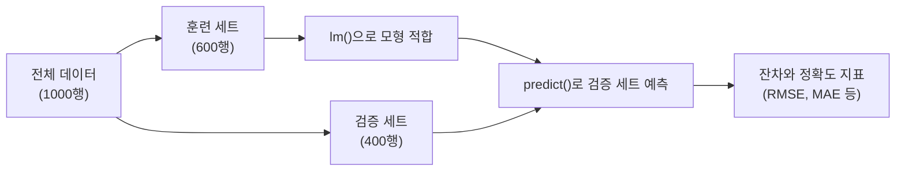

# 7장 — 회귀 분석

[레포지토리 안내](../../README.ko.md) | [English](Concepts_Lecture.md) | [한국어](Concepts_Lecture.ko.md)

> **최종 수정일:** 2026-10-26

> **학습 목표:**
> 1. R에서 단순 선형 회귀와 다중 선형 회귀를 수행할 수 있다
> 2. 회귀 계수와 결정 계수($R^2$)를 해석할 수 있다
> 3. 회귀 가정을 진단하고 이상치를 식별할 수 있다

---

## 목차

- [1. 회귀 분석 개요](#1-회귀-분석-개요)
  - [1.1 회귀 분석이란?](#11-회귀-분석이란)
  - [1.2 회귀 분석의 유형](#12-회귀-분석의-유형)
- [2. 단순 선형 회귀](#2-단순-선형-회귀)
  - [2.1 모형](#21-모형)
  - [2.2 계수 추정(최소제곱법)](#22-계수-추정최소제곱법)
  - [2.3 R에서의 구현](#23-r에서의-구현)
- [3. 다중 선형 회귀](#3-다중-선형-회귀)
  - [3.1 모형](#31-모형)
  - [3.2 예제: Toyota Corolla 가격 예측](#32-예제-toyota-corolla-가격-예측)
  - [3.3 데이터 분할](#33-데이터-분할)
  - [3.4 R에서의 적합](#34-r에서의-적합)
- [4. 회귀 방정식 추정](#4-회귀-방정식-추정)
  - [4.1 출력 해석](#41-출력-해석)
  - [4.2 유의성 코드](#42-유의성-코드)
  - [4.3 결정 계수](#43-결정-계수)
- [5. 모형 평가 지표](#5-모형-평가-지표)
  - [5.1 예측 및 잔차](#51-예측-및-잔차)
  - [5.2 주요 정확도 지표](#52-주요-정확도-지표)
  - [5.3 잔차 진단](#53-잔차-진단)
- [6. 변수 선택](#6-변수-선택)
  - [6.1 변수 선택의 필요성](#61-변수-선택의-필요성)
  - [6.2 방법론](#62-방법론)
  - [6.3 R에서의 구현](#63-r에서의-구현)
- [7. R에서의 지리 데이터 회귀](#7-r에서의-지리-데이터-회귀)
  - [7.1 미국 문해율 단계구분도와 회귀 분석](#71-미국-문해율-단계구분도와-회귀-분석)
  - [7.2 공간 데이터 개념](#72-공간-데이터-개념)
- [요약](#요약)
- [점검 문제](#점검-문제)

---

<br>

## 1. 회귀 분석 개요

### 1.1 회귀 분석이란?

**회귀 분석**(regression analysis)은 **종속 변수**(반응 변수, 결과 변수)와 하나 이상의 **독립 변수**(예측 변수, 특성 변수) 사이의 관계를 모형화하는 통계적 방법이다.

회귀 분석의 목적은 다음과 같다:
- **설명적 모형화**: 예측 변수가 반응 변수에 어떤 영향을 미치는지 이해한다.
- **예측적 모형화**: 반응 변수의 미래 값을 예측한다.

### 1.2 회귀 분석의 유형

| 유형 | 반응 변수 | 예측 변수 | 예시 |
|------|-----------|-----------|------|
| 단순 선형 | 연속형 | 하나의 연속형 | 매출 ~ TV 광고비 |
| 다중 선형 | 연속형 | 다수 | 가격 ~ 연식 + 주행거리 + 마력 |
| 로지스틱 | 이진형 (0/1) | 하나 이상 | 질병 ~ 위험 요인 |
| 다항식 | 연속형 | 비선형 항 | 성장 ~ 시간 + $\text{시간}^2$ |

*표 1. 반응 변수와 예측 변수에 따른 회귀 분석의 유형*

예시 열은 R의 수식 표기법(반응 변수 ~ 예측 변수)을 따른다. 로지스틱 회귀는 9장에서 다룬다.

---

<br>

## 2. 단순 선형 회귀

### 2.1 모형

단순 선형 회귀는 $X$와 $Y$ 사이의 선형 관계를 가정한다:

$$Y \approx \beta_0 + \beta_1 X$$

오차항까지 포함한 완전한 통계 모형은 다음과 같다:

$$Y = \beta_0 + \beta_1 X + \epsilon$$

여기서:
- $\beta_0$는 **절편**($X = 0$일 때 $Y$의 기댓값)이다.
- $\beta_1$은 **기울기**($X$가 1단위 증가할 때 $Y$의 평균 변화량)이다.
- $\epsilon$은 **오차항**(잡음과 모형에 포함되지 않은 효과를 포착)이다.

### 2.2 계수 추정(최소제곱법)

**최소제곱법**(least squares method)은 **잔차제곱합(RSS)** 을 최소화하는 $\hat{\beta}_0$와 $\hat{\beta}_1$을 구한다:

$$RSS = \sum_{i=1}^{n} e_i^2 = \sum_{i=1}^{n} (y_i - \hat{y}_i)^2$$

여기서 $e_i = y_i - \hat{y}_i$는 **잔차**(관측값과 예측값의 차이)이다.

닫힌 형태의 해는 다음과 같다:

$$\hat{\beta}_1 = \frac{\sum_{i=1}^{n}(x_i - \bar{x})(y_i - \bar{y})}{\sum_{i=1}^{n}(x_i - \bar{x})^2}$$

$$\hat{\beta}_0 = \bar{y} - \hat{\beta}_1 \bar{x}$$

> **[미적분학]** 위 닫힌 형태의 해는 RSS를 두 계수 $\beta_0$, $\beta_1$의 함수로 보고 두 편미분을 0으로 놓아 얻는다. $\partial RSS / \partial \beta_0 = -2\sum(y_i - \beta_0 - \beta_1 x_i) = 0$을 풀면 $\hat{\beta}_0 = \bar{y} - \hat{\beta}_1 \bar{x}$가 되고, 이를 $\partial RSS / \partial \beta_1 = -2\sum x_i(y_i - \beta_0 - \beta_1 x_i) = 0$에 대입하면 $\hat{\beta}_1$이 나온다. RSS는 두 계수에 대해 아래로 볼록한 2차 함수이므로, 두 편미분이 모두 0인 이 점에서 최솟값을 갖는다.

### 2.3 R에서의 구현

```r
# 단순 선형 회귀 적합
model <- lm(y ~ x, data = mydata)
summary(model)
```

> **핵심:** R의 `lm()` 함수는 `y ~ x` 형태의 수식 표기법을 사용하며, `y`는 반응 변수, `x`는 예측 변수이다. `~` 기호는 왼쪽의 반응 변수를 오른쪽 예측 변수의 함수로 모형화한다는 뜻이다.

---

<br>

## 3. 다중 선형 회귀

### 3.1 모형

다중 선형 회귀는 단순 선형 회귀를 여러 예측 변수로 확장한 것이다:

$$Y = \beta_0 + \beta_1 X_1 + \beta_2 X_2 + \cdots + \beta_p X_p + \epsilon$$

### 3.2 예제: Toyota Corolla 가격 예측

중고차의 속성으로 제시 가격을 예측하는 전형적인 예제이며, 사용하는 변수는 다음과 같다:

| 변수 | 설명 |
|------|------|
| Price | 제시 가격(유로, 반응 변수) |
| Age | 연식(월 단위) |
| Kilometers | 주행거리(km) |
| Fuel Type | 연료 유형(가솔린, 디젤, CNG) |
| HP | 마력 |
| Metallic | 메탈릭 색상 여부(Yes=1, No=0) |
| Automatic | 자동 변속기 여부(Yes=1, No=0) |
| CC | 실린더 용량(cc) |
| Doors | 문 수 |
| QuartTax | 분기별 도로세(유로) |
| Weight | 중량(kg) |

*표 2. Toyota Corolla 예제의 변수*

### 3.3 데이터 분할

모형을 적합하기 전에 데이터를 **훈련** 세트와 **검증** 세트로 분할한다:

```r
# 데이터 분할: 60% 훈련, 40% 검증
set.seed(1)
train.index <- sample(c(1:1000), 600)
train.df <- car.df[train.index, selected.var]
valid.df <- car.df[-train.index, selected.var]
```

`set.seed(1)`은 난수 시드를 고정하여 같은 분할을 재현하게 하고, `sample(c(1:1000), 600)`은 행 번호 1~1000 중 600개를 비복원 추출한다. `selected.var`는 분석에 쓸 열 이름을 담은 벡터이고, `-train.index`는 훈련 세트에 뽑히지 않은 나머지 400개 행을 고른다. 두 세트는 다음과 같이 쓰인다.



*그림 1. 훈련 세트와 검증 세트를 사용한 회귀 모형의 적합과 평가 흐름*

### 3.4 R에서의 적합

```r
# 나머지 모든 열을 예측 변수로 사용 (.은 "나머지 모든 변수"를 의미)
car.lm <- lm(Price ~ ., data = train.df)
options(scipen = 999)   # 과학적 표기법 비활성화
summary(car.lm)
```

---

<br>

## 4. 회귀 방정식 추정

### 4.1 출력 해석

`summary()` 출력에는 다음이 포함된다:

| 구성 요소 | 설명 |
|-----------|------|
| **Estimate** | 추정 계수 값 ($\hat{\beta}_i$) |
| **Std. Error** | 추정값의 표준 오차 |
| **t value** | 검정 통계량: $t_i = \hat{\beta}_i / se(\hat{\beta}_i)$ |
| **Pr(>\|t\|)** | 양측 가설 검정의 p값 |
| **Multiple R-squared** | $R^2$, 설명된 분산의 비율 |
| **Adjusted R-squared** | $R^2_{adj}$, 예측 변수 수를 고려하여 조정한 $R^2$ |
| **F-statistic** | 모형의 전체적 유의성 검정 |

*표 3. `summary()` 출력의 구성 요소*

### 4.2 유의성 코드

```text
Signif. codes:  0 '***' 0.001 '**' 0.01 '*' 0.05 '.' 0.1 ' ' 1
```

p값이 유의수준(보통 0.05)보다 작으면 계수가 0이라는 귀무가설을 기각하고 해당 예측 변수가 **통계적으로 유의미**하다고 판단한다. 계수 옆의 `***`는 p값이 0.001 이하, `**`는 0.01 이하, `*`는 0.05 이하, `.`는 0.1 이하임을 표시한다.

### 4.3 결정 계수

**결정 계수**(coefficient of determination) $R^2$는 모형이 데이터를 얼마나 잘 적합하는지를 측정한다:

$$R^2 = 1 - \frac{RSS}{TSS} = 1 - \frac{\sum(y_i - \hat{y}_i)^2}{\sum(y_i - \bar{y})^2}$$

여기서 TSS는 **총제곱합**(total sum of squares)으로, 평균 $\bar{y}$를 기준으로 한 반응 변수의 전체 변동이다. 절편이 있는 최소제곱 모형에서 $R^2$는 0과 1 사이의 값을 갖는다.

- $R^2 = 1$: 모형이 반응 변수의 변동을 모두 설명하는 완벽한 적합이다.
- $R^2 = 0$: 모형이 반응 변수의 변동을 전혀 설명하지 못한다.

**수정된** $R^2$는 불필요한 예측 변수의 추가에 대해 벌점을 부여한다:

$$R^2_{adj} = 1 - \frac{(1 - R^2)(n - 1)}{n - p - 1}$$

여기서 $n$은 관측값의 수, $p$는 예측 변수의 수이다.

> **핵심:** 예측 변수의 수가 다른 모형을 비교할 때는 $R^2$ 대신 수정된 $R^2$를 사용한다. 변수를 추가하면 $R^2$는 줄어들지 않지만, 모형이 반드시 개선되는 것은 아니다.

---

<br>

## 5. 모형 평가 지표

### 5.1 예측 및 잔차

```r
# 검증 세트에 대한 예측
car.lm.pred <- predict(car.lm, valid.df)

# 잔차 계산
some.residuals <- valid.df$Price[1:20] - car.lm.pred[1:20]
data.frame("Predicted" = car.lm.pred[1:20],
           "Actual" = valid.df$Price[1:20],
           "Residual" = some.residuals)
```

`predict()`는 훈련 세트로 적합한 모형에 검증 세트의 예측 변수를 넣어 가격을 예측하고, 마지막 문장은 검증 세트의 처음 20개 관측값에 대해 예측값, 실제값, 잔차(실제값 - 예측값)를 나란히 보여 준다.

### 5.2 주요 정확도 지표

| 지표 | 수식 | 해석 |
|------|------|------|
| **MAE** | $\frac{1}{n}\sum \vert e_i \vert$ | 평균 절대 오차의 크기 |
| **ME** | $\frac{1}{n}\sum e_i$ | 평균 오차(편향 방향 표시) |
| **MPE** | $100 \times \frac{1}{n}\sum \frac{e_i}{y_i}$ | 방향이 있는 백분율 오차 |
| **MAPE** | $100 \times \frac{1}{n}\sum \frac{\vert e_i \vert}{y_i}$ | 평균 절대 백분율 오차 |
| **RMSE** | $\sqrt{\frac{1}{n}\sum e_i^2}$ | 평균 제곱근 오차(Y와 동일한 단위) |

*표 4. 회귀 모형의 주요 정확도 지표*

```r
library(forecast)
accuracy(car.lm.pred, valid.df$Price)
#         ME     RMSE      MAE       MPE     MAPE
# 19.62  1325.24  1048.60  -0.75    9.35
```

이 결과에서 ME는 19.62유로로 가격 규모에 비해 0에 가까우므로 예측에 체계적인 편향이 거의 없고, RMSE는 1325.24유로, MAPE는 9.35%이다.

> **핵심:** RMSE는 반응 변수와 동일한 단위를 가지며, 큰 오차에 대해 MAE보다 더 큰 벌점을 부여하기 때문에 가장 널리 사용되는 지표이다.

### 5.3 잔차 진단

계수의 t 검정과 신뢰 구간은 오차항에 대한 가정 위에서 성립하므로, 모형을 적합한 뒤에는 잔차로 가정을 점검한다. 주요 가정은 선형성, 오차의 독립성, **등분산성**(오차의 분산이 일정함), 오차의 정규성이다.

```r
# 진단 그래프 네 개를 2x2 격자에 그리기
par(mfrow = c(2, 2))
plot(car.lm)
par(mfrow = c(1, 1))
```

| 그래프 | 점검하는 내용 | 문제의 신호 |
|------|------|------|
| 잔차 대 적합값(Residuals vs Fitted) | 선형성, 등분산성 | 곡선 패턴, 깔때기 모양의 퍼짐 |
| 정규 Q-Q(Q-Q Residuals) | 오차의 정규성 | 기준선에서 벗어난 점, 특히 양 끝 |
| 척도-위치(Scale-Location) | 등분산성 | 적합값에 따라 커지거나 작아지는 추세 |
| 잔차 대 레버리지(Residuals vs Leverage) | 이상치와 영향점 | Cook의 거리 경계선 밖의 점 |

*표 5. `plot()`이 그리는 회귀 진단 그래프*

> **참고:** 잔차가 큰 관측값은 **이상치**(outlier) 후보이고, 예측 변수 값이 다른 관측값과 멀리 떨어진 관측값은 **레버리지**(leverage)가 크다. 둘을 함께 반영한 **Cook의 거리**(Cook's distance)가 큰 관측값은 회귀 계수를 크게 바꾸는 **영향점**(influential point)이므로, 데이터 오류가 아닌지 확인하고 그 관측값을 뺀 적합 결과와 비교한다.

---

<br>

## 6. 변수 선택

### 6.1 변수 선택의 필요성

모든 예측 변수가 모형에 의미 있는 기여를 하는 것은 아니다. 불필요한 변수를 포함하면 다음과 같은 문제가 발생한다:
- 정확도는 개선되지 않고 모형 복잡도만 증가한다.
- **과적합**(모형이 훈련 데이터를 암기하지만 새로운 데이터에서는 실패하는 현상)이 일어날 수 있다.
- 해석 가능성이 떨어진다.

### 6.2 방법론

| 방법 | 설명 |
|------|------|
| **전진 선택(Forward Selection)** | 빈 모형에서 시작하여 변수를 하나씩 추가 |
| **후진 제거(Backward Elimination)** | 모든 변수에서 시작하여 하나씩 제거 |
| **단계적 선택(Stepwise)** | 전진과 후진의 조합 |
| **최적 부분 집합(Best Subset)** | 가능한 모든 조합을 평가 |

*표 6. 변수 선택 방법*

### 6.3 R에서의 구현

```r
# AIC 기준을 사용한 단계적 회귀
step(car.lm, direction = "both")

# 후진 제거
step(car.lm, direction = "backward")

# 전진 선택
step(lm(Price ~ 1, data = train.df),
     scope = formula(car.lm),
     direction = "forward")
```

`step()`은 각 단계에서 **AIC**(Akaike information criterion)를 가장 많이 줄이는 변수를 추가하거나 제거하고, 어떤 변경으로도 AIC가 줄지 않으면 멈춘다. AIC는 작을수록 좋은 모형을 뜻한다. 전진 선택은 절편만 있는 모형 `lm(Price ~ 1, ...)`에서 시작하여 `scope`로 지정한 전체 모형의 변수 안에서 변수를 추가한다.

---

<br>

## 7. R에서의 지리 데이터 회귀

### 7.1 미국 문해율 단계구분도와 회귀 분석

지리적 시각화와 통계적 분석을 결합하는 예로, 미국 주 경계 셰이프파일에 주별 문해율 데이터를 결합하여 **단계구분도**(choropleth map)를 그린다. 단계구분도는 지역별 값을 색의 농도로 나타낸 지도이다:

```r
library(tidyverse)
library(sf)

# 미국 주 셰이프파일 로드
USMap <- st_read("data/cb_2024_us_state_5m.shp")

# 문해율 데이터 로드
litRates <- read.csv("data/us_literacy_rates_by_state_2025.csv")

# 공간 데이터와 속성 데이터 결합
continentalUS <- USMap %>%
  left_join(litRates, by = c("NAME" = "State")) %>%
  filter(NAME != "Hawaii" & NAME != "Alaska" &
         NAME != "Puerto Rico" & !is.na(Rate))

# 단계구분도 생성
ggplot(continentalUS, aes(geometry = geometry, fill = Rate)) +
  geom_sf() +
  coord_sf()
```

`left_join()`은 셰이프파일의 주 이름 열 `NAME`과 CSV의 `State` 열이 같은 행끼리 문해율을 붙이고, `filter()`는 본토에서 떨어진 하와이, 알래스카, 푸에르토리코와 문해율이 없는 행을 제외한다. 이 결합과 필터 과정은 6장 7.3절과 같다. 결합한 sf 객체는 데이터 프레임이므로 `lm(Rate ~ 예측 변수, data = continentalUS)`처럼 회귀 분석에도 그대로 쓸 수 있다.

### 7.2 공간 데이터 개념

| 개념 | 설명 |
|------|------|
| 셰이프파일(Shapefile) | 지리적 피처를 저장하는 벡터 형식(.shp, .dbf, .shx, .prj) |
| CRS | 좌표 참조 시스템(예: WGS 84의 경우 EPSG:4326) |
| `sf` | R에서 공간 데이터를 다루는 Simple Features 패키지 |
| `st_read()` | 셰이프파일을 R의 sf 객체로 읽어들임 |
| `geom_sf()` | 공간 데이터를 위한 ggplot2 지오메트리 |

*표 7. R의 공간 데이터 주요 개념*

---

<br>

## 요약

| 개념 | 핵심 요약 |
|------|------------|
| 선형 회귀 | 반응 변수와 예측 변수의 선형 관계를 $Y = \beta_0 + \beta_1 X + \epsilon$으로 모형화한다. |
| 최소제곱법 | 잔차제곱합(RSS)을 최소화하는 계수를 추정한다. |
| `lm()` | 선형 모형을 적합하는 R 함수이며, `y ~ x` 형태의 수식을 쓴다. |
| `summary()` | 계수 추정값, 유의성, $R^2$, F-통계량을 보여 준다. |
| $R^2$ | 설명된 분산의 비율이며, 예측 변수 수가 다른 모형을 비교할 때는 수정된 $R^2$를 쓴다. |
| 잔차 | 관측값에서 예측값을 뺀 값 $e_i = y_i - \hat{y}_i$이다. |
| RMSE | 평균 제곱근 오차이며, 반응 변수와 같은 단위를 갖는다. |
| 잔차 진단 | `plot()`의 진단 그래프로 선형성, 등분산성, 정규성, 이상치와 영향점을 점검한다. |
| 데이터 분할 | 데이터를 훈련 세트와 검증 세트(이 예제에서는 60%와 40%)로 나누어 새 데이터에 대한 성능을 평가한다. |
| 변수 선택 | 전진 선택, 후진 제거, 단계적 선택으로 예측에 기여하는 변수를 고른다. |
| 지리 데이터 회귀 | `sf`로 읽은 공간 데이터에 속성 데이터를 결합하면 단계구분도로 시각화하고 `lm()`으로 분석할 수 있다. |

---

<br>

## 점검 문제

1. **최소제곱 추정:** 다섯 관측값 $(x, y)$ = (1, 2), (2, 4), (3, 5), (4, 4), (5, 5)에 단순 선형 회귀를 적합할 때 $\hat{\beta}_0$, $\hat{\beta}_1$, $R^2$를 구하라.

   <details>
   <summary>정답</summary>

   $\bar{x} = 3$, $\bar{y} = 4$이다. $\sum(x_i - \bar{x})(y_i - \bar{y}) = 4 + 0 + 0 + 0 + 2 = 6$이고 $\sum(x_i - \bar{x})^2 = 10$이므로 $\hat{\beta}_1 = 0.6$, $\hat{\beta}_0 = 4 - 0.6 \times 3 = 2.2$이다. 적합값은 2.8, 3.4, 4.0, 4.6, 5.2이고 잔차는 -0.8, 0.6, 1.0, -0.6, -0.2이므로 RSS = 2.4이다. TSS = 4 + 0 + 1 + 0 + 1 = 6이므로 $R^2 = 1 - 2.4/6 = 0.6$이다.

   </details>

2. **수정된 결정 계수:** 관측값 100개, 예측 변수 4개인 모형의 $R^2$가 0.80이다. 관련 없는 예측 변수 하나를 더하여 $R^2$가 0.801이 되었을 때 두 모형의 수정된 $R^2$를 구하고 어느 모형이 나은지 판단하라.

   <details>
   <summary>정답</summary>

   첫 모형은 $1 - (0.20 \times 99)/95 \approx 0.7916$이고, 둘째 모형은 $1 - (0.199 \times 99)/94 \approx 0.7904$이다. $R^2$는 늘었지만 수정된 $R^2$는 줄었으므로 추가한 변수는 모형을 개선하지 못하며, 예측 변수 4개인 첫 모형이 낫다.

   </details>

3. **정확도 지표:** 검증 세트 네 관측값의 실제값이 20, 10, 30, 40이고 잔차가 2, -1, -3, 2일 때 ME, MAE, RMSE, MAPE를 구하고, ME만으로 모형을 평가하면 안 되는 이유를 쓰라.

   <details>
   <summary>정답</summary>

   ME = (2 - 1 - 3 + 2)/4 = 0, MAE = (2 + 1 + 3 + 2)/4 = 2, RMSE = $\sqrt{(4 + 1 + 9 + 4)/4} = \sqrt{4.5} \approx 2.12$, MAPE = 100 × (2/20 + 1/10 + 3/30 + 2/40)/4 = 100 × 0.35/4 = 8.75%이다. 양의 오차와 음의 오차가 상쇄되어 ME는 0이지만 개별 오차는 0이 아니다. ME는 편향의 방향만 보여 주므로 오차의 크기는 MAE나 RMSE로 판단해야 한다.

   </details>

4. **잔차 진단:** 잔차 대 적합값 그래프에서 적합값이 커질수록 잔차의 퍼짐이 넓어지는 깔때기 모양이 보였다. 어떤 가정이 위배되었으며 어떤 문제가 생기는가?

   <details>
   <summary>정답</summary>

   등분산성 가정이 위배되었다(이분산성). 최소제곱 계수 추정값 자체는 편향되지 않지만 표준 오차가 부정확해지므로 t 검정의 p값과 신뢰 구간을 믿기 어렵다. 반응 변수의 로그 변환 같은 방법을 검토한다.

   </details>

5. **변수 선택:** 예측 변수를 모두 넣은 모형보다 변수를 선택한 모형이 검증 세트에서 더 나은 성능을 보일 수 있는 이유를 과적합과 연관 지어 설명하고, 전진 선택과 후진 제거의 시작점을 비교하라.

   <details>
   <summary>정답</summary>

   불필요한 변수는 모형이 훈련 데이터의 잡음까지 학습하게 하여, 훈련 세트의 오차는 줄어도 새 데이터인 검증 세트의 오차는 커지는 과적합을 일으킨다. 기여하지 않는 변수를 빼면 이런 영향이 줄어 검증 성능이 좋아질 수 있다. 전진 선택은 절편만 있는 빈 모형에서 시작하여 변수를 하나씩 추가하고, 후진 제거는 모든 변수를 넣은 모형에서 시작하여 하나씩 제거한다.

   </details>
