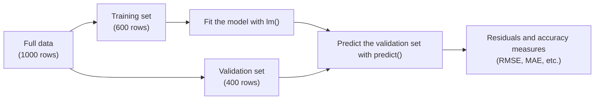

# Chapter 7 — Regression Analysis

[Repository Guide](../../README.md) | [English](Concepts_Lecture.md) | [한국어](Concepts_Lecture.ko.md)

> **Last Updated:** 2026-10-26

> **Learning Objectives:**
> 1. Perform simple and multiple linear regression in R
> 2. Interpret regression coefficients and the coefficient of determination ($R^2$)
> 3. Diagnose regression assumptions and identify outliers

---

## Table of Contents

- [1. Introduction to Regression](#1-introduction-to-regression)
  - [1.1 What is Regression?](#11-what-is-regression)
  - [1.2 Types of Regression](#12-types-of-regression)
- [2. Simple Linear Regression](#2-simple-linear-regression)
  - [2.1 The Model](#21-the-model)
  - [2.2 Estimating Coefficients (Least Squares)](#22-estimating-coefficients-least-squares)
  - [2.3 Implementation in R](#23-implementation-in-r)
- [3. Multiple Linear Regression](#3-multiple-linear-regression)
  - [3.1 The Model](#31-the-model)
  - [3.2 Example: Toyota Corolla Price Prediction](#32-example-toyota-corolla-price-prediction)
  - [3.3 Data Partitioning](#33-data-partitioning)
  - [3.4 Fitting in R](#34-fitting-in-r)
- [4. Estimating the Regression Equation](#4-estimating-the-regression-equation)
  - [4.1 Interpreting the Output](#41-interpreting-the-output)
  - [4.2 Significance Codes](#42-significance-codes)
  - [4.3 R-squared](#43-r-squared)
- [5. Model Evaluation Metrics](#5-model-evaluation-metrics)
  - [5.1 Prediction and Residuals](#51-prediction-and-residuals)
  - [5.2 Common Accuracy Measures](#52-common-accuracy-measures)
  - [5.3 Residual Diagnostics](#53-residual-diagnostics)
- [6. Variable Selection](#6-variable-selection)
  - [6.1 Why Select Variables?](#61-why-select-variables)
  - [6.2 Methods](#62-methods)
  - [6.3 Implementation in R](#63-implementation-in-r)
- [7. Regression with Geographic Data in R](#7-regression-with-geographic-data-in-r)
  - [7.1 US Literacy Rate Choropleth with Regression](#71-us-literacy-rate-choropleth-with-regression)
  - [7.2 Spatial Data Concepts](#72-spatial-data-concepts)
- [Summary](#summary)
- [Self-Check Questions](#self-check-questions)

---

<br>

## 1. Introduction to Regression

### 1.1 What is Regression?

**Regression analysis** is a statistical method for modeling the relationship between a **dependent variable** (response, outcome) and one or more **independent variables** (predictors, features).

The goals of regression analysis are:
- **Explanatory modeling**: Understand how predictors influence the response.
- **Predictive modeling**: Forecast future values of the response.

### 1.2 Types of Regression

| Type | Response Variable | Predictors | Example |
|------|-------------------|-----------|---------|
| Simple Linear | Continuous | One continuous | Sales ~ TV advertising |
| Multiple Linear | Continuous | Multiple | Price ~ Age + Mileage + HP |
| Logistic | Binary (0/1) | One or more | Disease ~ Risk factors |
| Polynomial | Continuous | Non-linear terms | Growth ~ Time + $\text{Time}^2$ |

*Table 1. Types of regression by response variable and predictors*

The Example column follows R formula notation (response ~ predictors). Logistic regression is covered in Chapter 9.

---

<br>

## 2. Simple Linear Regression

### 2.1 The Model

Simple linear regression assumes a linear relationship between $X$ and $Y$:

$$Y \approx \beta_0 + \beta_1 X$$

The full statistical model, including the error term, is:

$$Y = \beta_0 + \beta_1 X + \epsilon$$

Where:
- $\beta_0$ is the **intercept** (expected value of $Y$ when $X = 0$).
- $\beta_1$ is the **slope** (average change in $Y$ per one-unit increase in $X$).
- $\epsilon$ is the **error term** (captures noise and unmodeled effects).

### 2.2 Estimating Coefficients (Least Squares)

The **least squares method** finds $\hat{\beta}_0$ and $\hat{\beta}_1$ that minimize the **Residual Sum of Squares (RSS)**:

$$RSS = \sum_{i=1}^{n} e_i^2 = \sum_{i=1}^{n} (y_i - \hat{y}_i)^2$$

Where $e_i = y_i - \hat{y}_i$ is the **residual** (difference between observed and predicted values).

The closed-form solutions are:

$$\hat{\beta}_1 = \frac{\sum_{i=1}^{n}(x_i - \bar{x})(y_i - \bar{y})}{\sum_{i=1}^{n}(x_i - \bar{x})^2}$$

$$\hat{\beta}_0 = \bar{y} - \hat{\beta}_1 \bar{x}$$

> **[Calculus]** The closed-form solution above is obtained by treating RSS as a function of the two coefficients $\beta_0$ and $\beta_1$ and setting both partial derivatives to zero. Solving $\partial RSS / \partial \beta_0 = -2\sum(y_i - \beta_0 - \beta_1 x_i) = 0$ gives $\hat{\beta}_0 = \bar{y} - \hat{\beta}_1 \bar{x}$, and substituting it into $\partial RSS / \partial \beta_1 = -2\sum x_i(y_i - \beta_0 - \beta_1 x_i) = 0$ yields $\hat{\beta}_1$. RSS is a convex quadratic function of the two coefficients, so it attains its minimum at this point, where both partial derivatives are zero.

### 2.3 Implementation in R

```r
# Fit a simple linear regression
model <- lm(y ~ x, data = mydata)
summary(model)
```

> **Key Point:** The `lm()` function in R uses the formula notation `y ~ x` where `y` is the response variable and `x` is the predictor. The `~` symbol means that the response on the left is modeled as a function of the predictors on the right.

---

<br>

## 3. Multiple Linear Regression

### 3.1 The Model

Multiple linear regression extends simple linear regression to multiple predictors:

$$Y = \beta_0 + \beta_1 X_1 + \beta_2 X_2 + \cdots + \beta_p X_p + \epsilon$$

### 3.2 Example: Toyota Corolla Price Prediction

A classic example involves predicting the offer price of used cars from their attributes, using the following variables:

| Variable | Description |
|----------|-------------|
| Price | Offer price in Euros (response) |
| Age | Age in months |
| Kilometers | Accumulated km on odometer |
| Fuel Type | Petrol, Diesel, CNG |
| HP | Horsepower |
| Metallic | Metallic color (Yes=1, No=0) |
| Automatic | Automatic transmission (Yes=1, No=0) |
| CC | Cylinder volume in cubic centimeters |
| Doors | Number of doors |
| QuartTax | Quarterly road tax in Euros |
| Weight | Weight in kilograms |

*Table 2. Variables in the Toyota Corolla example*

### 3.3 Data Partitioning

Before fitting a model, data is split into **training** and **validation** sets:

```r
# Partition data: 60% training, 40% validation
set.seed(1)
train.index <- sample(c(1:1000), 600)
train.df <- car.df[train.index, selected.var]
valid.df <- car.df[-train.index, selected.var]
```

`set.seed(1)` fixes the random seed so that the same split can be reproduced, and `sample(c(1:1000), 600)` draws 600 of the row numbers 1-1000 without replacement. `selected.var` is a vector of the column names used in the analysis, and `-train.index` selects the remaining 400 rows that were not drawn for the training set. The two sets are used as follows.



*Figure 1. Fitting and evaluating a regression model with training and validation sets*

### 3.4 Fitting in R

```r
# Use all remaining columns as predictors (. means "all other variables")
car.lm <- lm(Price ~ ., data = train.df)
options(scipen = 999)   # Disable scientific notation
summary(car.lm)
```

---

<br>

## 4. Estimating the Regression Equation

### 4.1 Interpreting the Output

The `summary()` output includes:

| Component | Description |
|-----------|-------------|
| **Estimate** | Estimated coefficient values ($\hat{\beta}_i$) |
| **Std. Error** | Standard error of the estimate |
| **t value** | Test statistic: $t_i = \hat{\beta}_i / se(\hat{\beta}_i)$ |
| **Pr(>\|t\|)** | p-value for two-sided hypothesis test |
| **Multiple R-squared** | $R^2$, proportion of variance explained |
| **Adjusted R-squared** | $R^2_{adj}$, $R^2$ adjusted for number of predictors |
| **F-statistic** | Overall significance test of the model |

*Table 3. Components of the `summary()` output*

### 4.2 Significance Codes

```text
Signif. codes:  0 '***' 0.001 '**' 0.01 '*' 0.05 '.' 0.1 ' ' 1
```

If the p-value is smaller than the significance level (usually 0.05), the null hypothesis that the coefficient is zero is rejected and the predictor is judged **statistically significant**. Next to a coefficient, `***` marks a p-value of at most 0.001, `**` at most 0.01, `*` at most 0.05, and `.` at most 0.1.

### 4.3 R-squared

The **coefficient of determination** $R^2$ measures how well the model fits the data:

$$R^2 = 1 - \frac{RSS}{TSS} = 1 - \frac{\sum(y_i - \hat{y}_i)^2}{\sum(y_i - \bar{y})^2}$$

Here TSS is the **total sum of squares**, the total variation of the response around its mean $\bar{y}$. For a least squares model with an intercept, $R^2$ lies between 0 and 1.

- $R^2 = 1$: The model explains all variation in the response, a perfect fit.
- $R^2 = 0$: The model explains none of the variation in the response.

The **adjusted** $R^2$ penalizes for adding unnecessary predictors:

$$R^2_{adj} = 1 - \frac{(1 - R^2)(n - 1)}{n - p - 1}$$

Here $n$ is the number of observations and $p$ is the number of predictors.

> **Key Point:** Use the adjusted $R^2$ instead of $R^2$ when comparing models with different numbers of predictors. Adding variables never decreases $R^2$, but it may not improve the model.

---

<br>

## 5. Model Evaluation Metrics

### 5.1 Prediction and Residuals

```r
# Make predictions on validation set
car.lm.pred <- predict(car.lm, valid.df)

# Calculate residuals
some.residuals <- valid.df$Price[1:20] - car.lm.pred[1:20]
data.frame("Predicted" = car.lm.pred[1:20],
           "Actual" = valid.df$Price[1:20],
           "Residual" = some.residuals)
```

`predict()` feeds the predictors of the validation set into the model fitted on the training set to predict prices, and the last statement shows the predicted value, actual value, and residual (actual minus predicted) side by side for the first 20 validation observations.

### 5.2 Common Accuracy Measures

| Metric | Formula | Interpretation |
|--------|---------|----------------|
| **MAE** | $\frac{1}{n}\sum \vert e_i \vert$ | Average absolute error magnitude |
| **ME** | $\frac{1}{n}\sum e_i$ | Average error (shows bias direction) |
| **MPE** | $100 \times \frac{1}{n}\sum \frac{e_i}{y_i}$ | Percentage error with direction |
| **MAPE** | $100 \times \frac{1}{n}\sum \frac{\vert e_i \vert}{y_i}$ | Mean absolute percentage error |
| **RMSE** | $\sqrt{\frac{1}{n}\sum e_i^2}$ | Root mean squared error (same units as Y) |

*Table 4. Common accuracy measures for regression models*

```r
library(forecast)
accuracy(car.lm.pred, valid.df$Price)
#         ME     RMSE      MAE       MPE     MAPE
# 19.62  1325.24  1048.60  -0.75    9.35
```

In this result, ME is 19.62 Euros, close to zero relative to the price scale, so the predictions show almost no systematic bias; RMSE is 1325.24 Euros and MAPE is 9.35%.

> **Key Point:** RMSE is the most commonly used metric because it has the same units as the response variable and penalizes large errors more heavily than MAE.

### 5.3 Residual Diagnostics

The t-tests and confidence intervals for the coefficients rely on assumptions about the error term, so after fitting a model the assumptions are checked with the residuals. The main assumptions are linearity, independence of errors, **homoscedasticity** (constant error variance), and normality of errors.

```r
# Draw the four diagnostic plots in a 2x2 grid
par(mfrow = c(2, 2))
plot(car.lm)
par(mfrow = c(1, 1))
```

| Plot | What It Checks | Warning Sign |
|------|------|------|
| Residuals vs Fitted | Linearity, homoscedasticity | Curved pattern, funnel-shaped spread |
| Normal Q-Q (Q-Q Residuals) | Normality of errors | Points off the reference line, especially at the ends |
| Scale-Location | Homoscedasticity | A trend that rises or falls with the fitted values |
| Residuals vs Leverage | Outliers and influential points | Points beyond the Cook's distance contour lines |

*Table 5. Regression diagnostic plots drawn by `plot()`*

> **Note:** An observation with a large residual is an **outlier** candidate, and an observation whose predictor values are far from the others has high **leverage**. An observation with a large **Cook's distance**, which combines both, is an **influential point** that changes the regression coefficients substantially, so check that it is not a data error and compare the fit without it.

---

<br>

## 6. Variable Selection

### 6.1 Why Select Variables?

Not all predictors contribute meaningfully to the model. Including irrelevant variables can cause the following problems:
- Model complexity increases without improving accuracy.
- **Overfitting** (the model memorizes training data but fails on new data) can occur.
- Interpretability is reduced.

### 6.2 Methods

| Method | Description |
|--------|-------------|
| **Forward Selection** | Start empty; add variables one at a time |
| **Backward Elimination** | Start with all; remove variables one at a time |
| **Stepwise** | Combination of forward and backward |
| **Best Subset** | Evaluate all possible combinations |

*Table 6. Variable selection methods*

### 6.3 Implementation in R

```r
# Stepwise regression using AIC criterion
step(car.lm, direction = "both")

# Backward elimination
step(car.lm, direction = "backward")

# Forward selection
step(lm(Price ~ 1, data = train.df),
     scope = formula(car.lm),
     direction = "forward")
```

At each step, `step()` adds or removes the variable that reduces the **AIC** (Akaike information criterion) the most, and it stops when no change reduces the AIC. A smaller AIC indicates a better model. Forward selection starts from the intercept-only model `lm(Price ~ 1, ...)` and adds variables from those of the full model given by `scope`.

---

<br>

## 7. Regression with Geographic Data in R

### 7.1 US Literacy Rate Choropleth with Regression

As an example that combines geographic visualization with statistical analysis, state-level literacy rate data is joined to a US state boundary shapefile to draw a **choropleth map**. A choropleth map shows a value for each region as a shade of color:

```r
library(tidyverse)
library(sf)

# Load US state shapefile
USMap <- st_read("data/cb_2024_us_state_5m.shp")

# Load literacy rate data
litRates <- read.csv("data/us_literacy_rates_by_state_2025.csv")

# Join spatial and attribute data
continentalUS <- USMap %>%
  left_join(litRates, by = c("NAME" = "State")) %>%
  filter(NAME != "Hawaii" & NAME != "Alaska" &
         NAME != "Puerto Rico" & !is.na(Rate))

# Create choropleth map
ggplot(continentalUS, aes(geometry = geometry, fill = Rate)) +
  geom_sf() +
  coord_sf()
```

`left_join()` attaches the literacy rate to each row whose state name column `NAME` in the shapefile matches the `State` column of the CSV, and `filter()` removes Hawaii, Alaska, and Puerto Rico, which lie apart from the mainland, along with rows without a literacy rate. This join and filter are the same as in Chapter 6, Section 7.3. The joined sf object is a data frame, so it can be used directly for regression, as in `lm(Rate ~ predictor, data = continentalUS)`.

### 7.2 Spatial Data Concepts

| Concept | Description |
|---------|-------------|
| Shapefile | Vector format storing geographic features (.shp, .dbf, .shx, .prj) |
| CRS | Coordinate Reference System (e.g., EPSG:4326 for WGS 84) |
| `sf` | Simple Features package for spatial data in R |
| `st_read()` | Read shapefile into R as an sf object |
| `geom_sf()` | ggplot2 geometry for spatial data |

*Table 7. Key spatial data concepts in R*

---

<br>

## Summary

| Concept | Key Summary |
|---------|-----------|
| Linear regression | It models a linear relationship between the response and predictors as $Y = \beta_0 + \beta_1 X + \epsilon$. |
| Least squares | It estimates the coefficients that minimize the residual sum of squares (RSS). |
| `lm()` | It is the R function for fitting linear models and takes a formula of the form `y ~ x`. |
| `summary()` | It shows the coefficient estimates, significance, $R^2$, and F-statistic. |
| $R^2$ | It is the proportion of variance explained, and the adjusted $R^2$ is used to compare models with different numbers of predictors. |
| Residual | It is the observed value minus the predicted value, $e_i = y_i - \hat{y}_i$. |
| RMSE | It is the root mean squared error and has the same units as the response variable. |
| Residual diagnostics | The diagnostic plots from `plot()` check linearity, homoscedasticity, normality, outliers, and influential points. |
| Data partitioning | The data is split into training and validation sets (60% and 40% in this example) to evaluate performance on new data. |
| Variable selection | Forward selection, backward elimination, and stepwise selection choose the variables that contribute to prediction. |
| Geographic regression | Joining attribute data to spatial data read with `sf` allows choropleth visualization and analysis with `lm()`. |

---

<br>

## Self-Check Questions

1. **Least squares estimation:** Fit a simple linear regression to the five observations $(x, y)$ = (1, 2), (2, 4), (3, 5), (4, 4), (5, 5) and find $\hat{\beta}_0$, $\hat{\beta}_1$, and $R^2$.

   <details>
   <summary>Answer</summary>

   $\bar{x} = 3$ and $\bar{y} = 4$. Since $\sum(x_i - \bar{x})(y_i - \bar{y}) = 4 + 0 + 0 + 0 + 2 = 6$ and $\sum(x_i - \bar{x})^2 = 10$, $\hat{\beta}_1 = 0.6$ and $\hat{\beta}_0 = 4 - 0.6 \times 3 = 2.2$. The fitted values are 2.8, 3.4, 4.0, 4.6, 5.2 and the residuals are -0.8, 0.6, 1.0, -0.6, -0.2, so RSS = 2.4. TSS = 4 + 0 + 1 + 0 + 1 = 6, so $R^2 = 1 - 2.4/6 = 0.6$.

   </details>

2. **Adjusted R-squared:** A model with 100 observations and 4 predictors has $R^2$ = 0.80. Adding one irrelevant predictor raises $R^2$ to 0.801. Find the adjusted $R^2$ of both models and decide which model is better.

   <details>
   <summary>Answer</summary>

   The first model has $1 - (0.20 \times 99)/95 \approx 0.7916$, and the second has $1 - (0.199 \times 99)/94 \approx 0.7904$. $R^2$ increased but the adjusted $R^2$ decreased, so the added variable does not improve the model, and the first model with 4 predictors is better.

   </details>

3. **Accuracy measures:** Four validation observations have actual values 20, 10, 30, 40 and residuals 2, -1, -3, 2. Find ME, MAE, RMSE, and MAPE, and explain why ME alone should not be used to evaluate the model.

   <details>
   <summary>Answer</summary>

   ME = (2 - 1 - 3 + 2)/4 = 0, MAE = (2 + 1 + 3 + 2)/4 = 2, RMSE = $\sqrt{(4 + 1 + 9 + 4)/4} = \sqrt{4.5} \approx 2.12$, and MAPE = 100 × (2/20 + 1/10 + 3/30 + 2/40)/4 = 100 × 0.35/4 = 8.75%. Positive and negative errors cancel, so ME is 0 even though the individual errors are not. ME shows only the direction of bias, so the size of the errors must be judged with MAE or RMSE.

   </details>

4. **Residual diagnostics:** In the residuals vs fitted plot, the spread of the residuals widens into a funnel shape as the fitted values grow. Which assumption is violated, and what problem does it cause?

   <details>
   <summary>Answer</summary>

   The homoscedasticity assumption is violated (heteroscedasticity). The least squares coefficient estimates themselves remain unbiased, but the standard errors become inaccurate, so the p-values of the t-tests and the confidence intervals cannot be trusted. A remedy such as a log transformation of the response should be considered.

   </details>

5. **Variable selection:** Explain, in terms of overfitting, why a model with selected variables can perform better on the validation set than a model with all predictors, and compare the starting points of forward selection and backward elimination.

   <details>
   <summary>Answer</summary>

   Unnecessary variables make the model learn even the noise in the training data, causing overfitting in which the training error falls while the error on the validation set, which is new data, rises. Removing variables that do not contribute reduces this effect and can improve validation performance. Forward selection starts from the empty, intercept-only model and adds variables one at a time, while backward elimination starts from the model with all variables and removes them one at a time.

   </details>
