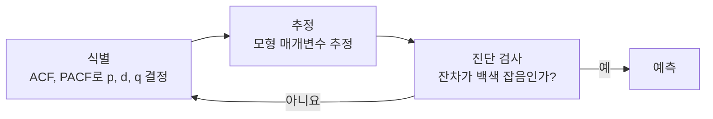

# 8장 — 시계열 분석

[레포지토리 안내](../../README.ko.md) | [English](Concepts_Lecture.md) | [한국어](Concepts_Lecture.ko.md)

> **최종 수정일:** 2026-10-26

> **학습 목표:**
> 1. R의 날짜와 시간 클래스, `ts` 객체를 만들고 변환할 수 있다
> 2. 시계열을 추세, 계절, 잔차 성분으로 분해할 수 있다
> 3. 시계열 예측을 위해 ARIMA 모형을 적용할 수 있다
> 4. 적절한 지표를 사용하여 예측 정확도를 평가할 수 있다

---

## 목차

- [1. 시계열 개요](#1-시계열-개요)
  - [1.1 정의](#11-정의)
  - [1.2 실제 사례](#12-실제-사례)
  - [1.3 핵심 개념](#13-핵심-개념)
- [2. 시계열 데이터의 특성](#2-시계열-데이터의-특성)
  - [2.1 변동의 유형](#21-변동의-유형)
  - [2.2 정상성](#22-정상성)
- [3. R에서의 날짜 및 시간 객체](#3-r에서의-날짜-및-시간-객체)
  - [3.1 날짜 클래스](#31-날짜-클래스)
  - [3.2 POSIXct vs. POSIXlt](#32-posixct-vs-posixlt)
  - [3.3 날짜 객체 생성](#33-날짜-객체-생성)
  - [3.4 날짜 형식 변환](#34-날짜-형식-변환)
  - [3.5 소프트웨어별 기준점](#35-소프트웨어별-기준점)
- [4. R에서의 시계열 객체](#4-r에서의-시계열-객체)
  - [4.1 ts 객체 생성](#41-ts-객체-생성)
  - [4.2 자주 사용되는 시계열 데이터셋](#42-자주-사용되는-시계열-데이터셋)
- [5. 기술적 기법](#5-기술적-기법)
  - [5.1 시계열 그래프](#51-시계열-그래프)
  - [5.2 자기상관 함수(ACF)](#52-자기상관-함수acf)
  - [5.3 편자기상관 함수(PACF)](#53-편자기상관-함수pacf)
- [6. 분해](#6-분해)
  - [6.1 가법 분해 vs. 승법 분해](#61-가법-분해-vs-승법-분해)
- [7. ARIMA 모형](#7-arima-모형)
  - [7.1 AR, MA 및 ARIMA](#71-ar-ma-및-arima)
  - [7.2 Box-Jenkins 방법론](#72-box-jenkins-방법론)
  - [7.3 R에서의 구현](#73-r에서의-구현)
- [8. 예측](#8-예측)
  - [8.1 예측 수행](#81-예측-수행)
  - [8.2 예측 정확도](#82-예측-정확도)
  - [8.3 추천 도서](#83-추천-도서)
- [요약](#요약)
- [점검 문제](#점검-문제)

---

<br>

## 1. 시계열 개요

### 1.1 정의

**시계열(Time Series)** 이란 연속적으로 동일한 간격을 두고 수집되거나 기록된 데이터 포인트의 순서열이다. 시계열 분석은 시간 순서로 정렬된 데이터를 분석하여 의미 있는 통계량을 추출하고, 패턴을 식별하며, 예측을 수행하는 방법론이다.

### 1.2 실제 사례

| 사례 | 데이터 설명 |
|------|-------------|
| Johnson & Johnson 수익 | 분기별 주당 순이익, 1960~1980 |
| 지구 온난화 | 평균 지표-해양 온도 지수, 1880~2015 |
| 음성 데이터 | 초당 10,000 포인트로 샘플링된 오디오 신호 |
| DJIA 수익률 | 다우존스 산업평균지수 일별 수익률 |
| 엘니뇨와 어류 개체수 | 월별 SOI 및 Recruitment 계열, 1950~1987 |
| 지진 vs. 폭발 | 지진파 파형 분류 |

*표 1. 시계열 데이터의 실제 사례*

### 1.3 핵심 개념

- **추세(Trend)**: 데이터의 장기적인 증가 또는 감소이다.
- **계절성(Seasonality)**: 규칙적인 주기적 변동이다(예: 연간 순환).
- **순환 변동(Cyclic Variation)**: 고정된 주기가 없는 진동이다(예: 경기 순환).
- **불규칙 변동(Noise/Irregularity)**: 무작위적이고 예측 불가능한 변동이다.

> **핵심:** George E. P. Box의 격언 "All models are wrong, but some are useful"(모든 모형은 틀리지만, 일부는 유용하다)은 시계열 분석에서 특히 적절하다. 모형은 현실을 근사할 뿐이지만 여전히 가치 있는 예측을 제공할 수 있기 때문이다.

---

<br>

## 2. 시계열 데이터의 특성

### 2.1 변동의 유형

#### 계절 변동

- 고정된 주기(연간, 분기별, 월별, 주별)로 반복되는 패턴이다.
- 예를 들어 실업률은 일반적으로 겨울에 높다.
- 추정하여 제거할 수 있다(탈계절화).

#### 순환 변동

- 고정된 주기가 없는 진동이다.
- 경기 순환의 길이는 3~4년에서 10년 이상까지 다양하다.
- 계절 패턴보다 예측이 어렵다.

#### 추세

- 장기적인 상승 또는 하강 움직임이다.
- 선형일 수도 있고 비선형일 수도 있다.
- 예를 들어 지구 온도는 장기적으로 상승하고 있다.

#### 불규칙/무작위 변동

- 예측할 수 없는 변동이다.
- 추세, 계절, 순환 성분을 제거하고 남은 잔차이다.

### 2.2 정상성

시계열의 통계적 특성(평균, 분산, 자기상관)이 시간에 따라 변하지 않으면 **정상성(Stationarity)** 을 갖는다고 한다.

- **엄격한 정상성**: 모든 결합 분포가 시간 이동에 대해 변하지 않는다.
- **약한 정상성**: 평균이 일정하고, 자기공분산이 시점이 아니라 시차에만 의존한다.

대부분의 시계열 모형은 정상성을 가정한다. 비정상 시계열은 **차분(differencing)** 을 통해 정상 시계열로 변환할 수 있다. 1차 차분은 $\nabla X_t = X_t - X_{t-1}$로, 이웃한 두 시점의 차이를 새 계열로 삼는다.

---

<br>

## 3. R에서의 날짜 및 시간 객체

### 3.1 날짜 클래스

R은 날짜와 시간을 다루기 위한 여러 클래스를 제공한다:

| 클래스 | 설명 | 기준점 |
|--------|------|--------|
| `Date` | 날짜만 표현(기준점 이후 일수로 저장) | 1970-01-01 |
| `POSIXct` | 기준점 이후 초 단위로 날짜와 시간 표현 | 1970-01-01 00:00:00 UTC |
| `POSIXlt` | 이름 있는 리스트로 날짜와 시간 표현 | 없음(연도는 1900년 이후 연수로 저장) |

*표 2. R의 날짜와 시간 클래스*

```r
# 현재 날짜 및 시간 가져오기
date <- Sys.Date()
date                    # "2025-12-02"
class(date)             # "Date"

time_ct <- Sys.time()
time_ct                 # "2025-12-02 14:30:00 KST"
class(time_ct)          # "POSIXct" "POSIXt"

# POSIXct를 POSIXlt로 변환
time_lt <- as.POSIXlt(time_ct)
class(time_lt)          # "POSIXlt" "POSIXt"
```

### 3.2 POSIXct vs. POSIXlt

```r
# POSIXct: 단일 숫자 값으로 저장 (기준점 이후 초)
unclass(time_ct)        # 예: 1764653400

# POSIXlt: 이름 있는 리스트로 저장
unclass(time_lt)$sec    # 초
unclass(time_lt)$hour   # 시
unclass(time_lt)$mday   # 일
unclass(time_lt)$mon    # 월 (0-11)
unclass(time_lt)$year   # 1900년 이후 연수
unclass(time_lt)$yday   # 연중 일수 (0-365)
```

### 3.3 날짜 객체 생성

```r
# 문자열을 Date로 변환
d1 <- "2022-09-21"
class(d1)               # "character"

d2 <- as.Date("2022-09-21")
class(d2)               # "Date"

# 시간대를 지정하여 POSIXct와 POSIXlt 생성
time_ct <- as.POSIXct("2022-09-21 20:05:35", tz = "EST")
time_lt <- as.POSIXlt("2022-09-21 20:05:35", tz = "EST")
```

### 3.4 날짜 형식 변환

ISO 8601 형식(YYYY-MM-DD)이 아닌 날짜 문자열은 `format` 인수에 형식 지정자를 주어 변환한다:

| 형식 코드 | 의미 | 예시 |
|-----------|------|------|
| `%Y` | 4자리 연도 | 2022 |
| `%m` | 2자리 월 | 09 |
| `%d` | 2자리 일 | 21 |
| `%H` | 시(24시간제) | 20 |
| `%M` | 분 | 05 |
| `%S` | 초 | 35 |

*표 3. 날짜 형식 지정자*

```r
# ISO 8601 형식 (기본): YYYY-MM-DD
as.Date("2017-01-20")

# 미국 형식: MM/DD/YYYY
as.Date("1/20/2017", format = "%m/%d/%Y")

# 뉴질랜드 형식: DD/MM/YYYY
as.Date("20/01/2017", format = "%d/%m/%Y")
```

### 3.5 소프트웨어별 기준점

| 소프트웨어 | 기준점 |
|------------|--------|
| R | 1970년 1월 1일 |
| SAS | 1960년 1월 1일 |
| Excel | 1900년 1월 1일 |

*표 4. 소프트웨어별 날짜 기준점*

> **핵심:** 다른 소프트웨어에서 날짜 데이터를 가져올 때는 기준점이 일치하는지 확인해야 한다. 숫자형 날짜 값을 변환할 때는 `as.Date()`의 `origin` 매개변수를 사용한다.

> **주의:** Excel의 1900 날짜 체계는 1900년을 윤년으로 잘못 취급하므로, 1900년 3월 이후 날짜의 Excel 일련번호를 R에서 변환할 때는 `origin = "1899-12-30"`을 쓴다. 예를 들어 `as.Date(45000, origin = "1899-12-30")`은 2023-03-15이다.

---

<br>

## 4. R에서의 시계열 객체

### 4.1 ts 객체 생성

```r
# 시계열 객체 생성
ts_data <- ts(data_vector, start = c(1960, 1), frequency = 4)
# start: 시작 시점 (연도, 기간)
# frequency: 단위 시간당 관측 수 (4 = 분기별, 12 = 월별)
```

### 4.2 자주 사용되는 시계열 데이터셋

```r
# Johnson & Johnson 분기별 수익
data(JohnsonJohnson)
plot(JohnsonJohnson)

# AirPassengers: 월별 항공기 승객 수
data(AirPassengers)
plot(AirPassengers)

# 미국 경제 데이터
library(ggplot2)
data(economics)
str(economics)
```

---

<br>

## 5. 기술적 기법

### 5.1 시계열 그래프

```r
library(ggplot2)
library(scales)

ggplot(economics, aes(x = date, y = psavert)) +
  geom_line(color = "indianred3", linewidth = 1) +
  geom_smooth() +
  scale_x_date(date_breaks = "5 years", labels = date_format("%b-%y")) +
  labs(title = "Personal Savings Rate",
       subtitle = "1967 to 2015",
       x = "", y = "Personal Savings Rate") +
  theme_minimal()
```

`economics` 데이터의 `psavert`는 미국의 개인 저축률(%)이다. `geom_smooth()`는 추세를 보여 주는 평활 곡선을 덧그리고, `scale_x_date()`는 x축 눈금을 5년 간격으로 두고 레이블을 월 약어와 두 자리 연도(`%b-%y`)로 표시한다.

### 5.2 자기상관 함수(ACF)

ACF는 시계열과 그 시차값 사이의 상관관계를 측정한다. 정상 시계열에서 시차 $h$의 자기상관은 다음과 같다:

$$\rho(h) = \frac{Cov(X_t, X_{t+h})}{Var(X_t)}$$

> **[확률및통계]** 두 확률 변수의 공분산 $Cov(X, Y) = E[(X - \mu_X)(Y - \mu_Y)]$는 두 변수가 각자의 평균에서 함께 벗어나는 정도이고, 이를 두 표준편차의 곱으로 나눈 상관계수는 -1과 1 사이의 값을 갖는다. 자기상관은 같은 계열의 두 시점 $X_t$와 $X_{t+h}$를 두 확률 변수로 보고 구한 상관계수이며, 정상 시계열에서는 $Var(X_t) = Var(X_{t+h})$이므로 두 표준편차의 곱이 위 식의 분모 $Var(X_t)$가 된다.

```r
acf(ts_data)         # ACF 그래프
acf(ts_data, plot = FALSE)  # 수치값 확인
```

### 5.3 편자기상관 함수(PACF)

PACF는 중간 시차의 효과를 제거한 후 $X_t$와 $X_{t+h}$ 사이의 상관관계를 측정한다:

```r
pacf(ts_data)        # PACF 그래프
```

> **핵심:** ACF와 PACF 그래프는 적절한 ARIMA 모형 차수를 식별하기 위한 필수적인 진단 도구이다. ACF는 MA 차수 식별에, PACF는 AR 차수 식별에 도움이 된다. MA(q) 과정의 ACF는 시차 q 이후 0으로 끊기고, AR(p) 과정의 PACF는 시차 p 이후 0으로 끊긴다.

---

<br>

## 6. 분해

### 6.1 가법 분해 vs. 승법 분해

시계열은 여러 성분으로 분해할 수 있다:

- **가법(Additive)**: $Y_t = T_t + S_t + R_t$ (계절 진폭이 일정)
- **승법(Multiplicative)**: $Y_t = T_t \times S_t \times R_t$ (계절 진폭이 추세에 비례)

여기서 $T_t$는 추세, $S_t$는 계절 성분, $R_t$는 잔차이다.

```r
# 시계열 분해
decomp <- decompose(AirPassengers, type = "multiplicative")
plot(decomp)

# STL 분해 (더 강건함)
stl_result <- stl(AirPassengers, s.window = "periodic")
plot(stl_result)
```

`decompose()`는 이동 평균으로 추세를 추정하고, **STL**(Seasonal and Trend decomposition using Loess)은 국소 회귀(loess)로 성분을 추정하여 이상값에 덜 민감하다. `s.window = "periodic"`은 계절 성분이 매년 같다고 둔다. `stl()`은 가법 분해만 수행하므로, AirPassengers처럼 계절 진폭이 추세에 비례하는 계열은 `stl(log(AirPassengers), s.window = "periodic")`처럼 로그를 취해 승법 구조를 가법 구조로 바꾼 뒤 적용하는 것이 일반적이다.

---

<br>

## 7. ARIMA 모형

### 7.1 AR, MA 및 ARIMA

| 모형 | 이름 | 수식 |
|------|------|------|
| AR(p) | 자기회귀 | $X_t = \phi_1 X_{t-1} + \cdots + \phi_p X_{t-p} + w_t$ |
| MA(q) | 이동 평균 | $X_t = w_t + \theta_1 w_{t-1} + \cdots + \theta_q w_{t-q}$ |
| ARMA(p,q) | 자기회귀 이동 평균 | AR과 MA의 조합 |
| ARIMA(p,d,q) | 자기회귀 누적 이동 평균 | 차분이 포함된 ARMA |

*표 5. AR, MA, ARMA, ARIMA 모형*

여기서 $w_t$는 평균이 0이고 분산이 일정하며 서로 상관이 없는 **백색 잡음**(white noise)이다.

매개변수:
- **p**: 자기회귀(AR) 성분의 차수이다.
- **d**: 정상성을 얻기 위한 차분의 차수이다.
- **q**: 이동 평균(MA) 성분의 차수이다.

### 7.2 Box-Jenkins 방법론

ARIMA 모형을 구축하는 고전적 접근법은 다음 네 단계로 이루어진다.

1. **식별(Identification)**: ACF/PACF 그래프를 사용하여 p, d, q를 결정한다.
2. **추정(Estimation)**: 모형 매개변수를 추정한다.
3. **진단 검사(Diagnostic Checking)**: 잔차가 백색 잡음인지 확인한다.
4. **예측(Forecasting)**: 예측값을 생성한다.

진단 검사에서 잔차에 패턴이 남아 있으면 식별 단계로 돌아가 차수를 다시 정한다.



*그림 1. Box-Jenkins 방법론의 반복 절차*

### 7.3 R에서의 구현

```r
library(forecast)

# 자동 ARIMA 모형 선택
auto_model <- auto.arima(ts_data)
summary(auto_model)

# 수동 ARIMA 지정
manual_model <- arima(ts_data, order = c(1, 1, 1))

# 잔차 검사
checkresiduals(auto_model)
```

`auto.arima()`는 AICc 같은 정보 기준이 가장 작은 차수를 자동으로 고르고, 기본 stats 패키지의 `arima()`는 `order = c(p, d, q)`로 차수를 직접 지정한다. `checkresiduals()`는 잔차의 시계열 그림, ACF, 히스토그램과 함께 잔차가 백색 잡음인지 보는 Ljung-Box 검정 결과를 보여 준다.

---

<br>

## 8. 예측

### 8.1 예측 수행

```r
library(forecast)

# 미래 값 예측
fc <- forecast(auto_model, h = 12)  # 12기간 선행 예측
plot(fc)

# Autoplot (ggplot2 스타일)
autoplot(fc) +
  labs(title = "Time Series Forecast",
       x = "Time", y = "Value")
```

`h = 12`는 12기간 앞까지 예측하라는 뜻이며, 예측 결과에는 점 예측값과 함께 80%, 95% 예측 구간이 들어 있다.

### 8.2 예측 정확도

```r
# 평가를 위한 훈련/테스트 분할
train <- window(ts_data, end = c(2010, 12))
test <- window(ts_data, start = c(2011, 1))

model <- auto.arima(train)
fc <- forecast(model, h = length(test))
accuracy(fc, test)
```

시계열은 시간 순서가 중요하므로 무작위로 나누지 않고, `window()`로 앞부분을 훈련 세트, 뒷부분을 테스트 세트로 나눈다. `accuracy()`는 7장에서 다룬 ME, RMSE, MAE, MPE, MAPE에 MASE 등을 더하여 훈련 세트와 테스트 세트에 대해 각각 보고한다.

### 8.3 추천 도서

| 도서 | 저자 | 주요 내용 |
|------|------|-----------|
| *Time Series Analysis and Its Applications* | Shumway & Stoffer | R을 활용한 종합적 이론 |
| *Forecasting: Principles and Practice* | Hyndman & Athanasopoulos | 실용적 예측(https://otexts.com/fpp3/) |
| *Hands-On Time Series Analysis with R* | Rami Krispin | 실용적 R 구현 |
| *Analysis of Financial Time Series* | Ruey S. Tsay | 금융 응용 |

*표 6. 시계열 분석 추천 도서*

---

<br>

## 요약

| 개념 | 핵심 요약 |
|------|------------|
| 시계열 | 일정한 시간 간격으로 관측한 데이터 포인트를 시간 순서로 늘어놓은 순서열이다. |
| 구성 요소 | 시계열은 추세, 계절성, 순환 변동, 불규칙 변동으로 이루어진다. |
| 정상성 | 통계적 특성이 시간에 따라 일정한 성질이며, 대부분의 모형이 이를 가정한다. |
| 날짜 클래스 | R은 `Date`, `POSIXct`(기준점 이후 초), `POSIXlt`(구성 요소의 리스트)로 날짜와 시간을 다룬다. |
| 날짜 형식 | `as.Date(x, format = ...)`에 `%Y`, `%m`, `%d` 같은 형식 지정자를 주어 문자열을 날짜로 바꾼다. |
| ACF/PACF | ARIMA 모형의 차수를 식별하는 진단 도구이다. |
| 분해 | 가법 분해($Y = T + S + R$)나 승법 분해($Y = T \times S \times R$)로 시계열을 성분으로 나눈다. |
| ARIMA(p,d,q) | p는 AR 차수, d는 차분 차수, q는 MA 차수이다. |
| Box-Jenkins | 식별, 추정, 진단 검사, 예측의 순서로 ARIMA 모형을 구축하고, 진단을 통과하지 못하면 식별로 돌아간다. |
| `auto.arima()` | 정보 기준에 따라 ARIMA 모형의 차수를 자동으로 선택하는 R 함수이다. |
| `forecast()` | 미래의 점 예측값과 예측 구간(기본 80%, 95%)을 함께 생성한다. |

---

<br>

## 점검 문제

1. **가법 분해와 승법 분해:** AirPassengers처럼 승객 수가 늘수록 계절 변동의 폭도 커지는 계열에는 어떤 분해가 적합한가? 이 계열에 로그를 취하면 어떻게 되는지 설명하라.

   <details>
   <summary>정답</summary>

   계절 진폭이 추세에 비례하므로 승법 분해 $Y_t = T_t \times S_t \times R_t$가 적합하다. 로그를 취하면 $\log Y_t = \log T_t + \log S_t + \log R_t$가 되어 가법 구조로 바뀌므로, 가법 분해만 수행하는 `stl()`도 적용할 수 있다.

   </details>

2. **POSIXlt 구성 요소:** `time_lt <- as.POSIXlt("2022-09-21 20:05:35", tz = "EST")`일 때 `unclass(time_lt)$mon`, `unclass(time_lt)$year`, `unclass(time_lt)$yday`의 값을 구하라.

   <details>
   <summary>정답</summary>

   `mon`은 0부터 세므로 9월은 8이다. `year`는 1900년 이후 연수이므로 2022 - 1900 = 122이다. 2022년은 윤년이 아니므로 9월 21일은 31 + 28 + 31 + 30 + 31 + 30 + 31 + 31 + 21 = 264번째 날이고, `yday`는 0부터 세므로 263이다.

   </details>

3. **날짜 변환:** 미국 형식 문자열 `"03/15/2024"`를 Date로 바꾸는 코드를 쓰고, Excel에서 가져온 일련번호 45000을 R의 날짜로 바꾸는 코드와 결과를 쓰라.

   <details>
   <summary>정답</summary>

   `as.Date("03/15/2024", format = "%m/%d/%Y")`이며 결과는 2024-03-15이다. Excel 일련번호는 `as.Date(45000, origin = "1899-12-30")`으로 바꾸며 결과는 2023-03-15이다.

   </details>

4. **ARIMA 차수 식별:** 어떤 계열은 1차 차분하면 정상이 되고, 차분한 계열의 PACF는 시차 2 이후 0으로 끊기며 ACF는 지수적으로 감소한다. 적합한 ARIMA 차수를 쓰고 이유를 설명하라.

   <details>
   <summary>정답</summary>

   한 번 차분하여 정상이 되었으므로 d = 1이다. PACF가 시차 2 이후 끊기고 ACF가 점차 감소하는 것은 AR(2) 과정의 특징이므로 p = 2, q = 0이다. 따라서 ARIMA(2,1,0)이 적합하다.

   </details>

5. **훈련 세트와 테스트 세트 분할:** 7장의 회귀 예제처럼 행을 무작위로 뽑아 시계열을 훈련 세트와 테스트 세트로 나누면 안 되는 이유를 쓰고, 월별 계열에서 2010년 12월까지를 훈련 세트로 쓰는 코드를 쓰라.

   <details>
   <summary>정답</summary>

   시계열 관측값은 시간 순서와 자기상관을 가지므로, 무작위로 나누면 미래 시점의 정보가 훈련에 섞여 실제 예측 상황을 재현하지 못한다. 앞부분으로 학습하고 뒷부분을 예측해야 하며, `train <- window(ts_data, end = c(2010, 12))`처럼 `window()`로 나눈다.

   </details>
