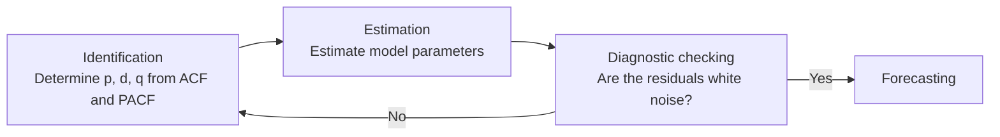

# Chapter 8 — Time Series Analysis

[Repository Guide](../../README.md) | [English](Concepts_Lecture.md) | [한국어](Concepts_Lecture.ko.md)

> **Last Updated:** 2026-10-18

> **Learning Objectives:**
> 1. Create and convert R date and time classes and `ts` objects
> 2. Decompose time series into trend, seasonal, and residual components
> 3. Apply ARIMA models for time series forecasting
> 4. Evaluate forecast accuracy using appropriate metrics

---

## Table of Contents

- [1. Introduction to Time Series](#1-introduction-to-time-series)
  - [1.1 Definition](#11-definition)
  - [1.2 Real-World Examples](#12-real-world-examples)
  - [1.3 Key Concepts](#13-key-concepts)
- [2. Characteristics of Time Series Data](#2-characteristics-of-time-series-data)
  - [2.1 Types of Variation](#21-types-of-variation)
  - [2.2 Stationarity](#22-stationarity)
- [3. Date and Time Objects in R](#3-date-and-time-objects-in-r)
  - [3.1 Date Classes](#31-date-classes)
  - [3.2 POSIXct vs. POSIXlt](#32-posixct-vs-posixlt)
  - [3.3 Creating Date Objects](#33-creating-date-objects)
  - [3.4 Date Format Conversion](#34-date-format-conversion)
  - [3.5 Origin Points Across Software](#35-origin-points-across-software)
- [4. Time Series Objects in R](#4-time-series-objects-in-r)
  - [4.1 Creating ts Objects](#41-creating-ts-objects)
  - [4.2 Common Time Series Datasets](#42-common-time-series-datasets)
- [5. Descriptive Techniques](#5-descriptive-techniques)
  - [5.1 Time Series Plotting](#51-time-series-plotting)
  - [5.2 Autocorrelation Function (ACF)](#52-autocorrelation-function-acf)
  - [5.3 Partial Autocorrelation Function (PACF)](#53-partial-autocorrelation-function-pacf)
- [6. Decomposition](#6-decomposition)
  - [6.1 Additive vs. Multiplicative](#61-additive-vs-multiplicative)
- [7. ARIMA Models](#7-arima-models)
  - [7.1 AR, MA, and ARIMA](#71-ar-ma-and-arima)
  - [7.2 Box-Jenkins Method](#72-box-jenkins-method)
  - [7.3 Implementation in R](#73-implementation-in-r)
- [8. Forecasting](#8-forecasting)
  - [8.1 Making Forecasts](#81-making-forecasts)
  - [8.2 Forecast Accuracy](#82-forecast-accuracy)
  - [8.3 Recommended References](#83-recommended-references)
- [Summary](#summary)
- [Self-Check Questions](#self-check-questions)

---

<br>

## 1. Introduction to Time Series

### 1.1 Definition

A **time series** is a sequence of data points collected or recorded at successive, equally spaced points in time. Time series analysis involves methods for analyzing time-ordered data to extract meaningful statistics, identify patterns, and make forecasts.

### 1.2 Real-World Examples

| Example | Data Description |
|---------|------------------|
| Johnson & Johnson Earnings | Quarterly earnings per share, 1960-1980 |
| Global Warming | Mean land-ocean temperature index, 1880-2015 |
| Speech Data | Audio signal sampled at 10,000 points/second |
| DJIA Returns | Daily returns of Dow Jones Industrial Average |
| El Nino & Fish Population | Monthly SOI and Recruitment series, 1950-1987 |
| Earthquake vs. Explosion | Seismic waveform classification |

*Table 1. Real-world examples of time series data*

### 1.3 Key Concepts

- **Trend**: Long-term increase or decrease in the data.
- **Seasonality**: Regular periodic fluctuations (e.g., annual cycles).
- **Cyclic variation**: Oscillations without a fixed period (e.g., business cycles).
- **Noise/Irregularity**: Random, unpredictable fluctuations.

> **Key Point:** George E. P. Box's aphorism "All models are wrong, but some are useful" is particularly relevant in time series analysis. Models only approximate reality, but they can still provide valuable forecasts.

---

<br>

## 2. Characteristics of Time Series Data

### 2.1 Types of Variation

#### Seasonal Variation

- Fixed periodic patterns repeat (annual, quarterly, monthly, weekly).
- For example, unemployment is typically higher in winter.
- They can be estimated and removed (deseasonalization).

#### Cyclic Variation

- Oscillations occur without a fixed period.
- Business cycles vary in length from 3-4 years to 10+ years.
- They are less predictable than seasonal patterns.

#### Trend

- A trend is a long-term upward or downward movement.
- It can be linear or non-linear.
- For example, global temperatures are rising over the long term.

#### Random/Irregular

- These are unpredictable fluctuations.
- They are the residual after removing trend, seasonal, and cyclic components.

### 2.2 Stationarity

A time series is **stationary** if its statistical properties (mean, variance, autocorrelation) do not change over time.

- **Strict stationarity**: All joint distributions are invariant under time shifts.
- **Weak stationarity**: The mean is constant, and the autocovariance depends only on the lag, not on the time point.

Most time series models assume stationarity. Non-stationary series can be made stationary through **differencing**. The first difference $\nabla X_t = X_t - X_{t-1}$ takes the difference between neighboring time points as the new series.

---

<br>

## 3. Date and Time Objects in R

### 3.1 Date Classes

R provides several classes for handling dates and times:

| Class | Description | Origin Point |
|-------|-------------|-------------|
| `Date` | Calendar date only (stored as days since origin) | 1970-01-01 |
| `POSIXct` | Date and time as seconds since origin | 1970-01-01 00:00:00 UTC |
| `POSIXlt` | Date and time as a named list | None (year stored as years since 1900) |

*Table 2. Date and time classes in R*

```r
# Get current date and time
date <- Sys.Date()
date                    # "2025-12-02"
class(date)             # "Date"

time_ct <- Sys.time()
time_ct                 # "2025-12-02 14:30:00 KST"
class(time_ct)          # "POSIXct" "POSIXt"

# Convert POSIXct to POSIXlt
time_lt <- as.POSIXlt(time_ct)
class(time_lt)          # "POSIXlt" "POSIXt"
```

### 3.2 POSIXct vs. POSIXlt

```r
# POSIXct: stored as a single numeric value (seconds since origin)
unclass(time_ct)        # e.g., 1663317362

# POSIXlt: stored as a named list
unclass(time_lt)$sec    # seconds
unclass(time_lt)$hour   # hour
unclass(time_lt)$mday   # day of month
unclass(time_lt)$mon    # month (0-11)
unclass(time_lt)$year   # years since 1900
unclass(time_lt)$yday   # day of year (0-365)
```

### 3.3 Creating Date Objects

```r
# String to Date conversion
d1 <- "2022-09-21"
class(d1)               # "character"

d2 <- as.Date("2022-09-21")
class(d2)               # "Date"

# Creating POSIXct and POSIXlt with timezone
time_ct <- as.POSIXct("2022-09-21 20:05:35", tz = "EST")
time_lt <- as.POSIXlt("2022-09-21 20:05:35", tz = "EST")
```

### 3.4 Date Format Conversion

Date strings that are not in ISO 8601 format (YYYY-MM-DD) are converted by giving format specifiers in the `format` argument:

| Format Code | Meaning | Example |
|-------------|---------|---------|
| `%Y` | 4-digit year | 2022 |
| `%m` | 2-digit month | 09 |
| `%d` | 2-digit day | 21 |
| `%H` | Hour (24h) | 20 |
| `%M` | Minute | 05 |
| `%S` | Second | 35 |

*Table 3. Date format specifiers*

```r
# ISO 8601 format (default): YYYY-MM-DD
as.Date("2017-01-20")

# US format: MM/DD/YYYY
as.Date("1/20/2017", format = "%m/%d/%Y")

# NZ format: DD/MM/YYYY
as.Date("20/01/2017", format = "%d/%m/%Y")
```

### 3.5 Origin Points Across Software

| Software | Origin Point |
|----------|-------------|
| R | January 1, 1970 |
| SAS | January 1, 1960 |
| Excel | January 1, 1900 |

*Table 4. Date origin points by software*

> **Key Point:** When importing date data from other software, verify the origin point matches. Use the `origin` parameter in `as.Date()` if converting from numeric date values.

> **Caution:** The Excel 1900 date system wrongly treats 1900 as a leap year, so when converting Excel serial numbers of dates from March 1900 onward in R, use `origin = "1899-12-30"`. For example, `as.Date(45000, origin = "1899-12-30")` is 2023-03-15.

---

<br>

## 4. Time Series Objects in R

### 4.1 Creating ts Objects

```r
# Create a time series object
ts_data <- ts(data_vector, start = c(1960, 1), frequency = 4)
# start: starting time (year, period)
# frequency: observations per unit time (4 = quarterly, 12 = monthly)
```

### 4.2 Common Time Series Datasets

```r
# Johnson & Johnson quarterly earnings
data(JohnsonJohnson)
plot(JohnsonJohnson)

# AirPassengers: monthly airline passengers
data(AirPassengers)
plot(AirPassengers)

# US economic data
library(ggplot2)
data(economics)
str(economics)
```

---

<br>

## 5. Descriptive Techniques

### 5.1 Time Series Plotting

```r
library(ggplot2)
library(scales)

ggplot(economics, aes(x = date, y = psavert)) +
  geom_line(color = "indianred3", linewidth = 1) +
  geom_smooth() +
  scale_x_date(date_breaks = "5 years", labels = date_format("%b-%y")) +
  labs(title = "Personal Savings Rate",
       subtitle = "1967 to 2015",
       x = "", y = "Personal Savings Rate") +
  theme_minimal()
```

`psavert` in the `economics` data is the US personal savings rate (%). `geom_smooth()` overlays a smoothed curve that shows the trend, and `scale_x_date()` places x-axis breaks every 5 years and labels them with the abbreviated month and two-digit year (`%b-%y`).

### 5.2 Autocorrelation Function (ACF)

The ACF measures the correlation between a time series and its lagged values. For a stationary series, the autocorrelation at lag $h$ is:

$$\rho(h) = \frac{Cov(X_t, X_{t+h})}{Var(X_t)}$$

```r
acf(ts_data)         # Plot ACF
acf(ts_data, plot = FALSE)  # Get numeric values
```

### 5.3 Partial Autocorrelation Function (PACF)

PACF measures the correlation between $X_t$ and $X_{t+h}$ after removing the effect of intermediate lags:

```r
pacf(ts_data)        # Plot PACF
```

> **Key Point:** ACF and PACF plots are essential diagnostic tools for identifying the appropriate ARIMA model order. ACF helps identify the MA order, while PACF helps identify the AR order. The ACF of an MA(q) process cuts off to zero after lag q, and the PACF of an AR(p) process cuts off to zero after lag p.

---

<br>

## 6. Decomposition

### 6.1 Additive vs. Multiplicative

A time series can be decomposed into components:

- **Additive**: $Y_t = T_t + S_t + R_t$ (constant seasonal amplitude)
- **Multiplicative**: $Y_t = T_t \times S_t \times R_t$ (seasonal amplitude proportional to trend)

Where $T_t$ is trend, $S_t$ is seasonal, and $R_t$ is residual.

```r
# Decompose a time series
decomp <- decompose(AirPassengers, type = "multiplicative")
plot(decomp)

# STL decomposition (more robust)
stl_result <- stl(AirPassengers, s.window = "periodic")
plot(stl_result)
```

`decompose()` estimates the trend with moving averages, while **STL** (Seasonal and Trend decomposition using Loess) estimates the components with local regression (loess) and is less sensitive to outliers. `s.window = "periodic"` assumes the seasonal component is the same every year. `stl()` performs only additive decomposition, so for a series such as AirPassengers whose seasonal amplitude is proportional to the trend, it is common to take logarithms first, as in `stl(log(AirPassengers), s.window = "periodic")`, which turns the multiplicative structure into an additive one.

---

<br>

## 7. ARIMA Models

### 7.1 AR, MA, and ARIMA

| Model | Name | Formula |
|-------|------|---------|
| AR(p) | Autoregressive | $X_t = \phi_1 X_{t-1} + \cdots + \phi_p X_{t-p} + w_t$ |
| MA(q) | Moving Average | $X_t = w_t + \theta_1 w_{t-1} + \cdots + \theta_q w_{t-q}$ |
| ARMA(p,q) | Autoregressive Moving Average | Combination of AR and MA |
| ARIMA(p,d,q) | Autoregressive Integrated Moving Average | ARMA with differencing |

*Table 5. AR, MA, ARMA, and ARIMA models*

Here $w_t$ is **white noise**, a sequence of uncorrelated values with mean zero and constant variance.

Parameters:
- **p**: The order of the autoregressive (AR) component.
- **d**: The degree of differencing needed for stationarity.
- **q**: The order of the moving average (MA) component.

### 7.2 Box-Jenkins Method

The classical approach to building ARIMA models:

1. **Identification**: Determine p, d, q using ACF/PACF plots.
2. **Estimation**: Estimate the model parameters.
3. **Diagnostic checking**: Verify that the residuals are white noise.
4. **Forecasting**: Generate predictions.

If a pattern remains in the residuals at diagnostic checking, return to identification and choose the orders again.



*Figure 1. Iterative procedure of the Box-Jenkins method*

### 7.3 Implementation in R

```r
library(forecast)

# Automatic ARIMA model selection
auto_model <- auto.arima(ts_data)
summary(auto_model)

# Manual ARIMA specification
manual_model <- arima(ts_data, order = c(1, 1, 1))

# Check residuals
checkresiduals(auto_model)
```

`auto.arima()` automatically chooses the orders with the smallest information criterion such as AICc, and `arima()` from the base stats package takes the orders directly as `order = c(p, d, q)`. `checkresiduals()` shows a time plot, ACF, and histogram of the residuals together with the result of the Ljung-Box test, which checks whether the residuals are white noise.

---

<br>

## 8. Forecasting

### 8.1 Making Forecasts

```r
library(forecast)

# Forecast future values
fc <- forecast(auto_model, h = 12)  # 12 periods ahead
plot(fc)

# Autoplot (ggplot2 style)
autoplot(fc) +
  labs(title = "Time Series Forecast",
       x = "Time", y = "Value")
```

`h = 12` asks for forecasts up to 12 periods ahead, and the result contains the point forecasts together with 80% and 95% prediction intervals.

### 8.2 Forecast Accuracy

```r
# Train/test split for evaluation
train <- window(ts_data, end = c(2010, 12))
test <- window(ts_data, start = c(2011, 1))

model <- auto.arima(train)
fc <- forecast(model, h = length(test))
accuracy(fc, test)
```

Because time order matters in a time series, the data is not split at random; `window()` takes the earlier part as the training set and the later part as the test set. `accuracy()` reports ME, RMSE, MAE, MPE, and MAPE from Chapter 7, plus MASE and others, separately for the training set and the test set.

### 8.3 Recommended References

| Book | Author | Focus |
|------|--------|-------|
| *Time Series Analysis and Its Applications* | Shumway & Stoffer | Comprehensive theory with R |
| *Forecasting: Principles and Practice* | Hyndman & Athanasopoulos | Practical forecasting (https://otexts.com/fpp3/) |
| *Hands-On Time Series Analysis with R* | Rami Krispin | Practical R implementation |
| *Analysis of Financial Time Series* | Ruey S. Tsay | Financial applications |

*Table 6. Recommended books on time series analysis*

---

<br>

## Summary

| Concept | Key Summary |
|---------|-----------|
| Time series | It is a sequence of data points observed at regular time intervals and arranged in time order. |
| Components | A time series consists of trend, seasonality, cyclic variation, and random noise. |
| Stationarity | It is the property that statistical properties stay constant over time, and most models assume it. |
| Date classes | R handles dates and times with `Date`, `POSIXct` (seconds since origin), and `POSIXlt` (a list of components). |
| Date formats | `as.Date(x, format = ...)` converts strings to dates with format specifiers such as `%Y`, `%m`, and `%d`. |
| ACF/PACF | They are diagnostic tools for identifying the orders of an ARIMA model. |
| Decomposition | It splits a time series into components by additive ($Y = T + S + R$) or multiplicative ($Y = T \times S \times R$) decomposition. |
| ARIMA(p,d,q) | p is the AR order, d is the degree of differencing, and q is the MA order. |
| Box-Jenkins | It builds an ARIMA model through identification, estimation, diagnostic checking, and forecasting, and returns to identification if diagnostics fail. |
| `auto.arima()` | It is the R function that automatically selects the orders of an ARIMA model by an information criterion. |
| `forecast()` | It generates future point forecasts together with prediction intervals (80% and 95% by default). |

---

<br>

## Self-Check Questions

1. **Additive vs. multiplicative decomposition:** Which decomposition suits a series such as AirPassengers, in which the seasonal swings grow as the number of passengers increases? Explain what happens when you take the logarithm of this series.

   <details>
   <summary>Answer</summary>

   The seasonal amplitude is proportional to the trend, so the multiplicative decomposition $Y_t = T_t \times S_t \times R_t$ is appropriate. Taking logarithms gives $\log Y_t = \log T_t + \log S_t + \log R_t$, an additive structure, so `stl()`, which performs only additive decomposition, can also be applied.

   </details>

2. **POSIXlt components:** For `time_lt <- as.POSIXlt("2022-09-21 20:05:35", tz = "EST")`, find the values of `unclass(time_lt)$mon`, `unclass(time_lt)$year`, and `unclass(time_lt)$yday`.

   <details>
   <summary>Answer</summary>

   `mon` counts from 0, so September is 8. `year` counts years since 1900, so it is 2022 - 1900 = 122. 2022 is not a leap year, so September 21 is day 31 + 28 + 31 + 30 + 31 + 30 + 31 + 31 + 21 = 264 of the year, and `yday` counts from 0, so it is 263.

   </details>

3. **Date conversion:** Write code that converts the US-format string `"03/15/2024"` to a Date, and write code that converts the serial number 45000 imported from Excel to an R date, together with the result.

   <details>
   <summary>Answer</summary>

   The code is `as.Date("03/15/2024", format = "%m/%d/%Y")`, and the result is 2024-03-15. The Excel serial number is converted with `as.Date(45000, origin = "1899-12-30")`, and the result is 2023-03-15.

   </details>

4. **Identifying ARIMA orders:** A series becomes stationary after first differencing, and for the differenced series the PACF cuts off to zero after lag 2 while the ACF decays exponentially. Give suitable ARIMA orders and explain why.

   <details>
   <summary>Answer</summary>

   The series became stationary after one difference, so d = 1. A PACF that cuts off after lag 2 with a gradually decaying ACF is characteristic of an AR(2) process, so p = 2 and q = 0. Therefore ARIMA(2,1,0) is appropriate.

   </details>

5. **Splitting into training and test sets:** Explain why a time series should not be split into training and test sets by drawing rows at random as in the regression example of Chapter 7, and write code that uses a monthly series up to December 2010 as the training set.

   <details>
   <summary>Answer</summary>

   Time series observations have a time order and autocorrelation, so a random split mixes information from future time points into training and fails to reproduce a real forecasting situation. The model must learn from the earlier part and predict the later part, using `window()` as in `train <- window(ts_data, end = c(2010, 12))`.

   </details>
