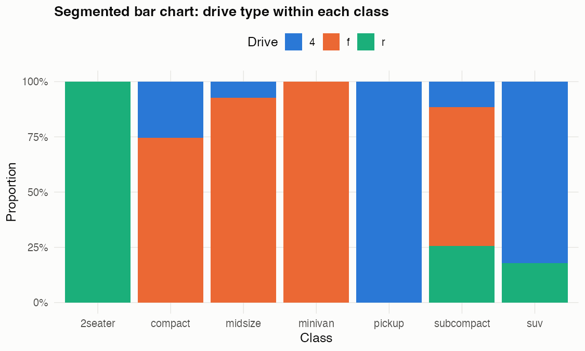
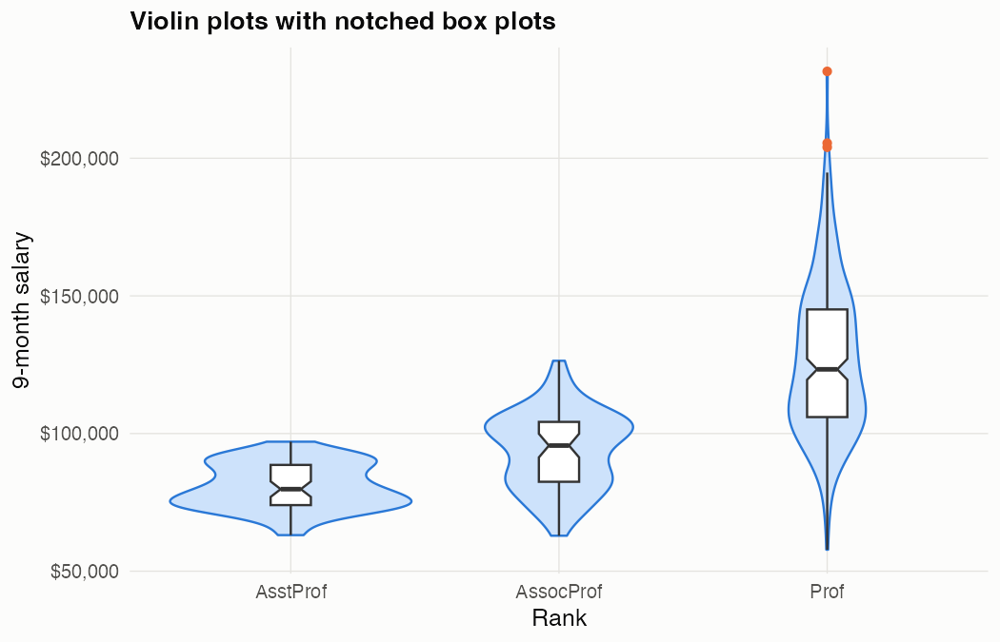
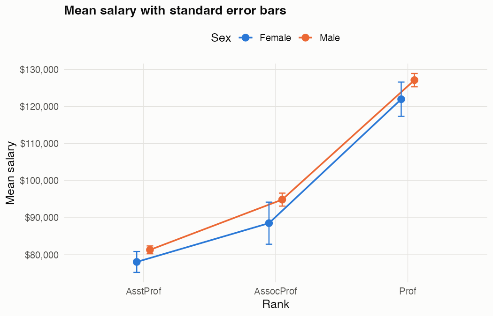
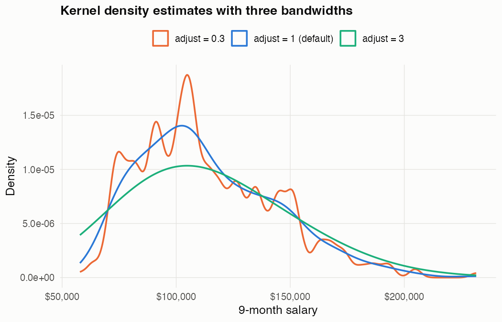
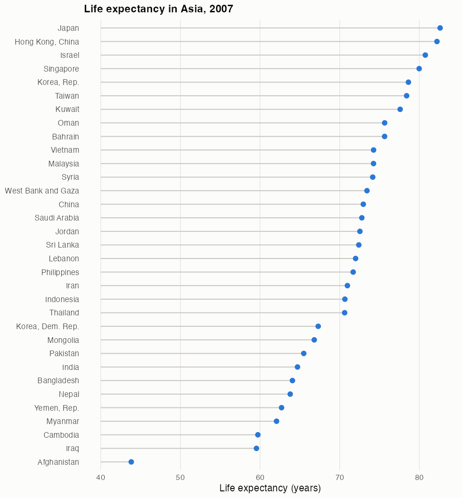
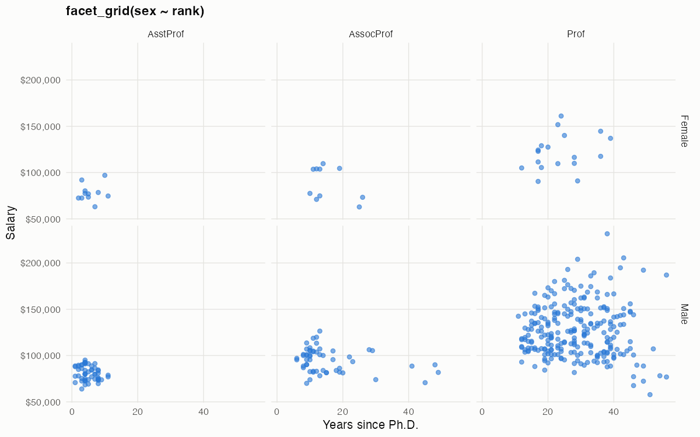
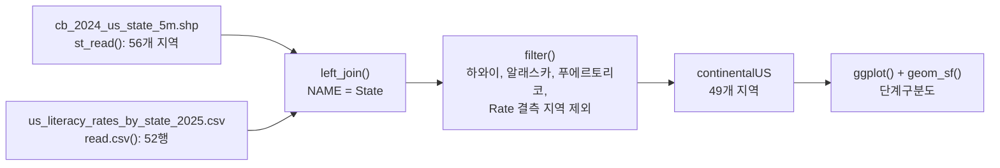
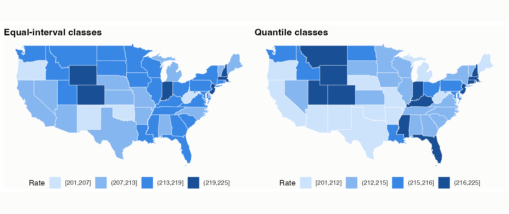
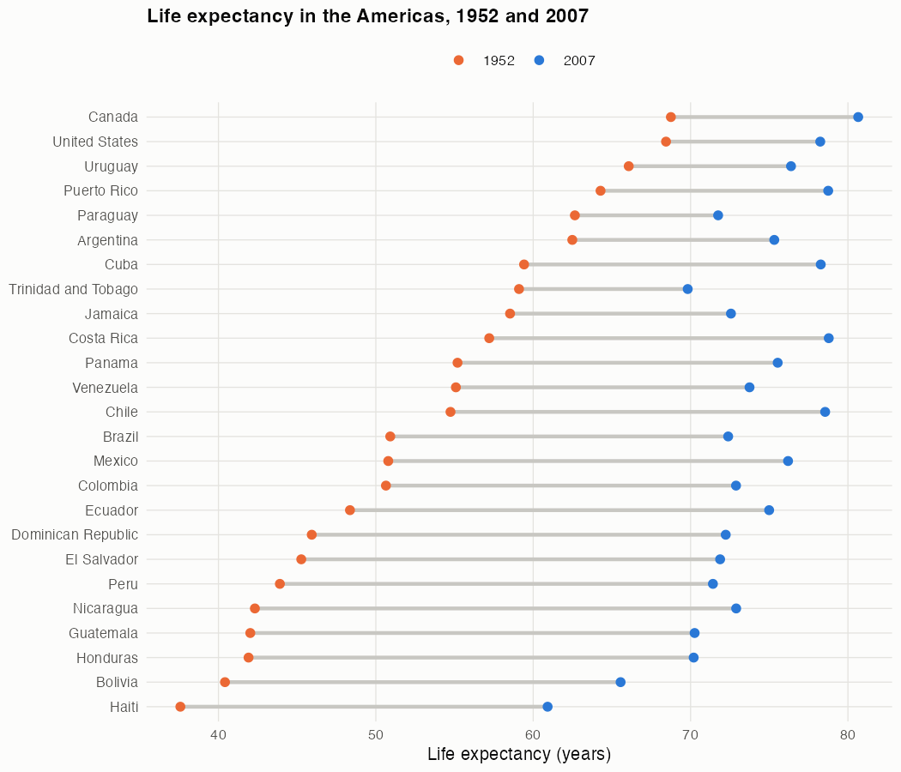

# 9장 — 고급 시각화

[레포지토리 안내](../../README.ko.md) | [English](Concepts_Lecture.md) | [한국어](Concepts_Lecture.ko.md)

> **최종 수정일:** 2026-11-27
>
> Modern Data Visualization with R, Kabacoff, Ch 5, 6, 7, 8

> **학습 목표:**
> 1. 누적, 병렬, 비율 막대 그래프와 밀도 그래프, 상자 그림, violin plot, 능선 그래프, strip plot으로 범주와 분포를 비교할 수 있다
> 2. 색상, 모양, 크기 매핑과 적합선으로 여러 변수의 관계를 한 그래프에 나타낼 수 있다
> 3. 패싯을 사용하여 다중 패널 그래프를 구성할 수 있다
> 4. sf와 mapview로 인터랙티브 지도를 만들고, 단계구분도로 지역별 값을 나타낼 수 있다
> 5. dumbbell chart, 기울기 그래프, 영역 차트, stream graph로 시간에 따른 변화를 나타낼 수 있다
> 6. 척도, 레이블, 테마를 지정하여 출판 품질의 그래프를 만들 수 있다

---

## 목차

- [1. 그룹화된 막대 그래프](#1-그룹화된-막대-그래프)
  - [1.1 병렬 막대 그래프](#11-병렬-막대-그래프)
  - [1.2 누적 막대, 병렬 막대, 비율 막대](#12-누적-막대-병렬-막대-비율-막대)
  - [1.3 색, 레이블, 백분율 표시](#13-색-레이블-백분율-표시)
  - [1.4 요약 통계의 막대 그래프](#14-요약-통계의-막대-그래프)
- [2. 고급 미적 요소를 활용한 산점도](#2-고급-미적-요소를-활용한-산점도)
  - [2.1 커스터마이징된 산점도](#21-커스터마이징된-산점도)
  - [2.2 주요 미적 요소 매개변수](#22-주요-미적-요소-매개변수)
  - [2.3 과대 겹침과 투명도](#23-과대-겹침과-투명도)
  - [2.4 산점도의 적합선](#24-산점도의-적합선)
- [3. 선 그래프](#3-선-그래프)
  - [3.1 시계열 선 그래프](#31-시계열-선-그래프)
  - [3.2 시간 변수의 형식과 여러 계열의 비교](#32-시간-변수의-형식과-여러-계열의-비교)
- [4. 분포 그래프](#4-분포-그래프)
  - [4.1 그룹별 커널 밀도 그래프](#41-그룹별-커널-밀도-그래프)
  - [4.2 병렬 상자 그림](#42-병렬-상자-그림)
  - [4.3 능선 그래프(Ridgeline Plot)](#43-능선-그래프ridgeline-plot)
  - [4.4 strip plot(jittering)](#44-strip-plotjittering)
  - [4.5 상자 그림을 읽는 방법](#45-상자-그림을-읽는-방법)
  - [4.6 노치와 violin plot](#46-노치와-violin-plot)
  - [4.7 평균과 표준 오차 그래프](#47-평균과-표준-오차-그래프)
  - [4.8 커널 밀도 추정과 대역폭](#48-커널-밀도-추정과-대역폭)
  - [4.9 Cleveland 점 그래프](#49-cleveland-점-그래프)
- [5. 그룹화 및 다변량 시각화](#5-그룹화-및-다변량-시각화)
  - [5.1 그룹별 색상 매핑](#51-그룹별-색상-매핑)
  - [5.2 색상 + 모양 매핑](#52-색상--모양-매핑)
  - [5.3 색상 + 크기 매핑](#53-색상--크기-매핑)
  - [5.4 적합선이 포함된 산점도](#54-적합선이-포함된-산점도)
  - [5.5 매핑과 고정값, 그리고 색 척도의 선택](#55-매핑과-고정값-그리고-색-척도의-선택)
- [6. 패싯을 활용한 다중 패널 그래프](#6-패싯을-활용한-다중-패널-그래프)
  - [6.1 그룹별 히스토그램](#61-그룹별-히스토그램)
  - [6.2 적합선이 포함된 패싯 산점도](#62-적합선이-포함된-패싯-산점도)
  - [6.3 다국가 기대수명](#63-다국가-기대수명)
  - [6.4 두 변수로 나누는 facet_grid](#64-두-변수로-나누는-facet_grid)
  - [6.5 그룹화와 패싯의 선택](#65-그룹화와-패싯의-선택)
- [7. GIS 시각화](#7-gis-시각화)
  - [7.1 mapview를 활용한 인터랙티브 지도](#71-mapview를-활용한-인터랙티브-지도)
  - [7.2 국가별 단계구분도(Choropleth Map)](#72-국가별-단계구분도choropleth-map)
  - [7.3 셰이프파일을 활용한 미국 주별 단계구분도](#73-셰이프파일을-활용한-미국-주별-단계구분도)
  - [7.4 지오코딩](#74-지오코딩)
  - [7.5 단계구분도의 구간과 정규화](#75-단계구분도의-구간과-정규화)
  - [7.6 좌표 참조 체계와 지도 투영](#76-좌표-참조-체계와-지도-투영)
  - [7.7 예제: 문해율 단계구분도의 이름 확인과 구간 비교](#77-예제-문해율-단계구분도의-이름-확인과-구간-비교)
- [8. 시간 기반 시각화](#8-시간-기반-시각화)
  - [8.1 평활화를 적용한 시계열](#81-평활화를-적용한-시계열)
  - [8.2 dumbbell chart](#82-dumbbell-chart)
  - [8.3 기울기 그래프(Slope Graph)](#83-기울기-그래프slope-graph)
  - [8.4 영역 차트 및 stream graph](#84-영역-차트-및-stream-graph)
  - [8.5 누적 영역 차트와 stream graph의 해석](#85-누적-영역-차트와-stream-graph의-해석)
  - [8.6 시간 그래프의 선택](#86-시간-그래프의-선택)
  - [8.7 예제: 정렬하고 색을 칠한 dumbbell chart](#87-예제-정렬하고-색을-칠한-dumbbell-chart)
- [9. 그래프의 선택과 흔한 실수](#9-그래프의-선택과-흔한-실수)
  - [9.1 변수의 종류에 따른 그래프 선택](#91-변수의-종류에-따른-그래프-선택)
  - [9.2 시각화의 흔한 실수](#92-시각화의-흔한-실수)
- [개념 적용](#개념-적용)
- [요약](#요약)
- [점검 문제](#점검-문제)

---

<br>

## 1. 그룹화된 막대 그래프

### 1.1 병렬 막대 그래프

`position = "dodge"`를 사용하면 막대를 쌓지 않고 나란히 배치할 수 있다:

```r
library(ggplot2)

ggplot(mpg, aes(x = class, fill = drv)) +
  geom_bar(position = "dodge")
```

이 그래프는 각 차량 유형 내에서 구동 방식(전륜, 후륜, 4WD)의 분포를 보여 준다. `drv`의 값 `f`, `r`, `4`가 각각 전륜, 후륜, 사륜 구동이며, 기본값 `position = "stack"`은 같은 자료를 한 막대에 쌓는다. 한 차량 유형에 없는 구동 방식은 자리가 비지 않고 남은 막대가 넓어지므로(예: 후륜만 있는 `2seater`), 막대 너비를 같게 유지하려면 `position_dodge(preserve = "single")`을 쓴다.

### 1.2 누적 막대, 병렬 막대, 비율 막대

두 범주형 변수의 관계는 보통 막대 그래프로 나타내며, 두 번째 범주를 막대 안에서 어떻게 배치하느냐에 따라 세 종류가 있다.

| 종류 | `position` 인수 | 막대 높이의 의미 | 비교하기 쉬운 것 |
|------|------|------|------|
| 누적 막대 그래프 | `"stack"`(기본값) | 첫 번째 범주의 전체 개수 | 범주별 전체 크기 |
| 병렬(그룹화된) 막대 그래프 | `"dodge"` | 두 범주 조합의 개수 | 한 범주 안에서 두 번째 범주끼리의 개수 |
| 비율(분할) 막대 그래프 | `"fill"` | 모두 1(100%) | 범주마다 두 번째 범주가 차지하는 비율 |

*표 1. 두 범주형 변수를 나타내는 세 가지 막대 그래프*

누적 막대 그래프는 차량 유형별 전체 대수를 보여 주고, 각 막대 안에서 구동 방식의 구성도 보여 준다. 예를 들어 2인승(`2seater`)은 모두 후륜 구동이고 SUV는 대부분 사륜 구동이다. 그러나 막대의 아래쪽이 아닌 조각은 시작점이 막대마다 달라 길이를 비교하기 어렵다. 비율 막대 그래프는 막대마다 높이를 100%로 맞추므로, 범주의 크기가 서로 다를 때 구성 비율을 비교하기 좋다.

```r
ggplot(mpg, aes(x = class, fill = drv)) +
  geom_bar(position = "fill") +
  labs(y = "Proportion")
```



*그림 1. 차량 유형 안에서 구동 방식이 차지하는 비율*

비율 막대 그래프에서 각 유형의 전체 대수는 사라진다는 점에 주의해야 한다. 2인승은 5대뿐이고 SUV는 62대이지만 두 막대의 높이가 같다. 세 그래프는 같은 자료에서 서로 다른 질문에 답하므로, 전체 크기와 구성 비율 가운데 무엇을 비교할지에 따라 고른다. 범주형 변수 두 개의 관계를 더 자세히 보여 주는 대안으로는 각 칸의 넓이를 조합의 개수에 비례하게 그리는 모자이크 그림이 있다.

### 1.3 색, 레이블, 백분율 표시

기본 설정의 그래프는 범주의 순서, 축 레이블, 색이 분석 목적에 맞지 않는 경우가 많다. 비율 막대 그래프의 각 조각에 백분율을 적으려면 먼저 조합마다의 비율을 계산한 요약 자료를 만든다.

```r
library(dplyr)

plotdata <- mpg %>%
  group_by(class, drv) %>%
  summarize(n = n(), .groups = "drop_last") %>%
  mutate(pct = n / sum(n),
         lbl = scales::percent(pct, accuracy = 1))
head(plotdata, 4)
#> # A tibble: 4 × 5
#> # Groups:   class [3]
#>   class   drv       n    pct lbl  
#>   <chr>   <chr> <int>  <dbl> <chr>
#> 1 2seater r         5 1      100% 
#> 2 compact 4        12 0.255  26%  
#> 3 compact f        35 0.745  74%  
#> 4 midsize 4         3 0.0732 7%
```

`group_by(class, drv)`로 묶어 `summarize()`로 개수를 세면, `.groups = "drop_last"`가 마지막 묶음 변수 `drv`만 풀어 `class`별 묶음이 남는다. 그래서 다음 `mutate()`의 `n / sum(n)`은 같은 차량 유형 안에서의 비율이 된다. 소형차(`compact`) 47대 가운데 사륜 구동 12대는 25.5%이다. `scales::percent()`는 비율을 "26%" 같은 문자열로 바꾸며, `accuracy = 1`은 정수 백분율로 반올림한다는 뜻이다. 이 요약 자료로 그래프를 그릴 때는 `geom_bar(stat = "identity", position = "fill")`로 막대 높이를 `pct`에 맞추고, `geom_text(aes(label = lbl), position = position_stack(vjust = 0.5))`로 각 조각의 가운데에 레이블을 놓는다. `vjust = 0.5`는 조각의 세로 방향 가운데를 뜻한다. 그 밖에 `factor()`로 범주의 순서와 이름을 바꾸고(예: `f`를 "front-wheel"로), `scale_y_continuous(labels = percent)`로 축 눈금을 백분율로, `scale_fill_brewer(palette = "Set2")`로 구별하기 쉬운 색 구성을 지정한다.

### 1.4 요약 통계의 막대 그래프

막대 그래프는 개수뿐 아니라 집단별 평균 같은 요약 통계를 나타내는 데도 쓴다. 이때는 요약 통계를 미리 계산하고 `geom_bar(stat = "identity")`(또는 `geom_col()`)로 막대 높이를 그 값으로 지정한다. 다음 코드는 2.1절에서 설명하는 `carData` 패키지의 대학 교원 급여 자료 `Salaries`로 직급별 평균 급여를 계산한다.

```r
data(Salaries, package = "carData")

plotdata2 <- Salaries %>%
  group_by(rank) %>%
  summarize(mean_salary = mean(salary))
plotdata2
#> # A tibble: 3 × 2
#>   rank      mean_salary
#>   <fct>           <dbl>
#> 1 AsstProf       80776.
#> 2 AssocProf      93876.
#> 3 Prof          126772.
```

조교수, 부교수, 교수의 평균 급여는 각각 약 80,776달러, 93,876달러, 126,772달러이다. `geom_text(aes(label = dollar(mean_salary)), vjust = -0.25)`를 더하면 막대 바로 위에 값을 적을 수 있다. 이 그래프는 간단하지만 평균 하나만 보여 줄 뿐 분포에 대한 정보가 전혀 없다는 큰 한계가 있다. 평균이 같은 두 집단도 퍼짐과 모양이 전혀 다를 수 있으므로, 집단 사이의 비교에는 4절의 분포 그래프나 4.7절의 평균과 표준 오차 그래프를 함께 쓰는 것이 좋다.

> **주의:** 개수나 합계처럼 0에서 시작하는 양을 막대로 그릴 때는 y축이 0에서 시작해야 한다. 막대의 길이가 값의 크기를 나타내므로, 축을 잘라 0이 아닌 값에서 시작하면 작은 차이가 몇 배의 차이처럼 보인다.

---

<br>

## 2. 고급 미적 요소를 활용한 산점도

### 2.1 커스터마이징된 산점도

`carData` 패키지의 `Salaries`는 2008~2009학년도 미국 한 대학의 조교수, 부교수, 교수 397명의 9개월 급여 자료이다. `rank`는 직급, `discipline`은 학과 유형(A: 이론, B: 응용), `yrs.since.phd`는 박사 학위 취득 후 연수, `yrs.service`는 재직 연수, `sex`는 성별, `salary`는 급여(달러)이다.

```r
library(ggplot2)
data(Salaries, package = "carData")

ggplot(Salaries,
       aes(x = yrs.since.phd, y = salary)) +
  geom_point(color = "cornflowerblue", size = 2, alpha = 0.8) +
  scale_y_continuous(label = scales::dollar, limits = c(50000, 250000)) +
  scale_x_continuous(breaks = seq(0, 60, 10), limits = c(0, 60)) +
  labs(x = "Years Since PhD",
       y = "",
       title = "Experience vs. Salary",
       subtitle = "9-month salary for 2008-2009")
```

`label = scales::dollar`은 `labels` 인수를 부분 일치로 지정한 것으로, y축 눈금을 `$100,000`처럼 달러 형식으로 표시한다. `limits`는 축의 범위를, `breaks`는 눈금의 위치를 정한다. `labs()`는 축 제목, 제목, 부제목을 지정하며, `y = ""`는 y축 제목을 비운다.

### 2.2 주요 미적 요소 매개변수

| 매개변수 | 설명 | 예시 |
|----------|------|------|
| `color` | 점이나 선의 색상 | `"cornflowerblue"` |
| `size` | 점 크기 | `2` (기본값: 1.5) |
| `alpha` | 투명도 (0~1) | `0.8` |
| `shape` | 점 모양 | `16` (채워진 원) |

*표 2. 산점도의 주요 미적 요소 매개변수*

2.1절의 코드는 이 값들을 `aes()` 밖에 지정했으므로, 6장 3절에서 본 것처럼 모든 점에 같은 고정값이 적용된다.

### 2.3 과대 겹침과 투명도

관측값이 많거나 값이 이산적이면 여러 점이 같은 자리에 겹쳐 찍혀, 실제보다 점이 적어 보이고 밀집한 영역을 알아보기 어렵다. 이를 **과대 겹침**(overplotting)이라고 한다. 해결 방법은 다음과 같다.

- **투명도:** `alpha`를 0.3\~0.7 정도로 낮추면 점이 겹친 곳이 더 진하게 보여 밀도를 알 수 있다.
- **jittering:** 4.4절의 `geom_jitter()`처럼 점을 무작위로 조금씩 흩뜨린다. 값이 정수인 변수에 특히 효과적이지만, 흩뜨린 양만큼 위치가 정확하지 않게 된다.
- **점 크기 줄이기:** `size`를 작게 하면 겹치는 정도가 줄어든다.
- **요약 그래프:** 점이 수만 개를 넘으면 `geom_bin2d()`나 `geom_hex()`처럼 평면을 칸으로 나누어 칸마다 개수를 색으로 나타내는 그래프가 낫다.

`Salaries` 자료의 `yrs.since.phd`와 `yrs.service`는 정수이므로 같은 값을 가진 교수가 많고, 2.1절의 `alpha = 0.8`은 이런 겹침을 어느 정도 드러낸다.

### 2.4 산점도의 적합선

`geom_smooth()`는 산점도에 추세를 보여 주는 선을 더한다. 방법을 지정하지 않으면 자료가 1,000개 미만일 때 LOESS(국소 회귀) 곡선과 95% 신뢰 구간 띠를 그린다. `method = "lm"`은 직선 회귀선, `method = "lm", formula = y ~ poly(x, 2)`는 2차 다항 곡선을 그리며, `se = FALSE`는 신뢰 구간 띠를 없앤다. 회귀선의 원리와 해석은 10장에서 다룬다.

박사 학위 취득 후 연수와 급여의 관계에 직선을 맞추면 경력 후반에 급여가 오히려 줄어드는 모습을 놓친다. 2차 곡선은 이 감소를 잡아낸다. 3차 곡선(`poly(x, 3)`)은 그보다 유연하지만, 실제로 3차를 넘는 다항식이 필요한 경우는 드물고 차수가 높을수록 자료의 양 끝에서 곡선이 크게 휘어 해석하기 어려워진다. 적합선은 자료의 패턴을 요약하는 도구이므로, 선의 모양을 자료가 실제로 보여 주는지 점과 함께 확인해야 한다.

---

<br>

## 3. 선 그래프

### 3.1 시계열 선 그래프

`gapminder` 패키지의 `gapminder`는 142개국의 기대수명(`lifeExp`), 인구, 1인당 GDP를 1952년부터 2007년까지 5년 간격으로 담은 자료이다. `filter()`는 dplyr의 함수이므로 `library(dplyr)`로 패키지를 먼저 불러온다.

```r
data(gapminder, package = "gapminder")
library(dplyr)
plotdata <- filter(gapminder, country == "United States")

ggplot(plotdata, aes(x = year, y = lifeExp)) +
  geom_line(linewidth = 1.5, color = "lightgrey") +
  geom_point(size = 3, color = "steelblue") +
  labs(y = "Life Expectancy (years)",
       x = "Year",
       title = "Life expectancy changes over time",
       subtitle = "United States (1952-2007)",
       caption = "Source: http://www.gapminder.org/data/")
```

레이어는 코드에 쓴 순서대로 그려지므로, 나중에 더한 `geom_point()`의 점이 연한 회색 선 위에 놓인다.

> **핵심:** `geom_line()`과 `geom_point()`를 결합하면 추세와 개별 데이터 포인트를 모두 보여 주는 효과적인 시각화를 만들 수 있다.

### 3.2 시간 변수의 형식과 여러 계열의 비교

선 그래프의 x축이 날짜이면 그 변수의 클래스가 문자열(`character`)이 아니라 `Date`여야 한다(11장 3절). 문자열이면 ggplot2가 날짜를 범주로 다루어 간격이 일정하지 않은 눈금을 만들거나 선을 잇지 못한다. `Date` 클래스이면 `scale_x_date()`의 `date_breaks`와 `labels`로 눈금의 간격과 형식을 바꿀 수 있다(8.1절).

여러 계열을 한 그래프에서 비교할 때는 계열을 구별하는 변수를 `color`나 `linetype`에 매핑한다. 예를 들어 `gapminder`에서 몇 나라를 골라 `aes(x = year, y = lifeExp, color = country)`로 그리면 나라마다 다른 색의 선이 그려진다. 계열이 다섯 개를 넘으면 색을 구별하기 어려우므로 6.3절처럼 패싯으로 나누는 편이 낫다. 단위가 다른 두 계열을 왼쪽과 오른쪽에 서로 다른 y축을 두어 겹쳐 그리는 이중 축 그래프는 두 축의 범위를 어떻게 정하느냐에 따라 두 선의 관계가 전혀 다르게 보이므로 피하고, 패널을 나누거나 기준 시점을 100으로 맞춘 지수로 바꾸어 그린다.

---

<br>

## 4. 분포 그래프

### 4.1 그룹별 커널 밀도 그래프

`geom_density()`는 커널 밀도 추정으로 분포를 매끄러운 곡선으로 그리고, `alpha = 0.4`는 겹친 부분도 보이도록 반투명하게 칠한다.

```r
data(Salaries, package = "carData")

ggplot(Salaries, aes(x = salary, fill = rank)) +
  geom_density(alpha = 0.4) +
  labs(title = "Salary distribution by rank")
```

### 4.2 병렬 상자 그림

```r
ggplot(Salaries, aes(x = rank, y = salary)) +
  geom_boxplot() +
  labs(title = "Salary distribution by rank")
```

### 4.3 능선 그래프(Ridgeline Plot)

능선 그래프는 그룹마다 밀도 곡선을 세로로 조금씩 어긋나게 겹쳐 놓아 많은 그룹의 분포를 한눈에 비교한다. `cty`는 도시 주행 연비(갤런당 마일)이다.

```r
library(ggridges)

ggplot(mpg, aes(x = cty, y = class, fill = class)) +
  geom_density_ridges() +
  theme_ridges() +
  labs(title = "City mileage by auto class") +
  theme(legend.position = "none")
```

### 4.4 strip plot(jittering)

`geom_jitter()`는 점의 위치를 무작위로 조금씩 흩뜨려 겹친 점이 보이게 한다. `factor(rank, labels = ...)`는 직급 이름을 두 줄짜리 이름으로 바꾸며, `\n`은 줄바꿈 문자이다.

```r
library(scales)

ggplot(Salaries,
       aes(y = factor(rank,
                      labels = c("Assistant\nProfessor",
                                 "Associate\nProfessor",
                                 "Full\nProfessor")),
           x = salary, color = rank)) +
  geom_jitter(alpha = 0.7) +
  scale_x_continuous(label = dollar) +
  labs(title = "Academic Salary by Rank",
       subtitle = "9-month salary for 2008-2009",
       x = "", y = "") +
  theme_minimal() +
  theme(legend.position = "none")
```

### 4.5 상자 그림을 읽는 방법

상자 그림(box plot)은 분포를 다섯 개의 수로 요약한다. 상자의 아래쪽과 위쪽 끝은 1사분위수 $Q_1$(25번째 백분위수)과 3사분위수 $Q_3$(75번째 백분위수)이고, 상자 안의 선은 중앙값이다. 상자의 길이는 **사분위 범위** $\mathrm{IQR} = Q_3 - Q_1$으로, 가운데 50% 관측값이 퍼진 폭이다. 상자에서 위아래로 뻗은 수염은 $Q_1 - 1.5 \times \mathrm{IQR}$과 $Q_3 + 1.5 \times \mathrm{IQR}$ 사이에 있는 가장 극단적인 관측값까지 그리고, 이 경계 밖의 관측값은 이상값 후보로 점을 따로 찍는다. 조교수 급여로 이 값을 계산하면 다음과 같다.

```r
s <- Salaries$salary[Salaries$rank == "AsstProf"]
q <- quantile(s, c(0.25, 0.5, 0.75))
iqr <- IQR(s)
c(q, IQR = iqr, lower_fence = q[[1]] - 1.5 * iqr, upper_fence = q[[3]] + 1.5 * iqr)
#>         25%         50%         75%         IQR lower_fence upper_fence 
#>    74000.00    79800.00    88597.50    14597.50    52103.75   110493.75
boxplot.stats(s)$stats
#> [1] 63100.0 74000.0 79800.0 88597.5 97032.0
boxplot.stats(s)$out
#> integer(0)
```

조교수 급여의 중앙값은 79,800달러이고 IQR은 약 14,598달러이다. 수염의 경계는 52,104달러와 110,494달러인데, 실제 최솟값 63,100달러와 최댓값 97,032달러가 그 안에 있으므로 수염은 이 두 값까지 그려지고 이상값은 없다(`boxplot.stats()$out`이 비어 있음). `boxplot.stats()$stats`의 다섯 값이 수염의 아래 끝, $Q_1$, 중앙값, $Q_3$, 수염의 위 끝이다. 상자의 너비는 보통 아무 의미가 없다.

상자 그림은 여러 집단을 간결하게 비교하기 좋지만, 분포가 봉우리 두 개를 가진 이봉 분포인지는 보여 주지 못한다. 상자 그림이 같아도 분포의 모양은 다를 수 있으므로, 관측값이 많지 않으면 점을 함께 찍거나 4.6절의 violin plot을 겹쳐 그린다.

### 4.6 노치와 violin plot

`geom_boxplot(notch = TRUE)`는 중앙값 둘레에 홈(노치)을 판다. 노치의 범위는 중앙값 $\pm 1.58 \times \mathrm{IQR}/\sqrt{n}$이며, 두 상자의 노치가 겹치지 않으면 중앙값이 다르다는 대략적인 증거로 본다. 이것은 근사적인 기준이지 정식 검정이 아니다.

```r
med_ci <- Salaries %>%
  group_by(rank) %>%
  summarize(n = n(), median = median(salary),
            lower = median - 1.58 * IQR(salary) / sqrt(n),
            upper = median + 1.58 * IQR(salary) / sqrt(n))
med_ci
#> # A tibble: 3 × 5
#>   rank          n  median   lower   upper
#>   <fct>     <int>   <dbl>   <dbl>   <dbl>
#> 1 AsstProf     67  79800   76982.  82618.
#> 2 AssocProf    64  95626.  91331.  99922.
#> 3 Prof        266 123322. 119533. 127110.
```

세 직급의 노치 범위(76,982\~82,618, 91,331\~99,922, 119,533\~127,110)는 서로 겹치지 않으므로 직급마다 급여의 중앙값이 다르다고 볼 수 있다. 교수의 노치가 좁은 것은 관측값이 266명으로 많아 $\sqrt{n}$이 크기 때문이다.

**violin plot**은 집단마다 커널 밀도 곡선(4.8절)을 세로로 세우고 좌우 대칭으로 펼친 그래프로, `geom_violin()`으로 그린다. 분포의 모양은 잘 보여 주지만 중앙값이나 가운데 50%의 위치는 보여 주지 않으므로, 폭이 좁은 상자 그림을 겹쳐 그리는 것이 흔하다. 이때 `geom_boxplot(width = 0.15)` 레이어를 `geom_violin()` 뒤에 써야 한다. 레이어는 코드 순서대로 그려지므로(3.1절) 앞에 쓰면 violin plot에 가려진다.



*그림 2. 직급별 급여의 violin plot과 노치 상자 그림*

그림 2에서 교수의 급여는 다른 두 직급보다 훨씬 넓게 퍼져 있고 위쪽으로 긴 꼬리를 가지며, 위쪽 끝에 따로 찍힌 점들은 수염 경계 밖의 이상값 후보이다. 이 점들은 204,000달러, 205,500달러, 231,545달러의 세 값이며, 앞의 두 점은 거의 겹쳐 보인다.

### 4.7 평균과 표준 오차 그래프

집단의 평균을 비교할 때 평균만 점으로 찍지 않고 그 불확실성을 오차 막대로 함께 나타내면, 차이가 우연으로 설명될 정도인지를 가늠할 수 있다. 먼저 집단마다 관측 수, 평균, 표준편차, 표준 오차, 95% 신뢰 구간의 반폭을 계산한다.

```r
plotdata3 <- Salaries %>%
  group_by(rank, sex) %>%
  summarize(n = n(), mean = mean(salary), sd = sd(salary),
            se = sd / sqrt(n), ci = qt(0.975, df = n - 1) * se,
            .groups = "drop")
plotdata3
#> # A tibble: 6 × 7
#>   rank      sex        n    mean     sd    se     ci
#>   <fct>     <fct>  <int>   <dbl>  <dbl> <dbl>  <dbl>
#> 1 AsstProf  Female    11  78050.  9372. 2826.  6296.
#> 2 AsstProf  Male      56  81311.  7901. 1056.  2116.
#> 3 AssocProf Female    10  88513. 17965. 5681. 12852.
#> 4 AssocProf Male      54  94870. 12891. 1754.  3519.
#> 5 Prof      Female    18 121968. 19620. 4624.  9757.
#> 6 Prof      Male     248 127121. 28214. 1792.  3529.
```

**표준 오차** $\mathrm{SE} = s/\sqrt{n}$은 표본 평균이 표본마다 흔들리는 정도이고, `qt(0.975, df = n - 1)`은 자유도 $n - 1$인 t 분포의 97.5% 분위수이므로 `ci`는 평균의 95% 신뢰 구간의 반폭이다. 표준 오차와 신뢰 구간은 14장에서 자세히 다룬다. 여교수의 표준 오차가 남교수보다 큰 것은 표준편차가 비슷해도 관측 수가 훨씬 적기 때문이다. 부교수 여성은 10명뿐이어서 평균의 95% 신뢰 구간 반폭이 12,852달러에 이른다.

```r
ggplot(plotdata3, aes(x = rank, y = mean, group = sex, color = sex)) +
  geom_point(size = 3, position = position_dodge(0.2)) +
  geom_line(position = position_dodge(0.2)) +
  geom_errorbar(aes(ymin = mean - se, ymax = mean + se),
                width = 0.1, position = position_dodge(0.2))
```

`position_dodge(0.2)`는 같은 직급의 두 성별 점을 좌우로 조금씩 비켜 놓아 오차 막대가 겹치지 않게 한다. `geom_errorbar()`의 `ymin`과 `ymax`는 막대의 아래와 위 끝이며, `width`는 막대 끝의 가로선 길이이다.



*그림 3. 직급과 성별에 따른 평균 급여와 표준 오차 막대*

오차 막대는 표준편차, 표준 오차, 신뢰 구간 가운데 무엇이든 나타낼 수 있으므로, 그래프에 무엇을 그렸는지 반드시 밝혀야 한다. 표준 오차 막대는 95% 신뢰 구간 막대의 약 절반 길이이므로, 같은 그래프라도 표준 오차를 그렸는지 신뢰 구간을 그렸는지에 따라 차이의 인상이 크게 달라진다.

### 4.8 커널 밀도 추정과 대역폭

4.1절의 커널 밀도 그래프는 히스토그램의 막대 대신 각 관측값에 작은 종 모양 곡선(커널)을 하나씩 놓고 모두 더해 매끄러운 곡선을 만든다. 관측값 $x_1, \ldots, x_n$에 대한 **커널 밀도 추정**은 다음과 같다.

```math
\hat{f}(x) = \frac{1}{nh} \sum_{i=1}^{n} K\left(\frac{x - x_i}{h}\right)
```

$K$는 넓이가 1인 커널 함수로 보통 표준정규분포의 밀도를 쓰고, $h$는 각 커널의 폭을 정하는 **대역폭**(bandwidth)이다. 대역폭은 히스토그램의 구간 폭과 같은 역할을 한다. $h$가 작으면 곡선이 자료의 우연한 굴곡까지 따라가 울퉁불퉁해지고, $h$가 크면 지나치게 매끄러워져 실제 봉우리가 사라진다. R의 기본 대역폭 `bw.nrd0`은 $h = 0.9 \min(s, \mathrm{IQR}/1.34)\, n^{-1/5}$이다.

```r
bw.nrd0(Salaries$salary)
#> [1] 8237.016
x <- Salaries$salary
0.9 * min(sd(x), IQR(x) / 1.34) * length(x)^(-1/5)
#> [1] 8237.016
```

397명의 급여에서 기본 대역폭은 약 8,237달러이다. `geom_density()`의 `adjust` 인수는 이 기본값에 곱하는 배수이다.



*그림 4. 세 대역폭으로 그린 급여의 커널 밀도 추정*

`adjust = 0.3`의 곡선은 작은 봉우리가 여럿 생겨 표본의 우연한 변동까지 보여 주고, `adjust = 3`의 곡선은 오른쪽으로 긴 꼬리와 10만 달러 근처의 봉우리를 뭉개 버린다. 기본값은 대개 무난한 출발점이지만, 분포의 모양에 대한 결론이 대역폭에 따라 달라지지 않는지 두세 값으로 확인하는 것이 좋다.

### 4.9 Cleveland 점 그래프

범주가 많을 때 각 범주의 값 하나를 비교하려면 막대 대신 점을 쓰는 **Cleveland 점 그래프**(Cleveland dot chart)가 효과적이다. 막대는 잉크가 많아 범주가 수십 개이면 그래프가 무거워지지만, 점은 같은 정보를 가볍게 보여 준다. 2007년 아시아 33개국의 기대수명을 그려 본다.

```r
asia <- gapminder %>% filter(continent == "Asia" & year == 2007)
ggplot(asia, aes(x = lifeExp, y = reorder(country, lifeExp))) +
  geom_segment(aes(x = 40, xend = lifeExp, yend = reorder(country, lifeExp)),
               color = "lightgrey") +
  geom_point(color = "blue", size = 2) +
  theme_minimal() +
  theme(panel.grid.major.y = element_blank())
```

`reorder(country, lifeExp)`는 국가를 기대수명 순서로 정렬한 팩터를 만든다. 정렬하지 않으면 국가가 알파벳 순서로 놓여 값을 비교하기 어렵다. `geom_segment()`는 기준값 40에서 각 점까지 선을 그어, 점과 선으로 된 이 모양을 막대 사탕 그래프(lollipop graph)라고도 부른다. `panel.grid.major.y = element_blank()`는 점선과 겹치는 가로 격자선을 없앤다.



*그림 5. 2007년 아시아 국가의 기대수명을 정렬한 Cleveland 점 그래프*

정렬된 그래프에서는 일본(82.6세)과 홍콩이 가장 높고 아프가니스탄(43.8세)이 다른 나라와 크게 떨어져 가장 낮다는 것이 한눈에 보인다. 기준선 40은 임의로 정한 값이므로, 선의 길이를 비율로 해석하지 않도록 주의해야 한다. 막대 그래프와 달리 점 그래프는 축이 0에서 시작하지 않아도 왜곡이 생기지 않는데, 점의 위치만 읽고 길이를 읽지 않기 때문이다.

---

<br>

## 5. 그룹화 및 다변량 시각화

### 5.1 그룹별 색상 매핑

```r
ggplot(Salaries, aes(x = yrs.since.phd, y = salary, color = rank)) +
  geom_point() +
  labs(title = "Academic salary by rank and years since degree")
```

### 5.2 색상 + 모양 매핑

```r
ggplot(Salaries, aes(x = yrs.since.phd, y = salary,
                     color = rank, shape = sex)) +
  geom_point(size = 3, alpha = 0.6) +
  labs(title = "Academic salary by rank, sex, and years since degree")
```

### 5.3 색상 + 크기 매핑

```r
ggplot(Salaries, aes(x = yrs.since.phd, y = salary,
                     color = rank, size = yrs.service)) +
  geom_point(alpha = 0.6) +
  labs(title = "Academic salary by rank, years of service, and years since degree")
```

이처럼 위치(x, y)와 색상, 모양, 크기에 서로 다른 변수를 매핑하면 한 그래프에 넷 이상의 변수를 나타낼 수 있다. 다만 매핑이 많아질수록 그래프를 읽기 어려워진다.

### 5.4 적합선이 포함된 산점도

`method = "lm"`과 `formula = y ~ poly(x, 2)`는 그룹마다 2차 다항 회귀 곡선을 적합하고, `se = FALSE`는 신뢰 구간 띠를 그리지 않는다. `color = sex`가 `ggplot()`의 `aes()`에 있으므로 점과 적합선이 모두 성별로 나뉜다.

```r
ggplot(Salaries,
       aes(x = yrs.since.phd, y = salary, color = sex)) +
  geom_point(alpha = 0.4, size = 3) +
  geom_smooth(se = FALSE, method = "lm",
              formula = y ~ poly(x, 2), linewidth = 1.5) +
  labs(x = "Years Since Ph.D.",
       title = "Academic Salary by Sex and Years Experience",
       subtitle = "9-month salary for 2008-2009",
       y = "", color = "Sex") +
  scale_y_continuous(label = scales::dollar) +
  scale_color_brewer(palette = "Set1") +
  theme_minimal()
```

### 5.5 매핑과 고정값, 그리고 색 척도의 선택

변수를 그래프의 시각적 속성에 대응시키는 **매핑**은 항상 `aes()` 안에 쓰고, 모든 점에 같은 값을 주는 고정값은 `aes()` 밖에 쓴다. `geom_point(aes(color = rank))`는 직급마다 다른 색을 칠하지만, `geom_point(color = "blue")`는 모든 점을 파랗게 칠한다. `aes(color = "blue")`처럼 고정값을 `aes()` 안에 쓰면 ggplot2는 "blue"라는 값 하나를 가진 변수로 받아들여 기본 팔레트의 첫 색(빨간 계열)을 칠하고 범례까지 만든다.

색에 매핑하는 변수의 종류에 따라 알맞은 색 척도가 다르다.

| 변수의 종류 | 척도 | 예시 함수 | 원칙 |
|------|------|------|------|
| 범주형(순서 없음) | 질적 척도 | `scale_color_brewer(palette = "Set1")` | 색상(hue)이 서로 뚜렷이 구별되는 색을 쓰고, 순서를 암시하지 않는다 |
| 연속형이나 순서형 | 순차 척도 | `scale_fill_gradient()`, `palette = "YlOrRd"` | 한 색상에서 밝기만 바뀌어, 진할수록 값이 크다 |
| 기준값을 중심으로 양쪽 | 발산 척도 | `scale_fill_gradient2(midpoint = 0)` | 기준값은 중립색, 양쪽은 서로 다른 두 색상 |

*표 3. 변수의 종류에 따른 색 척도*

무지개처럼 색상이 계속 바뀌는 척도로 연속형 변수를 칠하면, 밝기가 단조롭게 변하지 않아 어느 색이 더 큰 값인지 알기 어렵고 실제로 없는 경계가 생겨 보인다. 또한 색만으로 집단을 구별하면 색각 이상이 있는 독자나 흑백 인쇄에서 정보가 사라지므로, 5.2절처럼 모양을 함께 매핑하거나 직접 레이블을 다는 것이 좋다.

---

<br>

## 6. 패싯을 활용한 다중 패널 그래프

### 6.1 그룹별 히스토그램

`facet_wrap(~rank, ncol = 1)`은 직급마다 히스토그램을 하나씩 만들어 한 열로 쌓는다. `geom_histogram()`은 구간 수를 지정하지 않으면 `bins = 30`을 쓰고, 더 나은 값을 고르라는 메시지를 출력한다.

```r
ggplot(Salaries, aes(x = salary)) +
  geom_histogram() +
  facet_wrap(~rank, ncol = 1) +
  labs(title = "Salary histograms by rank")
```

### 6.2 적합선이 포함된 패싯 산점도

`discipline`의 수준 A와 B는 각각 이론 학과와 응용 학과이므로, `labels`로 이름을 바꾸어 패싯 제목에 쓴다. `geom_smooth(method = "lm")`은 패싯과 성별마다 직선 회귀선을 그린다.

```r
ggplot(Salaries, aes(x = yrs.since.phd, y = salary, color = sex)) +
  geom_point(size = 2, alpha = 0.5) +
  geom_smooth(method = "lm", se = FALSE, linewidth = 1.5) +
  facet_wrap(~factor(discipline,
                     labels = c("Theoretical", "Applied")),
             ncol = 1) +
  scale_y_continuous(labels = scales::dollar) +
  theme_minimal() +
  scale_color_brewer(palette = "Set1") +
  labs(title = "Relationship of salary and years since degree by sex and discipline",
       subtitle = "9-month salary for 2008-2009",
       color = "Gender",
       x = "Years since Ph.D.",
       y = "Academic Salary")
```

### 6.3 다국가 기대수명

`facet_wrap(~country)`는 아메리카 대륙 25개국마다 패널을 하나씩 만든다. `theme_minimal(base_size = 9)`는 글자 크기를 줄이고, `element_text(angle = 45, hjust = 1)`은 x축 눈금 글자를 45도 기울인다.

```r
data(gapminder, package = "gapminder")
plotdata <- dplyr::filter(gapminder, continent == "Americas")

ggplot(plotdata, aes(x = year, y = lifeExp)) +
  geom_line(color = "grey") +
  geom_point(color = "blue") +
  facet_wrap(~country) +
  theme_minimal(base_size = 9) +
  theme(axis.text.x = element_text(angle = 45, hjust = 1)) +
  labs(title = "Changes in Life Expectancy",
       x = "Year",
       y = "Life Expectancy")
```

### 6.4 두 변수로 나누는 facet_grid

`facet_wrap()`은 변수 하나의 수준마다 패널을 만들어 여러 줄로 감싸 놓는다. 두 변수의 조합마다 패널을 만들려면 `facet_grid(행 변수 ~ 열 변수)`를 쓴다.

```r
ggplot(Salaries, aes(x = yrs.since.phd, y = salary)) +
  geom_point() +
  facet_grid(sex ~ rank)
```

`sex ~ rank`는 성별을 행으로, 직급을 열로 하는 2×3 격자를 만든다. 열 변수만으로 나누려면 `facet_grid(. ~ rank)`, 행 변수만으로 나누려면 `facet_grid(sex ~ .)`로 쓴다.



*그림 6. 성별과 직급의 조합마다 그린 급여 산점도*

```r
table(Salaries$sex, Salaries$rank)
#>         
#>          AsstProf AssocProf Prof
#>   Female       11        10   18
#>   Male         56        54  248
```

`table()`의 교차표가 보여 주듯이 여성 패널에는 점이 10\~18개뿐이고 남성 교수 패널에는 248개가 있다. 패싯은 모든 패널에 같은 축 범위를 쓰므로(기본값 `scales = "fixed"`) 패널 사이의 비교가 정확하다. `scales = "free_y"`로 패널마다 축을 바꿀 수 있지만, 그러면 패널을 나란히 놓고 높이를 비교할 수 없게 된다.

### 6.5 그룹화와 패싯의 선택

세 번째 변수를 나타내는 방법은 같은 패널 안에서 색이나 모양으로 구별하는 **그룹화**(5절)와 패널을 나누는 **패싯**이다. 그룹화는 집단끼리 같은 좌표에서 직접 겹쳐 비교하기 좋지만, 집단이 많거나 점이 많으면 서로 가려 읽기 어렵다. 패싯은 겹침이 없어 집단마다의 패턴을 깨끗하게 보여 주지만, 집단 사이의 비교는 눈을 옮겨 가며 해야 한다. 가장 중요한 비교를 같은 패널 안의 그룹화로, 덜 중요한 구분을 패싯으로 나타내는 것이 일반적인 원칙이다. 6.2절의 그래프는 성별을 색으로 구별하고(같은 패널 안에서 직접 비교), 학과 유형을 패싯으로 나누어(별도의 맥락), 두 방법을 함께 쓴다.

---

<br>

## 7. GIS 시각화

### 7.1 mapview를 활용한 인터랙티브 지도

`ggmap` 패키지의 `crime`은 2010년 1~8월 미국 휴스턴의 범죄 기록 86,314건이며, 아래 코드는 그중 `offense`가 `murder`인 157건을 고른다. `st_as_sf()`는 경도(`lon`)와 위도(`lat`) 열을 점 도형으로 바꾸어 sf 객체를 만들고, `crs = 4326`은 좌표가 WGS 84 경위도 좌표계(EPSG:4326)임을 지정한다. `mapview()`는 Leaflet 기반의 인터랙티브 지도를 띄우며, 지도를 확대하고 이동하거나 점을 눌러 속성을 볼 수 있다.

```r
library(ggmap)
library(dplyr)
library(mapview)
library(sf)

homicide <- filter(crime, offense == "murder") %>%
  select(date, offense, address, lon, lat)

mymap <- st_as_sf(homicide, coords = c("lon", "lat"), crs = 4326)
mapview(mymap)
```

### 7.2 국가별 단계구분도(Choropleth Map)

`country_choropleth()`는 `region`과 `value` 두 열을 가진 데이터를 받아 국가마다 색을 칠한다. 그래서 `rename()`으로 `country`를 `region`으로, `lifeExp`를 `value`로 바꾸고, `tolower()`로 국가 이름을 소문자로 바꾸어 패키지의 지역 이름 형식에 맞춘다. `num_colors = 9`는 값을 9개 구간으로 나누어 칠하고, `scale_fill_brewer(palette = "YlOrRd")`는 노랑에서 빨강으로 이어지는 색 구성을 쓴다.

```r
library(choroplethr)
data(gapminder, package = "gapminder")

plotdata <- gapminder %>%
  filter(year == 2007) %>%
  rename(region = country, value = lifeExp) %>%
  mutate(region = tolower(region))

country_choropleth(plotdata, num_colors = 9) +
  scale_fill_brewer(palette = "YlOrRd") +
  labs(title = "Life expectancy by country",
       subtitle = "Gapminder 2007 data",
       fill = "Years")
```

> **참고:** **국가 이름 맞추기.** gapminder의 국가 이름 가운데 `"united states"`, `"korea, rep."`처럼 choroplethr의 지역 이름과 표기가 다른 국가는 짝을 찾지 못해 지도에서 빈칸으로 남고, 그 목록이 콘솔에 출력된다. 아래 코드는 `recode()`로 이름을 맞추는 단계를 더한 수정 버전이며, 그 뒤의 `country_choropleth()` 호출은 위와 같다. 바레인, 싱가포르처럼 지도에 지역이 없는 작은 국가는 이름을 맞추어도 칠해지지 않는다.

```r
data(country.map, package = "choroplethrMaps")   # for checking region names

plotdata <- gapminder %>%
  filter(year == 2007) %>%
  rename(region = country, value = lifeExp) %>%
  mutate(region = tolower(region)) %>%
  mutate(region =
           recode(region,
                  "united states"    = "united states of america",
                  "congo, dem. rep." = "democratic republic of the congo",
                  "congo, rep."      = "republic of congo",
                  "korea, dem. rep." = "north korea",
                  "korea, rep."      = "south korea",
                  "tanzania"         = "united republic of tanzania",
                  "serbia"           = "republic of serbia",
                  "slovak republic"  = "slovakia",
                  "yemen, rep."      = "yemen"))
```

### 7.3 셰이프파일을 활용한 미국 주별 단계구분도

셰이프파일(shapefile)은 도형을 담은 `.shp`와 함께 `.shx`(도형 색인), `.dbf`(속성 표), `.prj`(좌표계) 같은 파일이 한 묶음으로 같은 폴더에 있어야 한다. `st_read()`는 이 묶음을 읽어 지역마다 한 행인 sf 객체를 만든다. `cb_2024_us_state_5m`은 미국 인구조사국의 2024년 주 경계 파일로, 50개 주와 워싱턴 D.C., 푸에르토리코를 비롯한 5개 자치령을 합한 56개 지역을 담는다.

```r
library(tidyverse)
library(sf)

USMap <- st_read("data/cb_2024_us_state_5m.shp")
litRates <- read.csv("data/us_literacy_rates_by_state_2025.csv")

continentalUS <- USMap %>%
  left_join(litRates, by = c("NAME" = "State")) %>%
  filter(NAME != "Hawaii" & NAME != "Alaska" &
         NAME != "Puerto Rico" & !is.na(Rate))

ggplot(continentalUS, aes(geometry = geometry, fill = Rate)) +
  geom_sf() +
  coord_sf()
```

`left_join()`은 지도의 주 이름 열 `NAME`과 CSV의 `State` 열을 키로 삼아 `Rate` 열을 붙이며, 왼쪽 데이터가 sf 객체이므로 결과도 sf 객체이다. `filter()`는 본토에서 떨어진 하와이, 알래스카, 푸에르토리코와 `Rate`가 없는 지역을 빼므로 본토 48개 주와 워싱턴 D.C.의 49개 지역이 남는다. `geom_sf()`는 각 행의 `geometry` 열에 담긴 도형을 그리고, `fill = Rate`는 값에 따라 색을 칠한다.



*그림 7. 셰이프파일과 CSV를 결합하여 단계구분도를 그리는 과정*

### 7.4 지오코딩

주소만 있고 좌표가 없는 자료를 지도에 찍으려면 먼저 주소를 위도와 경도로 바꾸어야 하며, 이것을 **지오코딩**(geocoding)이라고 한다. 반대로 좌표를 주소로 바꾸는 것은 역 지오코딩이다. `tidygeocoder` 패키지의 `geocode()`는 데이터 프레임과 주소 열을 받아 위도와 경도 열을 붙여 준다.

예를 들어 주소를 담은 열 `location`이 있는 데이터 프레임 `addr_df`에 `geocode(addr_df, address = location, method = "osm")`을 적용하면 `lat`, `long` 열이 붙은 데이터 프레임이 돌아온다.

`method = "osm"`은 OpenStreetMap의 지오코딩 서비스를 쓴다는 뜻이며, 미국 인구조사국, ArcGIS, Google 같은 다른 서비스도 고를 수 있다. 일부 서비스는 API 키가 필요하고 하루 요청 수에 제한이 있다. 지오코딩 결과는 주소 표기가 모호하면 틀릴 수 있으므로, 지도에 찍어 잘못된 곳에 놓인 점이 없는지 확인한다. 7.1절의 범죄 자료는 이미 `lon`, `lat` 열을 갖고 있어 이 단계가 필요 없었다.

### 7.5 단계구분도의 구간과 정규화

단계구분도는 지역마다 값을 색으로 칠하므로, 값을 색에 어떻게 대응시키느냐가 지도의 인상을 크게 좌우한다.

1. **연속 척도와 구간 척도:** 값을 연속적인 색의 변화로 칠할 수도 있고(`scale_fill_gradient()`), 몇 개의 구간으로 나누어 구간마다 한 색을 칠할 수도 있다(`scale_fill_steps(n.breaks = 10)`, 7.2절의 `num_colors = 9`). 구간 척도는 지역을 몇 개의 등급으로 읽기 쉽게 하지만, 구간의 경계를 어디에 두느냐에 따라 같은 자료가 전혀 다르게 보인다. 경계를 등간격으로 두면 값이 치우친 분포에서 대부분 지역이 한두 색에 몰리고, 분위수로 두면 지역 수가 구간마다 같아지지만 작은 차이가 다른 색으로 과장될 수 있다.
2. **정규화:** 단계구분도는 인구 수나 사건 건수 같은 총량이 아니라 1인당 값, 비율, 밀도 같은 정규화된 값을 칠해야 한다. 총량을 칠하면 인구가 많은 지역이 진하게 보일 뿐이어서, 사실상 인구 지도가 된다. 7.3절의 `Rate`는 주의 인구 크기에 비례하는 총량이 아니므로 그대로 칠할 수 있다.
3. **면적의 효과:** 넓은 지역은 인구가 적어도 지도에서 크게 보이므로 시선을 끈다. 미국 지도에서는 인구가 적은 중서부의 넓은 주가 인구가 많은 동부의 작은 주보다 시각적으로 더 큰 비중을 차지한다.
4. **순차 척도:** 문해율처럼 크기를 나타내는 값은 한 색상의 밝기가 변하는 순차 척도(표 3)로 칠하고, 0이나 평균 같은 기준값보다 크고 작음을 보이려면 발산 척도를 쓴다.

또한 지명을 맞추지 못해 빈칸으로 남은 지역(7.2절)은 값이 없는 지역이지 값이 작은 지역이 아니므로, 범례에서 결측을 따로 표시하는 것이 좋다.

### 7.6 좌표 참조 체계와 지도 투영

지구는 구에 가까운 입체이므로, 위도와 경도를 평면 지도에 옮기려면 **투영**(projection)이 필요하다. 어떤 투영도 면적, 모양, 거리, 방향을 모두 보존할 수는 없으며, 목적에 따라 보존할 성질을 고른다. 예를 들어 Mercator 도법은 방향과 국지적인 모양을 보존하지만 고위도로 갈수록 면적을 크게 부풀리고, 정적 도법은 면적을 보존하므로 단계구분도처럼 면적이 인상을 좌우하는 지도에 알맞다.

좌표가 어떤 기준과 투영에서 측정되었는지를 밝힌 것이 **좌표 참조 체계**(coordinate reference system, CRS)이다. 7.1절의 `crs = 4326`은 GPS가 쓰는 WGS 84 경위도 좌표계의 EPSG 코드이다. `sf`의 `st_crs()`는 객체의 CRS를 확인하고, `st_transform()`은 다른 CRS로 좌표를 변환한다. 서로 다른 CRS의 두 공간 자료를 결합하거나 겹쳐 그리기 전에는 CRS를 같게 맞춰야 한다. `coord_sf(crs = ...)`를 쓰면 ggplot2가 그릴 때 지정한 투영으로 바꾸어 준다.

### 7.7 예제: 문해율 단계구분도의 이름 확인과 구간 비교

7.3절의 결합을 하기 전에는 두 자료의 지역 이름이 어긋나는 곳이 없는지 `setdiff()`로 확인한다. `setdiff(a, b)`는 `a`에는 있고 `b`에는 없는 원소를 돌려준다.

```r
USMap <- st_read("data/cb_2024_us_state_5m.shp", quiet = TRUE)
litRates <- read.csv("data/us_literacy_rates_by_state_2025.csv")
setdiff(litRates$State, USMap$NAME)
#> [1] "United States"
setdiff(USMap$NAME, litRates$State)
#> [1] "Puerto Rico"                                 
#> [2] "United States Virgin Islands"                
#> [3] "Guam"                                        
#> [4] "Commonwealth of the Northern Mariana Islands"
#> [5] "American Samoa"
```

CSV에만 있는 이름은 전국 값인 `United States` 하나이고, 지도에만 있는 이름은 푸에르토리코를 포함한 다섯 자치령이다. 주 이름의 철자는 모두 맞으므로 이름을 고칠 필요가 없고, 이 결과가 이 장의 점검 문제 5에서 49개 지역이 남는 이유를 보여 준다. `quiet = TRUE`는 `st_read()`가 파일 정보를 출력하지 않게 한다.

이제 같은 값을 두 가지 구간으로 나누어 7.5절의 차이를 확인한다.

```r
continentalUS <- USMap %>%
  left_join(litRates, by = c("NAME" = "State")) %>%
  filter(NAME != "Hawaii" & NAME != "Alaska" &
         NAME != "Puerto Rico" & !is.na(Rate))
r <- continentalUS$Rate
equal_cls <- cut(r, breaks = seq(min(r), max(r), length.out = 5), include.lowest = TRUE)
quant_cls <- cut(r, breaks = quantile(r, probs = seq(0, 1, 0.25)), include.lowest = TRUE)
table(equal_cls)
#> equal_cls
#> [201,207] (207,213] (213,219] (219,225] 
#>         4        15        24         6
table(quant_cls)
#> quant_cls
#> [201,212] (212,215] (215,216] (216,225] 
#>        14        15         8        12
```

`seq(min(r), max(r), length.out = 5)`는 최솟값 201과 최댓값 225 사이를 등간격 경계 5개로 나누어 너비 6의 구간 네 개를 만들고, `quantile(r, probs = seq(0, 1, 0.25))`는 사분위수를 경계로 삼는다. `cut()`의 `include.lowest = TRUE`는 최솟값을 첫 구간에 포함시킨다. 등간격 구간에서는 49개 지역 가운데 24개가 셋째 구간에 몰리고 첫 구간에는 4개뿐이다. 분위수 구간은 지역 수를 고르게 나누려 하지만, 값이 215나 216인 주가 많아 셋째 구간이 215 초과 216 이하의 좁은 범위에 8개만 담는다.



*그림 8. 같은 값을 등간격 구간과 분위수 구간으로 칠한 두 단계구분도*

그림 8의 두 지도는 같은 자료인데도 인상이 크게 다르다. 등간격 구간의 지도는 대부분 중간 색이어서 주 사이의 차이가 작아 보이고, 분위수 구간의 지도는 값이 216을 겨우 넘는 주와 225인 주가 같은 가장 진한 색으로 칠해져 차이가 실제보다 커 보인다. 따라서 구간을 나눈 지도에는 범례에 구간의 경계를 반드시 표시하고, 어떤 방법으로 구간을 정했는지 밝혀야 한다.

---

<br>

## 8. 시간 기반 시각화

### 8.1 평활화를 적용한 시계열

`geom_smooth()`는 방법을 지정하지 않으면 자료가 1,000개 미만일 때 LOESS(국소 회귀)를 쓰므로, 574개월 자료인 `economics`에는 LOESS 곡선과 신뢰 구간 띠가 그려진다. `date_breaks = "5 years"`는 5년마다 눈금을 두고, `date_format("%b-%y")`는 눈금을 월 약칭과 두 자리 연도로 표시한다.

```r
library(scales)

ggplot(economics, aes(x = date, y = psavert)) +
  geom_line(color = "indianred3", linewidth = 1) +
  geom_smooth() +
  scale_x_date(date_breaks = "5 years", labels = date_format("%b-%y")) +
  labs(title = "Personal Savings Rate",
       subtitle = "1967 to 2015",
       x = "", y = "Personal Savings Rate") +
  theme_minimal()
```

### 8.2 dumbbell chart

`pivot_wider()`는 국가와 연도마다 한 행인 긴 형식의 자료를 연도를 열로 펼친 넓은 형식으로 바꾼다. 열 이름을 `y1952`, `y2007`로 바꾸는 이유는 숫자로 시작하는 열 이름을 `aes()`에서 백틱 없이 쓰기 위해서이다. `geom_dumbbell()`은 `x`에서 `xend`까지 선으로 이어 두 시점의 값을 비교한다.

```r
library(ggalt)
library(tidyr)

plotdata_long <- filter(gapminder,
  continent == "Americas" & year %in% c(1952, 2007)) %>%
  select(country, year, lifeExp)

plotdata_wide <- pivot_wider(plotdata_long,
  names_from = year, values_from = lifeExp)
names(plotdata_wide) <- c("country", "y1952", "y2007")

ggplot(plotdata_wide, aes(y = country, x = y1952, xend = y2007)) +
  geom_dumbbell()
```

### 8.3 기울기 그래프(Slope Graph)

`newggslopegraph()`는 데이터, 시점 열, 값 열, 그룹 열을 차례로 받아 시점마다 값을 세로로 놓고 그룹별로 선을 잇는다. `year`를 팩터로 바꾸는 것은 시점을 범주로 다루기 위해서이고, `lifeExp`를 반올림하는 것은 그래프에 표시되는 값을 정수로 만들기 위해서이다.

```r
library(CGPfunctions)

df <- gapminder %>%
  filter(year %in% c(1992, 1997, 2002, 2007) &
         country %in% c("Panama", "Costa Rica", "Nicaragua",
                         "Honduras", "El Salvador", "Guatemala", "Belize")) %>%
  mutate(year = factor(year), lifeExp = round(lifeExp))

newggslopegraph(df, year, lifeExp, country) +
  labs(title = "Life Expectancy by Country",
       subtitle = "Central America",
       caption = "source: gapminder")
```

### 8.4 영역 차트 및 stream graph

`geom_area()`는 선 아래를 칠해 값의 크기를 면적으로 보인다. stream graph는 여러 그룹의 영역을 가운데 축을 중심으로 위아래로 쌓아 흐름처럼 보이게 한다. `uspopage`는 1900~2002년 미국 인구를 연령대별로 천 명 단위로 담은 자료이며, `Thousands/1000`은 백만 명 단위로 바꾼 값이다. `fct_rev()`는 연령대의 순서를 뒤집어 쌓는 순서와 범례 순서를 바꾼다.

```r
# Area chart
ggplot(economics, aes(x = date, y = psavert)) +
  geom_area(fill = "lightblue", color = "black") +
  labs(title = "Personal Savings Rate", x = "Date", y = "Personal Savings Rate")

# Stream graph
library(ggstream)
data(uspopage, package = "gcookbook")

ggplot(uspopage, aes(x = Year, y = Thousands/1000,
                     fill = forcats::fct_rev(AgeGroup))) +
  geom_stream() +
  labs(title = "US Population by age", subtitle = "1900 to 2002",
       x = "Year", y = "", fill = "Age Group") +
  scale_fill_brewer(palette = "Set2") +
  theme_minimal()
```

### 8.5 누적 영역 차트와 stream graph의 해석

누적 영역 차트는 여러 집단의 값을 쌓아 그려, 전체의 시간 변화와 각 집단의 기여를 함께 보여 준다. 집단의 변화와 전체의 변화를 모두 알고 싶을 때 가장 유용하다. 다만 맨 아래 집단만 기준선이 평평하고, 그 위의 집단은 아래 집단의 변동을 그대로 물려받은 기준선 위에 놓이므로 높이를 정확하게 읽기 어렵다. 그래서 가장 중요한 집단을 맨 아래에 두는 것이 좋다. 8.4절에서 `fct_rev()`로 연령대의 순서를 뒤집은 것도 쌓는 순서를 정하기 위해서이다. 값의 단위가 크면 `Thousands/1000`처럼 읽기 쉬운 단위(백만 명)로 바꾸고, 축 눈금에 과학적 표기가 나오지 않게 한다.

stream graph는 영역을 가운데 선을 중심으로 위아래로 펼치므로, y축의 값 자체는 해석하기 어렵다. 그래서 y축 눈금을 보통 숨기고, 같은 시점에서 집단들의 상대적인 두께를 비교하는 용도로 쓴다. `geom_stream(type = "proportional")`은 시점마다 전체를 1로 맞추어 집단의 비율 변화를 보여 주며, 1.2절의 비율 막대 그래프에 해당한다.

### 8.6 시간 그래프의 선택

시간에 따른 변화를 보여 주는 그래프는 시점의 수와 집단의 수에 따라 고른다.

| 상황 | 알맞은 그래프 |
|------|------|
| 한 계열, 시점이 많음 | 선 그래프(3.1절), 추세를 보이려면 평활선을 더함(8.1절) |
| 여러 계열, 시점이 많음 | 색으로 구별한 선 그래프, 계열이 많으면 패싯(6.3절) |
| 여러 집단, 두 시점 | dumbbell chart(8.2절) |
| 여러 집단, 서너 시점 | 기울기 그래프(8.3절) |
| 전체와 구성의 변화 | 누적 영역 차트, stream graph(8.4절) |

*표 4. 시간 변화를 보여 주는 그래프의 선택*

dumbbell chart는 집단을 변화량이나 나중 시점의 값으로 정렬하고(`reorder()`) 두 시점의 점을 다른 색으로 칠하면 패턴이 훨씬 잘 보인다. 기울기 그래프의 시점 변수는 반드시 팩터여야 한다.

### 8.7 예제: 정렬하고 색을 칠한 dumbbell chart

8.2절의 dumbbell chart를 읽기 쉽게 하려면 국가를 값의 크기로 정렬하고 두 시점의 점을 서로 다른 색으로 칠한다. 먼저 넓은 형식 자료에 증가량 열을 더해 어느 나라가 가장 많이 늘었는지 본다.

```r
plotdata_wide <- gapminder %>%
  filter(continent == "Americas" & year %in% c(1952, 2007)) %>%
  select(country, year, lifeExp) %>%
  pivot_wider(names_from = year, values_from = lifeExp) %>%
  rename(y1952 = `1952`, y2007 = `2007`) %>%
  mutate(gain = y2007 - y1952) %>%
  arrange(desc(gain))
head(plotdata_wide, 3)
#> # A tibble: 3 × 4
#>   country   y1952 y2007  gain
#>   <fct>     <dbl> <dbl> <dbl>
#> 1 Nicaragua  42.3  72.9  30.6
#> 2 Honduras   41.9  70.2  28.3
#> 3 Guatemala  42.0  70.3  28.2
tail(plotdata_wide, 2)
#> # A tibble: 2 × 4
#>   country       y1952 y2007  gain
#>   <fct>         <dbl> <dbl> <dbl>
#> 1 United States  68.4  78.2  9.80
#> 2 Paraguay       62.6  71.8  9.10
```

`rename()`의 백틱은 숫자로 시작하는 열 이름을 가리키기 위한 것이며, `arrange(desc(gain))`은 증가량이 큰 순서로 정렬한다. 1952\~2007년에 기대수명이 가장 많이 늘어난 나라는 니카라과(30.6년)이고, 가장 적게 늘어난 나라는 파라과이(9.1년)와 미국(9.8년)이다. 그래프에서는 `aes(y = reorder(country, y1952))`로 1952년 값의 순서로 국가를 정렬하고, `geom_dumbbell()`의 `colour_x`와 `colour_xend`로 두 시점의 점에 다른 색을 준다.



*그림 9. 1952년 기대수명으로 정렬하고 두 시점을 색으로 구별한 dumbbell chart*

정렬한 그림 9에서는 1952년에 기대수명이 낮았던 나라일수록 선이 길어, 나라 사이의 격차가 반세기 동안 크게 줄었다는 수렴의 패턴이 드러난다. 1952년에 가장 높았던 캐나다와 미국은 각각 11.9년과 9.8년 늘었고, 출발점이 가장 낮았던 아이티와 볼리비아는 23년 넘게 늘었는데도 2007년에 여전히 가장 낮은 두 나라로 남아 있다. 알파벳 순서로 놓인 8.2절의 기본 그래프에서는 이런 패턴을 찾기 어렵다.

---

<br>

## 9. 그래프의 선택과 흔한 실수

### 9.1 변수의 종류에 따른 그래프 선택

그래프는 나타내려는 변수의 종류와 개수로 고른다. 이 장의 그래프를 정리하면 다음과 같다.

| 변수의 조합 | 질문 | 그래프 | 절 |
|------|------|------|------|
| 범주형 × 범주형 | 조합마다의 개수나 구성 비율 | 누적, 병렬, 비율 막대 그래프 | 1절 |
| 수치형 × 수치형 | 두 변수의 관계 | 산점도와 적합선 | 2절, 5.4절 |
| 시간 × 수치형 | 시간에 따른 변화 | 선 그래프, 영역 차트 | 3절, 8절 |
| 범주형 × 수치형 | 집단별 분포의 비교 | 밀도, 상자, violin, 능선, strip plot | 4절 |
| 범주형 × 수치형 | 집단별 요약값의 비교 | 요약 통계 막대, 평균과 표준 오차, Cleveland 점 그래프 | 1.4절, 4.7절, 4.9절 |
| 세 변수 이상 | 조건에 따른 관계의 변화 | 색, 모양, 크기 매핑과 패싯 | 5절, 6절 |
| 지역 × 수치형 | 공간적 패턴 | 점 지도, 단계구분도 | 7절 |

*표 5. 변수의 조합에 따른 그래프의 선택*

### 9.2 시각화의 흔한 실수

- **막대 그래프의 축을 0이 아닌 값에서 시작한다.** 막대의 길이가 값을 나타내므로 축을 자르면 차이가 과장된다(1.4절).
- **이중 축으로 두 계열을 겹친다.** 두 축의 범위를 고르는 방식에 따라 두 선의 관계가 마음대로 바뀐다. 패널을 나누거나 지수로 바꾼다(3.2절).
- **연속형 변수에 무지개 색을 쓴다.** 밝기가 단조롭지 않아 크기의 순서를 읽기 어렵고 없는 경계가 생긴다. 순차 척도나 발산 척도를 쓴다(5.5절).
- **너무 많은 변수를 한 패널에 매핑한다.** 색, 모양, 크기를 모두 쓰면 읽는 사람이 범례를 오가느라 패턴을 놓친다. 하나는 패싯으로 옮긴다(6.5절).
- **총량으로 단계구분도를 칠한다.** 인구가 많은 지역이 진해질 뿐이다. 1인당 값이나 비율로 정규화한다(7.5절).
- **범주를 알파벳 순서로 둔다.** 값의 크기 순서로 정렬해야 비교가 쉽다(4.9절의 `reorder()`).
- **오차 막대가 무엇인지 밝히지 않는다.** 표준편차, 표준 오차, 신뢰 구간은 길이가 크게 다르다(4.7절).
- **평활선이나 대역폭을 하나만 보고 결론을 낸다.** 분포의 모양이나 추세에 대한 결론이 조정값에 따라 달라지지 않는지 확인한다(2.4절, 4.8절).

---

<br>

## 개념 적용

**T/F 점검:**

| 문장 | 판단과 근거 |
|:-----|:-----|
| 비율 막대 그래프에서는 범주마다의 전체 개수를 비교할 수 있다. | **F.** 모든 막대의 높이를 100%로 맞추므로 전체 개수의 정보는 사라진다. |
| 상자 그림의 수염은 항상 최솟값과 최댓값까지 그린다. | **F.** 수염은 $Q_1 - 1.5 \times \mathrm{IQR}$과 $Q_3 + 1.5 \times \mathrm{IQR}$ 안의 가장 극단적인 값까지이며, 그 밖의 값은 점으로 따로 찍는다. |
| 두 상자 그림의 노치가 겹치지 않으면 중앙값이 다르다는 대략적인 증거이다. | **T.** 노치는 중앙값 $\pm 1.58 \times \mathrm{IQR}/\sqrt{n}$으로, 겹치지 않으면 중앙값의 차이를 시사하지만 정식 검정은 아니다. |
| 커널 밀도 추정의 대역폭을 키우면 곡선이 더 울퉁불퉁해진다. | **F.** 대역폭이 클수록 곡선이 매끄러워지고, 작을수록 울퉁불퉁해진다. |
| `geom_point(aes(color = "blue"))`는 모든 점을 파란색으로 칠한다. | **F.** `aes()` 안의 "blue"는 값이 하나인 변수로 취급되어 기본 팔레트의 색과 범례가 생긴다. 고정값은 `aes()` 밖에 쓴다. |
| 표준 오차 막대는 같은 자료의 95% 신뢰 구간 막대보다 짧다. | **T.** 95% 신뢰 구간의 반폭은 표준 오차의 약 2배(t 분포 분위수배)이다. |
| 단계구분도는 지역별 사건 건수를 그대로 칠하는 것이 좋다. | **F.** 총량은 인구 크기를 반영할 뿐이므로 1인당 값이나 비율로 정규화해야 한다. |
| 누적 영역 차트에서 맨 아래 집단의 변화를 가장 정확하게 읽을 수 있다. | **T.** 맨 아래 집단만 평평한 기준선 위에 놓이고 나머지는 아래 집단의 변동을 물려받는다. |

---

<br>

## 요약

| 개념 | 핵심 요약 |
|------|-----------|
| 그룹화된 막대 그래프 | `position = "dodge"`로 막대를 쌓지 않고 나란히 놓는다. |
| 다변량 미적 요소 | 변수를 color, shape, size, alpha에 동시에 매핑하여 여러 변수를 한 그래프에 나타낸다. |
| 패싯(Faceting) | `facet_wrap()`으로 범주형 변수의 값마다 하위 그래프를 만든다. |
| 분포 그래프 | 밀도 그래프, 상자 그림, 능선 그래프, strip(jitter) plot으로 분포를 비교한다. |
| `geom_smooth()` | 선형, 다항, LOESS 같은 적합선을 추가한다. |
| GIS 지도 | `sf`와 `mapview`로 인터랙티브 지도를, `geom_sf()`로 정적 지도를 그린다. |
| 단계구분도(Choropleth) | 데이터 변수의 값에 따라 지리적 영역을 색으로 채운다. |
| 시간 시각화 | dumbbell chart, 기울기 그래프, 영역 차트, stream graph로 시간에 따른 변화를 나타낸다. |
| `theme_minimal()` | 출판 품질의 그래프에 어울리는 깔끔하고 간결한 테마이다. |
| 비율 막대 그래프 | `position = "fill"`로 막대를 100%로 맞추어 범주 안의 구성 비율을 비교한다. |
| 상자 그림 | 중앙값, $Q_1$, $Q_3$, $1.5 \times \mathrm{IQR}$ 안의 수염, 그 밖의 이상값 후보로 분포를 요약한다. |
| violin plot | 집단마다 커널 밀도 곡선을 좌우 대칭으로 그려 분포의 모양을 보여 주며, 상자 그림을 겹쳐 그린다. |
| 평균과 표준 오차 그래프 | 집단의 평균과 오차 막대를 함께 그리며, 오차 막대가 무엇인지 밝혀야 한다. |
| 커널 밀도 추정 | 관측값마다 커널을 놓아 더한 곡선이며, 대역폭이 매끄러움을 정한다. |
| Cleveland 점 그래프 | 범주가 많을 때 값의 순서로 정렬한 점으로 범주별 값을 비교한다. |
| `facet_grid()` | 두 변수의 조합마다 패널을 만들어 행과 열의 격자로 배치한다. |
| 정규화 | 단계구분도에는 총량 대신 1인당 값, 비율, 밀도를 칠한다. |
| 좌표 참조 체계 | 좌표의 기준과 투영을 밝힌 것이며, 결합하거나 겹쳐 그릴 자료는 CRS를 맞춘다. |

---

<br>

## 점검 문제

1. **dodge와 stack:** `ggplot(mpg, aes(x = class, fill = drv)) + geom_bar()`와 `geom_bar(position = "dodge")`를 쓴 그래프의 차이를 설명하라.

   <details>
   <summary>정답</summary>

   기본값 `position = "stack"`은 한 차량 유형의 구동 방식별 개수를 한 막대에 쌓으므로, 막대 전체의 높이가 그 유형의 차량 수가 된다. `position = "dodge"`는 구동 방식별 막대를 나란히 놓으므로, 한 유형 안에서 구동 방식끼리 개수를 직접 비교하기 쉽다.

   </details>

2. **2차 적합선:** 5.4절의 `geom_smooth(se = FALSE, method = "lm", formula = y ~ poly(x, 2))`가 그리는 선을 설명하고, 적합선이 두 개 그려지는 이유를 쓰라.

   <details>
   <summary>정답</summary>

   각 그룹에서 `salary`를 `yrs.since.phd`의 2차 다항식 $y = \beta_0 + \beta_1 x + \beta_2 x^2$으로 최소제곱 회귀한 곡선이며, `se = FALSE`이므로 신뢰 구간 띠는 그리지 않는다. `color = sex`가 `ggplot()`의 `aes()`에 있어 모든 레이어에 적용되므로 자료가 성별(Female, Male)로 나뉘고, 그룹마다 곡선이 하나씩 그려진다.

   </details>

3. **패싯 개수:** `Salaries`의 `rank`는 AsstProf, AssocProf, Prof 세 수준을 가진다. 6.1절의 `facet_wrap(~rank, ncol = 1)`이 만드는 패널의 수와 배치를 쓰라.

   <details>
   <summary>정답</summary>

   `rank`의 수준마다 패널이 하나씩 생기므로 패널은 3개이다. `ncol = 1`이므로 세 패널이 한 열로 위아래로 쌓인다.

   </details>

4. **긴 형식과 넓은 형식:** `gapminder`의 아메리카 대륙 국가는 25개이다. 8.2절의 `plotdata_long`과 `plotdata_wide`의 행 수와 열을 각각 쓰라.

   <details>
   <summary>정답</summary>

   `plotdata_long`은 국가마다 1952년과 2007년의 두 행이 있으므로 $25 \times 2 = 50$행이고, 열은 `country`, `year`, `lifeExp` 세 개이다. `plotdata_wide`는 국가마다 한 행이므로 25행이고, 열은 `country`, `1952`, `2007` 세 개이며 이름을 바꾼 뒤에는 `country`, `y1952`, `y2007`이 된다.

   </details>

5. **지도 결합과 필터:** `cb_2024_us_state_5m`에는 50개 주, 워싱턴 D.C., 5개 자치령의 56개 지역이 있고, CSV에는 50개 주, 워싱턴 D.C., `United States`의 52행이 있다. `continentalUS`에 남는 지역 수를 구하고, `!is.na(Rate)` 조건이 필요한 이유를 쓰라.

   <details>
   <summary>정답</summary>

   `left_join()`은 지도의 56개 지역을 모두 유지하고, CSV에 없는 5개 자치령은 `Rate`가 `NA`가 된다. `filter()`가 하와이, 알래스카, 푸에르토리코와 `Rate`가 `NA`인 나머지 자치령을 빼므로, 본토 48개 주와 워싱턴 D.C.의 49개 지역이 남는다. `!is.na(Rate)`가 없으면 괌 같은 자치령이 결측값의 회색으로 함께 그려져 지도의 범위가 태평양까지 넓어진다.

   </details>

6. **상자 그림의 계산:** 어떤 집단의 급여가 $Q_1$ = 70,000, 중앙값 = 78,000, $Q_3$ = 90,000이고 가장 큰 두 값이 118,000과 125,000이다. 위쪽 수염의 경계를 구하고, 두 값이 상자 그림에서 어떻게 표시되는지 쓰라.

   <details>
   <summary>정답</summary>

   IQR = 90,000 - 70,000 = 20,000이므로 위쪽 경계는 90,000 + 1.5 × 20,000 = 120,000이다. 118,000은 경계 안에 있는 가장 큰 값이므로 위쪽 수염이 이 값까지 그려지고, 125,000은 경계 밖이므로 이상값 후보로 점을 따로 찍는다.

   </details>

7. **표준 오차와 신뢰 구간:** 여교수 18명의 급여 표준편차가 19,620달러일 때 평균의 표준 오차를 구하라. 자유도 17인 t 분포의 97.5% 분위수가 2.110이면 95% 신뢰 구간의 반폭은 얼마인가? 관측값이 248명이고 표준편차가 28,214달러인 남교수와 비교하라.

   <details>
   <summary>정답</summary>

   SE = 19,620/$`\sqrt{18}`$ ≈ 4,624달러이고 반폭은 2.110 × 4,624 ≈ 9,757달러이다. 남교수는 SE = 28,214/$`\sqrt{248}`$ ≈ 1,792달러로, 표준편차는 더 크지만 관측 수가 많아 평균을 훨씬 정확하게 추정한다. 오차 막대의 길이는 퍼짐과 관측 수를 함께 반영한다.

   </details>

8. **그래프 선택:** 50개 주의 1인당 소득을 비교하려 한다. 단계구분도와 Cleveland 점 그래프의 장단점을 각각 하나씩 쓰라.

   <details>
   <summary>정답</summary>

   단계구분도는 이웃한 주끼리 비슷한 값을 갖는 공간적 패턴을 보여 주지만, 면적이 큰 주가 시선을 끌고 색의 미세한 차이로는 정확한 순위를 읽기 어렵다. Cleveland 점 그래프는 값으로 정렬하여 순위와 차이를 정확하게 보여 주지만, 어느 주가 서로 이웃하는지 같은 지리적 정보는 사라진다. 목적에 따라 고르거나 두 그래프를 함께 제시한다.

   </details>
