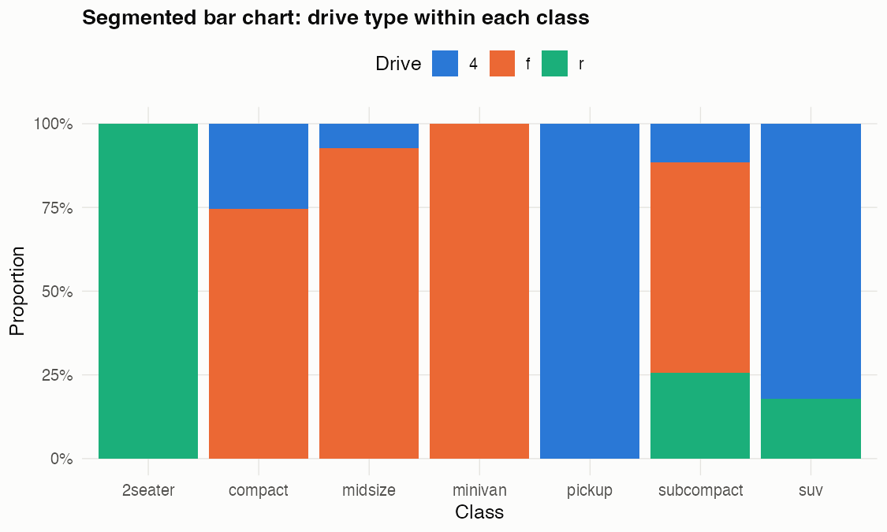
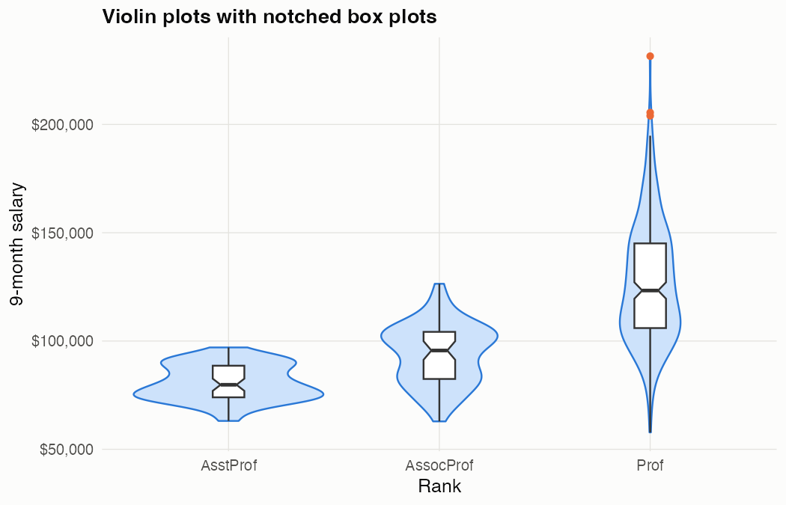
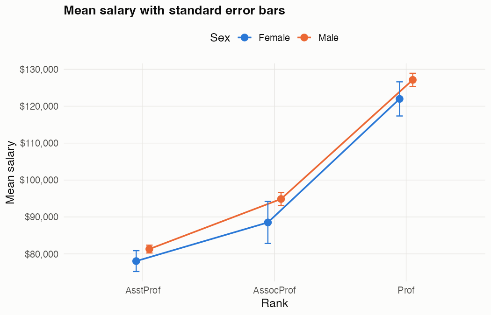
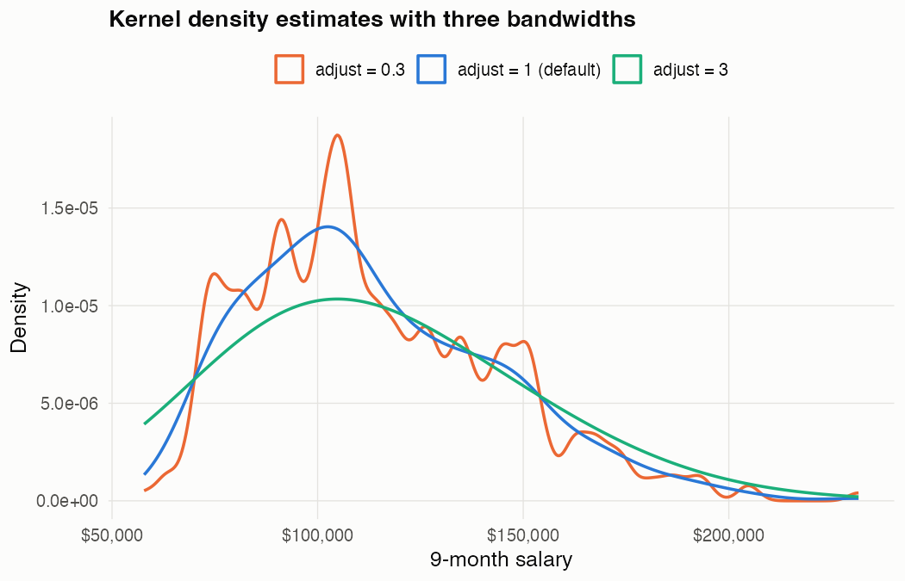
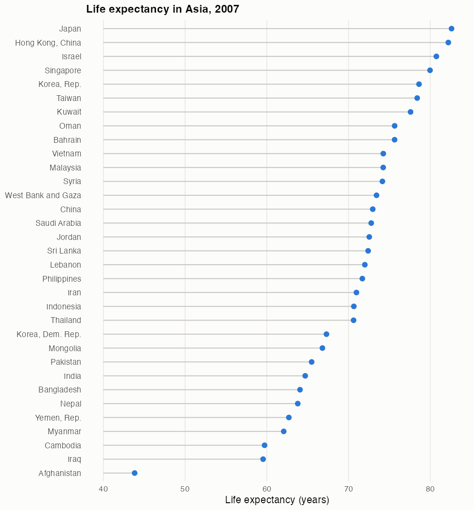
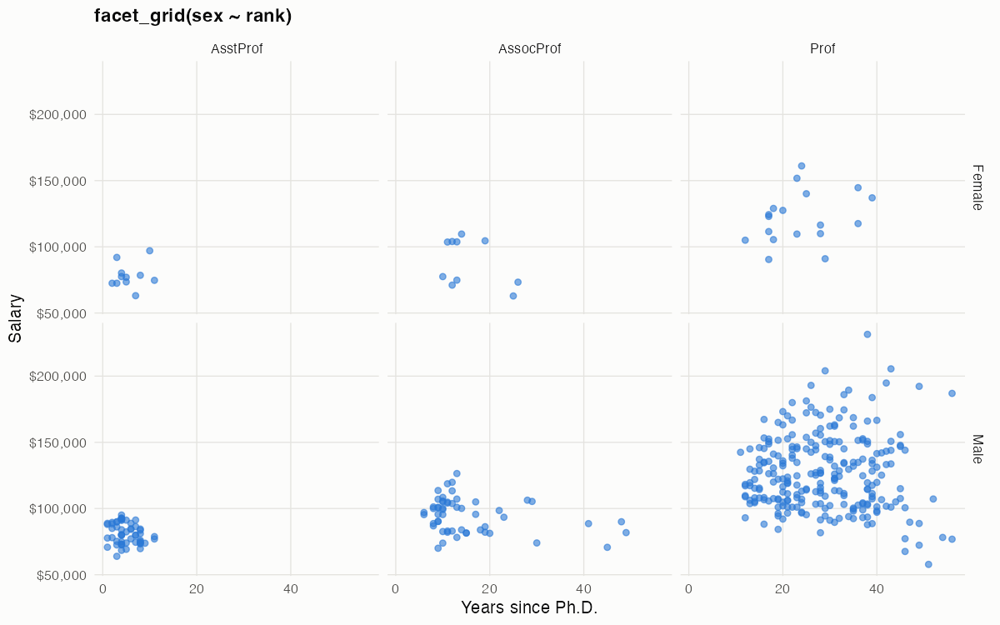
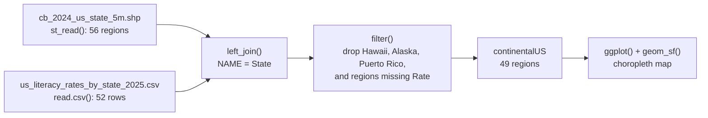
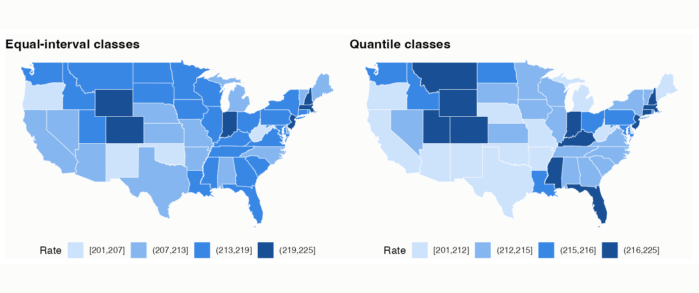
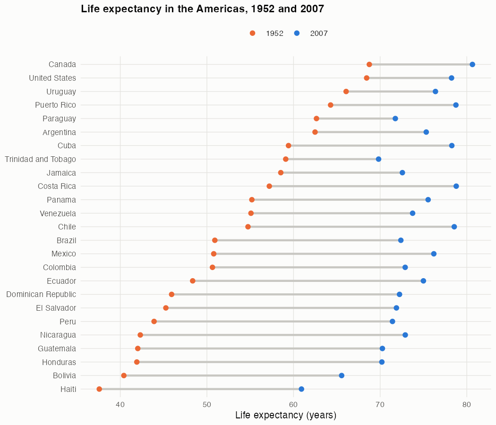

# Chapter 9 — Advanced Visualization

[Repository Guide](../../README.md) | [English](Concepts_Lecture.md) | [한국어](Concepts_Lecture.ko.md)

> **Last Updated:** 2026-11-19
>
> Modern Data Visualization with R, Kabacoff, Ch 5, 6, 7, 8

> **Learning Objectives:**
> 1. Compare categories and distributions with stacked, grouped, and segmented bar charts, density plots, box plots, violin plots, ridgeline plots, and strip plots
> 2. Show the relationships among several variables in one plot with color, shape, and size mappings and fitted lines
> 3. Build multi-panel plots using faceting
> 4. Create interactive maps with sf and mapview, and show regional values with choropleth maps
> 5. Show change over time with dumbbell charts, slope graphs, area charts, and stream graphs
> 6. Produce publication-quality plots by specifying scales, labels, and themes

---

## Table of Contents

- [1. Grouped Bar Charts](#1-grouped-bar-charts)
  - [1.1 Side-by-Side Bar Chart](#11-side-by-side-bar-chart)
  - [1.2 Stacked, Grouped, and Segmented Bar Charts](#12-stacked-grouped-and-segmented-bar-charts)
  - [1.3 Colors, Labels, and Percentages](#13-colors-labels-and-percentages)
  - [1.4 Bar Charts of Summary Statistics](#14-bar-charts-of-summary-statistics)
- [2. Scatter Plots with Advanced Aesthetics](#2-scatter-plots-with-advanced-aesthetics)
  - [2.1 Customized Scatter Plot](#21-customized-scatter-plot)
  - [2.2 Key Aesthetic Parameters](#22-key-aesthetic-parameters)
  - [2.3 Overplotting and Transparency](#23-overplotting-and-transparency)
  - [2.4 Fitted Lines on Scatterplots](#24-fitted-lines-on-scatterplots)
- [3. Line Plots](#3-line-plots)
  - [3.1 Time Series Line Plot](#31-time-series-line-plot)
  - [3.2 The Format of the Time Variable and Comparing Several Series](#32-the-format-of-the-time-variable-and-comparing-several-series)
- [4. Distribution Plots](#4-distribution-plots)
  - [4.1 Grouped Kernel Density Plots](#41-grouped-kernel-density-plots)
  - [4.2 Side-by-Side Box Plots](#42-side-by-side-box-plots)
  - [4.3 Ridgeline Plots](#43-ridgeline-plots)
  - [4.4 Strip Plots (Jittered)](#44-strip-plots-jittered)
  - [4.5 How to Read a Box Plot](#45-how-to-read-a-box-plot)
  - [4.6 Notches and Violin Plots](#46-notches-and-violin-plots)
  - [4.7 Mean and Standard Error Plots](#47-mean-and-standard-error-plots)
  - [4.8 Kernel Density Estimation and Bandwidth](#48-kernel-density-estimation-and-bandwidth)
  - [4.9 Cleveland Dot Charts](#49-cleveland-dot-charts)
- [5. Grouping and Multi-Variable Visualization](#5-grouping-and-multi-variable-visualization)
  - [5.1 Color Mapping by Group](#51-color-mapping-by-group)
  - [5.2 Color + Shape Mapping](#52-color--shape-mapping)
  - [5.3 Color + Size Mapping](#53-color--size-mapping)
  - [5.4 Scatter Plot with Fit Lines](#54-scatter-plot-with-fit-lines)
  - [5.5 Mappings, Fixed Values, and the Choice of Color Scale](#55-mappings-fixed-values-and-the-choice-of-color-scale)
- [6. Faceting for Multi-Panel Plots](#6-faceting-for-multi-panel-plots)
  - [6.1 Histograms by Group](#61-histograms-by-group)
  - [6.2 Faceted Scatter Plot with Fit Lines](#62-faceted-scatter-plot-with-fit-lines)
  - [6.3 Multi-Country Life Expectancy](#63-multi-country-life-expectancy)
  - [6.4 Splitting by Two Variables with facet_grid](#64-splitting-by-two-variables-with-facet_grid)
  - [6.5 Choosing Between Grouping and Faceting](#65-choosing-between-grouping-and-faceting)
- [7. GIS Visualization](#7-gis-visualization)
  - [7.1 Interactive Maps with mapview](#71-interactive-maps-with-mapview)
  - [7.2 Choropleth Maps by Country](#72-choropleth-maps-by-country)
  - [7.3 US State Choropleth with Shapefiles](#73-us-state-choropleth-with-shapefiles)
  - [7.4 Geocoding](#74-geocoding)
  - [7.5 Classes and Normalization in Choropleth Maps](#75-classes-and-normalization-in-choropleth-maps)
  - [7.6 Coordinate Reference Systems and Map Projections](#76-coordinate-reference-systems-and-map-projections)
  - [7.7 Example: Checking Names and Comparing Classes in the Literacy Choropleth](#77-example-checking-names-and-comparing-classes-in-the-literacy-choropleth)
- [8. Time-Based Visualization](#8-time-based-visualization)
  - [8.1 Time Series with Smoothing](#81-time-series-with-smoothing)
  - [8.2 Dumbbell Charts](#82-dumbbell-charts)
  - [8.3 Slope Graphs](#83-slope-graphs)
  - [8.4 Area Charts and Stream Graphs](#84-area-charts-and-stream-graphs)
  - [8.5 Interpreting Stacked Area Charts and Stream Graphs](#85-interpreting-stacked-area-charts-and-stream-graphs)
  - [8.6 Choosing a Time Plot](#86-choosing-a-time-plot)
  - [8.7 Example: A Sorted and Colored Dumbbell Chart](#87-example-a-sorted-and-colored-dumbbell-chart)
- [9. Choosing Plots and Common Mistakes](#9-choosing-plots-and-common-mistakes)
  - [9.1 Choosing a Plot by Kind of Variable](#91-choosing-a-plot-by-kind-of-variable)
  - [9.2 Common Mistakes in Visualization](#92-common-mistakes-in-visualization)
- [Concept Applications](#concept-applications)
- [Summary](#summary)
- [Self-Check Questions](#self-check-questions)

---

<br>

## 1. Grouped Bar Charts

### 1.1 Side-by-Side Bar Chart

Use `position = "dodge"` to place bars side by side instead of stacking:

```r
library(ggplot2)

ggplot(mpg, aes(x = class, fill = drv)) +
  geom_bar(position = "dodge")
```

This shows the distribution of drive types (front, rear, 4WD) within each vehicle class. The `drv` values `f`, `r`, and `4` stand for front-wheel, rear-wheel, and four-wheel drive, and the default `position = "stack"` stacks the same data in one bar. A drive type missing from a vehicle class leaves no gap; instead the remaining bars become wider (e.g., `2seater`, which has only rear-wheel drive), so `position_dodge(preserve = "single")` keeps bar widths equal.

### 1.2 Stacked, Grouped, and Segmented Bar Charts

The relationship between two categorical variables is usually shown with a bar chart, and there are three kinds depending on how the second category is arranged within the bars.

| Kind | `position` Argument | Meaning of Bar Height | Easy to Compare |
|------|------|------|------|
| Stacked bar chart | `"stack"` (default) | Total count of the first category | Overall size of each category |
| Grouped (side-by-side) bar chart | `"dodge"` | Count of each combination of the two categories | Counts of the second category within one category |
| Segmented (filled) bar chart | `"fill"` | Always 1 (100%) | The share of the second category within each category |

*Table 1. Three bar charts for two categorical variables*

A stacked bar chart shows the total number of cars of each class and also the composition of drive types within each bar. For example, all two-seaters (`2seater`) are rear-wheel drive and most SUVs are four-wheel drive. But the segments other than the bottom one start at different heights in different bars, so their lengths are hard to compare. A segmented bar chart sets every bar to 100%, so it is good for comparing compositions when the categories differ in size.

```r
ggplot(mpg, aes(x = class, fill = drv)) +
  geom_bar(position = "fill") +
  labs(y = "Proportion")
```



*Figure 1. Share of each drive type within each vehicle class*

Note that the total number of cars of each class disappears in a segmented bar chart. There are only 5 two-seaters and 62 SUVs, but the two bars have the same height. The three charts answer different questions from the same data, so the choice depends on whether overall size or composition is to be compared. An alternative that shows the relationship between two categorical variables in more detail is the mosaic plot, in which the area of each cell is proportional to the count of the combination.

### 1.3 Colors, Labels, and Percentages

The default settings often give category orders, axis labels, and colors that do not suit the purpose of the analysis. To print a percentage on each segment of a segmented bar chart, first build a summary data set with the proportion of each combination.

```r
library(dplyr)

plotdata <- mpg %>%
  group_by(class, drv) %>%
  summarize(n = n(), .groups = "drop_last") %>%
  mutate(pct = n / sum(n),
         lbl = scales::percent(pct, accuracy = 1))
head(plotdata, 4)
#> # A tibble: 4 × 5
#> # Groups:   class [3]
#>   class   drv       n    pct lbl  
#>   <chr>   <chr> <int>  <dbl> <chr>
#> 1 2seater r         5 1      100% 
#> 2 compact 4        12 0.255  26%  
#> 3 compact f        35 0.745  74%  
#> 4 midsize 4         3 0.0732 7%
```

Grouping with `group_by(class, drv)` and counting with `summarize()`, `.groups = "drop_last"` drops only the last grouping variable `drv`, leaving the data grouped by `class`. The `n / sum(n)` in the following `mutate()` is therefore the proportion within each vehicle class. The 12 four-wheel-drive cars among the 47 compact cars are 25.5%. `scales::percent()` turns proportions into strings such as "26%", and `accuracy = 1` rounds them to whole percentages. When plotting this summary data, `geom_bar(stat = "identity", position = "fill")` sets the bar heights to `pct`, and `geom_text(aes(label = lbl), position = position_stack(vjust = 0.5))` places the labels at the center of each segment; `vjust = 0.5` means the vertical middle of the segment. In addition, `factor()` changes the order and names of the categories (for example, `f` to "front-wheel"), `scale_y_continuous(labels = percent)` shows the axis ticks as percentages, and `scale_fill_brewer(palette = "Set2")` sets an easily distinguishable color scheme.

### 1.4 Bar Charts of Summary Statistics

Bar charts are used not only for counts but also for summary statistics such as group means. In this case, compute the summary statistics first and set the bar heights to those values with `geom_bar(stat = "identity")` (or `geom_col()`). The following code computes the mean salary by rank from `Salaries`, the faculty salary data of the `carData` package described in Section 2.1.

```r
data(Salaries, package = "carData")

plotdata2 <- Salaries %>%
  group_by(rank) %>%
  summarize(mean_salary = mean(salary))
plotdata2
#> # A tibble: 3 × 2
#>   rank      mean_salary
#>   <fct>           <dbl>
#> 1 AsstProf       80776.
#> 2 AssocProf      93876.
#> 3 Prof          126772.
```

The mean salaries of assistant professors, associate professors, and professors are about 80,776, 93,876, and 126,772 dollars. Adding `geom_text(aes(label = dollar(mean_salary)), vjust = -0.25)` writes the values just above the bars. This chart is simple, but it has the major limitation of showing a single mean with no information at all about the distribution. Two groups with the same mean can have completely different spreads and shapes, so comparisons between groups are better accompanied by the distribution plots of Section 4 or the mean and standard error plot of Section 4.7.

> **Caution:** When a quantity that starts at zero, such as a count or a total, is drawn as bars, the y-axis must start at zero. The length of a bar represents the size of the value, so cutting the axis to start at a nonzero value makes small differences look like differences of several times.

---

<br>

## 2. Scatter Plots with Advanced Aesthetics

### 2.1 Customized Scatter Plot

`Salaries` in the `carData` package holds the nine-month salaries of 397 assistant professors, associate professors, and professors at a US college in the 2008-2009 academic year. `rank` is the academic rank, `discipline` is the department type (A: theoretical, B: applied), `yrs.since.phd` is the years since the PhD, `yrs.service` is the years of service, `sex` is the sex, and `salary` is the salary (in dollars).

```r
library(ggplot2)
data(Salaries, package = "carData")

ggplot(Salaries,
       aes(x = yrs.since.phd, y = salary)) +
  geom_point(color = "cornflowerblue", size = 2, alpha = 0.8) +
  scale_y_continuous(label = scales::dollar, limits = c(50000, 250000)) +
  scale_x_continuous(breaks = seq(0, 60, 10), limits = c(0, 60)) +
  labs(x = "Years Since PhD",
       y = "",
       title = "Experience vs. Salary",
       subtitle = "9-month salary for 2008-2009")
```

`label = scales::dollar` specifies the `labels` argument through partial matching and formats the y-axis ticks as dollars, such as `$100,000`. `limits` sets the axis range, and `breaks` sets the tick positions. `labs()` sets the axis titles, title, and subtitle, and `y = ""` leaves the y-axis title empty.

### 2.2 Key Aesthetic Parameters

| Parameter | Description | Example |
|-----------|-------------|---------|
| `color` | Point or line color | `"cornflowerblue"` |
| `size` | Point size | `2` (default: 1.5) |
| `alpha` | Transparency (0-1) | `0.8` |
| `shape` | Point shape | `16` (filled circle) |

*Table 2. Key aesthetic parameters of a scatter plot*

The code in Section 2.1 sets these values outside `aes()`, so, as shown in Chapter 6, Section 3, the same constant applies to every point.

### 2.3 Overplotting and Transparency

When there are many observations or the values are discrete, several points are drawn on top of each other in the same place, making the points look fewer than they are and the dense regions hard to see. This is called **overplotting**. The remedies are the following.

- **Transparency:** Lowering `alpha` to about 0.3-0.7 makes places where points overlap look darker, revealing the density.
- **Jittering:** As with `geom_jitter()` in Section 4.4, the points are scattered slightly at random. This is especially effective for integer-valued variables, but the positions become inaccurate by the amount of scatter.
- **Smaller points:** A smaller `size` reduces the overlap.
- **Summary plots:** With tens of thousands of points, plots such as `geom_bin2d()` or `geom_hex()`, which divide the plane into cells and show the count of each cell by color, are better.

`yrs.since.phd` and `yrs.service` in the `Salaries` data are integers, so many professors share the same values, and the `alpha = 0.8` of Section 2.1 reveals some of this overlap.

### 2.4 Fitted Lines on Scatterplots

`geom_smooth()` adds a line showing the trend to a scatterplot. Without a specified method, it draws a LOESS (local regression) curve with a 95% confidence band when there are fewer than 1,000 observations. `method = "lm"` draws a straight regression line, `method = "lm", formula = y ~ poly(x, 2)` draws a quadratic curve, and `se = FALSE` removes the confidence band. The principles and interpretation of regression lines are covered in Chapter 10.

Fitting a straight line to years since the Ph.D. and salary misses the decline of salary late in a career. A quadratic curve captures this decline. A cubic curve (`poly(x, 3)`) is more flexible, but polynomials of order higher than 3 are rarely needed in practice, and the higher the order, the more the curve bends at the ends of the data, making it hard to interpret. A fitted line is a tool for summarizing a pattern in the data, so check against the points whether the data actually show the shape of the line.

---

<br>

## 3. Line Plots

### 3.1 Time Series Line Plot

`gapminder` in the `gapminder` package holds the life expectancy (`lifeExp`), population, and GDP per capita of 142 countries from 1952 to 2007 at five-year intervals. `filter()` is a dplyr function, so the package is loaded first with `library(dplyr)`.

```r
data(gapminder, package = "gapminder")
library(dplyr)
plotdata <- filter(gapminder, country == "United States")

ggplot(plotdata, aes(x = year, y = lifeExp)) +
  geom_line(linewidth = 1.5, color = "lightgrey") +
  geom_point(size = 3, color = "steelblue") +
  labs(y = "Life Expectancy (years)",
       x = "Year",
       title = "Life expectancy changes over time",
       subtitle = "United States (1952-2007)",
       caption = "Source: http://www.gapminder.org/data/")
```

Layers are drawn in the order they appear in the code, so the points of the later `geom_point()` sit on top of the light grey line.

> **Key Point:** Combining `geom_line()` and `geom_point()` creates an effective visualization that shows both the trend and individual data points.

### 3.2 The Format of the Time Variable and Comparing Several Series

When the x-axis of a line plot is a date, the variable must have class `Date`, not `character` (Chapter 11, Section 3). If it is a string, ggplot2 treats the dates as categories, making unevenly spaced ticks or failing to connect the line. With class `Date`, the spacing and format of the ticks can be changed with `date_breaks` and `labels` in `scale_x_date()` (Section 8.1).

To compare several series in one plot, map the variable distinguishing the series to `color` or `linetype`. For example, choosing a few countries from `gapminder` and plotting with `aes(x = year, y = lifeExp, color = country)` draws a line of a different color for each country. With more than five series the colors become hard to tell apart, so splitting them into facets as in Section 6.3 is better. A dual-axis plot, which overlays two series with different units on separate left and right y-axes, should be avoided because the relationship between the two lines looks completely different depending on how the ranges of the two axes are chosen; instead, split the panels or convert the series to indices with a base period set to 100.

---

<br>

## 4. Distribution Plots

### 4.1 Grouped Kernel Density Plots

`geom_density()` draws a distribution as a smooth curve by kernel density estimation, and `alpha = 0.4` fills it semi-transparently so that overlapping parts remain visible.

```r
data(Salaries, package = "carData")

ggplot(Salaries, aes(x = salary, fill = rank)) +
  geom_density(alpha = 0.4) +
  labs(title = "Salary distribution by rank")
```

### 4.2 Side-by-Side Box Plots

```r
ggplot(Salaries, aes(x = rank, y = salary)) +
  geom_boxplot() +
  labs(title = "Salary distribution by rank")
```

### 4.3 Ridgeline Plots

A ridgeline plot overlaps the density curves of the groups with a small vertical offset, so that the distributions of many groups can be compared at a glance. `cty` is the city fuel economy (miles per gallon).

```r
library(ggridges)

ggplot(mpg, aes(x = cty, y = class, fill = class)) +
  geom_density_ridges() +
  theme_ridges() +
  labs(title = "City mileage by auto class") +
  theme(legend.position = "none")
```

### 4.4 Strip Plots (Jittered)

`geom_jitter()` scatters point positions slightly at random so that overlapping points become visible. `factor(rank, labels = ...)` replaces the rank names with two-line names, and `\n` is the newline character.

```r
library(scales)

ggplot(Salaries,
       aes(y = factor(rank,
                      labels = c("Assistant\nProfessor",
                                 "Associate\nProfessor",
                                 "Full\nProfessor")),
           x = salary, color = rank)) +
  geom_jitter(alpha = 0.7) +
  scale_x_continuous(label = dollar) +
  labs(title = "Academic Salary by Rank",
       subtitle = "9-month salary for 2008-2009",
       x = "", y = "") +
  theme_minimal() +
  theme(legend.position = "none")
```

### 4.5 How to Read a Box Plot

A box plot summarizes a distribution with five numbers. The bottom and top of the box are the first quartile $Q_1$ (the 25th percentile) and the third quartile $Q_3$ (the 75th percentile), and the line inside the box is the median. The length of the box is the **interquartile range** $\mathrm{IQR} = Q_3 - Q_1$, the width over which the middle 50% of the observations spread. The whiskers extending above and below the box are drawn to the most extreme observations lying between $Q_1 - 1.5 \times \mathrm{IQR}$ and $Q_3 + 1.5 \times \mathrm{IQR}$, and observations outside these fences are plotted separately as candidate outliers. Computing these values for assistant professors' salaries gives the following.

```r
s <- Salaries$salary[Salaries$rank == "AsstProf"]
q <- quantile(s, c(0.25, 0.5, 0.75))
iqr <- IQR(s)
c(q, IQR = iqr, lower_fence = q[[1]] - 1.5 * iqr, upper_fence = q[[3]] + 1.5 * iqr)
#>         25%         50%         75%         IQR lower_fence upper_fence 
#>    74000.00    79800.00    88597.50    14597.50    52103.75   110493.75
boxplot.stats(s)$stats
#> [1] 63100.0 74000.0 79800.0 88597.5 97032.0
boxplot.stats(s)$out
#> integer(0)
```

The median salary of assistant professors is 79,800 dollars and the IQR about 14,598 dollars. The whisker fences are 52,104 and 110,494 dollars, and the actual minimum of 63,100 dollars and maximum of 97,032 dollars lie inside them, so the whiskers are drawn to these two values and there are no outliers (`boxplot.stats()$out` is empty). The five values of `boxplot.stats()$stats` are the lower end of the whisker, $Q_1$, the median, $Q_3$, and the upper end of the whisker. The width of the box usually has no meaning.

Box plots are good for comparing several groups concisely, but they cannot show whether a distribution is bimodal, with two peaks. The same box plot can come from differently shaped distributions, so when there are not many observations, plot the points together or overlay the violin plot of Section 4.6.

### 4.6 Notches and Violin Plots

`geom_boxplot(notch = TRUE)` cuts a notch around the median. The notch spans the median $\pm 1.58 \times \mathrm{IQR}/\sqrt{n}$, and non-overlapping notches of two boxes are taken as rough evidence that the medians differ. This is an approximate guide, not a formal test.

```r
med_ci <- Salaries %>%
  group_by(rank) %>%
  summarize(n = n(), median = median(salary),
            lower = median - 1.58 * IQR(salary) / sqrt(n),
            upper = median + 1.58 * IQR(salary) / sqrt(n))
med_ci
#> # A tibble: 3 × 5
#>   rank          n  median   lower   upper
#>   <fct>     <int>   <dbl>   <dbl>   <dbl>
#> 1 AsstProf     67  79800   76982.  82618.
#> 2 AssocProf    64  95626.  91331.  99922.
#> 3 Prof        266 123322. 119533. 127110.
```

The notch ranges of the three ranks (76,982-82,618, 91,331-99,922, 119,533-127,110) do not overlap, so the median salaries can be regarded as different across ranks. The notch of the professors is narrow because there are 266 observations, making $\sqrt{n}$ large.

A **violin plot** stands a kernel density curve (Section 4.8) upright for each group and mirrors it left and right; it is drawn with `geom_violin()`. It shows the shape of the distribution well but not the position of the median or the middle 50%, so a narrow box plot is commonly overlaid. In that case the `geom_boxplot(width = 0.15)` layer must come after `geom_violin()`. Layers are drawn in code order (Section 3.1), so a box plot written first is hidden behind the violin.



*Figure 2. Violin plots and notched box plots of salary by rank*

In Figure 2, professors' salaries spread much more widely than those of the other two ranks and have a long upper tail, and the points drawn separately at the top are candidate outliers beyond the whisker fence. They are three values, 204,000, 205,500, and 231,545 dollars, and the first two nearly overlap.

### 4.7 Mean and Standard Error Plots

When comparing group means, showing the uncertainty with error bars instead of plotting only the means as points makes it possible to judge whether a difference could be explained by chance. First compute, for each group, the number of observations, the mean, the standard deviation, the standard error, and the half-width of the 95% confidence interval.

```r
plotdata3 <- Salaries %>%
  group_by(rank, sex) %>%
  summarize(n = n(), mean = mean(salary), sd = sd(salary),
            se = sd / sqrt(n), ci = qt(0.975, df = n - 1) * se,
            .groups = "drop")
plotdata3
#> # A tibble: 6 × 7
#>   rank      sex        n    mean     sd    se     ci
#>   <fct>     <fct>  <int>   <dbl>  <dbl> <dbl>  <dbl>
#> 1 AsstProf  Female    11  78050.  9372. 2826.  6296.
#> 2 AsstProf  Male      56  81311.  7901. 1056.  2116.
#> 3 AssocProf Female    10  88513. 17965. 5681. 12852.
#> 4 AssocProf Male      54  94870. 12891. 1754.  3519.
#> 5 Prof      Female    18 121968. 19620. 4624.  9757.
#> 6 Prof      Male     248 127121. 28214. 1792.  3529.
```

The **standard error** $\mathrm{SE} = s/\sqrt{n}$ is how much the sample mean varies from sample to sample, and `qt(0.975, df = n - 1)` is the 97.5% quantile of the t distribution with $n - 1$ degrees of freedom, so `ci` is the half-width of the 95% confidence interval for the mean. Standard errors and confidence intervals are covered in detail in Chapter 14. The standard errors of the women are larger than those of the men because, even with similar standard deviations, there are far fewer observations. There are only 10 female associate professors, so the half-width of the 95% confidence interval for their mean reaches 12,852 dollars.

```r
ggplot(plotdata3, aes(x = rank, y = mean, group = sex, color = sex)) +
  geom_point(size = 3, position = position_dodge(0.2)) +
  geom_line(position = position_dodge(0.2)) +
  geom_errorbar(aes(ymin = mean - se, ymax = mean + se),
                width = 0.1, position = position_dodge(0.2))
```

`position_dodge(0.2)` shifts the points of the two sexes at the same rank slightly left and right so that their error bars do not overlap. `ymin` and `ymax` in `geom_errorbar()` are the lower and upper ends of the bars, and `width` is the length of the horizontal line at the ends of the bars.



*Figure 3. Mean salary by rank and sex with standard error bars*

Error bars can represent the standard deviation, the standard error, or a confidence interval, so the plot must always state which is drawn. Standard error bars are about half as long as 95% confidence interval bars, so the impression of a difference changes greatly depending on which is drawn.

### 4.8 Kernel Density Estimation and Bandwidth

The kernel density plot of Section 4.1 replaces the bars of a histogram by placing a small bell-shaped curve (a kernel) on each observation and adding them all to make a smooth curve. The **kernel density estimate** for observations $x_1, \ldots, x_n$ is as follows.

```math
\hat{f}(x) = \frac{1}{nh} \sum_{i=1}^{n} K\left(\frac{x - x_i}{h}\right)
```

$K$ is a kernel function with area 1, usually the standard normal density, and $h$ is the **bandwidth**, which sets the width of each kernel. The bandwidth plays the same role as the bin width of a histogram. With small $h$ the curve follows even chance wiggles of the data and becomes bumpy, and with large $h$ it becomes too smooth and real peaks disappear. R's default bandwidth `bw.nrd0` is $h = 0.9 \min(s, \mathrm{IQR}/1.34)\, n^{-1/5}$.

```r
bw.nrd0(Salaries$salary)
#> [1] 8237.016
x <- Salaries$salary
0.9 * min(sd(x), IQR(x) / 1.34) * length(x)^(-1/5)
#> [1] 8237.016
```

For the 397 salaries, the default bandwidth is about 8,237 dollars. The `adjust` argument of `geom_density()` is a multiplier applied to this default.



*Figure 4. Kernel density estimates of salary with three bandwidths*

The curve with `adjust = 0.3` has several small peaks and shows even the chance variation of the sample, while the curve with `adjust = 3` smears out the long right tail and the peak near 100,000 dollars. The default is usually a reasonable starting point, but it is good practice to check with two or three values that conclusions about the shape of the distribution do not depend on the bandwidth.

### 4.9 Cleveland Dot Charts

To compare one value per category when there are many categories, a **Cleveland dot chart**, which uses points instead of bars, is effective. Bars use a lot of ink and make a plot heavy when there are dozens of categories, while points show the same information lightly. The life expectancy of 33 Asian countries in 2007 is plotted.

```r
asia <- gapminder %>% filter(continent == "Asia" & year == 2007)
ggplot(asia, aes(x = lifeExp, y = reorder(country, lifeExp))) +
  geom_segment(aes(x = 40, xend = lifeExp, yend = reorder(country, lifeExp)),
               color = "lightgrey") +
  geom_point(color = "blue", size = 2) +
  theme_minimal() +
  theme(panel.grid.major.y = element_blank())
```

`reorder(country, lifeExp)` creates a factor with the countries sorted by life expectancy. Without sorting, the countries are placed in alphabetical order and the values are hard to compare. `geom_segment()` draws a line from the baseline 40 to each point, and this shape of points and lines is also called a lollipop graph. `panel.grid.major.y = element_blank()` removes the horizontal grid lines that would overlap the lines.



*Figure 5. Sorted Cleveland dot chart of life expectancy in Asian countries in 2007*

The sorted chart shows at a glance that Japan (82.6 years) and Hong Kong are highest and that Afghanistan (43.8 years) is lowest, far below the other countries. The baseline 40 is an arbitrary value, so the lengths of the lines must not be interpreted as ratios. Unlike a bar chart, a dot chart is not distorted when its axis does not start at zero, because only the positions of the points are read, not lengths.

---

<br>

## 5. Grouping and Multi-Variable Visualization

### 5.1 Color Mapping by Group

```r
ggplot(Salaries, aes(x = yrs.since.phd, y = salary, color = rank)) +
  geom_point() +
  labs(title = "Academic salary by rank and years since degree")
```

### 5.2 Color + Shape Mapping

```r
ggplot(Salaries, aes(x = yrs.since.phd, y = salary,
                     color = rank, shape = sex)) +
  geom_point(size = 3, alpha = 0.6) +
  labs(title = "Academic salary by rank, sex, and years since degree")
```

### 5.3 Color + Size Mapping

```r
ggplot(Salaries, aes(x = yrs.since.phd, y = salary,
                     color = rank, size = yrs.service)) +
  geom_point(alpha = 0.6) +
  labs(title = "Academic salary by rank, years of service, and years since degree")
```

Mapping different variables to position (x, y), color, shape, and size in this way shows four or more variables in one plot. The more mappings there are, however, the harder the plot becomes to read.

### 5.4 Scatter Plot with Fit Lines

`method = "lm"` with `formula = y ~ poly(x, 2)` fits a quadratic polynomial regression curve for each group, and `se = FALSE` omits the confidence band. Because `color = sex` is in the `aes()` of `ggplot()`, both the points and the fitted lines are split by sex.

```r
ggplot(Salaries,
       aes(x = yrs.since.phd, y = salary, color = sex)) +
  geom_point(alpha = 0.4, size = 3) +
  geom_smooth(se = FALSE, method = "lm",
              formula = y ~ poly(x, 2), linewidth = 1.5) +
  labs(x = "Years Since Ph.D.",
       title = "Academic Salary by Sex and Years Experience",
       subtitle = "9-month salary for 2008-2009",
       y = "", color = "Sex") +
  scale_y_continuous(label = scales::dollar) +
  scale_color_brewer(palette = "Set1") +
  theme_minimal()
```

### 5.5 Mappings, Fixed Values, and the Choice of Color Scale

A **mapping**, which associates a variable with a visual property of the plot, is always written inside `aes()`, and a fixed value given to every point is written outside `aes()`. `geom_point(aes(color = rank))` colors each rank differently, but `geom_point(color = "blue")` colors every point blue. Writing a fixed value inside `aes()`, as in `aes(color = "blue")`, makes ggplot2 treat "blue" as a variable with a single value, so it applies the first color of the default palette (a reddish color) and even creates a legend.

The appropriate color scale depends on the kind of variable mapped to color.

| Kind of Variable | Scale | Example Function | Principle |
|------|------|------|------|
| Categorical (unordered) | Qualitative scale | `scale_color_brewer(palette = "Set1")` | Use clearly distinct hues that do not imply an order |
| Continuous or ordinal | Sequential scale | `scale_fill_gradient()`, `palette = "YlOrRd"` | Vary only the lightness of one hue, darker for larger values |
| Both sides of a reference value | Diverging scale | `scale_fill_gradient2(midpoint = 0)` | A neutral color at the reference value and two different hues on either side |

*Table 3. Color scales by kind of variable*

Coloring a continuous variable with a scale whose hue keeps changing, like a rainbow, makes it hard to tell which color is the larger value because the lightness does not change monotonically, and it creates boundaries that do not exist in the data. In addition, distinguishing groups by color alone loses information for readers with color vision deficiency or in black-and-white printing, so it is better to map shape as well, as in Section 5.2, or to add direct labels.

---

<br>

## 6. Faceting for Multi-Panel Plots

### 6.1 Histograms by Group

`facet_wrap(~rank, ncol = 1)` draws one histogram per rank and stacks them in one column. Without a specified number of bins, `geom_histogram()` uses `bins = 30` and prints a message suggesting a better value.

```r
ggplot(Salaries, aes(x = salary)) +
  geom_histogram() +
  facet_wrap(~rank, ncol = 1) +
  labs(title = "Salary histograms by rank")
```

### 6.2 Faceted Scatter Plot with Fit Lines

The levels A and B of `discipline` stand for theoretical and applied departments, so `labels` renames them for the facet titles. `geom_smooth(method = "lm")` draws a straight regression line for each facet and sex.

```r
ggplot(Salaries, aes(x = yrs.since.phd, y = salary, color = sex)) +
  geom_point(size = 2, alpha = 0.5) +
  geom_smooth(method = "lm", se = FALSE, linewidth = 1.5) +
  facet_wrap(~factor(discipline,
                     labels = c("Theoretical", "Applied")),
             ncol = 1) +
  scale_y_continuous(labels = scales::dollar) +
  theme_minimal() +
  scale_color_brewer(palette = "Set1") +
  labs(title = "Relationship of salary and years since degree by sex and discipline",
       subtitle = "9-month salary for 2008-2009",
       color = "Gender",
       x = "Years since Ph.D.",
       y = "Academic Salary")
```

### 6.3 Multi-Country Life Expectancy

`facet_wrap(~country)` creates one panel for each of the 25 countries in the Americas. `theme_minimal(base_size = 9)` reduces the text size, and `element_text(angle = 45, hjust = 1)` tilts the x-axis tick labels by 45 degrees.

```r
data(gapminder, package = "gapminder")
plotdata <- dplyr::filter(gapminder, continent == "Americas")

ggplot(plotdata, aes(x = year, y = lifeExp)) +
  geom_line(color = "grey") +
  geom_point(color = "blue") +
  facet_wrap(~country) +
  theme_minimal(base_size = 9) +
  theme(axis.text.x = element_text(angle = 45, hjust = 1)) +
  labs(title = "Changes in Life Expectancy",
       x = "Year",
       y = "Life Expectancy")
```

### 6.4 Splitting by Two Variables with facet_grid

`facet_wrap()` creates a panel for each level of one variable and wraps the panels into several rows. To create a panel for each combination of two variables, use `facet_grid(row variable ~ column variable)`.

```r
ggplot(Salaries, aes(x = yrs.since.phd, y = salary)) +
  geom_point() +
  facet_grid(sex ~ rank)
```

`sex ~ rank` creates a 2×3 grid with sex as rows and rank as columns. To split only by a column variable, write `facet_grid(. ~ rank)`, and only by a row variable, `facet_grid(sex ~ .)`.



*Figure 6. Salary scatterplots for each combination of sex and rank*

```r
table(Salaries$sex, Salaries$rank)
#>         
#>          AsstProf AssocProf Prof
#>   Female       11        10   18
#>   Male         56        54  248
```

As the cross-tabulation from `table()` shows, the female panels contain only 10-18 points while the male professor panel contains 248. Facets use the same axis ranges in every panel (the default `scales = "fixed"`), so comparisons across panels are accurate. `scales = "free_y"` lets each panel have its own axis, but then the panels can no longer be compared side by side by height.

### 6.5 Choosing Between Grouping and Faceting

A third variable can be shown either by **grouping**, distinguishing groups by color or shape within the same panel (Section 5), or by **faceting**, splitting the panels. Grouping is good for comparing groups directly on the same coordinates, but with many groups or many points they hide one another and become hard to read. Faceting shows each group's pattern cleanly without overlap, but comparisons between groups require moving the eyes from panel to panel. The general principle is to show the most important comparison by grouping within the same panel and a less important division by faceting. The plot of Section 6.2 uses both methods, distinguishing sex by color (direct comparison within a panel) and splitting the discipline into facets (separate contexts).

---

<br>

## 7. GIS Visualization

### 7.1 Interactive Maps with mapview

`crime` in the `ggmap` package holds 86,314 crime records from Houston, Texas, from January to August 2010, and the code below selects the 157 records whose `offense` is `murder`. `st_as_sf()` turns the longitude (`lon`) and latitude (`lat`) columns into point geometries to create an sf object, and `crs = 4326` declares that the coordinates are in the WGS 84 longitude-latitude system (EPSG:4326). `mapview()` opens an interactive Leaflet-based map that can be zoomed and panned, and clicking a point shows its attributes.

```r
library(ggmap)
library(dplyr)
library(mapview)
library(sf)

homicide <- filter(crime, offense == "murder") %>%
  select(date, offense, address, lon, lat)

mymap <- st_as_sf(homicide, coords = c("lon", "lat"), crs = 4326)
mapview(mymap)
```

### 7.2 Choropleth Maps by Country

`country_choropleth()` takes data with two columns, `region` and `value`, and colors each country. `rename()` therefore renames `country` to `region` and `lifeExp` to `value`, and `tolower()` converts the country names to lowercase to match the package's region name format. `num_colors = 9` divides the values into 9 classes for coloring, and `scale_fill_brewer(palette = "YlOrRd")` uses a color scheme running from yellow to red.

```r
library(choroplethr)
data(gapminder, package = "gapminder")

plotdata <- gapminder %>%
  filter(year == 2007) %>%
  rename(region = country, value = lifeExp) %>%
  mutate(region = tolower(region))

country_choropleth(plotdata, num_colors = 9) +
  scale_fill_brewer(palette = "YlOrRd") +
  labs(title = "Life expectancy by country",
       subtitle = "Gapminder 2007 data",
       fill = "Years")
```

> **Note:** **Matching country names.** Countries whose gapminder names differ from choroplethr's region names, such as `"united states"` and `"korea, rep."`, find no match, remain blank on the map, and are listed in the console. The code below is a corrected version that adds a step matching the names with `recode()`; the `country_choropleth()` call that follows is the same as above. Small countries without a region on the map, such as Bahrain and Singapore, stay uncolored even after their names are matched.

```r
data(country.map, package = "choroplethrMaps")   # for checking region names

plotdata <- gapminder %>%
  filter(year == 2007) %>%
  rename(region = country, value = lifeExp) %>%
  mutate(region = tolower(region)) %>%
  mutate(region =
           recode(region,
                  "united states"    = "united states of america",
                  "congo, dem. rep." = "democratic republic of the congo",
                  "congo, rep."      = "republic of congo",
                  "korea, dem. rep." = "north korea",
                  "korea, rep."      = "south korea",
                  "tanzania"         = "united republic of tanzania",
                  "serbia"           = "republic of serbia",
                  "slovak republic"  = "slovakia",
                  "yemen, rep."      = "yemen"))
```

### 7.3 US State Choropleth with Shapefiles

A shapefile consists of a `.shp` file with the geometries together with files such as `.shx` (geometry index), `.dbf` (attribute table), and `.prj` (coordinate system), which must sit in the same folder as one set. `st_read()` reads the set into an sf object with one row per region. `cb_2024_us_state_5m` is the 2024 state boundary file of the US Census Bureau and holds 56 regions: the 50 states, Washington, D.C., and 5 territories including Puerto Rico.

```r
library(tidyverse)
library(sf)

USMap <- st_read("data/cb_2024_us_state_5m.shp")
litRates <- read.csv("data/us_literacy_rates_by_state_2025.csv")

continentalUS <- USMap %>%
  left_join(litRates, by = c("NAME" = "State")) %>%
  filter(NAME != "Hawaii" & NAME != "Alaska" &
         NAME != "Puerto Rico" & !is.na(Rate))

ggplot(continentalUS, aes(geometry = geometry, fill = Rate)) +
  geom_sf() +
  coord_sf()
```

`left_join()` uses the map's state name column `NAME` and the CSV's `State` column as the key to attach the `Rate` column, and because the left data is an sf object, the result is also an sf object. `filter()` removes Hawaii, Alaska, and Puerto Rico, which lie apart from the mainland, and the regions without `Rate`, leaving 49 regions: the 48 contiguous states and Washington, D.C. `geom_sf()` draws the geometry stored in the `geometry` column of each row, and `fill = Rate` colors it by value.



*Figure 7. Joining a shapefile and a CSV file to draw a choropleth map*

### 7.4 Geocoding

To plot data that have addresses but no coordinates on a map, the addresses must first be converted into latitude and longitude, which is called **geocoding**. Converting coordinates into addresses is reverse geocoding. `geocode()` from the `tidygeocoder` package takes a data frame and an address column and attaches latitude and longitude columns.

For example, applying `geocode(addr_df, address = location, method = "osm")` to a data frame `addr_df` with an address column `location` returns a data frame with `lat` and `long` columns attached.

`method = "osm"` means using the geocoding service of OpenStreetMap, and other services such as the US Census Bureau, ArcGIS, and Google can also be chosen. Some services require an API key and limit the number of requests per day. Geocoding results can be wrong when an address is ambiguous, so plot them on a map and check that no point has landed in a wrong place. The crime data of Section 7.1 already had `lon` and `lat` columns, so this step was not needed.

### 7.5 Classes and Normalization in Choropleth Maps

A choropleth map colors each region by its value, so how the values are mapped to colors largely determines the impression the map gives.

1. **Continuous and binned scales:** Values can be colored with a continuous change of color (`scale_fill_gradient()`) or divided into a few classes with one color per class (`scale_fill_steps(n.breaks = 10)`, `num_colors = 9` in Section 7.2). A binned scale makes the regions easy to read as a few grades, but the same data look completely different depending on where the class boundaries are placed. Equal-interval boundaries put most regions into one or two colors when the distribution is skewed, while quantile boundaries give every class the same number of regions but can exaggerate small differences into different colors.
2. **Normalization:** A choropleth map should be colored not with totals such as population counts or numbers of events but with normalized values such as per capita values, rates, or densities. Coloring totals simply makes populous regions dark, effectively producing a population map. The `Rate` of Section 7.3 is not a total proportional to the population of a state, so it can be colored as it is.
3. **The effect of area:** A large region draws attention because it looks big on the map even if its population is small. On a map of the United States, large but sparsely populated Midwestern states take up more visual weight than small but populous Eastern states.
4. **Sequential scales:** A value representing magnitude, such as a literacy rate, is colored with a sequential scale that varies the lightness of one hue (Table 3), and a diverging scale is used to show values above and below a reference such as 0 or the mean.

In addition, regions left blank because their names could not be matched (Section 7.2) are regions without a value, not regions with a small value, so it is good to mark missing values separately in the legend.

### 7.6 Coordinate Reference Systems and Map Projections

The earth is a nearly spherical solid, so transferring latitude and longitude onto a flat map requires a **projection**. No projection can preserve area, shape, distance, and direction all at once, so the property to preserve is chosen according to the purpose. For example, the Mercator projection preserves direction and local shape but inflates area greatly toward high latitudes, while equal-area projections preserve area and suit maps such as choropleths, whose impression depends on area.

A statement of the datum and projection in which coordinates are measured is a **coordinate reference system** (CRS). The `crs = 4326` of Section 7.1 is the EPSG code of the WGS 84 longitude-latitude system used by GPS. `st_crs()` in `sf` reports the CRS of an object, and `st_transform()` converts coordinates to another CRS. Before joining or overlaying two spatial data sets with different CRSs, their CRSs must be made the same. With `coord_sf(crs = ...)`, ggplot2 converts the data to the specified projection when drawing.

### 7.7 Example: Checking Names and Comparing Classes in the Literacy Choropleth

Before the join of Section 7.3, check with `setdiff()` that the region names of the two data sets do not mismatch anywhere. `setdiff(a, b)` returns the elements that are in `a` but not in `b`.

```r
USMap <- st_read("data/cb_2024_us_state_5m.shp", quiet = TRUE)
litRates <- read.csv("data/us_literacy_rates_by_state_2025.csv")
setdiff(litRates$State, USMap$NAME)
#> [1] "United States"
setdiff(USMap$NAME, litRates$State)
#> [1] "Puerto Rico"                                 
#> [2] "United States Virgin Islands"                
#> [3] "Guam"                                        
#> [4] "Commonwealth of the Northern Mariana Islands"
#> [5] "American Samoa"
```

The only name found only in the CSV is the national value `United States`, and the names found only in the map are the five territories including Puerto Rico. All state names are spelled the same, so no names need fixing, and this result shows why 49 regions remain in Self-Check Question 5 of this chapter. `quiet = TRUE` stops `st_read()` from printing file information.

Now the same values are divided into classes in two ways to see the difference described in Section 7.5.

```r
continentalUS <- USMap %>%
  left_join(litRates, by = c("NAME" = "State")) %>%
  filter(NAME != "Hawaii" & NAME != "Alaska" &
         NAME != "Puerto Rico" & !is.na(Rate))
r <- continentalUS$Rate
equal_cls <- cut(r, breaks = seq(min(r), max(r), length.out = 5), include.lowest = TRUE)
quant_cls <- cut(r, breaks = quantile(r, probs = seq(0, 1, 0.25)), include.lowest = TRUE)
table(equal_cls)
#> equal_cls
#> [201,207] (207,213] (213,219] (219,225] 
#>         4        15        24         6
table(quant_cls)
#> quant_cls
#> [201,212] (212,215] (215,216] (216,225] 
#>        14        15         8        12
```

`seq(min(r), max(r), length.out = 5)` divides the range between the minimum 201 and the maximum 225 with five equally spaced boundaries into four classes of width 6, and `quantile(r, probs = seq(0, 1, 0.25))` uses the quartiles as boundaries. `include.lowest = TRUE` in `cut()` includes the minimum in the first class. With equal-interval classes, 24 of the 49 regions crowd into the third class and only 4 fall into the first. Quantile classes try to divide the regions evenly, but many states have values of 215 or 216, so the third class holds only 8 regions in the narrow range above 215 and up to 216.



*Figure 8. Two choropleth maps coloring the same values with equal-interval and quantile classes*

The two maps of Figure 8 give very different impressions even though the data are the same. The equal-interval map is mostly in the middle colors, so the differences between states look small, while the quantile map colors a state just above 216 and a state at 225 with the same darkest color, making differences look larger than they are. A classed map must therefore show the class boundaries in its legend and state how the classes were determined.

---

<br>

## 8. Time-Based Visualization

### 8.1 Time Series with Smoothing

Without a specified method, `geom_smooth()` uses LOESS (local regression) when there are fewer than 1,000 observations, so for `economics`, which has 574 months, it draws a LOESS curve with a confidence band. `date_breaks = "5 years"` places a tick every 5 years, and `date_format("%b-%y")` labels the ticks with the abbreviated month and a two-digit year.

```r
library(scales)

ggplot(economics, aes(x = date, y = psavert)) +
  geom_line(color = "indianred3", linewidth = 1) +
  geom_smooth() +
  scale_x_date(date_breaks = "5 years", labels = date_format("%b-%y")) +
  labs(title = "Personal Savings Rate",
       subtitle = "1967 to 2015",
       x = "", y = "Personal Savings Rate") +
  theme_minimal()
```

### 8.2 Dumbbell Charts

`pivot_wider()` converts long-format data, with one row per country and year, into wide format with the years spread into columns. The columns are renamed to `y1952` and `y2007` so that `aes()` can use them without backticks, since the original names start with a digit. `geom_dumbbell()` connects `x` to `xend` with a line to compare the values at the two time points.

```r
library(ggalt)
library(tidyr)

plotdata_long <- filter(gapminder,
  continent == "Americas" & year %in% c(1952, 2007)) %>%
  select(country, year, lifeExp)

plotdata_wide <- pivot_wider(plotdata_long,
  names_from = year, values_from = lifeExp)
names(plotdata_wide) <- c("country", "y1952", "y2007")

ggplot(plotdata_wide, aes(y = country, x = y1952, xend = y2007)) +
  geom_dumbbell()
```

### 8.3 Slope Graphs

`newggslopegraph()` takes the data, the time column, the value column, and the group column in that order, places the values vertically at each time point, and connects them with a line per group. `year` is converted to a factor to treat the time points as categories, and `lifeExp` is rounded so that the values shown on the plot are integers.

```r
library(CGPfunctions)

df <- gapminder %>%
  filter(year %in% c(1992, 1997, 2002, 2007) &
         country %in% c("Panama", "Costa Rica", "Nicaragua",
                         "Honduras", "El Salvador", "Guatemala", "Belize")) %>%
  mutate(year = factor(year), lifeExp = round(lifeExp))

newggslopegraph(df, year, lifeExp, country) +
  labs(title = "Life Expectancy by Country",
       subtitle = "Central America",
       caption = "source: gapminder")
```

### 8.4 Area Charts and Stream Graphs

`geom_area()` fills the area under the line to show magnitude as area. A stream graph stacks the areas of several groups above and below a central axis so that they look like a flowing stream. `uspopage` holds the US population by age group from 1900 to 2002 in thousands, and `Thousands/1000` converts it to millions. `fct_rev()` reverses the order of the age groups, which changes the stacking order and the legend order.

```r
# Area chart
ggplot(economics, aes(x = date, y = psavert)) +
  geom_area(fill = "lightblue", color = "black") +
  labs(title = "Personal Savings Rate", x = "Date", y = "Personal Savings Rate")

# Stream graph
library(ggstream)
data(uspopage, package = "gcookbook")

ggplot(uspopage, aes(x = Year, y = Thousands/1000,
                     fill = forcats::fct_rev(AgeGroup))) +
  geom_stream() +
  labs(title = "US Population by age", subtitle = "1900 to 2002",
       x = "Year", y = "", fill = "Age Group") +
  scale_fill_brewer(palette = "Set2") +
  theme_minimal()
```

### 8.5 Interpreting Stacked Area Charts and Stream Graphs

A stacked area chart stacks the values of several groups, showing the change of the total over time together with the contribution of each group. It is most useful when both the change of the groups and the change of the total are of interest. However, only the bottom group has a flat baseline, and each group above it sits on a baseline that inherits the fluctuations of the groups below, so their heights are hard to read accurately. It is therefore best to place the most important group at the bottom. Reversing the order of the age groups with `fct_rev()` in Section 8.4 was also done to set the stacking order. When the values are large, convert them to an easily read unit, as with `Thousands/1000` (millions of people), and keep scientific notation out of the axis ticks.

A stream graph spreads the areas above and below a central line, so the values on the y-axis are hard to interpret. Its y-axis ticks are therefore usually hidden, and it is used to compare the relative thickness of the groups at the same time point. `geom_stream(type = "proportional")` scales the total to 1 at each time point and shows the change in the groups' proportions, the counterpart of the segmented bar chart of Section 1.2.

### 8.6 Choosing a Time Plot

A plot showing change over time is chosen according to the number of time points and the number of groups.

| Situation | Suitable Plot |
|------|------|
| One series, many time points | Line plot (Section 3.1), with a smoother added to show the trend (Section 8.1) |
| Several series, many time points | Line plot distinguished by color, facets for many series (Section 6.3) |
| Several groups, two time points | Dumbbell chart (Section 8.2) |
| Several groups, three or four time points | Slope graph (Section 8.3) |
| Change of the total and its composition | Stacked area chart, stream graph (Section 8.4) |

*Table 4. Choosing a plot to show change over time*

A dumbbell chart shows the pattern much better when the groups are sorted by the change or by the later value (`reorder()`) and the points of the two time points are colored differently. The time variable of a slope graph must be a factor.

### 8.7 Example: A Sorted and Colored Dumbbell Chart

To make the dumbbell chart of Section 8.2 easier to read, sort the countries by value and color the points of the two time points differently. First add a column of gains to the wide data to see which countries gained most.

```r
plotdata_wide <- gapminder %>%
  filter(continent == "Americas" & year %in% c(1952, 2007)) %>%
  select(country, year, lifeExp) %>%
  pivot_wider(names_from = year, values_from = lifeExp) %>%
  rename(y1952 = `1952`, y2007 = `2007`) %>%
  mutate(gain = y2007 - y1952) %>%
  arrange(desc(gain))
head(plotdata_wide, 3)
#> # A tibble: 3 × 4
#>   country   y1952 y2007  gain
#>   <fct>     <dbl> <dbl> <dbl>
#> 1 Nicaragua  42.3  72.9  30.6
#> 2 Honduras   41.9  70.2  28.3
#> 3 Guatemala  42.0  70.3  28.2
tail(plotdata_wide, 2)
#> # A tibble: 2 × 4
#>   country       y1952 y2007  gain
#>   <fct>         <dbl> <dbl> <dbl>
#> 1 United States  68.4  78.2  9.80
#> 2 Paraguay       62.6  71.8  9.10
```

The backticks in `rename()` refer to column names that start with digits, and `arrange(desc(gain))` sorts by gain in decreasing order. The country whose life expectancy grew most in 1952-2007 is Nicaragua (30.6 years), and those that grew least are Paraguay (9.1 years) and the United States (9.8 years). In the plot, `aes(y = reorder(country, y1952))` sorts the countries by their 1952 values, and `colour_x` and `colour_xend` of `geom_dumbbell()` give the points of the two time points different colors.



*Figure 9. Dumbbell chart sorted by 1952 life expectancy with the two time points distinguished by color*

In the sorted Figure 9, the countries with lower life expectancy in 1952 have longer lines, revealing a pattern of convergence in which the gap between countries narrowed greatly over half a century. Canada and the United States, highest in 1952, gained 11.9 and 9.8 years, while Haiti and Bolivia, which started lowest, gained more than 23 years and yet remain the two lowest countries in 2007. This pattern is hard to find in the basic plot of Section 8.2, ordered alphabetically.

---

<br>

## 9. Choosing Plots and Common Mistakes

### 9.1 Choosing a Plot by Kind of Variable

A plot is chosen by the kinds and number of variables to be shown. The plots of this chapter are summarized as follows.

| Combination of Variables | Question | Plot | Section |
|------|------|------|------|
| Categorical × categorical | Count or composition of each combination | Stacked, grouped, segmented bar charts | Section 1 |
| Numeric × numeric | Relationship between two variables | Scatterplot with fitted line | Section 2, Section 5.4 |
| Time × numeric | Change over time | Line plot, area chart | Section 3, Section 8 |
| Categorical × numeric | Comparing distributions across groups | Density, box, violin, ridgeline, strip plots | Section 4 |
| Categorical × numeric | Comparing summary values across groups | Bar chart of summaries, mean and standard error plot, Cleveland dot chart | Section 1.4, Section 4.7, Section 4.9 |
| Three or more variables | How a relationship changes with conditions | Color, shape, and size mappings and facets | Section 5, Section 6 |
| Region × numeric | Spatial pattern | Dot map, choropleth map | Section 7 |

*Table 5. Choosing a plot by combination of variables*

### 9.2 Common Mistakes in Visualization

- **Starting the axis of a bar chart at a nonzero value.** The length of a bar represents the value, so cutting the axis exaggerates differences (Section 1.4).
- **Overlaying two series with dual axes.** The relationship between the two lines changes arbitrarily with how the axis ranges are chosen. Split the panels or convert to indices (Section 3.2).
- **Using rainbow colors for a continuous variable.** The lightness is not monotonic, so the order of magnitudes is hard to read and false boundaries appear. Use a sequential or diverging scale (Section 5.5).
- **Mapping too many variables in one panel.** Using color, shape, and size together makes readers shuttle to the legend and miss the pattern. Move one to facets (Section 6.5).
- **Coloring a choropleth map with totals.** Populous regions simply become dark. Normalize to per capita values or rates (Section 7.5).
- **Leaving categories in alphabetical order.** Sorting by value makes comparison easier (`reorder()` in Section 4.9).
- **Not stating what the error bars are.** Standard deviations, standard errors, and confidence intervals differ greatly in length (Section 4.7).
- **Drawing conclusions from a single smoother or bandwidth.** Check that conclusions about the shape of a distribution or a trend do not depend on the tuning value (Section 2.4, Section 4.8).

---

<br>

## Concept Applications

**True/False Check:**

| Statement | Judgment and Reason |
|:-----|:-----|
| A segmented bar chart allows the total counts of the categories to be compared. | **F.** Every bar is set to 100%, so the information about total counts disappears. |
| The whiskers of a box plot always extend to the minimum and maximum. | **F.** The whiskers extend to the most extreme values within $Q_1 - 1.5 \times \mathrm{IQR}$ and $Q_3 + 1.5 \times \mathrm{IQR}$, and values beyond are plotted separately as points. |
| Non-overlapping notches of two box plots are rough evidence that the medians differ. | **T.** The notch is the median $\pm 1.58 \times \mathrm{IQR}/\sqrt{n}$, so non-overlap suggests a difference in medians, though it is not a formal test. |
| Increasing the bandwidth of a kernel density estimate makes the curve bumpier. | **F.** A larger bandwidth makes the curve smoother, and a smaller one makes it bumpier. |
| `geom_point(aes(color = "blue"))` colors every point blue. | **F.** "blue" inside `aes()` is treated as a variable with one value, producing a default palette color and a legend. Fixed values go outside `aes()`. |
| Standard error bars are shorter than 95% confidence interval bars for the same data. | **T.** The half-width of a 95% confidence interval is about twice the standard error (a t quantile times it). |
| A choropleth map is best colored with the raw number of events in each region. | **F.** Totals merely reflect population size, so they must be normalized to per capita values or rates. |
| In a stacked area chart, the change of the bottom group can be read most accurately. | **T.** Only the bottom group sits on a flat baseline, and the others inherit the fluctuations of the groups below. |

---

<br>

## Summary

| Concept | Key Summary |
|---------|-------------|
| Grouped bar chart | `position = "dodge"` places bars side by side instead of stacking them. |
| Multi-variable aesthetics | Mapping variables to color, shape, size, and alpha at once shows several variables in one plot. |
| Faceting | `facet_wrap()` creates a subplot for each value of a categorical variable. |
| Distribution plots | Density plots, box plots, ridgeline plots, and strip (jitter) plots compare distributions. |
| `geom_smooth()` | It adds fitted lines such as linear, polynomial, and LOESS fits. |
| GIS maps | `sf` and `mapview` draw interactive maps, and `geom_sf()` draws static maps. |
| Choropleth | It fills geographic regions with colors according to the values of a data variable. |
| Time visualization | Dumbbell charts, slope graphs, area charts, and stream graphs show change over time. |
| `theme_minimal()` | It is a clean, minimal theme suited to publication-quality plots. |
| Segmented bar chart | It sets each bar to 100% with `position = "fill"` to compare compositions within categories. |
| Box plot | It summarizes a distribution with the median, $Q_1$, $Q_3$, whiskers within $1.5 \times \mathrm{IQR}$, and candidate outliers beyond. |
| Violin plot | It draws each group's kernel density curve mirrored left and right to show the shape of the distribution, with a box plot overlaid. |
| Mean and standard error plot | It draws group means with error bars, and what the error bars represent must be stated. |
| Kernel density estimate | It is a curve formed by placing a kernel on each observation and adding them, with the bandwidth setting its smoothness. |
| Cleveland dot chart | It compares values across many categories with points sorted by value. |
| `facet_grid()` | It creates a panel for each combination of two variables and arranges the panels in a grid of rows and columns. |
| Normalization | A choropleth map is colored with per capita values, rates, or densities instead of totals. |
| Coordinate reference system | It states the datum and projection of the coordinates, and data to be joined or overlaid must share the same CRS. |

---

<br>

## Self-Check Questions

1. **Dodge and stack:** Explain how the plots drawn with `ggplot(mpg, aes(x = class, fill = drv)) + geom_bar()` and with `geom_bar(position = "dodge")` differ.

   <details>
   <summary>Answer</summary>

   The default `position = "stack"` stacks the counts of the drive types of a vehicle class in one bar, so the total height of the bar is the number of vehicles in that class. `position = "dodge"` places the bars of the drive types side by side, which makes it easier to compare the counts of drive types directly within a class.

   </details>

2. **Quadratic fit lines:** Describe the line drawn by `geom_smooth(se = FALSE, method = "lm", formula = y ~ poly(x, 2))` in Section 5.4, and explain why two fitted lines are drawn.

   <details>
   <summary>Answer</summary>

   For each group, it is the least-squares regression curve of `salary` on a quadratic polynomial of `yrs.since.phd`, $y = \beta_0 + \beta_1 x + \beta_2 x^2$, and `se = FALSE` omits the confidence band. Because `color = sex` is in the `aes()` of `ggplot()`, it applies to every layer, so the data is split by sex (Female, Male), and one curve is drawn per group.

   </details>

3. **Number of facets:** `rank` in `Salaries` has three levels, AsstProf, AssocProf, and Prof. Give the number and arrangement of the panels created by `facet_wrap(~rank, ncol = 1)` in Section 6.1.

   <details>
   <summary>Answer</summary>

   One panel is created per level of `rank`, so there are 3 panels. With `ncol = 1`, the three panels are stacked vertically in one column.

   </details>

4. **Long and wide formats:** `gapminder` has 25 countries in the Americas. Give the number of rows and the columns of `plotdata_long` and `plotdata_wide` in Section 8.2.

   <details>
   <summary>Answer</summary>

   `plotdata_long` has two rows per country, for 1952 and 2007, so it has $25 \times 2 = 50$ rows, and its columns are `country`, `year`, and `lifeExp`. `plotdata_wide` has one row per country, so it has 25 rows, and its three columns are `country`, `1952`, and `2007`, which become `country`, `y1952`, and `y2007` after renaming.

   </details>

5. **Joining and filtering the map:** `cb_2024_us_state_5m` has 56 regions (50 states, Washington, D.C., and 5 territories), and the CSV has 52 rows (50 states, Washington, D.C., and `United States`). Find the number of regions left in `continentalUS`, and explain why the condition `!is.na(Rate)` is needed.

   <details>
   <summary>Answer</summary>

   `left_join()` keeps all 56 regions of the map, and the 5 territories missing from the CSV get `NA` for `Rate`. `filter()` removes Hawaii, Alaska, Puerto Rico, and the remaining territories whose `Rate` is `NA`, leaving 49 regions: the 48 contiguous states and Washington, D.C. Without `!is.na(Rate)`, territories such as Guam would be drawn in the grey used for missing values, and the extent of the map would stretch across the Pacific.

   </details>

6. **Box plot computation:** A group's salaries have $Q_1$ = 70,000, median = 78,000, and $Q_3$ = 90,000, and the two largest values are 118,000 and 125,000. Find the upper whisker fence and state how the two values are shown in the box plot.

   <details>
   <summary>Answer</summary>

   IQR = 90,000 - 70,000 = 20,000, so the upper fence is 90,000 + 1.5 × 20,000 = 120,000. 118,000 is the largest value inside the fence, so the upper whisker is drawn to it, and 125,000 lies beyond the fence, so it is plotted separately as a candidate outlier.

   </details>

7. **Standard error and confidence interval:** The salaries of 18 female professors have a standard deviation of 19,620 dollars. Find the standard error of the mean. If the 97.5% quantile of the t distribution with 17 degrees of freedom is 2.110, what is the half-width of the 95% confidence interval? Compare with the male professors, with 248 observations and a standard deviation of 28,214 dollars.

   <details>
   <summary>Answer</summary>

   SE = 19,620/$`\sqrt{18}`$ ≈ 4,624 dollars, and the half-width is 2.110 × 4,624 ≈ 9,757 dollars. For the male professors, SE = 28,214/$`\sqrt{248}`$ ≈ 1,792 dollars; their standard deviation is larger, but with many more observations their mean is estimated much more precisely. The length of an error bar reflects both spread and the number of observations.

   </details>

8. **Choosing a plot:** Per capita income is to be compared across the 50 states. Give one strength and one weakness each of a choropleth map and a Cleveland dot chart.

   <details>
   <summary>Answer</summary>

   A choropleth map shows spatial patterns in which neighboring states have similar values, but large states draw attention and exact rankings are hard to read from fine differences in color. A Cleveland dot chart sorted by value shows rankings and differences precisely, but geographic information such as which states are neighbors disappears. Choose according to the purpose, or present both plots together.

   </details>
