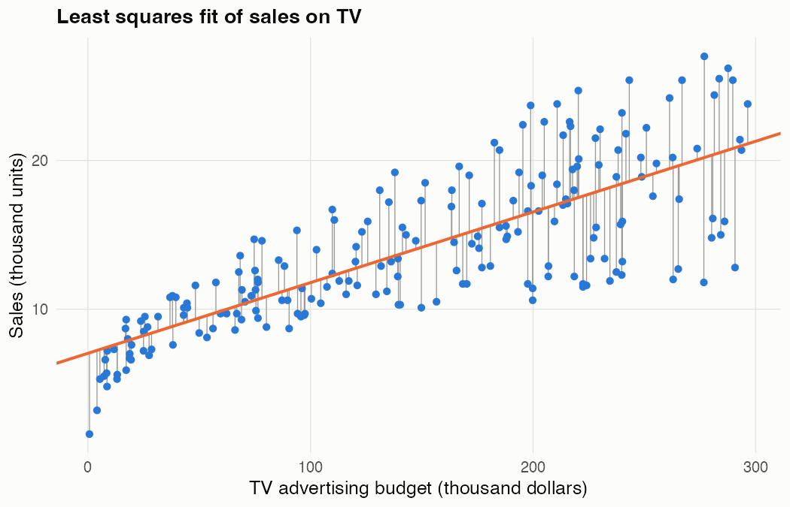
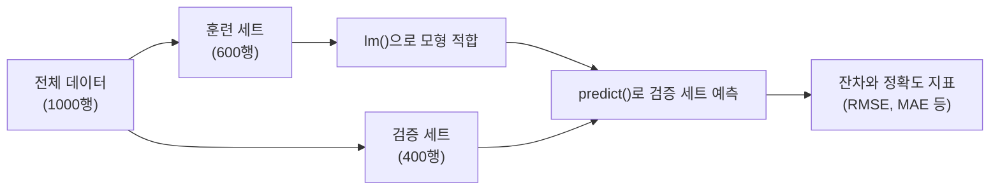
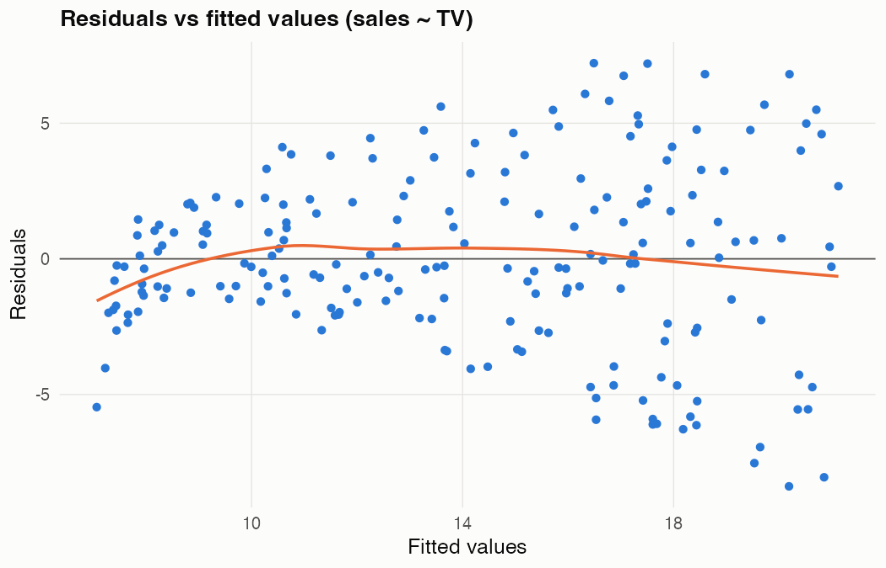
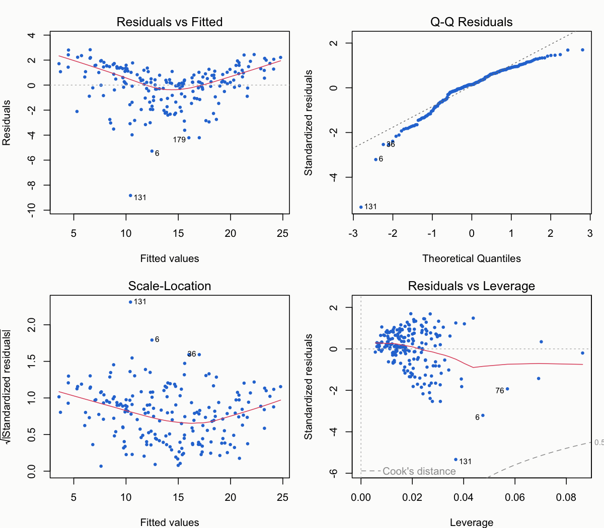
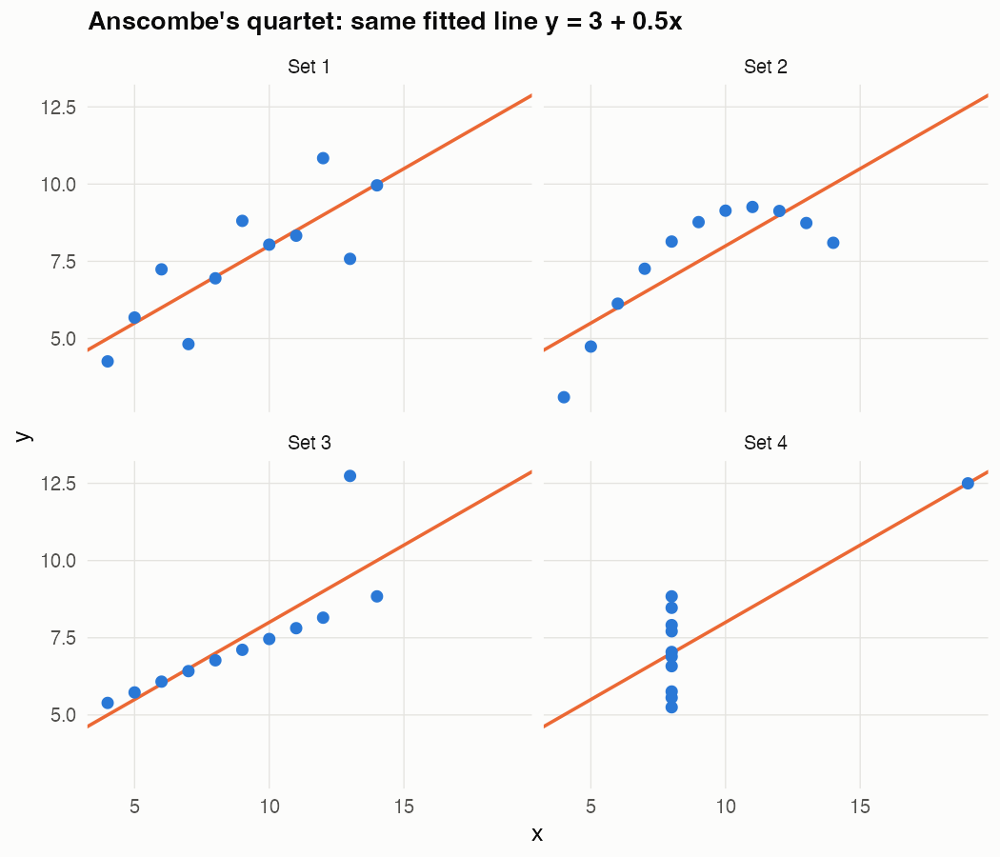

# 10장 — 회귀 분석

[레포지토리 안내](../../README.ko.md) | [English](Concepts_Lecture.md) | [한국어](Concepts_Lecture.ko.md)

> **최종 수정일:** 2026-11-27
>
> An Introduction to Statistical Learning, James, Witten, Hastie, and Tibshirani, Ch 3

> **학습 목표:**
> 1. 최소제곱법의 정규 방정식을 유도하고 단순 선형 회귀의 계수를 직접 계산할 수 있다
> 2. R에서 단순 선형 회귀와 다중 선형 회귀를 수행하고 `summary()` 출력의 각 항목을 해석할 수 있다
> 3. 회귀 계수의 표준 오차, 신뢰 구간, t 검정, F 검정을 설명할 수 있다
> 4. 결정 계수($R^2$)와 수정된 결정 계수의 의미와 한계를 설명할 수 있다
> 5. 잔차 진단 그래프, VIF, 레버리지, Cook의 거리로 회귀 가정을 진단하고 이상치를 식별할 수 있다
> 6. 검증 세트의 정확도 지표와 AIC로 모형을 비교하고 변수를 선택할 수 있다

---

## 목차

- [1. 회귀 분석 개요](#1-회귀-분석-개요)
  - [1.1 회귀 분석의 개념](#11-회귀-분석의-개념)
  - [1.2 회귀 분석의 유형](#12-회귀-분석의-유형)
  - [1.3 설명적 모형화와 예측적 모형화](#13-설명적-모형화와-예측적-모형화)
- [2. 단순 선형 회귀](#2-단순-선형-회귀)
  - [2.1 모형](#21-모형)
  - [2.2 계수 추정(최소제곱법)](#22-계수-추정최소제곱법)
  - [2.3 R에서의 구현](#23-r에서의-구현)
  - [2.4 정규 방정식의 유도](#24-정규-방정식의-유도)
  - [2.5 최소제곱 직선의 성질](#25-최소제곱-직선의-성질)
  - [2.6 모집단 회귀선과 오차항의 가정](#26-모집단-회귀선과-오차항의-가정)
  - [2.7 예제: 광고비와 판매량](#27-예제-광고비와-판매량)
  - [2.8 계수의 표준 오차와 신뢰 구간](#28-계수의-표준-오차와-신뢰-구간)
  - [2.9 계수의 가설 검정](#29-계수의-가설-검정)
  - [2.10 평균 반응의 신뢰 구간과 예측 구간](#210-평균-반응의-신뢰-구간과-예측-구간)
- [3. 다중 선형 회귀](#3-다중-선형-회귀)
  - [3.1 모형](#31-모형)
  - [3.2 예제: Toyota Corolla 가격 예측](#32-예제-toyota-corolla-가격-예측)
  - [3.3 데이터 분할](#33-데이터-분할)
  - [3.4 R에서의 적합](#34-r에서의-적합)
  - [3.5 회귀 평면](#35-회귀-평면)
  - [3.6 행렬로 쓴 정규 방정식](#36-행렬로-쓴-정규-방정식)
  - [3.7 다중 회귀 계수의 해석](#37-다중-회귀-계수의-해석)
  - [3.8 범주형 예측 변수와 가변수](#38-범주형-예측-변수와-가변수)
  - [3.9 상호작용 항](#39-상호작용-항)
- [4. 회귀 방정식 추정](#4-회귀-방정식-추정)
  - [4.1 출력 해석](#41-출력-해석)
  - [4.2 유의성 코드](#42-유의성-코드)
  - [4.3 결정 계수](#43-결정-계수)
  - [4.4 Toyota 예제의 추정 결과](#44-toyota-예제의-추정-결과)
  - [4.5 제곱합의 분해](#45-제곱합의-분해)
  - [4.6 수정된 결정 계수의 근거](#46-수정된-결정-계수의-근거)
  - [4.7 F 검정](#47-f-검정)
- [5. 모형 평가 지표](#5-모형-평가-지표)
  - [5.1 예측 및 잔차](#51-예측-및-잔차)
  - [5.2 주요 정확도 지표](#52-주요-정확도-지표)
  - [5.3 잔차 진단](#53-잔차-진단)
  - [5.4 Toyota 검증 세트의 예측 결과](#54-toyota-검증-세트의-예측-결과)
  - [5.5 회귀 가정의 정리](#55-회귀-가정의-정리)
  - [5.6 광고비 자료의 잔차 진단](#56-광고비-자료의-잔차-진단)
  - [5.7 Anscombe의 네 자료](#57-anscombe의-네-자료)
  - [5.8 다중공선성과 분산 팽창 인자](#58-다중공선성과-분산-팽창-인자)
  - [5.9 레버리지와 Cook의 거리](#59-레버리지와-cook의-거리)
- [6. 변수 선택](#6-변수-선택)
  - [6.1 변수 선택의 필요성](#61-변수-선택의-필요성)
  - [6.2 방법론](#62-방법론)
  - [6.3 R에서의 구현](#63-r에서의-구현)
  - [6.4 AIC의 정의와 단계적 선택의 실행](#64-aic의-정의와-단계적-선택의-실행)
  - [6.5 선형 회귀 밖의 회귀 모형](#65-선형-회귀-밖의-회귀-모형)
- [7. R에서의 지리 데이터 회귀](#7-r에서의-지리-데이터-회귀)
  - [7.1 미국 문해율 단계구분도와 회귀 분석](#71-미국-문해율-단계구분도와-회귀-분석)
  - [7.2 공간 데이터 개념](#72-공간-데이터-개념)
  - [7.3 공간 자료에 회귀를 적용할 때의 주의점](#73-공간-자료에-회귀를-적용할-때의-주의점)
- [8. 회귀 분석의 흔한 실수](#8-회귀-분석의-흔한-실수)
- [개념 적용](#개념-적용)
- [요약](#요약)
- [점검 문제](#점검-문제)
- [참고 문헌](#참고-문헌)

---

<br>

## 1. 회귀 분석 개요

### 1.1 회귀 분석의 개념

**회귀 분석**(regression analysis)은 **종속 변수**(반응 변수, 결과 변수)와 하나 이상의 **독립 변수**(예측 변수, 특성 변수) 사이의 관계를 모형화하는 통계적 방법이다.

회귀 분석의 목적은 다음과 같다:
- **설명적 모형화**: 예측 변수가 반응 변수에 어떤 영향을 미치는지 이해한다.
- **예측적 모형화**: 반응 변수의 미래 값을 예측한다.

### 1.2 회귀 분석의 유형

| 유형 | 반응 변수 | 예측 변수 | 예시 |
|------|-----------|-----------|------|
| 단순 선형 | 연속형 | 하나의 연속형 | 매출 ~ TV 광고비 |
| 다중 선형 | 연속형 | 다수 | 가격 ~ 연식 + 주행거리 + 마력 |
| 로지스틱 | 이진형 (0/1) | 하나 이상 | 질병 ~ 위험 요인 |
| 다항식 | 연속형 | 비선형 항 | 성장 ~ 시간 + $\text{시간}^2$ |

*표 1. 반응 변수와 예측 변수에 따른 회귀 분석의 유형*

예시 열은 R의 수식 표기법(반응 변수 ~ 예측 변수)을 따른다. 로지스틱 회귀는 12장에서 다룬다.

### 1.3 설명적 모형화와 예측적 모형화

두 목적은 같은 `lm()`으로 같은 모형을 적합하더라도 좋은 모형의 기준이 다르다. 설명적 모형화는 모집단에서 성립하는 관계를 추론하는 것이 목표이므로, 계수의 부호와 크기, 표준 오차와 p값이 중요하고 모형 전체 자료로 적합한 결과를 해석한다. 예측적 모형화는 새로운 관측값의 반응을 정확하게 맞히는 것이 목표이므로, 계수 하나하나의 의미보다 모형을 만들 때 쓰지 않은 자료에서의 오차가 중요하다. 그래서 예측적 모형화에서는 자료를 훈련 세트와 검증 세트로 나누고(3.3절) 검증 세트의 RMSE 같은 지표(5.2절)로 모형을 비교한다.

| 측면 | 설명적 모형화 | 예측적 모형화 |
|------|------|------|
| 핵심 질문 | 예측 변수와 반응 변수 사이에 어떤 관계가 있는가 | 새 관측값의 반응을 얼마나 정확히 맞히는가 |
| 중시하는 출력 | 계수 추정값, 표준 오차, 신뢰 구간, p값 | 검증 세트의 오차(RMSE, MAE 등) |
| 사용하는 자료 | 보통 자료 전체 | 훈련 세트로 적합, 검증 세트로 평가 |
| 변수를 남기는 기준 | 이론과 해석상 의미가 있는 변수 | 예측 오차를 줄이는 변수 |

*표 2. 설명적 모형화와 예측적 모형화의 비교*

Toyota Corolla 예제(3.2절)는 중고차 판매 가격을 맞히는 것이 목적인 예측적 모형화이고, 광고비 예제(2.7절)는 매체별 광고비와 판매량 사이의 관계를 알고 싶어 하는 설명적 모형화의 성격이 강하다.

---

<br>

## 2. 단순 선형 회귀

### 2.1 모형

단순 선형 회귀는 $X$와 $Y$ 사이의 선형 관계를 가정한다:

```math
Y \approx \beta_0 + \beta_1 X
```

오차항까지 포함한 완전한 통계 모형은 다음과 같다:

```math
Y = \beta_0 + \beta_1 X + \epsilon
```

여기서:
- $\beta_0$는 **절편**($X = 0$일 때 $Y$의 기댓값)이다.
- $\beta_1$은 **기울기**($X$가 1단위 증가할 때 $Y$의 평균 변화량)이다.
- $\epsilon$은 **오차항**(잡음과 모형에 포함되지 않은 효과를 포착)이다.

$\beta_0$와 $\beta_1$은 모르는 상수이며 **회귀 계수**(regression coefficient) 또는 모수(parameter)라고 부른다. 자료로 구한 추정값에는 모자 기호를 붙여 $`\hat{\beta}_0`$, $`\hat{\beta}_1`$로 쓰고, $X = x$일 때의 예측값을 $`\hat{y} = \hat{\beta}_0 + \hat{\beta}_1 x`$로 쓴다. "$`Y`$를 $`X`$에 회귀한다(regress $`Y`$ on $`X`$)"는 표현은 이 모형을 적합한다는 뜻이다.

### 2.2 계수 추정(최소제곱법)

**최소제곱법**(least squares method)은 **잔차제곱합(RSS)** 을 최소화하는 $\hat{\beta}_0$와 $\hat{\beta}_1$을 구한다:

```math
RSS = \sum_{i=1}^{n} e_i^2 = \sum_{i=1}^{n} (y_i - \hat{y}_i)^2
```

여기서 $e_i = y_i - \hat{y}_i$는 **잔차**(관측값과 예측값의 차이)이다.

닫힌 형태의 해는 다음과 같다:

```math
\hat{\beta}_1 = \frac{\sum_{i=1}^{n}(x_i - \bar{x})(y_i - \bar{y})}{\sum_{i=1}^{n}(x_i - \bar{x})^2}
```

```math
\hat{\beta}_0 = \bar{y} - \hat{\beta}_1 \bar{x}
```

> **[미적분학]** 위 닫힌 형태의 해는 RSS를 두 계수 $\beta_0$, $\beta_1$의 함수로 보고 두 편미분을 0으로 놓아 얻는다. $\partial RSS / \partial \beta_0 = -2\sum(y_i - \beta_0 - \beta_1 x_i) = 0$을 풀면 $\hat{\beta}_0 = \bar{y} - \hat{\beta}_1 \bar{x}$가 되고, 이를 $\partial RSS / \partial \beta_1 = -2\sum x_i(y_i - \beta_0 - \beta_1 x_i) = 0$에 대입하면 $\hat{\beta}_1$이 나온다. RSS는 두 계수에 대해 아래로 볼록한 2차 함수이므로, 두 편미분이 모두 0인 이 점에서 최솟값을 갖는다. 대입 과정 전체는 2.4절에 있다.

### 2.3 R에서의 구현

```r
# Fit a simple linear regression
model <- lm(y ~ x, data = mydata)
summary(model)
```

> **핵심:** R의 `lm()` 함수는 `y ~ x` 형태의 수식 표기법을 사용하며, `y`는 반응 변수, `x`는 예측 변수이다. `~` 기호는 왼쪽의 반응 변수를 오른쪽 예측 변수의 함수로 모형화한다는 뜻이다.

### 2.4 정규 방정식의 유도

2.2절의 미분 조건을 정리하면 두 미지수 $\beta_0$, $\beta_1$에 대한 연립 일차 방정식이 된다. 첫째 조건 $\sum(y_i - \beta_0 - \beta_1 x_i) = 0$을 풀어 쓰면 $\sum y_i = n\beta_0 + \beta_1 \sum x_i$이고, 둘째 조건 $\sum x_i(y_i - \beta_0 - \beta_1 x_i) = 0$을 풀어 쓰면 $\sum x_i y_i = \beta_0 \sum x_i + \beta_1 \sum x_i^2$이다.

```math
\begin{aligned}
n\beta_0 + \beta_1 \sum_{i=1}^{n} x_i &= \sum_{i=1}^{n} y_i \\
\beta_0 \sum_{i=1}^{n} x_i + \beta_1 \sum_{i=1}^{n} x_i^2 &= \sum_{i=1}^{n} x_i y_i
\end{aligned}
```

> **용어 정의:** **정규 방정식(normal equations)** 은 잔차제곱합의 각 계수에 대한 편미분을 0으로 놓아 얻는, 최소제곱 추정값이 만족해야 하는 연립 일차 방정식이다.

첫째 식을 $n$으로 나누면 $\bar{y} = \beta_0 + \beta_1 \bar{x}$이므로 $\hat{\beta}_0 = \bar{y} - \hat{\beta}_1 \bar{x}$이다. 이것을 둘째 식에 넣으면 $\sum x_i y_i = (\bar{y} - \beta_1 \bar{x}) n\bar{x} + \beta_1 \sum x_i^2$이고, 정리하면 $\beta_1(\sum x_i^2 - n\bar{x}^2) = \sum x_i y_i - n\bar{x}\bar{y}$이다. 다음 두 항등식을 쓰면 2.2절의 기울기 공식이 나온다.

```math
S_{xx} = \sum_{i=1}^{n} (x_i - \bar{x})^2 = \sum_{i=1}^{n} x_i^2 - n\bar{x}^2, \qquad
S_{xy} = \sum_{i=1}^{n} (x_i - \bar{x})(y_i - \bar{y}) = \sum_{i=1}^{n} x_i y_i - n\bar{x}\bar{y}
```

```math
\hat{\beta}_1 = \frac{S_{xy}}{S_{xx}}
```

이 해가 최솟값이라는 것은 RSS의 2계 편미분으로 확인한다. $\partial^2 RSS / \partial \beta_0^2 = 2n$, $\partial^2 RSS / \partial \beta_1^2 = 2\sum x_i^2$, $\partial^2 RSS / \partial \beta_0 \partial \beta_1 = 2\sum x_i$이므로 Hessian 행렬의 행렬식은 $4(n\sum x_i^2 - (\sum x_i)^2) = 4n S_{xx}$이다. $x_i$가 모두 같지 않으면 $S_{xx} > 0$이므로 Hessian 행렬은 양의 정부호이고, 이 점은 유일한 최솟값이다. 반대로 $x_i$가 모두 같으면 $S_{xx} = 0$이 되어 기울기를 정할 수 없다. 예측 변수에 변동이 없으면 기울기를 추정할 수 없다는 뜻이다.

다섯 관측값 $(x, y)$ = (1, 2), (2, 4), (3, 5), (4, 4), (5, 5)로 계산 과정을 따라가면 다음과 같다. $\bar{x} = 3$, $\bar{y} = 4$이고 편차 $x_i - \bar{x}$는 -2, -1, 0, 1, 2, $y_i - \bar{y}$는 -2, 0, 1, 0, 1이다. 편차의 곱은 4, 0, 0, 0, 2이므로 $S_{xy} = 6$, 편차의 제곱은 4, 1, 0, 1, 4이므로 $S_{xx} = 10$이다. 따라서 $\hat{\beta}_1 = 0.6$, $\hat{\beta}_0 = 4 - 0.6 \times 3 = 2.2$이고, 직선은 $\hat{y} = 2.2 + 0.6x$이다.

### 2.5 최소제곱 직선의 성질

정규 방정식에서 곧바로 다음 성질이 나온다. 모두 절편이 있는 최소제곱 직선에서 성립한다.

| 성질 | 식 | 근거 |
|------|------|------|
| 잔차의 합은 0이다 | $`\sum_{i} e_i = 0`$ | 첫째 정규 방정식 |
| 잔차와 예측 변수의 곱의 합은 0이다 | $`\sum_{i} x_i e_i = 0`$ | 둘째 정규 방정식 |
| 잔차와 적합값의 곱의 합은 0이다 | $`\sum_{i} \hat{y}_i e_i = 0`$ | 앞의 두 성질의 일차 결합 |
| 직선은 점 $(\bar{x}, \bar{y})$를 지난다 | $`\hat{\beta}_0 + \hat{\beta}_1 \bar{x} = \bar{y}`$ | $`\hat{\beta}_0`$의 공식 |
| 적합값의 평균은 $\bar{y}$이다 | $`\bar{\hat{y}} = \bar{y}`$ | 잔차의 합이 0 |

*표 3. 절편이 있는 최소제곱 직선의 성질*

2.4절의 예에서 잔차는 -0.8, 0.6, 1.0, -0.6, -0.2이므로 합이 0이고, $\sum x_i e_i = -0.8 + 1.2 + 3.0 - 2.4 - 1.0 = 0$이다. 잔차의 합이 0이라는 성질 때문에 잔차의 평균만 보아서는 모형의 좋고 나쁨을 알 수 없으며, 잔차의 크기는 RSS나 RSE로, 잔차의 패턴은 진단 그래프(5.3절)로 본다.

### 2.6 모집단 회귀선과 오차항의 가정

$Y = \beta_0 + \beta_1 X + \epsilon$에서 오차항 $\epsilon$은 평균이 0인 확률 변수라고 가정한다. 그러면 $X = x$로 고정했을 때 $Y$의 평균은 $E(Y \mid X = x) = \beta_0 + \beta_1 x$이고, 이 직선을 **모집단 회귀선**(population regression line)이라고 한다. 모집단 회귀선은 모르는 계수로 정해지므로 관측할 수 없고, 자료로 구한 $\hat{y} = \hat{\beta}_0 + \hat{\beta}_1 x$는 그 추정값인 **최소제곱 직선**(least squares line)이다.

모집단 회귀선은 $x$마다 $Y$가 하나의 분포를 이룬다는 그림으로 이해하면 쉽다. 예를 들어 $x = 65$인 개체들의 $Y$는 평균이 $\beta_0 + 65\beta_1$이고 표준편차가 $\sigma$인 분포를 이루며, $x = 90$인 개체들의 $Y$는 평균이 $\beta_0 + 90\beta_1$이고 표준편차가 같은 $\sigma$인 분포를 이룬다. 회귀선은 이 조건부 분포들의 평균을 이은 선이고, 관측값 하나가 회귀선에서 벗어난 양이 그 관측값의 오차 $\epsilon_i$이다. 선형 회귀의 추론(2.8, 2.9절)은 보통 다음 가정을 둔다.

1. **선형성:** $E(Y \mid X = x)$가 $x$의 일차식이다.
2. **독립성:** 오차 $\epsilon_1, \ldots, \epsilon_n$은 서로 독립이다(최소한 서로 상관이 없다).
3. **등분산성:** 모든 $x$에서 오차의 분산이 같은 $\sigma^2$이다.
4. **정규성:** 오차가 정규분포를 따른다. 표본이 크면 이 가정이 깨져도 계수의 t 검정은 근사적으로 성립한다.

같은 모형에서 자료를 여러 번 새로 뽑으면 자료마다 최소제곱 직선이 조금씩 다르게 나오지만, 그 직선들의 평균은 모집단 회귀선에 가깝다. 이것은 표본 평균 $\bar{y}$가 모집단 평균 $\mu$의 추정값인 것과 같은 관계이며, 가정 1과 2 아래에서 $\hat{\beta}_0$와 $\hat{\beta}_1$은 **불편 추정량**이다. 즉 추정값을 무수히 많이 구해 평균을 내면 참값과 같아진다. 한 자료에서 구한 추정값이 참값에서 얼마나 떨어져 있을 수 있는지는 표준 오차(2.8절)로 나타내며, 표본에 따라 추정값이 달라진다는 생각의 바탕인 표본 분포는 14장에서 다룬다.

### 2.7 예제: 광고비와 판매량

Advertising 자료는 200개 시장에서 한 제품의 판매량(`sales`, 천 단위)과 TV, 라디오, 신문 광고비(`TV`, `radio`, `newspaper`, 천 달러 단위)를 기록한 공개 자료이다. 먼저 판매량을 TV 광고비에 회귀한다.

```r
adv <- read.csv("Advertising.csv")
fit_tv <- lm(sales ~ TV, data = adv)
summary(fit_tv)
#> 
#> Call:
#> lm(formula = sales ~ TV, data = adv)
#> 
#> Residuals:
#>     Min      1Q  Median      3Q     Max 
#> -8.3860 -1.9545 -0.1913  2.0671  7.2124 
#> 
#> Coefficients:
#>             Estimate Std. Error t value Pr(>|t|)    
#> (Intercept) 7.032594   0.457843   15.36   <2e-16 ***
#> TV          0.047537   0.002691   17.67   <2e-16 ***
#> ---
#> Signif. codes:  0 '***' 0.001 '**' 0.01 '*' 0.05 '.' 0.1 ' ' 1
#> 
#> Residual standard error: 3.259 on 198 degrees of freedom
#> Multiple R-squared:  0.6119,	Adjusted R-squared:  0.6099 
#> F-statistic: 312.1 on 1 and 198 DF,  p-value: < 2.2e-16
```

추정된 직선은 $\hat{y} = 7.03 + 0.0475x$이다. 광고비의 단위가 천 달러이고 판매량의 단위가 천 개이므로, TV 광고비를 1,000달러 늘릴 때마다 판매량이 평균 약 47.5개 늘어난다고 해석한다. 절편 7.03은 TV 광고를 하지 않은 시장의 평균 판매량이 약 7,030개라는 뜻인데, 자료에 TV 광고비가 0에 가까운 시장이 있으므로 이 해석이 자료 범위를 크게 벗어나지 않는다. 각 관측값과 직선 사이의 세로 거리가 잔차이고, 최소제곱법은 그 제곱합을 가장 작게 하는 직선을 고른다.



*그림 1. TV 광고비에 대한 판매량의 최소제곱 직선과 잔차*

같은 계수를 2.2절의 공식으로 직접 계산하면 `lm()`의 출력과 일치하고, 2.5절의 성질도 확인할 수 있다.

```r
x <- adv$TV
y <- adv$sales
n <- length(y)
Sxx <- sum((x - mean(x))^2)
Sxy <- sum((x - mean(x)) * (y - mean(y)))
b1 <- Sxy / Sxx
b0 <- mean(y) - b1 * mean(x)
e <- y - (b0 + b1 * x)
RSS <- sum(e^2)
RSE <- sqrt(RSS / (n - 2))
se_b1 <- RSE / sqrt(Sxx)
se_b0 <- RSE * sqrt(1 / n + mean(x)^2 / Sxx)
round(c(b0 = b0, b1 = b1, RSS = RSS, RSE = RSE,
        se_b0 = se_b0, se_b1 = se_b1, t_b1 = b1 / se_b1), 4)
#>        b0        b1       RSS       RSE     se_b0     se_b1      t_b1 
#>    7.0326    0.0475 2102.5306    3.2587    0.4578    0.0027   17.6676
c(sum_e = sum(e), sum_xe = sum(x * e))
#>        sum_e       sum_xe 
#> 1.074696e-13 9.913492e-11
```

`Sxx`와 `Sxy`는 2.4절의 $S_{xx}$, $S_{xy}$이고, `b1`과 `b0`은 기울기와 절편이다. `e`는 잔차 벡터, `RSS`는 잔차제곱합, `RSE`는 2.8절의 잔차 표준 오차이다. `se_b0`, `se_b1`은 두 계수의 표준 오차이며, `t_b1`은 기울기의 t 통계량으로 `summary()`의 17.67과 같다. 마지막 줄의 두 값은 이론상 0이고, $10^{-13}$, $10^{-11}$ 정도의 값은 부동소수점 계산의 반올림 오차이다.

### 2.8 계수의 표준 오차와 신뢰 구간

추정값 $\hat{\beta}_1$은 자료에 따라 달라지는 확률 변수이고, 그 퍼짐을 **표준 오차**(standard error, SE)로 잰다. 2.6절의 가정 1\~3 아래에서 두 계수의 표준 오차는 다음과 같다.

```math
\mathrm{SE}(\hat{\beta}_1)^2 = \frac{\sigma^2}{\sum_{i=1}^{n} (x_i - \bar{x})^2}, \qquad
\mathrm{SE}(\hat{\beta}_0)^2 = \sigma^2 \left[ \frac{1}{n} + \frac{\bar{x}^2}{\sum_{i=1}^{n} (x_i - \bar{x})^2} \right]
```

첫째 식은 오차의 분산 $\sigma^2$이 작을수록, 그리고 $x_i$가 넓게 퍼져 있을수록 기울기를 정확하게 추정할 수 있다는 뜻이다. $x$가 좁은 범위에 몰려 있으면 직선의 기울기가 잡음에 크게 흔들린다. 둘째 식에서 $\bar{x} = 0$이면 $\mathrm{SE}(\hat{\beta}_0)$는 $\sigma/\sqrt{n}$이 되어 표본 평균의 표준 오차와 같다.

$\sigma^2$은 모르므로 자료로 추정한다. 그 추정값의 제곱근이 **잔차 표준 오차**(residual standard error, RSE)이다.

```math
\mathrm{RSE} = \hat{\sigma} = \sqrt{\frac{RSS}{n - 2}}
```

분모가 $n$이 아니라 $n - 2$인 이유는 계수 두 개를 자료로 추정하면서 잔차가 두 정규 방정식을 만족하도록 묶여, 잔차가 자유롭게 움직일 수 있는 차원이 $n - 2$로 줄기 때문이다. 이 $n - 2$를 잔차의 **자유도**(degrees of freedom)라고 한다. Advertising 자료에서는 $RSS = 2102.53$, $n = 200$이므로 $\mathrm{RSE} = \sqrt{2102.53/198} = 3.259$이고, `summary()` 출력의 `Residual standard error: 3.259 on 198 degrees of freedom`이 이 값이다. 판매량의 단위가 천 개이므로, 참 회귀선을 정확히 알더라도 각 시장의 판매량은 평균적으로 약 3,260개만큼 회귀선에서 벗어난다. 판매량 평균이 약 14,000개이므로 상대 오차는 약 23%이다.

> **용어 정의:** **신뢰 구간(confidence interval)** 은 표본에서 계산한 하한과 상한으로 이루어진 구간으로, 같은 방법으로 표본을 반복해서 뽑아 구간을 만들면 지정한 비율(예: 95%)의 구간이 모르는 참값을 포함하도록 만든 것이다.

오차가 정규분포를 따르면 $(\hat{\beta}_1 - \beta_1)/\mathrm{SE}(\hat{\beta}_1)$은 자유도 $n - 2$인 t 분포를 따르므로, $\beta_1$의 95% 신뢰 구간은 다음과 같다.

```math
\hat{\beta}_1 \pm t_{0.975,\,n-2} \cdot \mathrm{SE}(\hat{\beta}_1)
```

$n$이 크면 $t_{0.975,\,n-2}$는 1.96에 가까우므로(Advertising 자료의 $n = 200$에서는 약 1.97) 흔히 $\hat{\beta}_1 \pm 2 \cdot \mathrm{SE}(\hat{\beta}_1)$로 어림한다. R에서는 `confint()`가 이 구간을 계산한다.

```r
confint(fit_tv)
#>                  2.5 %     97.5 %
#> (Intercept) 6.12971927 7.93546783
#> TV          0.04223072 0.05284256
b1 + c(-1, 1) * qt(0.975, df = n - 2) * se_b1
#> [1] 0.04223072 0.05284256
```

`qt(0.975, df = n - 2)`는 자유도 198인 t 분포의 97.5% 분위수(약 1.972)이고, 둘째 줄은 공식을 그대로 계산해 `confint()`와 같은 구간을 얻는다. TV 광고비 1,000달러당 판매량 증가의 95% 신뢰 구간은 약 42개에서 53개이다. 이 구간은 "참값이 이 구간에 있을 확률이 95%"라는 뜻이 아니라, 같은 절차로 만든 구간들의 95%가 참값을 포함한다는 절차의 성질이다. 신뢰 구간의 해석은 14장에서 자세히 다룬다.

### 2.9 계수의 가설 검정

예측 변수와 반응 변수 사이에 관계가 있는지는 기울기가 0인지 묻는 가설 검정으로 판단한다.

```math
H_0: \beta_1 = 0 \quad \text{versus} \quad H_a: \beta_1 \neq 0
```

**귀무가설** $H_0$은 $X$와 $Y$ 사이에 관계가 없다는 가설이고, **대립가설** $H_a$는 어떤 관계가 있다는 가설이다. 검정 통계량은 추정값이 0에서 표준 오차의 몇 배만큼 떨어져 있는지를 나타내는 t 통계량이다.

```math
t = \frac{\hat{\beta}_1 - 0}{\mathrm{SE}(\hat{\beta}_1)}
```

$H_0$이 참이면 $t$는 자유도 $n - 2$인 t 분포를 따른다. t 분포는 0을 중심으로 좌우 대칭인 종 모양이며, $n$이 약 30보다 크면 표준정규분포와 거의 같다. $H_0$이 참이라고 가정할 때 지금 얻은 값만큼 또는 그보다 더 극단적인 $|t|$가 나올 확률이 **p값**이다. p값이 작으면 관계가 없는데도 이렇게 강한 연관이 우연히 나타났을 가능성이 낮다는 뜻이므로 $H_0$을 기각하고 $X$와 $Y$ 사이에 관계가 있다고 결론 내린다. 기각의 기준으로는 흔히 5%나 1%를 쓰며, 분야에 따라 10%를 쓰기도 한다. $n = 30$일 때 이 기준은 대략 $|t|$가 2와 2.75를 넘는 경우에 해당한다.

Advertising 자료의 TV 계수는 $t = 0.0475 / 0.0027 = 17.67$로 0에서 표준 오차의 17배 이상 떨어져 있고, p값은 $2 \times 10^{-16}$보다 작다. 절편도 $t = 15.36$이다. 따라서 $\beta_0 \neq 0$이고 $\beta_1 \neq 0$이라고 결론 내린다. 기울기의 검정이 기각되면 TV 광고비와 판매량 사이에 관계가 있다는 뜻이고, 절편의 검정이 기각되면 TV 광고비가 0일 때의 판매량이 0이 아니라는 뜻이다.

> **주의:** p값이 작다는 것은 $\beta_1 = 0$이라는 가설과 자료가 맞지 않는다는 뜻일 뿐, 효과가 크다거나 인과 관계가 있다는 뜻이 아니다. 표본이 매우 크면 실질적으로 무시할 만한 기울기도 p값이 매우 작아진다. 효과의 크기는 계수와 신뢰 구간으로 판단하며, p값의 올바른 해석과 오용은 14장에서 다룬다.

### 2.10 평균 반응의 신뢰 구간과 예측 구간

회귀식으로 $X = x_0$에서의 반응을 말할 때는 두 종류의 불확실성을 구별해야 한다. 같은 $x_0$을 가진 개체들의 **평균 반응** $\beta_0 + \beta_1 x_0$을 추정하는 경우에는 계수 추정의 불확실성만 있다. 반면 새로운 개체 **하나의 반응** $Y = \beta_0 + \beta_1 x_0 + \epsilon$을 예측하는 경우에는 그 개체의 오차 $\epsilon$까지 더해진다. 그래서 개별 반응에 대한 **예측 구간**(prediction interval)은 평균 반응에 대한 신뢰 구간보다 항상 넓다.

```math
\hat{y}_0 \pm t_{0.975,\,n-2} \cdot \hat{\sigma} \sqrt{\frac{1}{n} + \frac{(x_0 - \bar{x})^2}{S_{xx}}} \quad \text{(신뢰 구간)}, \qquad
\hat{y}_0 \pm t_{0.975,\,n-2} \cdot \hat{\sigma} \sqrt{1 + \frac{1}{n} + \frac{(x_0 - \bar{x})^2}{S_{xx}}} \quad \text{(예측 구간)}
```

```r
new <- data.frame(TV = 100)
predict(fit_tv, new, interval = "confidence")
#>        fit      lwr     upr
#> 1 11.78626 11.26782 12.3047
predict(fit_tv, new, interval = "prediction")
#>        fit      lwr      upr
#> 1 11.78626 5.339251 18.23326
```

`predict()`에 새 자료 `new`를 주고 `interval`을 지정하면 점 예측값(`fit`)과 구간의 하한(`lwr`), 상한(`upr`)을 돌려준다. TV 광고비가 10만 달러인 시장들의 평균 판매량은 11,786개로 예측되고 그 95% 신뢰 구간은 약 11,268개에서 12,305개이지만, 그런 시장 하나의 판매량에 대한 95% 예측 구간은 약 5,339개에서 18,233개로 훨씬 넓다. 두 식 모두 $(x_0 - \bar{x})^2$ 항 때문에 $x_0$이 자료의 중심에서 멀수록 구간이 넓어지며, 자료 범위 밖의 $x_0$에서 예측하는 **외삽**(extrapolation)은 선형 관계가 그 범위에서도 성립한다는 보장이 없으므로 더욱 조심해야 한다.

---

<br>

## 3. 다중 선형 회귀

### 3.1 모형

다중 선형 회귀는 단순 선형 회귀를 여러 예측 변수로 확장한 것이다:

```math
Y = \beta_0 + \beta_1 X_1 + \beta_2 X_2 + \cdots + \beta_p X_p + \epsilon
```

### 3.2 예제: Toyota Corolla 가격 예측

중고차의 속성으로 제시 가격을 예측하는 전형적인 예제이다. 대규모 Toyota 대리점은 신차를 사는 고객이 쓰던 중고차를 사들여 주는 보상 판매를 제공하고, 사들인 중고차에 작은 이윤만 붙여 다시 판다. 적절한 이윤을 남기려면 대리점이 중고차를 얼마에 팔 수 있을지 미리 예측해야 하므로, 그 대리점이 과거에 판매한 Toyota Corolla 중고차의 판매 기록을 모았다. 분석에는 자료의 처음 1,000대를 쓰며, 사용하는 변수는 다음과 같다:

| 변수 | 설명 |
|------|------|
| Price | 제시 가격(유로, 반응 변수) |
| Age | 2004년 8월 기준 연식(월 단위) |
| Kilometers | 주행거리(km) |
| Fuel Type | 연료 유형(가솔린, 디젤, CNG) |
| HP | 마력 |
| Metallic | 메탈릭 색상 여부(Yes=1, No=0) |
| Automatic | 자동 변속기 여부(Yes=1, No=0) |
| CC | 실린더 용량(cc) |
| Doors | 문 수 |
| QuartTax | 분기별 도로세(유로) |
| Weight | 중량(kg) |

*표 4. Toyota Corolla 예제의 변수*

자료의 처음 몇 행을 보면 같은 차종이라도 연식이 23\~39개월, 주행거리가 약 19,000\~98,000km로 다양하고, 가격은 약 11,950\~22,750유로 범위에 있다. 디젤 차량은 마력이 90, 배기량이 2,000cc인 반면 가솔린 차량은 마력이 110\~192, 배기량이 1,600\~1,800cc여서, 연료 유형이 다른 변수와 함께 움직인다는 점도 볼 수 있다.

### 3.3 데이터 분할

모형을 적합하기 전에 데이터를 **훈련** 세트와 **검증** 세트로 분할한다:

```r
# Partition data: 60% training, 40% validation
set.seed(1)
train.index <- sample(c(1:1000), 600)
train.df <- car.df[train.index, selected.var]
valid.df <- car.df[-train.index, selected.var]
```

`set.seed(1)`은 난수 시드를 고정하여 같은 분할을 재현하게 하고, `sample(c(1:1000), 600)`은 행 번호 1~1000 중 600개를 비복원 추출한다. `selected.var`는 분석에 쓸 열 이름을 담은 벡터이고, `-train.index`는 훈련 세트에 뽑히지 않은 나머지 400개 행을 고른다. 두 세트는 다음과 같이 쓰인다.



*그림 2. 훈련 세트와 검증 세트를 사용한 회귀 모형의 적합과 평가 흐름*

### 3.4 R에서의 적합

```r
# Use all remaining columns as predictors (. means "all other variables")
car.lm <- lm(Price ~ ., data = train.df)
options(scipen = 999)   # Disable scientific notation
summary(car.lm)
```

`selected.var`로 고른 열은 반응 변수 `Price`와 표 4의 예측 변수 10개이다. 연료 유형은 가변수 두 개로 바뀌므로(3.8절) 추정하는 기울기는 모두 11개이며, 이 모형의 추정 결과는 4.4절에 있다.

### 3.5 회귀 평면

예측 변수가 두 개이면 $`\hat{y} = \hat{\beta}_0 + \hat{\beta}_1 x_1 + \hat{\beta}_2 x_2`$는 3차원 공간의 평면이다. 각 관측값 $`(x_{i1}, x_{i2}, y_i)`$에서 이 평면까지의 세로 거리가 잔차이고, 최소제곱법은 잔차의 제곱합이 가장 작도록 평면의 기울기와 높이를 정한다. 단순 회귀에서 직선으로 점들을 근사하던 것을 평면으로 근사하는 것이며, 예측 변수가 $p$개이면 같은 원리로 $p + 1$차원 공간의 초평면이 된다. 예측값은 다음과 같이 계산한다.

```math
\hat{y} = \hat{\beta}_0 + \hat{\beta}_1 x_1 + \hat{\beta}_2 x_2 + \cdots + \hat{\beta}_p x_p
```

### 3.6 행렬로 쓴 정규 방정식

예측 변수가 여럿이면 계수를 행렬로 한꺼번에 다루는 편이 간단하다. $n \times (p + 1)$ **설계 행렬** $\mathbf{X}$는 첫 열이 모두 1(절편)이고 나머지 열이 예측 변수의 값이며, $\mathbf{y}$는 반응 변수의 벡터, $\boldsymbol{\beta}$는 계수 벡터이다. 그러면 모형과 잔차제곱합은 다음과 같이 쓸 수 있다.

```math
\mathbf{y} = \mathbf{X}\boldsymbol{\beta} + \boldsymbol{\epsilon}, \qquad
RSS(\boldsymbol{\beta}) = (\mathbf{y} - \mathbf{X}\boldsymbol{\beta})^\top (\mathbf{y} - \mathbf{X}\boldsymbol{\beta})
```

$RSS$를 $\boldsymbol{\beta}$로 미분하면 $-2\mathbf{X}^\top(\mathbf{y} - \mathbf{X}\boldsymbol{\beta})$이고, 이것을 0으로 놓은 식이 다중 회귀의 정규 방정식이다.

```math
\mathbf{X}^\top \mathbf{X} \hat{\boldsymbol{\beta}} = \mathbf{X}^\top \mathbf{y}
\quad \Longrightarrow \quad
\hat{\boldsymbol{\beta}} = (\mathbf{X}^\top \mathbf{X})^{-1} \mathbf{X}^\top \mathbf{y}
```

$p = 1$이면 이 식은 2.4절의 두 정규 방정식과 같다. $\mathbf{X}^\top \mathbf{X}$의 역행렬이 있으려면 $\mathbf{X}$의 열들이 일차 독립이어야 한다. 어떤 예측 변수가 다른 예측 변수들의 일차 결합으로 정확히 표현되면(예: 같은 길이를 cm와 인치로 두 번 넣은 경우) 계수를 하나로 정할 수 없고, R은 그런 변수의 계수를 `NA`로 보고한다. 일차 결합에 가깝기만 한 경우가 5.8절의 다중공선성이다.

> **[선형대수학]** 정규 방정식은 $\mathbf{y}$를 $\mathbf{X}$의 열 공간에 정사영하는 문제와 같다. 잔차 벡터 $\mathbf{e} = \mathbf{y} - \mathbf{X}\hat{\boldsymbol{\beta}}$가 $\mathbf{X}^\top \mathbf{e} = \mathbf{0}$을 만족한다는 것은 잔차가 $\mathbf{X}$의 모든 열과 직교한다는 뜻이며, 2.5절의 $\sum e_i = 0$과 $\sum x_i e_i = 0$은 이 직교 조건을 성분별로 쓴 것이다. 적합값 $\hat{\mathbf{y}} = \mathbf{X}(\mathbf{X}^\top \mathbf{X})^{-1}\mathbf{X}^\top \mathbf{y}$에 쓰인 행렬 $\mathbf{H} = \mathbf{X}(\mathbf{X}^\top \mathbf{X})^{-1}\mathbf{X}^\top$를 모자 행렬이라 하며, 그 대각 원소가 5.9절의 레버리지이다.

Advertising 자료에서 정규 방정식을 직접 풀면 `lm()`과 같은 계수를 얻는다.

```r
X <- cbind(1, as.matrix(adv[, c("TV", "radio", "newspaper")]))
beta_hat <- solve(t(X) %*% X, t(X) %*% adv$sales)
round(drop(beta_hat), 6)
#>                  TV     radio newspaper 
#>  2.938889  0.045765  0.188530 -0.001037
```

`cbind(1, ...)`은 절편에 해당하는 1의 열을 붙여 설계 행렬을 만들고, `solve(A, b)`는 연립 방정식 $A\boldsymbol{\beta} = b$를 푼다. 역행렬을 따로 구해 곱하는 것보다 연립 방정식을 직접 푸는 편이 수치적으로 안정적이다.

### 3.7 다중 회귀 계수의 해석

다중 회귀에서 $\beta_j$는 **다른 예측 변수를 모두 고정했을 때** $X_j$가 1단위 증가하면 $Y$의 평균이 변하는 양이다. 이 조건이 붙는다는 점에서 단순 회귀의 기울기와 의미가 다르다. Advertising 자료에 세 매체를 모두 넣으면 다음 결과가 나온다.

```r
fit_all <- lm(sales ~ TV + radio + newspaper, data = adv)
summary(fit_all)
#> 
#> Call:
#> lm(formula = sales ~ TV + radio + newspaper, data = adv)
#> 
#> Residuals:
#>     Min      1Q  Median      3Q     Max 
#> -8.8277 -0.8908  0.2418  1.1893  2.8292 
#> 
#> Coefficients:
#>              Estimate Std. Error t value Pr(>|t|)    
#> (Intercept)  2.938889   0.311908   9.422   <2e-16 ***
#> TV           0.045765   0.001395  32.809   <2e-16 ***
#> radio        0.188530   0.008611  21.893   <2e-16 ***
#> newspaper   -0.001037   0.005871  -0.177     0.86    
#> ---
#> Signif. codes:  0 '***' 0.001 '**' 0.01 '*' 0.05 '.' 0.1 ' ' 1
#> 
#> Residual standard error: 1.686 on 196 degrees of freedom
#> Multiple R-squared:  0.8972,	Adjusted R-squared:  0.8956 
#> F-statistic: 570.3 on 3 and 196 DF,  p-value: < 2.2e-16
```

TV와 신문 광고비를 고정한 채 라디오 광고비를 1,000달러 늘리면 판매량이 평균 약 189개 늘어난다. 신문 계수는 -0.001로 0에 가깝고 p값이 0.86이므로, TV와 라디오 광고비를 알고 나면 신문 광고비는 판매량에 대해 추가로 알려 주는 것이 없다. 그런데 신문 광고비 하나만으로 회귀하면 결과가 달라진다.

```r
coef(summary(lm(sales ~ newspaper, data = adv)))
#>               Estimate Std. Error   t value     Pr(>|t|)
#> (Intercept) 12.3514071 0.62142019 19.876096 4.713507e-49
#> newspaper    0.0546931 0.01657572  3.299591 1.148196e-03
round(cor(adv[, c("TV", "radio", "newspaper", "sales")]), 4)
#>               TV  radio newspaper  sales
#> TV        1.0000 0.0548    0.0566 0.7822
#> radio     0.0548 1.0000    0.3541 0.5762
#> newspaper 0.0566 0.3541    1.0000 0.2283
#> sales     0.7822 0.5762    0.2283 1.0000
```

단순 회귀에서는 신문 광고비의 기울기가 0.055이고 p값이 0.001로 유의하다. 두 결과가 다른 이유는 상관 행렬에 있다. 신문 광고비와 라디오 광고비의 상관계수가 0.35로, 라디오 광고를 많이 하는 시장에서 신문 광고도 많이 하는 경향이 있다. 단순 회귀의 신문 계수는 이렇게 함께 움직이는 라디오 광고의 효과를 대신 받아 판매량과의 연관을 보이는 것이고, 라디오를 모형에 넣어 고정하면 그 연관이 사라진다. 상어 공격 건수와 아이스크림 판매량이 함께 늘어나는 것이 둘 다 기온의 영향인 것과 같은 구조이다. 다중 회귀의 계수는 함께 넣은 다른 변수에 따라 달라지므로, 계수를 해석할 때는 반드시 어떤 변수를 함께 고정했는지를 밝혀야 한다.

> **주의:** "다른 변수를 고정한다"는 해석은 그 변수들이 실제로 따로 움직일 수 있을 때 의미가 있다. 예측 변수들이 강하게 상관되어 있으면(5.8절) 한 변수만 바꾸는 상황이 자료에 거의 없으므로, 계수의 추정이 불안정하고 해석도 어렵다. 또한 관측 자료의 회귀 계수는 연관의 크기이지 인과 효과가 아니다.

### 3.8 범주형 예측 변수와 가변수

연료 유형처럼 값이 범주인 예측 변수는 숫자로 그대로 넣을 수 없으므로 **가변수**(dummy variable)로 바꾼다. 범주가 $K$개이면 하나를 **기준 범주**로 정하고 나머지 $K - 1$개 범주마다 "그 범주이면 1, 아니면 0"인 변수를 만든다. 기준 범주의 가변수를 따로 만들지 않는 이유는, $K$개를 모두 만들면 그 합이 항상 1이 되어 절편의 열과 일차 종속이 되기 때문이다(3.6절). R의 `lm()`은 팩터 변수를 자동으로 가변수로 바꾸며 첫 수준을 기준으로 삼는다.

```r
mt <- transform(mtcars, cyl = factor(cyl))
coef(summary(lm(mpg ~ wt + cyl, data = mt)))
#>              Estimate Std. Error   t value     Pr(>|t|)
#> (Intercept) 33.990794  1.8877934 18.005569 6.257246e-17
#> wt          -3.205613  0.7538957 -4.252065 2.130435e-04
#> cyl6        -4.255582  1.3860728 -3.070244 4.717834e-03
#> cyl8        -6.070860  1.6522878 -3.674214 9.991893e-04
```

`transform()`으로 실린더 수 `cyl`을 팩터로 바꾸면 수준 4, 6, 8 가운데 4가 기준이 되고, `cyl6`, `cyl8` 두 가변수가 만들어진다. 무게가 같을 때 6기통 차는 4기통 차보다 연비가 평균 4.26mpg, 8기통 차는 6.07mpg 낮다. 가변수의 계수는 언제나 기준 범주와의 차이이며, 기준 범주의 평균 효과는 절편에 들어 있다. Toyota 예제의 `Fuel_TypeDiesel`, `Fuel_TypePetrol`도 같은 방식으로 만들어진 가변수이며, 기준 범주는 CNG이다(4.4절).

### 3.9 상호작용 항

3.7절의 모형은 TV 광고의 효과가 라디오 광고비와 관계없이 일정하다고 가정한다. 그러나 두 매체에 함께 광고하면 효과가 서로 커지는 **상호작용**(interaction)이 있을 수 있다. 이것은 두 변수의 곱을 예측 변수로 넣어 나타낸다.

```math
Y = \beta_0 + \beta_1 X_1 + \beta_2 X_2 + \beta_3 X_1 X_2 + \epsilon = \beta_0 + (\beta_1 + \beta_3 X_2) X_1 + \beta_2 X_2 + \epsilon
```

오른쪽 식처럼 정리하면 $X_1$의 기울기가 $\beta_1 + \beta_3 X_2$로, $X_2$의 값에 따라 달라진다. R의 수식에서 `TV * radio`는 `TV + radio + TV:radio`를 줄여 쓴 것이고, `TV:radio`가 곱의 항이다.

```r
fit_int <- lm(sales ~ TV * radio, data = adv)
round(coef(summary(fit_int)), 6)
#>             Estimate Std. Error   t value Pr(>|t|)
#> (Intercept) 6.750220   0.247871 27.232755   0.0000
#> TV          0.019101   0.001504 12.698953   0.0000
#> radio       0.028860   0.008905  3.240815   0.0014
#> TV:radio    0.001086   0.000052 20.726564   0.0000
c(R2_additive = summary(lm(sales ~ TV + radio, data = adv))$r.squared,
  R2_interaction = summary(fit_int)$r.squared)
#>    R2_additive R2_interaction 
#>      0.8971943      0.9677905
```

상호작용 항의 t 통계량이 20.7로 매우 크고, $R^2$는 0.897에서 0.968로 높아진다. TV 광고비 1,000달러 증가의 효과는 $0.0191 + 0.00109 \times \text{radio}$로, 라디오 광고비가 0이면 약 19개이지만 라디오 광고비가 20(2만 달러)이면 약 41개이다. 상호작용 항을 넣을 때는 그 항의 p값이 작으면 개별 항(`TV`, `radio`)의 p값이 크더라도 개별 항을 모형에 남기는 것이 관례이며, 이를 **위계 원칙**(hierarchical principle)이라고 한다.

---

<br>

## 4. 회귀 방정식 추정

### 4.1 출력 해석

`summary()` 출력에는 다음이 포함된다:

| 구성 요소 | 설명 |
|-----------|------|
| **Estimate** | 추정 계수 값 ($\hat{\beta}_i$) |
| **Std. Error** | 추정값의 표준 오차 |
| **t value** | 검정 통계량: $t_i = \hat{\beta}_i / se(\hat{\beta}_i)$ |
| **Pr(>\|t\|)** | 양측 가설 검정의 p값 |
| **Multiple R-squared** | $R^2$, 설명된 분산의 비율 |
| **Adjusted R-squared** | $R^2_{adj}$, 예측 변수 수를 고려하여 조정한 $R^2$ |
| **F-statistic** | 모형의 전체적 유의성 검정 |

*표 5. `summary()` 출력의 구성 요소*

표에 없는 두 항목도 함께 읽는다. 출력 첫머리의 `Residuals:`는 잔차의 최솟값, 사분위수, 최댓값으로, 중앙값이 0에 가깝고 1사분위수와 3사분위수의 절댓값이 비슷하면 잔차가 0을 중심으로 대칭에 가깝다는 뜻이다. `Residual standard error`는 2.8절의 RSE와 그 자유도 $n - p - 1$이다.

### 4.2 유의성 코드

```text
Signif. codes:  0 '***' 0.001 '**' 0.01 '*' 0.05 '.' 0.1 ' ' 1
```

p값이 유의수준(보통 0.05)보다 작으면 계수가 0이라는 귀무가설을 기각하고 해당 예측 변수가 **통계적으로 유의미**하다고 판단한다. 계수 옆의 `***`는 p값이 0.001 이하, `**`는 0.01 이하, `*`는 0.05 이하, `.`는 0.1 이하임을 표시한다.

### 4.3 결정 계수

**결정 계수**(coefficient of determination) $R^2$는 모형이 데이터를 얼마나 잘 적합하는지를 측정한다:

```math
R^2 = 1 - \frac{RSS}{TSS} = 1 - \frac{\sum(y_i - \hat{y}_i)^2}{\sum(y_i - \bar{y})^2}
```

여기서 TSS는 **총제곱합**(total sum of squares)으로, 평균 $\bar{y}$를 기준으로 한 반응 변수의 전체 변동이다. 절편이 있는 최소제곱 모형에서 $R^2$는 0과 1 사이의 값을 갖는다.

- $R^2 = 1$: 모형이 반응 변수의 변동을 모두 설명하는 완벽한 적합이다.
- $R^2 = 0$: 모형이 반응 변수의 변동을 전혀 설명하지 못한다.

**수정된** $R^2$는 불필요한 예측 변수의 추가에 대해 벌점을 부여한다:

```math
R^2_{adj} = 1 - \frac{(1 - R^2)(n - 1)}{n - p - 1}
```

여기서 $n$은 관측값의 수, $p$는 예측 변수의 수이다.

> **핵심:** 예측 변수의 수가 다른 모형을 비교할 때는 $R^2$ 대신 수정된 $R^2$를 사용한다. 변수를 추가하면 $R^2$는 줄어들지 않지만, 모형이 반드시 개선되는 것은 아니다.

### 4.4 Toyota 예제의 추정 결과

3.4절의 모형을 훈련 세트 600대로 적합한 결과는 다음과 같다.

```text
Call:
lm(formula = Price ~ ., data = train.df)

Residuals:
    Min      1Q  Median      3Q     Max 
-9781.2  -729.9     0.9   739.3  6912.9 

Coefficients:
                    Estimate   Std. Error t value             Pr(>|t|)    
(Intercept)     -4754.379821  1661.719608  -2.861             0.004372 ** 
Age_08_04        -133.271592     4.901960 -27.187 < 0.0000000000000002 ***
KM                 -0.020992     0.002304  -9.111 < 0.0000000000000002 ***
Fuel_TypeDiesel   896.206322   603.164063   1.486             0.137857    
Fuel_TypePetrol  2191.368250   575.629429   3.807             0.000155 ***
HP                 37.257375     5.233283   7.119     0.00000000000317 ***
Met_Color          51.315188   123.395390   0.416             0.677664    
Automatic          63.567598   262.282017   0.242             0.808583    
CC                  0.010747     0.097711   0.110             0.912456    
Doors             -55.700492    63.966255  -0.871             0.384230    
Quarterly_Tax      13.080021     2.608396   5.015     0.00000070465597 ***
Weight             16.219638     1.526915  10.622 < 0.0000000000000002 ***
---
Signif. codes:  0 '***' 0.001 '**' 0.01 '*' 0.05 '.' 0.1 ' ' 1

Residual standard error: 1392 on 588 degrees of freedom
Multiple R-squared:  0.8703,	Adjusted R-squared:  0.8679 
F-statistic: 358.7 on 11 and 588 DF,  p-value: < 0.00000000000000022
```

계수는 단위를 붙여 읽는다. 다른 변수를 고정하면 연식이 1개월 늘 때 가격이 평균 133유로 낮아지고, 주행거리가 1km 늘 때 0.021유로(1만 km에 약 210유로) 낮아지며, 마력이 1 늘 때 37유로, 중량이 1kg 늘 때 16유로 높아진다. 연료 유형의 두 계수는 기준 범주인 CNG 차량과 비교한 차이로, 가솔린 차량은 다른 조건이 같은 CNG 차량보다 평균 2,191유로 비싸고(p = 0.000155), 디젤 차량의 차이 896유로는 p = 0.138로 유의하지 않다. 메탈릭 색상, 자동 변속기, 배기량, 문 수의 계수는 p값이 0.38 이상이어서 다른 변수가 있을 때 가격 예측에 추가로 기여한다는 증거가 약하며, 이 변수들이 6절의 변수 선택에서 제거 후보가 된다.

`options(scipen = 999)`를 지정했기 때문에 p값이 `2e-16` 같은 과학적 표기 대신 소수로 표시된다. 잔차의 자유도 588은 관측값 600개에서 추정한 계수 12개(절편과 기울기 11개)를 뺀 값이고, F 통계량의 자유도 11과 588도 같은 이유에서 나온다. $R^2 = 0.8703$은 훈련 세트 가격 변동의 87%를 모형이 설명한다는 뜻이며, 수정된 결정 계수 $1 - (1 - 0.8703) \times 599 / 588 = 0.8679$도 거의 같으므로 예측 변수 수에 비해 자료가 충분히 많다. RSE 1,392유로는 훈련 세트 안에서 가격이 회귀식에서 벗어나는 전형적인 크기이고, 이 값을 5.4절의 검증 세트 RMSE와 비교하면 과적합 여부를 가늠할 수 있다.

### 4.5 제곱합의 분해

절편이 있는 최소제곱 모형에서는 반응 변수의 전체 변동이 모형이 설명한 변동과 설명하지 못한 변동으로 정확히 나뉜다. 편차 $y_i - \bar{y}$를 $(\hat{y}_i - \bar{y}) + (y_i - \hat{y}_i)$로 나누어 제곱하고 합하면 다음과 같다.

```math
\sum_{i}(y_i - \bar{y})^2 = \sum_{i}(\hat{y}_i - \bar{y})^2 + \sum_{i}(y_i - \hat{y}_i)^2 + 2\sum_{i}(\hat{y}_i - \bar{y})e_i
```

마지막 교차항은 $2\sum \hat{y}_i e_i - 2\bar{y}\sum e_i$이고, 2.5절의 성질에 따라 두 합이 모두 0이므로 사라진다. 따라서 다음 분해가 성립한다.

```math
\underbrace{\sum_{i}(y_i - \bar{y})^2}_{TSS} = \underbrace{\sum_{i}(\hat{y}_i - \bar{y})^2}_{ESS} + \underbrace{\sum_{i}(y_i - \hat{y}_i)^2}_{RSS}
```

ESS는 **회귀제곱합**(explained sum of squares)이다. 이 분해 덕분에 $R^2 = 1 - RSS/TSS = ESS/TSS$는 "반응 변수의 변동 가운데 모형이 설명하는 비율"로 해석되고, 0과 1 사이에 있다. 절편이 없는 모형에서는 교차항이 0이 되지 않을 수 있어 이 해석이 깨진다. 단순 선형 회귀에서는 $R^2$가 $X$와 $Y$의 표본 상관계수 $r$의 제곱과 같다.

```r
TSS <- sum((y - mean(y))^2)
ESS <- sum((fitted(fit_tv) - mean(y))^2)
round(c(TSS = TSS, ESS = ESS, RSS = RSS, ESS_plus_RSS = ESS + RSS,
        R2 = 1 - RSS / TSS, r_squared = cor(x, y)^2), 4)
#>          TSS          ESS          RSS ESS_plus_RSS           R2    r_squared 
#>    5417.1487    3314.6182    2102.5306    5417.1487       0.6119       0.6119
```

TV 광고비 하나로 판매량 변동의 61%를 설명하며, 상관계수 0.7822의 제곱도 0.6119이다. $R^2$가 얼마면 충분한지는 분야에 따라 다르다. 물리 실험처럼 관계가 거의 정확히 선형인 분야에서는 0.9 이상이 아니면 실험에 문제가 있다고 보지만, 사람의 행동을 다루는 분야에서는 0.1 정도도 의미 있는 경우가 많다. $R^2$는 관계가 선형인지도 알려 주지 않으므로(5.7절) 그래프와 함께 본다.

### 4.6 수정된 결정 계수의 근거

$R^2 = 1 - RSS/TSS$에서 $RSS/n$과 $TSS/n$은 각각 오차의 분산과 반응 변수의 분산을 추정하지만, 표본에서 계수를 추정해 쓴 만큼 작게 치우쳐 있다. 각 제곱합을 그 자유도로 나누어 치우침을 고친 것이 수정된 결정 계수이다.

```math
R^2_{adj} = 1 - \frac{RSS / (n - p - 1)}{TSS / (n - 1)}
```

분자는 오차 분산의 추정값 $\hat{\sigma}^2$이고 분모는 반응 변수의 표본 분산이다. 이 식을 정리하면 4.3절의 식이 된다. 쓸모없는 변수를 하나 더하면 RSS는 조금 줄지만 $n - p - 1$도 1 줄어들므로, RSS의 감소가 자유도 감소를 메우지 못하면 $R^2_{adj}$는 오히려 작아진다. 다음 출력은 Advertising 다중 회귀에서 공식으로 계산한 값과 `summary()`가 보고한 값이 같음을 보여 준다.

```r
s <- summary(fit_all)
p <- 3
c(R2 = s$r.squared,
  adj_by_formula = 1 - (1 - s$r.squared) * (n - 1) / (n - p - 1),
  adj_reported = s$adj.r.squared)
#>             R2 adj_by_formula   adj_reported 
#>      0.8972106      0.8956373      0.8956373
```

### 4.7 F 검정

다중 회귀에서 먼저 물어야 할 것은 예측 변수 가운데 하나라도 반응 변수와 관계가 있는지이다. 이것은 모든 기울기가 0이라는 귀무가설의 검정이다.

```math
H_0: \beta_1 = \beta_2 = \cdots = \beta_p = 0 \quad \text{versus} \quad H_a: \text{적어도 하나의 } \beta_j \neq 0
```

```math
F = \frac{(TSS - RSS)/p}{RSS/(n - p - 1)}
```

분모는 오차 분산의 추정값이고, 분자는 $H_0$이 참이면 역시 오차 분산을 추정하지만 $H_0$이 거짓이면 그보다 커진다. 그래서 $F$가 1보다 훨씬 크면 $H_0$을 기각한다. $H_0$과 오차의 정규성 아래에서 $F$는 자유도 $(p, n - p - 1)$인 F 분포를 따른다. Advertising 다중 회귀의 $F = 570.3$은 자유도 (3, 196)에서 p값이 약 $10^{-96}$이다.

```r
fs <- s$fstatistic
fs
#>    value    numdf    dendf 
#> 570.2707   3.0000 196.0000
pf(fs["value"], fs["numdf"], fs["dendf"], lower.tail = FALSE)
#>        value 
#> 1.575227e-96
anova(lm(sales ~ TV + radio, data = adv), fit_all)
#> Analysis of Variance Table
#> 
#> Model 1: sales ~ TV + radio
#> Model 2: sales ~ TV + radio + newspaper
#>   Res.Df    RSS Df Sum of Sq      F Pr(>F)
#> 1    197 556.91                           
#> 2    196 556.83  1  0.088717 0.0312 0.8599
```

`pf(..., lower.tail = FALSE)`는 F 분포에서 관측값보다 큰 쪽의 확률, 즉 p값이다. 개별 t 검정이 있는데도 F 검정이 필요한 이유는 여러 번 검정하는 문제 때문이다. 예측 변수가 100개이고 모두 반응 변수와 무관해도, 5% 기준의 t 검정 100번 가운데 약 5개는 우연히 유의하게 나온다. F 검정은 예측 변수 수와 관계없이 $H_0$이 참일 때 잘못 기각할 확률이 5%로 유지된다.

`anova()`에 두 모형을 넣으면 일부 계수만 0인지 묻는 **부분 F 검정**을 한다. 위 출력은 TV와 라디오가 있는 모형에 신문을 더해도 RSS가 0.089밖에 줄지 않아 $F = 0.0312$, p = 0.86임을 보여 준다. 변수 하나를 더하는 부분 F 검정의 F 값은 그 변수의 t 값의 제곱($(-0.177)^2 \approx 0.031$)과 같고 p값도 3.7절의 t 검정과 같다.

---

<br>

## 5. 모형 평가 지표

### 5.1 예측 및 잔차

```r
# Make predictions on validation set
car.lm.pred <- predict(car.lm, valid.df)

# Calculate residuals
some.residuals <- valid.df$Price[1:20] - car.lm.pred[1:20]
data.frame("Predicted" = car.lm.pred[1:20],
           "Actual" = valid.df$Price[1:20],
           "Residual" = some.residuals)
```

`predict()`는 훈련 세트로 적합한 모형에 검증 세트의 예측 변수를 넣어 가격을 예측하고, 마지막 문장은 검증 세트의 처음 20개 관측값에 대해 예측값, 실제값, 잔차(실제값 - 예측값)를 나란히 보여 준다.

### 5.2 주요 정확도 지표

| 지표 | 수식 | 해석 |
|------|------|------|
| **MAE** | $\frac{1}{n}\sum \vert e_i \vert$ | 평균 절대 오차의 크기 |
| **ME** | $\frac{1}{n}\sum e_i$ | 평균 오차(편향 방향 표시) |
| **MPE** | $100 \times \frac{1}{n}\sum \frac{e_i}{y_i}$ | 방향이 있는 백분율 오차 |
| **MAPE** | $100 \times \frac{1}{n}\sum \frac{\vert e_i \vert}{y_i}$ | 평균 절대 백분율 오차 |
| **RMSE** | $\sqrt{\frac{1}{n}\sum e_i^2}$ | 평균 제곱근 오차(Y와 동일한 단위) |

*표 6. 회귀 모형의 주요 정확도 지표*

```r
library(forecast)
accuracy(car.lm.pred, valid.df$Price)
#>                ME     RMSE      MAE        MPE     MAPE
#> Test set 19.62125 1325.235 1048.604 -0.7497401 9.348056
```

이 결과에서 ME는 19.62유로로 가격 규모에 비해 0에 가까우므로 예측에 체계적인 편향이 거의 없고, RMSE는 1325.24유로, MAPE는 9.35%이다.

> **핵심:** RMSE는 반응 변수와 동일한 단위를 가지며, 큰 오차에 대해 MAE보다 더 큰 벌점을 부여하기 때문에 가장 널리 사용되는 지표이다.

RMSE는 훈련 세트에서 계산한 RSE와 모양이 같지만, 모형을 만들 때 쓰지 않은 자료로 계산한다는 점이 다르다. MPE와 MAPE는 $y_i$로 나누므로 실제값이 0이거나 0에 가까운 관측값이 있으면 쓸 수 없고, 같은 크기의 오차라도 실제값이 작은 관측값에서 더 크게 반영된다. 지표를 고를 때는 오차의 비용이 오차 크기에 비례하는지(MAE), 큰 오차가 특히 나쁜지(RMSE), 상대적인 크기가 중요한지(MAPE)를 먼저 생각한다.

### 5.3 잔차 진단

계수의 t 검정과 신뢰 구간은 오차항에 대한 가정 위에서 성립하므로, 모형을 적합한 뒤에는 잔차로 가정을 점검한다. 주요 가정은 선형성, 오차의 독립성, **등분산성**(오차의 분산이 일정함), 오차의 정규성이다.

```r
# Draw the four diagnostic plots in a 2x2 grid
par(mfrow = c(2, 2))
plot(car.lm)
par(mfrow = c(1, 1))
```

| 그래프 | 점검하는 내용 | 문제의 신호 |
|------|------|------|
| 잔차 대 적합값(Residuals vs Fitted) | 선형성, 등분산성 | 곡선 패턴, 깔때기 모양의 퍼짐 |
| 정규 Q-Q(Q-Q Residuals) | 오차의 정규성 | 기준선에서 벗어난 점, 특히 양 끝 |
| 척도-위치(Scale-Location) | 등분산성 | 적합값에 따라 커지거나 작아지는 추세 |
| 잔차 대 레버리지(Residuals vs Leverage) | 이상치와 영향점 | Cook의 거리 경계선 밖의 점 |

*표 7. `plot()`이 그리는 회귀 진단 그래프*

> **참고:** 잔차가 큰 관측값은 **이상치**(outlier) 후보이고, 예측 변수 값이 다른 관측값과 멀리 떨어진 관측값은 **레버리지**(leverage)가 크다. 둘을 함께 반영한 **Cook의 거리**(Cook's distance)가 큰 관측값은 회귀 계수를 크게 바꾸는 **영향점**(influential point)이므로, 데이터 오류가 아닌지 확인하고 그 관측값을 뺀 적합 결과와 비교한다.

### 5.4 Toyota 검증 세트의 예측 결과

5.1절의 코드는 검증 세트 400대 가운데 처음 20대의 예측값, 실제값, 잔차를 보여 준다. 그 가운데 몇 행은 다음과 같다(행 이름은 원래 자료의 행 번호).

| 행 | 예측값 | 실제값 | 잔차 |
|------|------:|------:|------:|
| 2 | 16,447.08 | 13,750 | -2,697.08 |
| 7 | 16,756.56 | 16,900 | 143.44 |
| 8 | 16,749.79 | 18,600 | 1,850.21 |
| 9 | 20,959.15 | 21,500 | 540.85 |
| 10 | 14,349.86 | 12,950 | -1,399.86 |
| 12 | 21,123.59 | 19,950 | -1,173.59 |

*표 8. Toyota 검증 세트의 일부 예측값과 잔차(유로)*

잔차가 양수이면 모형이 가격을 낮게 예측한 것이고 음수이면 높게 예측한 것이다. 2번 차는 실제보다 약 2,700유로 높게 예측되었다. 400대 전체의 RMSE 1,325유로(5.2절)는 훈련 세트의 RSE 1,392유로(4.4절)와 비슷하므로, 이 모형은 훈련 자료에만 지나치게 맞춰진 과적합 상태가 아니라고 판단할 수 있다. 검증 오차가 훈련 오차보다 훨씬 크다면 과적합을 의심한다.

### 5.5 회귀 가정의 정리

2.6절의 가정이 깨지면 무엇이 잘못되는지는 가정마다 다르다. 이를 구별해 두면 진단 그래프에서 문제를 발견했을 때 그 문제가 무엇을 무효로 만드는지 판단할 수 있다.

| 가정 | 깨지는 경우의 예 | 영향 | 대응 |
|------|------|------|------|
| 선형성 | 판매량이 광고비에 대해 체감하며 증가 | 계수 추정 자체가 편향되고 예측이 체계적으로 틀림 | 변수 변환, 다항 항, 상호작용 항 |
| 독립성 | 시간 순서로 측정한 자료, 같은 가구의 여러 구성원 | 표준 오차를 작게 추정하여 신뢰 구간이 지나치게 좁아짐 | 시계열 모형(11장), 군집을 반영한 모형 |
| 등분산성 | 소득이 클수록 지출의 퍼짐이 커짐 | 계수는 불편이지만 표준 오차, p값, 구간이 부정확 | 반응 변수의 로그나 제곱근 변환, 가중 최소제곱 |
| 정규성 | 오른쪽으로 긴 꼬리, 극단적 이상치 | 표본이 작을 때 t 검정과 구간이 부정확 | 변환, 표본 확대, 강건 회귀(6.5절) |

*표 9. 선형 회귀의 가정과 위반의 영향*

최소제곱 추정값 자체는 가정 없이도 계산된다. 가정은 그 추정값의 성질(불편성, 표준 오차, 분포)을 보장하기 위한 것이므로, 순수하게 예측만 하는 경우에는 검증 오차가 작은지가 더 중요하고, 계수의 신뢰 구간과 p값으로 결론을 내리는 설명적 모형화에서는 가정의 점검이 필수이다.

### 5.6 광고비 자료의 잔차 진단

TV 광고비만 넣은 모형의 잔차를 적합값에 대해 그리면, 적합값이 클수록 잔차가 넓게 퍼지는 깔때기 모양과 양 끝이 낮고 가운데가 높은 약한 곡선이 함께 보인다. 등분산성과 선형성이 모두 의심되는 모양이다.



*그림 3. TV 광고비 모형의 잔차 대 적합값 그래프*

세 매체를 모두 넣은 모형(3.7절)의 진단 그래프 네 개는 다음과 같다.



*그림 4. 세 매체 회귀 모형의 진단 그래프 네 개*

왼쪽 위의 잔차 대 적합값 그래프에서 잔차가 U자 모양을 그린다. 적합값이 작거나 큰 시장에서는 실제 판매량이 예측보다 크고, 중간에서는 작다는 뜻이다. 이는 TV와 라디오 광고를 한쪽에만 집중한 시장보다 두 매체에 나누어 쓴 시장의 판매량이 더 많은 상호작용 때문이며, 3.9절의 상호작용 항을 넣으면 이 패턴이 크게 줄어든다. 오른쪽 위 Q-Q 그래프는 왼쪽 꼬리가 기준선 아래로 처져 큰 음의 잔차가 정규분포보다 많음을 보이고, 131번과 6번 관측값이 두 그래프 모두에서 번호로 표시된다.

### 5.7 Anscombe의 네 자료

통계학자 Francis Anscombe는 1973년에 평균, 분산, 상관계수, 회귀식이 거의 같지만 그래프는 전혀 다른 네 자료를 만들어, 자료를 분석할 때 그래프를 그리는 것이 중요하고 이상치와 영향 관측값이 통계적 성질을 크게 바꿀 수 있음을 보였다 [1]. R의 `anscombe` 자료로 네 자료의 요약 통계를 비교한다.

```r
stats <- sapply(1:4, function(i) {
  xi <- anscombe[[paste0("x", i)]]
  yi <- anscombe[[paste0("y", i)]]
  f <- lm(yi ~ xi)
  c(mean_x = mean(xi), var_x = var(xi), mean_y = mean(yi), var_y = var(yi),
    cor = cor(xi, yi), b0 = coef(f)[[1]], b1 = coef(f)[[2]],
    R2 = summary(f)$r.squared)
})
colnames(stats) <- paste0("set", 1:4)
round(stats, 3)
#>          set1   set2   set3   set4
#> mean_x  9.000  9.000  9.000  9.000
#> var_x  11.000 11.000 11.000 11.000
#> mean_y  7.501  7.501  7.500  7.501
#> var_y   4.127  4.128  4.123  4.123
#> cor     0.816  0.816  0.816  0.817
#> b0      3.000  3.001  3.002  3.002
#> b1      0.500  0.500  0.500  0.500
#> R2      0.667  0.666  0.666  0.667
```

`sapply()`는 1부터 4까지 각 자료에 함수를 적용하고, 함수 안에서 `paste0("x", i)`로 열 이름 `x1`, `x2` 등을 만들어 꺼낸 뒤 평균, 분산, 상관계수, 회귀 계수, $R^2$를 벡터로 돌려준다. 네 자료 모두 $x$의 평균 9와 분산 11, $y$의 평균 7.50과 분산 약 4.12, 상관계수 0.816, 회귀식 $\hat{y} = 3.00 + 0.500x$, $R^2 = 0.67$을 갖는다.



*그림 5. 요약 통계와 회귀식이 같은 Anscombe의 네 자료*

그러나 그래프로 보면 첫째 자료만 선형 회귀에 어울린다. 둘째 자료는 곡선 관계여서 2차 항이 필요하고, 셋째 자료는 거의 완벽한 직선에서 이상치 하나가 기울기를 끌어올렸으며, 넷째 자료는 점 하나를 빼면 $x$가 모두 8이어서, 레버리지가 매우 큰 그 점($x = 19$)이 기울기 전체를 정한다. 요약 통계와 $R^2$만으로 모형을 판단하면 안 되는 이유이다.

### 5.8 다중공선성과 분산 팽창 인자

예측 변수들끼리 강하게 상관되어 있는 상태를 **다중공선성**(multicollinearity)이라고 한다. 두 변수가 거의 함께 움직이면 반응 변수의 변화를 둘 중 어느 변수의 효과로 돌릴지 자료가 구별하지 못하므로, 계수의 표준 오차가 커지고 부호가 뒤집히기도 하며, 자료가 조금만 바뀌어도 추정값이 크게 흔들린다. 반면 예측값 자체와 $R^2$는 크게 나빠지지 않으므로, 다중공선성은 예측보다 계수의 해석에서 더 큰 문제이다.

> **용어 정의:** **분산 팽창 인자(variance inflation factor, VIF)** 는 $j$번째 계수의 분산이 다른 예측 변수와의 상관 때문에 상관이 없을 때보다 몇 배 커졌는지를 나타내는 값으로, $X_j$를 나머지 예측 변수에 회귀한 결정 계수 $`R^2_{X_j \mid X_{-j}}`$로 $`1/(1 - R^2_{X_j \mid X_{-j}})`$이다.

VIF의 최솟값은 1(다른 변수와 전혀 상관이 없음)이고, 경험적으로 5나 10을 넘으면 공선성이 문제가 될 만큼 크다고 본다. 상관 행렬은 두 변수 사이의 상관만 보여 주므로, 세 변수 이상이 함께 얽힌 공선성은 VIF로 찾는다. `car` 패키지의 `vif()`로 계산한다.

```r
library(car)
vif(fit_all)
#>        TV     radio newspaper 
#>  1.004611  1.144952  1.145187
vif(lm(mpg ~ cyl + disp + hp + wt, data = mtcars))
#>       cyl      disp        hp        wt 
#>  6.737707 10.373286  3.405983  4.848016
round(cor(mtcars[, c("cyl", "disp", "hp", "wt")]), 3)
#>        cyl  disp    hp    wt
#> cyl  1.000 0.902 0.832 0.782
#> disp 0.902 1.000 0.791 0.888
#> hp   0.832 0.791 1.000 0.659
#> wt   0.782 0.888 0.659 1.000
```

Advertising의 세 매체는 VIF가 모두 1.15 이하여서 공선성이 문제되지 않는다. 반면 mtcars에서 실린더 수, 배기량, 마력, 무게로 연비를 예측하면 배기량의 VIF가 10.4이다. 배기량은 실린더 수와 0.902, 무게와 0.888의 상관을 가지며, 다음 계산처럼 나머지 세 변수가 배기량 변동의 90%를 설명한다.

```r
r2_disp <- summary(lm(disp ~ cyl + hp + wt, data = mtcars))$r.squared
c(R2_disp = r2_disp, VIF_disp = 1 / (1 - r2_disp))
#>    R2_disp   VIF_disp 
#>  0.9035985 10.3732860
```

VIF가 10이면 계수의 분산이 10배, 표준 오차가 $\sqrt{10} \approx 3.2$배로 커진다. 대응 방법으로는 공선적인 변수 가운데 하나를 빼기, 관련 변수를 하나의 지표로 합치기, 6.5절의 능형 회귀처럼 공선성에 강한 방법 쓰기가 있다.

### 5.9 레버리지와 Cook의 거리

5.3절의 참고 상자에서 말한 두 양은 다음과 같이 계산한다. $i$번째 관측값의 **레버리지** $h_i$는 3.6절 모자 행렬 $\mathbf{H}$의 $i$번째 대각 원소이고, 단순 회귀에서는 다음과 같다.

```math
h_i = \frac{1}{n} + \frac{(x_i - \bar{x})^2}{\sum_{j=1}^{n} (x_j - \bar{x})^2}
```

$x_i$가 평균에서 멀수록 $h_i$가 커지며, $h_i$는 $1/n$과 1 사이에 있고 모든 관측값의 평균은 $(p + 1)/n$이다. 레버리지가 평균보다 크게 높은 관측값은 회귀선을 자기 쪽으로 끌어당길 힘이 크다. **Cook의 거리** $D_i$는 $i$번째 관측값을 빼고 다시 적합했을 때 모든 적합값이 얼마나 바뀌는지를 잰 값이며, 잔차가 크고 레버리지도 클 때 커진다.

```math
D_i = \frac{e_i^2}{(p + 1)\hat{\sigma}^2} \cdot \frac{h_i}{(1 - h_i)^2}
```

```r
h <- hatvalues(fit_all)
d <- cooks.distance(fit_all)
c(mean_h = mean(h), p1_over_n = (p + 1) / n)
#>    mean_h p1_over_n 
#>      0.02      0.02
head(sort(h, decreasing = TRUE), 3)
#>         17        102        166 
#> 0.08633414 0.07023387 0.06919936
head(sort(d, decreasing = TRUE), 3)
#>        131          6         76 
#> 0.27295612 0.12830584 0.05631284
sum(d > 4 / n)
#> [1] 16
```

`hatvalues()`와 `cooks.distance()`는 관측값마다 두 값을 계산한다. 레버리지의 평균은 $(3 + 1)/200 = 0.02$로 이론값과 같고, 가장 큰 레버리지는 17번 관측값의 0.086으로 평균의 4배 남짓이다. Cook의 거리는 131번 관측값이 0.273으로 가장 크며, 이 관측값은 그림 4의 네 그래프에 모두 번호로 표시되었다. Cook의 거리의 경계로 흔히 쓰는 $4/n = 0.02$를 넘는 관측값은 16개이지만, 이 값은 검토할 관측값을 고르는 기준일 뿐이며 넘었다고 자동으로 지워서는 안 된다. 1을 넘는 관측값은 하나도 없으므로, 관측값 하나가 결론을 뒤집을 정도의 영향점은 없다.

---

<br>

## 6. 변수 선택

### 6.1 변수 선택의 필요성

모든 예측 변수가 모형에 의미 있는 기여를 하는 것은 아니다. 불필요한 변수를 포함하면 다음과 같은 문제가 발생한다:
- 정확도는 개선되지 않고 모형 복잡도만 증가한다.
- **과적합**(모형이 훈련 데이터를 암기하지만 새로운 데이터에서는 실패하는 현상)이 일어날 수 있다.
- 해석 가능성이 떨어진다.

### 6.2 방법론

| 방법 | 설명 |
|------|------|
| **전진 선택(Forward Selection)** | 빈 모형에서 시작하여 변수를 하나씩 추가 |
| **후진 제거(Backward Elimination)** | 모든 변수에서 시작하여 하나씩 제거 |
| **단계적 선택(Stepwise)** | 전진과 후진의 조합 |
| **최적 부분 집합(Best Subset)** | 가능한 모든 조합을 평가 |

*표 10. 변수 선택 방법*

최적 부분 집합은 예측 변수가 $p$개이면 $2^p$개의 모형을 모두 비교해야 하므로, $p = 20$이면 100만 개가 넘는 모형을 적합해야 한다. 전진 선택과 후진 제거는 매 단계에서 변수 하나만 바꾸므로 계산량이 훨씬 적지만, 가장 좋은 조합을 찾는다는 보장은 없다. 후진 제거는 전체 모형을 먼저 적합해야 하므로 관측값 수가 예측 변수 수보다 많을 때($n > p$)만 시작할 수 있고, 전진 선택은 그런 제약이 없다.

### 6.3 R에서의 구현

```r
# Stepwise regression using AIC criterion
step(car.lm, direction = "both")

# Backward elimination
step(car.lm, direction = "backward")

# Forward selection
step(lm(Price ~ 1, data = train.df),
     scope = formula(car.lm),
     direction = "forward")
```

`step()`은 각 단계에서 **AIC**(Akaike information criterion)를 가장 많이 줄이는 변수를 추가하거나 제거하고, 어떤 변경으로도 AIC가 줄지 않으면 멈춘다. AIC는 작을수록 좋은 모형을 뜻한다. 전진 선택은 절편만 있는 모형 `lm(Price ~ 1, ...)`에서 시작하여 `scope`로 지정한 전체 모형의 변수 안에서 변수를 추가한다.

### 6.4 AIC의 정의와 단계적 선택의 실행

> **용어 정의:** **AIC(Akaike information criterion)** 는 모형의 적합도와 복잡도를 함께 반영한 지표로, 최대 로그 우도를 $\ell$, 추정한 모수의 수를 $k$라 할 때 $-2\ell + 2k$로 정의하며 값이 작을수록 좋은 모형이다.

첫째 항은 자료에 잘 맞을수록 작아지고, 둘째 항은 모수가 하나 늘 때마다 2씩 벌점을 준다. 정규 오차를 가정한 선형 회귀에서는 상수항을 빼면 $AIC = n \log(RSS/n) + 2k$가 되며, `step()`과 `extractAIC()`는 이 식을 쓴다($k$는 절편을 포함한 계수의 수). 그래서 변수를 하나 더할 때 RSS가 충분히 줄지 않으면 AIC가 커진다.

```r
k <- length(coef(fit_all))
c(extractAIC = extractAIC(fit_all)[2],
  by_formula = n * log(sum(resid(fit_all)^2) / n) + 2 * k)
#> extractAIC by_formula 
#>   212.7868   212.7868
```

Advertising 자료의 세 매체 모형에서 후진 제거를 실행하면 다음과 같다.

```r
step(fit_all, direction = "backward")
#> Start:  AIC=212.79
#> sales ~ TV + radio + newspaper
#> 
#>             Df Sum of Sq    RSS    AIC
#> - newspaper  1      0.09  556.9 210.82
#> <none>                    556.8 212.79
#> - radio      1   1361.74 1918.6 458.20
#> - TV         1   3058.01 3614.8 584.90
#> 
#> Step:  AIC=210.82
#> sales ~ TV + radio
#> 
#>         Df Sum of Sq    RSS    AIC
#> <none>                556.9 210.82
#> - radio  1    1545.6 2102.5 474.52
#> - TV     1    3061.6 3618.5 583.10
#> 
#> Call:
#> lm(formula = sales ~ TV + radio, data = adv)
#> 
#> Coefficients:
#> (Intercept)           TV        radio  
#>     2.92110      0.04575      0.18799
```

출력의 각 단계 표는 변수를 하나 뺐을 때(`-`)의 RSS와 AIC이고, `<none>`은 아무것도 바꾸지 않은 현재 모형이다. 첫 단계에서 신문을 빼면 RSS가 0.09만 늘어 AIC가 212.79에서 210.82로 줄어들므로 신문을 뺀다. 둘째 단계에서는 라디오나 TV를 빼면 AIC가 474.52, 583.10으로 크게 늘어나므로 멈추고, 최종 모형은 `sales ~ TV + radio`이다. 이 결과는 3.7절의 t 검정, 4.7절의 부분 F 검정과 같은 결론이다.

> **주의:** 변수 선택을 마친 모형의 `summary()`에 나오는 p값과 신뢰 구간은 같은 자료로 변수를 고른 결과이므로 실제보다 낙관적이다. 자료를 보고 유리한 변수를 골랐기 때문에, 선택된 변수의 p값은 미리 정한 모형의 p값보다 작게 나오는 경향이 있다. 선택된 모형의 성능은 선택에 쓰지 않은 검증 세트로 평가한다.

### 6.5 선형 회귀 밖의 회귀 모형

선형 회귀 말고도 수많은 회귀 모형이 있다. 대표적인 것은 다음과 같다.

| 모형 | 선형 회귀의 어떤 한계를 다루는가 |
|------|------|
| 로버스트(robust) 회귀 | 이상치가 계수를 끌고 가는 문제를 잔차에 덜 민감한 손실로 완화 |
| 저항 회귀(LMS, LTS) | 제곱 잔차의 중앙값(least median squares)이나 큰 잔차를 잘라 낸 합(least trimmed squares)을 최소화하여 이상치에 저항 |
| 능형 회귀(ridge regression) | 계수의 제곱합에 벌점을 주어 다중공선성으로 커진 분산을 줄임 |
| 벌점 회귀(Lasso, Elastic Net) | 계수의 절댓값 합에 벌점을 주어 일부 계수를 정확히 0으로 만들며 변수 선택을 겸함 |
| 로지스틱 회귀 | 반응 변수가 이진형인 경우(12장) |
| 가산 회귀(additive model) | 각 예측 변수의 효과를 직선 대신 매끄러운 곡선으로 추정 |
| 주성분 회귀 | 상관된 예측 변수들을 서로 직교하는 소수의 주성분으로 바꾼 뒤 회귀 |
| 중도절단 회귀 | 반응 변수가 일정 값 이상이나 이하에서 잘려 관측되는 경우(예: 생존 시간) |
| 조각별 선형 회귀 | 구간마다 기울기가 다른 직선을 이어 붙임 |
| 분위수 회귀 | 조건부 평균 대신 조건부 중앙값이나 분위수를 모형화 |
| 선형 혼합 모형 | 같은 개체를 반복 측정하거나 집단으로 묶인 자료의 상관을 반영 |

*표 11. 선형 회귀 밖의 회귀 모형과 다루는 한계*

이렇게 많은 모형이 있는 이유는 5.5절의 가정이 현실 자료에서 자주 깨지기 때문이다. 관계가 직선이 아니거나, 이상치가 있거나, 예측 변수가 많고 서로 상관되어 있거나, 반응 변수가 연속형이 아니거나, 관측값들이 서로 독립이 아니면 보통의 최소제곱법이 적절하지 않으며, 각 모형은 그중 특정한 문제를 고치도록 만들어졌다. 어떤 모형이든 출발점은 이 장의 선형 회귀이며, 선형 회귀의 가정과 진단을 이해하면 언제 다른 모형이 필요한지 판단할 수 있다.

> **[기계학습]** 능형 회귀와 Lasso는 $RSS + \lambda \sum_j \beta_j^2$나 $RSS + \lambda \sum_j \lvert\beta_j\rvert$를 최소화하며, 벌점의 세기 $\lambda$는 교차 검증으로 정한다. 편향을 조금 늘리는 대신 분산을 크게 줄여 예측 오차를 낮추는 편향-분산 절충의 대표적인 예이다.

---

<br>

## 7. R에서의 지리 데이터 회귀

### 7.1 미국 문해율 단계구분도와 회귀 분석

지리적 시각화와 통계적 분석을 결합하는 예로, 미국 주 경계 셰이프파일에 주별 문해율 데이터를 결합하여 **단계구분도**(choropleth map)를 그린다. 단계구분도는 지역별 값을 색의 농도로 나타낸 지도이다:

```r
library(tidyverse)
library(sf)

# Load US state shapefile
USMap <- st_read("data/cb_2024_us_state_5m.shp")

# Load literacy rate data
litRates <- read.csv("data/us_literacy_rates_by_state_2025.csv")

# Join spatial and attribute data
continentalUS <- USMap %>%
  left_join(litRates, by = c("NAME" = "State")) %>%
  filter(NAME != "Hawaii" & NAME != "Alaska" &
         NAME != "Puerto Rico" & !is.na(Rate))

# Create choropleth map
ggplot(continentalUS, aes(geometry = geometry, fill = Rate)) +
  geom_sf() +
  coord_sf()
```

`left_join()`은 셰이프파일의 주 이름 열 `NAME`과 CSV의 `State` 열이 같은 행끼리 문해율을 붙이고, `filter()`는 본토에서 떨어진 하와이, 알래스카, 푸에르토리코와 문해율이 없는 행을 제외한다. 이 결합과 필터 과정은 9장 7.3절과 같다. 결합한 sf 객체는 데이터 프레임이므로 `lm(Rate ~ 예측 변수, data = continentalUS)`처럼 회귀 분석에도 그대로 쓸 수 있다.

### 7.2 공간 데이터 개념

| 개념 | 설명 |
|------|------|
| 셰이프파일(Shapefile) | 지리적 피처를 저장하는 벡터 형식(.shp, .dbf, .shx, .prj) |
| CRS | 좌표 참조 시스템(예: WGS 84의 경우 EPSG:4326) |
| `sf` | R에서 공간 데이터를 다루는 Simple Features 패키지 |
| `st_read()` | 셰이프파일을 R의 sf 객체로 읽어들임 |
| `geom_sf()` | 공간 데이터를 위한 ggplot2 지오메트리 |

*표 12. R의 공간 데이터 주요 개념*

### 7.3 공간 자료에 회귀를 적용할 때의 주의점

주나 시군구처럼 지역을 단위로 한 자료에서는 가까운 지역끼리 값이 비슷한 경향이 흔하다. 이를 **공간 자기상관**(spatial autocorrelation)이라고 하며, 이웃한 지역의 오차가 서로 상관되면 5.5절의 독립성 가정이 깨진다. 그 결과 표준 오차가 실제보다 작게 추정되어, 회귀 계수가 실제보다 유의하게 보일 수 있다. 진단은 잔차를 단계구분도로 그려 보는 것에서 시작한다. 잔차가 지도에서 무작위로 섞이지 않고 같은 부호끼리 지역 덩어리를 이루면 공간 자기상관을 의심하고, 지역 간 상관을 모형에 넣는 공간 회귀 모형을 검토한다.

지역 단위 자료의 회귀 계수는 지역 사이의 관계이지 개인 사이의 관계가 아니라는 점도 주의해야 한다. 주별 문해율과 주별 소득의 관계가 강하다고 해서 개인의 문해 능력과 개인의 소득 사이에 같은 크기의 관계가 있다는 결론은 나오지 않는다. 집단 수준의 관계로 개인 수준을 추론하는 이 오류를 **생태학적 오류**(ecological fallacy)라고 한다.

---

<br>

## 8. 회귀 분석의 흔한 실수

- **연관을 인과로 해석한다.** 관측 자료의 회귀 계수는 다른 변수를 고정했을 때의 연관이다. 3.7절의 신문 광고처럼 빠진 변수가 효과를 대신 보여 줄 수 있으므로, 인과 효과는 실험이나 그에 준하는 설계가 있어야 주장할 수 있다.
- **자료 범위 밖에서 예측한다.** 선형 관계는 관측한 $x$의 범위에서만 확인된 것이다. 2.10절처럼 범위 밖에서는 예측 구간이 넓어질 뿐 아니라 관계 자체가 바뀔 수 있다.
- **$R^2$만 보고 모형을 고른다.** 변수를 더하면 $R^2$는 줄지 않는다. 예측 변수 수가 다른 모형은 수정된 $R^2$, AIC, 검증 세트의 오차로 비교하고, 5.7절처럼 그래프로 관계의 모양을 확인한다.
- **훈련 세트의 오차로 예측 성능을 보고한다.** 훈련 세트의 오차는 모형이 그 자료에 맞춰졌으므로 낙관적이다. 예측 성능은 검증 세트에서 잰다(5.4절).
- **단위를 무시하고 계수의 크기를 비교한다.** Toyota 예제에서 주행거리 계수 -0.021의 절댓값이 연식 계수 -133보다 훨씬 작은 것은 단위(km와 개월)가 다르기 때문이지 주행거리가 덜 중요해서가 아니다. 영향의 크기를 비교하려면 변수의 현실적인 변화 폭을 곱해 보거나 표준화한 계수를 쓴다.
- **유의하지 않은 계수를 "효과가 0"으로 해석한다.** p값이 크다는 것은 자료가 효과를 확인할 만큼 충분하지 않다는 뜻이며, 신뢰 구간이 넓으면 큰 효과도 배제하지 못한다. 공선성(5.8절)이 있으면 중요한 변수도 유의하지 않게 나올 수 있다.
- **진단 없이 p값을 보고한다.** 등분산성이나 독립성이 깨지면 표준 오차와 p값이 틀린다(5.5절). 잔차 그래프를 확인하기 전에는 계수의 유의성을 결론으로 내세우지 않는다.
- **가변수를 모든 범주에 대해 만든다.** 범주가 $K$개이면 가변수는 $K - 1$개이다. $K$개를 모두 넣으면 절편과 일차 종속이 되어 계수를 정할 수 없다(3.8절).

---

<br>

## 개념 적용

**T/F 점검:**

| 문장 | 판단과 근거 |
|:-----|:-----|
| 절편이 있는 최소제곱 직선의 잔차를 모두 더하면 0이다. | **T.** 첫째 정규 방정식이 바로 $\sum e_i = 0$이다. |
| 예측 변수를 하나 더하면 $R^2$와 수정된 $R^2$가 모두 커진다. | **F.** $R^2$는 줄지 않지만, 수정된 $R^2$는 RSS의 감소가 자유도 감소를 메우지 못하면 줄어든다. |
| 같은 $x_0$에서 예측 구간은 평균 반응의 신뢰 구간보다 항상 넓다. | **T.** 예측 구간에는 새 관측값 자신의 오차 분산 $\sigma^2$이 더해진다. |
| 단순 회귀에서 유의한 변수는 다중 회귀에서도 유의하다. | **F.** 신문 광고비처럼 상관된 다른 변수를 함께 넣으면 유의성이 사라질 수 있다. |
| 등분산성이 깨지면 최소제곱 계수 추정값이 편향된다. | **F.** 계수는 여전히 불편이지만 표준 오차, p값, 신뢰 구간이 부정확해진다. |
| VIF가 1이면 그 예측 변수는 나머지 예측 변수와 선형 관계가 없다. | **T.** $R^2_{X_j \mid X_{-j}} = 0$일 때 VIF $= 1/(1 - 0) = 1$이다. |
| F 검정의 p값이 작으면 모든 계수가 0이 아니다. | **F.** F 검정은 적어도 하나의 계수가 0이 아님을 보일 뿐이며, 어느 계수인지는 알려 주지 않는다. |
| Anscombe의 네 자료는 회귀식과 $R^2$가 같으므로 같은 모형이 적절하다. | **F.** 둘째는 곡선 관계, 셋째와 넷째는 이상치나 레버리지가 큰 점 하나가 결과를 정하므로 그래프로 확인해야 한다. |

---

<br>

## 요약

| 개념 | 핵심 요약 |
|------|------------|
| 선형 회귀 | 반응 변수와 예측 변수의 선형 관계를 $Y = \beta_0 + \beta_1 X + \epsilon$으로 모형화한다. |
| 설명과 예측 | 설명적 모형화는 계수와 그 불확실성을, 예측적 모형화는 검증 세트의 오차를 중시한다. |
| 최소제곱법 | 잔차제곱합(RSS)을 최소화하는 계수를 추정한다. |
| 정규 방정식 | RSS의 편미분을 0으로 놓은 연립 방정식이며, 행렬로는 $`\mathbf{X}^\top \mathbf{X} \hat{\boldsymbol{\beta}} = \mathbf{X}^\top \mathbf{y}`$이다. |
| `lm()` | 선형 모형을 적합하는 R 함수이며, `y ~ x` 형태의 수식을 쓴다. |
| `summary()` | 계수 추정값, 유의성, $R^2$, F-통계량을 보여 준다. |
| 표준 오차 | 계수 추정값이 표본에 따라 흔들리는 정도이며, 오차 분산이 작고 $x$가 넓게 퍼질수록 작다. |
| 신뢰 구간 | 계수의 95% 신뢰 구간은 추정값 ± $t_{0.975,\,n-p-1}$ × 표준 오차이다. |
| t 검정 | 계수가 0이라는 가설을 추정값과 표준 오차의 비로 검정한다. |
| 예측 구간 | 개별 반응의 구간은 오차 분산이 더해지므로 평균 반응의 신뢰 구간보다 넓다. |
| $R^2$ | 설명된 분산의 비율이며, 예측 변수 수가 다른 모형을 비교할 때는 수정된 $R^2$를 쓴다. |
| 제곱합 분해 | 절편이 있는 최소제곱 모형에서 TSS = ESS + RSS가 성립한다. |
| F 검정 | 모든 기울기가 0이라는 가설을 한 번에 검정하며, 부분 F 검정은 일부 계수를 검정한다. |
| 가변수 | 범주가 $K$개인 변수는 기준 범주를 뺀 $K - 1$개의 0/1 변수로 넣는다. |
| 상호작용 | 두 변수의 곱을 넣으면 한 변수의 기울기가 다른 변수의 값에 따라 달라진다. |
| 잔차 | 관측값에서 예측값을 뺀 값 $e_i = y_i - \hat{y}_i$이다. |
| RMSE | 평균 제곱근 오차이며, 반응 변수와 같은 단위를 갖는다. |
| 잔차 진단 | `plot()`의 진단 그래프로 선형성, 등분산성, 정규성, 이상치와 영향점을 점검한다. |
| 다중공선성 | 예측 변수들이 강하게 상관된 상태이며, VIF가 5나 10을 넘으면 계수의 해석을 의심한다. |
| 레버리지와 Cook의 거리 | 예측 변수 값이 멀리 떨어진 정도와 관측값 하나를 뺐을 때 적합값이 바뀌는 정도이다. |
| 데이터 분할 | 데이터를 훈련 세트와 검증 세트(이 예제에서는 60%와 40%)로 나누어 새 데이터에 대한 성능을 평가한다. |
| 변수 선택 | 전진 선택, 후진 제거, 단계적 선택으로 예측에 기여하는 변수를 고른다. |
| AIC | $-2\ell + 2k$로 적합도와 복잡도를 함께 반영하며, 선형 회귀에서는 $n \log(RSS/n) + 2k$이다. |
| 지리 데이터 회귀 | `sf`로 읽은 공간 데이터에 속성 데이터를 결합하면 단계구분도로 시각화하고 `lm()`으로 분석할 수 있다. |

---

<br>

## 점검 문제

1. **최소제곱 추정:** 다섯 관측값 $(x, y)$ = (1, 2), (2, 4), (3, 5), (4, 4), (5, 5)에 단순 선형 회귀를 적합할 때 $\hat{\beta}_0$, $\hat{\beta}_1$, $R^2$를 구하라.

   <details>
   <summary>정답</summary>

   $\bar{x} = 3$, $\bar{y} = 4$이다. $\sum(x_i - \bar{x})(y_i - \bar{y}) = 4 + 0 + 0 + 0 + 2 = 6$이고 $\sum(x_i - \bar{x})^2 = 10$이므로 $\hat{\beta}_1 = 0.6$, $\hat{\beta}_0 = 4 - 0.6 \times 3 = 2.2$이다. 적합값은 2.8, 3.4, 4.0, 4.6, 5.2이고 잔차는 -0.8, 0.6, 1.0, -0.6, -0.2이므로 RSS = 2.4이다. TSS = 4 + 0 + 1 + 0 + 1 = 6이므로 $R^2 = 1 - 2.4/6 = 0.6$이다.

   </details>

2. **수정된 결정 계수:** 관측값 100개, 예측 변수 4개인 모형의 $R^2$가 0.80이다. 관련 없는 예측 변수 하나를 더하여 $R^2$가 0.801이 되었을 때 두 모형의 수정된 $R^2$를 구하고 어느 모형이 나은지 판단하라.

   <details>
   <summary>정답</summary>

   첫 모형은 $1 - (0.20 \times 99)/95 \approx 0.7916$이고, 둘째 모형은 $1 - (0.199 \times 99)/94 \approx 0.7904$이다. $R^2$는 늘었지만 수정된 $R^2$는 줄었으므로 추가한 변수는 모형을 개선하지 못하며, 예측 변수 4개인 첫 모형이 낫다.

   </details>

3. **정확도 지표:** 검증 세트 네 관측값의 실제값이 20, 10, 30, 40이고 잔차가 2, -1, -3, 2일 때 ME, MAE, RMSE, MAPE를 구하고, ME만으로 모형을 평가하면 안 되는 이유를 쓰라.

   <details>
   <summary>정답</summary>

   ME = (2 - 1 - 3 + 2)/4 = 0, MAE = (2 + 1 + 3 + 2)/4 = 2, RMSE = $\sqrt{(4 + 1 + 9 + 4)/4} = \sqrt{4.5} \approx 2.12$, MAPE = 100 × (2/20 + 1/10 + 3/30 + 2/40)/4 = 100 × 0.35/4 = 8.75%이다. 양의 오차와 음의 오차가 상쇄되어 ME는 0이지만 개별 오차는 0이 아니다. ME는 편향의 방향만 보여 주므로 오차의 크기는 MAE나 RMSE로 판단해야 한다.

   </details>

4. **잔차 진단:** 잔차 대 적합값 그래프에서 적합값이 커질수록 잔차의 퍼짐이 넓어지는 깔때기 모양이 보였다. 어떤 가정이 위배되었으며 어떤 문제가 생기는가?

   <details>
   <summary>정답</summary>

   등분산성 가정이 위배되었다(이분산성). 최소제곱 계수 추정값 자체는 편향되지 않지만 표준 오차가 부정확해지므로 t 검정의 p값과 신뢰 구간을 믿기 어렵다. 반응 변수의 로그 변환 같은 방법을 검토한다.

   </details>

5. **변수 선택:** 예측 변수를 모두 넣은 모형보다 변수를 선택한 모형이 검증 세트에서 더 나은 성능을 보일 수 있는 이유를 과적합과 연관 지어 설명하고, 전진 선택과 후진 제거의 시작점을 비교하라.

   <details>
   <summary>정답</summary>

   불필요한 변수는 모형이 훈련 데이터의 잡음까지 학습하게 하여, 훈련 세트의 오차는 줄어도 새 데이터인 검증 세트의 오차는 커지는 과적합을 일으킨다. 기여하지 않는 변수를 빼면 이런 영향이 줄어 검증 성능이 좋아질 수 있다. 전진 선택은 절편만 있는 빈 모형에서 시작하여 변수를 하나씩 추가하고, 후진 제거는 모든 변수를 넣은 모형에서 시작하여 하나씩 제거한다.

   </details>

6. **표준 오차와 t 검정:** 문제 1의 자료로 잔차 표준 오차, $`\mathrm{SE}(\hat{\beta}_1)`$, 기울기의 t 통계량을 구하고, 유의수준 5%에서 $\beta_1 = 0$을 기각할 수 있는지 판단하라. 자유도 3인 t 분포의 97.5% 분위수는 3.182이다.

   <details>
   <summary>정답</summary>

   RSE $= \sqrt{2.4/(5 - 2)} = \sqrt{0.8} \approx 0.894$이고 $`\mathrm{SE}(\hat{\beta}_1) = 0.894/\sqrt{10} \approx 0.283`$이다. $t = 0.6/0.283 \approx 2.12$로 3.182보다 작으므로 기각하지 못한다(양측 p값은 약 0.124). $R^2 = 0.6$으로 결정 계수가 작지 않아도 관측값이 5개뿐이면 표준 오차가 커서 관계를 확인할 증거가 부족하다. 단순 회귀의 F 통계량 $(0.6/1)/(0.4/3) = 4.5$는 $t^2$과 같다.

   </details>

7. **분산 팽창 인자:** 어떤 예측 변수를 나머지 예측 변수들에 회귀한 결정 계수가 0.8이다. 이 변수의 VIF를 구하고, 그 계수의 표준 오차가 다른 변수와 상관이 없을 때보다 몇 배인지 쓰라. 이 변수의 계수가 유의하지 않게 나왔을 때 무엇을 의심해야 하는가?

   <details>
   <summary>정답</summary>

   VIF $= 1/(1 - 0.8) = 5$이므로 계수의 분산은 5배, 표준 오차는 $\sqrt{5} \approx 2.24$배이다. 표준 오차가 커지면 t 통계량이 작아지므로, 실제로 반응 변수와 관계가 있는 변수라도 유의하지 않게 나올 수 있다. 계수가 유의하지 않다는 것을 효과가 없다는 뜻으로 읽지 말고, 공선적인 변수를 빼거나 합친 모형과 비교해야 한다.

   </details>

8. **상호작용의 해석:** 3.9절의 모형 $`\hat{y} = 6.750 + 0.0191\,\text{TV} + 0.0289\,\text{radio} + 0.00109\,\text{TV} \times \text{radio}`$에서 라디오 광고비가 10(1만 달러)인 시장과 40(4만 달러)인 시장에서 TV 광고비를 1(1,000달러) 늘릴 때의 판매량 증가를 각각 구하고, 상호작용이 없는 모형과 무엇이 다른지 설명하라.

   <details>
   <summary>정답</summary>

   TV의 기울기는 $0.0191 + 0.00109 \times \text{radio}$이다. 라디오가 10이면 $0.0191 + 0.0109 = 0.0300$, 곧 약 30개이고, 라디오가 40이면 $0.0191 + 0.0436 = 0.0627$, 곧 약 63개이다. 상호작용이 없는 모형에서는 TV의 효과가 라디오 광고비와 관계없이 하나의 기울기(3.7절에서 약 46개)로 고정되지만, 상호작용 모형에서는 라디오 광고를 많이 하는 시장일수록 TV 광고의 효과가 커진다.

   </details>

---

<br>

## 참고 문헌

1. F. J. Anscombe, "Graphs in statistical analysis," *The American Statistician*, vol. 27, no. 1, pp. 17-21, 1973.
