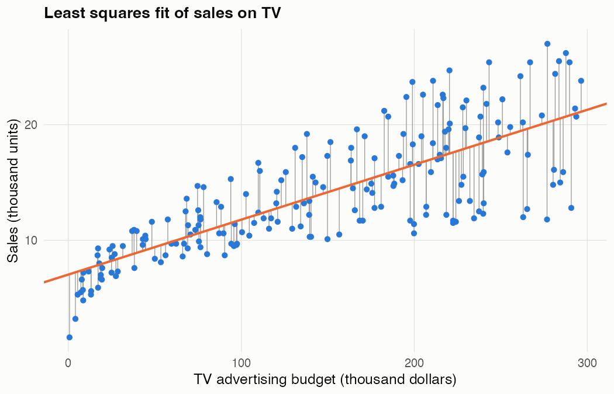
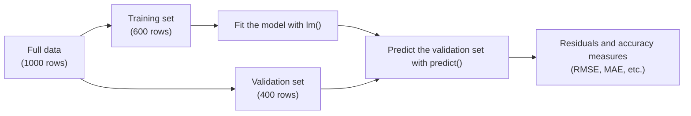
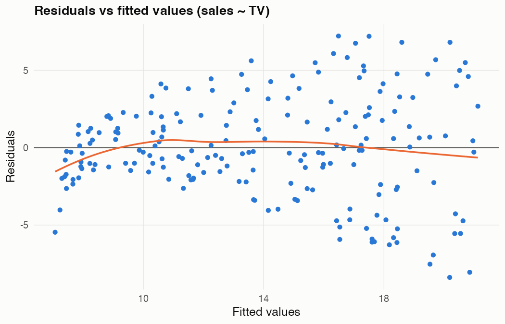
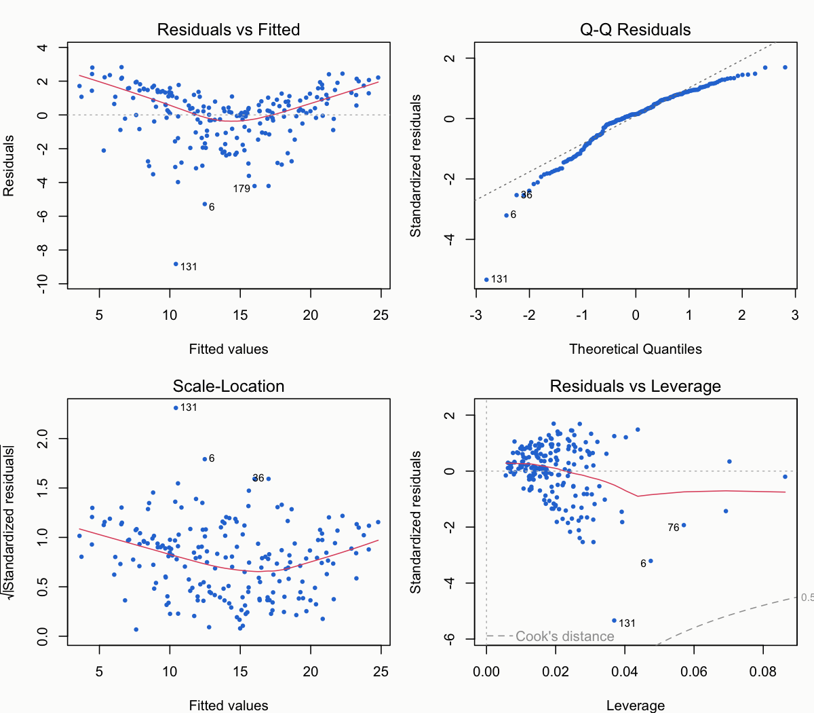
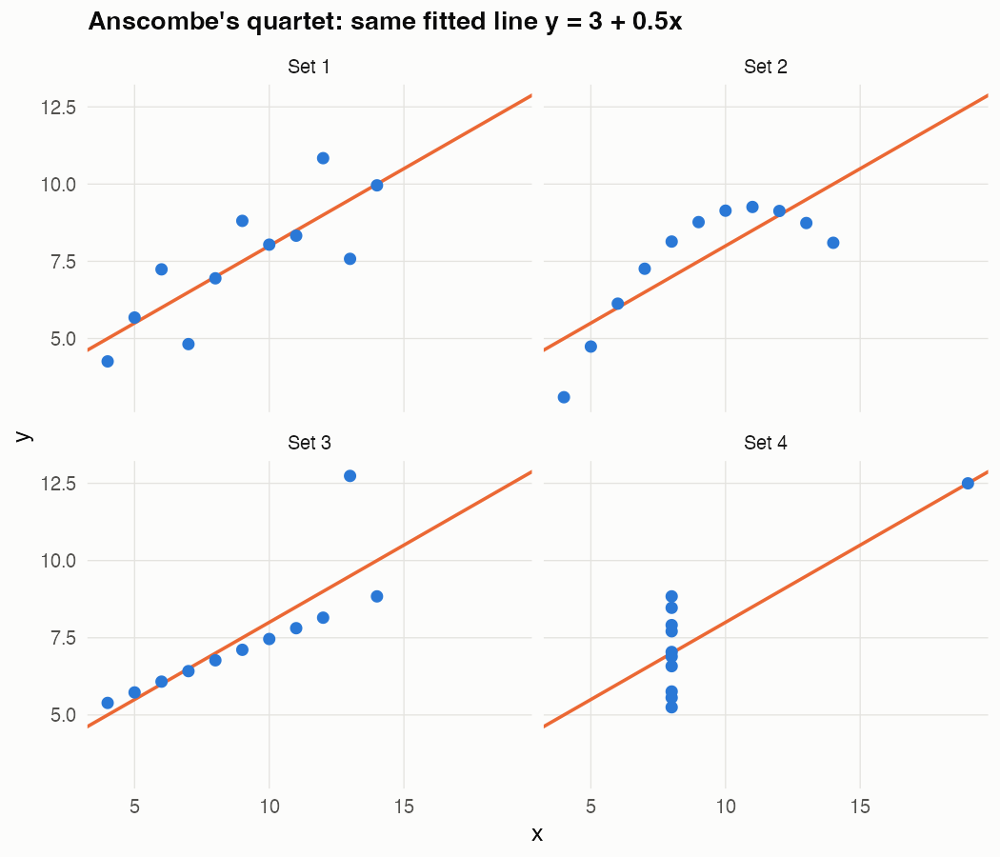

# Chapter 10 — Regression Analysis

[Repository Guide](../../README.md) | [English](Concepts_Lecture.md) | [한국어](Concepts_Lecture.ko.md)

> **Last Updated:** 2026-11-19
>
> An Introduction to Statistical Learning, James, Witten, Hastie, and Tibshirani, Ch 3

> **Learning Objectives:**
> 1. Derive the normal equations of least squares and compute the coefficients of simple linear regression by hand
> 2. Perform simple and multiple linear regression in R and interpret each part of the `summary()` output
> 3. Explain the standard errors, confidence intervals, t-tests, and F-test for regression coefficients
> 4. Explain the meaning and limits of the coefficient of determination ($R^2$) and the adjusted $R^2$
> 5. Diagnose regression assumptions and identify outliers with residual plots, VIF, leverage, and Cook's distance
> 6. Compare models and select variables with validation-set accuracy measures and AIC

---

## Table of Contents

- [1. Introduction to Regression](#1-introduction-to-regression)
  - [1.1 The Concept of Regression](#11-the-concept-of-regression)
  - [1.2 Types of Regression](#12-types-of-regression)
  - [1.3 Explanatory and Predictive Modeling](#13-explanatory-and-predictive-modeling)
- [2. Simple Linear Regression](#2-simple-linear-regression)
  - [2.1 The Model](#21-the-model)
  - [2.2 Estimating Coefficients (Least Squares)](#22-estimating-coefficients-least-squares)
  - [2.3 Implementation in R](#23-implementation-in-r)
  - [2.4 Deriving the Normal Equations](#24-deriving-the-normal-equations)
  - [2.5 Properties of the Least Squares Line](#25-properties-of-the-least-squares-line)
  - [2.6 The Population Regression Line and the Error Assumptions](#26-the-population-regression-line-and-the-error-assumptions)
  - [2.7 Example: Advertising Budgets and Sales](#27-example-advertising-budgets-and-sales)
  - [2.8 Standard Errors and Confidence Intervals of the Coefficients](#28-standard-errors-and-confidence-intervals-of-the-coefficients)
  - [2.9 Hypothesis Tests on the Coefficients](#29-hypothesis-tests-on-the-coefficients)
  - [2.10 Confidence Intervals for the Mean Response and Prediction Intervals](#210-confidence-intervals-for-the-mean-response-and-prediction-intervals)
- [3. Multiple Linear Regression](#3-multiple-linear-regression)
  - [3.1 The Model](#31-the-model)
  - [3.2 Example: Toyota Corolla Price Prediction](#32-example-toyota-corolla-price-prediction)
  - [3.3 Data Partitioning](#33-data-partitioning)
  - [3.4 Fitting in R](#34-fitting-in-r)
  - [3.5 The Regression Plane](#35-the-regression-plane)
  - [3.6 The Normal Equations in Matrix Form](#36-the-normal-equations-in-matrix-form)
  - [3.7 Interpreting Multiple Regression Coefficients](#37-interpreting-multiple-regression-coefficients)
  - [3.8 Categorical Predictors and Dummy Variables](#38-categorical-predictors-and-dummy-variables)
  - [3.9 Interaction Terms](#39-interaction-terms)
- [4. Estimating the Regression Equation](#4-estimating-the-regression-equation)
  - [4.1 Interpreting the Output](#41-interpreting-the-output)
  - [4.2 Significance Codes](#42-significance-codes)
  - [4.3 R-squared](#43-r-squared)
  - [4.4 Estimation Results of the Toyota Example](#44-estimation-results-of-the-toyota-example)
  - [4.5 Decomposition of the Sum of Squares](#45-decomposition-of-the-sum-of-squares)
  - [4.6 The Rationale for the Adjusted R-squared](#46-the-rationale-for-the-adjusted-r-squared)
  - [4.7 The F-Test](#47-the-f-test)
- [5. Model Evaluation Metrics](#5-model-evaluation-metrics)
  - [5.1 Prediction and Residuals](#51-prediction-and-residuals)
  - [5.2 Common Accuracy Measures](#52-common-accuracy-measures)
  - [5.3 Residual Diagnostics](#53-residual-diagnostics)
  - [5.4 Predictions on the Toyota Validation Set](#54-predictions-on-the-toyota-validation-set)
  - [5.5 Summary of the Regression Assumptions](#55-summary-of-the-regression-assumptions)
  - [5.6 Residual Diagnostics of the Advertising Data](#56-residual-diagnostics-of-the-advertising-data)
  - [5.7 Anscombe's Quartet](#57-anscombes-quartet)
  - [5.8 Multicollinearity and the Variance Inflation Factor](#58-multicollinearity-and-the-variance-inflation-factor)
  - [5.9 Leverage and Cook's Distance](#59-leverage-and-cooks-distance)
- [6. Variable Selection](#6-variable-selection)
  - [6.1 The Need for Variable Selection](#61-the-need-for-variable-selection)
  - [6.2 Methods](#62-methods)
  - [6.3 Implementation in R](#63-implementation-in-r)
  - [6.4 Definition of AIC and Running Stepwise Selection](#64-definition-of-aic-and-running-stepwise-selection)
  - [6.5 Regression Models Beyond Linear Regression](#65-regression-models-beyond-linear-regression)
- [7. Regression with Geographic Data in R](#7-regression-with-geographic-data-in-r)
  - [7.1 US Literacy Rate Choropleth with Regression](#71-us-literacy-rate-choropleth-with-regression)
  - [7.2 Spatial Data Concepts](#72-spatial-data-concepts)
  - [7.3 Cautions When Applying Regression to Spatial Data](#73-cautions-when-applying-regression-to-spatial-data)
- [8. Common Mistakes in Regression Analysis](#8-common-mistakes-in-regression-analysis)
- [Concept Applications](#concept-applications)
- [Summary](#summary)
- [Self-Check Questions](#self-check-questions)
- [References](#references)

---

<br>

## 1. Introduction to Regression

### 1.1 The Concept of Regression

**Regression analysis** is a statistical method for modeling the relationship between a **dependent variable** (response, outcome) and one or more **independent variables** (predictors, features).

The goals of regression analysis are:
- **Explanatory modeling**: Understand how predictors influence the response.
- **Predictive modeling**: Forecast future values of the response.

### 1.2 Types of Regression

| Type | Response Variable | Predictors | Example |
|------|-------------------|-----------|---------|
| Simple Linear | Continuous | One continuous | Sales ~ TV advertising |
| Multiple Linear | Continuous | Multiple | Price ~ Age + Mileage + HP |
| Logistic | Binary (0/1) | One or more | Disease ~ Risk factors |
| Polynomial | Continuous | Non-linear terms | Growth ~ Time + $\text{Time}^2$ |

*Table 1. Types of regression by response variable and predictors*

The Example column follows R formula notation (response ~ predictors). Logistic regression is covered in Chapter 12.

### 1.3 Explanatory and Predictive Modeling

Even when the same model is fitted with the same `lm()`, the two goals judge a good model by different standards. Explanatory modeling aims to infer a relationship that holds in the population, so the sign and size of the coefficients, their standard errors, and their p-values matter, and the results fitted on the full data are interpreted. Predictive modeling aims to predict the response of new observations accurately, so the error on data not used to build the model matters more than the meaning of each coefficient. For this reason, predictive modeling splits the data into training and validation sets (Section 3.3) and compares models with measures such as the RMSE on the validation set (Section 5.2).

| Aspect | Explanatory Modeling | Predictive Modeling |
|------|------|------|
| Central question | What relationship exists between the predictors and the response | How accurately the response of a new observation is predicted |
| Output that matters | Coefficient estimates, standard errors, confidence intervals, p-values | Error on the validation set (RMSE, MAE, and so on) |
| Data used | Usually the full data | Fitted on the training set, evaluated on the validation set |
| Criterion for keeping a variable | A variable meaningful in theory and interpretation | A variable that reduces the prediction error |

*Table 2. Comparison of explanatory and predictive modeling*

The Toyota Corolla example (Section 3.2) is predictive modeling whose purpose is to predict the sale price of a used car, while the advertising example (Section 2.7) leans toward explanatory modeling, since it asks how the advertising budget of each medium is related to sales.

---

<br>

## 2. Simple Linear Regression

### 2.1 The Model

Simple linear regression assumes a linear relationship between $X$ and $Y$:

```math
Y \approx \beta_0 + \beta_1 X
```

The full statistical model, including the error term, is:

```math
Y = \beta_0 + \beta_1 X + \epsilon
```

Where:
- $\beta_0$ is the **intercept** (expected value of $Y$ when $X = 0$).
- $\beta_1$ is the **slope** (average change in $Y$ per one-unit increase in $X$).
- $\epsilon$ is the **error term** (captures noise and unmodeled effects).

$\beta_0$ and $\beta_1$ are unknown constants called the **regression coefficients** or parameters. Estimates computed from data carry a hat, $`\hat{\beta}_0`$ and $`\hat{\beta}_1`$, and the predicted value at $X = x$ is written $`\hat{y} = \hat{\beta}_0 + \hat{\beta}_1 x`$. The phrase "regress $`Y`$ on $`X`$" means fitting this model.

### 2.2 Estimating Coefficients (Least Squares)

The **least squares method** finds $\hat{\beta}_0$ and $\hat{\beta}_1$ that minimize the **Residual Sum of Squares (RSS)**:

```math
RSS = \sum_{i=1}^{n} e_i^2 = \sum_{i=1}^{n} (y_i - \hat{y}_i)^2
```

Where $e_i = y_i - \hat{y}_i$ is the **residual** (difference between observed and predicted values).

The closed-form solutions are:

```math
\hat{\beta}_1 = \frac{\sum_{i=1}^{n}(x_i - \bar{x})(y_i - \bar{y})}{\sum_{i=1}^{n}(x_i - \bar{x})^2}
```

```math
\hat{\beta}_0 = \bar{y} - \hat{\beta}_1 \bar{x}
```

> **[Calculus]** The closed-form solution above is obtained by treating RSS as a function of the two coefficients $\beta_0$ and $\beta_1$ and setting both partial derivatives to zero. Solving $\partial RSS / \partial \beta_0 = -2\sum(y_i - \beta_0 - \beta_1 x_i) = 0$ gives $\hat{\beta}_0 = \bar{y} - \hat{\beta}_1 \bar{x}$, and substituting it into $\partial RSS / \partial \beta_1 = -2\sum x_i(y_i - \beta_0 - \beta_1 x_i) = 0$ yields $\hat{\beta}_1$. RSS is a convex quadratic function of the two coefficients, so it attains its minimum at this point, where both partial derivatives are zero. The full substitution is given in Section 2.4.

### 2.3 Implementation in R

```r
# Fit a simple linear regression
model <- lm(y ~ x, data = mydata)
summary(model)
```

> **Key Point:** The `lm()` function in R uses the formula notation `y ~ x` where `y` is the response variable and `x` is the predictor. The `~` symbol means that the response on the left is modeled as a function of the predictors on the right.

### 2.4 Deriving the Normal Equations

The derivative conditions of Section 2.2 form a system of linear equations in the two unknowns $\beta_0$ and $\beta_1$. Expanding the first condition $\sum(y_i - \beta_0 - \beta_1 x_i) = 0$ gives $\sum y_i = n\beta_0 + \beta_1 \sum x_i$, and expanding the second condition $\sum x_i(y_i - \beta_0 - \beta_1 x_i) = 0$ gives $\sum x_i y_i = \beta_0 \sum x_i + \beta_1 \sum x_i^2$.

```math
\begin{aligned}
n\beta_0 + \beta_1 \sum_{i=1}^{n} x_i &= \sum_{i=1}^{n} y_i \\
\beta_0 \sum_{i=1}^{n} x_i + \beta_1 \sum_{i=1}^{n} x_i^2 &= \sum_{i=1}^{n} x_i y_i
\end{aligned}
```

> **Definition:** The **normal equations** are the system of linear equations that the least squares estimates must satisfy, obtained by setting the partial derivative of the residual sum of squares with respect to each coefficient to zero.

Dividing the first equation by $n$ gives $\bar{y} = \beta_0 + \beta_1 \bar{x}$, so $\hat{\beta}_0 = \bar{y} - \hat{\beta}_1 \bar{x}$. Substituting this into the second equation gives $\sum x_i y_i = (\bar{y} - \beta_1 \bar{x}) n\bar{x} + \beta_1 \sum x_i^2$, which rearranges to $\beta_1(\sum x_i^2 - n\bar{x}^2) = \sum x_i y_i - n\bar{x}\bar{y}$. The two identities below then yield the slope formula of Section 2.2.

```math
S_{xx} = \sum_{i=1}^{n} (x_i - \bar{x})^2 = \sum_{i=1}^{n} x_i^2 - n\bar{x}^2, \qquad
S_{xy} = \sum_{i=1}^{n} (x_i - \bar{x})(y_i - \bar{y}) = \sum_{i=1}^{n} x_i y_i - n\bar{x}\bar{y}
```

```math
\hat{\beta}_1 = \frac{S_{xy}}{S_{xx}}
```

That this solution is a minimum is confirmed with the second partial derivatives of RSS. Since $\partial^2 RSS / \partial \beta_0^2 = 2n$, $\partial^2 RSS / \partial \beta_1^2 = 2\sum x_i^2$, and $\partial^2 RSS / \partial \beta_0 \partial \beta_1 = 2\sum x_i$, the determinant of the Hessian matrix is $4(n\sum x_i^2 - (\sum x_i)^2) = 4n S_{xx}$. If the $x_i$ are not all equal, $S_{xx} > 0$, so the Hessian is positive definite and the point is the unique minimum. Conversely, if all $x_i$ are equal, $S_{xx} = 0$ and the slope cannot be determined. In other words, a slope cannot be estimated when the predictor does not vary.

Following the computation with the five observations $(x, y)$ = (1, 2), (2, 4), (3, 5), (4, 4), (5, 5) gives the following. $\bar{x} = 3$ and $\bar{y} = 4$, the deviations $x_i - \bar{x}$ are -2, -1, 0, 1, 2, and the deviations $y_i - \bar{y}$ are -2, 0, 1, 0, 1. The products of the deviations are 4, 0, 0, 0, 2, so $S_{xy} = 6$, and the squared deviations are 4, 1, 0, 1, 4, so $S_{xx} = 10$. Therefore $\hat{\beta}_1 = 0.6$, $\hat{\beta}_0 = 4 - 0.6 \times 3 = 2.2$, and the line is $\hat{y} = 2.2 + 0.6x$.

### 2.5 Properties of the Least Squares Line

The following properties follow directly from the normal equations. All of them hold for a least squares line with an intercept.

| Property | Formula | Reason |
|------|------|------|
| The residuals sum to 0 | $`\sum_{i} e_i = 0`$ | First normal equation |
| The products of residuals and predictor values sum to 0 | $`\sum_{i} x_i e_i = 0`$ | Second normal equation |
| The products of residuals and fitted values sum to 0 | $`\sum_{i} \hat{y}_i e_i = 0`$ | A linear combination of the two properties above |
| The line passes through the point $(\bar{x}, \bar{y})$ | $`\hat{\beta}_0 + \hat{\beta}_1 \bar{x} = \bar{y}`$ | Formula for $`\hat{\beta}_0`$ |
| The mean of the fitted values is $\bar{y}$ | $`\bar{\hat{y}} = \bar{y}`$ | The residuals sum to 0 |

*Table 3. Properties of a least squares line with an intercept*

In the example of Section 2.4, the residuals are -0.8, 0.6, 1.0, -0.6, -0.2, so they sum to 0, and $\sum x_i e_i = -0.8 + 1.2 + 3.0 - 2.4 - 1.0 = 0$. Because the residuals sum to 0, the mean of the residuals alone says nothing about the quality of a model; the size of the residuals is judged with RSS or RSE, and their pattern with diagnostic plots (Section 5.3).

### 2.6 The Population Regression Line and the Error Assumptions

In $Y = \beta_0 + \beta_1 X + \epsilon$, the error term $\epsilon$ is assumed to be a random variable with mean zero. Then the mean of $Y$ with $X$ fixed at $x$ is $E(Y \mid X = x) = \beta_0 + \beta_1 x$, and this line is called the **population regression line**. Because the population regression line is determined by unknown coefficients, it cannot be observed, and $\hat{y} = \hat{\beta}_0 + \hat{\beta}_1 x$ computed from the data is its estimate, the **least squares line**.

The population regression line is easy to understand as a picture in which $Y$ forms a distribution at each $x$. For example, the $Y$ values of units with $x = 65$ form a distribution with mean $\beta_0 + 65\beta_1$ and standard deviation $\sigma$, and the $Y$ values of units with $x = 90$ form a distribution with mean $\beta_0 + 90\beta_1$ and the same standard deviation $\sigma$. The regression line connects the means of these conditional distributions, and the amount by which one observation deviates from the line is its error $\epsilon_i$. Inference in linear regression (Sections 2.8 and 2.9) usually rests on the following assumptions.

1. **Linearity:** $E(Y \mid X = x)$ is a linear function of $x$.
2. **Independence:** The errors $\epsilon_1, \ldots, \epsilon_n$ are mutually independent (at least uncorrelated).
3. **Homoscedasticity:** The variance of the error is the same $\sigma^2$ at every $x$.
4. **Normality:** The errors follow a normal distribution. With a large sample, the t-tests of the coefficients hold approximately even when this assumption fails.

If data are drawn anew many times from the same model, each data set gives a slightly different least squares line, but the average of those lines is close to the population regression line. This is the same relationship as the sample mean $\bar{y}$ being an estimate of the population mean $\mu$, and under assumptions 1 and 2, $\hat{\beta}_0$ and $\hat{\beta}_1$ are **unbiased estimators**. That is, the average of infinitely many estimates equals the true value. How far an estimate from one data set may lie from the true value is expressed by the standard error (Section 2.8), and the sampling distribution underlying the idea that estimates vary from sample to sample is covered in Chapter 14.

### 2.7 Example: Advertising Budgets and Sales

The Advertising data set is a public data set recording, for 200 markets, the sales of a product (`sales`, in thousands of units) and the advertising budgets for TV, radio, and newspaper (`TV`, `radio`, `newspaper`, in thousands of dollars). First, sales are regressed on the TV budget.

```r
adv <- read.csv("Advertising.csv")
fit_tv <- lm(sales ~ TV, data = adv)
summary(fit_tv)
#> 
#> Call:
#> lm(formula = sales ~ TV, data = adv)
#> 
#> Residuals:
#>     Min      1Q  Median      3Q     Max 
#> -8.3860 -1.9545 -0.1913  2.0671  7.2124 
#> 
#> Coefficients:
#>             Estimate Std. Error t value Pr(>|t|)    
#> (Intercept) 7.032594   0.457843   15.36   <2e-16 ***
#> TV          0.047537   0.002691   17.67   <2e-16 ***
#> ---
#> Signif. codes:  0 '***' 0.001 '**' 0.01 '*' 0.05 '.' 0.1 ' ' 1
#> 
#> Residual standard error: 3.259 on 198 degrees of freedom
#> Multiple R-squared:  0.6119,	Adjusted R-squared:  0.6099 
#> F-statistic: 312.1 on 1 and 198 DF,  p-value: < 2.2e-16
```

The estimated line is $\hat{y} = 7.03 + 0.0475x$. Because the budget is in thousands of dollars and sales are in thousands of units, the interpretation is that each additional 1,000 dollars of TV advertising is associated with about 47.5 additional units sold on average. The intercept 7.03 means that the average sales of markets without TV advertising are about 7,030 units, and since the data include markets with TV budgets near zero, this interpretation does not stray far from the range of the data. The vertical distance between each observation and the line is a residual, and least squares chooses the line that makes the sum of their squares smallest.



*Figure 1. Least squares line and residuals of sales on the TV budget*

Computing the same coefficients directly with the formulas of Section 2.2 reproduces the output of `lm()`, and the properties of Section 2.5 can also be checked.

```r
x <- adv$TV
y <- adv$sales
n <- length(y)
Sxx <- sum((x - mean(x))^2)
Sxy <- sum((x - mean(x)) * (y - mean(y)))
b1 <- Sxy / Sxx
b0 <- mean(y) - b1 * mean(x)
e <- y - (b0 + b1 * x)
RSS <- sum(e^2)
RSE <- sqrt(RSS / (n - 2))
se_b1 <- RSE / sqrt(Sxx)
se_b0 <- RSE * sqrt(1 / n + mean(x)^2 / Sxx)
round(c(b0 = b0, b1 = b1, RSS = RSS, RSE = RSE,
        se_b0 = se_b0, se_b1 = se_b1, t_b1 = b1 / se_b1), 4)
#>        b0        b1       RSS       RSE     se_b0     se_b1      t_b1 
#>    7.0326    0.0475 2102.5306    3.2587    0.4578    0.0027   17.6676
c(sum_e = sum(e), sum_xe = sum(x * e))
#>        sum_e       sum_xe 
#> 1.074696e-13 9.913492e-11
```

`Sxx` and `Sxy` are $S_{xx}$ and $S_{xy}$ of Section 2.4, and `b1` and `b0` are the slope and intercept. `e` is the residual vector, `RSS` the residual sum of squares, and `RSE` the residual standard error of Section 2.8. `se_b0` and `se_b1` are the standard errors of the two coefficients, and `t_b1` is the t-statistic of the slope, equal to the 17.67 in `summary()`. The two values on the last line are zero in theory, and values around $10^{-13}$ and $10^{-11}$ are rounding errors of floating-point arithmetic.

### 2.8 Standard Errors and Confidence Intervals of the Coefficients

The estimate $\hat{\beta}_1$ is a random variable that varies with the data, and its spread is measured by the **standard error** (SE). Under assumptions 1-3 of Section 2.6, the standard errors of the two coefficients are as follows.

```math
\mathrm{SE}(\hat{\beta}_1)^2 = \frac{\sigma^2}{\sum_{i=1}^{n} (x_i - \bar{x})^2}, \qquad
\mathrm{SE}(\hat{\beta}_0)^2 = \sigma^2 \left[ \frac{1}{n} + \frac{\bar{x}^2}{\sum_{i=1}^{n} (x_i - \bar{x})^2} \right]
```

The first formula means that the slope can be estimated more precisely when the error variance $\sigma^2$ is smaller and when the $x_i$ are more spread out. When $x$ is concentrated in a narrow range, the slope of the line is shaken strongly by noise. In the second formula, if $\bar{x} = 0$, $\mathrm{SE}(\hat{\beta}_0)$ becomes $\sigma/\sqrt{n}$, the same as the standard error of a sample mean.

Since $\sigma^2$ is unknown, it is estimated from the data. The square root of that estimate is the **residual standard error** (RSE).

```math
\mathrm{RSE} = \hat{\sigma} = \sqrt{\frac{RSS}{n - 2}}
```

The denominator is $n - 2$ rather than $n$ because estimating two coefficients from the data ties the residuals to the two normal equations, which reduces the dimensions in which the residuals can move freely to $n - 2$. This $n - 2$ is called the **degrees of freedom** of the residuals. In the Advertising data, $RSS = 2102.53$ and $n = 200$, so $\mathrm{RSE} = \sqrt{2102.53/198} = 3.259$, which is the `Residual standard error: 3.259 on 198 degrees of freedom` in the `summary()` output. Since sales are in thousands of units, even if the true regression line were known exactly, the sales of each market would deviate from it by about 3,260 units on average. Since mean sales are about 14,000 units, the relative error is about 23%.

> **Definition:** A **confidence interval** is an interval with a lower and an upper limit computed from a sample, constructed so that if samples are drawn repeatedly and intervals are built by the same method, a specified proportion (for example, 95%) of the intervals contain the unknown true value.

If the errors are normally distributed, $(\hat{\beta}_1 - \beta_1)/\mathrm{SE}(\hat{\beta}_1)$ follows a t distribution with $n - 2$ degrees of freedom, so the 95% confidence interval for $\beta_1$ is as follows.

```math
\hat{\beta}_1 \pm t_{0.975,\,n-2} \cdot \mathrm{SE}(\hat{\beta}_1)
```

For large $n$, $t_{0.975,\,n-2}$ is close to 1.96 (about 1.97 for $n = 200$ in the Advertising data), so the interval is often approximated as $\hat{\beta}_1 \pm 2 \cdot \mathrm{SE}(\hat{\beta}_1)$. In R, `confint()` computes this interval.

```r
confint(fit_tv)
#>                  2.5 %     97.5 %
#> (Intercept) 6.12971927 7.93546783
#> TV          0.04223072 0.05284256
b1 + c(-1, 1) * qt(0.975, df = n - 2) * se_b1
#> [1] 0.04223072 0.05284256
```

`qt(0.975, df = n - 2)` is the 97.5% quantile of the t distribution with 198 degrees of freedom (about 1.972), and the second line computes the formula directly to obtain the same interval as `confint()`. The 95% confidence interval for the increase in sales per 1,000 dollars of TV advertising is about 42 to 53 units. This interval does not mean that "the true value lies in this interval with probability 95%"; it is a property of the procedure, namely that 95% of the intervals built by the same procedure contain the true value. The interpretation of confidence intervals is covered in detail in Chapter 14.

### 2.9 Hypothesis Tests on the Coefficients

Whether there is a relationship between the predictor and the response is judged by a hypothesis test asking whether the slope is zero.

```math
H_0: \beta_1 = 0 \quad \text{versus} \quad H_a: \beta_1 \neq 0
```

The **null hypothesis** $H_0$ states that there is no relationship between $X$ and $Y$, and the **alternative hypothesis** $H_a$ states that there is some relationship. The test statistic is the t-statistic, which expresses how many standard errors the estimate lies from zero.

```math
t = \frac{\hat{\beta}_1 - 0}{\mathrm{SE}(\hat{\beta}_1)}
```

If $H_0$ is true, $t$ follows a t distribution with $n - 2$ degrees of freedom. The t distribution is bell-shaped and symmetric about zero, and for $n$ greater than about 30 it is almost the same as the standard normal distribution. The **p-value** is the probability, assuming $H_0$ is true, of obtaining a value of $|t|$ as extreme as or more extreme than the one observed. A small p-value means that so strong an association is unlikely to appear by chance when there is no relationship, so $H_0$ is rejected and it is concluded that there is a relationship between $X$ and $Y$. Common cutoffs for rejection are 5% or 1%, and some fields use 10%. When $n = 30$, these cutoffs correspond roughly to $|t|$ exceeding 2 and 2.75.

The TV coefficient of the Advertising data has $t = 0.0475 / 0.0027 = 17.67$, more than 17 standard errors away from zero, and its p-value is smaller than $2 \times 10^{-16}$. The intercept also has $t = 15.36$. Therefore it is concluded that $\beta_0 \neq 0$ and $\beta_1 \neq 0$. Rejecting the test on the slope means that there is a relationship between the TV budget and sales, and rejecting the test on the intercept means that sales are not zero when the TV budget is zero.

> **Caution:** A small p-value means only that the data are incompatible with the hypothesis $\beta_1 = 0$; it does not mean that the effect is large or that there is a causal relationship. With a very large sample, even a practically negligible slope gets a very small p-value. The size of an effect is judged with the coefficient and its confidence interval, and the correct interpretation and the misuse of p-values are covered in Chapter 14.

### 2.10 Confidence Intervals for the Mean Response and Prediction Intervals

When a regression equation is used to talk about the response at $X = x_0$, two kinds of uncertainty must be distinguished. Estimating the **mean response** $\beta_0 + \beta_1 x_0$ of units with the same $x_0$ involves only the uncertainty of estimating the coefficients. Predicting the **response of a single** new unit, $Y = \beta_0 + \beta_1 x_0 + \epsilon$, adds that unit's own error $\epsilon$. Therefore the **prediction interval** for an individual response is always wider than the confidence interval for the mean response.

```math
\hat{y}_0 \pm t_{0.975,\,n-2} \cdot \hat{\sigma} \sqrt{\frac{1}{n} + \frac{(x_0 - \bar{x})^2}{S_{xx}}} \quad \text{(confidence interval)}, \qquad
\hat{y}_0 \pm t_{0.975,\,n-2} \cdot \hat{\sigma} \sqrt{1 + \frac{1}{n} + \frac{(x_0 - \bar{x})^2}{S_{xx}}} \quad \text{(prediction interval)}
```

```r
new <- data.frame(TV = 100)
predict(fit_tv, new, interval = "confidence")
#>        fit      lwr     upr
#> 1 11.78626 11.26782 12.3047
predict(fit_tv, new, interval = "prediction")
#>        fit      lwr      upr
#> 1 11.78626 5.339251 18.23326
```

Given new data `new` and an `interval` argument, `predict()` returns the point prediction (`fit`) and the lower (`lwr`) and upper (`upr`) limits of the interval. The mean sales of markets with a TV budget of 100,000 dollars are predicted to be 11,786 units, with a 95% confidence interval of about 11,268 to 12,305 units, but the 95% prediction interval for the sales of one such market is much wider, about 5,339 to 18,233 units. Because of the $(x_0 - \bar{x})^2$ term, both intervals widen as $x_0$ moves away from the center of the data, and **extrapolation**, prediction at an $x_0$ outside the range of the data, requires even more care because there is no guarantee that the linear relationship holds there.

---

<br>

## 3. Multiple Linear Regression

### 3.1 The Model

Multiple linear regression extends simple linear regression to multiple predictors:

```math
Y = \beta_0 + \beta_1 X_1 + \beta_2 X_2 + \cdots + \beta_p X_p + \epsilon
```

### 3.2 Example: Toyota Corolla Price Prediction

A classic example involves predicting the offer price of used cars from their attributes. A large Toyota dealership offers customers who buy a new car a trade-in, buying their used car, and resells the used cars it buys at a small margin. To earn a reasonable margin, the dealership must predict in advance the price at which it can sell a used car, so the sales records of all used Toyota Corollas it sold previously were collected. The analysis uses the first 1,000 cars of the data, with the following variables:

| Variable | Description |
|----------|-------------|
| Price | Offer price in Euros (response) |
| Age | Age in months as of August 2004 |
| Kilometers | Accumulated km on odometer |
| Fuel Type | Petrol, Diesel, CNG |
| HP | Horsepower |
| Metallic | Metallic color (Yes=1, No=0) |
| Automatic | Automatic transmission (Yes=1, No=0) |
| CC | Cylinder volume in cubic centimeters |
| Doors | Number of doors |
| QuartTax | Quarterly road tax in Euros |
| Weight | Weight in kilograms |

*Table 4. Variables in the Toyota Corolla example*

The first few rows of the data show that even within the same model, ages range over 23-39 months and mileages over about 19,000-98,000 km, and prices lie in the range of about 11,950-22,750 Euros. Diesel cars have 90 horsepower and 2,000 cc engines, whereas petrol cars have 110-192 horsepower and 1,600-1,800 cc engines, so the fuel type also moves together with other variables.

### 3.3 Data Partitioning

Before fitting a model, data is split into **training** and **validation** sets:

```r
# Partition data: 60% training, 40% validation
set.seed(1)
train.index <- sample(c(1:1000), 600)
train.df <- car.df[train.index, selected.var]
valid.df <- car.df[-train.index, selected.var]
```

`set.seed(1)` fixes the random seed so that the same split can be reproduced, and `sample(c(1:1000), 600)` draws 600 of the row numbers 1-1000 without replacement. `selected.var` is a vector of the column names used in the analysis, and `-train.index` selects the remaining 400 rows that were not drawn for the training set. The two sets are used as follows.



*Figure 2. Fitting and evaluating a regression model with training and validation sets*

### 3.4 Fitting in R

```r
# Use all remaining columns as predictors (. means "all other variables")
car.lm <- lm(Price ~ ., data = train.df)
options(scipen = 999)   # Disable scientific notation
summary(car.lm)
```

The columns selected by `selected.var` are the response `Price` and the 10 predictors of Table 4. The fuel type becomes two dummy variables (Section 3.8), so 11 slopes are estimated in total, and the estimation results of this model are given in Section 4.4.

### 3.5 The Regression Plane

With two predictors, $`\hat{y} = \hat{\beta}_0 + \hat{\beta}_1 x_1 + \hat{\beta}_2 x_2`$ is a plane in three-dimensional space. The vertical distance from each observation $`(x_{i1}, x_{i2}, y_i)`$ to this plane is a residual, and least squares sets the slopes and height of the plane so that the sum of squared residuals is smallest. Where simple regression approximates the points with a line, this approximates them with a plane, and with $p$ predictors the same principle gives a hyperplane in $p + 1$ dimensions. Predictions are computed as follows.

```math
\hat{y} = \hat{\beta}_0 + \hat{\beta}_1 x_1 + \hat{\beta}_2 x_2 + \cdots + \hat{\beta}_p x_p
```

### 3.6 The Normal Equations in Matrix Form

With several predictors, it is simpler to handle the coefficients all at once with matrices. The $n \times (p + 1)$ **design matrix** $\mathbf{X}$ has a first column of ones (the intercept) and remaining columns holding the predictor values, $\mathbf{y}$ is the vector of responses, and $\boldsymbol{\beta}$ is the coefficient vector. The model and the residual sum of squares can then be written as follows.

```math
\mathbf{y} = \mathbf{X}\boldsymbol{\beta} + \boldsymbol{\epsilon}, \qquad
RSS(\boldsymbol{\beta}) = (\mathbf{y} - \mathbf{X}\boldsymbol{\beta})^\top (\mathbf{y} - \mathbf{X}\boldsymbol{\beta})
```

Differentiating $RSS$ with respect to $\boldsymbol{\beta}$ gives $-2\mathbf{X}^\top(\mathbf{y} - \mathbf{X}\boldsymbol{\beta})$, and setting it to zero gives the normal equations of multiple regression.

```math
\mathbf{X}^\top \mathbf{X} \hat{\boldsymbol{\beta}} = \mathbf{X}^\top \mathbf{y}
\quad \Longrightarrow \quad
\hat{\boldsymbol{\beta}} = (\mathbf{X}^\top \mathbf{X})^{-1} \mathbf{X}^\top \mathbf{y}
```

When $p = 1$, this equation is the same as the two normal equations of Section 2.4. For $\mathbf{X}^\top \mathbf{X}$ to have an inverse, the columns of $\mathbf{X}$ must be linearly independent. If one predictor is exactly a linear combination of the others (for example, the same length entered twice, in cm and in inches), its coefficient cannot be determined uniquely, and R reports that coefficient as `NA`. The case in which a predictor is only close to a linear combination is the multicollinearity of Section 5.8.

> **[Linear Algebra]** The normal equations are equivalent to orthogonally projecting $\mathbf{y}$ onto the column space of $\mathbf{X}$. That the residual vector $\mathbf{e} = \mathbf{y} - \mathbf{X}\hat{\boldsymbol{\beta}}$ satisfies $\mathbf{X}^\top \mathbf{e} = \mathbf{0}$ means that the residuals are orthogonal to every column of $\mathbf{X}$, and $\sum e_i = 0$ and $\sum x_i e_i = 0$ of Section 2.5 are this orthogonality condition written componentwise. The matrix $\mathbf{H} = \mathbf{X}(\mathbf{X}^\top \mathbf{X})^{-1}\mathbf{X}^\top$ used in the fitted values $\hat{\mathbf{y}} = \mathbf{X}(\mathbf{X}^\top \mathbf{X})^{-1}\mathbf{X}^\top \mathbf{y}$ is called the hat matrix, and its diagonal elements are the leverages of Section 5.9.

Solving the normal equations directly for the Advertising data gives the same coefficients as `lm()`.

```r
X <- cbind(1, as.matrix(adv[, c("TV", "radio", "newspaper")]))
beta_hat <- solve(t(X) %*% X, t(X) %*% adv$sales)
round(drop(beta_hat), 6)
#>                  TV     radio newspaper 
#>  2.938889  0.045765  0.188530 -0.001037
```

`cbind(1, ...)` builds the design matrix by attaching a column of ones for the intercept, and `solve(A, b)` solves the linear system $A\boldsymbol{\beta} = b$. Solving the system directly is numerically more stable than computing the inverse separately and multiplying.

### 3.7 Interpreting Multiple Regression Coefficients

In multiple regression, $\beta_j$ is the change in the mean of $Y$ when $X_j$ increases by one unit **with all other predictors held fixed**. This condition makes its meaning differ from the slope of a simple regression. Entering all three media for the Advertising data gives the following result.

```r
fit_all <- lm(sales ~ TV + radio + newspaper, data = adv)
summary(fit_all)
#> 
#> Call:
#> lm(formula = sales ~ TV + radio + newspaper, data = adv)
#> 
#> Residuals:
#>     Min      1Q  Median      3Q     Max 
#> -8.8277 -0.8908  0.2418  1.1893  2.8292 
#> 
#> Coefficients:
#>              Estimate Std. Error t value Pr(>|t|)    
#> (Intercept)  2.938889   0.311908   9.422   <2e-16 ***
#> TV           0.045765   0.001395  32.809   <2e-16 ***
#> radio        0.188530   0.008611  21.893   <2e-16 ***
#> newspaper   -0.001037   0.005871  -0.177     0.86    
#> ---
#> Signif. codes:  0 '***' 0.001 '**' 0.01 '*' 0.05 '.' 0.1 ' ' 1
#> 
#> Residual standard error: 1.686 on 196 degrees of freedom
#> Multiple R-squared:  0.8972,	Adjusted R-squared:  0.8956 
#> F-statistic: 570.3 on 3 and 196 DF,  p-value: < 2.2e-16
```

Increasing the radio budget by 1,000 dollars with the TV and newspaper budgets held fixed is associated with about 189 more units sold on average. The newspaper coefficient is -0.001, close to zero, with a p-value of 0.86, so once the TV and radio budgets are known, the newspaper budget adds no further information about sales. Regressing on the newspaper budget alone, however, gives a different result.

```r
coef(summary(lm(sales ~ newspaper, data = adv)))
#>               Estimate Std. Error   t value     Pr(>|t|)
#> (Intercept) 12.3514071 0.62142019 19.876096 4.713507e-49
#> newspaper    0.0546931 0.01657572  3.299591 1.148196e-03
round(cor(adv[, c("TV", "radio", "newspaper", "sales")]), 4)
#>               TV  radio newspaper  sales
#> TV        1.0000 0.0548    0.0566 0.7822
#> radio     0.0548 1.0000    0.3541 0.5762
#> newspaper 0.0566 0.3541    1.0000 0.2283
#> sales     0.7822 0.5762    0.2283 1.0000
```

In the simple regression, the slope of the newspaper budget is 0.055 with a p-value of 0.001, which is significant. The reason the two results differ lies in the correlation matrix. The correlation between the newspaper and radio budgets is 0.35, so markets that advertise heavily on radio also tend to advertise heavily in newspapers. The newspaper coefficient of the simple regression shows an association with sales because it picks up the effect of the radio advertising that moves with it, and once radio is entered and held fixed, the association disappears. This has the same structure as shark attacks and ice cream sales rising together because both respond to temperature. Because the coefficients of a multiple regression depend on which other variables are included, the interpretation of a coefficient must always state which variables were held fixed with it.

> **Caution:** The interpretation "holding the other variables fixed" is meaningful when those variables can actually vary separately. If the predictors are strongly correlated (Section 5.8), the data contain almost no situations in which only one variable changes, so the coefficient estimates are unstable and hard to interpret. In addition, a regression coefficient from observational data is the size of an association, not a causal effect.

### 3.8 Categorical Predictors and Dummy Variables

A predictor whose values are categories, such as the fuel type, cannot be entered as a number directly, so it is converted into **dummy variables**. With $K$ categories, one is chosen as the **baseline category**, and for each of the remaining $K - 1$ categories a variable equal to 1 for that category and 0 otherwise is created. No dummy is created for the baseline because creating all $K$ would make their sum always 1, which is linearly dependent on the intercept column (Section 3.6). R's `lm()` converts factor variables into dummy variables automatically and uses the first level as the baseline.

```r
mt <- transform(mtcars, cyl = factor(cyl))
coef(summary(lm(mpg ~ wt + cyl, data = mt)))
#>              Estimate Std. Error   t value     Pr(>|t|)
#> (Intercept) 33.990794  1.8877934 18.005569 6.257246e-17
#> wt          -3.205613  0.7538957 -4.252065 2.130435e-04
#> cyl6        -4.255582  1.3860728 -3.070244 4.717834e-03
#> cyl8        -6.070860  1.6522878 -3.674214 9.991893e-04
```

Converting the number of cylinders `cyl` into a factor with `transform()` makes 4 the baseline among the levels 4, 6, and 8 and creates the two dummies `cyl6` and `cyl8`. At the same weight, six-cylinder cars average 4.26 mpg less fuel efficiency than four-cylinder cars, and eight-cylinder cars 6.07 mpg less. The coefficient of a dummy is always the difference from the baseline category, and the average effect of the baseline category is contained in the intercept. `Fuel_TypeDiesel` and `Fuel_TypePetrol` in the Toyota example are dummy variables created the same way, with CNG as the baseline (Section 4.4).

### 3.9 Interaction Terms

The model of Section 3.7 assumes that the effect of TV advertising is constant regardless of the radio budget. Advertising in both media together, however, may produce an **interaction** in which each increases the effect of the other. This is represented by entering the product of the two variables as a predictor.

```math
Y = \beta_0 + \beta_1 X_1 + \beta_2 X_2 + \beta_3 X_1 X_2 + \epsilon = \beta_0 + (\beta_1 + \beta_3 X_2) X_1 + \beta_2 X_2 + \epsilon
```

Rearranged as on the right, the slope of $X_1$ is $\beta_1 + \beta_3 X_2$, which depends on the value of $X_2$. In an R formula, `TV * radio` is shorthand for `TV + radio + TV:radio`, and `TV:radio` is the product term.

```r
fit_int <- lm(sales ~ TV * radio, data = adv)
round(coef(summary(fit_int)), 6)
#>             Estimate Std. Error   t value Pr(>|t|)
#> (Intercept) 6.750220   0.247871 27.232755   0.0000
#> TV          0.019101   0.001504 12.698953   0.0000
#> radio       0.028860   0.008905  3.240815   0.0014
#> TV:radio    0.001086   0.000052 20.726564   0.0000
c(R2_additive = summary(lm(sales ~ TV + radio, data = adv))$r.squared,
  R2_interaction = summary(fit_int)$r.squared)
#>    R2_additive R2_interaction 
#>      0.8971943      0.9677905
```

The t-statistic of the interaction term is 20.7, very large, and $R^2$ rises from 0.897 to 0.968. The effect of a 1,000-dollar increase in the TV budget is $0.0191 + 0.00109 \times \text{radio}$, about 19 units when the radio budget is 0 but about 41 units when the radio budget is 20 (20,000 dollars). When an interaction term is included and its p-value is small, the convention is to keep the main effects (`TV`, `radio`) in the model even if their p-values are large; this is called the **hierarchical principle**.

---

<br>

## 4. Estimating the Regression Equation

### 4.1 Interpreting the Output

The `summary()` output includes:

| Component | Description |
|-----------|-------------|
| **Estimate** | Estimated coefficient values ($\hat{\beta}_i$) |
| **Std. Error** | Standard error of the estimate |
| **t value** | Test statistic: $t_i = \hat{\beta}_i / se(\hat{\beta}_i)$ |
| **Pr(>\|t\|)** | p-value for two-sided hypothesis test |
| **Multiple R-squared** | $R^2$, proportion of variance explained |
| **Adjusted R-squared** | $R^2_{adj}$, $R^2$ adjusted for number of predictors |
| **F-statistic** | Overall significance test of the model |

*Table 5. Components of the `summary()` output*

Two items not in the table are read as well. `Residuals:` at the top of the output gives the minimum, quartiles, and maximum of the residuals; if the median is close to 0 and the first and third quartiles have similar absolute values, the residuals are nearly symmetric about 0. `Residual standard error` is the RSE of Section 2.8 together with its degrees of freedom $n - p - 1$.

### 4.2 Significance Codes

```text
Signif. codes:  0 '***' 0.001 '**' 0.01 '*' 0.05 '.' 0.1 ' ' 1
```

If the p-value is smaller than the significance level (usually 0.05), the null hypothesis that the coefficient is zero is rejected and the predictor is judged **statistically significant**. Next to a coefficient, `***` marks a p-value of at most 0.001, `**` at most 0.01, `*` at most 0.05, and `.` at most 0.1.

### 4.3 R-squared

The **coefficient of determination** $R^2$ measures how well the model fits the data:

```math
R^2 = 1 - \frac{RSS}{TSS} = 1 - \frac{\sum(y_i - \hat{y}_i)^2}{\sum(y_i - \bar{y})^2}
```

Here TSS is the **total sum of squares**, the total variation of the response around its mean $\bar{y}$. For a least squares model with an intercept, $R^2$ lies between 0 and 1.

- $R^2 = 1$: The model explains all variation in the response, a perfect fit.
- $R^2 = 0$: The model explains none of the variation in the response.

The **adjusted** $R^2$ penalizes for adding unnecessary predictors:

```math
R^2_{adj} = 1 - \frac{(1 - R^2)(n - 1)}{n - p - 1}
```

Here $n$ is the number of observations and $p$ is the number of predictors.

> **Key Point:** Use the adjusted $R^2$ instead of $R^2$ when comparing models with different numbers of predictors. Adding variables never decreases $R^2$, but it may not improve the model.

### 4.4 Estimation Results of the Toyota Example

Fitting the model of Section 3.4 to the training set of 600 cars gives the following result.

```text
Call:
lm(formula = Price ~ ., data = train.df)

Residuals:
    Min      1Q  Median      3Q     Max 
-9781.2  -729.9     0.9   739.3  6912.9 

Coefficients:
                    Estimate   Std. Error t value             Pr(>|t|)    
(Intercept)     -4754.379821  1661.719608  -2.861             0.004372 ** 
Age_08_04        -133.271592     4.901960 -27.187 < 0.0000000000000002 ***
KM                 -0.020992     0.002304  -9.111 < 0.0000000000000002 ***
Fuel_TypeDiesel   896.206322   603.164063   1.486             0.137857    
Fuel_TypePetrol  2191.368250   575.629429   3.807             0.000155 ***
HP                 37.257375     5.233283   7.119     0.00000000000317 ***
Met_Color          51.315188   123.395390   0.416             0.677664    
Automatic          63.567598   262.282017   0.242             0.808583    
CC                  0.010747     0.097711   0.110             0.912456    
Doors             -55.700492    63.966255  -0.871             0.384230    
Quarterly_Tax      13.080021     2.608396   5.015     0.00000070465597 ***
Weight             16.219638     1.526915  10.622 < 0.0000000000000002 ***
---
Signif. codes:  0 '***' 0.001 '**' 0.01 '*' 0.05 '.' 0.1 ' ' 1

Residual standard error: 1392 on 588 degrees of freedom
Multiple R-squared:  0.8703,	Adjusted R-squared:  0.8679 
F-statistic: 358.7 on 11 and 588 DF,  p-value: < 0.00000000000000022
```

Coefficients are read with their units. With the other variables held fixed, each additional month of age lowers the price by 133 Euros on average, each additional kilometer lowers it by 0.021 Euros (about 210 Euros per 10,000 km), each additional unit of horsepower raises it by 37 Euros, and each additional kilogram of weight raises it by 16 Euros. The two fuel-type coefficients are differences from the baseline category, CNG cars: petrol cars are on average 2,191 Euros more expensive than otherwise identical CNG cars (p = 0.000155), while the diesel difference of 896 Euros, with p = 0.138, is not significant. The coefficients of metallic color, automatic transmission, engine volume, and number of doors have p-values of 0.38 or more, so the evidence that they add to price prediction in the presence of the other variables is weak, and they become candidates for removal in the variable selection of Section 6.

Because `options(scipen = 999)` was set, the p-values appear as decimals instead of scientific notation such as `2e-16`. The residual degrees of freedom, 588, are the 600 observations minus the 12 estimated coefficients (the intercept and 11 slopes), and the degrees of freedom 11 and 588 of the F-statistic arise for the same reason. $R^2 = 0.8703$ means that the model explains 87% of the price variation in the training set, and the adjusted coefficient of determination $1 - (1 - 0.8703) \times 599 / 588 = 0.8679$ is almost the same, so the data are ample relative to the number of predictors. The RSE of 1,392 Euros is the typical size by which prices in the training set deviate from the regression equation, and comparing it with the validation-set RMSE in Section 5.4 indicates whether the model overfits.

### 4.5 Decomposition of the Sum of Squares

In a least squares model with an intercept, the total variation of the response splits exactly into the variation explained by the model and the variation left unexplained. Splitting each deviation $y_i - \bar{y}$ into $(\hat{y}_i - \bar{y}) + (y_i - \hat{y}_i)$, squaring, and summing gives the following.

```math
\sum_{i}(y_i - \bar{y})^2 = \sum_{i}(\hat{y}_i - \bar{y})^2 + \sum_{i}(y_i - \hat{y}_i)^2 + 2\sum_{i}(\hat{y}_i - \bar{y})e_i
```

The last cross term is $2\sum \hat{y}_i e_i - 2\bar{y}\sum e_i$, and by the properties of Section 2.5 both sums are zero, so it vanishes. The following decomposition therefore holds.

```math
\underbrace{\sum_{i}(y_i - \bar{y})^2}_{TSS} = \underbrace{\sum_{i}(\hat{y}_i - \bar{y})^2}_{ESS} + \underbrace{\sum_{i}(y_i - \hat{y}_i)^2}_{RSS}
```

ESS is the **explained sum of squares**. Thanks to this decomposition, $R^2 = 1 - RSS/TSS = ESS/TSS$ is interpreted as "the proportion of the variation in the response that the model explains" and lies between 0 and 1. In a model without an intercept, the cross term need not vanish, and this interpretation breaks down. In simple linear regression, $R^2$ equals the square of the sample correlation coefficient $r$ between $X$ and $Y$.

```r
TSS <- sum((y - mean(y))^2)
ESS <- sum((fitted(fit_tv) - mean(y))^2)
round(c(TSS = TSS, ESS = ESS, RSS = RSS, ESS_plus_RSS = ESS + RSS,
        R2 = 1 - RSS / TSS, r_squared = cor(x, y)^2), 4)
#>          TSS          ESS          RSS ESS_plus_RSS           R2    r_squared 
#>    5417.1487    3314.6182    2102.5306    5417.1487       0.6119       0.6119
```

The TV budget alone explains 61% of the variation in sales, and the square of the correlation coefficient 0.7822 is also 0.6119. How large an $R^2$ is enough depends on the field. In fields such as physical experiments, where relationships are almost exactly linear, a value below 0.9 suggests a problem with the experiment, but in fields that study human behavior, a value around 0.1 is often meaningful. $R^2$ does not reveal whether the relationship is linear either (Section 5.7), so it is read together with plots.

### 4.6 The Rationale for the Adjusted R-squared

In $R^2 = 1 - RSS/TSS$, $RSS/n$ and $TSS/n$ estimate the error variance and the variance of the response, respectively, but they are biased downward by the coefficients estimated from the sample. Dividing each sum of squares by its degrees of freedom to correct the bias gives the adjusted coefficient of determination.

```math
R^2_{adj} = 1 - \frac{RSS / (n - p - 1)}{TSS / (n - 1)}
```

The numerator is the estimate $\hat{\sigma}^2$ of the error variance, and the denominator is the sample variance of the response. Rearranging this formula gives the formula of Section 4.3. Adding one useless variable reduces RSS slightly but also reduces $n - p - 1$ by 1, so if the reduction in RSS does not make up for the lost degree of freedom, $R^2_{adj}$ actually decreases. The output below shows that the value computed with the formula for the Advertising multiple regression equals the value reported by `summary()`.

```r
s <- summary(fit_all)
p <- 3
c(R2 = s$r.squared,
  adj_by_formula = 1 - (1 - s$r.squared) * (n - 1) / (n - p - 1),
  adj_reported = s$adj.r.squared)
#>             R2 adj_by_formula   adj_reported 
#>      0.8972106      0.8956373      0.8956373
```

### 4.7 The F-Test

The first question to ask in multiple regression is whether at least one of the predictors is related to the response. This is a test of the null hypothesis that all slopes are zero.

```math
H_0: \beta_1 = \beta_2 = \cdots = \beta_p = 0 \quad \text{versus} \quad H_a: \text{at least one } \beta_j \neq 0
```

```math
F = \frac{(TSS - RSS)/p}{RSS/(n - p - 1)}
```

The denominator is an estimate of the error variance, and the numerator also estimates the error variance when $H_0$ is true but is larger when $H_0$ is false. Therefore $H_0$ is rejected when $F$ is much larger than 1. Under $H_0$ and normal errors, $F$ follows an F distribution with $(p, n - p - 1)$ degrees of freedom. The $F = 570.3$ of the Advertising multiple regression has a p-value of about $10^{-96}$ at (3, 196) degrees of freedom.

```r
fs <- s$fstatistic
fs
#>    value    numdf    dendf 
#> 570.2707   3.0000 196.0000
pf(fs["value"], fs["numdf"], fs["dendf"], lower.tail = FALSE)
#>        value 
#> 1.575227e-96
anova(lm(sales ~ TV + radio, data = adv), fit_all)
#> Analysis of Variance Table
#> 
#> Model 1: sales ~ TV + radio
#> Model 2: sales ~ TV + radio + newspaper
#>   Res.Df    RSS Df Sum of Sq      F Pr(>F)
#> 1    197 556.91                           
#> 2    196 556.83  1  0.088717 0.0312 0.8599
```

`pf(..., lower.tail = FALSE)` is the probability of the F distribution above the observed value, that is, the p-value. The F-test is needed even though individual t-tests exist because of the problem of testing many times. With 100 predictors all unrelated to the response, about 5 of the 100 t-tests at the 5% level would still come out significant by chance. The F-test keeps the probability of wrongly rejecting $H_0$ at 5% when $H_0$ is true, regardless of the number of predictors.

Passing two models to `anova()` performs a **partial F-test** of whether only some coefficients are zero. The output above shows that adding newspaper to the model with TV and radio reduces RSS by only 0.089, giving $F = 0.0312$ and p = 0.86. The F value of a partial F-test that adds one variable equals the square of that variable's t value ($(-0.177)^2 \approx 0.031$), and its p-value is the same as that of the t-test in Section 3.7.

---

<br>

## 5. Model Evaluation Metrics

### 5.1 Prediction and Residuals

```r
# Make predictions on validation set
car.lm.pred <- predict(car.lm, valid.df)

# Calculate residuals
some.residuals <- valid.df$Price[1:20] - car.lm.pred[1:20]
data.frame("Predicted" = car.lm.pred[1:20],
           "Actual" = valid.df$Price[1:20],
           "Residual" = some.residuals)
```

`predict()` feeds the predictors of the validation set into the model fitted on the training set to predict prices, and the last statement shows the predicted value, actual value, and residual (actual minus predicted) side by side for the first 20 validation observations.

### 5.2 Common Accuracy Measures

| Metric | Formula | Interpretation |
|--------|---------|----------------|
| **MAE** | $\frac{1}{n}\sum \vert e_i \vert$ | Average absolute error magnitude |
| **ME** | $\frac{1}{n}\sum e_i$ | Average error (shows bias direction) |
| **MPE** | $100 \times \frac{1}{n}\sum \frac{e_i}{y_i}$ | Percentage error with direction |
| **MAPE** | $100 \times \frac{1}{n}\sum \frac{\vert e_i \vert}{y_i}$ | Mean absolute percentage error |
| **RMSE** | $\sqrt{\frac{1}{n}\sum e_i^2}$ | Root mean squared error (same units as Y) |

*Table 6. Common accuracy measures for regression models*

```r
library(forecast)
accuracy(car.lm.pred, valid.df$Price)
#>                ME     RMSE      MAE        MPE     MAPE
#> Test set 19.62125 1325.235 1048.604 -0.7497401 9.348056
```

In this result, ME is 19.62 Euros, close to zero relative to the price scale, so the predictions show almost no systematic bias; RMSE is 1325.24 Euros and MAPE is 9.35%.

> **Key Point:** RMSE is the most commonly used metric because it has the same units as the response variable and penalizes large errors more heavily than MAE.

RMSE has the same form as the RSE computed on the training set but differs in being computed on data not used to build the model. MPE and MAPE divide by $y_i$, so they cannot be used when some actual values are zero or close to zero, and an error of the same size counts more heavily for an observation with a small actual value. When choosing a measure, consider first whether the cost of an error is proportional to its size (MAE), whether large errors are especially bad (RMSE), or whether relative size matters (MAPE).

### 5.3 Residual Diagnostics

The t-tests and confidence intervals for the coefficients rely on assumptions about the error term, so after fitting a model the assumptions are checked with the residuals. The main assumptions are linearity, independence of errors, **homoscedasticity** (constant error variance), and normality of errors.

```r
# Draw the four diagnostic plots in a 2x2 grid
par(mfrow = c(2, 2))
plot(car.lm)
par(mfrow = c(1, 1))
```

| Plot | What It Checks | Warning Sign |
|------|------|------|
| Residuals vs Fitted | Linearity, homoscedasticity | Curved pattern, funnel-shaped spread |
| Normal Q-Q (Q-Q Residuals) | Normality of errors | Points off the reference line, especially at the ends |
| Scale-Location | Homoscedasticity | A trend that rises or falls with the fitted values |
| Residuals vs Leverage | Outliers and influential points | Points beyond the Cook's distance contour lines |

*Table 7. Regression diagnostic plots drawn by `plot()`*

> **Note:** An observation with a large residual is an **outlier** candidate, and an observation whose predictor values are far from the others has high **leverage**. An observation with a large **Cook's distance**, which combines both, is an **influential point** that changes the regression coefficients substantially, so check that it is not a data error and compare the fit without it.

### 5.4 Predictions on the Toyota Validation Set

The code of Section 5.1 shows the predicted values, actual values, and residuals of the first 20 of the 400 cars in the validation set. Some of those rows are as follows (row names are the row numbers of the original data).

| Row | Predicted | Actual | Residual |
|------|------:|------:|------:|
| 2 | 16,447.08 | 13,750 | -2,697.08 |
| 7 | 16,756.56 | 16,900 | 143.44 |
| 8 | 16,749.79 | 18,600 | 1,850.21 |
| 9 | 20,959.15 | 21,500 | 540.85 |
| 10 | 14,349.86 | 12,950 | -1,399.86 |
| 12 | 21,123.59 | 19,950 | -1,173.59 |

*Table 8. Some predicted values and residuals of the Toyota validation set (Euros)*

A positive residual means that the model predicted the price too low, and a negative residual means that it predicted too high. Car 2 was predicted about 2,700 Euros above its actual price. The RMSE of 1,325 Euros over all 400 cars (Section 5.2) is similar to the training-set RSE of 1,392 Euros (Section 4.4), so this model can be judged not to be overfitted, that is, not tailored excessively to the training data. If the validation error were much larger than the training error, overfitting would be suspected.

### 5.5 Summary of the Regression Assumptions

What goes wrong when an assumption of Section 2.6 fails differs from assumption to assumption. Distinguishing them makes it possible, when a diagnostic plot reveals a problem, to judge what that problem invalidates.

| Assumption | Example of Failure | Consequence | Remedy |
|------|------|------|------|
| Linearity | Sales rising with diminishing returns to advertising | The coefficient estimates themselves are biased, and predictions are systematically wrong | Variable transformations, polynomial terms, interaction terms |
| Independence | Data measured in time order, several members of the same household | Standard errors are underestimated, so confidence intervals are too narrow | Time series models (Chapter 11), models that account for clusters |
| Homoscedasticity | Spending spreads more as income grows | Coefficients remain unbiased, but standard errors, p-values, and intervals are inaccurate | Log or square-root transformation of the response, weighted least squares |
| Normality | A long right tail, extreme outliers | t-tests and intervals are inaccurate in small samples | Transformations, larger samples, robust regression (Section 6.5) |

*Table 9. Assumptions of linear regression and the consequences of their failure*

The least squares estimates themselves can be computed without any assumptions. The assumptions guarantee the properties of those estimates (unbiasedness, standard errors, distribution), so for pure prediction a small validation error matters more, while in explanatory modeling, where conclusions are drawn from the confidence intervals and p-values of the coefficients, checking the assumptions is essential.

### 5.6 Residual Diagnostics of the Advertising Data

Plotting the residuals of the TV-only model against the fitted values shows both a funnel shape, in which the residuals spread more as the fitted values grow, and a weak curve that is low at both ends and high in the middle. Both homoscedasticity and linearity are in doubt.



*Figure 3. Residuals vs fitted values of the TV budget model*

The four diagnostic plots of the model with all three media (Section 3.7) are as follows.



*Figure 4. Four diagnostic plots of the three-media regression model*

In the residuals vs fitted plot at the top left, the residuals trace a U shape. In markets with small or large fitted values, actual sales exceed the predictions, and in the middle they fall short. This is due to the interaction in which markets that split their budget between TV and radio sell more than markets that concentrate on one medium, and adding the interaction term of Section 3.9 greatly reduces this pattern. The Q-Q plot at the top right shows the left tail sagging below the reference line, meaning more large negative residuals than a normal distribution would produce, and observations 131 and 6 are labeled by number in both plots.

### 5.7 Anscombe's Quartet

In 1973, the statistician Francis Anscombe constructed four data sets with almost identical means, variances, correlations, and regression equations but completely different plots, showing that plotting data is essential in analysis and that outliers and influential observations can change statistical properties substantially [1]. The `anscombe` data in R compare the summary statistics of the four data sets.

```r
stats <- sapply(1:4, function(i) {
  xi <- anscombe[[paste0("x", i)]]
  yi <- anscombe[[paste0("y", i)]]
  f <- lm(yi ~ xi)
  c(mean_x = mean(xi), var_x = var(xi), mean_y = mean(yi), var_y = var(yi),
    cor = cor(xi, yi), b0 = coef(f)[[1]], b1 = coef(f)[[2]],
    R2 = summary(f)$r.squared)
})
colnames(stats) <- paste0("set", 1:4)
round(stats, 3)
#>          set1   set2   set3   set4
#> mean_x  9.000  9.000  9.000  9.000
#> var_x  11.000 11.000 11.000 11.000
#> mean_y  7.501  7.501  7.500  7.501
#> var_y   4.127  4.128  4.123  4.123
#> cor     0.816  0.816  0.816  0.817
#> b0      3.000  3.001  3.002  3.002
#> b1      0.500  0.500  0.500  0.500
#> R2      0.667  0.666  0.666  0.667
```

`sapply()` applies the function to each data set from 1 to 4; inside the function, `paste0("x", i)` builds the column names `x1`, `x2`, and so on to extract the columns, and the function returns the means, variances, correlation, regression coefficients, and $R^2$ as a vector. All four data sets have an $x$ mean of 9 and variance of 11, a $y$ mean of 7.50 and variance of about 4.12, a correlation of 0.816, the regression equation $\hat{y} = 3.00 + 0.500x$, and $R^2 = 0.67$.



*Figure 5. Anscombe's four data sets with the same summary statistics and regression equation*

Seen in plots, however, only the first data set suits linear regression. The second has a curved relationship that needs a quadratic term, the third is an almost perfect line whose slope is pulled up by a single outlier, and in the fourth all $x$ values are 8 except one point with very high leverage ($x = 19$) that determines the whole slope. This is why a model must not be judged by summary statistics and $R^2$ alone.

### 5.8 Multicollinearity and the Variance Inflation Factor

A state in which the predictors are strongly correlated with one another is called **multicollinearity**. When two variables move almost together, the data cannot tell to which of the two the change in the response should be attributed, so the standard errors of the coefficients grow, signs sometimes flip, and the estimates swing widely when the data change slightly. The predictions themselves and $R^2$ do not suffer much, however, so multicollinearity is a bigger problem for interpreting coefficients than for prediction.

> **Definition:** The **variance inflation factor (VIF)** is the factor by which the variance of the $`j`$th coefficient is inflated by correlation with the other predictors compared with no correlation, equal to $`1/(1 - R^2_{X_j \mid X_{-j}})`$ where $`R^2_{X_j \mid X_{-j}}`$ is the coefficient of determination from regressing $X_j$ on the remaining predictors.

The minimum VIF is 1 (no correlation with the other variables), and as a rule of thumb, values above 5 or 10 indicate collinearity large enough to be a problem. The correlation matrix shows only correlations between pairs of variables, so collinearity involving three or more variables together is found with VIF. It is computed with `vif()` from the `car` package.

```r
library(car)
vif(fit_all)
#>        TV     radio newspaper 
#>  1.004611  1.144952  1.145187
vif(lm(mpg ~ cyl + disp + hp + wt, data = mtcars))
#>       cyl      disp        hp        wt 
#>  6.737707 10.373286  3.405983  4.848016
round(cor(mtcars[, c("cyl", "disp", "hp", "wt")]), 3)
#>        cyl  disp    hp    wt
#> cyl  1.000 0.902 0.832 0.782
#> disp 0.902 1.000 0.791 0.888
#> hp   0.832 0.791 1.000 0.659
#> wt   0.782 0.888 0.659 1.000
```

The three media of the Advertising data all have VIFs of 1.15 or less, so collinearity is not a problem. In contrast, predicting fuel efficiency in mtcars from the number of cylinders, displacement, horsepower, and weight gives displacement a VIF of 10.4. Displacement has correlations of 0.902 with the number of cylinders and 0.888 with weight, and as the computation below shows, the other three variables explain 90% of its variation.

```r
r2_disp <- summary(lm(disp ~ cyl + hp + wt, data = mtcars))$r.squared
c(R2_disp = r2_disp, VIF_disp = 1 / (1 - r2_disp))
#>    R2_disp   VIF_disp 
#>  0.9035985 10.3732860
```

A VIF of 10 inflates the variance of the coefficient tenfold and its standard error by $\sqrt{10} \approx 3.2$ times. Remedies include dropping one of the collinear variables, combining related variables into a single index, and using a method robust to collinearity, such as the ridge regression of Section 6.5.

### 5.9 Leverage and Cook's Distance

The two quantities mentioned in the note box of Section 5.3 are computed as follows. The **leverage** $h_i$ of the $`i`$th observation is the $`i`$th diagonal element of the hat matrix $\mathbf{H}$ of Section 3.6, and in simple regression it is as follows.

```math
h_i = \frac{1}{n} + \frac{(x_i - \bar{x})^2}{\sum_{j=1}^{n} (x_j - \bar{x})^2}
```

$h_i$ grows as $x_i$ moves away from the mean, lies between $1/n$ and 1, and averages $(p + 1)/n$ over all observations. An observation whose leverage is well above average has great power to pull the regression line toward itself. **Cook's distance** $D_i$ measures how much all the fitted values change when the $`i`$th observation is removed and the model is refitted, and it is large when both the residual and the leverage are large.

```math
D_i = \frac{e_i^2}{(p + 1)\hat{\sigma}^2} \cdot \frac{h_i}{(1 - h_i)^2}
```

```r
h <- hatvalues(fit_all)
d <- cooks.distance(fit_all)
c(mean_h = mean(h), p1_over_n = (p + 1) / n)
#>    mean_h p1_over_n 
#>      0.02      0.02
head(sort(h, decreasing = TRUE), 3)
#>         17        102        166 
#> 0.08633414 0.07023387 0.06919936
head(sort(d, decreasing = TRUE), 3)
#>        131          6         76 
#> 0.27295612 0.12830584 0.05631284
sum(d > 4 / n)
#> [1] 16
```

`hatvalues()` and `cooks.distance()` compute the two values for each observation. The mean leverage is $(3 + 1)/200 = 0.02$, matching the theoretical value, and the largest leverage is 0.086 for observation 17, a little over four times the mean. Observation 131 has the largest Cook's distance, 0.273, and this observation was labeled by number in all four plots of Figure 4. Sixteen observations exceed $4/n = 0.02$, a commonly used cutoff for Cook's distance, but this cutoff only picks observations to examine, and exceeding it is no reason to delete an observation automatically. No observation exceeds 1, so there is no influential point strong enough for a single observation to overturn the conclusions.

---

<br>

## 6. Variable Selection

### 6.1 The Need for Variable Selection

Not all predictors contribute meaningfully to the model. Including irrelevant variables can cause the following problems:
- Model complexity increases without improving accuracy.
- **Overfitting** (the model memorizes training data but fails on new data) can occur.
- Interpretability is reduced.

### 6.2 Methods

| Method | Description |
|--------|-------------|
| **Forward Selection** | Start empty; add variables one at a time |
| **Backward Elimination** | Start with all; remove variables one at a time |
| **Stepwise** | Combination of forward and backward |
| **Best Subset** | Evaluate all possible combinations |

*Table 10. Variable selection methods*

Best subset selection must compare all $2^p$ models when there are $p$ predictors, so with $p = 20$ more than a million models must be fitted. Forward selection and backward elimination change only one variable at each step and need far less computation, but they are not guaranteed to find the best combination. Backward elimination can start only when there are more observations than predictors ($n > p$), so that the full model can be fitted, while forward selection has no such restriction.

### 6.3 Implementation in R

```r
# Stepwise regression using AIC criterion
step(car.lm, direction = "both")

# Backward elimination
step(car.lm, direction = "backward")

# Forward selection
step(lm(Price ~ 1, data = train.df),
     scope = formula(car.lm),
     direction = "forward")
```

At each step, `step()` adds or removes the variable that reduces the **AIC** (Akaike information criterion) the most, and it stops when no change reduces the AIC. A smaller AIC indicates a better model. Forward selection starts from the intercept-only model `lm(Price ~ 1, ...)` and adds variables from those of the full model given by `scope`.

### 6.4 Definition of AIC and Running Stepwise Selection

> **Definition:** The **AIC (Akaike information criterion)** is a measure that reflects both the fit and the complexity of a model, defined as $-2\ell + 2k$ where $\ell$ is the maximized log-likelihood and $k$ is the number of estimated parameters, with smaller values indicating a better model.

The first term becomes smaller as the model fits the data better, and the second term adds a penalty of 2 for each additional parameter. In linear regression with normal errors, dropping constant terms gives $AIC = n \log(RSS/n) + 2k$, and `step()` and `extractAIC()` use this formula ($k$ is the number of coefficients including the intercept). Therefore, if adding a variable does not reduce RSS enough, AIC increases.

```r
k <- length(coef(fit_all))
c(extractAIC = extractAIC(fit_all)[2],
  by_formula = n * log(sum(resid(fit_all)^2) / n) + 2 * k)
#> extractAIC by_formula 
#>   212.7868   212.7868
```

Running backward elimination on the three-media model of the Advertising data gives the following.

```r
step(fit_all, direction = "backward")
#> Start:  AIC=212.79
#> sales ~ TV + radio + newspaper
#> 
#>             Df Sum of Sq    RSS    AIC
#> - newspaper  1      0.09  556.9 210.82
#> <none>                    556.8 212.79
#> - radio      1   1361.74 1918.6 458.20
#> - TV         1   3058.01 3614.8 584.90
#> 
#> Step:  AIC=210.82
#> sales ~ TV + radio
#> 
#>         Df Sum of Sq    RSS    AIC
#> <none>                556.9 210.82
#> - radio  1    1545.6 2102.5 474.52
#> - TV     1    3061.6 3618.5 583.10
#> 
#> Call:
#> lm(formula = sales ~ TV + radio, data = adv)
#> 
#> Coefficients:
#> (Intercept)           TV        radio  
#>     2.92110      0.04575      0.18799
```

Each step table in the output gives the RSS and AIC when one variable is removed (`-`), and `<none>` is the current model with nothing changed. In the first step, removing newspaper increases RSS by only 0.09 and lowers AIC from 212.79 to 210.82, so newspaper is removed. In the second step, removing radio or TV would raise AIC sharply to 474.52 or 583.10, so the search stops, and the final model is `sales ~ TV + radio`. This result agrees with the t-test of Section 3.7 and the partial F-test of Section 4.7.

> **Caution:** The p-values and confidence intervals in the `summary()` of a model obtained by variable selection are more optimistic than they should be, because the variables were chosen with the same data. Since favorable variables were picked after looking at the data, the p-values of the selected variables tend to be smaller than those of a model fixed in advance. The performance of the selected model is evaluated on a validation set not used in the selection.

### 6.5 Regression Models Beyond Linear Regression

Beyond linear regression there are countless regression models. Representative ones are the following.

| Model | Limitation of Linear Regression It Addresses |
|------|------|
| Robust regression | Mitigates outliers dragging the coefficients by using a loss less sensitive to residuals |
| Resistant regression (LMS, LTS) | Resists outliers by minimizing the median of squared residuals (least median squares) or a sum that trims the largest residuals (least trimmed squares) |
| Ridge regression | Penalizes the sum of squared coefficients to reduce the variance inflated by multicollinearity |
| Penalized regression (Lasso, Elastic Net) | Penalizes the sum of absolute coefficients, setting some coefficients exactly to 0 and doing variable selection at the same time |
| Logistic regression | Binary responses (Chapter 12) |
| Additive models | Estimates the effect of each predictor with a smooth curve instead of a line |
| Principal components regression | Replaces correlated predictors with a few mutually orthogonal principal components before regressing |
| Censored regression | Responses observed only up to or beyond a certain value (for example, survival times) |
| Piecewise linear regression | Joins lines with different slopes in different intervals |
| Quantile regression | Models conditional medians or quantiles instead of conditional means |
| Linear mixed models | Accounts for correlation in repeated measurements of the same units or in grouped data |

*Table 11. Regression models beyond linear regression and the limitations they address*

So many models exist because the assumptions of Section 5.5 often fail in real data. When the relationship is not a straight line, when there are outliers, when there are many correlated predictors, when the response is not continuous, or when the observations are not independent, ordinary least squares is not appropriate, and each model is built to fix a particular one of these problems. The starting point of every model is the linear regression of this chapter, and understanding its assumptions and diagnostics makes it possible to judge when another model is needed.

> **[Machine Learning]** Ridge regression and the Lasso minimize $RSS + \lambda \sum_j \beta_j^2$ or $RSS + \lambda \sum_j \lvert\beta_j\rvert$, and the penalty strength $\lambda$ is chosen by cross-validation. They are a standard example of the bias-variance tradeoff, accepting slightly more bias in exchange for a large reduction in variance to lower the prediction error.

---

<br>

## 7. Regression with Geographic Data in R

### 7.1 US Literacy Rate Choropleth with Regression

As an example that combines geographic visualization with statistical analysis, state-level literacy rate data is joined to a US state boundary shapefile to draw a **choropleth map**. A choropleth map shows a value for each region as a shade of color:

```r
library(tidyverse)
library(sf)

# Load US state shapefile
USMap <- st_read("data/cb_2024_us_state_5m.shp")

# Load literacy rate data
litRates <- read.csv("data/us_literacy_rates_by_state_2025.csv")

# Join spatial and attribute data
continentalUS <- USMap %>%
  left_join(litRates, by = c("NAME" = "State")) %>%
  filter(NAME != "Hawaii" & NAME != "Alaska" &
         NAME != "Puerto Rico" & !is.na(Rate))

# Create choropleth map
ggplot(continentalUS, aes(geometry = geometry, fill = Rate)) +
  geom_sf() +
  coord_sf()
```

`left_join()` attaches the literacy rate to each row whose state name column `NAME` in the shapefile matches the `State` column of the CSV, and `filter()` removes Hawaii, Alaska, and Puerto Rico, which lie apart from the mainland, along with rows without a literacy rate. This join and filter are the same as in Chapter 9, Section 7.3. The joined sf object is a data frame, so it can be used directly for regression, as in `lm(Rate ~ predictor, data = continentalUS)`.

### 7.2 Spatial Data Concepts

| Concept | Description |
|---------|-------------|
| Shapefile | Vector format storing geographic features (.shp, .dbf, .shx, .prj) |
| CRS | Coordinate Reference System (e.g., EPSG:4326 for WGS 84) |
| `sf` | Simple Features package for spatial data in R |
| `st_read()` | Read shapefile into R as an sf object |
| `geom_sf()` | ggplot2 geometry for spatial data |

*Table 12. Key spatial data concepts in R*

### 7.3 Cautions When Applying Regression to Spatial Data

In data whose units are regions, such as states or counties, neighboring regions commonly have similar values. This is called **spatial autocorrelation**, and when the errors of neighboring regions are correlated, the independence assumption of Section 5.5 fails. As a result, the standard errors are underestimated, and the regression coefficients may look more significant than they are. Diagnosis begins with drawing the residuals as a choropleth map. If the residuals do not mix randomly on the map but form regional clusters of the same sign, spatial autocorrelation is suspected, and spatial regression models that include the correlation between regions are considered.

It must also be noted that a regression coefficient from region-level data describes a relationship between regions, not between individuals. A strong relationship between state literacy rates and state incomes does not imply a relationship of the same size between an individual's literacy and that individual's income. This error of inferring individual-level relationships from group-level ones is called the **ecological fallacy**.

---

<br>

## 8. Common Mistakes in Regression Analysis

- **Interpreting association as causation.** A regression coefficient from observational data is an association with the other variables held fixed. As with the newspaper advertising of Section 3.7, an omitted variable can show its effect through another variable, so a causal effect can be claimed only with an experiment or an equivalent design.
- **Predicting outside the range of the data.** A linear relationship has been confirmed only within the observed range of $x$. Outside that range, not only does the prediction interval widen as in Section 2.10, but the relationship itself may change.
- **Choosing a model by $R^2$ alone.** Adding variables never decreases $R^2$. Models with different numbers of predictors are compared with the adjusted $R^2$, AIC, and validation-set error, and the shape of the relationship is checked with plots as in Section 5.7.
- **Reporting prediction performance with the training-set error.** The training-set error is optimistic because the model was fitted to that data. Prediction performance is measured on a validation set (Section 5.4).
- **Comparing coefficient sizes while ignoring units.** In the Toyota example, the mileage coefficient -0.021 is far smaller in absolute value than the age coefficient -133 because the units differ (km and months), not because mileage matters less. To compare the sizes of effects, multiply each coefficient by a realistic range of change of its variable or use standardized coefficients.
- **Interpreting a non-significant coefficient as "no effect".** A large p-value means that the data are not sufficient to confirm an effect, and a wide confidence interval cannot rule out a large effect. With collinearity (Section 5.8), even an important variable can come out non-significant.
- **Reporting p-values without diagnostics.** If homoscedasticity or independence fails, the standard errors and p-values are wrong (Section 5.5). The significance of coefficients is not put forward as a conclusion before the residual plots are checked.
- **Creating dummy variables for every category.** A variable with $K$ categories needs $K - 1$ dummies. Entering all $K$ makes them linearly dependent on the intercept, so the coefficients cannot be determined (Section 3.8).

---

<br>

## Concept Applications

**True/False Check:**

| Statement | Judgment and Reason |
|:-----|:-----|
| The residuals of a least squares line with an intercept sum to 0. | **T.** The first normal equation is exactly $\sum e_i = 0$. |
| Adding one predictor increases both $R^2$ and the adjusted $R^2$. | **F.** $R^2$ never decreases, but the adjusted $R^2$ decreases if the reduction in RSS does not make up for the lost degree of freedom. |
| At the same $x_0$, the prediction interval is always wider than the confidence interval for the mean response. | **T.** The prediction interval adds the error variance $\sigma^2$ of the new observation itself. |
| A variable significant in simple regression is also significant in multiple regression. | **F.** As with the newspaper budget, its significance can disappear when another correlated variable is entered. |
| When homoscedasticity fails, the least squares coefficient estimates are biased. | **F.** The coefficients remain unbiased, but the standard errors, p-values, and confidence intervals become inaccurate. |
| A VIF of 1 means that the predictor has no linear relationship with the remaining predictors. | **T.** When $R^2_{X_j \mid X_{-j}} = 0$, VIF $= 1/(1 - 0) = 1$. |
| A small p-value of the F-test means that none of the coefficients is 0. | **F.** The F-test shows only that at least one coefficient is not 0 and does not tell which. |
| Anscombe's four data sets have the same regression equation and $R^2$, so the same model is appropriate for all. | **F.** The second is a curved relationship, and in the third and fourth a single outlier or high-leverage point determines the result, so they must be checked with plots. |

---

<br>

## Summary

| Concept | Key Summary |
|---------|-----------|
| Linear regression | It models a linear relationship between the response and predictors as $Y = \beta_0 + \beta_1 X + \epsilon$. |
| Explanation and prediction | Explanatory modeling emphasizes the coefficients and their uncertainty, and predictive modeling emphasizes the validation-set error. |
| Least squares | It estimates the coefficients that minimize the residual sum of squares (RSS). |
| Normal equations | They are the system obtained by setting the partial derivatives of RSS to zero, written in matrix form as $`\mathbf{X}^\top \mathbf{X} \hat{\boldsymbol{\beta}} = \mathbf{X}^\top \mathbf{y}`$. |
| `lm()` | It is the R function for fitting linear models and takes a formula of the form `y ~ x`. |
| `summary()` | It shows the coefficient estimates, significance, $R^2$, and F-statistic. |
| Standard error | It is how much a coefficient estimate varies from sample to sample, and it is smaller when the error variance is small and $x$ is widely spread. |
| Confidence interval | The 95% confidence interval for a coefficient is the estimate ± $t_{0.975,\,n-p-1}$ × standard error. |
| t-test | It tests the hypothesis that a coefficient is zero with the ratio of the estimate to its standard error. |
| Prediction interval | The interval for an individual response is wider than the confidence interval for the mean response because the error variance is added. |
| $R^2$ | It is the proportion of variance explained, and the adjusted $R^2$ is used to compare models with different numbers of predictors. |
| Sum of squares decomposition | TSS = ESS + RSS holds in a least squares model with an intercept. |
| F-test | It tests the hypothesis that all slopes are zero at once, and the partial F-test tests a subset of the coefficients. |
| Dummy variables | A variable with $K$ categories enters as $K - 1$ zero-one variables, leaving out the baseline category. |
| Interaction | Entering the product of two variables makes the slope of one depend on the value of the other. |
| Residual | It is the observed value minus the predicted value, $e_i = y_i - \hat{y}_i$. |
| RMSE | It is the root mean squared error and has the same units as the response variable. |
| Residual diagnostics | The diagnostic plots from `plot()` check linearity, homoscedasticity, normality, outliers, and influential points. |
| Multicollinearity | It is a state of strongly correlated predictors, and a VIF above 5 or 10 casts doubt on the interpretation of the coefficients. |
| Leverage and Cook's distance | They are how far an observation's predictor values lie from the others and how much the fitted values change when that observation is removed. |
| Data partitioning | The data is split into training and validation sets (60% and 40% in this example) to evaluate performance on new data. |
| Variable selection | Forward selection, backward elimination, and stepwise selection choose the variables that contribute to prediction. |
| AIC | It reflects fit and complexity together as $-2\ell + 2k$, which in linear regression is $n \log(RSS/n) + 2k$. |
| Geographic regression | Joining attribute data to spatial data read with `sf` allows choropleth visualization and analysis with `lm()`. |

---

<br>

## Self-Check Questions

1. **Least squares estimation:** Fit a simple linear regression to the five observations $(x, y)$ = (1, 2), (2, 4), (3, 5), (4, 4), (5, 5) and find $\hat{\beta}_0$, $\hat{\beta}_1$, and $R^2$.

   <details>
   <summary>Answer</summary>

   $\bar{x} = 3$ and $\bar{y} = 4$. Since $\sum(x_i - \bar{x})(y_i - \bar{y}) = 4 + 0 + 0 + 0 + 2 = 6$ and $\sum(x_i - \bar{x})^2 = 10$, $\hat{\beta}_1 = 0.6$ and $\hat{\beta}_0 = 4 - 0.6 \times 3 = 2.2$. The fitted values are 2.8, 3.4, 4.0, 4.6, 5.2 and the residuals are -0.8, 0.6, 1.0, -0.6, -0.2, so RSS = 2.4. TSS = 4 + 0 + 1 + 0 + 1 = 6, so $R^2 = 1 - 2.4/6 = 0.6$.

   </details>

2. **Adjusted R-squared:** A model with 100 observations and 4 predictors has $R^2$ = 0.80. Adding one irrelevant predictor raises $R^2$ to 0.801. Find the adjusted $R^2$ of both models and decide which model is better.

   <details>
   <summary>Answer</summary>

   The first model has $1 - (0.20 \times 99)/95 \approx 0.7916$, and the second has $1 - (0.199 \times 99)/94 \approx 0.7904$. $R^2$ increased but the adjusted $R^2$ decreased, so the added variable does not improve the model, and the first model with 4 predictors is better.

   </details>

3. **Accuracy measures:** Four validation observations have actual values 20, 10, 30, 40 and residuals 2, -1, -3, 2. Find ME, MAE, RMSE, and MAPE, and explain why ME alone should not be used to evaluate the model.

   <details>
   <summary>Answer</summary>

   ME = (2 - 1 - 3 + 2)/4 = 0, MAE = (2 + 1 + 3 + 2)/4 = 2, RMSE = $\sqrt{(4 + 1 + 9 + 4)/4} = \sqrt{4.5} \approx 2.12$, and MAPE = 100 × (2/20 + 1/10 + 3/30 + 2/40)/4 = 100 × 0.35/4 = 8.75%. Positive and negative errors cancel, so ME is 0 even though the individual errors are not. ME shows only the direction of bias, so the size of the errors must be judged with MAE or RMSE.

   </details>

4. **Residual diagnostics:** In the residuals vs fitted plot, the spread of the residuals widens into a funnel shape as the fitted values grow. Which assumption is violated, and what problem does it cause?

   <details>
   <summary>Answer</summary>

   The homoscedasticity assumption is violated (heteroscedasticity). The least squares coefficient estimates themselves remain unbiased, but the standard errors become inaccurate, so the p-values of the t-tests and the confidence intervals cannot be trusted. A remedy such as a log transformation of the response should be considered.

   </details>

5. **Variable selection:** Explain, in terms of overfitting, why a model with selected variables can perform better on the validation set than a model with all predictors, and compare the starting points of forward selection and backward elimination.

   <details>
   <summary>Answer</summary>

   Unnecessary variables make the model learn even the noise in the training data, causing overfitting in which the training error falls while the error on the validation set, which is new data, rises. Removing variables that do not contribute reduces this effect and can improve validation performance. Forward selection starts from the empty, intercept-only model and adds variables one at a time, while backward elimination starts from the model with all variables and removes them one at a time.

   </details>

6. **Standard error and t-test:** With the data of Question 1, find the residual standard error, $`\mathrm{SE}(\hat{\beta}_1)`$, and the t-statistic of the slope, and decide whether $\beta_1 = 0$ can be rejected at the 5% significance level. The 97.5% quantile of the t distribution with 3 degrees of freedom is 3.182.

   <details>
   <summary>Answer</summary>

   RSE $= \sqrt{2.4/(5 - 2)} = \sqrt{0.8} \approx 0.894$ and $`\mathrm{SE}(\hat{\beta}_1) = 0.894/\sqrt{10} \approx 0.283`$. Since $t = 0.6/0.283 \approx 2.12$ is smaller than 3.182, the hypothesis cannot be rejected (the two-sided p-value is about 0.124). Even though $R^2 = 0.6$ is not small, with only five observations the standard error is large and the evidence for a relationship is insufficient. The F-statistic of the simple regression, $(0.6/1)/(0.4/3) = 4.5$, equals $t^2$.

   </details>

7. **Variance inflation factor:** Regressing one predictor on the remaining predictors gives a coefficient of determination of 0.8. Find this variable's VIF and state by how many times its coefficient's standard error exceeds the value it would have with no correlation with the other variables. What should be suspected if this variable's coefficient comes out non-significant?

   <details>
   <summary>Answer</summary>

   VIF $= 1/(1 - 0.8) = 5$, so the variance of the coefficient is 5 times larger and its standard error $\sqrt{5} \approx 2.24$ times larger. A larger standard error makes the t-statistic smaller, so even a variable truly related to the response can come out non-significant. A non-significant coefficient should not be read as no effect; it should be compared with a model in which the collinear variables are dropped or combined.

   </details>

8. **Interpreting an interaction:** In the model $`\hat{y} = 6.750 + 0.0191\,\text{TV} + 0.0289\,\text{radio} + 0.00109\,\text{TV} \times \text{radio}`$ of Section 3.9, find the increase in sales from raising the TV budget by 1 (1,000 dollars) in a market with a radio budget of 10 (10,000 dollars) and in one with a radio budget of 40 (40,000 dollars), and explain how this differs from a model without an interaction.

   <details>
   <summary>Answer</summary>

   The slope of TV is $0.0191 + 0.00109 \times \text{radio}$. With radio at 10 it is $0.0191 + 0.0109 = 0.0300$, about 30 units, and with radio at 40 it is $0.0191 + 0.0436 = 0.0627$, about 63 units. In a model without an interaction, the effect of TV is fixed at a single slope (about 46 units in Section 3.7) regardless of the radio budget, but in the interaction model the effect of TV advertising grows in markets that advertise more on radio.

   </details>

---

<br>

## References

1. F. J. Anscombe, "Graphs in statistical analysis," *The American Statistician*, vol. 27, no. 1, pp. 17-21, 1973.
