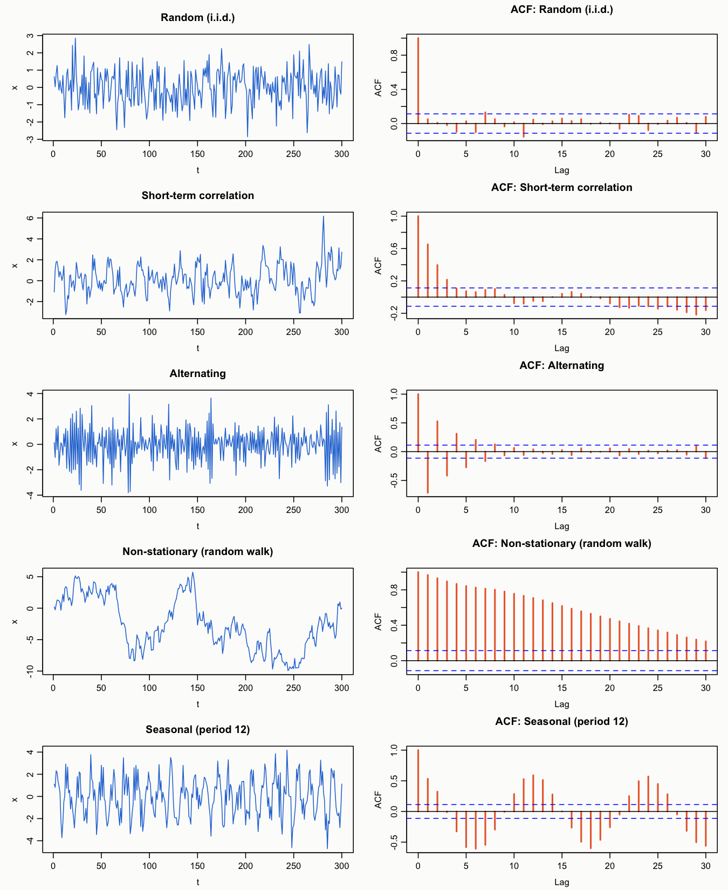
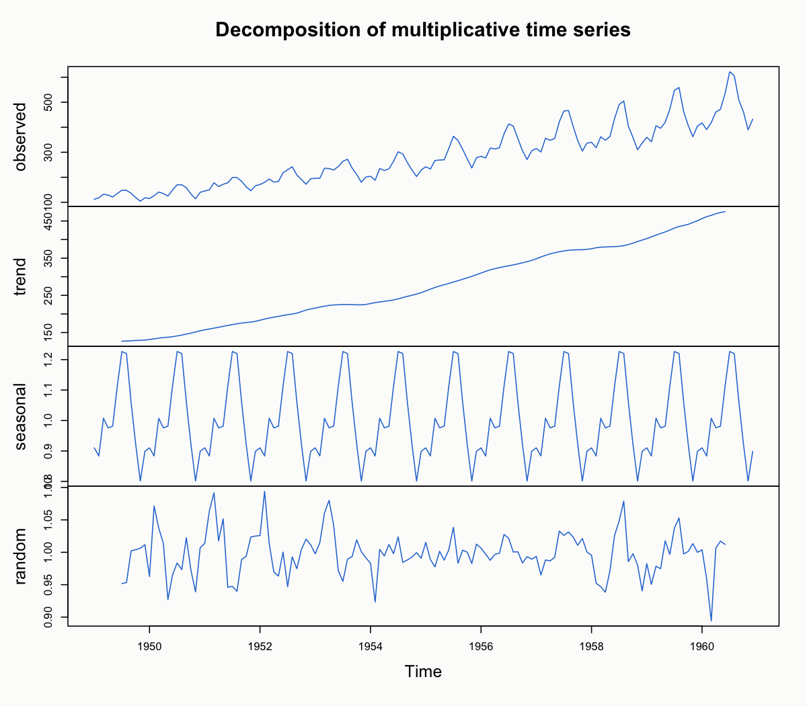
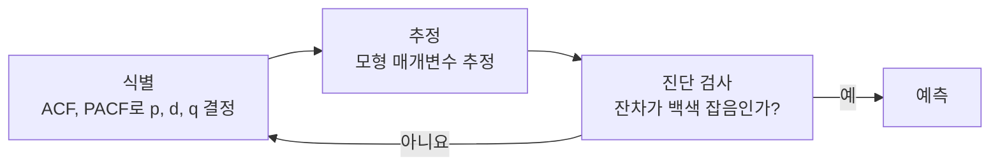
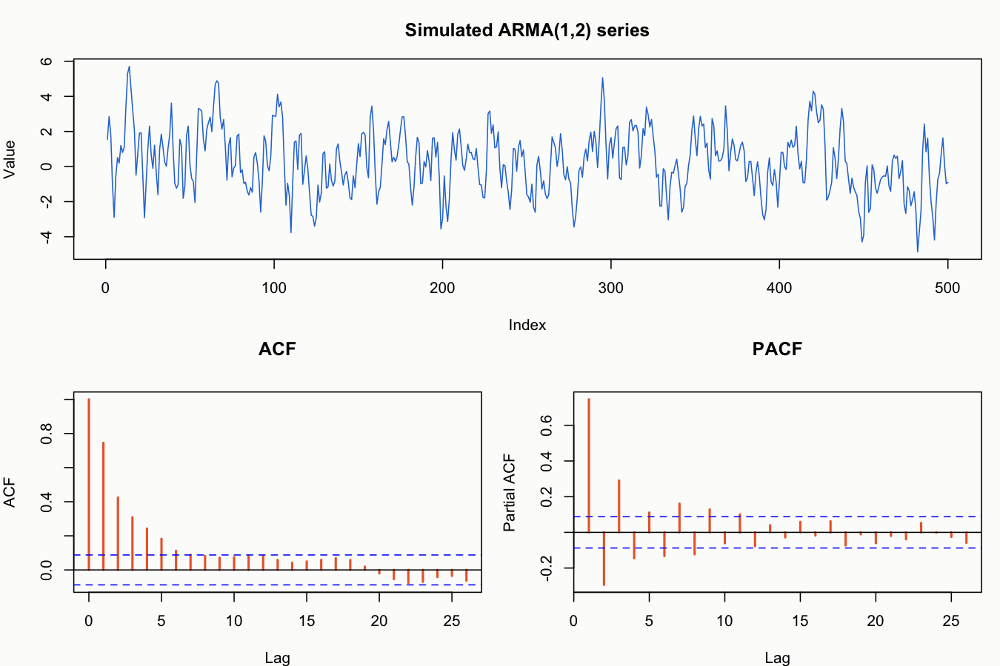
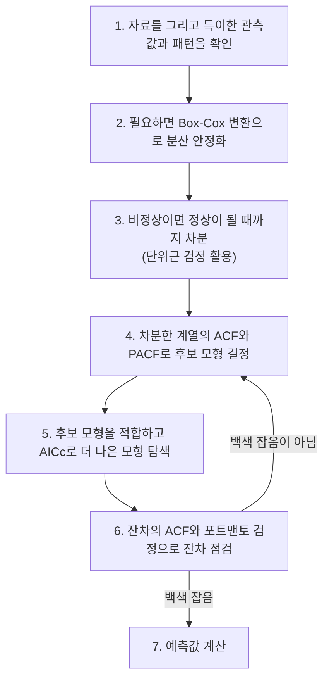
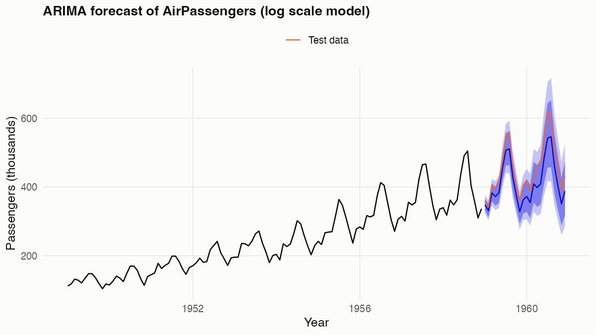

# 11장 — 시계열 분석

[레포지토리 안내](../../README.ko.md) | [English](Concepts_Lecture.md) | [한국어](Concepts_Lecture.ko.md)

> **최종 수정일:** 2026-11-27
>
> Forecasting: Principles and Practice, Hyndman and Athanasopoulos, Ch 9

> **학습 목표:**
> 1. R의 날짜와 시간 클래스, `ts` 객체를 만들고 변환할 수 있다
> 2. 시계열을 추세, 계절, 잔차 성분으로 분해할 수 있다
> 3. 시계열 예측을 위해 ARIMA 모형을 적용할 수 있다
> 4. 적절한 지표를 사용하여 예측 정확도를 평가할 수 있다
> 5. 정상성의 정의를 설명하고 차분과 단위근 검정으로 비정상 계열을 다룰 수 있다
> 6. 상관도와 편자기상관 함수를 해석하여 AR, MA, ARMA 모형의 차수를 식별할 수 있다

---

## 목차

- [1. 시계열 개요](#1-시계열-개요)
  - [1.1 정의](#11-정의)
  - [1.2 실제 사례](#12-실제-사례)
  - [1.3 핵심 개념](#13-핵심-개념)
  - [1.4 시계열 분석이 다루는 문제](#14-시계열-분석이-다루는-문제)
- [2. 시계열 데이터의 특성](#2-시계열-데이터의-특성)
  - [2.1 변동의 유형](#21-변동의-유형)
  - [2.2 정상성](#22-정상성)
  - [2.3 순환 변동과 추세의 판단](#23-순환-변동과-추세의-판단)
  - [2.4 시계열 그래프와 변환](#24-시계열-그래프와-변환)
  - [2.5 확률 과정과 정상성의 정의](#25-확률-과정과-정상성의-정의)
  - [2.6 차분과 단위근 검정](#26-차분과-단위근-검정)
- [3. R에서의 날짜 및 시간 객체](#3-r에서의-날짜-및-시간-객체)
  - [3.1 날짜 클래스](#31-날짜-클래스)
  - [3.2 POSIXct vs. POSIXlt](#32-posixct-vs-posixlt)
  - [3.3 날짜 객체 생성](#33-날짜-객체-생성)
  - [3.4 날짜 형식 변환](#34-날짜-형식-변환)
  - [3.5 소프트웨어별 기준점](#35-소프트웨어별-기준점)
  - [3.6 날짜와 시간 색인 만들기](#36-날짜와-시간-색인-만들기)
  - [3.7 lubridate 패키지](#37-lubridate-패키지)
- [4. R에서의 시계열 객체](#4-r에서의-시계열-객체)
  - [4.1 ts 객체 생성](#41-ts-객체-생성)
  - [4.2 자주 사용되는 시계열 데이터셋](#42-자주-사용되는-시계열-데이터셋)
  - [4.3 ts 객체의 속성](#43-ts-객체의-속성)
  - [4.4 다변량 시계열 객체](#44-다변량-시계열-객체)
  - [4.5 ts 객체의 부분 선택과 집계](#45-ts-객체의-부분-선택과-집계)
  - [4.6 zoo와 xts 객체](#46-zoo와-xts-객체)
- [5. 기술적 기법](#5-기술적-기법)
  - [5.1 시계열 그래프](#51-시계열-그래프)
  - [5.2 자기상관 함수(ACF)](#52-자기상관-함수acf)
  - [5.3 편자기상관 함수(PACF)](#53-편자기상관-함수pacf)
  - [5.4 표본 자기상관계수](#54-표본-자기상관계수)
  - [5.5 상관도의 해석](#55-상관도의-해석)
  - [5.6 편자기상관 함수의 정의](#56-편자기상관-함수의-정의)
- [6. 분해](#6-분해)
  - [6.1 가법 분해 vs. 승법 분해](#61-가법-분해-vs-승법-분해)
  - [6.2 고전적 분해의 계산 과정](#62-고전적-분해의-계산-과정)
- [7. ARIMA 모형](#7-arima-모형)
  - [7.1 AR, MA 및 ARIMA](#71-ar-ma-및-arima)
  - [7.2 Box-Jenkins 방법론](#72-box-jenkins-방법론)
  - [7.3 R에서의 구현](#73-r에서의-구현)
  - [7.4 이동 평균 과정의 성질](#74-이동-평균-과정의-성질)
  - [7.5 자기회귀 과정의 성질](#75-자기회귀-과정의-성질)
  - [7.6 ARMA 모형과 후향 연산자](#76-arma-모형과-후향-연산자)
  - [7.7 ACF와 PACF에 의한 차수 식별](#77-acf와-pacf에-의한-차수-식별)
  - [7.8 ARIMA 모형의 표기](#78-arima-모형의-표기)
  - [7.9 예제: ARMA(1,2) 모의 자료의 차수 선택](#79-예제-arma12-모의-자료의-차수-선택)
  - [7.10 Ljung-Box 검정](#710-ljung-box-검정)
- [8. 예측](#8-예측)
  - [8.1 예측 수행](#81-예측-수행)
  - [8.2 예측 정확도](#82-예측-정확도)
  - [8.3 추천 도서](#83-추천-도서)
  - [8.4 ARIMA 예측의 전체 절차](#84-arima-예측의-전체-절차)
  - [8.5 예제: AirPassengers의 예측](#85-예제-airpassengers의-예측)
- [9. 시계열 분석의 흔한 실수](#9-시계열-분석의-흔한-실수)
- [개념 적용](#개념-적용)
- [요약](#요약)
- [점검 문제](#점검-문제)
- [참고 문헌](#참고-문헌)

---

<br>

## 1. 시계열 개요

### 1.1 정의

**시계열(Time Series)** 이란 연속적으로 동일한 간격을 두고 수집되거나 기록된 데이터 포인트의 순서열이다. 시계열 분석은 시간 순서로 정렬된 데이터를 분석하여 의미 있는 통계량을 추출하고, 패턴을 식별하며, 예측을 수행하는 방법론이다.

### 1.2 실제 사례

| 사례 | 데이터 설명 |
|------|-------------|
| Johnson & Johnson 수익 | 분기별 주당 순이익, 1960~1980 |
| 지구 온난화 | 평균 지표-해양 온도 지수, 1880~2015 |
| 음성 데이터 | 초당 10,000 포인트로 샘플링된 오디오 신호 |
| DJIA 수익률 | Dow Jones 산업평균지수 일별 수익률 |
| 엘니뇨와 어류 개체수 | 월별 SOI 및 Recruitment 계열, 1950~1987 |
| 지진 vs. 폭발 | 지진파 파형 분류 |

*표 1. 시계열 데이터의 실제 사례*

### 1.3 핵심 개념

- **추세(Trend)**: 데이터의 장기적인 증가 또는 감소이다.
- **계절성(Seasonality)**: 규칙적인 주기적 변동이다(예: 연간 순환).
- **순환 변동(Cyclic Variation)**: 고정된 주기가 없는 진동이다(예: 경기 순환).
- **불규칙 변동(Noise/Irregularity)**: 무작위적이고 예측 불가능한 변동이다.

> **핵심:** George E. P. Box의 격언 "All models are wrong, but some are useful"(모든 모형은 틀리지만, 일부는 유용하다)은 시계열 분석에서 특히 적절하다. 모형은 현실을 근사할 뿐이지만 여전히 가치 있는 예측을 제공할 수 있기 때문이다.

### 1.4 시계열 분석이 다루는 문제

표 1의 사례는 시계열 분석이 답하려는 질문이 자료마다 다르다는 것을 보여 준다. 질문의 종류에 따라 필요한 기법도 달라진다.

| 사례 | 자료의 특징 | 분석의 질문 | 대표 기법 |
|------|------|------|------|
| Johnson & Johnson 수익 | 1960년 1분기부터 1980년 4분기까지 84개 분기의 주당 순이익이 지수적으로 증가하고, 계절 변동의 폭도 함께 커짐 | 추세와 계절 성분을 분리하고 미래 수익을 예측 | 분해, 로그 변환, ARIMA |
| 지구 온난화 | 1880\~2015년의 연평균 지표-해양 온도 지수(1951\~1980년 평균에 대한 편차)가 20세기 후반부터 뚜렷하게 상승 | 상승 추세가 자연 변동인지, 추세의 기울기는 얼마인지 | 추세 회귀, 차분 |
| 음성 자료 | "aaa...hhh" 음절을 초당 10,000개 점으로 기록한 0.1초 분량(약 1,000개 점)의 신호가 규칙적으로 반복됨 | 신호의 주기적 특징(서명)으로 음절을 인식 | 스펙트럼 분석 |
| DJIA 수익률 | 2006-04-20부터 2016-04-20까지의 일별 수익률이 평균 0 근처에서 움직이지만 2008년 무렵 변동 폭이 크게 커짐 | 미래 수익률의 변동성(분산)을 예측 | ARCH, GARCH, 확률적 변동성 모형 |
| 엘니뇨와 어류 개체수 | 1950~1987년 453개월의 남방 진동 지수(SOI)와 새로 유입된 어류 수(Recruitment)가 서로 관련됨 | 한 계열(해수 온도)로 다른 계열(어류 수)을 설명 | 시차 회귀, 전이 함수 모형 |
| 지진과 폭발 | 지진 관측소에 기록된 P파($t = 1, \ldots, 1024$)와 S파($t = 1025, \ldots, 2048$)의 파형 | 파형이 지진에서 왔는지 핵실험 같은 폭발에서 왔는지 구별 | 시계열 판별 분석 |

*표 2. 시계열 사례의 특징과 분석의 질문*

이 장은 이 가운데 추세와 계절성의 분해(6절), 정상 시계열의 ARIMA 모형(7절), 그리고 예측(8절)을 다룬다. 스펙트럼 분석, 변동성 모형, 전이 함수 모형, 판별 분석은 같은 정상성과 자기상관의 개념 위에 세워진 심화 주제이다.

---

<br>

## 2. 시계열 데이터의 특성

### 2.1 변동의 유형

#### 계절 변동

- 고정된 주기(연간, 분기별, 월별, 주별)로 반복되는 패턴이다.
- 예를 들어 실업률은 일반적으로 겨울에 높다.
- 추정하여 제거할 수 있다(탈계절화).

#### 순환 변동

- 고정된 주기가 없는 진동이다.
- 경기 순환의 길이는 3~4년에서 10년 이상까지 다양하다.
- 계절 패턴보다 예측이 어렵다.

#### 추세

- 장기적인 상승 또는 하강 움직임이다.
- 선형일 수도 있고 비선형일 수도 있다.
- 예를 들어 지구 온도는 장기적으로 상승하고 있다.

#### 불규칙/무작위 변동

- 예측할 수 없는 변동이다.
- 추세, 계절, 순환 성분을 제거하고 남은 잔차이다.

### 2.2 정상성

시계열의 통계적 특성(평균, 분산, 자기상관)이 시간에 따라 변하지 않으면 **정상성(Stationarity)** 을 갖는다고 한다.

- **엄격한 정상성**: 모든 결합 분포가 시간 이동에 대해 변하지 않는다.
- **약한 정상성**: 평균이 일정하고, 자기공분산이 시점이 아니라 시차에만 의존한다.

대부분의 시계열 모형은 정상성을 가정한다. 비정상 시계열은 **차분(differencing)** 을 통해 정상 시계열로 변환할 수 있다. 1차 차분은 $\nabla X_t = X_t - X_{t-1}$로, 이웃한 두 시점의 차이를 새 계열로 삼는다.

### 2.3 순환 변동과 추세의 판단

순환 변동은 주기가 고정되어 있지 않다는 점에서 계절 변동과 다르다. 미국의 월별 실업률은 1990\~2000년에 약 11년, 2000\~2007년에 7년 길이의 순환을 보였고, 2007년에 시작된 셋째 순환은 2019년 5월까지도 끝나지 않아 12년을 넘겼다. 이처럼 한 계열 안에서도 순환의 길이가 매번 달라지므로, 순환 변동은 계절 변동처럼 평균 패턴을 구해 빼는 방식으로 제거할 수 없다.

추세는 대략 "평균 수준의 장기적 변화"로 정의할 수 있지만, 무엇을 "장기"로 볼지가 분명하지 않다는 어려움이 있다. 예를 들어 기후 변수는 수백 년 주기로 천천히 변할 수 있으므로, 20년치 자료에서는 그 변화가 추세로 보이지만 수백 년치 자료에서는 순환의 일부로 보인다. 따라서 추세를 말할 때는 관측값의 수와 관측 기간을 함께 고려해 무엇을 장기로 볼지 판단해야 한다.

추세와 순환 변동을 제거하고 남은 잔차는 무작위일 수도 있고 아닐 수도 있다. 잔차에 순환 변동이 남아 있는지, 겉보기에 불규칙한 변동을 7절의 이동 평균(MA) 모형이나 자기회귀(AR) 모형 같은 확률 모형으로 설명할 수 있는지를 살피는 것이 시계열 분석의 중심 과제이다.

### 2.4 시계열 그래프와 변환

시계열 분석의 첫 단계이자 가장 중요한 단계는 관측값을 시간에 대해 그려 보는 것이다. 영국의 시간별 전력 수요는 하루와 한 주 단위의 강한 계절성을, S&P 500 지수의 일별 종가는 뚜렷한 상승 추세를, 미국의 월별 실업률은 길이가 일정하지 않은 순환을, 연간 흑점 수는 약 11년 주기의 순환을 보인다. 이렇게 그래프를 보면 추세, 계절성, 순환, 이상값, 분산의 변화를 한눈에 확인할 수 있고, 이것이 어떤 변환과 모형이 필요한지를 정한다.

그래프를 보고 로그나 제곱근 같은 변환을 고려하는 이유는 다음 세 가지이다.

1. **분산의 안정화:** 추세가 있고 분산이 평균과 함께 커지면 변환이 도움이 된다. 특히 표준편차가 평균에 정비례하면 로그 변환이 알맞다. 반면 추세 없이 분산만 시간에 따라 변하면 변환으로는 해결되지 않으며, 변하는 분산을 허용하는 모형(예: 1.4절의 GARCH)을 고려해야 한다.
2. **계절 효과를 가법적으로 만들기:** 계절 변동의 폭이 추세와 함께 커지는 승법 구조는 로그를 취하면 가법 구조가 된다(6절).
3. **정규분포에 가깝게 만들기:** 모형 구축과 예측은 보통 자료가 정규분포를 따른다는 가정 위에서 이루어진다.

로그 변환과 제곱근 변환은 **Box-Cox 변환**이라는 일반적인 변환 집단의 특별한 경우이다. Box-Cox 변환은 모수 $\lambda$로 정의되며, $\lambda = 0$이면 로그 변환, $\lambda = 1/2$이면 제곱근 변환에 해당한다(상수 차이와 척도를 무시하면).

```math
w_t = \begin{cases} \log(y_t) & \lambda = 0 \\ (y_t^{\lambda} - 1)/\lambda & \lambda \neq 0 \end{cases}
```

### 2.5 확률 과정과 정상성의 정의

수학적으로 **확률 과정**(stochastic process)은 시간 순서로 늘어선 확률 변수들의 모임이다. 시간이 연속이면 시점 $t$의 확률 변수를 $X(t)$로, 시간이 이산이면 $X_t$($t = 0, \pm 1, \pm 2, \ldots$)로 쓴다. 실제로 관측한 시계열 $x_1, \ldots, x_N$은 이 확률 과정이 한 번 실현된 **실현값**(realization)이다. 시계열 분석은 관측한 단 하나의 실현값으로부터 그 밑에 있는 확률 모형의 성질을 추론하는 일이며, 같은 시점의 값을 여러 번 관측할 수 없다는 점이 일반적인 표본과 다르다.

확률 과정은 다음 세 함수로 요약한다.

| 함수 | 정의 | 의미 |
|------|------|------|
| 평균 함수 | $\mu(t) = E[X(t)]$ | 시점마다의 기댓값 |
| 분산 함수 | $\sigma^2(t) = \mathrm{Var}[X(t)] = E[(X(t) - \mu(t))^2]$ | 시점마다의 퍼짐 |
| 자기공분산 함수 | $\gamma(t_1, t_2) = E\lbrace[X(t_1) - \mu(t_1)][X(t_2) - \mu(t_2)]\rbrace$ | 두 시점의 값이 함께 움직이는 정도 |

*표 3. 확률 과정의 평균, 분산, 자기공분산 함수*

분산 함수는 자기공분산 함수에서 $t_1 = t_2$인 특별한 경우이다. 이 함수들로 2.2절의 두 정상성을 엄밀하게 정의할 수 있다.

> **용어 정의:** **강한 정상성(strict stationarity)** 은 임의의 시점 $t_1, \ldots, t_k$와 이동량 $\tau$에 대해 $X(t_1), \ldots, X(t_k)$의 결합 분포와 $X(t_1 + \tau), \ldots, X(t_k + \tau)$의 결합 분포가 같다는 성질이다.

강한 정상성은 시간의 원점을 옮겨도 결합 분포가 바뀌지 않는다는 뜻이므로, 결합 분포는 시점 사이의 간격에만 의존한다. $k = 1$이면 모든 $t$에서 $X(t)$의 분포가 같으므로 평균 $\mu$와 분산 $\sigma^2$이 상수이고, $k = 2$이면 $X(t_1)$과 $X(t_2)$의 결합 분포가 시차 $\tau = t_2 - t_1$에만 의존하므로 자기공분산도 $\gamma(\tau) = \mathrm{Cov}[X(t), X(t + \tau)]$로 쓸 수 있다. 이 $\gamma(\tau)$를 시차 $\tau$의 **자기공분산 계수**라고 한다.

> **용어 정의:** **약한 정상성(weak stationarity)** 은 평균이 상수 $E[X(t)] = \mu$이고 자기공분산이 시차에만 의존하여 $\mathrm{Cov}[X(t), X(t + \tau)] = \gamma(\tau)$인 성질로, 2차 정상성(second-order stationarity)이라고도 한다.

약한 정상성은 2차를 넘는 적률에 아무 조건도 두지 않는다. $\tau = 0$으로 두면 분산 $\gamma(0)$도 상수이며, 이 정의는 평균과 분산이 유한하다는 것도 포함한다. 실무에서 "정상"이라고 하면 보통 약한 정상성을 뜻한다. 정규 과정에서는 평균과 자기공분산이 결합 분포를 완전히 정하므로 두 정상성이 같다.

정상 과정의 **자기상관 함수**(autocorrelation function, ac.f.)는 $\rho(\tau) = \gamma(\tau)/\gamma(0) = \gamma(\tau)/\sigma^2$이며 다음 성질을 갖는다.

1. $\rho(0) = 1$이다.
2. 시차에 대한 우함수이다: $\rho(\tau) = \rho(-\tau)$. 그래서 상관도는 $\tau \geq 0$만 그린다.
3. $|\rho(\tau)| \leq 1$이다.
4. 자기상관 함수가 모형을 하나로 정하지는 않는다. 서로 다른 확률 과정이 같은 자기상관 함수를 가질 수 있다(7.4절의 가역성).

> **주의:** 확률 과정의 자기상관 함수 $\rho(k)$와 관측 자료로 계산한 표본 자기상관 함수 $r_k$(5.4절)는 구별해야 한다. $\rho(k)$는 모르는 모형의 성질이고, $r_k$는 그 추정값이므로 표본에 따라 흔들린다. 상관도에서 작은 막대가 보인다고 해서 과정의 자기상관이 0이 아니라고 단정할 수 없다.

### 2.6 차분과 단위근 검정

대부분의 실제 시계열은 비정상이다. 평균이 변하는 비정상 계열은 **차분**(differencing)으로 정상 계열로 바꾸는 것이 일반적이며, 차분에는 다음 종류가 있다 [1].

| 차분 | 식 | 제거하는 것 |
|------|------|------|
| 1차 차분 | $\nabla x_t = x_t - x_{t-1}$ | 수준의 변화, 선형 추세 |
| 2차 차분 | $\nabla^2 x_t = x_t - 2x_{t-1} + x_{t-2}$ | 1차 차분 뒤에도 남은 추세의 변화 |
| 계절 차분 | $\nabla_m x_t = x_t - x_{t-m}$ | 주기 $m$의 계절 패턴 |

*표 4. 차분의 종류*

1차 차분한 계열이 백색 잡음이면 원래 계열은 $x_t = x_{t-1} + w_t$, 곧 **확률 보행**(random walk)이다. 확률 보행은 평균이 일정해 보여도 분산이 시간에 비례해 커지므로 비정상이며, 오랫동안 위나 아래로 흘러가는 긴 흐름과 예측할 수 없는 급변을 보인다. 차분한 계열의 평균이 0이 아니면 $x_t = c + x_{t-1} + w_t$인 **표류가 있는 확률 보행**(random walk with drift)이고, $c$는 한 시점당 평균 변화량이다. 강한 계절성이 있는 계열은 계절 차분을 먼저 하는 것이 권장되며, 계절 차분만으로 정상이 되면 1차 차분은 필요 없다. 2차를 넘는 차분은 거의 필요하지 않다.

차분이 필요한지는 **단위근 검정**(unit root test)으로 객관적으로 판단한다. 두 검정은 귀무가설이 반대이므로 해석을 혼동하지 않아야 한다.

| 검정 | R 함수 | 귀무가설 | p값이 작을 때의 결론 |
|------|------|------|------|
| KPSS 검정 | `tseries::kpss.test()` | 계열이 정상이다 | 정상이 아니므로 차분이 필요하다 |
| ADF 검정 | `tseries::adf.test()` | 계열에 단위근이 있다(비정상) | 단위근이 없으므로 정상이다 |

*표 5. 두 단위근 검정의 귀무가설과 해석*

AirPassengers의 로그 계열에 두 검정을 적용하면 다음과 같다.

```r
library(tseries)
library(forecast)
lap <- log(AirPassengers)
suppressWarnings(kpss.test(lap))
#> 
#> 	KPSS Test for Level Stationarity
#> 
#> data:  lap
#> KPSS Level = 2.8287, Truncation lag parameter = 4, p-value = 0.01
suppressWarnings(kpss.test(diff(diff(lap), lag = 12)))
#> 
#> 	KPSS Test for Level Stationarity
#> 
#> data:  diff(diff(lap), lag = 12)
#> KPSS Level = 0.084365, Truncation lag parameter = 4, p-value = 0.1
c(ndiffs = ndiffs(lap), nsdiffs = nsdiffs(lap))
#>  ndiffs nsdiffs 
#>       1       1
```

로그 계열의 KPSS 통계량은 2.83으로 p값이 0.01이므로 정상이라는 귀무가설을 기각한다. `diff(lap, lag = 12)`로 계절 차분한 뒤 `diff()`로 1차 차분까지 한 계열은 p값이 0.1이어서 정상이라는 가설을 기각하지 못한다. `kpss.test()`는 p값을 표에서 보간하므로 0.01보다 작으면 0.01로, 0.1보다 크면 0.1로 잘라서 보고하고, 이때 경고를 내므로 `suppressWarnings()`로 감쌌다. `forecast` 패키지의 `ndiffs()`와 `nsdiffs()`는 같은 검정을 반복하여 필요한 1차 차분과 계절 차분의 횟수를 알려 주며, 이 계열은 둘 다 1이다.

```r
suppressWarnings(adf.test(lap))
#> 
#> 	Augmented Dickey-Fuller Test
#> 
#> data:  lap
#> Dickey-Fuller = -6.4215, Lag order = 5, p-value = 0.01
#> alternative hypothesis: stationary
suppressWarnings(adf.test(diff(diff(lap), lag = 12)))
#> 
#> 	Augmented Dickey-Fuller Test
#> 
#> data:  diff(diff(lap), lag = 12)
#> Dickey-Fuller = -5.1993, Lag order = 5, p-value = 0.01
#> alternative hypothesis: stationary
```

ADF 검정은 로그 계열 자체에도 p값 0.01을 주어 단위근이 없다고 판단한다. `adf.test()`의 기본 검정식이 선형 추세를 포함하므로, 선형 추세 주위에서 정상이라는 뜻이며, 계열에 강한 계절성이 있다는 것은 따로 다루지 않는다. 이처럼 두 검정의 결론이 다를 수 있으므로, 단위근 검정의 결과는 그래프와 상관도(5.5절)와 함께 판단한다.

> **주의:** 필요한 것보다 많이 차분하면(과대 차분) 원래 없던 자기상관이 생긴다. 예를 들어 백색 잡음 $w_t$를 차분하면 $w_t - w_{t-1}$은 시차 1의 자기상관이 -0.5인 MA(1) 과정이 된다. 차분은 필요한 최소 횟수만 하고, 1차 차분과 계절 차분처럼 해석할 수 있는 차분만 쓴다.

---

<br>

## 3. R에서의 날짜 및 시간 객체

### 3.1 날짜 클래스

R은 날짜와 시간을 다루기 위한 여러 클래스를 제공한다:

| 클래스 | 설명 | 기준점 |
|--------|------|--------|
| `Date` | 날짜만 표현(기준점 이후 일수로 저장) | 1970-01-01 |
| `POSIXct` | 기준점 이후 초 단위로 날짜와 시간 표현 | 1970-01-01 00:00:00 UTC |
| `POSIXlt` | 이름 있는 리스트로 날짜와 시간 표현 | 없음(연도는 1900년 이후 연수로 저장) |

*표 6. R의 날짜와 시간 클래스*

```r
# Get current date and time
date <- Sys.Date()
date                    # "2025-12-02"
class(date)             # "Date"

time_ct <- Sys.time()
time_ct                 # "2025-12-02 14:30:00 KST"
class(time_ct)          # "POSIXct" "POSIXt"

# Convert POSIXct to POSIXlt
time_lt <- as.POSIXlt(time_ct)
class(time_lt)          # "POSIXlt" "POSIXt"
```

### 3.2 POSIXct vs. POSIXlt

```r
# POSIXct: stored as a single numeric value (seconds since origin)
unclass(time_ct)        # e.g., 1764653400

# POSIXlt: stored as a named list
unclass(time_lt)$sec    # seconds
unclass(time_lt)$hour   # hour
unclass(time_lt)$mday   # day of month
unclass(time_lt)$mon    # month (0-11)
unclass(time_lt)$year   # years since 1900
unclass(time_lt)$yday   # day of year (0-365)
```

### 3.3 날짜 객체 생성

```r
# String to Date conversion
d1 <- "2022-09-21"
class(d1)               # "character"

d2 <- as.Date("2022-09-21")
class(d2)               # "Date"

# Creating POSIXct and POSIXlt with timezone
time_ct <- as.POSIXct("2022-09-21 20:05:35", tz = "EST")
time_lt <- as.POSIXlt("2022-09-21 20:05:35", tz = "EST")
```

### 3.4 날짜 형식 변환

ISO 8601 형식(YYYY-MM-DD)이 아닌 날짜 문자열은 `format` 인수에 형식 지정자를 주어 변환한다:

| 형식 코드 | 의미 | 예시 |
|-----------|------|------|
| `%Y` | 4자리 연도 | 2022 |
| `%m` | 2자리 월 | 09 |
| `%d` | 2자리 일 | 21 |
| `%H` | 시(24시간제) | 20 |
| `%M` | 분 | 05 |
| `%S` | 초 | 35 |

*표 7. 날짜 형식 지정자*

```r
# ISO 8601 format (default): YYYY-MM-DD
as.Date("2017-01-20")

# US format: MM/DD/YYYY
as.Date("1/20/2017", format = "%m/%d/%Y")

# NZ format: DD/MM/YYYY
as.Date("20/01/2017", format = "%d/%m/%Y")
```

### 3.5 소프트웨어별 기준점

| 소프트웨어 | 기준점 |
|------------|--------|
| R | 1970년 1월 1일 |
| SAS | 1960년 1월 1일 |
| Excel | 1900년 1월 1일 |

*표 8. 소프트웨어별 날짜 기준점*

> **핵심:** 다른 소프트웨어에서 날짜 데이터를 가져올 때는 기준점이 일치하는지 확인해야 한다. 숫자형 날짜 값을 변환할 때는 `as.Date()`의 `origin` 매개변수를 사용한다.

> **주의:** Excel의 1900 날짜 체계는 1900년을 윤년으로 잘못 취급하므로, 1900년 3월 이후 날짜의 Excel 일련번호를 R에서 변환할 때는 `origin = "1899-12-30"`을 쓴다. 예를 들어 `as.Date(45000, origin = "1899-12-30")`은 2023-03-15이다.

### 3.6 날짜와 시간 색인 만들기

일정한 간격의 시점을 나열한 벡터는 시계열의 색인으로 쓴다. base 패키지는 Date 객체용 `seq.Date()`와 POSIX 객체용 `seq.POSIXt()`를 제공하며, 두 함수의 차이는 출력의 클래스 말고는 간격의 단위뿐이다.

| 함수 | `by` 인수로 쓸 수 있는 간격 |
|------|------|
| `seq.Date()` | `"day"`, `"week"`, `"month"`, `"quarter"`, `"year"` |
| `seq.POSIXt()` | `"sec"`, `"min"`, `"hour"`, `"day"`, `"DSTday"`, `"week"`, `"month"`, `"quarter"`, `"year"` |

*표 9. 날짜와 시간 색인 함수의 간격 단위*

```r
daily_index <- seq.Date(from = as.Date("2016-01-01"),
                        to = as.Date("2018-12-31"), by = "day")
head(daily_index, 3)
#> [1] "2016-01-01" "2016-01-02" "2016-01-03"
daily_3_index <- seq.Date(from = as.Date("2016-01-01"),
                          to = as.Date("2018-12-31"), by = "3 days")
head(daily_3_index, 3)
#> [1] "2016-01-01" "2016-01-04" "2016-01-07"
hourly_index <- seq.POSIXt(from = as.POSIXct("2018-06-01", tz = "UTC"),
                           by = "hours", length.out = 48)
head(hourly_index, 3)
#> [1] "2018-06-01 00:00:00 UTC" "2018-06-01 01:00:00 UTC"
#> [3] "2018-06-01 02:00:00 UTC"
```

`from`과 `to`는 시작과 끝 시점, `by`는 간격이며 `"3 days"`처럼 앞에 정수를 붙이면 그 배수 간격이 된다. 끝 시점 대신 `length.out`으로 원소 수를 정할 수도 있어, 마지막 줄은 2018-06-01 0시부터 1시간 간격으로 48개 시점을 만든다. `"DSTday"`는 일광 절약 시간이 바뀌는 날에도 같은 시각을 유지하는 하루 간격이다.

문자열로 저장된 날짜는 겉모습이 같아도 날짜 객체와 같은 값이 아니다.

```r
time_str <- "2022-09-17 23:59:59"
time_posix <- as.POSIXct(time_str, tz = "UTC")
class(time_str)
#> [1] "character"
class(time_posix)
#> [1] "POSIXct" "POSIXt"
identical(time_str, time_posix)
#> [1] FALSE
```

`identical()`이 `FALSE`인 것은 하나는 문자열이고 다른 하나는 1970-01-01 이후의 초를 담은 숫자이기 때문이다. 문자열로는 날짜의 차이나 정렬, 간격 계산을 할 수 없으므로 자료를 읽은 직후 날짜 객체로 바꾼다. 숫자로 저장된 Excel 날짜도 같은 방식으로 바꾼다. Excel 형식의 일련번호 42755와 42756은 `as.Date(c(42755, 42756), origin = "1899-12-30")`로 바꾸면 2017-01-20과 2017-01-21이 된다.

### 3.7 lubridate 패키지

`lubridate` 패키지는 날짜 문자열의 순서만 함수 이름으로 지정하면 형식 지정자(표 7) 없이 변환해 준다. 함수 이름의 `y`, `m`, `d`, `h`, `m`, `s`가 연, 월, 일, 시, 분, 초의 순서를 나타내며, 구분 기호나 요일, 월 이름이 섞여 있어도 알아서 읽는다.

```r
library(lubridate)
ymd("2017-01-20")
#> [1] "2017-01-20"
mdy("1/20/2017")
#> [1] "2017-01-20"
dmy("20/01/2017")
#> [1] "2017-01-20"
mdy("Friday, January 20, 2017")
#> [1] "2017-01-20"
time_obj <- mdy_hms("Wednesday, September 21, 2022 04:00:00 PM", tz = "GMT")
time_obj
#> [1] "2022-09-21 16:00:00 GMT"
```

`ymd()`, `mdy()`, `dmy()`는 각각 연-월-일, 월-일-연, 일-월-연 순서의 문자열을 Date로 바꾸고, `mdy_hms()`는 시각까지 읽어 POSIXct를 만든다. "04:00:00 PM"은 오후 4시이므로 16시로 변환된다. 날짜 객체에서 구성 요소를 꺼내거나 시각을 반올림하는 함수도 있다.

```r
c(yday = yday(time_obj), qday = qday(time_obj), day = day(time_obj))
#> yday qday  day 
#>  264   83   21
wday(time_obj, label = TRUE)
#> [1] Wed
#> Levels: Sun < Mon < Tue < Wed < Thu < Fri < Sat
t2 <- mdy_hms("Monday, December 31, 2018 11:59:59 PM", tz = "EST")
round_date(t2, unit = "minute")
#> [1] "2019-01-01 EST"
floor_date(t2, unit = "hour")
#> [1] "2018-12-31 23:00:00 EST"
ceiling_date(t2, unit = "day")
#> [1] "2019-01-01 EST"
```

`yday()`는 연중 몇째 날인지(1부터 셈), `qday()`는 분기 중 몇째 날인지, `day()`는 월중 일을 돌려준다. 2022년 9월 21일은 연중 264번째 날이고, 3분기가 7월 1일에 시작하므로 31 + 31 + 21 = 83번째 날이다. `wday(label = TRUE)`는 요일을 순서 있는 팩터로 돌려준다. `round_date()`는 가장 가까운 단위로 반올림, `floor_date()`는 내림, `ceiling_date()`는 올림을 한다. 23:59:59를 분 단위로 반올림하면 다음 날 0시가 된다. 3.2절의 `POSIXlt`와 달리 `yday()`는 1부터 세므로, 같은 날짜에 대해 `unclass(as.POSIXlt(x))$yday`보다 1 크다.

---

<br>

## 4. R에서의 시계열 객체

### 4.1 ts 객체 생성

```r
# Create a time series object
ts_data <- ts(data_vector, start = c(1960, 1), frequency = 4)
# start: starting time (year, period)
# frequency: observations per unit time (4 = quarterly, 12 = monthly)
```

### 4.2 자주 사용되는 시계열 데이터셋

```r
# Johnson & Johnson quarterly earnings
data(JohnsonJohnson)
plot(JohnsonJohnson)

# AirPassengers: monthly airline passengers
data(AirPassengers)
plot(AirPassengers)

# US economic data
library(ggplot2)
data(economics)
str(economics)
```

### 4.3 ts 객체의 속성

시계열 자료는 다른 자료와 구별되는 고유한 속성을 갖는다. 각 관측값이 기록된 시점인 **타임스탬프**(timestamp), 한 주기 안의 관측 수인 **빈도**(frequency), 그리고 반복의 단위인 **주기**(cycle)이다. 월별 자료는 1년이 한 주기이고 빈도가 12이며, 분기별 자료는 빈도가 4이다. `ts` 객체는 관측값과 그에 대응하는 타임스탬프 두 요소로 이루어지며, R의 주요 시계열 패키지인 `stats`와 `forecast`가 이 형식을 기본으로 쓴다. R에 내장된 `UKgas`(1960~1986년 영국의 분기별 가스 소비량)로 속성을 확인한다.

```r
is.ts(UKgas)
#> [1] TRUE
length(UKgas)
#> [1] 108
c(frequency = frequency(UKgas), deltat = deltat(UKgas))
#> frequency    deltat 
#>      4.00      0.25
start(UKgas)
#> [1] 1960    1
end(UKgas)
#> [1] 1986    4
head(cycle(UKgas), 8)
#>      Qtr1 Qtr2 Qtr3 Qtr4
#> 1960    1    2    3    4
#> 1961    1    2    3    4
head(time(UKgas), 8)
#>         Qtr1    Qtr2    Qtr3    Qtr4
#> 1960 1960.00 1960.25 1960.50 1960.75
#> 1961 1961.00 1961.25 1961.50 1961.75
```

`is.ts()`는 객체가 `ts` 클래스인지, `length()`는 관측 수(27년 × 4분기 = 108)를 확인한다. `deltat()`는 이웃한 관측 사이의 시간 간격으로 빈도의 역수 $1/4 = 0.25$년이다. `start()`와 `end()`는 첫 관측과 마지막 관측의 (연도, 주기 안의 위치)이고, `cycle()`은 각 관측이 주기 안에서 몇째인지(분기 번호), `time()`은 각 관측의 시점을 소수로 나타낸 값이다. 1960년 3분기의 시점이 1960.50인 것은 연도에 $(3 - 1) \times 0.25$를 더했기 때문이다.

`ts()`로 객체를 만들 때는 시작 시점, 끝 시점, 빈도 가운데 둘만 주면 나머지가 정해진다.

```r
my_ts1 <- ts(data = 1:60, start = c(2010, 1), end = c(2014, 12), frequency = 12)
my_ts2 <- ts(data = 1:60, end = c(2014, 12), frequency = 12)
my_ts3 <- ts(data = 1:60, start = 2010, frequency = 12)
start(my_ts2)
#> [1] 2010    1
identical(my_ts1, my_ts2) && identical(my_ts2, my_ts3)
#> [1] TRUE
```

관측값이 60개이고 빈도가 12이면 5년치이므로, 끝 시점 2014년 12월만 주어도 시작이 2010년 1월로 정해지고, 시작만 주어도 끝이 정해진다. 세 객체는 완전히 같다.

### 4.4 다변량 시계열 객체

같은 시점에 여러 변수를 관측한 자료는 **다변량 시계열**이며, R에서는 `ts`를 확장한 `mts` 클래스로 다룬다. `mts` 객체는 행이 시점, 열이 변수인 행렬에 시계열 속성을 붙인 것이다. 내장 자료 `mdeaths`와 `fdeaths`(1974~1979년 영국의 남녀별 월간 폐 질환 사망자 수)를 `cbind()`로 묶으면 `mts` 객체가 된다.

```r
deaths <- cbind(male = mdeaths, female = fdeaths)
class(deaths)
#> [1] "mts"    "ts"     "matrix" "array"
frequency(deaths)
#> [1] 12
head(deaths, 3)
#>          male female
#> Jan 1974 2134    901
#> Feb 1974 1863    689
#> Mar 1974 1877    827
```

클래스가 `"mts" "ts" "matrix" "array"`인 것은 이 객체가 다변량 시계열이면서 시계열이고 행렬이기도 하다는 뜻이다. `ts()`의 `data` 인수에 데이터 프레임의 여러 열을 주어도 `mts` 객체를 만들 수 있다. 데이터 프레임의 날짜 열에서 시작 시점을 정할 때는 `start = c(year(min(date)), month(min(date)))`처럼 lubridate의 `year()`와 `month()`를 쓰면 편리하다. 자료를 `ts`로 바꾸기 전에는 날짜 순서로 정렬되어 있는지 확인해야 하는데, `ts()`는 날짜 열을 보지 않고 행의 순서대로 시점을 붙이기 때문이다.

`plot.ts()`는 다변량 시계열을 그릴 때 `plot.type = "multiple"`(기본값)이면 변수마다 패널을 따로, `"single"`이면 한 패널에 겹쳐 그린다. 척도가 다른 두 변수(예: 차량 판매량과 실업률)는 패널을 나누어 그리는 것이 좋다.

### 4.5 ts 객체의 부분 선택과 집계

`ts` 객체는 구조가 특수하므로 데이터 프레임의 행 선택 방법(`[행, 열]`)을 그대로 쓰면 시계열 속성을 잃는다. 시계열의 일부를 시간 범위로 고르는 것은 `window()`, 빈도를 낮추어 묶는 것은 `aggregate()`로 한다. 예측 모형을 만들 때 시계열을 훈련 구간과 테스트 구간으로 나누는 것이 대표적인 부분 선택이다(8.2절).

```r
window(UKgas, start = c(1970, 1), end = c(1970, 4))
#>       Qtr1  Qtr2  Qtr3  Qtr4
#> 1970 244.9 216.1 188.9 142.5
window(UKgas, start = c(1960, 3), frequency = 1)[1:5]
#> [1] 84.8 84.8 89.7 92.9 89.7
```

첫째 호출은 1970년의 네 분기를 고른다. 둘째 호출처럼 `frequency = 1`을 주면 1960년 3분기부터 1년에 한 번씩, 곧 매년 3분기의 값만 고른다. 이렇게 하면 한 분기의 연도별 변화를 볼 수 있다.

```r
head(aggregate(UKgas, nfrequency = 1, FUN = "sum"), 4)
#> Time Series:
#> Start = 1960 
#> End = 1963 
#> Frequency = 1 
#> [1] 494.7 486.7 523.6 544.4
a <- 1:24
a[24] <- NA
a_ts <- ts(a, start = c(2000, 1), frequency = 12)
aggregate(a_ts, nfrequency = 4, FUN = "sum")
#>      Qtr1 Qtr2 Qtr3 Qtr4
#> 2000    6   15   24   33
#> 2001   42   51   60   NA
```

`aggregate()`는 시계열을 새 빈도 `nfrequency`의 구간으로 나누고 각 구간에 `FUN`을 적용한다. 분기별 가스 소비량을 `nfrequency = 1`, `FUN = "sum"`으로 묶으면 연간 소비량이 되어, 1960년 값 494.7은 네 분기 값의 합이다. 둘째 예는 월별 계열 1, 2, ..., 23, NA를 분기별 합으로 묶는다. 2000년 1분기는 1 + 2 + 3 = 6이고, 2001년 4분기에는 결측값이 있으므로 합도 `NA`이다. 결측값을 빼고 합하려면 `FUN = sum, na.rm = TRUE`처럼 함수와 인수를 따로 준다.

### 4.6 zoo와 xts 객체

`ts` 말고도 `zoo` 패키지의 `zoo` 클래스와 그것을 확장한 `xts` 패키지의 `xts` 클래스가 널리 쓰인다. `ts`는 시점이 일정한 간격으로 놓인다고 가정하지만, `zoo`와 `xts`는 각 관측값에 실제 날짜나 시각을 색인으로 붙이므로 주말과 휴일이 빠진 주가처럼 간격이 불규칙한 자료도 다룰 수 있다. 그래서 주가와 지수 같은 금융 시계열 분석에서 특히 많이 쓴다.

```r
library(xts)
gas_xts <- as.xts(UKgas)
head(gas_xts, 3)
#>          [,1]
#> 1960 Q1 160.1
#> 1960 Q2 129.7
#> 1960 Q3  84.8
periodicity(gas_xts)
#> Quarterly periodicity from 1960 Q1 to 1986 Q4
```

`as.xts()`는 `ts` 객체를 `xts`로 바꾸며, 행 이름이 분기 색인(`1960 Q1`)이 된다. `periodicity()`는 색인을 보고 자료의 주기를 추정한다. `xts` 객체는 `gas_xts["1970"]`처럼 날짜 문자열로 부분을 고를 수 있다.

---

<br>

## 5. 기술적 기법

### 5.1 시계열 그래프

```r
library(ggplot2)
library(scales)

ggplot(economics, aes(x = date, y = psavert)) +
  geom_line(color = "indianred3", linewidth = 1) +
  geom_smooth() +
  scale_x_date(date_breaks = "5 years", labels = date_format("%b-%y")) +
  labs(title = "Personal Savings Rate",
       subtitle = "1967 to 2015",
       x = "", y = "Personal Savings Rate") +
  theme_minimal()
```

`economics` 데이터의 `psavert`는 미국의 개인 저축률(%)이다. `geom_smooth()`는 추세를 보여 주는 평활 곡선을 덧그리고, `scale_x_date()`는 x축 눈금을 5년 간격으로 두고 레이블을 월 약어와 두 자리 연도(`%b-%y`)로 표시한다.

### 5.2 자기상관 함수(ACF)

ACF는 시계열과 그 시차값 사이의 상관관계를 측정한다. 정상 시계열에서 시차 $h$의 자기상관은 다음과 같다:

```math
\rho(h) = \frac{Cov(X_t, X_{t+h})}{Var(X_t)}
```

> **[확률및통계]** 두 확률 변수의 공분산 $Cov(X, Y) = E[(X - \mu_X)(Y - \mu_Y)]$는 두 변수가 각자의 평균에서 함께 벗어나는 정도이고, 이를 두 표준편차의 곱으로 나눈 상관계수는 -1과 1 사이의 값을 갖는다. 자기상관은 같은 계열의 두 시점 $X_t$와 $X_{t+h}$를 두 확률 변수로 보고 구한 상관계수이며, 정상 시계열에서는 $Var(X_t) = Var(X_{t+h})$이므로 두 표준편차의 곱이 위 식의 분모 $Var(X_t)$가 된다.

```r
acf(ts_data)         # Plot ACF
acf(ts_data, plot = FALSE)  # Get numeric values
```

### 5.3 편자기상관 함수(PACF)

PACF는 중간 시차의 효과를 제거한 후 $X_t$와 $X_{t+h}$ 사이의 상관관계를 측정한다:

```r
pacf(ts_data)        # Plot PACF
```

> **핵심:** ACF와 PACF 그래프는 적절한 ARIMA 모형 차수를 식별하기 위한 필수적인 진단 도구이다. ACF는 MA 차수 식별에, PACF는 AR 차수 식별에 도움이 된다. MA(q) 과정의 ACF는 시차 q 이후 0으로 끊기고, AR(p) 과정의 PACF는 시차 p 이후 0으로 끊긴다.

### 5.4 표본 자기상관계수

두 변수의 관측값 쌍 $(x_1, y_1), \ldots, (x_N, y_N)$의 표본 상관계수는 다음과 같다.

```math
r = \frac{\sum_{i=1}^{N} (x_i - \bar{x})(y_i - \bar{y})}{\sqrt{\sum_{i=1}^{N} (x_i - \bar{x})^2 \sum_{i=1}^{N} (y_i - \bar{y})^2}}
```

$r$은 두 변수 사이의 선형 관계의 방향과 잡음의 정도를 반영하며, 관계의 기울기나 비선형 관계는 반영하지 못한다. 기울기가 다른 직선 위의 점들도 모두 $r = 1$이고, 원이나 X자 모양처럼 분명한 비선형 관계가 있어도 $r = 0$일 수 있다.

시계열 $x_1, \ldots, x_N$에서는 한 시점 간격의 관측값 쌍 $(x_1, x_2), (x_2, x_3), \ldots, (x_{N-1}, x_N)$의 $N - 1$개를 만들어, 첫째 값을 한 변수, 둘째 값을 다른 변수로 보고 같은 공식을 적용할 수 있다. 이것이 시차 1의 **표본 자기상관계수**(sample autocorrelation coefficient) $r_1$이다. 실제로는 두 부분 계열의 평균을 따로 구하지 않고 전체 평균 $\bar{x}$를 쓰며, 분모도 전체 계열의 제곱합으로 간단히 하여 시차 $k$의 계수를 다음과 같이 정의한다.

```math
r_k = \frac{\sum_{t=1}^{N-k} (x_t - \bar{x})(x_{t+k} - \bar{x})}{\sum_{t=1}^{N} (x_t - \bar{x})^2}, \qquad k = 0, 1, 2, \ldots
```

$r_k$는 항상 $[-1, 1]$에 있고 $r_0 = 1$이다. R에 내장된 `lh`(10분 간격으로 측정한 한 여성의 혈중 황체 형성 호르몬 농도 48개)로 공식을 직접 계산하면 `acf()`의 값과 같다.

```r
x <- as.numeric(lh)
N <- length(x)
xbar <- mean(x)
r <- function(k) sum((x[1:(N - k)] - xbar) * (x[(1 + k):N] - xbar)) / sum((x - xbar)^2)
c(r1 = r(1), r2 = r(2), r3 = r(3))
#>         r1         r2         r3 
#>  0.5755245  0.1818182 -0.1447552
round(acf(lh, lag.max = 3, plot = FALSE)$acf[2:4], 6)
#> [1]  0.575524  0.181818 -0.144755
1.96 / sqrt(N)
#> [1] 0.2829016
```

함수 `r(k)`의 분자는 앞쪽 $N - k$개 값과 $k$칸 뒤의 $N - k$개 값의 편차 곱의 합이고, 분모는 전체 편차 제곱합이다. `acf()$acf`의 첫 원소는 시차 0의 값 1이므로 `[2:4]`로 시차 1\~3을 꺼낸다. 마지막 값은 아래에서 설명하는 유의성 경계이다.

### 5.5 상관도의 해석

표본 자기상관계수 $r_k$를 시차 $k = 0, 1, \ldots, M$에 대해 막대로 그린 그래프를 **상관도**(correlogram) 또는 표본 자기상관 함수(sample ac.f.)라고 하며, 보통 $M$은 $N$보다 훨씬 작다. `acf()`가 그리는 그래프가 상관도이다. 서로 독립이고 같은 분포를 따르는(i.i.d.) 완전히 무작위인 계열에서는 $k \geq 1$의 $r_k$가 근사적으로 $N(0, 1/N)$을 따르므로, 20개 가운데 19개 정도의 $r_k$가 $\pm 1.96/\sqrt{N}$ 안에 들어온다. `acf()` 그래프의 파란 점선이 이 경계이며, `lh`에서는 $1.96/\sqrt{48} = 0.283$이므로 $r_1 = 0.576$만 경계를 넘는다.

상관도를 해석하는 것은 시계열 모형화의 핵심이지만 쉬운 일이 아니다. 대표적인 다섯 유형은 다음과 같다.

| 계열의 유형 | 상관도의 모양 | 이유 |
|------|------|------|
| 무작위 계열(i.i.d.) | $k \geq 1$에서 거의 모든 $r_k$가 경계 안 | 관측값이 서로 독립이므로 모든 자기상관이 0 |
| 단기 상관이 있는 계열 | $r_1$이 꽤 크고, 한두 개의 양수가 점점 작아진 뒤 0 근처 | 이웃한 관측값끼리만 비슷하고 먼 관측값은 무관 |
| 번갈아 움직이는 계열 | 부호가 번갈아 바뀜($r_1 < 0$, $r_2 > 0$, ...) | 연속한 관측값이 평균의 반대편에 놓이고 두 칸 떨어지면 같은 편에 놓임 |
| 비정상 계열(추세) | 매우 큰 시차에서야 0으로 내려옴 | 추세 때문에 평균의 한쪽에 있는 관측값 뒤에 같은 쪽 관측값이 오래 이어짐 |
| 계절 효과가 있는 계열 | 같은 주기로 진동(월별 자료면 $r_6$이 크고 음수, $r_{12}$가 크고 양수) | 반 주기 떨어진 값은 반대 계절, 한 주기 떨어진 값은 같은 계절 |

*표 10. 상관도의 다섯 유형*



*그림 1. 다섯 유형의 모의 계열과 그 상관도*

그림 1은 각 유형을 모의로 만든 계열(왼쪽)과 그 상관도(오른쪽)이다. 단기 상관 계열은 $x_t = 0.7x_{t-1} + w_t$, 번갈아 움직이는 계열은 $x_t = -0.7x_{t-1} + w_t$, 비정상 계열은 백색 잡음의 누적합인 확률 보행, 계절 계열은 주기 12의 사인 곡선에 잡음을 더한 것이다. 비정상 계열의 상관도는 시차 30에서도 0.3 근처에 머물러 있는데, 이렇게 천천히 줄어드는 상관도는 다른 성질을 가리므로 차분(2.6절)으로 추세를 먼저 없앤 뒤 상관도를 다시 본다.

### 5.6 편자기상관 함수의 정의

편자기상관을 구하는 방법은 다음과 같다. 정상 과정 $X_t$의 자기상관을 $\rho_j$라 할 때 $k \times k$ 연립 방정식을 생각한다.

```math
\begin{aligned}
\rho_1 &= \phi_{k1}\rho_0 + \phi_{k2}\rho_1 + \cdots + \phi_{kk}\rho_{k-1} \\
\rho_2 &= \phi_{k1}\rho_1 + \phi_{k2}\rho_0 + \cdots + \phi_{kk}\rho_{k-2} \\
&\;\;\vdots \\
\rho_k &= \phi_{k1}\rho_{k-1} + \phi_{k2}\rho_{k-2} + \cdots + \phi_{kk}\rho_0
\end{aligned}
```

이 방정식의 해 가운데 마지막 계수 $\phi_{kk}$를 시차 $k$의 **편자기상관**(partial autocorrelation)이라 하고, $k = 1, 2, \ldots$에 대한 $\phi_{kk}$를 편자기상관 함수라고 한다. 이 방정식은 $X_t$를 $X_{t-1}, \ldots, X_{t-k}$에 회귀하는 AR($k$) 모형의 계수가 만족하는 식(Yule-Walker 방정식)이므로, $\phi_{kk}$는 AR($k$) 모형의 마지막 계수와 같다. Cramer 공식으로 풀면 다음과 같다.

```math
\phi_{11} = \rho_1, \qquad
\phi_{22} = \frac{\begin{vmatrix} \rho_0 & \rho_1 \\ \rho_1 & \rho_2 \end{vmatrix}}{\begin{vmatrix} \rho_0 & \rho_1 \\ \rho_1 & \rho_0 \end{vmatrix}} = \frac{\rho_2 - \rho_1^2}{1 - \rho_1^2}
```

편자기상관이라는 이름은 같은 양의 다른 정의에서 왔다. $\phi_{kk}$는 중간 값 $X_{t+1}, \ldots, X_{t+k-1}$이 주어졌을 때의 $X_t$와 $X_{t+k}$의 조건부 상관계수이며, 중간 시차를 통해 전해지는 상관을 걷어 낸 직접적인 상관이다. 시차 1의 편자기상관은 사이에 낀 시차가 없으므로 시차 1의 자기상관과 같다. AR(1) 과정 $X_t = 0.8X_{t-1} + w_t$는 $\rho_2 = 0.64 = \rho_1^2$이므로 $\phi_{22} = (0.64 - 0.64)/(1 - 0.64) = 0$이다. $X_t$와 $X_{t-2}$ 사이의 상관 0.64가 모두 $X_{t-1}$을 거쳐 전해진 것이기 때문이다.

---

<br>

## 6. 분해

### 6.1 가법 분해 vs. 승법 분해

시계열은 여러 성분으로 분해할 수 있다:

- **가법(Additive)**: $Y_t = T_t + S_t + R_t$ (계절 진폭이 일정)
- **승법(Multiplicative)**: $Y_t = T_t \times S_t \times R_t$ (계절 진폭이 추세에 비례)

여기서 $T_t$는 추세, $S_t$는 계절 성분, $R_t$는 잔차이다.

```r
# Decompose a time series
decomp <- decompose(AirPassengers, type = "multiplicative")
plot(decomp)

# STL decomposition (more robust)
stl_result <- stl(AirPassengers, s.window = "periodic")
plot(stl_result)
```

`decompose()`는 이동 평균으로 추세를 추정하고, **STL**(Seasonal and Trend decomposition using Loess)은 국소 회귀(loess)로 성분을 추정하여 이상값에 덜 민감하다. `s.window = "periodic"`은 계절 성분이 매년 같다고 둔다. `stl()`은 가법 분해만 수행하므로, AirPassengers처럼 계절 진폭이 추세에 비례하는 계열은 `stl(log(AirPassengers), s.window = "periodic")`처럼 로그를 취해 승법 구조를 가법 구조로 바꾼 뒤 적용하는 것이 일반적이다.

### 6.2 고전적 분해의 계산 과정

`decompose()`가 하는 고전적 분해는 다음 순서로 계산한다. 월별 자료(주기 $m = 12$)의 승법 분해를 예로 든다.

1. **추세 추정:** 중심 이동 평균으로 추세 $\hat{T}_t$를 구한다. 주기가 짝수이면 12개 값의 평균의 중심이 두 시점 사이에 놓이므로, 12개 평균을 한 번 더 2개씩 평균한 $2 \times 12$ 이동 평균을 쓴다. 이 평균은 $t - 6$과 $t + 6$의 값에 1/24, 그 사이 11개 값에 1/12의 가중치를 준다.
2. **추세 제거:** 승법 분해에서는 $y_t / \hat{T}_t$, 가법 분해에서는 $y_t - \hat{T}_t$로 추세를 없앤다.
3. **계절 지수:** 추세를 없앤 값을 같은 달끼리 평균하고, 열두 달의 지수가 승법에서는 평균 1, 가법에서는 합 0이 되도록 조정한다. 이 값이 해마다 같은 계절 성분 $\hat{S}_t$이다.
4. **잔차:** 승법에서는 $y_t / (\hat{T}_t \hat{S}_t)$, 가법에서는 $y_t - \hat{T}_t - \hat{S}_t$이다.

```r
dec <- decompose(AirPassengers, type = "multiplicative")
round(dec$figure, 3)
#>  [1] 0.910 0.884 1.007 0.976 0.981 1.113 1.227 1.220 1.060 0.922 0.801 0.899
round(window(dec$trend, start = c(1949, 7), end = c(1949, 9)), 2)
#>         Jul    Aug    Sep
#> 1949 126.79 127.25 127.96
mean(AirPassengers[1:12])
#> [1] 126.6667
```

`dec$figure`는 1월부터 12월까지의 계절 지수이다. 7월의 지수 1.227은 7월 승객 수가 그 무렵 추세보다 평균 22.7% 많다는 뜻이고, 11월의 0.801은 20% 가까이 적다는 뜻이다. 추세의 첫 값은 1949년 7월에야 나오는데, $2 \times 12$ 이동 평균은 앞뒤로 6개월씩 값이 있어야 계산되므로 처음과 끝 6개월은 `NA`가 된다. 1949년 7월의 추세 126.79는 1949년 1\~12월의 단순 평균 126.67과 비슷하지만, 양 끝 값(1949년 1월과 1950년 1월)에 절반의 가중치를 주므로 정확히 같지는 않다.



*그림 2. AirPassengers의 승법 분해*

그림 2의 네 패널은 위에서부터 관측값, 추세, 계절 성분, 잔차이다. 고전적 분해는 계절 성분이 매년 같다고 가정하고 처음과 끝의 추세를 추정하지 못한다는 한계가 있으며, 이상값이 이동 평균에 그대로 영향을 준다. STL 분해(6.1절)는 이 한계를 덜어 준다.

---

<br>

## 7. ARIMA 모형

### 7.1 AR, MA 및 ARIMA

| 모형 | 이름 | 수식 |
|------|------|------|
| AR(p) | 자기회귀 | $X_t = \phi_1 X_{t-1} + \cdots + \phi_p X_{t-p} + w_t$ |
| MA(q) | 이동 평균 | $X_t = w_t + \theta_1 w_{t-1} + \cdots + \theta_q w_{t-q}$ |
| ARMA(p,q) | 자기회귀 이동 평균 | AR과 MA의 조합 |
| ARIMA(p,d,q) | 자기회귀 누적 이동 평균 | 차분이 포함된 ARMA |

*표 11. AR, MA, ARMA, ARIMA 모형*

여기서 $w_t$는 평균이 0이고 분산이 일정하며 서로 상관이 없는 **백색 잡음**(white noise)이다.

매개변수:
- **p**: 자기회귀(AR) 성분의 차수이다.
- **d**: 정상성을 얻기 위한 차분의 차수이다.
- **q**: 이동 평균(MA) 성분의 차수이다.

### 7.2 Box-Jenkins 방법론

ARIMA 모형을 구축하는 고전적 접근법은 다음 네 단계로 이루어진다.

1. **식별(Identification)**: ACF/PACF 그래프를 사용하여 p, d, q를 결정한다.
2. **추정(Estimation)**: 모형 매개변수를 추정한다.
3. **진단 검사(Diagnostic Checking)**: 잔차가 백색 잡음인지 확인한다.
4. **예측(Forecasting)**: 예측값을 생성한다.

진단 검사에서 잔차에 패턴이 남아 있으면 식별 단계로 돌아가 차수를 다시 정한다.



*그림 3. Box-Jenkins 방법론의 반복 절차*

### 7.3 R에서의 구현

```r
library(forecast)

# Automatic ARIMA model selection
auto_model <- auto.arima(ts_data)
summary(auto_model)

# Manual ARIMA specification
manual_model <- arima(ts_data, order = c(1, 1, 1))

# Check residuals
checkresiduals(auto_model)
```

`auto.arima()`는 AICc 같은 정보 기준이 가장 작은 차수를 자동으로 고르고, 기본 stats 패키지의 `arima()`는 `order = c(p, d, q)`로 차수를 직접 지정한다. `checkresiduals()`는 잔차의 시계열 그림, ACF, 히스토그램과 함께 잔차가 백색 잡음인지 보는 Ljung-Box 검정 결과를 보여 준다.

### 7.4 이동 평균 과정의 성질

$\lbrace w_t \rbrace$를 평균 0, 분산 $\sigma_w^2$인 순수 무작위 과정(백색 잡음)으로 둔다. 다음 식을 만족하는 $\lbrace X_t \rbrace$를 $q$차 **이동 평균 과정**(moving average process), 곧 MA($q$) 과정이라고 한다. 보통 $\theta_0 = 1$로 둔다.

```math
X_t = \theta_0 w_t + \theta_1 w_{t-1} + \cdots + \theta_q w_{t-q}
```

이 과정의 자기공분산 $\gamma(k)$는 $t$에 의존하지 않고 평균도 0으로 일정하므로, 계수 $\lbrace \theta_i \rbrace$가 무엇이든 MA 과정은 2차 정상이다. $w_t$가 정규분포를 따르면 $X_t$도 정규분포를 따르므로 강한 정상인 정규 과정이 된다. 자기상관 함수는 다음과 같다.

```math
\rho(k) = \begin{cases} 1 & k = 0 \\ \sum_{i=0}^{q-k} \theta_i \theta_{i+k} \Big/ \sum_{i=0}^{q} \theta_i^2 & k = 1, \ldots, q \\ 0 & k > q \\ \rho(-k) & k < 0 \end{cases}
```

자기상관 함수가 시차 $q$ 뒤에서 0으로 **끊기는**(cuts off) 것이 MA 과정의 특징이다. $q$칸보다 멀리 떨어진 두 값 $X_t$와 $X_{t+k}$는 공통된 $w$ 항을 하나도 갖지 않기 때문이다. 특히 $\theta_0 = 1$인 MA(1) 과정 $X_t = w_t + \theta_1 w_{t-1}$의 자기상관은 $\rho(\pm 1) = \theta_1/(1 + \theta_1^2)$이고 나머지 시차에서는 0이다. 예를 들어 $\theta_1 = 0.5$이면 $\rho(1) = 0.5/1.25 = 0.4$이다. $\theta_1/(1 + \theta_1^2)$의 절댓값은 $\theta_1 = \pm 1$에서 최대 0.5이므로, MA(1) 과정의 $|\rho(1)|$은 0.5를 넘을 수 없다.

MA 과정이 정상이기 위해서는 계수에 제약이 필요 없지만, **가역성**(invertibility)이라는 조건을 두는 것이 바람직하다. 다음 두 MA(1) 모형을 비교한다.

```math
\text{A}: X_t = w_t + \theta w_{t-1}, \qquad \text{B}: X_t = w_t + \frac{1}{\theta} w_{t-1}
```

두 모형의 시차 1 자기상관은 각각 $\theta/(1 + \theta^2)$와 $(1/\theta)/(1 + 1/\theta^2) = \theta/(\theta^2 + 1)$로 같다. 즉 자기상관 함수만 보아서는 두 모형을 구별할 수 없다(2.5절의 성질 4). 두 모형을 $w_t$에 대해 거꾸로 풀면 차이가 드러난다.

```math
\text{A}: w_t = X_t - \theta X_{t-1} + \theta^2 X_{t-2} - \cdots, \qquad
\text{B}: w_t = X_t - \frac{1}{\theta} X_{t-1} + \frac{1}{\theta^2} X_{t-2} - \cdots
```

$-1 < \theta < 1$이면 A의 급수는 수렴하지만 B의 급수는 발산한다. 시점 $t$의 확률적 교란 $w_t$(**혁신**, innovation)를 현재와 과거의 $X_t$ 값의 수렴하는 합 $w_t = \sum_{j=0}^{\infty} \pi_j X_{t-j}$($\sum |\pi_j| < \infty$)로 나타낼 수 있으면 그 과정을 가역이라고 한다. 따라서 $|\theta| < 1$일 때 A는 가역이고 B는 가역이 아니다. 가역성 조건을 두면 주어진 자기상관 함수에 대응하는 MA 모형이 하나로 정해지므로, 추정 프로그램은 가역인 해를 보고한다.

### 7.5 자기회귀 과정의 성질

다음 식을 만족하는 $\lbrace X_t \rbrace$를 $p$차 **자기회귀 과정**(autoregressive process), 곧 AR($p$) 과정이라고 한다.

```math
X_t = \phi_1 X_{t-1} + \cdots + \phi_p X_{t-p} + w_t
```

이 식은 10장의 다중 회귀 모형과 비슷하지만, $X_t$를 별도의 예측 변수가 아니라 자기 자신의 과거 값에 회귀한다는 점이 다르다. "자기"회귀라는 이름이 여기서 나왔다.

가장 간단한 1차 과정 $X_t = \phi X_{t-1} + w_t$는 러시아의 수학자 A. A. Markov의 이름을 따서 Markov 과정이라고도 부른다. 이 식에 같은 식을 거듭 대입하면 다음과 같다.

```math
X_t = \phi(\phi X_{t-2} + w_{t-1}) + w_t = \phi^2(\phi X_{t-3} + w_{t-2}) + \phi w_{t-1} + w_t = \cdots = w_t + \phi w_{t-1} + \phi^2 w_{t-2} + \cdots
```

즉 AR(1) 과정은 무한 차수의 MA 과정으로 쓸 수 있으며, 이 합이 수렴하려면 $-1 < \phi < 1$이어야 한다. 이 조건에서 AR(1) 과정은 2차 정상이고, 자기상관 함수는 다음과 같이 시차에 따라 지수적으로 줄어든다.

```math
\rho(k) = \phi^k, \qquad k = 0, 1, 2, \ldots
```

$\phi = 0.8$이면 $\rho(1), \rho(2), \rho(3), \rho(4)$는 0.8, 0.64, 0.512, 0.4096이다. $\phi > 0$이면 상관도가 양수인 채로 줄어들고, $\phi < 0$이면 부호가 번갈아 바뀌며 줄어든다(그림 1의 둘째, 셋째 유형). $|\phi| = 1$이면 모든 $k$에서 $|\rho(k)| = 1$인 퇴화한 경우가 되므로, 정상 과정이 되려면 반드시 $-1 < \phi < 1$이어야 한다. $\phi = 1$인 경우가 2.6절의 확률 보행이다.

일반적인 AR($p$) 과정의 정상성 조건은 다음 특성 방정식의 근으로 표현한다. 여기서 $B$를 복소 변수로 본다.

```math
\phi(B) = 1 - \phi_1 B - \cdots - \phi_p B^p = 0
```

> **핵심:** AR($p$) 과정이 정상일 필요충분조건은 특성 방정식 $\phi(B) = 0$의 근이 모두 단위원 밖에 있는 것, 곧 모든 근의 절댓값(복소수이면 모듈러스)이 1보다 큰 것이다.

예를 들어 AR(2) 과정 $X_t = X_{t-1} - \frac{1}{2}X_{t-2} + w_t$의 특성 방정식은 $1 - B + \frac{1}{2}B^2 = 0$이다. 근의 공식으로 풀면 $B = 1 \pm i$이고 두 근의 모듈러스는 $\sqrt{2} \approx 1.414$로 1보다 크므로 이 과정은 정상이다.

```r
roots <- polyroot(c(1, -1, 0.5))
roots
#> [1] 1+1i 1-1i
Mod(roots)
#> [1] 1.414214 1.414214
round(ARMAacf(ar = c(1, -0.5), lag.max = 6), 4)
#>       0       1       2       3       4       5       6 
#>  1.0000  0.6667  0.1667 -0.1667 -0.2500 -0.1667 -0.0417
```

`polyroot()`는 다항식의 계수를 낮은 차수부터 받아 근을 구하고, `Mod()`는 복소수의 모듈러스를 구한다. `ARMAacf()`는 AR과 MA 계수로부터 이론적 자기상관 함수를 계산한다. 근이 복소수이면 자기상관 함수가 감쇠하면서 진동하는데, 이 과정의 자기상관도 0.667에서 시작해 시차 3부터 음수가 되었다가 다시 0으로 다가간다. 이 AR(2) 과정의 $\rho(1)$은 Yule-Walker 방정식 $\rho(1) = \phi_1 + \phi_2 \rho(1)$에서 $\phi_1/(1 - \phi_2) = 1/1.5 = 0.667$로도 확인할 수 있다.

### 7.6 ARMA 모형과 후향 연산자

MA 과정과 AR 과정을 결합하면 더 다양한 시계열을 적은 모수로 나타낼 수 있다. AR 항 $p$개와 MA 항 $q$개를 가진 혼합 자기회귀 이동 평균 과정, 곧 ARMA($p, q$) 과정은 다음과 같다.

```math
X_t = \phi_1 X_{t-1} + \cdots + \phi_p X_{t-p} + w_t + \theta_1 w_{t-1} + \cdots + \theta_q w_{t-q}
```

> **용어 정의:** **후향 연산자(backward shift operator)** $B$는 시계열의 값을 한 시점 뒤로 옮기는 연산자로, $BX_t = X_{t-1}$, $B^j X_t = X_{t-j}$로 정의한다.

후향 연산자를 쓰면 ARMA 모형을 $\phi(B)X_t = \theta(B)w_t$로 간단히 쓸 수 있다. 여기서 $\phi(B) = 1 - \phi_1 B - \cdots - \phi_p B^p$와 $\theta(B) = 1 + \theta_1 B + \cdots + \theta_q B^q$는 각각 $p$차와 $q$차 다항식이다. ARMA 과정은 $\phi(B) = 0$의 근이 단위원 밖에 있으면 정상이고, $\theta(B) = 0$의 근이 단위원 밖에 있으면 가역이다.

평균이 0이 아닌 계열을 위해 상수항(표류) $c$를 넣어 다음과 같이 쓰기도 한다. 이 표기에서 $Y_t$는 계열 자체, $\phi_i$는 $i$번째 시차의 계수, $\theta_i$는 과거 오차 $w_{t-i}$의 계수, $w_t$는 백색 잡음 오차항이다.

```math
\text{ARMA}(p, q): Y_t = c + \sum_{i=1}^{p} \phi_i Y_{t-i} + \sum_{i=1}^{q} \theta_i w_{t-i} + w_t
```

예를 들어 ARMA(3,2) 모형은 $Y_t = c + \phi_1 Y_{t-1} + \phi_2 Y_{t-2} + \phi_3 Y_{t-3} + \theta_1 w_{t-1} + \theta_2 w_{t-2} + w_t$이다.

ARMA(1,1) 과정 $X_t = \phi X_{t-1} + w_t + \theta w_{t-1}$($|\phi| < 1$, $|\theta| < 1$)의 자기상관 함수를 구하면 Yule-Walker 방정식은 $k \geq 2$에서 $\rho(k) = \phi \rho(k - 1)$이고, 이를 풀면 다음과 같다.

```math
\rho(k) = \frac{(1 + \phi\theta)(\phi + \theta)}{1 + 2\phi\theta + \theta^2} \phi^{k-1}, \qquad k \geq 1
```

$\phi = 0.7$, $\theta = 0.4$이면 $\rho(1) = (1.28)(1.1)/(1 + 0.56 + 0.16) = 1.408/1.72 = 0.8186$이고 $\rho(2) = 0.7 \times 0.8186 = 0.5730$이다.

```r
a1 <- 0.7; b1 <- 0.4
rho1 <- (1 + a1 * b1) * (a1 + b1) / (1 + 2 * a1 * b1 + b1^2)
round(c(formula_rho1 = rho1, formula_rho2 = rho1 * a1), 4)
#> formula_rho1 formula_rho2 
#>       0.8186       0.5730
round(ARMAacf(ar = a1, ma = b1, lag.max = 2)[2:3], 4)
#>      1      2 
#> 0.8186 0.5730
```

시차 1의 값은 MA 항 때문에 AR(1)의 $\phi = 0.7$보다 크지만, 시차 2부터는 AR(1)처럼 $\phi$배씩 줄어든다. 이렇게 ARMA 과정의 자기상관 함수는 처음 몇 시차는 MA 부분에 따라 정해지고 그 뒤로는 AR 부분에 따라 감소한다.

### 7.7 ACF와 PACF에 의한 차수 식별

세 모형의 ACF와 PACF는 다음처럼 서로 다른 모양을 보인다. "끊긴다"는 것은 어떤 시차 뒤로 값이 0이 된다는 뜻이고, "점차 감소한다"(tails off)는 것은 지수적으로 또는 감쇠 진동하며 0에 다가간다는 뜻이다.

| | AR($p$) | MA($q$) | ARMA($p, q$) |
|------|------|------|------|
| ACF | 점차 감소 | 시차 $q$ 뒤에 끊김 | 점차 감소 |
| PACF | 시차 $p$ 뒤에 끊김 | 점차 감소 | 점차 감소 |

*표 12. AR, MA, ARMA 과정의 ACF와 PACF 모양*

AR($p$)의 PACF가 $p$ 뒤에서 끊기는 것은 5.6절에 따라 $\phi_{kk}$가 AR($k$) 모형의 마지막 계수이고, 참 모형이 AR($p$)이면 $k > p$에서 그 계수가 0이기 때문이다. 이 표에서 실무 규칙이 나온다. 정상이 될 때까지 차분한 계열에서 ACF가 지수적으로 감소하거나 감쇠 진동하고 PACF에 시차 $p$까지 유의한 막대가 있고 그 뒤로 없으면 ARIMA($p, d, 0$)을, PACF가 감소하고 ACF에 시차 $q$까지 유의한 막대가 있고 그 뒤로 없으면 ARIMA($0, d, q$)을 후보로 삼는다 [1]. $p$와 $q$가 모두 양수이면 ACF와 PACF 모두 점차 감소하므로 그래프로 차수를 정하기 어렵고, 7.9절처럼 여러 후보를 적합해 정보 기준으로 비교한다.

### 7.8 ARIMA 모형의 표기

실제 시계열은 대부분 비정상이다. 평균이 변하는 비정상 계열은 차분할 수 있으므로, $d$번 차분한 계열을 다음과 같이 쓴다.

```math
W_t = \nabla^d X_t = (1 - B)^d X_t, \qquad d = 0, 1, 2, \ldots
```

차분한 계열 $W_t$가 ARMA($p, q$)를 따르는 과정이 자기회귀 누적 이동 평균(ARIMA) 과정이다.

```math
W_t = \phi_1 W_{t-1} + \cdots + \phi_p W_{t-p} + w_t + \theta_1 w_{t-1} + \cdots + \theta_q w_{t-q}
```

이것을 후향 연산자로 쓰면 $\phi(B)W_t = \theta(B)w_t$, 곧 $\phi(B)(1 - B)^d X_t = \theta(B)w_t$이다. $W_t$에 대해서는 ARMA($p, q$) 모형이고, $X_t$의 $d$차 차분을 기술하는 이 모형을 차수 ($p, d, q$)의 ARIMA 과정이라고 한다. "누적"(integrated)이라는 말은 $X_t$가 $W_t$를 $d$번 누적해 합한 것이라는 데서 나왔다. 예를 들어 ARIMA(1,1,1) 모형 $(1 + 0.5B)(1 - B)X_t = (1 + 0.3B)w_t$와 ARIMA(1,1,2) 모형 $(1 - 0.6B)(1 - B)X_t = (1 - 0.3B + 0.5B^2)w_t$는 모두 차분 한 번이 들어 있어 비정상이며, 이 계열들의 상관도는 그림 1의 확률 보행처럼 매우 천천히 줄어든다.

| 모형 | ARIMA 표기 |
|------|------|
| 백색 잡음 | ARIMA(0,0,0), 상수항 없음 |
| 확률 보행 | ARIMA(0,1,0), 상수항 없음 |
| 표류가 있는 확률 보행 | ARIMA(0,1,0), 상수항 있음 |
| 자기회귀 | ARIMA($`p`$,0,0) |
| 이동 평균 | ARIMA(0,0,$`q`$) |

*표 13. ARIMA 모형의 특별한 경우*

### 7.9 예제: ARMA(1,2) 모의 자료의 차수 선택

AR 계수 $\phi_1 = 0.7$, MA 계수 $\theta_1 = 0.5$, $\theta_2 = -0.3$인 ARMA(1,2) 구조를 가진 길이 500의 계열을 `arima.sim()`으로 만들고, 참 차수를 모른다고 가정하여 후보 모형 네 개를 적합한다.

```r
set.seed(12345)
arma <- arima.sim(model = list(order = c(1, 0, 2), ar = c(0.7), ma = c(0.5, -0.3)), n = 500)
fits <- list(
  "ARMA(1,1)" = arima(arma, order = c(1, 0, 1), include.mean = FALSE),
  "ARMA(2,1)" = arima(arma, order = c(2, 0, 1), include.mean = FALSE),
  "ARMA(1,2)" = arima(arma, order = c(1, 0, 2), include.mean = FALSE),
  "ARMA(2,2)" = arima(arma, order = c(2, 0, 2), include.mean = FALSE))
sapply(fits, AIC)
#> ARMA(1,1) ARMA(2,1) ARMA(1,2) ARMA(2,2) 
#>  1451.996  1438.521  1436.535  1438.511
fits[["ARMA(1,2)"]]
#> 
#> Call:
#> arima(x = arma, order = c(1, 0, 2), include.mean = FALSE)
#> 
#> Coefficients:
#>          ar1     ma1      ma2
#>       0.7602  0.4654  -0.4079
#> s.e.  0.0626  0.0858   0.0832
#> 
#> sigma^2 estimated as 1.014:  log likelihood = -714.27,  aic = 1436.54
```

`arima.sim()`의 `model` 인수에 `order`와 계수를 주면 그 과정을 모의 생성한다. 계열의 평균이 0이므로 `include.mean = FALSE`로 상수항을 빼고 적합한다. `sapply(fits, AIC)`는 네 모형의 AIC를 한꺼번에 계산하며, 참 차수인 ARMA(1,2)의 AIC 1436.54가 가장 작다. 추정된 계수 0.760, 0.465, -0.408은 참값 0.7, 0.5, -0.3과 각각 표준 오차의 0.4\~1.3배만큼 떨어져 있어 추정 오차로 설명되는 범위 안에 있다. 모의 자료는 난수에 따라 달라지므로 시드나 R 버전이 다르면 수치가 조금 달라지지만, 참 차수의 AIC가 가장 작게 나오는 경향은 같다.



*그림 4. 모의 ARMA(1,2) 계열과 그 ACF와 PACF*

그림 4에서 ACF와 PACF가 모두 한 시차에서 끊기지 않고 점차 감소하므로, 7.7절의 표대로 그래프만으로는 $p$와 $q$를 정할 수 없고 정보 기준의 비교가 필요하다.

### 7.10 Ljung-Box 검정

모형의 잔차가 백색 잡음이면 잔차의 자기상관이 모든 시차에서 0에 가까워야 한다. 시차를 하나씩 보는 대신 여러 시차의 자기상관을 묶어 한 번에 검정하는 것이 **포트맨토 검정**(portmanteau test)이며, 가장 널리 쓰는 것이 Ljung-Box 검정이다. 길이 $T$인 잔차의 시차 $k$ 자기상관을 $r_k$라 하면 통계량은 다음과 같다.

```math
Q^* = T(T + 2) \sum_{k=1}^{h} \frac{r_k^2}{T - k}
```

잔차가 백색 잡음이라는 귀무가설 아래에서 $Q^*$는 근사적으로 자유도 $h - K$인 카이제곱 분포를 따르며, $K$는 추정한 ARMA 모수의 수 $p + q$이다. p값이 크면 잔차에 자기상관이 남아 있다는 증거가 없으므로 모형이 자료의 상관 구조를 충분히 잡았다고 본다.

```r
best_arma <- fits[["ARMA(1,2)"]]
Box.test(residuals(best_arma), lag = 10, type = "Ljung-Box", fitdf = 3)
#> 
#> 	Box-Ljung test
#> 
#> data:  residuals(best_arma)
#> X-squared = 5.3129, df = 7, p-value = 0.6218
res <- residuals(best_arma)
Tn <- length(res)
rk <- acf(res, lag.max = 10, plot = FALSE)$acf[2:11]
Q <- Tn * (Tn + 2) * sum(rk^2 / (Tn - 1:10))
c(Q = Q, p = pchisq(Q, df = 10 - 3, lower.tail = FALSE))
#>         Q         p 
#> 5.3129261 0.6218336
```

`Box.test()`의 `lag = 10`은 $h$, `fitdf = 3`은 $K = 1 + 2$이므로 자유도는 7이다. 둘째 코드는 같은 통계량을 공식으로 직접 계산해 $Q^* = 5.31$, p = 0.62를 얻는다. p값이 커서 잔차가 백색 잡음이라는 가설을 기각하지 못한다. 7.3절의 `checkresiduals()`도 같은 검정을 보고하며, 비계절 자료에는 $h = 10$, 계절 주기 $m$인 자료에는 $h = 2m$ 정도를 쓰는 것이 흔하다 [1].

---

<br>

## 8. 예측

### 8.1 예측 수행

```r
library(forecast)

# Forecast future values
fc <- forecast(auto_model, h = 12)  # 12 periods ahead
plot(fc)

# Autoplot (ggplot2 style)
autoplot(fc) +
  labs(title = "Time Series Forecast",
       x = "Time", y = "Value")
```

`h = 12`는 12기간 앞까지 예측하라는 뜻이며, 예측 결과에는 점 예측값과 함께 80%, 95% 예측 구간이 들어 있다.

### 8.2 예측 정확도

```r
# Train/test split for evaluation
train <- window(ts_data, end = c(2010, 12))
test <- window(ts_data, start = c(2011, 1))

model <- auto.arima(train)
fc <- forecast(model, h = length(test))
accuracy(fc, test)
```

시계열은 시간 순서가 중요하므로 무작위로 나누지 않고, `window()`로 앞부분을 훈련 세트, 뒷부분을 테스트 세트로 나눈다. `accuracy()`는 10장에서 다룬 ME, RMSE, MAE, MPE, MAPE에 MASE 등을 더하여 훈련 세트와 테스트 세트에 대해 각각 보고한다.

### 8.3 추천 도서

| 도서 | 저자 | 주요 내용 |
|------|------|-----------|
| *Time Series Analysis and Its Applications* | Shumway & Stoffer | R을 활용한 종합적 이론 |
| *Forecasting: Principles and Practice* | Hyndman & Athanasopoulos | 실용적 예측(https://otexts.com/fpp3/) |
| *Hands-On Time Series Analysis with R* | Rami Krispin | 실용적 R 구현 |
| *Analysis of Financial Time Series* | Ruey S. Tsay | 금융 응용 |

*표 14. 시계열 분석 추천 도서*

### 8.4 ARIMA 예측의 전체 절차

Box-Jenkins 방법론(7.2절)을 실제 자료에 적용하는 절차를 더 자세히 쓰면 다음과 같다 [1]. `auto.arima()`는 이 가운데 3\~5단계를 자동으로 수행한다. 단위근 검정을 반복해 $d$를 정하고, 단계적 탐색으로 여러 ($p, q$) 조합을 적합하여 AICc가 가장 작은 모형을 고른다.



*그림 5. ARIMA 모형으로 예측하는 일반 절차*

**AICc**는 표본 크기를 보정한 AIC이다. 상수항이 있으면 $k = 1$, 없으면 $k = 0$이라 하고 관측 수를 $T$라 할 때 다음과 같다 [1].

```math
\text{AIC} = -2\log(L) + 2(p + q + k + 1), \qquad
\text{AICc} = \text{AIC} + \frac{2(p + q + k + 1)(p + q + k + 2)}{T - p - q - k - 2}
```

AIC와 AICc는 같은 자료에 적합한 모형끼리만 비교할 수 있다. 차분 차수 $d$가 다르면 우도를 계산하는 자료 자체가 달라지므로, AICc는 $p$와 $q$를 고르는 데만 쓰고 $d$는 단위근 검정으로 정한다.

### 8.5 예제: AirPassengers의 예측

AirPassengers(1949~1960년 월별 국제선 항공 승객 수, 천 명 단위)의 처음 10년을 훈련 구간, 마지막 2년을 테스트 구간으로 나누어 ARIMA 모형으로 예측한다. 6절에서 본 것처럼 계절 변동의 폭이 추세와 함께 커지므로 `lambda = 0`으로 로그 변환한 계열에 모형을 적합한다.

```r
train <- window(AirPassengers, end = c(1958, 12))
test <- window(AirPassengers, start = c(1959, 1))
fit_ap <- auto.arima(train, lambda = 0)
fit_ap
#> Series: train 
#> ARIMA(0,1,1)(0,1,1)[12] 
#> Box Cox transformation: lambda= 0 
#> 
#> Coefficients:
#>           ma1     sma1
#>       -0.3424  -0.5405
#> s.e.   0.1009   0.0877
#> 
#> sigma^2 = 0.001432:  log likelihood = 197.51
#> AIC=-389.02   AICc=-388.78   BIC=-381
```

`lambda = 0`은 Box-Cox 변환(2.4절)의 모수이므로 로그 변환을 뜻하며, `forecast()`는 예측값을 원래 척도로 되돌려 준다. 선택된 `ARIMA(0,1,1)(0,1,1)[12]`는 **계절 ARIMA** 모형으로, 괄호 뒤의 `(0,1,1)[12]`는 주기 12의 계절 부분이 계절 차분 한 번과 계절 MA 항 하나를 가진다는 뜻이다. 2.6절에서 `ndiffs()`와 `nsdiffs()`가 각각 1을 준 것과 일치한다. 이 모형은 항공 승객 자료에서 처음 쓰여 **항공사 모형**(airline model)이라고도 불린다. 두 MA 계수의 표준 오차는 계수 크기의 3분의 1 이하이므로 둘 다 0과 뚜렷이 다르다.

```r
fc_ap <- forecast(fit_ap, h = length(test))
round(accuracy(fc_ap, test), 3)
#>                  ME   RMSE    MAE    MPE  MAPE  MASE  ACF1 Theil's U
#> Training set -0.237  8.835  6.517 -0.075 2.638 0.228 0.042        NA
#> Test set     39.447 43.184 39.447  8.516 8.516 1.381 0.464     0.843
```

훈련 구간의 MAPE는 2.6%이지만 테스트 구간은 8.5%로 커진다. 테스트 구간의 ME와 MAE가 39.447로 같다는 것은 24개월 모두 예측이 실제보다 작았다는 뜻이며, 이 시기의 승객 수가 과거 추세보다 빠르게 늘었기 때문이다. **MASE**(mean absolute scaled error)는 MAE를 훈련 구간에서 계절 순진 예측(1년 전 값을 그대로 쓰는 예측)의 MAE로 나눈 값이므로, 1.381은 테스트 구간에서 이 모형의 오차가 훈련 구간 순진 예측 오차의 1.38배라는 뜻이다. 훈련 구간의 오차로 모형을 평가하면 예측 성능을 과대평가하게 된다는 것을 보여 주는 예이다.



*그림 6. AirPassengers의 ARIMA 예측과 테스트 구간의 실제값*

그림 6의 파란 선은 점 예측값, 진한 띠와 연한 띠는 80%와 95% 예측 구간, 주황색 선은 테스트 구간의 실제값이다. 실제값은 24개월 모두 점 예측값보다 위에 있지만 모두 95% 예측 구간 안에 들어 있다. 예측 구간은 시점이 멀어질수록 넓어지는데, 차분이 있는 모형에서는 예측 오차가 시점마다 누적되기 때문이다.

---

<br>

## 9. 시계열 분석의 흔한 실수

- **그래프를 그리지 않고 모형부터 적합한다.** 추세, 계절성, 분산의 변화, 이상값은 그래프에서 가장 먼저 보인다(2.4절). 그래프 없이 `auto.arima()`만 돌리면 변환이나 이상값 처리가 필요한 자료를 그대로 모형화하게 된다.
- **비정상 계열의 상관도로 차수를 정한다.** 추세가 있는 계열의 ACF는 천천히 줄어들어 다른 구조를 가린다(5.5절). 차분해서 정상으로 만든 뒤 ACF와 PACF를 본다.
- **필요 이상으로 차분한다.** 과대 차분은 없던 음의 자기상관을 만든다(2.6절). 차분한 계열의 시차 1 자기상관이 -0.5에 가까우면 과대 차분을 의심한다.
- **KPSS 검정과 ADF 검정의 귀무가설을 혼동한다.** KPSS는 "정상"이, ADF는 "단위근이 있음"이 귀무가설이므로 p값이 작을 때의 결론이 반대이다(표 5).
- **시계열을 무작위로 나누어 검증한다.** 행을 무작위로 뽑으면 미래의 정보가 훈련 자료에 섞인다. 앞부분으로 적합하고 뒷부분으로 평가한다(8.2절).
- **차분 차수가 다른 모형의 AIC를 비교한다.** $d$가 다르면 우도를 계산하는 자료가 다르므로 AIC나 AICc를 비교할 수 없다(8.4절).
- **잔차 점검 없이 예측한다.** 잔차에 자기상관이 남아 있으면 모형이 자료의 구조를 다 담지 못한 것이고, 예측 구간도 정확하지 않다. Ljung-Box 검정(7.10절)과 잔차의 ACF로 확인한다.
- **예측 구간 없이 점 예측값만 보고한다.** 미래는 불확실하며 그 크기는 시점이 멀어질수록 커진다. 예측값은 항상 예측 구간과 함께 제시한다(8.5절).

---

<br>

## 개념 적용

**T/F 점검:**

| 문장 | 판단과 근거 |
|:-----|:-----|
| MA(2) 과정의 자기상관 함수는 시차 3부터 0이다. | **T.** 두 칸보다 멀리 떨어진 값은 공통된 $w$ 항이 없으므로 $\rho(k) = 0$($k > 2$)이다. |
| AR(1) 과정 $X_t = 1.2X_{t-1} + w_t$는 정상이다. | **F.** 정상이려면 $-1 < \phi < 1$이어야 하며, $\phi = 1.2$이면 값이 폭발적으로 커진다. |
| KPSS 검정의 p값이 0.01이면 차분이 필요하다고 판단한다. | **T.** KPSS의 귀무가설은 "정상"이므로, 이를 기각하면 비정상으로 보고 차분한다. |
| 같은 자기상관 함수를 갖는 MA(1) 모형은 하나뿐이다. | **F.** $\theta$와 $1/\theta$의 두 모형이 같은 자기상관을 가지며, 가역성 조건으로 하나를 고른다. |
| 시차 1의 편자기상관은 시차 1의 자기상관과 같다. | **T.** 두 시점 사이에 걷어 낼 중간 시차가 없으므로 $\phi_{11} = \rho_1$이다. |
| 상관도가 시차 30에서도 0.3 근처이면 계열이 정상일 가능성이 높다. | **F.** 천천히 줄어드는 상관도는 추세가 있는 비정상 계열의 특징이다. |
| Ljung-Box 검정의 p값이 크면 잔차가 백색 잡음이라는 가설을 기각하지 못한다. | **T.** 귀무가설이 "잔차의 자기상관이 모두 0"이므로 p값이 크면 남은 상관의 증거가 없다. |
| `aggregate(x, nfrequency = 4, FUN = "sum")`은 월별 계열을 분기별 합계로 바꾼다. | **T.** 빈도를 12에서 4로 낮추며 각 분기의 세 달 값을 더한다. |

---

<br>

## 요약

| 개념 | 핵심 요약 |
|------|------------|
| 시계열 | 일정한 시간 간격으로 관측한 데이터 포인트를 시간 순서로 늘어놓은 순서열이다. |
| 구성 요소 | 시계열은 추세, 계절성, 순환 변동, 불규칙 변동으로 이루어진다. |
| 정상성 | 통계적 특성이 시간에 따라 일정한 성질이며, 대부분의 모형이 이를 가정한다. |
| 날짜 클래스 | R은 `Date`, `POSIXct`(기준점 이후 초), `POSIXlt`(구성 요소의 리스트)로 날짜와 시간을 다룬다. |
| 날짜 형식 | `as.Date(x, format = ...)`에 `%Y`, `%m`, `%d` 같은 형식 지정자를 주어 문자열을 날짜로 바꾼다. |
| ACF/PACF | ARIMA 모형의 차수를 식별하는 진단 도구이다. |
| 분해 | 가법 분해($Y = T + S + R$)나 승법 분해($Y = T \times S \times R$)로 시계열을 성분으로 나눈다. |
| ARIMA(p,d,q) | p는 AR 차수, d는 차분 차수, q는 MA 차수이다. |
| Box-Jenkins | 식별, 추정, 진단 검사, 예측의 순서로 ARIMA 모형을 구축하고, 진단을 통과하지 못하면 식별로 돌아간다. |
| `auto.arima()` | 정보 기준에 따라 ARIMA 모형의 차수를 자동으로 선택하는 R 함수이다. |
| `forecast()` | 미래의 점 예측값과 예측 구간(기본 80%, 95%)을 함께 생성한다. |
| 확률 과정 | 시간 순서로 늘어선 확률 변수들의 모임이며, 관측한 시계열은 그 실현값 하나이다. |
| 차분 | 1차 차분 $\nabla x_t$, 계절 차분 $\nabla_m x_t$로 평균의 변화와 계절 패턴을 없애며, 필요한 최소 횟수만 한다. |
| 단위근 검정 | KPSS는 정상을, ADF는 단위근을 귀무가설로 두므로 p값의 해석이 반대이다. |
| 표본 자기상관 | $r_k$는 $k$칸 떨어진 값의 상관이며, 무작위 계열에서는 대부분 $\pm 1.96/\sqrt{N}$ 안에 든다. |
| MA($q$) 과정 | 항상 정상이고 ACF가 시차 $q$ 뒤에 끊기며, 가역성 조건으로 모형을 하나로 정한다. |
| AR($p$) 과정 | 특성 방정식의 근이 모두 단위원 밖이면 정상이고, PACF가 시차 $p$ 뒤에 끊긴다. |
| Ljung-Box 검정 | 잔차의 여러 시차 자기상관을 묶어 자유도 $h - p - q$의 카이제곱 분포로 백색 잡음 여부를 검정한다. |
| 계절 ARIMA | ARIMA($`p,d,q`$)($`P,D,Q`$)[$`m`$]은 주기 $m$의 계절 부분에 차분과 AR, MA 항을 따로 둔 모형이다. |

---

<br>

## 점검 문제

1. **가법 분해와 승법 분해:** AirPassengers처럼 승객 수가 늘수록 계절 변동의 폭도 커지는 계열에는 어떤 분해가 적합한가? 이 계열에 로그를 취하면 어떻게 되는지 설명하라.

   <details>
   <summary>정답</summary>

   계절 진폭이 추세에 비례하므로 승법 분해 $Y_t = T_t \times S_t \times R_t$가 적합하다. 로그를 취하면 $\log Y_t = \log T_t + \log S_t + \log R_t$가 되어 가법 구조로 바뀌므로, 가법 분해만 수행하는 `stl()`도 적용할 수 있다.

   </details>

2. **POSIXlt 구성 요소:** `time_lt <- as.POSIXlt("2022-09-21 20:05:35", tz = "EST")`일 때 `unclass(time_lt)$mon`, `unclass(time_lt)$year`, `unclass(time_lt)$yday`의 값을 구하라.

   <details>
   <summary>정답</summary>

   `mon`은 0부터 세므로 9월은 8이다. `year`는 1900년 이후 연수이므로 2022 - 1900 = 122이다. 2022년은 윤년이 아니므로 9월 21일은 31 + 28 + 31 + 30 + 31 + 30 + 31 + 31 + 21 = 264번째 날이고, `yday`는 0부터 세므로 263이다.

   </details>

3. **날짜 변환:** 미국 형식 문자열 `"03/15/2024"`를 Date로 바꾸는 코드를 쓰고, Excel에서 가져온 일련번호 45000을 R의 날짜로 바꾸는 코드와 결과를 쓰라.

   <details>
   <summary>정답</summary>

   `as.Date("03/15/2024", format = "%m/%d/%Y")`이며 결과는 2024-03-15이다. Excel 일련번호는 `as.Date(45000, origin = "1899-12-30")`으로 바꾸며 결과는 2023-03-15이다.

   </details>

4. **ARIMA 차수 식별:** 어떤 계열은 1차 차분하면 정상이 되고, 차분한 계열의 PACF는 시차 2 이후 0으로 끊기며 ACF는 지수적으로 감소한다. 적합한 ARIMA 차수를 쓰고 이유를 설명하라.

   <details>
   <summary>정답</summary>

   한 번 차분하여 정상이 되었으므로 d = 1이다. PACF가 시차 2 이후 끊기고 ACF가 점차 감소하는 것은 AR(2) 과정의 특징이므로 p = 2, q = 0이다. 따라서 ARIMA(2,1,0)이 적합하다.

   </details>

5. **훈련 세트와 테스트 세트 분할:** 10장의 회귀 예제처럼 행을 무작위로 뽑아 시계열을 훈련 세트와 테스트 세트로 나누면 안 되는 이유를 쓰고, 월별 계열에서 2010년 12월까지를 훈련 세트로 쓰는 코드를 쓰라.

   <details>
   <summary>정답</summary>

   시계열 관측값은 시간 순서와 자기상관을 가지므로, 무작위로 나누면 미래 시점의 정보가 훈련에 섞여 실제 예측 상황을 재현하지 못한다. 앞부분으로 학습하고 뒷부분을 예측해야 하며, `train <- window(ts_data, end = c(2010, 12))`처럼 `window()`로 나눈다.

   </details>

6. **MA(1)과 AR(1)의 자기상관:** MA(1) 과정 $X_t = w_t + 0.6w_{t-1}$과 AR(1) 과정 $X_t = 0.6X_{t-1} + w_t$의 시차 1, 2, 3 자기상관을 각각 구하고, 두 과정의 ACF와 PACF의 모양을 비교하라.

   <details>
   <summary>정답</summary>

   MA(1)은 $\rho(1) = 0.6/(1 + 0.36) \approx 0.441$이고 $\rho(2) = \rho(3) = 0$이다. AR(1)은 $\rho(k) = 0.6^k$이므로 0.6, 0.36, 0.216이다. MA(1)의 ACF는 시차 1 뒤에 끊기고 PACF는 점차 감소하며, AR(1)의 ACF는 지수적으로 감소하고 PACF는 시차 1 뒤에 끊긴다.

   </details>

7. **AR(2)의 정상성:** AR(2) 과정 $X_t = 0.5X_{t-1} + 0.3X_{t-2} + w_t$의 특성 방정식을 쓰고 근을 구하여 정상인지 판단하라.

   <details>
   <summary>정답</summary>

   특성 방정식은 $1 - 0.5B - 0.3B^2 = 0$, 곧 $0.3B^2 + 0.5B - 1 = 0$이다. $B = (-0.5 \pm \sqrt{0.25 + 1.2})/0.6 = (-0.5 \pm 1.204)/0.6$이므로 근은 약 1.174와 -2.840이다. 두 근의 절댓값이 모두 1보다 크므로 정상이다.

   </details>

8. **Ljung-Box 검정의 자유도:** 월별 계열에 ARMA(2,1) 모형을 적합한 뒤 잔차로 $h = 24$의 Ljung-Box 검정을 하였더니 $Q^* = 40.3$이었다. 자유도를 구하고, 자유도 21인 카이제곱 분포의 95% 분위수가 32.67일 때 결론을 쓰라.

   <details>
   <summary>정답</summary>

   추정한 모수가 $p + q = 3$개이므로 자유도는 $24 - 3 = 21$이다. $Q^* = 40.3$이 32.67보다 크므로 유의수준 5%에서 잔차가 백색 잡음이라는 가설을 기각한다(p값은 약 0.007). 잔차에 자기상관이 남아 있으므로, 월별 자료의 계절 구조를 담는 계절 항을 넣는 등 모형을 다시 정해야 한다.

   </details>

---

<br>

## 참고 문헌

1. R. J. Hyndman and G. Athanasopoulos, *Forecasting: Principles and Practice*, 3rd ed. Melbourne, Australia: OTexts, 2021. [Online]. Available: https://otexts.com/fpp3/
