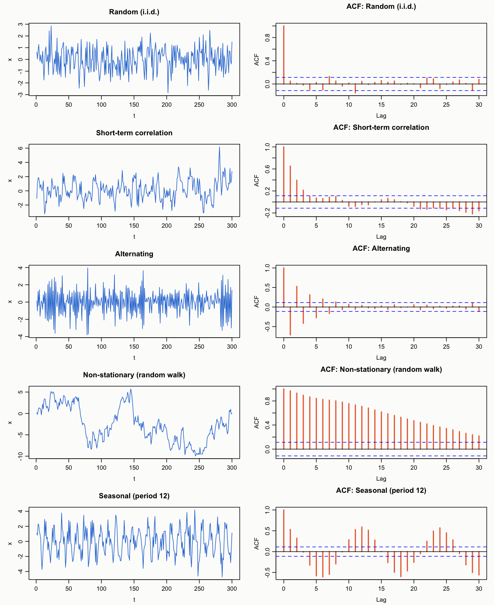
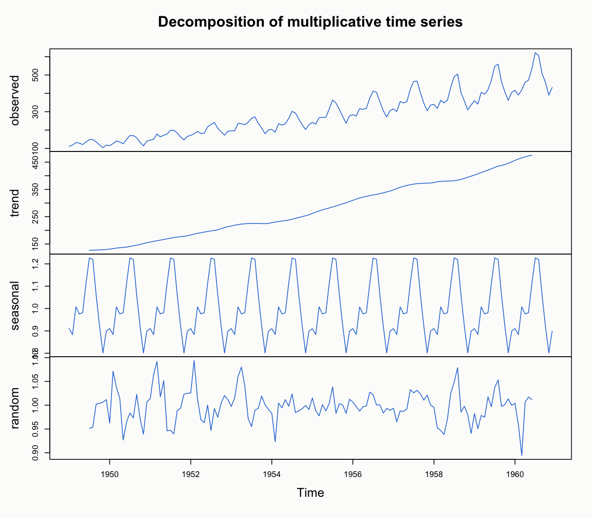
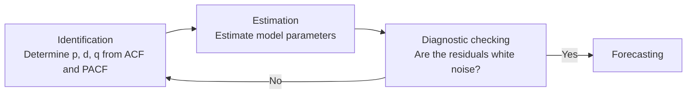
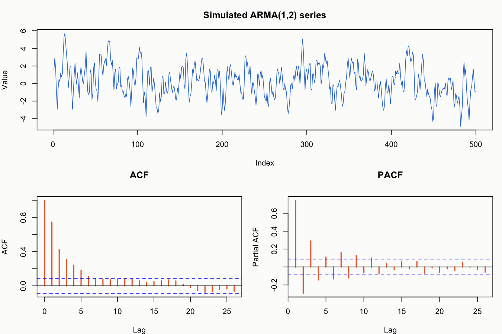
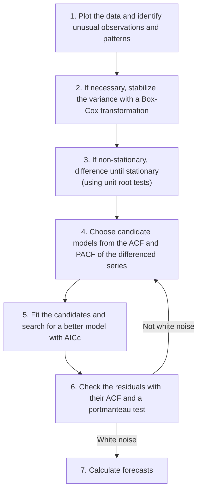
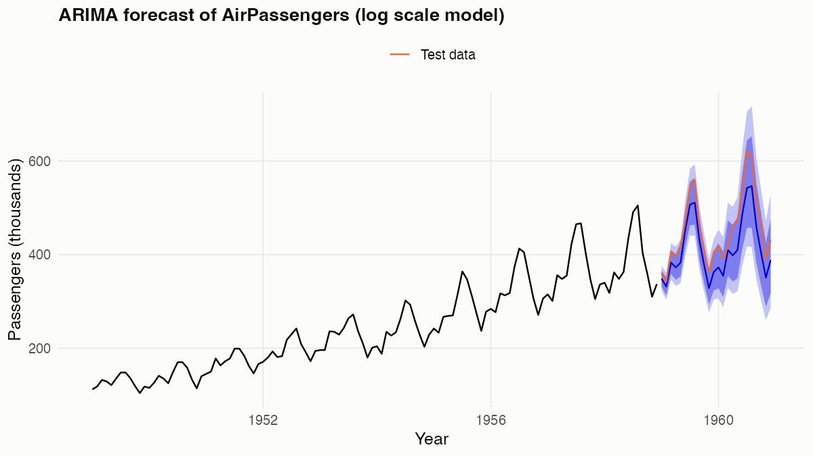

# Chapter 11 — Time Series Analysis

[Repository Guide](../../README.md) | [English](Concepts_Lecture.md) | [한국어](Concepts_Lecture.ko.md)

> **Last Updated:** 2026-11-19
>
> Forecasting: Principles and Practice, Hyndman and Athanasopoulos, Ch 9

> **Learning Objectives:**
> 1. Create and convert R date and time classes and `ts` objects
> 2. Decompose time series into trend, seasonal, and residual components
> 3. Apply ARIMA models for time series forecasting
> 4. Evaluate forecast accuracy using appropriate metrics
> 5. Explain the definition of stationarity and handle non-stationary series with differencing and unit root tests
> 6. Interpret correlograms and partial autocorrelation functions to identify the orders of AR, MA, and ARMA models

---

## Table of Contents

- [1. Introduction to Time Series](#1-introduction-to-time-series)
  - [1.1 Definition](#11-definition)
  - [1.2 Real-World Examples](#12-real-world-examples)
  - [1.3 Key Concepts](#13-key-concepts)
  - [1.4 Problems Addressed by Time Series Analysis](#14-problems-addressed-by-time-series-analysis)
- [2. Characteristics of Time Series Data](#2-characteristics-of-time-series-data)
  - [2.1 Types of Variation](#21-types-of-variation)
  - [2.2 Stationarity](#22-stationarity)
  - [2.3 Judging Cycles and Trends](#23-judging-cycles-and-trends)
  - [2.4 Time Series Plots and Transformations](#24-time-series-plots-and-transformations)
  - [2.5 Stochastic Processes and the Definition of Stationarity](#25-stochastic-processes-and-the-definition-of-stationarity)
  - [2.6 Differencing and Unit Root Tests](#26-differencing-and-unit-root-tests)
- [3. Date and Time Objects in R](#3-date-and-time-objects-in-r)
  - [3.1 Date Classes](#31-date-classes)
  - [3.2 POSIXct vs. POSIXlt](#32-posixct-vs-posixlt)
  - [3.3 Creating Date Objects](#33-creating-date-objects)
  - [3.4 Date Format Conversion](#34-date-format-conversion)
  - [3.5 Origin Points Across Software](#35-origin-points-across-software)
  - [3.6 Creating Date and Time Indexes](#36-creating-date-and-time-indexes)
  - [3.7 The lubridate Package](#37-the-lubridate-package)
- [4. Time Series Objects in R](#4-time-series-objects-in-r)
  - [4.1 Creating ts Objects](#41-creating-ts-objects)
  - [4.2 Common Time Series Datasets](#42-common-time-series-datasets)
  - [4.3 Attributes of ts Objects](#43-attributes-of-ts-objects)
  - [4.4 Multivariate Time Series Objects](#44-multivariate-time-series-objects)
  - [4.5 Subsetting and Aggregating ts Objects](#45-subsetting-and-aggregating-ts-objects)
  - [4.6 zoo and xts Objects](#46-zoo-and-xts-objects)
- [5. Descriptive Techniques](#5-descriptive-techniques)
  - [5.1 Time Series Plotting](#51-time-series-plotting)
  - [5.2 Autocorrelation Function (ACF)](#52-autocorrelation-function-acf)
  - [5.3 Partial Autocorrelation Function (PACF)](#53-partial-autocorrelation-function-pacf)
  - [5.4 The Sample Autocorrelation Coefficient](#54-the-sample-autocorrelation-coefficient)
  - [5.5 Interpreting the Correlogram](#55-interpreting-the-correlogram)
  - [5.6 Definition of the Partial Autocorrelation Function](#56-definition-of-the-partial-autocorrelation-function)
- [6. Decomposition](#6-decomposition)
  - [6.1 Additive vs. Multiplicative](#61-additive-vs-multiplicative)
  - [6.2 How Classical Decomposition Is Computed](#62-how-classical-decomposition-is-computed)
- [7. ARIMA Models](#7-arima-models)
  - [7.1 AR, MA, and ARIMA](#71-ar-ma-and-arima)
  - [7.2 Box-Jenkins Method](#72-box-jenkins-method)
  - [7.3 Implementation in R](#73-implementation-in-r)
  - [7.4 Properties of Moving Average Processes](#74-properties-of-moving-average-processes)
  - [7.5 Properties of Autoregressive Processes](#75-properties-of-autoregressive-processes)
  - [7.6 ARMA Models and the Backward Shift Operator](#76-arma-models-and-the-backward-shift-operator)
  - [7.7 Identifying the Orders with the ACF and PACF](#77-identifying-the-orders-with-the-acf-and-pacf)
  - [7.8 Notation for ARIMA Models](#78-notation-for-arima-models)
  - [7.9 Example: Choosing the Orders for Simulated ARMA(1,2) Data](#79-example-choosing-the-orders-for-simulated-arma12-data)
  - [7.10 The Ljung-Box Test](#710-the-ljung-box-test)
- [8. Forecasting](#8-forecasting)
  - [8.1 Making Forecasts](#81-making-forecasts)
  - [8.2 Forecast Accuracy](#82-forecast-accuracy)
  - [8.3 Recommended Books](#83-recommended-books)
  - [8.4 The Full Procedure for ARIMA Forecasting](#84-the-full-procedure-for-arima-forecasting)
  - [8.5 Example: Forecasting AirPassengers](#85-example-forecasting-airpassengers)
- [9. Common Mistakes in Time Series Analysis](#9-common-mistakes-in-time-series-analysis)
- [Concept Applications](#concept-applications)
- [Summary](#summary)
- [Self-Check Questions](#self-check-questions)
- [References](#references)

---

<br>

## 1. Introduction to Time Series

### 1.1 Definition

A **time series** is a sequence of data points collected or recorded at successive, equally spaced points in time. Time series analysis involves methods for analyzing time-ordered data to extract meaningful statistics, identify patterns, and make forecasts.

### 1.2 Real-World Examples

| Example | Data Description |
|---------|------------------|
| Johnson & Johnson Earnings | Quarterly earnings per share, 1960-1980 |
| Global Warming | Mean land-ocean temperature index, 1880-2015 |
| Speech Data | Audio signal sampled at 10,000 points/second |
| DJIA Returns | Daily returns of Dow Jones Industrial Average |
| El Nino & Fish Population | Monthly SOI and Recruitment series, 1950-1987 |
| Earthquake vs. Explosion | Seismic waveform classification |

*Table 1. Real-world examples of time series data*

### 1.3 Key Concepts

- **Trend**: Long-term increase or decrease in the data.
- **Seasonality**: Regular periodic fluctuations (e.g., annual cycles).
- **Cyclic variation**: Oscillations without a fixed period (e.g., business cycles).
- **Noise/Irregularity**: Random, unpredictable fluctuations.

> **Key Point:** George E. P. Box's aphorism "All models are wrong, but some are useful" is particularly relevant in time series analysis. Models only approximate reality, but they can still provide valuable forecasts.

### 1.4 Problems Addressed by Time Series Analysis

The examples in Table 1 show that the question a time series analysis tries to answer differs from data set to data set. Different kinds of questions call for different techniques.

| Example | Features of the Data | Question of the Analysis | Representative Techniques |
|------|------|------|------|
| Johnson & Johnson earnings | Earnings per share for 84 quarters from 1960 Q1 to 1980 Q4 grow exponentially, and the seasonal swings widen with them | Separate the trend and seasonal components and forecast future earnings | Decomposition, log transformation, ARIMA |
| Global warming | The annual land-ocean temperature index for 1880-2015 (deviations from the 1951-1980 average) rises clearly from the late twentieth century | Whether the rising trend is natural variation, and what its slope is | Trend regression, differencing |
| Speech data | A 0.1-second signal (about 1,000 points) recording the syllable "aaa...hhh" at 10,000 points per second repeats regularly | Recognize the syllable from the periodic features (signature) of the signal | Spectral analysis |
| DJIA returns | Daily returns from 2006-04-20 to 2016-04-20 move around a mean near 0, but their swings grow sharply around 2008 | Forecast the volatility (variance) of future returns | ARCH, GARCH, stochastic volatility models |
| El Nino and fish population | The Southern Oscillation Index (SOI) and the number of new fish (Recruitment) over 453 months in 1950-1987 are related | Explain one series (fish numbers) with another (sea temperature) | Lagged regression, transfer function models |
| Earthquakes and explosions | Waveforms of the P wave ($t = 1, \ldots, 1024$) and S wave ($t = 1025, \ldots, 2048$) recorded at a seismic station | Distinguish whether a waveform came from an earthquake or from an explosion such as a nuclear test | Time series discriminant analysis |

*Table 2. Features of time series examples and the questions of the analysis*

This chapter covers the decomposition of trend and seasonality (Section 6), ARIMA models for stationary series (Section 7), and forecasting (Section 8). Spectral analysis, volatility models, transfer function models, and discriminant analysis are advanced topics built on the same concepts of stationarity and autocorrelation.

---

<br>

## 2. Characteristics of Time Series Data

### 2.1 Types of Variation

#### Seasonal Variation

- Fixed periodic patterns repeat (annual, quarterly, monthly, weekly).
- For example, unemployment is typically higher in winter.
- They can be estimated and removed (deseasonalization).

#### Cyclic Variation

- Oscillations occur without a fixed period.
- Business cycles vary in length from 3-4 years to 10+ years.
- They are less predictable than seasonal patterns.

#### Trend

- A trend is a long-term upward or downward movement.
- It can be linear or non-linear.
- For example, global temperatures are rising over the long term.

#### Random/Irregular

- These are unpredictable fluctuations.
- They are the residual after removing trend, seasonal, and cyclic components.

### 2.2 Stationarity

A time series is **stationary** if its statistical properties (mean, variance, autocorrelation) do not change over time.

- **Strict stationarity**: All joint distributions are invariant under time shifts.
- **Weak stationarity**: The mean is constant, and the autocovariance depends only on the lag, not on the time point.

Most time series models assume stationarity. Non-stationary series can be made stationary through **differencing**. The first difference $\nabla X_t = X_t - X_{t-1}$ takes the difference between neighboring time points as the new series.

### 2.3 Judging Cycles and Trends

Cyclic variation differs from seasonal variation in having no fixed period. The US monthly unemployment rate showed a cycle of about 11 years in 1990-2000 and one of 7 years in 2000-2007, and the third cycle, which began in 2007, had not ended as of May 2019, lasting more than 12 years. Because the length of a cycle varies even within one series, cyclic variation cannot be removed by computing and subtracting an average pattern, as seasonal variation can.

A trend can be defined loosely as "a long-term change in the mean level", but the difficulty is that it is not clear what counts as "long term". For example, a climate variable may change slowly over cycles of several hundred years, so the change looks like a trend in 20 years of data but like part of a cycle in several centuries of data. Therefore, when speaking of a trend, one must judge what counts as long term with the number of observations and the observation period in mind.

The residuals left after removing trend and cyclic variation may or may not be random. Examining whether cyclic variation remains in the residuals, and whether apparently irregular variation can be explained by probability models such as the moving average (MA) and autoregressive (AR) models of Section 7, is the central task of time series analysis.

### 2.4 Time Series Plots and Transformations

The first and most important step in any time series analysis is to plot the observations against time. UK hourly electricity demand shows strong daily and weekly seasonality, S&P 500 daily closing values show a clear upward trend, the US monthly unemployment rate shows cycles of varying length, and annual sunspot numbers show a cycle of about 11 years. A plot reveals trend, seasonality, cycles, outliers, and changes in variance at a glance, and this determines which transformations and models are needed.

The three main reasons for considering a transformation such as logarithms or square roots after looking at a plot are the following.

1. **Stabilizing the variance:** A transformation helps when there is a trend and the variance grows with the mean. In particular, a logarithmic transformation is appropriate when the standard deviation is directly proportional to the mean. If the variance changes over time without a trend, however, a transformation will not help, and a model that allows a changing variance (for example, the GARCH of Section 1.4) should be considered.
2. **Making the seasonal effect additive:** A multiplicative structure, in which the seasonal swings grow with the trend, becomes additive after taking logarithms (Section 6).
3. **Making the data closer to normal:** Model building and forecasting are usually carried out on the assumption that the data are normally distributed.

The logarithmic and square-root transformations are special cases of a general family called the **Box-Cox transformation**. The Box-Cox transformation is defined by a parameter $\lambda$, with $\lambda = 0$ corresponding to the logarithmic transformation and $\lambda = 1/2$ to the square-root transformation (ignoring a constant shift and scale).

```math
w_t = \begin{cases} \log(y_t) & \lambda = 0 \\ (y_t^{\lambda} - 1)/\lambda & \lambda \neq 0 \end{cases}
```

### 2.5 Stochastic Processes and the Definition of Stationarity

Mathematically, a **stochastic process** is a collection of random variables ordered in time. When time is continuous, the random variable at time $t$ is written $X(t)$, and when time is discrete, $X_t$ ($t = 0, \pm 1, \pm 2, \ldots$). An observed time series $x_1, \ldots, x_N$ is one **realization** of this stochastic process. Time series analysis infers the properties of the underlying probability model from this single observed realization, and it differs from an ordinary sample in that the value at a given time cannot be observed more than once.

A stochastic process is summarized by the following three functions.

| Function | Definition | Meaning |
|------|------|------|
| Mean function | $\mu(t) = E[X(t)]$ | The expected value at each time |
| Variance function | $\sigma^2(t) = \mathrm{Var}[X(t)] = E[(X(t) - \mu(t))^2]$ | The spread at each time |
| Autocovariance function | $\gamma(t_1, t_2) = E\lbrace[X(t_1) - \mu(t_1)][X(t_2) - \mu(t_2)]\rbrace$ | How much the values at two times move together |

*Table 3. Mean, variance, and autocovariance functions of a stochastic process*

The variance function is the special case of the autocovariance function with $t_1 = t_2$. With these functions, the two kinds of stationarity of Section 2.2 can be defined rigorously.

> **Definition:** **Strict stationarity** is the property that for any times $t_1, \ldots, t_k$ and any shift $\tau$, the joint distribution of $X(t_1), \ldots, X(t_k)$ is the same as the joint distribution of $X(t_1 + \tau), \ldots, X(t_k + \tau)$.

Strict stationarity means that shifting the time origin does not change the joint distributions, so the joint distributions depend only on the intervals between times. With $k = 1$, the distribution of $X(t)$ is the same for all $t$, so the mean $\mu$ and variance $\sigma^2$ are constants, and with $k = 2$, the joint distribution of $X(t_1)$ and $X(t_2)$ depends only on the lag $\tau = t_2 - t_1$, so the autocovariance can be written $\gamma(\tau) = \mathrm{Cov}[X(t), X(t + \tau)]$. This $\gamma(\tau)$ is called the **autocovariance coefficient** at lag $\tau$.

> **Definition:** **Weak stationarity** is the property that the mean is constant, $E[X(t)] = \mu$, and the autocovariance depends only on the lag, $\mathrm{Cov}[X(t), X(t + \tau)] = \gamma(\tau)$; it is also called second-order stationarity.

Weak stationarity places no condition on moments higher than the second. Setting $\tau = 0$ shows that the variance $\gamma(0)$ is also constant, and the definition also implies that the mean and variance are finite. In practice, "stationary" usually means weakly stationary. For a normal process, the mean and autocovariance determine the joint distributions completely, so the two kinds of stationarity coincide.

The **autocorrelation function** (ac.f.) of a stationary process is $\rho(\tau) = \gamma(\tau)/\gamma(0) = \gamma(\tau)/\sigma^2$, and it has the following properties.

1. $\rho(0) = 1$.
2. It is an even function of the lag: $\rho(\tau) = \rho(-\tau)$. This is why a correlogram is drawn only for $\tau \geq 0$.
3. $|\rho(\tau)| \leq 1$.
4. The autocorrelation function does not identify a model uniquely. Different stochastic processes can have the same autocorrelation function (the invertibility of Section 7.4).

> **Caution:** The autocorrelation function $\rho(k)$ of a stochastic process must be distinguished from the sample autocorrelation function $r_k$ computed from observed data (Section 5.4). $\rho(k)$ is a property of the unknown model, while $r_k$ is its estimate and varies from sample to sample. A small bar in a correlogram does not by itself establish that the autocorrelation of the process is nonzero.

### 2.6 Differencing and Unit Root Tests

Most real time series are non-stationary. A non-stationary series whose mean changes is usually made stationary by **differencing**, of which there are the following kinds [1].

| Difference | Formula | What It Removes |
|------|------|------|
| First difference | $\nabla x_t = x_t - x_{t-1}$ | Changes in level, a linear trend |
| Second difference | $\nabla^2 x_t = x_t - 2x_{t-1} + x_{t-2}$ | A change in trend remaining after the first difference |
| Seasonal difference | $\nabla_m x_t = x_t - x_{t-m}$ | A seasonal pattern of period $m$ |

*Table 4. Kinds of differencing*

If the first-differenced series is white noise, the original series is $x_t = x_{t-1} + w_t$, a **random walk**. A random walk is non-stationary because its variance grows in proportion to time even though its mean seems constant, and it shows long stretches of drifting up or down and sudden unpredictable changes. If the mean of the differenced series is not zero, the model is $x_t = c + x_{t-1} + w_t$, a **random walk with drift**, where $c$ is the average change per time step. For strongly seasonal series it is recommended to take the seasonal difference first, and if the seasonal difference alone makes the series stationary, no first difference is needed. Differences beyond the second order are almost never needed.

Whether differencing is needed is judged objectively with a **unit root test**. The two tests have opposite null hypotheses, so their interpretations must not be confused.

| Test | R Function | Null Hypothesis | Conclusion When the p-value Is Small |
|------|------|------|------|
| KPSS test | `tseries::kpss.test()` | The series is stationary | Not stationary, so differencing is needed |
| ADF test | `tseries::adf.test()` | The series has a unit root (non-stationary) | No unit root, so the series is stationary |

*Table 5. Null hypotheses and interpretation of the two unit root tests*

Applying the two tests to the log of AirPassengers gives the following.

```r
library(tseries)
library(forecast)
lap <- log(AirPassengers)
suppressWarnings(kpss.test(lap))
#> 
#> 	KPSS Test for Level Stationarity
#> 
#> data:  lap
#> KPSS Level = 2.8287, Truncation lag parameter = 4, p-value = 0.01
suppressWarnings(kpss.test(diff(diff(lap), lag = 12)))
#> 
#> 	KPSS Test for Level Stationarity
#> 
#> data:  diff(diff(lap), lag = 12)
#> KPSS Level = 0.084365, Truncation lag parameter = 4, p-value = 0.1
c(ndiffs = ndiffs(lap), nsdiffs = nsdiffs(lap))
#>  ndiffs nsdiffs 
#>       1       1
```

The KPSS statistic of the log series is 2.83 with a p-value of 0.01, so the null hypothesis of stationarity is rejected. The series seasonally differenced with `diff(lap, lag = 12)` and then first-differenced with `diff()` has a p-value of 0.1, so the hypothesis of stationarity is not rejected. `kpss.test()` interpolates the p-value from a table, truncating it to 0.01 when it is smaller and to 0.1 when it is larger and issuing a warning in that case, which is why the calls are wrapped in `suppressWarnings()`. `ndiffs()` and `nsdiffs()` from the `forecast` package repeat such tests to report the number of first and seasonal differences needed, and both are 1 for this series.

```r
suppressWarnings(adf.test(lap))
#> 
#> 	Augmented Dickey-Fuller Test
#> 
#> data:  lap
#> Dickey-Fuller = -6.4215, Lag order = 5, p-value = 0.01
#> alternative hypothesis: stationary
suppressWarnings(adf.test(diff(diff(lap), lag = 12)))
#> 
#> 	Augmented Dickey-Fuller Test
#> 
#> data:  diff(diff(lap), lag = 12)
#> Dickey-Fuller = -5.1993, Lag order = 5, p-value = 0.01
#> alternative hypothesis: stationary
```

The ADF test gives a p-value of 0.01 even for the log series itself and concludes that there is no unit root. Because the default test equation of `adf.test()` includes a linear trend, this means stationarity around a linear trend, and the strong seasonality of the series is not addressed separately. Since the two tests can thus reach different conclusions, the results of unit root tests are judged together with plots and correlograms (Section 5.5).

> **Caution:** Differencing more than necessary (over-differencing) creates autocorrelation that was not there. For example, differencing white noise $w_t$ gives $w_t - w_{t-1}$, an MA(1) process with a lag-1 autocorrelation of -0.5. Difference only the minimum number of times needed, and use only interpretable differences such as first and seasonal differences.

---

<br>

## 3. Date and Time Objects in R

### 3.1 Date Classes

R provides several classes for handling dates and times:

| Class | Description | Origin Point |
|-------|-------------|-------------|
| `Date` | Calendar date only (stored as days since origin) | 1970-01-01 |
| `POSIXct` | Date and time as seconds since origin | 1970-01-01 00:00:00 UTC |
| `POSIXlt` | Date and time as a named list | None (year stored as years since 1900) |

*Table 6. Date and time classes in R*

```r
# Get current date and time
date <- Sys.Date()
date                    # "2025-12-02"
class(date)             # "Date"

time_ct <- Sys.time()
time_ct                 # "2025-12-02 14:30:00 KST"
class(time_ct)          # "POSIXct" "POSIXt"

# Convert POSIXct to POSIXlt
time_lt <- as.POSIXlt(time_ct)
class(time_lt)          # "POSIXlt" "POSIXt"
```

### 3.2 POSIXct vs. POSIXlt

```r
# POSIXct: stored as a single numeric value (seconds since origin)
unclass(time_ct)        # e.g., 1764653400

# POSIXlt: stored as a named list
unclass(time_lt)$sec    # seconds
unclass(time_lt)$hour   # hour
unclass(time_lt)$mday   # day of month
unclass(time_lt)$mon    # month (0-11)
unclass(time_lt)$year   # years since 1900
unclass(time_lt)$yday   # day of year (0-365)
```

### 3.3 Creating Date Objects

```r
# String to Date conversion
d1 <- "2022-09-21"
class(d1)               # "character"

d2 <- as.Date("2022-09-21")
class(d2)               # "Date"

# Creating POSIXct and POSIXlt with timezone
time_ct <- as.POSIXct("2022-09-21 20:05:35", tz = "EST")
time_lt <- as.POSIXlt("2022-09-21 20:05:35", tz = "EST")
```

### 3.4 Date Format Conversion

Date strings that are not in ISO 8601 format (YYYY-MM-DD) are converted by giving format specifiers in the `format` argument:

| Format Code | Meaning | Example |
|-------------|---------|---------|
| `%Y` | 4-digit year | 2022 |
| `%m` | 2-digit month | 09 |
| `%d` | 2-digit day | 21 |
| `%H` | Hour (24h) | 20 |
| `%M` | Minute | 05 |
| `%S` | Second | 35 |

*Table 7. Date format specifiers*

```r
# ISO 8601 format (default): YYYY-MM-DD
as.Date("2017-01-20")

# US format: MM/DD/YYYY
as.Date("1/20/2017", format = "%m/%d/%Y")

# NZ format: DD/MM/YYYY
as.Date("20/01/2017", format = "%d/%m/%Y")
```

### 3.5 Origin Points Across Software

| Software | Origin Point |
|----------|-------------|
| R | January 1, 1970 |
| SAS | January 1, 1960 |
| Excel | January 1, 1900 |

*Table 8. Date origin points by software*

> **Key Point:** When importing date data from other software, verify the origin point matches. Use the `origin` parameter in `as.Date()` if converting from numeric date values.

> **Caution:** The Excel 1900 date system wrongly treats 1900 as a leap year, so when converting Excel serial numbers of dates from March 1900 onward in R, use `origin = "1899-12-30"`. For example, `as.Date(45000, origin = "1899-12-30")` is 2023-03-15.

### 3.6 Creating Date and Time Indexes

A vector of time points at regular intervals serves as the index of a time series. The base package provides `seq.Date()` for Date objects and `seq.POSIXt()` for POSIX objects, and apart from the class of the output, the two functions differ only in the units of the interval.

| Function | Intervals Allowed in the `by` Argument |
|------|------|
| `seq.Date()` | `"day"`, `"week"`, `"month"`, `"quarter"`, `"year"` |
| `seq.POSIXt()` | `"sec"`, `"min"`, `"hour"`, `"day"`, `"DSTday"`, `"week"`, `"month"`, `"quarter"`, `"year"` |

*Table 9. Interval units of the date and time index functions*

```r
daily_index <- seq.Date(from = as.Date("2016-01-01"),
                        to = as.Date("2018-12-31"), by = "day")
head(daily_index, 3)
#> [1] "2016-01-01" "2016-01-02" "2016-01-03"
daily_3_index <- seq.Date(from = as.Date("2016-01-01"),
                          to = as.Date("2018-12-31"), by = "3 days")
head(daily_3_index, 3)
#> [1] "2016-01-01" "2016-01-04" "2016-01-07"
hourly_index <- seq.POSIXt(from = as.POSIXct("2018-06-01", tz = "UTC"),
                           by = "hours", length.out = 48)
head(hourly_index, 3)
#> [1] "2018-06-01 00:00:00 UTC" "2018-06-01 01:00:00 UTC"
#> [3] "2018-06-01 02:00:00 UTC"
```

`from` and `to` are the start and end points and `by` is the interval; prefixing an integer, as in `"3 days"`, gives a multiple of that interval. The number of elements can be given with `length.out` instead of an end point, so the last call creates 48 time points at one-hour intervals from midnight on 2018-06-01. `"DSTday"` is a one-day interval that keeps the same clock time even on days when daylight saving time changes.

A date stored as a string is not the same value as a date object even when it looks the same.

```r
time_str <- "2022-09-17 23:59:59"
time_posix <- as.POSIXct(time_str, tz = "UTC")
class(time_str)
#> [1] "character"
class(time_posix)
#> [1] "POSIXct" "POSIXt"
identical(time_str, time_posix)
#> [1] FALSE
```

`identical()` is `FALSE` because one is a string and the other is a number holding the seconds since 1970-01-01. Strings cannot be used to compute date differences, sort, or measure intervals, so data should be converted to date objects right after they are read. Excel dates stored as numbers are converted the same way: the Excel serial numbers 42755 and 42756 become 2017-01-20 and 2017-01-21 with `as.Date(c(42755, 42756), origin = "1899-12-30")`.

### 3.7 The lubridate Package

The `lubridate` package converts date strings without format specifiers (Table 7) once the order of the components is named in the function name. The letters `y`, `m`, `d`, `h`, `m`, `s` in the function name give the order of year, month, day, hour, minute, and second, and the functions parse strings even when they contain separators, weekdays, or month names.

```r
library(lubridate)
ymd("2017-01-20")
#> [1] "2017-01-20"
mdy("1/20/2017")
#> [1] "2017-01-20"
dmy("20/01/2017")
#> [1] "2017-01-20"
mdy("Friday, January 20, 2017")
#> [1] "2017-01-20"
time_obj <- mdy_hms("Wednesday, September 21, 2022 04:00:00 PM", tz = "GMT")
time_obj
#> [1] "2022-09-21 16:00:00 GMT"
```

`ymd()`, `mdy()`, and `dmy()` convert strings in year-month-day, month-day-year, and day-month-year order into Dates, and `mdy_hms()` also reads the time of day and creates a POSIXct. "04:00:00 PM" is 4 p.m., so it becomes 16:00. There are also functions that extract components from a date object or round times.

```r
c(yday = yday(time_obj), qday = qday(time_obj), day = day(time_obj))
#> yday qday  day 
#>  264   83   21
wday(time_obj, label = TRUE)
#> [1] Wed
#> Levels: Sun < Mon < Tue < Wed < Thu < Fri < Sat
t2 <- mdy_hms("Monday, December 31, 2018 11:59:59 PM", tz = "EST")
round_date(t2, unit = "minute")
#> [1] "2019-01-01 EST"
floor_date(t2, unit = "hour")
#> [1] "2018-12-31 23:00:00 EST"
ceiling_date(t2, unit = "day")
#> [1] "2019-01-01 EST"
```

`yday()` returns the day of the year (counting from 1), `qday()` the day of the quarter, and `day()` the day of the month. September 21, 2022 is the 264th day of the year, and since the third quarter begins on July 1, it is day 31 + 31 + 21 = 83 of the quarter. `wday(label = TRUE)` returns the weekday as an ordered factor. `round_date()` rounds to the nearest unit, `floor_date()` rounds down, and `ceiling_date()` rounds up. Rounding 23:59:59 to the minute gives midnight of the next day. Unlike the `POSIXlt` of Section 3.2, `yday()` counts from 1, so it is one larger than `unclass(as.POSIXlt(x))$yday` for the same date.

---

<br>

## 4. Time Series Objects in R

### 4.1 Creating ts Objects

```r
# Create a time series object
ts_data <- ts(data_vector, start = c(1960, 1), frequency = 4)
# start: starting time (year, period)
# frequency: observations per unit time (4 = quarterly, 12 = monthly)
```

### 4.2 Common Time Series Datasets

```r
# Johnson & Johnson quarterly earnings
data(JohnsonJohnson)
plot(JohnsonJohnson)

# AirPassengers: monthly airline passengers
data(AirPassengers)
plot(AirPassengers)

# US economic data
library(ggplot2)
data(economics)
str(economics)
```

### 4.3 Attributes of ts Objects

Time series data have distinctive attributes that set them apart from other data: the **timestamp**, the time at which each observation was recorded; the **frequency**, the number of observations in one cycle; and the **cycle**, the unit of repetition. For monthly data a full cycle is a year and the frequency is 12, and for quarterly data the frequency is 4. A `ts` object consists of two elements, the observed values and their corresponding timestamps, and the main R time series packages `stats` and `forecast` use this format by default. The attributes are checked with the built-in `UKgas` data (quarterly UK gas consumption, 1960-1986).

```r
is.ts(UKgas)
#> [1] TRUE
length(UKgas)
#> [1] 108
c(frequency = frequency(UKgas), deltat = deltat(UKgas))
#> frequency    deltat 
#>      4.00      0.25
start(UKgas)
#> [1] 1960    1
end(UKgas)
#> [1] 1986    4
head(cycle(UKgas), 8)
#>      Qtr1 Qtr2 Qtr3 Qtr4
#> 1960    1    2    3    4
#> 1961    1    2    3    4
head(time(UKgas), 8)
#>         Qtr1    Qtr2    Qtr3    Qtr4
#> 1960 1960.00 1960.25 1960.50 1960.75
#> 1961 1961.00 1961.25 1961.50 1961.75
```

`is.ts()` checks whether the object has class `ts`, and `length()` gives the number of observations (27 years × 4 quarters = 108). `deltat()` is the time interval between neighboring observations, the reciprocal of the frequency, $1/4 = 0.25$ years. `start()` and `end()` give the (year, position within the cycle) of the first and last observations, `cycle()` the position of each observation within the cycle (the quarter number), and `time()` the time of each observation as a decimal. The time of 1960 Q3 is 1960.50 because $(3 - 1) \times 0.25$ is added to the year.

When creating an object with `ts()`, giving any two of the start, the end, and the frequency determines the third.

```r
my_ts1 <- ts(data = 1:60, start = c(2010, 1), end = c(2014, 12), frequency = 12)
my_ts2 <- ts(data = 1:60, end = c(2014, 12), frequency = 12)
my_ts3 <- ts(data = 1:60, start = 2010, frequency = 12)
start(my_ts2)
#> [1] 2010    1
identical(my_ts1, my_ts2) && identical(my_ts2, my_ts3)
#> [1] TRUE
```

Sixty observations at frequency 12 cover five years, so giving only the end point, December 2014, fixes the start at January 2010, and giving only the start fixes the end. The three objects are exactly the same.

### 4.4 Multivariate Time Series Objects

Data observing several variables at the same time points form a **multivariate time series**, handled in R with the `mts` class, an extension of `ts`. An `mts` object is a matrix whose rows are time points and whose columns are variables, with time series attributes attached. Binding the built-in data `mdeaths` and `fdeaths` (monthly deaths from lung diseases in the UK by sex, 1974-1979) with `cbind()` gives an `mts` object.

```r
deaths <- cbind(male = mdeaths, female = fdeaths)
class(deaths)
#> [1] "mts"    "ts"     "matrix" "array"
frequency(deaths)
#> [1] 12
head(deaths, 3)
#>          male female
#> Jan 1974 2134    901
#> Feb 1974 1863    689
#> Mar 1974 1877    827
```

The class `"mts" "ts" "matrix" "array"` means that this object is a multivariate time series, a time series, and also a matrix. An `mts` object can also be created by passing several columns of a data frame to the `data` argument of `ts()`. When setting the start from a date column of a data frame, lubridate's `year()` and `month()` are convenient, as in `start = c(year(min(date)), month(min(date)))`. Before converting data to `ts`, check that they are sorted by date, because `ts()` ignores the date column and assigns times in row order.

When drawing a multivariate time series, `plot.ts()` draws a separate panel for each variable with `plot.type = "multiple"` (the default) and overlays them in one panel with `"single"`. Two variables on different scales (for example, vehicle sales and the unemployment rate) are better drawn in separate panels.

### 4.5 Subsetting and Aggregating ts Objects

Because of the special structure of a `ts` object, the row selection of a data frame (`[row, column]`) loses the time series attributes. Selecting part of a series by time range is done with `window()`, and grouping at a lower frequency with `aggregate()`. Splitting a series into training and test periods when building a forecasting model is a typical subsetting step (Section 8.2).

```r
window(UKgas, start = c(1970, 1), end = c(1970, 4))
#>       Qtr1  Qtr2  Qtr3  Qtr4
#> 1970 244.9 216.1 188.9 142.5
window(UKgas, start = c(1960, 3), frequency = 1)[1:5]
#> [1] 84.8 84.8 89.7 92.9 89.7
```

The first call selects the four quarters of 1970. Giving `frequency = 1`, as in the second call, selects one value per year starting from 1960 Q3, that is, only the third-quarter values of each year. This shows the year-to-year change of one quarter.

```r
head(aggregate(UKgas, nfrequency = 1, FUN = "sum"), 4)
#> Time Series:
#> Start = 1960 
#> End = 1963 
#> Frequency = 1 
#> [1] 494.7 486.7 523.6 544.4
a <- 1:24
a[24] <- NA
a_ts <- ts(a, start = c(2000, 1), frequency = 12)
aggregate(a_ts, nfrequency = 4, FUN = "sum")
#>      Qtr1 Qtr2 Qtr3 Qtr4
#> 2000    6   15   24   33
#> 2001   42   51   60   NA
```

`aggregate()` splits the series into intervals of the new frequency `nfrequency` and applies `FUN` to each interval. Grouping the quarterly gas consumption with `nfrequency = 1` and `FUN = "sum"` gives the annual consumption, so the 1960 value 494.7 is the sum of the four quarterly values. The second example groups the monthly series 1, 2, ..., 23, NA into quarterly sums. The first quarter of 2000 is 1 + 2 + 3 = 6, and the fourth quarter of 2001 contains a missing value, so its sum is also `NA`. To sum while ignoring missing values, pass the function and its argument separately, as in `FUN = sum, na.rm = TRUE`.

### 4.6 zoo and xts Objects

Besides `ts`, the `zoo` class of the `zoo` package and its extension, the `xts` class of the `xts` package, are widely used. `ts` assumes that time points are equally spaced, whereas `zoo` and `xts` attach an actual date or time to each observation as its index, so they can also handle irregularly spaced data such as stock prices with weekends and holidays missing. For this reason they are especially common in the analysis of financial time series such as stock prices and indices.

```r
library(xts)
gas_xts <- as.xts(UKgas)
head(gas_xts, 3)
#>          [,1]
#> 1960 Q1 160.1
#> 1960 Q2 129.7
#> 1960 Q3  84.8
periodicity(gas_xts)
#> Quarterly periodicity from 1960 Q1 to 1986 Q4
```

`as.xts()` converts a `ts` object into `xts`, and the row names become a quarterly index (`1960 Q1`). `periodicity()` estimates the periodicity of the data from the index. An `xts` object can be subset with date strings, as in `gas_xts["1970"]`.

---

<br>

## 5. Descriptive Techniques

### 5.1 Time Series Plotting

```r
library(ggplot2)
library(scales)

ggplot(economics, aes(x = date, y = psavert)) +
  geom_line(color = "indianred3", linewidth = 1) +
  geom_smooth() +
  scale_x_date(date_breaks = "5 years", labels = date_format("%b-%y")) +
  labs(title = "Personal Savings Rate",
       subtitle = "1967 to 2015",
       x = "", y = "Personal Savings Rate") +
  theme_minimal()
```

`psavert` in the `economics` data is the US personal savings rate (%). `geom_smooth()` overlays a smoothed curve that shows the trend, and `scale_x_date()` places x-axis breaks every 5 years and labels them with the abbreviated month and two-digit year (`%b-%y`).

### 5.2 Autocorrelation Function (ACF)

The ACF measures the correlation between a time series and its lagged values. For a stationary series, the autocorrelation at lag $h$ is:

```math
\rho(h) = \frac{Cov(X_t, X_{t+h})}{Var(X_t)}
```

> **[Probability and Statistics]** The covariance of two random variables, $Cov(X, Y) = E[(X - \mu_X)(Y - \mu_Y)]$, measures how much the two variables deviate from their own means together, and the correlation coefficient, which divides it by the product of the two standard deviations, lies between -1 and 1. Autocorrelation is the correlation coefficient obtained by treating the two time points $X_t$ and $X_{t+h}$ of the same series as two random variables, and in a stationary series $Var(X_t) = Var(X_{t+h})$, so the product of the two standard deviations becomes the denominator $Var(X_t)$ of the formula above.

```r
acf(ts_data)         # Plot ACF
acf(ts_data, plot = FALSE)  # Get numeric values
```

### 5.3 Partial Autocorrelation Function (PACF)

PACF measures the correlation between $X_t$ and $X_{t+h}$ after removing the effect of intermediate lags:

```r
pacf(ts_data)        # Plot PACF
```

> **Key Point:** ACF and PACF plots are essential diagnostic tools for identifying the appropriate ARIMA model order. ACF helps identify the MA order, while PACF helps identify the AR order. The ACF of an MA(q) process cuts off to zero after lag q, and the PACF of an AR(p) process cuts off to zero after lag p.

### 5.4 The Sample Autocorrelation Coefficient

The sample correlation coefficient of $N$ pairs of observations $(x_1, y_1), \ldots, (x_N, y_N)$ on two variables is as follows.

```math
r = \frac{\sum_{i=1}^{N} (x_i - \bar{x})(y_i - \bar{y})}{\sqrt{\sum_{i=1}^{N} (x_i - \bar{x})^2 \sum_{i=1}^{N} (y_i - \bar{y})^2}}
```

$r$ reflects the direction and the noisiness of a linear relationship between the two variables, but not the slope of the relationship or nonlinear relationships. Points on lines with different slopes all have $r = 1$, and $r$ can be 0 even when there is a clear nonlinear relationship, such as a circle or an X shape.

From a time series $x_1, \ldots, x_N$, one can form the $N - 1$ pairs of observations one time step apart, $(x_1, x_2), (x_2, x_3), \ldots, (x_{N-1}, x_N)$, and apply the same formula, regarding the first value as one variable and the second as the other. This is the **sample autocorrelation coefficient** $r_1$ at lag 1. In practice, the overall mean $\bar{x}$ is used instead of the separate means of the two subseries, and the denominator is simplified to the sum of squares of the whole series, giving the following definition of the coefficient at lag $k$.

```math
r_k = \frac{\sum_{t=1}^{N-k} (x_t - \bar{x})(x_{t+k} - \bar{x})}{\sum_{t=1}^{N} (x_t - \bar{x})^2}, \qquad k = 0, 1, 2, \ldots
```

$r_k$ always lies in $[-1, 1]$, and $r_0 = 1$. Computing the formula directly for the built-in `lh` data (48 measurements of a woman's blood luteinizing hormone level taken at 10-minute intervals) gives the same values as `acf()`.

```r
x <- as.numeric(lh)
N <- length(x)
xbar <- mean(x)
r <- function(k) sum((x[1:(N - k)] - xbar) * (x[(1 + k):N] - xbar)) / sum((x - xbar)^2)
c(r1 = r(1), r2 = r(2), r3 = r(3))
#>         r1         r2         r3 
#>  0.5755245  0.1818182 -0.1447552
round(acf(lh, lag.max = 3, plot = FALSE)$acf[2:4], 6)
#> [1]  0.575524  0.181818 -0.144755
1.96 / sqrt(N)
#> [1] 0.2829016
```

The numerator of the function `r(k)` is the sum of the products of deviations of the first $N - k$ values and the $N - k$ values $k$ steps later, and the denominator is the sum of squared deviations of the whole series. The first element of `acf()$acf` is the value 1 at lag 0, so `[2:4]` extracts lags 1-3. The last value is the significance bound explained below.

### 5.5 Interpreting the Correlogram

A plot of the sample autocorrelation coefficients $r_k$ as bars against the lag $k = 0, 1, \ldots, M$ is called a **correlogram** or the sample autocorrelation function (sample ac.f.), where $M$ is usually much smaller than $N$. The plot drawn by `acf()` is a correlogram. For a completely random series of independent, identically distributed (i.i.d.) observations, $r_k$ for $k \geq 1$ is approximately $N(0, 1/N)$, so about 19 out of 20 values of $r_k$ fall within $\pm 1.96/\sqrt{N}$. The dashed blue lines in an `acf()` plot are these bounds; for `lh` the bound is $1.96/\sqrt{48} = 0.283$, so only $r_1 = 0.576$ exceeds it.

Interpreting a correlogram is the key to time series modeling, but it is not easy work. The five typical patterns are as follows.

| Type of Series | Shape of the Correlogram | Reason |
|------|------|------|
| Random series (i.i.d.) | Almost all $r_k$ for $k \geq 1$ within the bounds | The observations are independent, so every autocorrelation is 0 |
| Series with short-term correlation | A fairly large $r_1$ followed by one or two positive values getting smaller, then near 0 | Only neighboring observations are similar, and distant ones are unrelated |
| Alternating series | Signs alternate ($r_1 < 0$, $r_2 > 0$, ...) | Successive observations lie on opposite sides of the mean, and observations two steps apart on the same side |
| Non-stationary series (trend) | Does not come down to 0 until very large lags | Because of the trend, an observation on one side of the mean is followed by many more on the same side |
| Series with a seasonal effect | Oscillates with the same period (for monthly data, $r_6$ large and negative, $r_{12}$ large and positive) | Values half a period apart are in opposite seasons, and values one period apart in the same season |

*Table 10. Five patterns of the correlogram*



*Figure 1. Simulated series of five types and their correlograms*

Figure 1 shows a simulated series of each type (left) and its correlogram (right). The short-term correlation series is $x_t = 0.7x_{t-1} + w_t$, the alternating series $x_t = -0.7x_{t-1} + w_t$, the non-stationary series a random walk, the cumulative sum of white noise, and the seasonal series a sine curve of period 12 plus noise. The correlogram of the non-stationary series stays near 0.3 even at lag 30, and because such a slowly decaying correlogram hides other properties, the trend is first removed by differencing (Section 2.6) before the correlogram is examined again.

### 5.6 Definition of the Partial Autocorrelation Function

The partial autocorrelation is obtained as follows. Let $\rho_j$ be the autocorrelations of a stationary process $X_t$, and consider the $k \times k$ system of equations below.

```math
\begin{aligned}
\rho_1 &= \phi_{k1}\rho_0 + \phi_{k2}\rho_1 + \cdots + \phi_{kk}\rho_{k-1} \\
\rho_2 &= \phi_{k1}\rho_1 + \phi_{k2}\rho_0 + \cdots + \phi_{kk}\rho_{k-2} \\
&\;\;\vdots \\
\rho_k &= \phi_{k1}\rho_{k-1} + \phi_{k2}\rho_{k-2} + \cdots + \phi_{kk}\rho_0
\end{aligned}
```

The last coefficient $\phi_{kk}$ of the solution is called the **partial autocorrelation** at lag $k$, and $\phi_{kk}$ for $k = 1, 2, \ldots$ is the partial autocorrelation function. These are the equations (the Yule-Walker equations) satisfied by the coefficients of an AR($k$) model regressing $X_t$ on $X_{t-1}, \ldots, X_{t-k}$, so $\phi_{kk}$ equals the last coefficient of the AR($k$) model. Solving with Cramer's rule gives the following.

```math
\phi_{11} = \rho_1, \qquad
\phi_{22} = \frac{\begin{vmatrix} \rho_0 & \rho_1 \\ \rho_1 & \rho_2 \end{vmatrix}}{\begin{vmatrix} \rho_0 & \rho_1 \\ \rho_1 & \rho_0 \end{vmatrix}} = \frac{\rho_2 - \rho_1^2}{1 - \rho_1^2}
```

The name partial autocorrelation comes from another definition of the same quantity. $\phi_{kk}$ is the conditional correlation between $X_t$ and $X_{t+k}$ given the intermediate values $X_{t+1}, \ldots, X_{t+k-1}$, the direct correlation with the part transmitted through intermediate lags removed. The partial autocorrelation at lag 1 equals the autocorrelation at lag 1 because there are no lags in between. For the AR(1) process $X_t = 0.8X_{t-1} + w_t$, $\rho_2 = 0.64 = \rho_1^2$, so $\phi_{22} = (0.64 - 0.64)/(1 - 0.64) = 0$. This is because the correlation 0.64 between $X_t$ and $X_{t-2}$ is entirely transmitted through $X_{t-1}$.

---

<br>

## 6. Decomposition

### 6.1 Additive vs. Multiplicative

A time series can be decomposed into components:

- **Additive**: $Y_t = T_t + S_t + R_t$ (constant seasonal amplitude)
- **Multiplicative**: $Y_t = T_t \times S_t \times R_t$ (seasonal amplitude proportional to trend)

Where $T_t$ is trend, $S_t$ is seasonal, and $R_t$ is residual.

```r
# Decompose a time series
decomp <- decompose(AirPassengers, type = "multiplicative")
plot(decomp)

# STL decomposition (more robust)
stl_result <- stl(AirPassengers, s.window = "periodic")
plot(stl_result)
```

`decompose()` estimates the trend with moving averages, while **STL** (Seasonal and Trend decomposition using Loess) estimates the components with local regression (loess) and is less sensitive to outliers. `s.window = "periodic"` assumes the seasonal component is the same every year. `stl()` performs only additive decomposition, so for a series such as AirPassengers whose seasonal amplitude is proportional to the trend, it is common to take logarithms first, as in `stl(log(AirPassengers), s.window = "periodic")`, which turns the multiplicative structure into an additive one.

### 6.2 How Classical Decomposition Is Computed

The classical decomposition performed by `decompose()` is computed in the following order. The multiplicative decomposition of monthly data (period $m = 12$) serves as the example.

1. **Trend estimation:** The trend $\hat{T}_t$ is obtained with a centered moving average. When the period is even, the center of an average of 12 values falls between two time points, so a $2 \times 12$ moving average, which averages the 12-term averages again in pairs, is used. This average gives weight 1/24 to the values at $t - 6$ and $t + 6$ and weight 1/12 to the 11 values between them.
2. **Detrending:** The trend is removed with $y_t / \hat{T}_t$ in a multiplicative decomposition and $y_t - \hat{T}_t$ in an additive one.
3. **Seasonal indices:** The detrended values are averaged month by month, and the twelve indices are adjusted to average 1 (multiplicative) or sum to 0 (additive). These values are the seasonal component $\hat{S}_t$, the same every year.
4. **Remainder:** It is $y_t / (\hat{T}_t \hat{S}_t)$ in the multiplicative case and $y_t - \hat{T}_t - \hat{S}_t$ in the additive case.

```r
dec <- decompose(AirPassengers, type = "multiplicative")
round(dec$figure, 3)
#>  [1] 0.910 0.884 1.007 0.976 0.981 1.113 1.227 1.220 1.060 0.922 0.801 0.899
round(window(dec$trend, start = c(1949, 7), end = c(1949, 9)), 2)
#>         Jul    Aug    Sep
#> 1949 126.79 127.25 127.96
mean(AirPassengers[1:12])
#> [1] 126.6667
```

`dec$figure` holds the seasonal indices from January to December. The July index 1.227 means that July passenger numbers are on average 22.7% above the trend at that time, and the November index 0.801 that they are nearly 20% below it. The first trend value appears only in July 1949, because a $2 \times 12$ moving average needs six months of values on each side, so the first and last six months are `NA`. The trend of 126.79 for July 1949 is close to the simple mean of January-December 1949, 126.67, but not exactly equal to it, because the end values (January 1949 and January 1950) receive half weight.



*Figure 2. Multiplicative decomposition of AirPassengers*

The four panels of Figure 2 are, from the top, the observed values, the trend, the seasonal component, and the remainder. Classical decomposition has limitations: it assumes that the seasonal component is the same every year, it cannot estimate the trend at the beginning and end of the series, and outliers affect the moving averages directly. STL decomposition (Section 6.1) relieves these limitations.

---

<br>

## 7. ARIMA Models

### 7.1 AR, MA, and ARIMA

| Model | Name | Formula |
|-------|------|---------|
| AR(p) | Autoregressive | $X_t = \phi_1 X_{t-1} + \cdots + \phi_p X_{t-p} + w_t$ |
| MA(q) | Moving Average | $X_t = w_t + \theta_1 w_{t-1} + \cdots + \theta_q w_{t-q}$ |
| ARMA(p,q) | Autoregressive Moving Average | Combination of AR and MA |
| ARIMA(p,d,q) | Autoregressive Integrated Moving Average | ARMA with differencing |

*Table 11. AR, MA, ARMA, and ARIMA models*

Here $w_t$ is **white noise**, a sequence of uncorrelated values with mean zero and constant variance.

Parameters:
- **p**: The order of the autoregressive (AR) component.
- **d**: The degree of differencing needed for stationarity.
- **q**: The order of the moving average (MA) component.

### 7.2 Box-Jenkins Method

The classical approach to building an ARIMA model consists of the following four steps.

1. **Identification**: Determine p, d, q using ACF/PACF plots.
2. **Estimation**: Estimate the model parameters.
3. **Diagnostic checking**: Verify that the residuals are white noise.
4. **Forecasting**: Generate predictions.

If a pattern remains in the residuals at diagnostic checking, return to identification and choose the orders again.



*Figure 3. Iterative procedure of the Box-Jenkins method*

### 7.3 Implementation in R

```r
library(forecast)

# Automatic ARIMA model selection
auto_model <- auto.arima(ts_data)
summary(auto_model)

# Manual ARIMA specification
manual_model <- arima(ts_data, order = c(1, 1, 1))

# Check residuals
checkresiduals(auto_model)
```

`auto.arima()` automatically chooses the orders with the smallest information criterion such as AICc, and `arima()` from the base stats package takes the orders directly as `order = c(p, d, q)`. `checkresiduals()` shows a time plot, ACF, and histogram of the residuals together with the result of the Ljung-Box test, which checks whether the residuals are white noise.

### 7.4 Properties of Moving Average Processes

Let $\lbrace w_t \rbrace$ be a purely random process (white noise) with mean 0 and variance $\sigma_w^2$. A process $\lbrace X_t \rbrace$ satisfying the following equation is called a **moving average process** of order $q$, an MA($q$) process. Usually $\theta_0 = 1$.

```math
X_t = \theta_0 w_t + \theta_1 w_{t-1} + \cdots + \theta_q w_{t-q}
```

The autocovariance $\gamma(k)$ of this process does not depend on $t$ and the mean is constant at 0, so an MA process is second-order stationary whatever the coefficients $\lbrace \theta_i \rbrace$. If $w_t$ is normally distributed, so is $X_t$, and the process is a strictly stationary normal process. The autocorrelation function is as follows.

```math
\rho(k) = \begin{cases} 1 & k = 0 \\ \sum_{i=0}^{q-k} \theta_i \theta_{i+k} \Big/ \sum_{i=0}^{q} \theta_i^2 & k = 1, \ldots, q \\ 0 & k > q \\ \rho(-k) & k < 0 \end{cases}
```

That the autocorrelation function **cuts off** to 0 after lag $q$ is the distinctive feature of an MA process. Two values $X_t$ and $X_{t+k}$ more than $q$ steps apart share no common $w$ term. In particular, the MA(1) process $X_t = w_t + \theta_1 w_{t-1}$ with $\theta_0 = 1$ has autocorrelation $\rho(\pm 1) = \theta_1/(1 + \theta_1^2)$ and 0 at all other lags. For example, $\theta_1 = 0.5$ gives $\rho(1) = 0.5/1.25 = 0.4$. The absolute value of $\theta_1/(1 + \theta_1^2)$ reaches its maximum of 0.5 at $\theta_1 = \pm 1$, so $|\rho(1)|$ of an MA(1) process cannot exceed 0.5.

No restrictions on the coefficients are required for an MA process to be stationary, but it is desirable to impose a condition called **invertibility**. Compare the following two MA(1) models.

```math
\text{A}: X_t = w_t + \theta w_{t-1}, \qquad \text{B}: X_t = w_t + \frac{1}{\theta} w_{t-1}
```

The lag-1 autocorrelations of the two models are $\theta/(1 + \theta^2)$ and $(1/\theta)/(1 + 1/\theta^2) = \theta/(\theta^2 + 1)$, which are equal. That is, the two models cannot be distinguished from the autocorrelation function alone (property 4 of Section 2.5). Solving the two models backward for $w_t$ reveals the difference.

```math
\text{A}: w_t = X_t - \theta X_{t-1} + \theta^2 X_{t-2} - \cdots, \qquad
\text{B}: w_t = X_t - \frac{1}{\theta} X_{t-1} + \frac{1}{\theta^2} X_{t-2} - \cdots
```

If $-1 < \theta < 1$, the series for A converges but the series for B diverges. A process is called invertible if the random disturbance at time $t$, $w_t$ (the **innovation**), can be expressed as a convergent sum of present and past values of $X_t$, $w_t = \sum_{j=0}^{\infty} \pi_j X_{t-j}$ with $\sum |\pi_j| < \infty$. Therefore, when $|\theta| < 1$, A is invertible and B is not. Imposing invertibility makes the MA model corresponding to a given autocorrelation function unique, and estimation software reports the invertible solution.

### 7.5 Properties of Autoregressive Processes

A process $\lbrace X_t \rbrace$ satisfying the following equation is called an **autoregressive process** of order $p$, an AR($p$) process.

```math
X_t = \phi_1 X_{t-1} + \cdots + \phi_p X_{t-p} + w_t
```

This equation resembles the multiple regression model of Chapter 10, except that $X_t$ is regressed not on separate predictor variables but on its own past values. This explains the prefix "auto".

The simplest first-order process $X_t = \phi X_{t-1} + w_t$ is also called the Markov process, after the Russian mathematician A. A. Markov. Substituting the same equation into itself repeatedly gives the following.

```math
X_t = \phi(\phi X_{t-2} + w_{t-1}) + w_t = \phi^2(\phi X_{t-3} + w_{t-2}) + \phi w_{t-1} + w_t = \cdots = w_t + \phi w_{t-1} + \phi^2 w_{t-2} + \cdots
```

That is, an AR(1) process can be written as an MA process of infinite order, and the sum converges only if $-1 < \phi < 1$. Under this condition, the AR(1) process is second-order stationary, and its autocorrelation function decays exponentially with the lag.

```math
\rho(k) = \phi^k, \qquad k = 0, 1, 2, \ldots
```

With $\phi = 0.8$, $\rho(1), \rho(2), \rho(3), \rho(4)$ are 0.8, 0.64, 0.512, 0.4096. When $\phi > 0$ the correlogram decays while staying positive, and when $\phi < 0$ it decays with alternating signs (the second and third types in Figure 1). If $|\phi| = 1$, $|\rho(k)| = 1$ for all $k$, a degenerate case, so $-1 < \phi < 1$ is required for a proper stationary process. The case $\phi = 1$ is the random walk of Section 2.6.

The stationarity condition of a general AR($p$) process is expressed through the roots of the following characteristic equation, where $B$ is regarded as a complex variable.

```math
\phi(B) = 1 - \phi_1 B - \cdots - \phi_p B^p = 0
```

> **Key Point:** An AR($p$) process is stationary if and only if all roots of the characteristic equation $\phi(B) = 0$ lie outside the unit circle, that is, the absolute value (the modulus, for complex roots) of every root is greater than 1.

For example, the characteristic equation of the AR(2) process $X_t = X_{t-1} - \frac{1}{2}X_{t-2} + w_t$ is $1 - B + \frac{1}{2}B^2 = 0$. The quadratic formula gives $B = 1 \pm i$, and the modulus of both roots is $\sqrt{2} \approx 1.414$, greater than 1, so this process is stationary.

```r
roots <- polyroot(c(1, -1, 0.5))
roots
#> [1] 1+1i 1-1i
Mod(roots)
#> [1] 1.414214 1.414214
round(ARMAacf(ar = c(1, -0.5), lag.max = 6), 4)
#>       0       1       2       3       4       5       6 
#>  1.0000  0.6667  0.1667 -0.1667 -0.2500 -0.1667 -0.0417
```

`polyroot()` finds the roots of a polynomial given its coefficients in increasing order of degree, and `Mod()` gives the modulus of a complex number. `ARMAacf()` computes the theoretical autocorrelation function from AR and MA coefficients. Complex roots make the autocorrelation function oscillate while decaying, and the autocorrelations of this process start at 0.667, turn negative from lag 3, and then approach 0 again. The $\rho(1)$ of this AR(2) process can also be checked from the Yule-Walker equation $\rho(1) = \phi_1 + \phi_2 \rho(1)$, which gives $\phi_1/(1 - \phi_2) = 1/1.5 = 0.667$.

### 7.6 ARMA Models and the Backward Shift Operator

Combining MA and AR processes makes it possible to represent a wider variety of time series with few parameters. A mixed autoregressive moving average process with $p$ AR terms and $q$ MA terms, an ARMA($p, q$) process, is as follows.

```math
X_t = \phi_1 X_{t-1} + \cdots + \phi_p X_{t-p} + w_t + \theta_1 w_{t-1} + \cdots + \theta_q w_{t-q}
```

> **Definition:** The **backward shift operator** $B$ is the operator that moves the value of a time series back one time step, defined by $BX_t = X_{t-1}$ and $B^j X_t = X_{t-j}$.

With the backward shift operator, the ARMA model can be written concisely as $\phi(B)X_t = \theta(B)w_t$, where $\phi(B) = 1 - \phi_1 B - \cdots - \phi_p B^p$ and $\theta(B) = 1 + \theta_1 B + \cdots + \theta_q B^q$ are polynomials of order $p$ and $q$. An ARMA process is stationary if the roots of $\phi(B) = 0$ lie outside the unit circle and invertible if the roots of $\theta(B) = 0$ do.

For a series with nonzero mean, a constant (drift) $c$ is sometimes added, as below. In this notation, $Y_t$ is the series itself, $\phi_i$ the coefficient of the $`i`$th lag, $\theta_i$ the coefficient of the past error $w_{t-i}$, and $w_t$ the white noise error term.

```math
\text{ARMA}(p, q): Y_t = c + \sum_{i=1}^{p} \phi_i Y_{t-i} + \sum_{i=1}^{q} \theta_i w_{t-i} + w_t
```

For example, an ARMA(3,2) model is $Y_t = c + \phi_1 Y_{t-1} + \phi_2 Y_{t-2} + \phi_3 Y_{t-3} + \theta_1 w_{t-1} + \theta_2 w_{t-2} + w_t$.

To find the autocorrelation function of the ARMA(1,1) process $X_t = \phi X_{t-1} + w_t + \theta w_{t-1}$ ($|\phi| < 1$, $|\theta| < 1$), note that the Yule-Walker equations are $\rho(k) = \phi \rho(k - 1)$ for $k \geq 2$, and solving them gives the following.

```math
\rho(k) = \frac{(1 + \phi\theta)(\phi + \theta)}{1 + 2\phi\theta + \theta^2} \phi^{k-1}, \qquad k \geq 1
```

With $\phi = 0.7$ and $\theta = 0.4$, $\rho(1) = (1.28)(1.1)/(1 + 0.56 + 0.16) = 1.408/1.72 = 0.8186$ and $\rho(2) = 0.7 \times 0.8186 = 0.5730$.

```r
a1 <- 0.7; b1 <- 0.4
rho1 <- (1 + a1 * b1) * (a1 + b1) / (1 + 2 * a1 * b1 + b1^2)
round(c(formula_rho1 = rho1, formula_rho2 = rho1 * a1), 4)
#> formula_rho1 formula_rho2 
#>       0.8186       0.5730
round(ARMAacf(ar = a1, ma = b1, lag.max = 2)[2:3], 4)
#>      1      2 
#> 0.8186 0.5730
```

The value at lag 1 is larger than the $\phi = 0.7$ of an AR(1) because of the MA term, but from lag 2 on it decreases by a factor of $\phi$, as in an AR(1). In this way, the first few lags of the autocorrelation function of an ARMA process are determined by the MA part, and after that it decays according to the AR part.

### 7.7 Identifying the Orders with the ACF and PACF

The ACF and PACF of the three models have the distinct shapes below. "Cuts off" means that the values become 0 after some lag, and "tails off" means that they approach 0 exponentially or in a damped oscillation.

| | AR($p$) | MA($q$) | ARMA($p, q$) |
|------|------|------|------|
| ACF | Tails off | Cuts off after lag $q$ | Tails off |
| PACF | Cuts off after lag $p$ | Tails off | Tails off |

*Table 12. Shapes of the ACF and PACF of AR, MA, and ARMA processes*

The PACF of an AR($p$) cuts off after $p$ because, by Section 5.6, $\phi_{kk}$ is the last coefficient of an AR($k$) model, and when the true model is AR($p$) that coefficient is 0 for $k > p$. This table yields a practical rule. In a series differenced until it is stationary, if the ACF decays exponentially or in a damped oscillation and the PACF has significant spikes up to lag $p$ and none beyond, ARIMA($p, d, 0$) is a candidate; if the PACF decays and the ACF has significant spikes up to lag $q$ and none beyond, ARIMA($0, d, q$) is a candidate [1]. When both $p$ and $q$ are positive, both the ACF and PACF tail off, so the orders are hard to determine from the plots, and several candidates are fitted and compared with an information criterion, as in Section 7.9.

### 7.8 Notation for ARIMA Models

Most real time series are non-stationary. A series that is non-stationary in the mean can be differenced, and the series differenced $d$ times is written as follows.

```math
W_t = \nabla^d X_t = (1 - B)^d X_t, \qquad d = 0, 1, 2, \ldots
```

A process in which the differenced series $W_t$ follows an ARMA($p, q$) is an autoregressive integrated moving average (ARIMA) process.

```math
W_t = \phi_1 W_{t-1} + \cdots + \phi_p W_{t-p} + w_t + \theta_1 w_{t-1} + \cdots + \theta_q w_{t-q}
```

In backward shift notation this is $\phi(B)W_t = \theta(B)w_t$, or $\phi(B)(1 - B)^d X_t = \theta(B)w_t$. It is an ARMA($p, q$) model for $W_t$, and this model describing the $`d`$th differences of $X_t$ is called an ARIMA process of order ($p, d, q$). The word "integrated" comes from the fact that $X_t$ is $W_t$ summed (integrated) $d$ times. For example, the ARIMA(1,1,1) model $(1 + 0.5B)(1 - B)X_t = (1 + 0.3B)w_t$ and the ARIMA(1,1,2) model $(1 - 0.6B)(1 - B)X_t = (1 - 0.3B + 0.5B^2)w_t$ each contain one difference and are therefore non-stationary, and the correlograms of these series decay very slowly, like that of the random walk in Figure 1.

| Model | ARIMA Notation |
|------|------|
| White noise | ARIMA(0,0,0), no constant |
| Random walk | ARIMA(0,1,0), no constant |
| Random walk with drift | ARIMA(0,1,0), with constant |
| Autoregression | ARIMA($`p`$,0,0) |
| Moving average | ARIMA(0,0,$`q`$) |

*Table 13. Special cases of ARIMA models*

### 7.9 Example: Choosing the Orders for Simulated ARMA(1,2) Data

A series of length 500 with an ARMA(1,2) structure, with AR coefficient $\phi_1 = 0.7$ and MA coefficients $\theta_1 = 0.5$ and $\theta_2 = -0.3$, is generated with `arima.sim()`, and four candidate models are fitted as if the true orders were unknown.

```r
set.seed(12345)
arma <- arima.sim(model = list(order = c(1, 0, 2), ar = c(0.7), ma = c(0.5, -0.3)), n = 500)
fits <- list(
  "ARMA(1,1)" = arima(arma, order = c(1, 0, 1), include.mean = FALSE),
  "ARMA(2,1)" = arima(arma, order = c(2, 0, 1), include.mean = FALSE),
  "ARMA(1,2)" = arima(arma, order = c(1, 0, 2), include.mean = FALSE),
  "ARMA(2,2)" = arima(arma, order = c(2, 0, 2), include.mean = FALSE))
sapply(fits, AIC)
#> ARMA(1,1) ARMA(2,1) ARMA(1,2) ARMA(2,2) 
#>  1451.996  1438.521  1436.535  1438.511
fits[["ARMA(1,2)"]]
#> 
#> Call:
#> arima(x = arma, order = c(1, 0, 2), include.mean = FALSE)
#> 
#> Coefficients:
#>          ar1     ma1      ma2
#>       0.7602  0.4654  -0.4079
#> s.e.  0.0626  0.0858   0.0832
#> 
#> sigma^2 estimated as 1.014:  log likelihood = -714.27,  aic = 1436.54
```

Given `order` and coefficients in its `model` argument, `arima.sim()` simulates that process. The mean of the series is 0, so the models are fitted without a constant using `include.mean = FALSE`. `sapply(fits, AIC)` computes the AIC of the four models at once, and the true order ARMA(1,2) has the smallest AIC, 1436.54. The estimated coefficients 0.760, 0.465, and -0.408 lie 0.4-1.3 standard errors from the true values 0.7, 0.5, and -0.3, within the range explained by estimation error. Simulated data depend on the random draws, so a different seed or R version gives slightly different numbers, but the tendency for the true orders to have the smallest AIC is the same.



*Figure 4. Simulated ARMA(1,2) series with its ACF and PACF*

In Figure 4, both the ACF and PACF tail off rather than cutting off at one lag, so, as the table of Section 7.7 says, $p$ and $q$ cannot be determined from the plots alone, and a comparison of information criteria is needed.

### 7.10 The Ljung-Box Test

If the residuals of a model are white noise, their autocorrelations should be close to 0 at every lag. Instead of looking at lags one at a time, a **portmanteau test** tests the autocorrelations of several lags at once, and the most widely used is the Ljung-Box test. With $r_k$ the lag-$`k`$ autocorrelation of residuals of length $T$, the statistic is as follows.

```math
Q^* = T(T + 2) \sum_{k=1}^{h} \frac{r_k^2}{T - k}
```

Under the null hypothesis that the residuals are white noise, $Q^*$ approximately follows a chi-square distribution with $h - K$ degrees of freedom, where $K$ is the number of estimated ARMA parameters, $p + q$. A large p-value gives no evidence that autocorrelation remains in the residuals, so the model is regarded as having captured the correlation structure of the data adequately.

```r
best_arma <- fits[["ARMA(1,2)"]]
Box.test(residuals(best_arma), lag = 10, type = "Ljung-Box", fitdf = 3)
#> 
#> 	Box-Ljung test
#> 
#> data:  residuals(best_arma)
#> X-squared = 5.3129, df = 7, p-value = 0.6218
res <- residuals(best_arma)
Tn <- length(res)
rk <- acf(res, lag.max = 10, plot = FALSE)$acf[2:11]
Q <- Tn * (Tn + 2) * sum(rk^2 / (Tn - 1:10))
c(Q = Q, p = pchisq(Q, df = 10 - 3, lower.tail = FALSE))
#>         Q         p 
#> 5.3129261 0.6218336
```

In `Box.test()`, `lag = 10` is $h$ and `fitdf = 3` is $K = 1 + 2$, so the degrees of freedom are 7. The second block computes the same statistic directly from the formula, obtaining $Q^* = 5.31$ and p = 0.62. The p-value is large, so the hypothesis that the residuals are white noise is not rejected. `checkresiduals()` of Section 7.3 reports the same test, and it is common to use $h = 10$ for non-seasonal data and about $h = 2m$ for data with seasonal period $m$ [1].

---

<br>

## 8. Forecasting

### 8.1 Making Forecasts

```r
library(forecast)

# Forecast future values
fc <- forecast(auto_model, h = 12)  # 12 periods ahead
plot(fc)

# Autoplot (ggplot2 style)
autoplot(fc) +
  labs(title = "Time Series Forecast",
       x = "Time", y = "Value")
```

`h = 12` asks for forecasts up to 12 periods ahead, and the result contains the point forecasts together with 80% and 95% prediction intervals.

### 8.2 Forecast Accuracy

```r
# Train/test split for evaluation
train <- window(ts_data, end = c(2010, 12))
test <- window(ts_data, start = c(2011, 1))

model <- auto.arima(train)
fc <- forecast(model, h = length(test))
accuracy(fc, test)
```

Because time order matters in a time series, the data is not split at random; `window()` takes the earlier part as the training set and the later part as the test set. `accuracy()` reports ME, RMSE, MAE, MPE, and MAPE from Chapter 10, plus MASE and others, separately for the training set and the test set.

### 8.3 Recommended Books

| Book | Author | Focus |
|------|--------|-------|
| *Time Series Analysis and Its Applications* | Shumway & Stoffer | Comprehensive theory with R |
| *Forecasting: Principles and Practice* | Hyndman & Athanasopoulos | Practical forecasting (https://otexts.com/fpp3/) |
| *Hands-On Time Series Analysis with R* | Rami Krispin | Practical R implementation |
| *Analysis of Financial Time Series* | Ruey S. Tsay | Financial applications |

*Table 14. Recommended books on time series analysis*

### 8.4 The Full Procedure for ARIMA Forecasting

Written out in more detail, the procedure for applying the Box-Jenkins method (Section 7.2) to real data is as follows [1]. `auto.arima()` performs steps 3-5 automatically: it chooses $d$ with repeated unit root tests and fits several ($p, q$) combinations in a stepwise search, choosing the model with the smallest AICc.



*Figure 5. General procedure for forecasting with an ARIMA model*

The **AICc** is the AIC corrected for sample size. With $k = 1$ if there is a constant and $k = 0$ otherwise, and $T$ the number of observations, it is as follows [1].

```math
\text{AIC} = -2\log(L) + 2(p + q + k + 1), \qquad
\text{AICc} = \text{AIC} + \frac{2(p + q + k + 1)(p + q + k + 2)}{T - p - q - k - 2}
```

AIC and AICc can be compared only between models fitted to the same data. If the differencing order $d$ differs, the data on which the likelihood is computed differ, so AICc is used only to choose $p$ and $q$, and $d$ is chosen with unit root tests.

### 8.5 Example: Forecasting AirPassengers

The first ten years of AirPassengers (monthly international airline passengers, 1949-1960, in thousands) are used as the training period and the last two years as the test period, and the series is forecast with an ARIMA model. As seen in Section 6, the seasonal swings grow with the trend, so the model is fitted to the log-transformed series with `lambda = 0`.

```r
train <- window(AirPassengers, end = c(1958, 12))
test <- window(AirPassengers, start = c(1959, 1))
fit_ap <- auto.arima(train, lambda = 0)
fit_ap
#> Series: train 
#> ARIMA(0,1,1)(0,1,1)[12] 
#> Box Cox transformation: lambda= 0 
#> 
#> Coefficients:
#>           ma1     sma1
#>       -0.3424  -0.5405
#> s.e.   0.1009   0.0877
#> 
#> sigma^2 = 0.001432:  log likelihood = 197.51
#> AIC=-389.02   AICc=-388.78   BIC=-381
```

`lambda = 0` is the parameter of the Box-Cox transformation (Section 2.4) and thus means a log transformation, and `forecast()` returns the forecasts on the original scale. The selected `ARIMA(0,1,1)(0,1,1)[12]` is a **seasonal ARIMA** model; the `(0,1,1)[12]` after the parentheses means that the seasonal part with period 12 has one seasonal difference and one seasonal MA term. This agrees with `ndiffs()` and `nsdiffs()` each giving 1 in Section 2.6. Because this model was first used on airline passenger data, it is also called the **airline model**. The standard errors of the two MA coefficients are at most a third of the coefficients, so both differ clearly from 0.

```r
fc_ap <- forecast(fit_ap, h = length(test))
round(accuracy(fc_ap, test), 3)
#>                  ME   RMSE    MAE    MPE  MAPE  MASE  ACF1 Theil's U
#> Training set -0.237  8.835  6.517 -0.075 2.638 0.228 0.042        NA
#> Test set     39.447 43.184 39.447  8.516 8.516 1.381 0.464     0.843
```

The MAPE is 2.6% in the training period but grows to 8.5% in the test period. That the ME and MAE of the test period are both 39.447 means that the forecasts were below the actual values in all 24 months, because passenger numbers in this period grew faster than the past trend. **MASE** (mean absolute scaled error) divides the MAE by the MAE of the seasonal naive forecast (reusing the value of one year earlier) on the training period, so 1.381 means that the error of this model in the test period is 1.38 times the error of the naive forecast in the training period. This example shows that evaluating a model by its training-period error overstates its forecasting performance.



*Figure 6. ARIMA forecast of AirPassengers with the actual test values*

In Figure 6, the blue line is the point forecast, the dark and light bands are the 80% and 95% prediction intervals, and the orange line is the actual test values. The actual values lie above the point forecasts in all 24 months but all fall inside the 95% prediction intervals. The prediction intervals widen as the horizon grows, because in a model with differencing the forecast errors accumulate step by step.

---

<br>

## 9. Common Mistakes in Time Series Analysis

- **Fitting a model before plotting the data.** Trends, seasonality, changes in variance, and outliers show up first in a plot (Section 2.4). Running `auto.arima()` without a plot models data that need a transformation or outlier treatment as they are.
- **Choosing orders from the correlogram of a non-stationary series.** The ACF of a trending series decays slowly and hides other structure (Section 5.5). Difference the series to make it stationary before looking at the ACF and PACF.
- **Differencing more than necessary.** Over-differencing creates negative autocorrelation that was not there (Section 2.6). If the lag-1 autocorrelation of the differenced series is close to -0.5, suspect over-differencing.
- **Confusing the null hypotheses of the KPSS and ADF tests.** The null hypothesis of KPSS is "stationary" and that of ADF is "has a unit root", so a small p-value leads to opposite conclusions (Table 5).
- **Validating with a random split of a time series.** Drawing rows at random mixes future information into the training data. Fit on the earlier part and evaluate on the later part (Section 8.2).
- **Comparing the AIC of models with different differencing orders.** If $d$ differs, the data on which the likelihood is computed differ, so AIC and AICc cannot be compared (Section 8.4).
- **Forecasting without checking the residuals.** If autocorrelation remains in the residuals, the model has not captured all the structure of the data, and the prediction intervals are not accurate either. Check with the Ljung-Box test (Section 7.10) and the ACF of the residuals.
- **Reporting only point forecasts without prediction intervals.** The future is uncertain, and the uncertainty grows with the horizon. Forecasts are always presented with prediction intervals (Section 8.5).

---

<br>

## Concept Applications

**True/False Check:**

| Statement | Judgment and Reason |
|:-----|:-----|
| The autocorrelation function of an MA(2) process is 0 from lag 3 on. | **T.** Values more than two steps apart share no $w$ term, so $\rho(k) = 0$ for $k > 2$. |
| The AR(1) process $X_t = 1.2X_{t-1} + w_t$ is stationary. | **F.** Stationarity requires $-1 < \phi < 1$, and with $\phi = 1.2$ the values grow explosively. |
| A KPSS p-value of 0.01 indicates that differencing is needed. | **T.** The null hypothesis of KPSS is "stationary", so rejecting it means the series is treated as non-stationary and differenced. |
| Only one MA(1) model has a given autocorrelation function. | **F.** The two models with $\theta$ and $1/\theta$ have the same autocorrelation, and invertibility selects one of them. |
| The partial autocorrelation at lag 1 equals the autocorrelation at lag 1. | **T.** There are no intermediate lags to remove between the two times, so $\phi_{11} = \rho_1$. |
| A correlogram near 0.3 even at lag 30 suggests that the series is probably stationary. | **F.** A slowly decaying correlogram is characteristic of a non-stationary series with a trend. |
| A large p-value in the Ljung-Box test means that the hypothesis that the residuals are white noise is not rejected. | **T.** The null hypothesis is "all residual autocorrelations are 0", so a large p-value gives no evidence of remaining correlation. |
| `aggregate(x, nfrequency = 4, FUN = "sum")` turns a monthly series into quarterly totals. | **T.** It lowers the frequency from 12 to 4 and adds the three monthly values of each quarter. |

---

<br>

## Summary

| Concept | Key Summary |
|---------|-----------|
| Time series | It is a sequence of data points observed at regular time intervals and arranged in time order. |
| Components | A time series consists of trend, seasonality, cyclic variation, and random noise. |
| Stationarity | It is the property that statistical properties stay constant over time, and most models assume it. |
| Date classes | R handles dates and times with `Date`, `POSIXct` (seconds since origin), and `POSIXlt` (a list of components). |
| Date formats | `as.Date(x, format = ...)` converts strings to dates with format specifiers such as `%Y`, `%m`, and `%d`. |
| ACF/PACF | They are diagnostic tools for identifying the orders of an ARIMA model. |
| Decomposition | It splits a time series into components by additive ($Y = T + S + R$) or multiplicative ($Y = T \times S \times R$) decomposition. |
| ARIMA(p,d,q) | p is the AR order, d is the degree of differencing, and q is the MA order. |
| Box-Jenkins | It builds an ARIMA model through identification, estimation, diagnostic checking, and forecasting, and returns to identification if diagnostics fail. |
| `auto.arima()` | It is the R function that automatically selects the orders of an ARIMA model by an information criterion. |
| `forecast()` | It generates future point forecasts together with prediction intervals (80% and 95% by default). |
| Stochastic process | It is a collection of random variables ordered in time, and an observed time series is one realization of it. |
| Differencing | The first difference $\nabla x_t$ and the seasonal difference $\nabla_m x_t$ remove changes in the mean and seasonal patterns, and only the minimum number of differences is taken. |
| Unit root tests | KPSS takes stationarity and ADF a unit root as the null hypothesis, so their p-values are interpreted in opposite ways. |
| Sample autocorrelation | $r_k$ is the correlation of values $k$ steps apart, and for a random series most values fall within $\pm 1.96/\sqrt{N}$. |
| MA($q$) process | It is always stationary, its ACF cuts off after lag $q$, and invertibility makes the model unique. |
| AR($p$) process | It is stationary if all roots of the characteristic equation lie outside the unit circle, and its PACF cuts off after lag $p$. |
| Ljung-Box test | It tests whether the residuals are white noise by combining their autocorrelations at several lags, using a chi-square distribution with $h - p - q$ degrees of freedom. |
| Seasonal ARIMA | ARIMA($`p,d,q`$)($`P,D,Q`$)[$`m`$] is a model with separate differencing and AR and MA terms for the seasonal part of period $m$. |

---

<br>

## Self-Check Questions

1. **Additive vs. multiplicative decomposition:** Which decomposition suits a series such as AirPassengers, in which the seasonal swings grow as the number of passengers increases? Explain what happens when you take the logarithm of this series.

   <details>
   <summary>Answer</summary>

   The seasonal amplitude is proportional to the trend, so the multiplicative decomposition $Y_t = T_t \times S_t \times R_t$ is appropriate. Taking logarithms gives $\log Y_t = \log T_t + \log S_t + \log R_t$, an additive structure, so `stl()`, which performs only additive decomposition, can also be applied.

   </details>

2. **POSIXlt components:** For `time_lt <- as.POSIXlt("2022-09-21 20:05:35", tz = "EST")`, find the values of `unclass(time_lt)$mon`, `unclass(time_lt)$year`, and `unclass(time_lt)$yday`.

   <details>
   <summary>Answer</summary>

   `mon` counts from 0, so September is 8. `year` counts years since 1900, so it is 2022 - 1900 = 122. 2022 is not a leap year, so September 21 is day 31 + 28 + 31 + 30 + 31 + 30 + 31 + 31 + 21 = 264 of the year, and `yday` counts from 0, so it is 263.

   </details>

3. **Date conversion:** Write code that converts the US-format string `"03/15/2024"` to a Date, and write code that converts the serial number 45000 imported from Excel to an R date, together with the result.

   <details>
   <summary>Answer</summary>

   The code is `as.Date("03/15/2024", format = "%m/%d/%Y")`, and the result is 2024-03-15. The Excel serial number is converted with `as.Date(45000, origin = "1899-12-30")`, and the result is 2023-03-15.

   </details>

4. **Identifying ARIMA orders:** A series becomes stationary after first differencing, and for the differenced series the PACF cuts off to zero after lag 2 while the ACF decays exponentially. Give suitable ARIMA orders and explain why.

   <details>
   <summary>Answer</summary>

   The series became stationary after one difference, so d = 1. A PACF that cuts off after lag 2 with a gradually decaying ACF is characteristic of an AR(2) process, so p = 2 and q = 0. Therefore ARIMA(2,1,0) is appropriate.

   </details>

5. **Splitting into training and test sets:** Explain why a time series should not be split into training and test sets by drawing rows at random as in the regression example of Chapter 10, and write code that uses a monthly series up to December 2010 as the training set.

   <details>
   <summary>Answer</summary>

   Time series observations have a time order and autocorrelation, so a random split mixes information from future time points into training and fails to reproduce a real forecasting situation. The model must learn from the earlier part and predict the later part, using `window()` as in `train <- window(ts_data, end = c(2010, 12))`.

   </details>

6. **Autocorrelations of MA(1) and AR(1):** Find the lag 1, 2, and 3 autocorrelations of the MA(1) process $X_t = w_t + 0.6w_{t-1}$ and the AR(1) process $X_t = 0.6X_{t-1} + w_t$, and compare the shapes of the ACF and PACF of the two processes.

   <details>
   <summary>Answer</summary>

   For the MA(1), $\rho(1) = 0.6/(1 + 0.36) \approx 0.441$ and $\rho(2) = \rho(3) = 0$. For the AR(1), $\rho(k) = 0.6^k$, so the values are 0.6, 0.36, 0.216. The ACF of the MA(1) cuts off after lag 1 and its PACF tails off, while the ACF of the AR(1) decays exponentially and its PACF cuts off after lag 1.

   </details>

7. **Stationarity of an AR(2):** Write the characteristic equation of the AR(2) process $X_t = 0.5X_{t-1} + 0.3X_{t-2} + w_t$, find its roots, and decide whether the process is stationary.

   <details>
   <summary>Answer</summary>

   The characteristic equation is $1 - 0.5B - 0.3B^2 = 0$, that is, $0.3B^2 + 0.5B - 1 = 0$. Since $B = (-0.5 \pm \sqrt{0.25 + 1.2})/0.6 = (-0.5 \pm 1.204)/0.6$, the roots are about 1.174 and -2.840. Both roots have absolute value greater than 1, so the process is stationary.

   </details>

8. **Degrees of freedom of the Ljung-Box test:** After fitting an ARMA(2,1) model to a monthly series, a Ljung-Box test of the residuals with $h = 24$ gives $Q^* = 40.3$. Find the degrees of freedom and state the conclusion, given that the 95% quantile of the chi-square distribution with 21 degrees of freedom is 32.67.

   <details>
   <summary>Answer</summary>

   There are $p + q = 3$ estimated parameters, so the degrees of freedom are $24 - 3 = 21$. Since $Q^* = 40.3$ exceeds 32.67, the hypothesis that the residuals are white noise is rejected at the 5% significance level (the p-value is about 0.007). Autocorrelation remains in the residuals, so the model must be respecified, for example by adding seasonal terms that capture the seasonal structure of monthly data.

   </details>

---

<br>

## References

1. R. J. Hyndman and G. Athanasopoulos, *Forecasting: Principles and Practice*, 3rd ed. Melbourne, Australia: OTexts, 2021. [Online]. Available: https://otexts.com/fpp3/
