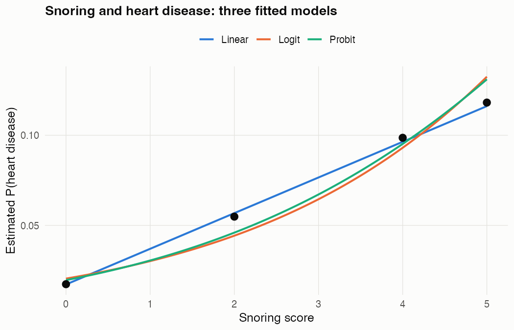
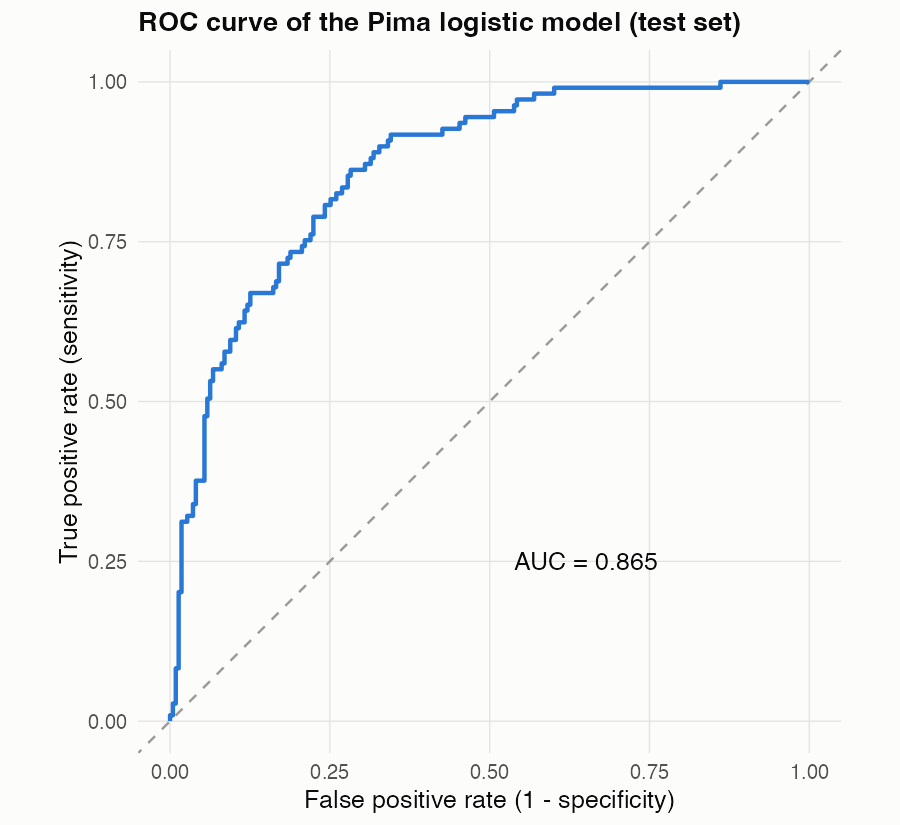

# 12장 — 로지스틱 회귀

[레포지토리 안내](../../README.ko.md) | [English](Concepts_Lecture.md) | [한국어](Concepts_Lecture.ko.md)

> **최종 수정일:** 2026-11-27
>
> An Introduction to Statistical Learning, James, Witten, Hastie, and Tibshirani, Ch 4

> **학습 목표:**
> 1. 이진 분류를 위해 로지스틱 회귀를 적용할 수 있다
> 2. 오즈비와 로그 오즈 계수를 해석할 수 있다
> 3. 혼동 행렬과 ROC 곡선을 사용하여 분류 모형을 평가할 수 있다
> 4. 다항 로지스틱 회귀로 세 개 이상의 클래스를 분류할 수 있다
> 5. 이탈도, 우도비 검정, Wald 검정으로 로지스틱 모형의 계수를 추론할 수 있다
> 6. 선형 확률 모형과 일반화 선형 모형의 관계를 설명하고 사례-대조 자료의 오즈비를 해석할 수 있다

---

## 목차

- [1. 동기: 분류 vs 회귀](#1-동기-분류-vs-회귀)
  - [1.1 분류 문제에 선형 회귀를 사용할 수 없는 이유](#11-분류-문제에-선형-회귀를-사용할-수-없는-이유)
  - [1.2 분류 문제의 설정](#12-분류-문제의-설정)
  - [1.3 선형 확률 모형](#13-선형-확률-모형)
  - [1.4 일반화 선형 모형의 세 성분](#14-일반화-선형-모형의-세-성분)
- [2. 로지스틱 함수(sigmoid)](#2-로지스틱-함수sigmoid)
  - [2.1 정의](#21-정의)
  - [2.2 성질](#22-성질)
  - [2.3 로지스틱 회귀 모형](#23-로지스틱-회귀-모형)
  - [2.4 곡선의 기울기와 중앙 유효 수준](#24-곡선의-기울기와-중앙-유효-수준)
  - [2.5 예제: 투구게의 부수체](#25-예제-투구게의-부수체)
- [3. 오즈와 로그 오즈](#3-오즈와-로그-오즈)
  - [3.1 오즈(Odds)](#31-오즈odds)
  - [3.2 로그 오즈(logit)](#32-로그-오즈logit)
  - [3.3 관계 요약](#33-관계-요약)
  - [3.4 확률, 오즈, 로그 오즈의 환산](#34-확률-오즈-로그-오즈의-환산)
  - [3.5 오즈비와 상대 위험](#35-오즈비와-상대-위험)
- [4. 최대 우도 추정](#4-최대-우도-추정)
  - [4.1 최소제곱법을 사용할 수 없는 이유](#41-최소제곱법을-사용할-수-없는-이유)
  - [4.2 우도 함수](#42-우도-함수)
  - [4.3 로그 우도](#43-로그-우도)
  - [4.4 R에서의 구현](#44-r에서의-구현)
  - [4.5 그룹화된 자료와 그룹화되지 않은 자료](#45-그룹화된-자료와-그룹화되지-않은-자료)
  - [4.6 예제: 코골이와 심장병](#46-예제-코골이와-심장병)
  - [4.7 이탈도와 우도비 검정](#47-이탈도와-우도비-검정)
  - [4.8 Wald 검정과 신뢰 구간](#48-wald-검정과-신뢰-구간)
  - [4.9 최대 우도 추정의 반복 계산](#49-최대-우도-추정의-반복-계산)
- [5. 모형 해석](#5-모형-해석)
  - [5.1 계수 해석](#51-계수-해석)
  - [5.2 오즈비(Odds Ratio)](#52-오즈비odds-ratio)
  - [5.3 R에서의 오즈비 계산](#53-r에서의-오즈비-계산)
  - [5.4 예제: 피마 인디언 당뇨 자료의 다중 로지스틱 회귀](#54-예제-피마-인디언-당뇨-자료의-다중-로지스틱-회귀)
  - [5.5 후향적 연구와 오즈비](#55-후향적-연구와-오즈비)
  - [5.6 다른 변수의 조정과 교란](#56-다른-변수의-조정과-교란)
- [6. 모형 평가](#6-모형-평가)
  - [6.1 예측 클래스](#61-예측-클래스)
  - [6.2 혼동 행렬(Confusion Matrix)](#62-혼동-행렬confusion-matrix)
  - [6.3 ROC 곡선과 AUC](#63-roc-곡선과-auc)
  - [6.4 R에서의 ROC 곡선](#64-r에서의-roc-곡선)
  - [6.5 예제: 피마 자료의 혼동 행렬](#65-예제-피마-자료의-혼동-행렬)
  - [6.6 임계값의 선택](#66-임계값의-선택)
  - [6.7 AUC의 확률적 해석](#67-auc의-확률적-해석)
- [7. 다항 로지스틱 회귀](#7-다항-로지스틱-회귀)
  - [7.1 다중 클래스로의 확장](#71-다중-클래스로의-확장)
  - [7.2 예측 확률](#72-예측-확률)
  - [7.3 R에서의 구현](#73-r에서의-구현)
  - [7.4 예제: 꽃받침 길이에 의한 붓꽃 분류](#74-예제-꽃받침-길이에-의한-붓꽃-분류)
- [8. 로지스틱 회귀의 흔한 실수](#8-로지스틱-회귀의-흔한-실수)
- [개념 적용](#개념-적용)
- [요약](#요약)
- [점검 문제](#점검-문제)
- [참고 문헌](#참고-문헌)

---

<br>

## 1. 동기: 분류 vs 회귀

### 1.1 분류 문제에 선형 회귀를 사용할 수 없는 이유

10장에서 다룬 선형 회귀는 연속형 반응 변수 $Y \in (-\infty, +\infty)$를 예측한다. 반응 변수가 **이진형**(예: Yes/No, 0/1)일 때 선형 회귀는 다음과 같은 치명적 한계를 갖는다:

- 예측값이 $[0, 1]$ 범위 **밖**으로 벗어날 수 있어 확률로 해석할 수 없다.
- 선형 모형은 예측 변수의 효과가 일정하다고 가정하는데, 이는 경계가 있는 결과에는 비현실적이다.
- 잔차가 이분산적이고 비정규적이어서 10장 5.3절에서 다룬 보통의 최소제곱법(OLS) 회귀의 가정을 위반한다.

### 1.2 분류 문제의 설정

| 측면 | 회귀 | 분류 |
|------|------|------|
| 반응 변수 | 연속형 ($Y \in \mathbb{R}$) | 범주형(이진 또는 다중 클래스) |
| 목표 | 수치 값 예측 | 클래스 레이블 예측 |
| 출력 | 점 추정값 | 클래스 소속 확률 |
| 예시 | 주택 가격 예측 | 질병 진단(환자 / 건강) |

*표 1. 회귀 문제와 분류 문제의 비교*

로지스틱 회귀는 **회귀 프레임워크**를 사용하여 **분류 문제**를 해결하는 가교 역할을 한다. 이는 $Y$가 특정 클래스에 속할 확률을 모형화한다.

### 1.3 선형 확률 모형

$Y$가 1("성공")과 0("실패")의 두 값만 갖는 이항 반응 변수이면 $Y$의 분포는 성공 확률 $P(Y = 1) = \pi$, 실패 확률 $P(Y = 0) = 1 - \pi$로 정해지는 Bernoulli 분포이고, 그 평균은 $E(Y) = \pi$이다. 그러므로 $Y$의 평균을 모형화한다는 것은 성공 확률을 모형화한다는 뜻이다. 10장의 선형 모형을 그대로 흉내 내어 성공 확률을 예측 변수의 일차식으로 두면 다음 모형이 된다.

```math
P(Y = 1) = \alpha + \beta_1 x_1 + \cdots + \beta_p x_p
```

> **용어 정의:** **선형 확률 모형(linear probability model)** 은 성공 확률을 예측 변수의 일차식으로 두는 이항 반응 모형으로, $x_1$ 이외의 변수를 고정했을 때 $\beta_1$은 $x_1$이 1단위 변할 때의 확률 $P(Y = 1)$의 변화량이다.

이 모형은 해석하기 쉽지만 중요한 구조적 결함이 있다. 확률은 0과 1 사이에 있어야 하는데 일차식은 실수 전체의 값을 가질 수 있으므로, $x$가 충분히 크거나 작으면 $P(Y = 1) < 0$이나 $P(Y = 1) > 1$을 예측한다. 그래서 선형 확률 모형은 $x$의 범위가 좁을 때만 쓸 수 있고, 예측 변수가 여럿인 대부분의 응용에는 더 복잡한 모형이 필요하다. 또한 이항 자료의 분산 $\pi(1 - \pi)$는 평균에 따라 달라지므로, 오차의 분산이 일정하다는 보통 최소제곱법의 가정(10장 5.5절)도 성립하지 않는다.

실제로 $P(Y = 1)$과 $x$의 관계는 선형이라기보다 대개 비선형이다. $x$가 같은 양만큼 변해도 $P(Y = 1)$이 0이나 1에 가까울 때보다 구간의 가운데에 있을 때 영향이 더 크다. 예를 들어 가구가 새 차를 사는지(1) 중고차를 사는지(0)를 가구의 연간 수입으로 모형화할 때, 수입이 10,000달러 늘어나는 효과는 $P(Y = 1)$이 이미 1에 가까운 연 수입 1,000,000달러의 가구보다 연 수입 50,000달러의 가구에서 더 크다. 이런 관계를 나타내는 것이 2절의 S자 곡선이다.

### 1.4 일반화 선형 모형의 세 성분

선형 회귀, 로지스틱 회귀, 도수 자료의 Poisson 회귀는 모두 **일반화 선형 모형**(generalized linear model, GLM)이라는 하나의 틀에 속한다. GLM은 다음 세 성분으로 이루어진다.

| 성분 | 내용 | 선형 회귀 | 로지스틱 회귀 |
|------|------|------|------|
| 랜덤 성분 | 반응 변수 $Y$의 확률 분포 | 정규분포 | 이항분포(Bernoulli 분포) |
| 체계적 성분 | 예측 변수의 선형 결합 $\alpha + \beta_1 x_1 + \cdots + \beta_p x_p$ | 같음 | 같음 |
| 연결 함수 | 평균 $\mu = E(Y)$를 선형 결합에 잇는 함수 $g(\mu)$ | 항등 함수 $g(\mu) = \mu$ | logit 함수 $g(\pi) = \log[\pi/(1 - \pi)]$ |

*표 2. 일반화 선형 모형의 세 성분*

보통의 선형 모형은 GLM에서 랜덤 성분이 정규분포이고 연결 함수가 항등 함수인 특별한 경우이다. GLM은 이 모형을 두 방향으로 일반화한다. 첫째, 랜덤 성분이 정규분포가 아닌 다른 분포를 가질 수 있고, 둘째, 평균 자체가 아니라 평균의 함수를 모형화할 수 있다. 범주형 자료를 분석하는 전통적인 방법은 $Y$를 적당히 변환해 정규분포에 가깝게 만든 뒤 최소제곱법을 쓰는 것이었지만, 분산을 일정하게 하는 변환이 정규성을 만족하지 못하거나 변환된 척도에서 선형 모형이 맞지 않는 경우가 많다. GLM은 연결 함수를 고르는 일과 랜덤 성분을 고르는 일을 분리하고 모수를 최대 우도법(4절)으로 추정하므로, 이런 변환이 필요 없다. 이항 분포에서는 logit이 분포의 자연 모수이므로 **정준 연결 함수**(canonical link)라고 하며, R의 `glm()`에서 `family = binomial`을 지정하면 기본으로 logit 연결을 쓴다.

---

<br>

## 2. 로지스틱 함수(sigmoid)

### 2.1 정의

**로지스틱 함수**(sigmoid 함수라고도 함)는 임의의 실수 입력을 구간 $(0, 1)$로 매핑한다:

```math
\sigma(z) = \frac{1}{1 + e^{-z}}
```

여기서 $z = \beta_0 + \beta_1 X_1 + \beta_2 X_2 + \cdots + \beta_p X_p$는 예측 변수의 선형 결합이다. $z$가 -6부터 6까지의 정수일 때 $\sigma(z)$를 소수 첫째 자리로 반올림하여 찍으면 다음과 같은 S자 곡선이 된다.

```text
P(Y=1)
1.0 |                                     *   *   *   *
0.9 |                                 *
0.8 |
0.7 |                             *
0.6 |
0.5 |                         *
0.4 |
0.3 |                     *
0.2 |
0.1 |                 *
0.0 | *   *   *   *
    +----------------------------------------------------> z
     -6      -4      -2       0       2       4       6
```

*그림 1. sigmoid 함수가 만드는 S자 곡선*

### 2.2 성질

| 성질 | 설명 |
|------|------|
| 치역 | $(0, 1)$, 항상 유효한 확률을 출력 |
| 단조성 | 순증가 |
| 대칭성 | $\sigma(-z) = 1 - \sigma(z)$ |
| 중점 | $\sigma(0) = 0.5$ |
| 도함수 | $\sigma'(z) = \sigma(z)(1 - \sigma(z))$ |

*표 3. sigmoid 함수의 성질*

### 2.3 로지스틱 회귀 모형

예측 변수가 주어졌을 때 반응 변수가 1일 확률은 다음과 같다:

```math
P(Y = 1 \mid X) = \frac{1}{1 + e^{-(\beta_0 + \beta_1 X_1 + \cdots + \beta_p X_p)}}
```

이를 통해 예측 변수 값에 관계없이 예측 확률이 항상 0과 1 사이에 있도록 보장한다.

### 2.4 곡선의 기울기와 중앙 유효 수준

예측 변수가 하나인 로지스틱 회귀 $\pi(x) = e^{\alpha + \beta x}/(1 + e^{\alpha + \beta x})$에서 $\beta$의 부호는 곡선이 증가하는지($\beta > 0$) 감소하는지($\beta < 0$)를 정하고, $|\beta|$가 클수록 곡선이 가파르게 변한다. $\beta = 0$이면 곡선은 수평선이 되고 $Y$는 $X$와 독립이다. 곡선은 직선이 아니므로 $x$가 1단위 변할 때 $\pi(x)$의 변화량은 $x$값에 따라 다르다. 특정 $x$에서 곡선에 접하는 직선의 기울기는 표 3의 도함수와 연쇄 법칙으로 구한다.

```math
\frac{d\pi(x)}{dx} = \beta \pi(x)[1 - \pi(x)]
```

예를 들어 $\pi(x) = 0.50$인 $x$에서 접선의 기울기는 $\beta(0.50)(0.50) = 0.25\beta$이고, $\pi(x) = 0.90$이나 0.10인 곳에서는 $0.09\beta$이다. 확률이 1이나 0에 가까워질수록 기울기는 0에 가까워진다. 기울기가 가장 큰 곳은 $\pi(x) = 0.50$인 점이며, $\alpha + \beta x = 0$을 풀어 그 $x$값이 $x = -\alpha/\beta$임을 안다.

> **용어 정의:** **중앙 유효 수준(median effective level)** 은 성공과 실패의 확률이 각각 50%가 되는 예측 변수의 값 $x = -\alpha/\beta$로, $\mathrm{EL}_{50}$이라고도 쓴다.

이 성질 때문에 로지스틱 회귀의 계수 $\beta$를 "확률의 변화량"으로 바로 읽을 수 없다. 접선의 기울기는 어디에서나 $\beta/4$ 이하이고, $\pi(x)$가 0이나 1에 가까운 곳에서는 그보다 훨씬 작다.

### 2.5 예제: 투구게의 부수체

암컷 투구게 173마리를 조사하여, 산란 둥지의 암컷 곁에 머무는 수컷인 부수체(satellite)가 한 마리 이상 있으면 $y = 1$, 없으면 $y = 0$으로 두고, 암컷의 등딱지 너비(cm)를 예측 변수로 삼았다. 너비는 21.0cm에서 33.5cm 사이에 있다. $y$를 $x$에 대해 그린 산점도는 $y = 1$과 $y = 0$ 두 수준에 점이 모여 있을 뿐이어서 로지스틱 곡선이 맞는지 판단하기 어렵다. 그래서 특정 함수 형태를 가정하지 않고 자료를 평활하는 일반화 가법 모형으로 곡선을 먼저 그려 보면, 너비가 커질수록 부수체가 있을 확률이 증가하는 S자에 가까운 모양이 나타난다. 로지스틱 회귀를 적합한 R 출력은 다음과 같다.

```text
              Estimate  Std. Error  z value  Pr(>|z|)
(Intercept)   -12.3508      2.6287   -4.698  2.62e-06
width           0.4972      0.1017    4.887  1.02e-06
```

따라서 너비가 $x$인 암컷이 부수체를 가질 확률의 추정식은 $\mathrm{logit}[\hat{\pi}(x)] = -12.351 + 0.497x$이고, 확률로는 다음과 같다.

```math
\hat{\pi}(x) = \frac{\exp(-12.351 + 0.497x)}{1 + \exp(-12.351 + 0.497x)}
```

$\hat{\beta} = 0.497 > 0$이므로 너비가 클수록 추정 확률이 커진다. 계산 과정은 다음과 같다.

```r
b0 <- -12.3508; b1 <- 0.4972
p <- function(x) exp(b0 + b1 * x) / (1 + exp(b0 + b1 * x))
round(c(p21 = p(21.0), p33.5 = p(33.5), p26.3 = p(26.3), p27.3 = p(27.3),
        median_effective = -b0 / b1, slope_at_mean = b1 * p(26.3) * (1 - p(26.3)),
        OR = exp(b1)), 4)
#>              p21            p33.5            p26.3            p27.3 
#>           0.1290           0.9867           0.6738           0.7725 
#> median_effective    slope_at_mean               OR 
#>          24.8407           0.1093           1.6441
c(odds26.3 = p(26.3) / (1 - p(26.3)), odds27.3 = p(27.3) / (1 - p(27.3)),
  ratio = (p(27.3) / (1 - p(27.3))) / (p(26.3) / (1 - p(26.3))))
#> odds26.3 odds27.3    ratio 
#> 2.065888 3.396549 1.644111
```

함수 `p(x)`는 추정식을 확률로 바꾼다. 가장 작은 너비 21.0cm의 추정 확률은 0.129, 가장 큰 너비 33.5cm에서는 0.987이므로, 자료의 범위 안에서 너비의 효과가 매우 크다. 중앙 유효 수준은 $`-\hat{\alpha}/\hat{\beta} = 12.351/0.497 = 24.8`$cm이다. 표본 평균 너비 26.3cm에서 추정 확률은 0.674이고, 이 점에서 곡선의 기울기는 $0.497 \times 0.674 \times 0.326 = 0.11$이다. 즉 평균 너비 근처에서는 너비가 1cm 늘 때 부수체가 있을 확률이 약 0.11 늘어난다.

오즈로 해석하면 더 간단하다. $e^{\hat{\beta}} = e^{0.497} = 1.64$이므로 너비가 1cm 늘 때마다 부수체가 있을 오즈가 1.64배, 곧 64% 늘어난다. 실제로 $x = 26.3$에서의 오즈는 $0.674/0.326 = 2.07$이고, $x = 27.3$에서는 추정 확률 0.773에 대한 오즈가 $0.773/0.227 = 3.40$이며, $3.40 = 2.07 \times 1.64$가 성립한다. 확률의 증가량은 $x$에 따라 다르지만 오즈의 배수는 어느 $x$에서나 같은 1.64이다.

---

<br>

## 3. 오즈와 로그 오즈

### 3.1 오즈(Odds)

사건의 **오즈**는 사건이 발생할 확률과 발생하지 않을 확률의 비율로 정의된다:

```math
\text{Odds} = \frac{P(Y=1)}{P(Y=0)} = \frac{P(Y=1)}{1 - P(Y=1)}
```

- $P = 0.8$이면 $\text{Odds} = 0.8 / 0.2 = 4$이다. 사건이 발생할 확률이 발생하지 않을 확률의 4배라는 뜻이다.
- 오즈의 범위는 $0$에서 $+\infty$까지이다.

### 3.2 로그 오즈(logit)

오즈의 자연 로그를 취하면 **logit** 함수가 된다:

```math
\text{logit}(P) = \log\left(\frac{P}{1-P}\right) = \beta_0 + \beta_1 X_1 + \cdots + \beta_p X_p
```

이것이 핵심 변환이다: $P$는 0과 1 사이에 제한되지만, 로그 오즈는 $(-\infty, +\infty)$로 **제한이 없어** 예측 변수의 선형 함수로 모형화할 수 있다.

### 3.3 관계 요약

```math
X \xrightarrow{\text{선형 결합}} z = \beta_0 + \beta X \xrightarrow{\text{sigmoid}} P = \sigma(z) \xrightarrow{\text{임계값}} \hat{Y} \in \{0, 1\}
```

즉 예측 변수의 선형 결합 $z$를 sigmoid 함수에 넣어 확률 $P$를 얻고, $P$를 임계값과 비교하여 예측 클래스 $\hat{Y}$를 정한다.

### 3.4 확률, 오즈, 로그 오즈의 환산

같은 사건의 가능성을 확률, 오즈, 로그 오즈의 세 척도로 나타낼 수 있다. 세 척도 사이의 환산은 다음과 같다.

```math
\text{Odds} = \frac{P}{1 - P}, \qquad P = \frac{\text{Odds}}{1 + \text{Odds}}, \qquad \text{logit}(P) = \log(\text{Odds}), \qquad P = \frac{1}{1 + e^{-\text{logit}(P)}}
```

| 확률 $P$ | 오즈 $P/(1 - P)$ | 로그 오즈 |
|------:|------:|------:|
| 0.01 | 0.0101 | -4.595 |
| 0.10 | 0.111 | -2.197 |
| 0.25 | 0.333 | -1.099 |
| 0.50 | 1 | 0 |
| 0.75 | 3 | 1.099 |
| 0.90 | 9 | 2.197 |
| 0.99 | 99 | 4.595 |

*표 4. 확률, 오즈, 로그 오즈의 대응*

확률이 0.5일 때 오즈는 1이고 로그 오즈는 0이다. 확률 $P$와 $1 - P$의 로그 오즈는 부호만 다르므로 로그 오즈는 0을 중심으로 대칭이다. 확률이 작을 때는 오즈와 확률이 거의 같지만(0.01과 0.0101), 확률이 커지면 오즈는 빠르게 커져 확률 0.99의 오즈는 99이다. 로그 오즈가 1 늘어나는 효과가 확률로는 0.5 근처에서 크고 0이나 1 근처에서 작은 것은 2.4절의 기울기 공식과 같은 내용이다.

### 3.5 오즈비와 상대 위험

두 집단의 확률을 비교하는 방법에는 차이, 비, 오즈비가 있다. 집단 1의 성공 확률을 $\pi_1$, 집단 2의 성공 확률을 $\pi_2$로 둔다.

| 비교 척도 | 정의 | 같은 확률일 때의 값 |
|------|------|------:|
| 확률의 차이 | $\pi_1 - \pi_2$ | 0 |
| 상대 위험(relative risk) | $\pi_1 / \pi_2$ | 1 |
| 오즈비(odds ratio) | $\dfrac{\pi_1/(1 - \pi_1)}{\pi_2/(1 - \pi_2)}$ | 1 |

*표 5. 두 확률을 비교하는 세 척도*

오즈비와 상대 위험은 서로 다른 양이다. 두 양 사이에는 $\text{OR} = \text{RR} \times (1 - \pi_2)/(1 - \pi_1)$의 관계가 있으므로, 두 확률이 모두 작으면 $(1 - \pi_2)/(1 - \pi_1)$이 1에 가까워 오즈비가 상대 위험의 근삿값이 된다. 예를 들어 $\pi_1 = 0.02$, $\pi_2 = 0.01$이면 상대 위험은 2이고 오즈비는 $(0.02/0.98)/(0.01/0.99) = 2.02$이다. 그러나 $\pi_1 = 0.6$, $\pi_2 = 0.3$이면 상대 위험은 2이지만 오즈비는 $(0.6/0.4)/(0.3/0.7) = 3.5$로 훨씬 크다. 로지스틱 회귀의 $e^{\beta}$는 오즈비이므로, 사건이 흔한 경우에 "위험이 $e^{\beta}$배"라고 말하면 효과를 과장하게 된다.

---

<br>

## 4. 최대 우도 추정

### 4.1 최소제곱법을 사용할 수 없는 이유

선형 회귀와 달리 로지스틱 회귀는 계수를 추정할 때 보통의 최소제곱법(OLS)을 **사용하지 않는다**. 그 이유는 다음과 같다:
- 반응 변수가 연속형이 아니라 이진형이다.
- 예측 변수와 $P(Y=1)$ 사이의 관계가 비선형이다.
- 최소제곱법은 확률 모형에 대해 의미 있는 추정을 주지 않는다.

### 4.2 우도 함수

$n$개의 관측값에 대해 **우도**는 모형 매개변수가 주어졌을 때 실제 데이터를 관측할 확률이다:

```math
L(\beta) = \prod_{i=1}^{n} P(Y_i = y_i \mid X_i) = \prod_{i=1}^{n} p_i^{y_i}(1 - p_i)^{1 - y_i}
```

여기서 $p_i = P(Y_i = 1 \mid X_i)$이다.

### 4.3 로그 우도

로그를 취하면 곱이 합으로 변환되어 최적화가 용이해진다:

```math
\ell(\beta) = \sum_{i=1}^{n} \left[ y_i \log(p_i) + (1 - y_i) \log(1 - p_i) \right]
```

최대 우도 추정(MLE)은 $\ell(\beta)$를 **최대화**하는 $\hat{\beta}$를 구한다. 이는 **Newton-Raphson** 또는 **반복 가중 최소제곱(IRLS)** 등의 알고리즘을 사용하여 반복적으로 풀이한다.

> **[미적분학]** 함수가 극댓값을 갖는 점에서는 각 변수에 대한 편미분이 0이므로, MLE $\hat{\beta}$는 $\partial \ell / \partial \beta_j = 0$을 만족한다. 표 3의 도함수 $\sigma'(z) = \sigma(z)(1 - \sigma(z))$와 연쇄 법칙을 쓰면 $\partial \ell / \partial \beta_j = \sum_{i=1}^{n} (y_i - p_i) x_{ij}$이다. 여기서 $x_{ij}$는 $i$번째 관측값의 $j$번째 예측 변수 값이고, 절편에 대해서는 $x_{i0} = 1$이다. $p_i$가 계수에 대해 비선형이므로 이 방정식은 10장의 최소제곱법과 달리 닫힌 형태로 풀리지 않고, Newton-Raphson처럼 기울기와 2차 도함수를 이용하는 반복 알고리즘으로 푼다. 로그 우도는 계수에 대해 위로 볼록한 함수이므로 기울기가 0인 점이 곧 최댓값이다.

### 4.4 R에서의 구현

```r
# 최대 우도를 사용한 로지스틱 회귀 적합
model <- glm(y ~ x1 + x2, data = mydata, family = binomial)
summary(model)
```

> **핵심:** `family = binomial`이 지정된 `glm()` 함수는 내부적으로 MLE를 사용한다. `summary()` 출력은 **로그 오즈** 척도에서 계수를 보고한다.

### 4.5 그룹화된 자료와 그룹화되지 않은 자료

표준적인 자료 파일은 행이 개체(예: 사람), 열이 변수를 나타내며, 이항 반응 변수의 열에는 1(성공)이나 0(실패)이 들어 있다. 이런 자료를 **그룹화되지 않은**(ungrouped) 자료라고 한다. 예측 변수가 모두 이산형이면 예측 변수 값의 조합마다 관측 수와 성공 수를 세어 적을 수 있으며, 이런 자료를 **그룹화된**(grouped) 자료라고 한다. 두 형식은 같은 정보를 담고 있으므로 같은 최대 우도 추정값을 준다. 4.6절의 코골이 자료는 4개 행의 그룹화된 자료이며, 이것을 사람마다 한 행인 그룹화되지 않은 자료로 바꾸면 2,484개 행이 된다. 그 가운데 코를 골지 않는 사람의 행이 1,379개이고, 그중 24개 행은 $y = 1$, 1,355개 행은 $y = 0$이다.

R의 `glm()`에 그룹화된 자료를 넣을 때는 반응 변수에 성공 비율 `yes / n`을 주고 `weights = n`으로 각 비율이 몇 개 관측값에 근거하는지를 알려 준다. `cbind(yes, no) ~ x`처럼 성공 수와 실패 수를 묶은 행렬을 반응 변수로 주어도 같은 결과를 얻는다.

### 4.6 예제: 코골이와 심장병

다음 표는 코골이가 심장병의 위험 요인일 수 있는지 알아보기 위한 역학 연구의 자료이다 [1]. 조사 대상자들은 배우자의 보고를 근거로 코골이 정도에 따라 네 범주로 분류되었고, 각 행의 관측값은 서로 독립인 이항 표본으로 간주한다. 코골이 범주에 점수 (0, 2, 4, 5)를 주었는데, 마지막 두 범주는 다른 인접한 범주 쌍보다 더 가깝다고 보았기 때문이다.

| 코골이 정도 | 점수 $x$ | 심장병 있음 | 심장병 없음 | 비율 |
|------|------:|------:|------:|------:|
| 전혀 골지 않음 | 0 | 24 | 1,355 | 0.017 |
| 가끔 | 2 | 35 | 603 | 0.055 |
| 거의 매일 밤 | 4 | 21 | 192 | 0.099 |
| 매일 밤 | 5 | 30 | 224 | 0.118 |

*표 6. 코골이 정도와 심장병의 관계*

이 자료에 로지스틱 회귀, 선형 확률 모형, probit 모형을 적합하여 비교한다. **probit 모형**(probit model)은 연결 함수로 표준정규분포의 누적 분포 함수의 역함수를 쓰는 모형으로, 로지스틱 모형과 거의 같은 S자 곡선을 준다.

```r
Heart <- data.frame(snoring = c("never", "occasional", "nearly_every_night", "every_night"),
                    yes = c(24, 35, 21, 30), no = c(1355, 603, 192, 224))
Heart$x <- c(0, 2, 4, 5)
Heart$n <- Heart$yes + Heart$no
fit_logit <- glm(yes / n ~ x, family = binomial(link = "logit"),
                 weights = n, data = Heart)
round(coef(summary(fit_logit)), 5)
#>             Estimate Std. Error   z value Pr(>|z|)
#> (Intercept) -3.86625    0.16621 -23.26061        0
#> x            0.39734    0.05001   7.94504        0
fit_probit <- glm(yes / n ~ x, family = binomial(link = "probit"),
                  weights = n, data = Heart)
fit_lin <- glm(yes / n ~ x, family = quasi(link = "identity", variance = "mu(1-mu)"),
               weights = n, data = Heart, start = c(0.02, 0.02))
round(coef(summary(fit_lin, dispersion = 1))[, 1:2], 6)
#>             Estimate Std. Error
#> (Intercept) 0.017247   0.003451
#> x           0.019778   0.002805
round(data.frame(x = Heart$x, observed = Heart$yes / Heart$n,
                 linear = fitted(fit_lin), logit = fitted(fit_logit),
                 probit = fitted(fit_probit)), 3)
#>   x observed linear logit probit
#> 1 0    0.017  0.017 0.021  0.020
#> 2 2    0.055  0.057 0.044  0.046
#> 3 4    0.099  0.096 0.093  0.095
#> 4 5    0.118  0.116 0.132  0.131
```

`yes / n`은 범주마다의 심장병 비율이고, `weights = n`은 그 비율이 몇 명에 근거하는지를 준다. `binomial(link = "logit")`과 `binomial(link = "probit")`은 연결 함수만 다른 두 이항 GLM이다. 이항 분포에는 항등 연결이 기본으로 제공되지 않으므로, 선형 확률 모형은 분산이 $\mu(1 - \mu)$인 `quasi` 패밀리에 항등 연결을 주어 적합하고, `start`로 반복 계산의 시작값을 준다. `summary(fit_lin, dispersion = 1)`은 분산 모수를 이항 분포처럼 1로 고정하여 표준 오차를 계산한다.

로지스틱 회귀의 추정식은 $\mathrm{logit}[\hat{P}(Y = 1)] = -3.866 + 0.397x$이다. $\hat{\beta} = 0.397 > 0$은 코골이가 심할수록 심장병 발병 가능성이 높아짐을 뜻한다. 선형 확률 모형의 추정식은 $\hat{P}(Y = 1) = 0.0172 + 0.0198x$이며, 해석은 간단하다. 코를 골지 않는 사람($x = 0$)의 추정 확률은 0.017이고, 가끔 코를 고는 사람($x = 2$)은 $2 \times 0.020 = 0.04$만큼 높으며, 거의 매일 밤 코를 고는 사람($x = 4$)은 0.08만큼 높다. 이 자료의 범위에서는 확률이 0.02\~0.13으로 작고 좁으므로 선형 확률 모형의 결함(1.3절)이 드러나지 않으며, 세 모형의 적합값이 모두 관측 비율과 비슷하다.



*그림 2. 코골이 자료에 적합한 선형, logit, probit 모형*

GLM에서 $E(Y)$의 추정값을 **적합값**(fitted value)이라고 한다. 그림 2에서 logit 모형과 probit 모형의 곡선은 거의 겹치며, 확률이 작은 이 범위에서는 S자 곡선의 아래쪽 일부만 보이므로 선형에 가까운 모양이다. 오즈비로 해석하면 코골이 점수가 1 늘 때마다 심장병의 오즈가 $e^{0.397} = 1.49$배가 되고, 점수 차가 2인 "가끔"과 "전혀"의 오즈비는 $e^{2 \times 0.397} = 2.21$이다.

### 4.7 이탈도와 우도비 검정

로지스틱 회귀에는 10장의 RSS에 해당하는 양으로 **이탈도**(deviance)를 쓴다. 이탈도는 적합한 모형의 최대 로그 우도를 $\ell(\hat{\beta})$라 할 때 $D = -2[\ell(\hat{\beta}) - \ell_{\text{포화}}]$로 정의되며, 포화 모형은 관측값(그룹화된 자료에서는 행)마다 모수를 하나씩 두어 자료를 완벽하게 맞히는 모형이다. 그룹화되지 않은 0/1 자료에서는 포화 모형의 로그 우도가 0이므로 이탈도가 $-2\ell(\hat{\beta})$와 같다. 이탈도는 작을수록 모형이 자료에 잘 맞는다.

`summary()`가 보고하는 **널 이탈도**(null deviance)는 절편만 있는 모형의 이탈도이고, **잔차 이탈도**(residual deviance)는 적합한 모형의 이탈도이다. 모형 A가 모형 B에 변수를 몇 개 더한 모형일 때, 더한 변수의 계수가 모두 0이라는 가설은 두 이탈도의 차이로 검정한다.

```math
G^2 = D_B - D_A = -2[\ell(\hat{\beta}_B) - \ell(\hat{\beta}_A)]
```

이것이 **우도비 검정**(likelihood ratio test)이다. 귀무가설이 참이면 $G^2$은 근사적으로 자유도가 더한 모수의 수인 카이제곱 분포를 따른다. 선형 회귀의 부분 F 검정(10장 4.7절)에 대응하며, R에서는 `anova(작은 모형, 큰 모형, test = "Chisq")`로 계산한다. 코골이 모형에서 기울기가 0이라는 가설을 검정하면 다음과 같다.

```r
c(null = fit_logit$null.deviance, residual = deviance(fit_logit),
  df_null = fit_logit$df.null, df_resid = fit_logit$df.residual)
#>      null  residual   df_null  df_resid 
#> 65.904481  2.808912  3.000000  2.000000
G2 <- fit_logit$null.deviance - deviance(fit_logit)
c(G2 = G2, p = pchisq(G2, df = 1, lower.tail = FALSE), wald_z2 = 7.94504^2)
#>           G2            p      wald_z2 
#> 6.309557e+01 1.969166e-15 6.312366e+01
```

절편만 있는 모형의 이탈도는 65.90(자유도 3)이고 코골이 점수를 넣은 모형의 이탈도는 2.81(자유도 2)이므로, $G^2 = 63.10$이고 자유도 1의 p값은 약 $2 \times 10^{-15}$이다. 코골이 점수는 심장병과 뚜렷한 관계가 있다. 이 자료는 그룹화된 자료이므로 잔차 이탈도 2.81은 네 범주의 비율을 모두 따로 맞히는 포화 모형과 비교한 값이기도 하다. 자유도 2의 카이제곱 분포에서 p값이 0.245이므로, 점수에 대해 logit이 선형이라는 모형이 자료와 어긋난다는 증거는 없다. 이처럼 범주마다 관측 수가 충분한 그룹화된 자료에서는 잔차 이탈도를 적합도 검정에 쓸 수 있지만, 그룹화되지 않은 0/1 자료의 잔차 이탈도는 근사가 맞지 않으므로 적합도 검정에 쓰지 않는다.

### 4.8 Wald 검정과 신뢰 구간

`summary()`의 `z value`는 **Wald 통계량** $z = \hat{\beta}_j / \mathrm{SE}(\hat{\beta}_j)$이다. 표본이 크면 최대 우도 추정량은 근사적으로 정규분포를 따르므로, 귀무가설 $\beta_j = 0$ 아래에서 $z$는 근사적으로 표준정규분포를 따르고, `Pr(>|z|)`는 그 양측 p값이다. 선형 회귀의 t 통계량(10장 2.9절)과 같은 역할이지만, 오차가 정규분포라는 가정에서 정확히 유도된 t 분포가 아니라 큰 표본의 근사이므로 `z`라고 표시한다. 코골이 모형의 $z = 7.945$를 제곱한 63.12는 4.7절의 우도비 통계량 63.10과 거의 같으며, 표본이 크면 두 검정은 같은 결론을 준다. 둘이 다르면 우도비 검정을 더 믿는다.

같은 근사로 $\beta_j$의 95% **Wald 신뢰 구간**은 $\hat{\beta}_j \pm 1.96 \cdot \mathrm{SE}(\hat{\beta}_j)$이고, 양 끝에 지수를 취하면 오즈비의 구간이 된다.

```r
b <- coef(summary(fit_logit))["x", ]
round(c(lower = b[["Estimate"]] - 1.96 * b[["Std. Error"]],
        upper = b[["Estimate"]] + 1.96 * b[["Std. Error"]]), 4)
#>  lower  upper 
#> 0.2993 0.4954
round(confint.default(fit_logit)["x", ], 4)
#>  2.5 % 97.5 % 
#> 0.2993 0.4954
round(suppressMessages(confint(fit_logit))["x", ], 4)
#>  2.5 % 97.5 % 
#> 0.2999 0.4964
round(exp(confint.default(fit_logit)["x", ]), 4)
#>  2.5 % 97.5 % 
#> 1.3489 1.6411
```

R의 `confint.default()`는 Wald 구간을, `confint()`는 우도 함수의 모양을 따라 구하는 **프로파일 우도 구간**을 계산한다. 이 자료처럼 표본이 크면 두 구간은 거의 같지만(0.299\~0.495와 0.300\~0.496), 표본이 작거나 추정값이 경계에 가까우면 프로파일 우도 구간이 더 정확하다. 마지막 줄의 오즈비 구간은 코골이 점수가 1 늘 때 심장병의 오즈가 1.35배에서 1.64배 사이로 늘어난다는 것을 보여 준다. 검정과 신뢰 구간의 원리 자체는 14장에서 다룬다.

### 4.9 최대 우도 추정의 반복 계산

4.3절의 미적분학 상자에서 본 것처럼 로지스틱 회귀의 우도 방정식 $\sum_i (y_i - p_i)x_{ij} = 0$은 닫힌 형태로 풀리지 않는다. `glm()`이 쓰는 **반복 가중 최소제곱**(iteratively reweighted least squares, IRLS)은 현재 추정값에서 로그 우도를 2차식으로 근사하고 그 최댓값으로 옮겨 가는 Newton-Raphson 방법을 가중 최소제곱의 형태로 쓴 것이다. 그룹화된 자료에서 $i$번째 행의 시행 수를 $n_i$, 성공 수를 $y_i$라 하면 한 번의 반복은 다음과 같다.

1. 현재 계수 $\boldsymbol{\beta}$로 선형 예측값 $\eta_i = \mathbf{x}_i^\top \boldsymbol{\beta}$와 확률 $p_i = 1/(1 + e^{-\eta_i})$를 구한다.
2. 가중치 $w_i = n_i p_i (1 - p_i)$와 작업 반응 변수 $z_i = \eta_i + (y_i - n_i p_i)/w_i$를 구한다.
3. $z_i$를 $\mathbf{x}_i$에 가중치 $w_i$로 회귀하여 새 계수 $\boldsymbol{\beta} = (\mathbf{X}^\top \mathbf{W} \mathbf{X})^{-1} \mathbf{X}^\top \mathbf{W} \mathbf{z}$를 얻는다.

이 과정을 계수가 거의 변하지 않을 때까지 되풀이한다. 코골이 자료에 직접 적용하면 다음과 같다.

```r
X <- cbind(1, c(0, 2, 4, 5))
y <- c(24, 35, 21, 30); n <- c(1379, 638, 213, 254)
beta <- c(0, 0)
for (it in 1:6) {
  eta <- drop(X %*% beta)
  p <- 1 / (1 + exp(-eta))
  W <- n * p * (1 - p)
  z <- eta + (y - n * p) / W
  beta <- drop(solve(t(X) %*% (W * X), t(X) %*% (W * z)))
  cat(sprintf("iteration %d: beta0 = %.5f, beta1 = %.5f\n", it, beta[1], beta[2]))
}
#> iteration 1: beta0 = -1.93251, beta1 = 0.08015
#> iteration 2: beta0 = -2.91445, beta1 = 0.19954
#> iteration 3: beta0 = -3.56823, beta1 = 0.32983
#> iteration 4: beta0 = -3.83190, beta1 = 0.38960
#> iteration 5: beta0 = -3.86576, beta1 = 0.39723
#> iteration 6: beta0 = -3.86625, beta1 = 0.39734
sqrt(diag(solve(t(X) %*% (W * X))))
#> [1] 0.16618051 0.05000501
```

`X`는 절편 열과 점수 열로 된 설계 행렬, `y`와 `n`은 범주별 심장병 수와 인원이다. 반복문 안의 네 줄이 위의 단계 1\~3이며, `W * X`는 `X`의 각 행에 가중치를 곱한 것으로 $\mathbf{W}\mathbf{X}$와 같다. 계수 0에서 시작해 여섯 번 만에 `glm()`의 추정값 -3.86625, 0.39734에 도달하며, 마지막 몇 번의 반복에서는 정확한 자릿수가 빠르게 늘어난다. Newton-Raphson 방법은 해 근처에서 이렇게 2차 수렴한다. 수렴한 점에서 $(\mathbf{X}^\top \mathbf{W} \mathbf{X})^{-1}$은 추정량의 근사 공분산 행렬이고, 그 대각 원소의 제곱근이 표준 오차이다. 마지막 줄의 0.1662와 0.0500은 직전 반복의 가중치로 계산한 값이어서 `summary()`의 0.16621, 0.05001과 소수 넷째 자리까지 같다. 로그 우도가 계수에 대해 위로 볼록하므로 시작값과 관계없이 같은 최댓값에 수렴하지만, 자료가 완전히 분리되면(8절) 최댓값이 존재하지 않아 계수가 계속 커진다.

---

<br>

## 5. 모형 해석

### 5.1 계수 해석

로지스틱 회귀에서 계수는 예측 변수가 1단위 증가할 때 **로그 오즈**의 변화를 나타낸다:

```math
\log\left(\frac{P}{1-P}\right) = \beta_0 + \beta_1 X_1
```

- $\beta_0$: 모든 예측 변수가 0일 때 $Y=1$의 로그 오즈이다.
- $\beta_k$: 다른 변수를 고정했을 때 $X_k$가 1단위 증가하면 로그 오즈가 $\beta_k$만큼 변한다.

### 5.2 오즈비(Odds Ratio)

계수를 지수화하면 **오즈비**를 얻는다:

```math
\text{OR}_k = e^{\beta_k}
```

| $\beta_k$ | $e^{\beta_k}$ | 해석 |
|-----------|---------------|------|
| 양수 | $> 1$ | 예측 변수가 $Y=1$의 오즈를 **증가**시킴 |
| 0 | $= 1$ | 예측 변수가 **효과 없음** |
| 음수 | $< 1$ | 예측 변수가 $Y=1$의 오즈를 **감소**시킴 |

*표 7. 계수의 부호에 따른 오즈비의 해석*

예를 들어, $\beta_1 = 0.693$이면 $e^{0.693} \approx 2.0$이므로, $X_1$이 1단위 증가할 때 $Y=1$의 오즈가 **2배**가 된다. 2배가 되는 것은 확률이 아니라 오즈이다.

### 5.3 R에서의 오즈비 계산

```r
# 95% 신뢰 구간과 함께 오즈비 구하기
exp(coef(model))
exp(confint(model))
```

`coef(model)`은 로그 오즈 척도의 계수이므로 `exp()`를 취하면 오즈비가 되고, `confint(model)`이 주는 계수의 95% 신뢰 구간 양 끝에 `exp()`를 취하면 오즈비의 95% 신뢰 구간이 된다.

### 5.4 예제: 피마 인디언 당뇨 자료의 다중 로지스틱 회귀

`MASS` 패키지의 `Pima.tr`과 `Pima.te`는 미국 애리조나주 피닉스 부근에 사는 21세 이상 피마 인디언 여성의 당뇨 검사 자료로, 각각 200명과 332명이 들어 있다. 반응 변수 `type`은 세계보건기구 기준의 당뇨 여부(`Yes`, `No`)이고, 예측 변수는 임신 횟수(`npreg`), 경구 포도당 부하 검사의 혈장 포도당 농도(`glu`), 이완기 혈압(`bp`), 삼두근 피부 두께(`skin`), 체질량 지수(`bmi`), 당뇨 가계 내력 함수(`ped`), 나이(`age`)이다. `Pima.tr`을 훈련 세트, `Pima.te`를 검증 세트로 쓴다.

```r
data(Pima.tr, package = "MASS"); data(Pima.te, package = "MASS")
dim(Pima.tr); dim(Pima.te)
#> [1] 200   8
#> [1] 332   8
table(Pima.tr$type)
#> 
#>  No Yes 
#> 132  68
```

훈련 세트의 당뇨 환자는 68명(34%)이다. 다섯 예측 변수로 로지스틱 회귀를 적합한다.

```r
fit_pima <- glm(type ~ npreg + glu + bmi + ped + age, data = Pima.tr, family = binomial)
summary(fit_pima)
#> 
#> Call:
#> glm(formula = type ~ npreg + glu + bmi + ped + age, family = binomial, 
#>     data = Pima.tr)
#> 
#> Coefficients:
#>              Estimate Std. Error z value Pr(>|z|)    
#> (Intercept) -9.938059   1.541571  -6.447 1.14e-10 ***
#> npreg        0.103142   0.064517   1.599  0.10989    
#> glu          0.031809   0.006667   4.771 1.83e-06 ***
#> bmi          0.079672   0.032649   2.440  0.01468 *  
#> ped          1.811417   0.661048   2.740  0.00614 ** 
#> age          0.039286   0.020967   1.874  0.06097 .  
#> ---
#> Signif. codes:  0 '***' 0.001 '**' 0.01 '*' 0.05 '.' 0.1 ' ' 1
#> 
#> (Dispersion parameter for binomial family taken to be 1)
#> 
#>     Null deviance: 256.41  on 199  degrees of freedom
#> Residual deviance: 178.47  on 194  degrees of freedom
#> AIC: 190.47
#> 
#> Number of Fisher Scoring iterations: 5
```

`type`이 팩터이므로 `glm()`은 첫 수준 `No`를 0, 둘째 수준 `Yes`를 1로 두고 당뇨일 확률을 모형화한다. 출력의 `Dispersion parameter ... taken to be 1`은 이항 분포의 분산이 평균으로 정해지므로 따로 추정할 분산 모수가 없다는 뜻이고, `Fisher Scoring iterations: 5`는 4.9절의 반복 알고리즘이 5번 만에 수렴했다는 뜻이다. AIC 190.47은 $178.47 + 2 \times 6$으로, 10장 6.4절의 정의에서 모수가 6개인 경우이다.

다른 변수를 고정하면 혈장 포도당 농도가 1단위 높을 때 당뇨의 로그 오즈가 0.0318 늘어난다. 이 효과를 오즈비와 신뢰 구간으로 나타낸다.

```r
round(cbind(OR = exp(coef(fit_pima)), exp(confint.default(fit_pima))), 4)
#>                 OR  2.5 %  97.5 %
#> (Intercept) 0.0000 0.0000  0.0010
#> npreg       1.1086 0.9770  1.2581
#> glu         1.0323 1.0189  1.0459
#> bmi         1.0829 1.0158  1.1545
#> ped         6.1191 1.6750 22.3549
#> age         1.0401 0.9982  1.0837
exp(10 * coef(fit_pima)["glu"])
#>      glu 
#> 1.374497
```

포도당 농도의 오즈비 1.032는 1단위당 오즈가 3.2% 늘어난다는 뜻인데, 포도당 농도의 값은 수십에서 200 가까이에 걸쳐 있어 1단위는 매우 작은 변화이므로 현실적인 단위로 바꾸어 읽는 것이 좋다. 10단위 높으면 오즈는 $e^{10 \times 0.0318} = 1.37$배가 된다. 체질량 지수가 1 높으면 오즈가 1.08배, 가계 내력 함수가 1 높으면 6.12배이다. 가계 내력 함수의 오즈비가 커 보이는 것은 검증 세트에서 이 변수의 중간 50%가 약 0.27\~0.68 사이에 있어 1단위 변화가 매우 큰 변화이기 때문이다. 임신 횟수와 나이의 오즈비 신뢰 구간은 1을 포함하므로 5% 수준에서 유의하지 않다(p = 0.110, 0.061).

두 변수를 함께 뺄 수 있는지는 4.7절의 우도비 검정으로 판단한다. `ped`와 `age`를 뺀 모형과 비교하면 다음과 같다.

```r
fit_small <- glm(type ~ npreg + glu + bmi, data = Pima.tr, family = binomial)
anova(fit_small, fit_pima, test = "Chisq")
#> Analysis of Deviance Table
#> 
#> Model 1: type ~ npreg + glu + bmi
#> Model 2: type ~ npreg + glu + bmi + ped + age
#>   Resid. Df Resid. Dev Df Deviance Pr(>Chi)   
#> 1       196     189.89                        
#> 2       194     178.47  2   11.415 0.003321 **
#> ---
#> Signif. codes:  0 '***' 0.001 '**' 0.01 '*' 0.05 '.' 0.1 ' ' 1
```

두 변수를 더하면 이탈도가 11.415 줄고 자유도 2의 p값이 0.0033이므로, 두 계수가 모두 0이라는 가설을 기각한다. 나이 하나만 보면 p = 0.061로 유의하지 않았지만 가계 내력 함수와 함께 넣으면 뚜렷한 개선이 있다. 널 이탈도 256.41에서 잔차 이탈도 178.47로의 감소 77.94는 다섯 예측 변수 전체에 대한 우도비 통계량이며, 선형 회귀의 F 검정(10장 4.7절)에 해당한다.

### 5.5 후향적 연구와 오즈비

로지스틱 회귀는 반응 변수 $Y$가 아니라 예측 변수 $X$를 무작위로 뽑은 자료에도 쓸 수 있다는 특징이 있다. 많은 생물의학 연구, 특히 역학 연구는 **사례-대조 연구**(case-control study)를 자주 사용한다. 이 설계에서는 병이 있는 사람($Y = 1$, 사례)과 병이 없는 사람($Y = 0$, 대조)을 미리 정한 수만큼 모은 뒤 각 사람의 과거 노출 $X$를 조사한다. 즉 $X$가 주어졌을 때의 $Y$가 아니라 $Y$가 주어졌을 때의 $X$를 관측하는 **후향적**(retrospective) 자료이다.

이런 자료에서도 오즈비는 추정할 수 있다. 2×2 표에서 $Y$가 주어졌을 때 $X$의 오즈비와 $X$가 주어졌을 때 $Y$의 오즈비가 같기 때문이다. 로지스틱 회귀의 계수는 오즈비와 관련되므로, 후향적 자료에 로지스틱 회귀를 적합하면 관심 있는 예측 변수의 효과 $e^{\beta}$를 제대로 추정할 수 있다. 예를 들어 폐암 환자 709명의 사례와 그에 대응하는 709명의 대조를 비교한 사례-대조 연구에서 흡연 여부($x = 1$은 흡연자, $x = 0$은 비흡연자)에 대한 오즈비는 3.0이었으며, 이 값은 $\mathrm{logit}[P(Y = 1)] = \alpha + \beta x$ 모형의 $e^{\beta}$에 대한 추정값으로 볼 수 있다.

그러나 절편 $\alpha$는 제대로 추정할 수 없다. $\alpha$는 $x$가 주어졌을 때의 $Y$의 분포, 곧 병에 걸릴 절대적 확률과 관련되는데, 사례-대조 연구에서는 사례와 대조의 비율을 연구자가 정하므로(이 예에서는 1:1) 그 확률이 표본에 반영되지 않기 때문이다. 따라서 사례-대조 자료로 적합한 로지스틱 회귀로 개인의 발병 확률을 예측하면 안 되며, 오즈비만 해석한다. 오즈비와 달리 상대 위험(3.5절)은 사례-대조 자료로 추정할 수 없다. 이것이 역학에서 오즈비가 널리 쓰이는 이유 가운데 하나이다.

### 5.6 다른 변수의 조정과 교란

다중 로지스틱 회귀의 계수도 10장 3.7절의 다중 회귀와 마찬가지로 함께 넣은 다른 변수를 고정한 조건부 효과이다. 피마 자료에서 임신 횟수 하나로 당뇨를 예측하면 계수가 0.169(p = 0.0002)로 뚜렷하게 유의하지만, 나이를 함께 넣으면 0.054(p = 0.34)로 줄어든다.

```r
round(coef(summary(glm(type ~ npreg, data = Pima.tr, family = binomial)))["npreg", ], 4)
#>   Estimate Std. Error    z value   Pr(>|z|) 
#>     0.1688     0.0460     3.6707     0.0002
round(coef(summary(glm(type ~ npreg + age, data = Pima.tr, family = binomial)))["npreg", ], 4)
#>   Estimate Std. Error    z value   Pr(>|z|) 
#>     0.0539     0.0562     0.9599     0.3371
round(cor(Pima.tr$npreg, Pima.tr$age), 3)
#> [1] 0.599
```

임신 횟수와 나이의 상관계수는 0.599로, 나이가 많은 여성일수록 임신 횟수가 많다. 나이는 당뇨의 위험과도 관련되므로, 임신 횟수만 넣은 모형의 계수에는 나이의 효과가 섞여 있다. 이처럼 예측 변수와 반응 변수 모두에 관련된 제3의 변수가 겉보기 연관을 만드는 것을 **교란**(confounding)이라고 하며, 그 변수를 교란 변수라고 한다. 나이를 고정하면 임신 횟수의 추가적인 효과는 작고 유의하지 않다. 그러므로 로지스틱 회귀의 오즈비를 보고할 때는 어떤 변수로 조정한 값인지를 함께 밝혀야 한다. 13장의 Simpson의 역설은 교란이 연관의 방향까지 뒤집는 극단적인 경우이다.

---

<br>

## 6. 모형 평가

### 6.1 예측 클래스

**결정 임계값**(일반적으로 0.5)이 예측 확률을 클래스 레이블로 변환한다:

```math
\hat{Y} = \begin{cases} 1 & \text{if } P(Y=1 \mid X) \geq 0.5 \\ 0 & \text{otherwise} \end{cases}
```

임계값을 바꾸면 양성으로 예측하는 관측값의 수가 달라지며, 6.3절의 ROC 곡선은 모든 임계값에서의 성능을 한꺼번에 보여 준다.

### 6.2 혼동 행렬(Confusion Matrix)

혼동 행렬은 분류 성능을 요약한다:

|  | 예측 양성 | 예측 음성 |
|--|-----------|-----------|
| **실제 양성** | 참 양성 (TP) | 거짓 음성 (FN) |
| **실제 음성** | 거짓 양성 (FP) | 참 음성 (TN) |

*표 8. 이진 분류의 혼동 행렬*

혼동 행렬에서 도출되는 주요 지표:

| 지표 | 수식 | 설명 |
|------|------|------|
| **정확도(Accuracy)** | $\frac{TP + TN}{TP + TN + FP + FN}$ | 전체 정답 비율 |
| **민감도 또는 재현율(Sensitivity, Recall)** | $\frac{TP}{TP + FN}$ | 참 양성 비율 |
| **특이도(Specificity)** | $\frac{TN}{TN + FP}$ | 참 음성 비율 |
| **정밀도(Precision)** | $\frac{TP}{TP + FP}$ | 양성 예측 정확도 |
| **F1 점수** | $\frac{2 \cdot \text{Precision} \cdot \text{Recall}}{\text{Precision} + \text{Recall}}$ | 정밀도와 재현율의 조화 평균 |

*표 9. 혼동 행렬에서 도출되는 분류 지표*

### 6.3 ROC 곡선과 AUC

**수신자 조작 특성(ROC)** 곡선은 다양한 임계값에서 참 양성 비율(TPR, 민감도)과 거짓 양성 비율(FPR, 1 - 특이도)을 도시한다.

- 완벽한 분류기는 좌상단 모서리(TPR = 1, FPR = 0)를 지난다.
- 무작위 분류기는 대각선을 따른다.
- **곡선 아래 면적(AUC)** 은 모형의 전반적 성능을 0과 1 사이의 값으로 정량화하며, 흔히 쓰는 경험적 기준은 다음과 같다:

| AUC | 모형 품질 |
|-----|-----------|
| $[0.9, 1.0]$ | 우수 |
| $[0.8, 0.9)$ | 양호 |
| $[0.7, 0.8)$ | 보통 |
| $[0.6, 0.7)$ | 미흡 |
| 0.5 | 판별 불가(무작위) |

*표 10. AUC에 따른 모형 품질의 경험적 기준*

### 6.4 R에서의 ROC 곡선

```r
library(pROC)
roc_obj <- roc(actual, predicted_prob)
plot(roc_obj, main = "ROC Curve", col = "blue", lwd = 2)
auc(roc_obj)
```

`roc()`는 실제 클래스와 예측 확률로 ROC 곡선을 계산하고, `auc()`는 그 곡선 아래 면적을 구한다.

### 6.5 예제: 피마 자료의 혼동 행렬

5.4절의 모형으로 검증 세트 332명의 당뇨 확률을 예측하고, 임계값 0.5로 분류한다.

```r
prob <- predict(fit_pima, newdata = Pima.te, type = "response")
head(round(prob, 3))
#>     1     2     3     4     5     6 
#> 0.762 0.041 0.026 0.039 0.791 0.727
pred <- factor(ifelse(prob >= 0.5, "Yes", "No"), levels = c("No", "Yes"))
tab <- table(Predicted = pred, Actual = Pima.te$type)
tab
#>          Actual
#> Predicted  No Yes
#>       No  199  42
#>       Yes  24  67
```

`predict()`에 `type = "response"`를 주면 로그 오즈가 아니라 확률을 돌려준다(기본값 `"link"`는 로그 오즈). `ifelse()`로 확률이 0.5 이상이면 `Yes`, 아니면 `No`로 바꾸고, `factor()`의 `levels`로 두 수준의 순서를 고정한다. 수준을 고정하지 않으면 한쪽 클래스로만 예측될 때 표의 행이 하나 빠진다. `table()`은 예측 클래스를 행, 실제 클래스를 열로 하는 혼동 행렬을 만든다. 당뇨를 양성으로 보면 TP = 67, FN = 42, FP = 24, TN = 199이다.

```r
TP <- tab["Yes", "Yes"]; TN <- tab["No", "No"]; FP <- tab["Yes", "No"]; FN <- tab["No", "Yes"]
round(c(accuracy = (TP + TN) / sum(tab), sensitivity = TP / (TP + FN),
        specificity = TN / (TN + FP), precision = TP / (TP + FP),
        F1 = 2 * TP / (2 * TP + FP + FN), no_info = max(table(Pima.te$type)) / nrow(Pima.te)), 4)
#>    accuracy sensitivity specificity   precision          F1     no_info 
#>      0.8012      0.6147      0.8924      0.7363      0.6700      0.6717
```

정확도는 $(67 + 199)/332 = 0.801$이다. 그러나 검증 세트의 비당뇨인 비율이 $223/332 = 0.672$이므로, 모든 사람을 비당뇨로 예측하는 모형도 67.2%의 정확도를 얻는다. 이 값을 **무정보 비율**(no information rate)이라 하며, 모형의 정확도는 이 기준과 비교해야 의미가 있다. 민감도는 $67/109 = 0.615$로, 실제 당뇨 환자 109명 가운데 39%를 놓친다. 특이도는 $199/223 = 0.892$이고 정밀도는 $67/91 = 0.736$이다. 이처럼 클래스의 크기가 다를 때 정확도 하나는 소수 클래스의 성능을 가리므로 민감도와 특이도를 함께 보고한다.

### 6.6 임계값의 선택

임계값 0.5는 두 종류의 오류의 비용이 같다고 볼 때의 자연스러운 선택이지만, 반드시 0.5를 쓸 필요는 없다. 당뇨를 놓치는 것(FN)이 건강한 사람을 재검사하게 하는 것(FP)보다 훨씬 나쁘다면 임계값을 낮추어 민감도를 높인다.

```r
for (thr in c(0.3, 0.5, 0.7)) {
  pr <- factor(ifelse(prob >= thr, "Yes", "No"), levels = c("No", "Yes"))
  tb <- table(pr, Pima.te$type)
  cat(sprintf("threshold %.1f: sensitivity %.3f, specificity %.3f\n", thr,
              tb["Yes", "Yes"] / sum(tb[, "Yes"]), tb["No", "No"] / sum(tb[, "No"])))
}
#> threshold 0.3: sensitivity 0.807, specificity 0.758
#> threshold 0.5: sensitivity 0.615, specificity 0.892
#> threshold 0.7: sensitivity 0.422, specificity 0.946
```

`for` 반복문은 임계값 0.3, 0.5, 0.7마다 혼동 행렬을 다시 만들고, `sprintf()`로 민감도와 특이도를 소수 셋째 자리까지 출력한다. 임계값을 0.5에서 0.3으로 낮추면 민감도는 0.615에서 0.807로 오르고 특이도는 0.892에서 0.758로 내려간다. 민감도와 특이도는 한쪽을 높이면 다른 쪽이 낮아지는 관계에 있으며, 어느 임계값이 좋은지는 자료가 아니라 두 오류의 상대적 비용이 정한다. 비용을 모를 때 흔히 쓰는 기준은 민감도와 특이도의 합이 가장 큰 점, 곧 **Youden 지수** $J = \text{민감도} + \text{특이도} - 1$이 가장 큰 임계값이다.

```r
roc_obj <- roc(Pima.te$type, prob, levels = c("No", "Yes"), direction = "<")
auc(roc_obj)
#> Area under the curve: 0.8652
ci.auc(roc_obj)
#> 95% CI: 0.8255-0.9049 (DeLong)
coords(roc_obj, "best", ret = c("threshold", "sensitivity", "specificity"))
#>   threshold sensitivity specificity
#> 1 0.2480398   0.8623853   0.7174888
```

`roc()`의 `levels`는 음성과 양성 클래스의 순서이고, `direction = "<"`는 양성의 예측 확률이 더 크다는 뜻이다. `coords(..., "best")`는 기본으로 Youden 지수가 가장 큰 임계값을 찾으며, 이 자료에서는 약 0.248이다. 이때 민감도는 0.862, 특이도는 0.717이다. 같은 검증 세트로 임계값을 고르고 그 성능을 보고하면 성능이 과대평가되므로, 엄밀하게는 임계값을 고르는 자료와 평가하는 자료를 나누어야 한다.

### 6.7 AUC의 확률적 해석

이 모형의 AUC는 0.865이고, 95% 신뢰 구간은 0.826\~0.905이다. 표 10의 기준으로는 양호한 판별 성능이다.



*그림 3. 피마 자료 로지스틱 모형의 검증 세트 ROC 곡선*

AUC에는 직관적인 확률적 해석이 있다. 양성 개체 하나와 음성 개체 하나를 무작위로 하나씩 뽑았을 때 양성 개체의 예측 확률이 더 클 확률이 AUC이다(같으면 절반으로 센다). 이 해석대로 직접 계산하면 `auc()`와 같은 값이 나온다.

```r
pos <- prob[Pima.te$type == "Yes"]; neg <- prob[Pima.te$type == "No"]
mean(outer(pos, neg, ">") + 0.5 * outer(pos, neg, "=="))
#> [1] 0.8651829
```

`outer(pos, neg, ">")`는 당뇨 환자 109명과 비당뇨인 223명의 모든 쌍($109 \times 223 = 24{,}307$쌍)에 대해 환자의 예측 확률이 더 큰지를 담은 행렬이고, 그 평균이 순위가 맞게 매겨진 쌍의 비율이다. 그러므로 AUC는 예측 확률의 순위만 보며, 확률 값 자체가 실제 비율과 맞는지(보정)는 평가하지 않는다. 또한 AUC는 모든 임계값을 요약한 값이므로, 실제로 쓸 임계값에서의 민감도와 특이도는 따로 보고해야 한다.

---

<br>

## 7. 다항 로지스틱 회귀

### 7.1 다중 클래스로의 확장

반응 변수의 범주가 세 개 이상일 때($K > 2$), **다항 로지스틱 회귀**가 이진 모형을 일반화한다. 하나의 범주가 **참조**(기준) 범주로 지정되며, 모형은 $K - 1$개의 계수 세트를 추정한다.

참조 범주 $K$에 대한 범주 $k$의 경우:

```math
\log\left(\frac{P(Y = k)}{P(Y = K)}\right) = \beta_{k0} + \beta_{k1} X_1 + \cdots + \beta_{kp} X_p
```

### 7.2 예측 확률

각 클래스의 확률은 **softmax** 함수를 사용하여 계산된다:

```math
P(Y = k \mid X) = \frac{e^{z_k}}{\sum_{j=1}^{K} e^{z_j}}
```

여기서 $z_k = \beta_{k0} + \beta_{k1} X_1 + \cdots + \beta_{kp} X_p$이고 $z_K = 0$(참조 범주)이다.

### 7.3 R에서의 구현

```r
library(nnet)
multi_model <- multinom(Species ~ ., data = iris)
summary(multi_model)

# 예측 확률
predict(multi_model, newdata = iris[1:5, ], type = "probs")
```

> **핵심:** `nnet` 패키지의 `multinom()` 함수는 다항 로지스틱 회귀를 적합한다. 참조 범주가 아닌 각 클래스는 자체적인 계수 세트를 갖는다. `multinom()`은 반응 변수 팩터의 첫 번째 수준(iris에서는 setosa)을 참조 범주로 삼는다.

### 7.4 예제: 꽃받침 길이에 의한 붓꽃 분류

꽃받침 길이(`Sepal.Length`) 하나로 붓꽃의 세 품종을 분류하는 다항 로지스틱 회귀를 적합한다.

```r
library(nnet)
multi_model <- multinom(Species ~ Sepal.Length, data = iris, trace = FALSE)
round(coef(multi_model), 3)
#>            (Intercept) Sepal.Length
#> versicolor     -26.083        4.816
#> virginica      -38.768        6.848
round(predict(multi_model, newdata = data.frame(Sepal.Length = c(5, 6, 7)),
              type = "probs"), 4)
#>   setosa versicolor virginica
#> 1 0.8728     0.1178    0.0094
#> 2 0.0359     0.5985    0.3655
#> 3 0.0001     0.1767    0.8232
table(Predicted = predict(multi_model), Actual = iris$Species)
#>             Actual
#> Predicted    setosa versicolor virginica
#>   setosa         45          6         1
#>   versicolor      5         30        12
#>   virginica       0         14        37
```

`trace = FALSE`는 반복 계산 과정의 출력을 끈다. 참조 범주는 setosa이므로 두 행은 각각 $\log[P(\text{versicolor})/P(\text{setosa})] = -26.083 + 4.816x$와 $\log[P(\text{virginica})/P(\text{setosa})] = -38.768 + 6.848x$이다. 꽃받침 길이가 1cm 길면 setosa에 대한 versicolor의 오즈가 $e^{4.816} \approx 123$배, virginica의 오즈가 $e^{6.848} \approx 942$배가 된다. 두 logit의 차이 $-12.685 + 2.032x$는 versicolor에 대한 virginica의 로그 오즈이므로, 참조 범주를 바꾸어도 모형은 같고 계수의 표현만 달라진다.

꽃받침 길이가 5cm인 꽃의 확률을 7.2절의 softmax로 구하면 $z_{\text{versicolor}} = -26.083 + 4.816 \times 5 = -2.003$, $z_{\text{virginica}} = -38.768 + 6.848 \times 5 = -4.528$, $z_{\text{setosa}} = 0$이다. 따라서 $P(\text{setosa}) = 1/(1 + e^{-2.003} + e^{-4.528}) = 1/(1 + 0.1349 + 0.0108) = 0.873$이고, 나머지 두 확률은 $0.1349 \times 0.873 = 0.118$과 $0.0108 \times 0.873 = 0.009$이다. `predict()`는 각 꽃을 확률이 가장 큰 품종으로 분류하며, 혼동 행렬에서 150송이 가운데 $45 + 30 + 37 = 112$송이(74.7%)를 맞힌다. 꽃받침 길이만으로는 versicolor와 virginica가 많이 겹치므로 둘 사이의 오분류가 대부분이다.

---

<br>

## 8. 로지스틱 회귀의 흔한 실수

- **계수를 확률의 변화량으로 읽는다.** $\beta$는 로그 오즈의 변화량이고 $e^{\beta}$는 오즈의 배수이다. 확률의 변화량은 $\beta\pi(1 - \pi)$로 위치에 따라 다르다(2.4절).
- **오즈비를 상대 위험으로 말한다.** 사건이 흔하면 오즈비는 상대 위험보다 훨씬 크다(3.5절). "오즈가 2배"를 "위험이 2배"로 바꾸어 말하지 않는다.
- **정확도만으로 분류 모형을 평가한다.** 클래스가 불균형하면 다수 클래스만 예측해도 정확도가 높다. 무정보 비율과 비교하고 민감도, 특이도, 정밀도를 함께 본다(6.5절).
- **임계값 0.5를 당연하게 쓴다.** 두 오류의 비용이 다르면 임계값을 조정해야 하며, ROC 곡선으로 가능한 선택을 본다(6.6절).
- **훈련 자료로 혼동 행렬과 AUC를 보고한다.** 훈련 자료의 성능은 낙관적이다. 모형을 만들 때 쓰지 않은 검증 자료로 평가한다.
- **완전 분리를 알아채지 못한다.** 어떤 예측 변수의 값으로 두 클래스를 완벽하게 나눌 수 있으면 최대 우도 추정값이 무한대로 발산하여, `glm()`이 매우 큰 계수와 표준 오차를 내고 "fitted probabilities numerically 0 or 1 occurred" 경고를 준다. 이때의 계수와 p값은 해석할 수 없으므로 변수 구성을 다시 보거나 벌점을 준 방법을 쓴다.
- **사례-대조 자료로 발병 확률을 예측한다.** 사례와 대조의 비율을 연구자가 정했으므로 절편과 예측 확률은 의미가 없고 오즈비만 해석할 수 있다(5.5절).
- **예측 변수의 단위를 무시하고 오즈비를 비교한다.** 피마 자료에서 가계 내력 함수의 오즈비 6.12가 포도당의 1.03보다 큰 것은 단위의 크기 때문이다. 현실적인 변화 폭(예: 포도당 10단위)으로 바꾸어 비교한다(5.4절).

---

<br>

## 개념 적용

**T/F 점검:**

| 문장 | 판단과 근거 |
|:-----|:-----|
| 선형 확률 모형은 예측 확률이 항상 0과 1 사이에 있다. | **F.** 일차식은 실수 전체의 값을 가지므로 $x$가 크거나 작으면 0보다 작거나 1보다 큰 확률을 예측한다. |
| 로지스틱 곡선의 기울기는 $\pi(x) = 0.5$인 점에서 가장 크다. | **T.** 기울기 $\beta\pi(1 - \pi)$는 $\pi = 0.5$에서 최대 $\beta/4$이다. |
| 확률이 0.01과 0.02인 두 집단의 오즈비는 상대 위험 2와 거의 같다. | **T.** 확률이 작으면 $(1 - \pi_2)/(1 - \pi_1)$이 1에 가까워 오즈비가 약 2.02이다. |
| 그룹화된 자료와 그룹화되지 않은 자료는 서로 다른 최대 우도 추정값을 준다. | **F.** 두 형식은 같은 정보를 담고 있으므로 계수 추정값이 같다. |
| 사례-대조 연구의 로지스틱 회귀로 절편을 추정하면 모집단의 발병률을 알 수 있다. | **F.** 사례와 대조의 비율을 연구자가 정하므로 절편은 모집단의 발병 확률을 반영하지 않는다. |
| 임계값을 낮추면 민감도는 높아지거나 그대로이고 특이도는 낮아지거나 그대로이다. | **T.** 양성으로 예측하는 개체가 늘어 TP와 FP가 함께 늘거나 그대로이다. |
| AUC가 0.865이면 무작위로 뽑은 양성과 음성 한 쌍에서 양성의 예측 확률이 더 클 확률이 0.865이다. | **T.** AUC는 순위가 맞게 매겨진 양성-음성 쌍의 비율과 같다. |
| 모든 개체를 다수 클래스로 예측해도 정확도는 무정보 비율과 같다. | **T.** 다수 클래스의 비율만큼 맞히므로 정확도가 무정보 비율이 된다. |

---

<br>

## 요약

| 개념 | 핵심 요약 |
|------|------------|
| 로지스틱 회귀 | sigmoid 함수를 사용하여 이진 결과의 확률을 모형화한다. |
| sigmoid 함수 | $\sigma(z) = \frac{1}{1 + e^{-z}}$이며, $(-\infty, +\infty)$를 $(0, 1)$로 매핑한다. |
| 오즈 | 비율 $P / (1-P)$이며, 범위는 $0$에서 $+\infty$까지이다. |
| 로그 오즈(logit) | $\log(P/(1-P)) = \beta_0 + \beta X$로, 예측 변수에 대해 선형이다. |
| 최대 우도 | $\ell(\beta) = \sum [y_i \log p_i + (1-y_i)\log(1-p_i)]$를 최대화하여 $\hat{\beta}$를 구한다. |
| `glm()` | 로지스틱 회귀를 적합하는 R 함수이며, `family = binomial`을 지정한다. |
| 오즈비 | $e^{\beta_k}$로, $X_k$가 1단위 증가할 때 오즈에 곱해지는 배수이다. |
| 혼동 행렬 | 예측 클래스와 실제 클래스의 교차표이다. |
| ROC 곡선 | 임계값에 따른 TPR과 FPR을 그린 곡선이며, AUC로 요약한다. |
| 다항 로지스틱 | softmax와 $K-1$개의 logit 방정식을 사용하여 $K > 2$ 클래스로 확장한다. |
| 선형 확률 모형 | 성공 확률을 예측 변수의 일차식으로 두는 모형이며, 확률이 0과 1을 벗어날 수 있다. |
| 일반화 선형 모형 | 랜덤 성분, 체계적 성분, 연결 함수로 이루어지며, 로지스틱 회귀는 이항 분포와 logit 연결의 GLM이다. |
| 중앙 유효 수준 | 성공 확률이 0.5가 되는 $x = -\alpha/\beta$이며, 이 점에서 곡선의 기울기가 최대 $\beta/4$이다. |
| 오즈비와 상대 위험 | 사건이 드물면 오즈비가 상대 위험에 가깝지만 사건이 흔하면 오즈비가 훨씬 크다. |
| 이탈도 | $-2$ × (모형과 포화 모형의 로그 우도 차이)이며, 두 모형의 이탈도 차이가 우도비 통계량이다. |
| Wald 검정 | $z = \hat{\beta}/\mathrm{SE}(\hat{\beta})$를 표준정규분포와 비교하며, 표본이 크면 우도비 검정과 같은 결론을 준다. |
| 무정보 비율 | 모두 다수 클래스로 예측할 때의 정확도이며, 분류 모형의 정확도를 비교하는 기준이다. |
| 후향적 연구 | 사례-대조 자료로도 오즈비는 추정할 수 있지만 절편과 발병 확률은 추정할 수 없다. |

---

<br>

## 점검 문제

1. **확률과 오즈:** $\beta_0 = -3$, $\beta_1 = 0.5$인 로지스틱 회귀에서 $X = 4$일 때 $P(Y=1)$, 오즈, 임계값 0.5에서의 예측 클래스를 구하라. $X$가 얼마일 때 $P(Y=1) = 0.5$가 되는가?

   <details>
   <summary>정답</summary>

   $z = -3 + 0.5 \times 4 = -1$이므로 $P = 1/(1 + e^{1}) \approx 0.269$이다. 오즈는 $0.269/0.731 \approx 0.368$로 $e^{-1}$과 같다. $P < 0.5$이므로 예측 클래스는 0이다. $P = 0.5$는 $z = 0$일 때이므로 $-3 + 0.5X = 0$에서 $X = 6$이다.

   </details>

2. **오즈비:** 어떤 예측 변수의 계수가 $\hat{\beta}_k = 0.405$일 때 오즈비를 구하고 해석하라. 이 변수가 2단위 증가하면 오즈는 몇 배가 되는가?

   <details>
   <summary>정답</summary>

   $e^{0.405} \approx 1.50$이므로, 다른 변수를 고정했을 때 이 변수가 1단위 증가하면 $Y=1$의 오즈가 약 1.5배(50% 증가)가 된다. 2단위 증가하면 $e^{0.81} = (e^{0.405})^2 \approx 2.25$배가 된다.

   </details>

3. **혼동 행렬 지표:** 200개 관측값에서 TP = 40, FN = 10, FP = 20, TN = 130일 때 정확도, 민감도, 특이도, 정밀도, F1 점수를 구하라.

   <details>
   <summary>정답</summary>

   정확도 = (40 + 130)/200 = 0.85, 민감도 = 40/50 = 0.80, 특이도 = 130/150 ≈ 0.867, 정밀도 = 40/60 ≈ 0.667이다. F1 = 2 × 0.667 × 0.80/(0.667 + 0.80) ≈ 0.727이며, 이는 2TP/(2TP + FP + FN) = 80/110과 같다.

   </details>

4. **임계값과 ROC:** 결정 임계값을 0.5에서 0.3으로 낮추면 민감도와 특이도는 각각 어떻게 변하는가? ROC 곡선과 AUC는 이 선택과 어떤 관계인가?

   <details>
   <summary>정답</summary>

   양성으로 예측하는 관측값이 늘어 TP가 늘고 FN이 줄므로 민감도는 높아지거나 그대로이고, FP가 늘고 TN이 줄므로 특이도는 낮아지거나 그대로이다. ROC 곡선은 모든 임계값에서의 (FPR, TPR) 점을 이은 것이므로, 임계값을 바꾸는 것은 곡선 위의 한 점에서 다른 점으로 옮겨 가는 것이다. AUC는 특정 임계값에 의존하지 않는 전반적 판별 성능을 나타낸다.

   </details>

5. **다항 로지스틱 회귀:** iris 데이터처럼 클래스가 3개, 예측 변수가 4개일 때 `multinom()`이 추정하는 계수는 모두 몇 개인가? 참조 범주는 무엇인가?

   <details>
   <summary>정답</summary>

   참조 범주를 뺀 $K - 1 = 2$개 클래스마다 절편과 예측 변수 4개의 계수를 추정하므로 $2 \times (4 + 1) = 10$개이다. `multinom()`은 팩터의 첫 번째 수준인 setosa를 참조 범주로 삼고, versicolor와 virginica의 계수를 보고한다.

   </details>

6. **곡선의 기울기와 중앙 유효 수준:** 투구게 모형 $\mathrm{logit}[\hat{\pi}(x)] = -12.351 + 0.497x$에서 중앙 유효 수준을 구하고, 그 점과 $\hat{\pi}(x) = 0.9$인 점에서 곡선의 기울기를 각각 구하라.

   <details>
   <summary>정답</summary>

   중앙 유효 수준은 $`12.351/0.497 \approx 24.85`$cm이다. 그 점에서 $\hat{\pi} = 0.5$이므로 기울기는 $0.497 \times 0.5 \times 0.5 \approx 0.124$이고, $\hat{\pi} = 0.9$인 점에서는 $0.497 \times 0.9 \times 0.1 \approx 0.045$이다. 확률이 1에 가까워질수록 너비가 같은 양만큼 늘어도 확률의 증가가 작아진다.

   </details>

7. **우도비 검정:** 예측 변수 3개인 로지스틱 모형의 잔차 이탈도가 210.6이고, 여기에 예측 변수 2개를 더한 모형의 잔차 이탈도가 202.3이다. 우도비 통계량과 자유도를 구하고, 자유도 2인 카이제곱 분포의 95% 분위수가 5.99일 때 결론을 쓰라.

   <details>
   <summary>정답</summary>

   $G^2 = 210.6 - 202.3 = 8.3$이고 자유도는 더한 모수의 수인 2이다. 8.3이 5.99보다 크므로 유의수준 5%에서 더한 두 변수의 계수가 모두 0이라는 가설을 기각한다(p값은 약 0.016). 적어도 하나의 변수는 모형을 개선한다.

   </details>

8. **정확도와 무정보 비율:** 양성 50명, 음성 950명인 검증 자료에서 어떤 모형의 혼동 행렬이 TP = 10, FN = 40, FP = 20, TN = 930이다. 정확도, 민감도, 무정보 비율을 구하고 이 모형의 성능을 평가하라.

   <details>
   <summary>정답</summary>

   정확도는 $(10 + 930)/1000 = 0.94$, 민감도는 $10/50 = 0.20$, 무정보 비율은 $950/1000 = 0.95$이다. 정확도 0.94는 모두 음성으로 예측하는 경우의 0.95보다 낮고, 양성의 80%를 놓친다. 정확도가 높아 보여도 양성을 찾는 목적에는 쓸 수 없는 모형이므로, 임계값을 낮추거나 ROC 곡선으로 더 나은 임계값을 찾아야 한다.

   </details>

---

<br>

## 참고 문헌

1. P. G. Norton and E. V. Dunn, "Snoring as a risk factor for disease: an epidemiological survey," *British Medical Journal (Clinical Research Edition)*, vol. 291, no. 6496, pp. 630-632, 1985.
