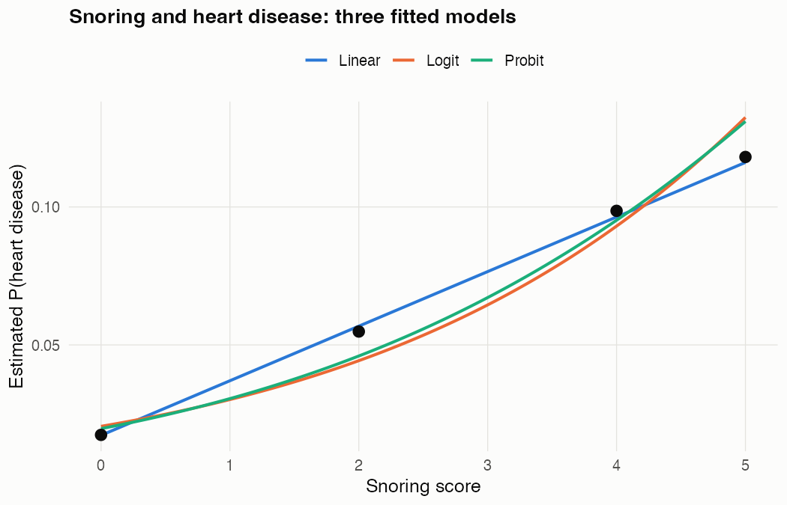
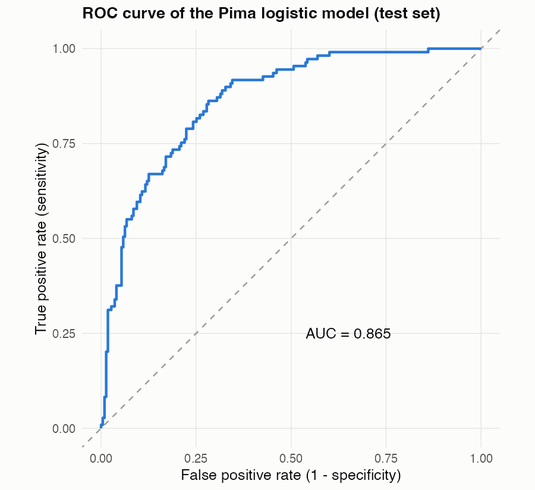

# Chapter 12 — Logistic Regression

[Repository Guide](../../README.md) | [English](Concepts_Lecture.md) | [한국어](Concepts_Lecture.ko.md)

> **Last Updated:** 2026-11-19
>
> An Introduction to Statistical Learning, James, Witten, Hastie, and Tibshirani, Ch 4

> **Learning Objectives:**
> 1. Apply logistic regression for binary classification
> 2. Interpret odds ratios and log-odds coefficients
> 3. Evaluate classification models using confusion matrices and ROC curves
> 4. Classify three or more classes with multinomial logistic regression
> 5. Make inferences about logistic regression coefficients with the deviance, likelihood ratio tests, and Wald tests
> 6. Explain the relationship between the linear probability model and generalized linear models and interpret odds ratios from case-control data

---

## Table of Contents

- [1. Motivation: Classification vs Regression](#1-motivation-classification-vs-regression)
  - [1.1 Reasons Linear Regression Is Unsuitable for Classification](#11-reasons-linear-regression-is-unsuitable-for-classification)
  - [1.2 The Classification Setting](#12-the-classification-setting)
  - [1.3 The Linear Probability Model](#13-the-linear-probability-model)
  - [1.4 The Three Components of a Generalized Linear Model](#14-the-three-components-of-a-generalized-linear-model)
- [2. The Logistic Function (Sigmoid)](#2-the-logistic-function-sigmoid)
  - [2.1 Definition](#21-definition)
  - [2.2 Properties](#22-properties)
  - [2.3 The Logistic Regression Model](#23-the-logistic-regression-model)
  - [2.4 The Slope of the Curve and the Median Effective Level](#24-the-slope-of-the-curve-and-the-median-effective-level)
  - [2.5 Example: Satellites of Horseshoe Crabs](#25-example-satellites-of-horseshoe-crabs)
- [3. Odds and Log-Odds](#3-odds-and-log-odds)
  - [3.1 Odds](#31-odds)
  - [3.2 Log-Odds (Logit)](#32-log-odds-logit)
  - [3.3 Relationship Summary](#33-relationship-summary)
  - [3.4 Converting Among Probability, Odds, and Log-Odds](#34-converting-among-probability-odds-and-log-odds)
  - [3.5 Odds Ratios and Relative Risks](#35-odds-ratios-and-relative-risks)
- [4. Maximum Likelihood Estimation](#4-maximum-likelihood-estimation)
  - [4.1 Reasons Least Squares Cannot Be Used](#41-reasons-least-squares-cannot-be-used)
  - [4.2 The Likelihood Function](#42-the-likelihood-function)
  - [4.3 The Log-Likelihood](#43-the-log-likelihood)
  - [4.4 Implementation in R](#44-implementation-in-r)
  - [4.5 Grouped and Ungrouped Data](#45-grouped-and-ungrouped-data)
  - [4.6 Example: Snoring and Heart Disease](#46-example-snoring-and-heart-disease)
  - [4.7 Deviance and the Likelihood Ratio Test](#47-deviance-and-the-likelihood-ratio-test)
  - [4.8 Wald Tests and Confidence Intervals](#48-wald-tests-and-confidence-intervals)
  - [4.9 Iterative Computation of the Maximum Likelihood Estimates](#49-iterative-computation-of-the-maximum-likelihood-estimates)
- [5. Model Interpretation](#5-model-interpretation)
  - [5.1 Interpreting Coefficients](#51-interpreting-coefficients)
  - [5.2 Odds Ratios](#52-odds-ratios)
  - [5.3 Computing Odds Ratios in R](#53-computing-odds-ratios-in-r)
  - [5.4 Example: Multiple Logistic Regression on the Pima Indian Diabetes Data](#54-example-multiple-logistic-regression-on-the-pima-indian-diabetes-data)
  - [5.5 Retrospective Studies and the Odds Ratio](#55-retrospective-studies-and-the-odds-ratio)
  - [5.6 Adjusting for Other Variables and Confounding](#56-adjusting-for-other-variables-and-confounding)
- [6. Model Evaluation](#6-model-evaluation)
  - [6.1 Predicted Classes](#61-predicted-classes)
  - [6.2 Confusion Matrix](#62-confusion-matrix)
  - [6.3 ROC Curve and AUC](#63-roc-curve-and-auc)
  - [6.4 ROC Curve in R](#64-roc-curve-in-r)
  - [6.5 Example: The Confusion Matrix of the Pima Data](#65-example-the-confusion-matrix-of-the-pima-data)
  - [6.6 Choosing the Threshold](#66-choosing-the-threshold)
  - [6.7 Probabilistic Interpretation of the AUC](#67-probabilistic-interpretation-of-the-auc)
- [7. Multinomial Logistic Regression](#7-multinomial-logistic-regression)
  - [7.1 Extension to Multi-Class](#71-extension-to-multi-class)
  - [7.2 Predicted Probabilities](#72-predicted-probabilities)
  - [7.3 Implementation in R](#73-implementation-in-r)
  - [7.4 Example: Classifying Iris Flowers by Sepal Length](#74-example-classifying-iris-flowers-by-sepal-length)
- [8. Common Mistakes in Logistic Regression](#8-common-mistakes-in-logistic-regression)
- [Concept Applications](#concept-applications)
- [Summary](#summary)
- [Self-Check Questions](#self-check-questions)
- [References](#references)

---

<br>

## 1. Motivation: Classification vs Regression

### 1.1 Reasons Linear Regression Is Unsuitable for Classification

Linear regression, covered in Chapter 10, predicts a continuous response variable $Y \in (-\infty, +\infty)$. When the response is **binary** (e.g., Yes/No, 0/1), linear regression has critical limitations:

- Predicted values can fall **outside** the range $[0, 1]$, making them uninterpretable as probabilities.
- The linear model assumes a constant effect of predictors, which is unrealistic for bounded outcomes.
- Residuals are heteroscedastic and non-normal, violating the assumptions of ordinary least squares (OLS) regression covered in Chapter 10, Section 5.3.

### 1.2 The Classification Setting

| Aspect | Regression | Classification |
|--------|-----------|----------------|
| Response variable | Continuous ($Y \in \mathbb{R}$) | Categorical (binary or multi-class) |
| Goal | Predict a numerical value | Predict a class label |
| Output | Point estimate | Probability of class membership |
| Example | House price prediction | Disease diagnosis (sick / healthy) |

*Table 1. Comparison of regression and classification problems*

Logistic regression bridges the gap: it uses a **regression framework** to solve a **classification problem** by modeling the probability that $Y$ belongs to a particular class.

### 1.3 The Linear Probability Model

If $Y$ is a binary response taking only the values 1 ("success") and 0 ("failure"), its distribution is the Bernoulli distribution determined by the success probability $P(Y = 1) = \pi$ and the failure probability $P(Y = 0) = 1 - \pi$, and its mean is $E(Y) = \pi$. Modeling the mean of $Y$ therefore means modeling the success probability. Imitating the linear model of Chapter 10 directly and making the success probability a linear function of the predictors gives the following model.

```math
P(Y = 1) = \alpha + \beta_1 x_1 + \cdots + \beta_p x_p
```

> **Definition:** The **linear probability model** is a binary response model that makes the success probability a linear function of the predictors, in which $\beta_1$ is the change in the probability $P(Y = 1)$ when $x_1$ changes by one unit with the other variables held fixed.

This model is easy to interpret but has an important structural defect. Probabilities must lie between 0 and 1, but a linear function can take any real value, so for sufficiently large or small $x$ it predicts $P(Y = 1) < 0$ or $P(Y = 1) > 1$. The linear probability model can therefore be used only when the range of $x$ is narrow, and most applications with several predictors require a more complex model. In addition, the variance $\pi(1 - \pi)$ of binary data depends on the mean, so the ordinary least squares assumption of constant error variance (Chapter 10, Section 5.5) does not hold either.

In reality, the relationship between $P(Y = 1)$ and $x$ is usually nonlinear rather than linear. A fixed change in $x$ has less effect when $P(Y = 1)$ is near 0 or 1 than when it is in the middle of the range. For example, when modeling whether a household buys a new car (1) or a used car (0) from its annual income, an income increase of 10,000 dollars has a larger effect for a household earning 50,000 dollars a year than for one earning 1,000,000 dollars a year, for which $P(Y = 1)$ is already close to 1. The S-shaped curve of Section 2 represents such a relationship.

### 1.4 The Three Components of a Generalized Linear Model

Linear regression, logistic regression, and Poisson regression for count data all belong to a single framework called the **generalized linear model** (GLM). A GLM consists of the following three components.

| Component | Content | Linear Regression | Logistic Regression |
|------|------|------|------|
| Random component | The probability distribution of the response $Y$ | Normal distribution | Binomial (Bernoulli) distribution |
| Systematic component | The linear combination of predictors $\alpha + \beta_1 x_1 + \cdots + \beta_p x_p$ | Same | Same |
| Link function | The function $g(\mu)$ linking the mean $\mu = E(Y)$ to the linear combination | Identity $g(\mu) = \mu$ | Logit $g(\pi) = \log[\pi/(1 - \pi)]$ |

*Table 2. The three components of a generalized linear model*

The ordinary linear model is the special case of a GLM with a normal random component and the identity link. GLMs generalize it in two directions: first, the random component can have a distribution other than the normal, and second, a function of the mean rather than the mean itself can be modeled. The traditional way of analyzing categorical data was to transform $Y$ so that it is approximately normal and then apply least squares, but a transformation that stabilizes the variance often fails to give normality, or a linear model does not fit on the transformed scale. A GLM separates the choice of the link function from the choice of the random component and estimates the parameters by maximum likelihood (Section 4), so such transformations are unnecessary. For the binomial distribution, the logit is the natural parameter of the distribution and is called the **canonical link**, and specifying `family = binomial` in R's `glm()` uses the logit link by default.

---

<br>

## 2. The Logistic Function (Sigmoid)

### 2.1 Definition

The **logistic function** (also called the sigmoid function) maps any real-valued input to the interval $(0, 1)$:

```math
\sigma(z) = \frac{1}{1 + e^{-z}}
```

Where $z = \beta_0 + \beta_1 X_1 + \beta_2 X_2 + \cdots + \beta_p X_p$ is the linear combination of predictors. Plotting $\sigma(z)$ rounded to one decimal place at the integers $z$ from -6 to 6 gives the following S-shaped curve.

```text
P(Y=1)
1.0 |                                     *   *   *   *
0.9 |                                 *
0.8 |
0.7 |                             *
0.6 |
0.5 |                         *
0.4 |
0.3 |                     *
0.2 |
0.1 |                 *
0.0 | *   *   *   *
    +----------------------------------------------------> z
     -6      -4      -2       0       2       4       6
```

*Figure 1. S-shaped curve of the sigmoid function*

### 2.2 Properties

| Property | Description |
|----------|-------------|
| Range | $(0, 1)$, always outputs a valid probability |
| Monotonicity | Strictly increasing |
| Symmetry | $\sigma(-z) = 1 - \sigma(z)$ |
| Midpoint | $\sigma(0) = 0.5$ |
| Derivative | $\sigma'(z) = \sigma(z)(1 - \sigma(z))$ |

*Table 3. Properties of the sigmoid function*

### 2.3 The Logistic Regression Model

The probability that the response equals 1 given the predictors is:

```math
P(Y = 1 \mid X) = \frac{1}{1 + e^{-(\beta_0 + \beta_1 X_1 + \cdots + \beta_p X_p)}}
```

This ensures the predicted probability is always between 0 and 1, regardless of the predictor values.

### 2.4 The Slope of the Curve and the Median Effective Level

In logistic regression with one predictor, $\pi(x) = e^{\alpha + \beta x}/(1 + e^{\alpha + \beta x})$, the sign of $\beta$ determines whether the curve increases ($\beta > 0$) or decreases ($\beta < 0$), and the larger $|\beta|$ is, the more steeply the curve changes. When $\beta = 0$, the curve is a horizontal line and $Y$ is independent of $X$. Because the curve is not a straight line, the change in $\pi(x)$ when $x$ changes by one unit depends on the value of $x$. The slope of the line tangent to the curve at a particular $x$ is obtained from the derivative in Table 3 and the chain rule.

```math
\frac{d\pi(x)}{dx} = \beta \pi(x)[1 - \pi(x)]
```

For example, the slope of the tangent at the $x$ where $\pi(x) = 0.50$ is $\beta(0.50)(0.50) = 0.25\beta$, and where $\pi(x) = 0.90$ or 0.10 it is $0.09\beta$. The slope approaches 0 as the probability approaches 1 or 0. The slope is largest at the point where $\pi(x) = 0.50$, and solving $\alpha + \beta x = 0$ shows that this $x$ is $x = -\alpha/\beta$.

> **Definition:** The **median effective level** is the value of the predictor, $x = -\alpha/\beta$, at which success and failure each have probability 50%, also written $\mathrm{EL}_{50}$.

Because of this property, the logistic regression coefficient $\beta$ cannot be read directly as "a change in probability". The slope of the tangent is at most $\beta/4$ everywhere, and it is much smaller where $\pi(x)$ is close to 0 or 1.

### 2.5 Example: Satellites of Horseshoe Crabs

In a study of 173 female horseshoe crabs, $y = 1$ if the female had at least one satellite, a male residing near her at the nest, and $y = 0$ otherwise, and the female's carapace width (cm) served as the predictor. The widths lie between 21.0 cm and 33.5 cm. A scatterplot of $y$ against $x$ only shows points piled up at the two levels $y = 1$ and $y = 0$, so it is hard to judge whether a logistic curve fits. Drawing a curve first with a generalized additive model, which smooths the data without assuming a particular functional form, shows a roughly S-shaped pattern in which the probability of a satellite increases with width. The R output of the fitted logistic regression is as follows.

```text
              Estimate  Std. Error  z value  Pr(>|z|)
(Intercept)   -12.3508      2.6287   -4.698  2.62e-06
width           0.4972      0.1017    4.887  1.02e-06
```

The estimated equation for the probability that a female of width $x$ has a satellite is therefore $\mathrm{logit}[\hat{\pi}(x)] = -12.351 + 0.497x$, or, as a probability, the following.

```math
\hat{\pi}(x) = \frac{\exp(-12.351 + 0.497x)}{1 + \exp(-12.351 + 0.497x)}
```

Since $\hat{\beta} = 0.497 > 0$, the estimated probability increases with width. The computations are as follows.

```r
b0 <- -12.3508; b1 <- 0.4972
p <- function(x) exp(b0 + b1 * x) / (1 + exp(b0 + b1 * x))
round(c(p21 = p(21.0), p33.5 = p(33.5), p26.3 = p(26.3), p27.3 = p(27.3),
        median_effective = -b0 / b1, slope_at_mean = b1 * p(26.3) * (1 - p(26.3)),
        OR = exp(b1)), 4)
#>              p21            p33.5            p26.3            p27.3 
#>           0.1290           0.9867           0.6738           0.7725 
#> median_effective    slope_at_mean               OR 
#>          24.8407           0.1093           1.6441
c(odds26.3 = p(26.3) / (1 - p(26.3)), odds27.3 = p(27.3) / (1 - p(27.3)),
  ratio = (p(27.3) / (1 - p(27.3))) / (p(26.3) / (1 - p(26.3))))
#> odds26.3 odds27.3    ratio 
#> 2.065888 3.396549 1.644111
```

The function `p(x)` converts the estimated equation into a probability. The estimated probability at the smallest width, 21.0 cm, is 0.129, and at the largest width, 33.5 cm, it is 0.987, so the effect of width over the range of the data is very large. The median effective level is $-\hat{\alpha}/\hat{\beta} = 12.351/0.497 = 24.8$ cm. At the sample mean width of 26.3 cm the estimated probability is 0.674, and the slope of the curve at this point is $0.497 \times 0.674 \times 0.326 = 0.11$. That is, near the mean width, the probability of a satellite increases by about 0.11 per additional centimeter of width.

The interpretation in terms of odds is simpler. Since $e^{\hat{\beta}} = e^{0.497} = 1.64$, the odds of having a satellite multiply by 1.64, an increase of 64%, for each additional centimeter of width. Indeed, the odds at $x = 26.3$ are $0.674/0.326 = 2.07$, the odds for the estimated probability 0.773 at $x = 27.3$ are $0.773/0.227 = 3.40$, and $3.40 = 2.07 \times 1.64$ holds. The increase in probability depends on $x$, but the multiplier of the odds is the same 1.64 at every $x$.

---

<br>

## 3. Odds and Log-Odds

### 3.1 Odds

The **odds** of an event are defined as the ratio of the probability that the event occurs to the probability that it does not:

```math
\text{Odds} = \frac{P(Y=1)}{P(Y=0)} = \frac{P(Y=1)}{1 - P(Y=1)}
```

- If $P = 0.8$, then $\text{Odds} = 0.8 / 0.2 = 4$. This means the event is 4 times as likely to occur as not to occur.
- Odds range from $0$ to $+\infty$.

### 3.2 Log-Odds (Logit)

Taking the natural logarithm of the odds yields the **logit** function:

```math
\text{logit}(P) = \log\left(\frac{P}{1-P}\right) = \beta_0 + \beta_1 X_1 + \cdots + \beta_p X_p
```

This is the key transformation: while $P$ is bounded between 0 and 1, the log-odds are **unbounded** $(-\infty, +\infty)$, so they can be modeled as a linear function of the predictors.

### 3.3 Relationship Summary

```math
X \xrightarrow{\text{linear combination}} z = \beta_0 + \beta X \xrightarrow{\text{sigmoid}} P = \sigma(z) \xrightarrow{\text{threshold}} \hat{Y} \in \{0, 1\}
```

That is, the linear combination $z$ of the predictors is passed through the sigmoid function to obtain the probability $P$, and $P$ is compared with a threshold to decide the predicted class $\hat{Y}$.

### 3.4 Converting Among Probability, Odds, and Log-Odds

The chance of the same event can be expressed on three scales: probability, odds, and log-odds. The conversions among the three scales are as follows.

```math
\text{Odds} = \frac{P}{1 - P}, \qquad P = \frac{\text{Odds}}{1 + \text{Odds}}, \qquad \text{logit}(P) = \log(\text{Odds}), \qquad P = \frac{1}{1 + e^{-\text{logit}(P)}}
```

| Probability $P$ | Odds $P/(1 - P)$ | Log-Odds |
|------:|------:|------:|
| 0.01 | 0.0101 | -4.595 |
| 0.10 | 0.111 | -2.197 |
| 0.25 | 0.333 | -1.099 |
| 0.50 | 1 | 0 |
| 0.75 | 3 | 1.099 |
| 0.90 | 9 | 2.197 |
| 0.99 | 99 | 4.595 |

*Table 4. Correspondence among probability, odds, and log-odds*

When the probability is 0.5, the odds are 1 and the log-odds are 0. The log-odds of probabilities $P$ and $1 - P$ differ only in sign, so the log-odds are symmetric about 0. When the probability is small, the odds are almost the same as the probability (0.01 and 0.0101), but as the probability grows, the odds grow quickly, so the odds of probability 0.99 are 99. That an increase of 1 in the log-odds has a large effect on the probability near 0.5 and a small effect near 0 or 1 is the same fact as the slope formula of Section 2.4.

### 3.5 Odds Ratios and Relative Risks

Two groups' probabilities can be compared by their difference, their ratio, or their odds ratio. Let $\pi_1$ be the success probability of group 1 and $\pi_2$ that of group 2.

| Comparison Measure | Definition | Value for Equal Probabilities |
|------|------|------:|
| Difference of probabilities | $\pi_1 - \pi_2$ | 0 |
| Relative risk | $\pi_1 / \pi_2$ | 1 |
| Odds ratio | $\dfrac{\pi_1/(1 - \pi_1)}{\pi_2/(1 - \pi_2)}$ | 1 |

*Table 5. Three measures for comparing two probabilities*

The odds ratio and the relative risk are different quantities. They are related by $\text{OR} = \text{RR} \times (1 - \pi_2)/(1 - \pi_1)$, so when both probabilities are small, $(1 - \pi_2)/(1 - \pi_1)$ is close to 1 and the odds ratio approximates the relative risk. For example, with $\pi_1 = 0.02$ and $\pi_2 = 0.01$ the relative risk is 2 and the odds ratio is $(0.02/0.98)/(0.01/0.99) = 2.02$. But with $\pi_1 = 0.6$ and $\pi_2 = 0.3$ the relative risk is 2 while the odds ratio is $(0.6/0.4)/(0.3/0.7) = 3.5$, much larger. The $e^{\beta}$ of logistic regression is an odds ratio, so saying "the risk is $e^{\beta}$ times" for a common event exaggerates the effect.

---

<br>

## 4. Maximum Likelihood Estimation

### 4.1 Reasons Least Squares Cannot Be Used

Unlike linear regression, logistic regression does **not** use ordinary least squares (OLS) to estimate its coefficients because:
- The response is binary, not continuous.
- The relationship between predictors and $P(Y=1)$ is non-linear.
- Least squares does not produce meaningful estimates for probability models.

### 4.2 The Likelihood Function

For $n$ observations, the **likelihood** is the probability of observing the actual data given the model parameters:

```math
L(\beta) = \prod_{i=1}^{n} P(Y_i = y_i \mid X_i) = \prod_{i=1}^{n} p_i^{y_i}(1 - p_i)^{1 - y_i}
```

Where $p_i = P(Y_i = 1 \mid X_i)$.

### 4.3 The Log-Likelihood

Taking the logarithm converts the product into a sum, which is easier to optimize:

```math
\ell(\beta) = \sum_{i=1}^{n} \left[ y_i \log(p_i) + (1 - y_i) \log(1 - p_i) \right]
```

The MLE finds $\hat{\beta}$ that **maximizes** $\ell(\beta)$. This is solved iteratively using algorithms such as **Newton-Raphson** or **Iteratively Reweighted Least Squares (IRLS)**.

> **[Calculus]** At a point where a function has a maximum, its partial derivative with respect to each variable is zero, so the MLE $\hat{\beta}$ satisfies $\partial \ell / \partial \beta_j = 0$. Using the derivative $\sigma'(z) = \sigma(z)(1 - \sigma(z))$ from Table 3 and the chain rule gives $\partial \ell / \partial \beta_j = \sum_{i=1}^{n} (y_i - p_i) x_{ij}$. Here $x_{ij}$ is the value of predictor $j$ for observation $i$, and $x_{i0} = 1$ for the intercept. Because $p_i$ is nonlinear in the coefficients, this equation, unlike least squares in Chapter 10, has no closed-form solution, and it is solved by iterative algorithms such as Newton-Raphson that use the gradient and second derivatives. The log-likelihood is a concave function of the coefficients, so the point where the gradient is zero is the maximum.

### 4.4 Implementation in R

```r
# Fit logistic regression using maximum likelihood
model <- glm(y ~ x1 + x2, data = mydata, family = binomial)
summary(model)
```

> **Key Point:** The `glm()` function with `family = binomial` uses MLE internally. The `summary()` output reports coefficients on the **log-odds** scale.

### 4.5 Grouped and Ungrouped Data

A standard data file has rows for subjects (for example, people) and columns for variables, and the column of a binary response contains 1 (success) or 0 (failure). Such data are called **ungrouped** data. When all predictors are discrete, the number of observations and the number of successes can be counted and recorded for each combination of predictor values, and such data are called **grouped** data. The two formats contain the same information and give the same maximum likelihood estimates. The snoring data of Section 4.6 are grouped data with 4 rows, and converting them to ungrouped data with one row per person gives 2,484 rows. Of these, 1,379 rows are for people who never snore, of which 24 rows have $y = 1$ and 1,355 rows have $y = 0$.

When grouped data are given to R's `glm()`, the response is the proportion of successes `yes / n`, and `weights = n` tells how many observations each proportion is based on. Giving a matrix that binds the numbers of successes and failures as the response, as in `cbind(yes, no) ~ x`, gives the same result.

### 4.6 Example: Snoring and Heart Disease

The following table comes from an epidemiological study investigating whether snoring might be a risk factor for heart disease [1]. The subjects were classified into four categories of snoring level based on reports by their spouses, and the observations in each row are regarded as independent binomial samples. The snoring categories were given the scores (0, 2, 4, 5), because the last two categories were considered closer to each other than the other adjacent pairs.

| Snoring Level | Score $x$ | Heart Disease Yes | Heart Disease No | Proportion |
|------|------:|------:|------:|------:|
| Never | 0 | 24 | 1,355 | 0.017 |
| Occasional | 2 | 35 | 603 | 0.055 |
| Nearly every night | 4 | 21 | 192 | 0.099 |
| Every night | 5 | 30 | 224 | 0.118 |

*Table 6. Relationship between snoring level and heart disease*

Logistic regression, the linear probability model, and the probit model are fitted to these data and compared. The **probit model** uses the inverse of the cumulative distribution function of the standard normal distribution as its link function and gives an S-shaped curve almost identical to that of the logistic model.

```r
Heart <- data.frame(snoring = c("never", "occasional", "nearly_every_night", "every_night"),
                    yes = c(24, 35, 21, 30), no = c(1355, 603, 192, 224))
Heart$x <- c(0, 2, 4, 5)
Heart$n <- Heart$yes + Heart$no
fit_logit <- glm(yes / n ~ x, family = binomial(link = "logit"),
                 weights = n, data = Heart)
round(coef(summary(fit_logit)), 5)
#>             Estimate Std. Error   z value Pr(>|z|)
#> (Intercept) -3.86625    0.16621 -23.26061        0
#> x            0.39734    0.05001   7.94504        0
fit_probit <- glm(yes / n ~ x, family = binomial(link = "probit"),
                  weights = n, data = Heart)
fit_lin <- glm(yes / n ~ x, family = quasi(link = "identity", variance = "mu(1-mu)"),
               weights = n, data = Heart, start = c(0.02, 0.02))
round(coef(summary(fit_lin, dispersion = 1))[, 1:2], 6)
#>             Estimate Std. Error
#> (Intercept) 0.017247   0.003451
#> x           0.019778   0.002805
round(data.frame(x = Heart$x, observed = Heart$yes / Heart$n,
                 linear = fitted(fit_lin), logit = fitted(fit_logit),
                 probit = fitted(fit_probit)), 3)
#>   x observed linear logit probit
#> 1 0    0.017  0.017 0.021  0.020
#> 2 2    0.055  0.057 0.044  0.046
#> 3 4    0.099  0.096 0.093  0.095
#> 4 5    0.118  0.116 0.132  0.131
```

`yes / n` is the proportion with heart disease in each category, and `weights = n` gives how many people each proportion is based on. `binomial(link = "logit")` and `binomial(link = "probit")` are two binomial GLMs that differ only in the link function. The identity link is not provided by default for the binomial distribution, so the linear probability model is fitted with the `quasi` family with variance $\mu(1 - \mu)$ and the identity link, with `start` giving the starting values of the iterations. `summary(fit_lin, dispersion = 1)` computes the standard errors with the dispersion parameter fixed at 1, as for the binomial distribution.

The estimated logistic regression equation is $\mathrm{logit}[\hat{P}(Y = 1)] = -3.866 + 0.397x$. $\hat{\beta} = 0.397 > 0$ means that the chance of heart disease rises with the level of snoring. The estimated linear probability model is $\hat{P}(Y = 1) = 0.0172 + 0.0198x$, and its interpretation is simple. The estimated probability for people who never snore ($x = 0$) is 0.017, it is $2 \times 0.020 = 0.04$ higher for occasional snorers ($x = 2$), and 0.08 higher for those who snore nearly every night ($x = 4$). Over the range of these data the probabilities are small and narrow, 0.02-0.13, so the defect of the linear probability model (Section 1.3) does not show, and the fitted values of all three models are close to the observed proportions.



*Figure 2. Linear, logit, and probit models fitted to the snoring data*

In a GLM, the estimate of $E(Y)$ is called the **fitted value**. In Figure 2, the curves of the logit and probit models almost coincide, and because only the lower part of the S-shaped curve appears in this range of small probabilities, their shape is close to linear. Interpreted as odds ratios, each increase of 1 in the snoring score multiplies the odds of heart disease by $e^{0.397} = 1.49$, and the odds ratio between "occasional" and "never", whose scores differ by 2, is $e^{2 \times 0.397} = 2.21$.

### 4.7 Deviance and the Likelihood Ratio Test

Logistic regression uses the **deviance** as the quantity corresponding to the RSS of Chapter 10. With $\ell(\hat{\beta})$ the maximized log-likelihood of the fitted model, the deviance is defined as $D = -2[\ell(\hat{\beta}) - \ell_{\text{saturated}}]$, where the saturated model has one parameter per observation (per row, for grouped data) and fits the data perfectly. For ungrouped 0/1 data, the log-likelihood of the saturated model is 0, so the deviance equals $-2\ell(\hat{\beta})$. The smaller the deviance, the better the model fits the data.

The **null deviance** reported by `summary()` is the deviance of the intercept-only model, and the **residual deviance** is that of the fitted model. When model A is model B with some variables added, the hypothesis that the coefficients of the added variables are all 0 is tested with the difference of the two deviances.

```math
G^2 = D_B - D_A = -2[\ell(\hat{\beta}_B) - \ell(\hat{\beta}_A)]
```

This is the **likelihood ratio test**. If the null hypothesis is true, $G^2$ approximately follows a chi-square distribution with degrees of freedom equal to the number of added parameters. It corresponds to the partial F-test of linear regression (Chapter 10, Section 4.7), and in R it is computed with `anova(smaller model, larger model, test = "Chisq")`. Testing whether the slope is 0 in the snoring model gives the following.

```r
c(null = fit_logit$null.deviance, residual = deviance(fit_logit),
  df_null = fit_logit$df.null, df_resid = fit_logit$df.residual)
#>      null  residual   df_null  df_resid 
#> 65.904481  2.808912  3.000000  2.000000
G2 <- fit_logit$null.deviance - deviance(fit_logit)
c(G2 = G2, p = pchisq(G2, df = 1, lower.tail = FALSE), wald_z2 = 7.94504^2)
#>           G2            p      wald_z2 
#> 6.309557e+01 1.969166e-15 6.312366e+01
```

The deviance of the intercept-only model is 65.90 (3 degrees of freedom) and that of the model with the snoring score is 2.81 (2 degrees of freedom), so $G^2 = 63.10$ with a p-value of about $2 \times 10^{-15}$ on 1 degree of freedom. The snoring score has a clear relationship with heart disease. Because these data are grouped, the residual deviance 2.81 is also a comparison with the saturated model that fits the proportion of each of the four categories separately. With a p-value of 0.245 on 2 degrees of freedom, there is no evidence that the model, in which the logit is linear in the score, conflicts with the data. In this way, for grouped data with enough observations per category, the residual deviance can be used as a goodness-of-fit test, but for ungrouped 0/1 data the approximation does not hold, so the residual deviance is not used as a goodness-of-fit test.

### 4.8 Wald Tests and Confidence Intervals

The `z value` in `summary()` is the **Wald statistic** $z = \hat{\beta}_j / \mathrm{SE}(\hat{\beta}_j)$. With a large sample, the maximum likelihood estimator is approximately normally distributed, so under the null hypothesis $\beta_j = 0$, $z$ approximately follows the standard normal distribution, and `Pr(>|z|)` is its two-sided p-value. It plays the same role as the t-statistic of linear regression (Chapter 10, Section 2.9), but it is labeled `z` because it is a large-sample approximation rather than a t distribution derived exactly under normal errors. The square of $z = 7.945$ in the snoring model, 63.12, is almost the same as the likelihood ratio statistic 63.10 of Section 4.7, and with a large sample the two tests reach the same conclusion. When they differ, the likelihood ratio test is more trustworthy.

By the same approximation, the 95% **Wald confidence interval** for $\beta_j$ is $\hat{\beta}_j \pm 1.96 \cdot \mathrm{SE}(\hat{\beta}_j)$, and exponentiating its endpoints gives an interval for the odds ratio.

```r
b <- coef(summary(fit_logit))["x", ]
round(c(lower = b[["Estimate"]] - 1.96 * b[["Std. Error"]],
        upper = b[["Estimate"]] + 1.96 * b[["Std. Error"]]), 4)
#>  lower  upper 
#> 0.2993 0.4954
round(confint.default(fit_logit)["x", ], 4)
#>  2.5 % 97.5 % 
#> 0.2993 0.4954
round(suppressMessages(confint(fit_logit))["x", ], 4)
#>  2.5 % 97.5 % 
#> 0.2999 0.4964
round(exp(confint.default(fit_logit)["x", ]), 4)
#>  2.5 % 97.5 % 
#> 1.3489 1.6411
```

R's `confint.default()` computes the Wald interval, and `confint()` computes the **profile likelihood interval**, which follows the shape of the likelihood function. With a large sample, as in these data, the two intervals are almost the same (0.299-0.495 and 0.300-0.496), but with a small sample or an estimate near a boundary, the profile likelihood interval is more accurate. The odds ratio interval on the last line shows that each increase of 1 in the snoring score multiplies the odds of heart disease by between 1.35 and 1.64. The principles of tests and confidence intervals themselves are covered in Chapter 14.

### 4.9 Iterative Computation of the Maximum Likelihood Estimates

As seen in the calculus box of Section 4.3, the likelihood equations of logistic regression, $\sum_i (y_i - p_i)x_{ij} = 0$, have no closed-form solution. **Iteratively reweighted least squares** (IRLS), used by `glm()`, is the Newton-Raphson method, which approximates the log-likelihood by a quadratic at the current estimate and moves to its maximum, written in the form of weighted least squares. For grouped data with $n_i$ trials and $y_i$ successes in row $i$, one iteration is as follows.

1. With the current coefficients $\boldsymbol{\beta}$, compute the linear predictors $\eta_i = \mathbf{x}_i^\top \boldsymbol{\beta}$ and the probabilities $p_i = 1/(1 + e^{-\eta_i})$.
2. Compute the weights $w_i = n_i p_i (1 - p_i)$ and the working response $z_i = \eta_i + (y_i - n_i p_i)/w_i$.
3. Regress $z_i$ on $\mathbf{x}_i$ with weights $w_i$ to obtain the new coefficients $\boldsymbol{\beta} = (\mathbf{X}^\top \mathbf{W} \mathbf{X})^{-1} \mathbf{X}^\top \mathbf{W} \mathbf{z}$.

This process is repeated until the coefficients barely change. Applying it directly to the snoring data gives the following.

```r
X <- cbind(1, c(0, 2, 4, 5))
y <- c(24, 35, 21, 30); n <- c(1379, 638, 213, 254)
beta <- c(0, 0)
for (it in 1:6) {
  eta <- drop(X %*% beta)
  p <- 1 / (1 + exp(-eta))
  W <- n * p * (1 - p)
  z <- eta + (y - n * p) / W
  beta <- drop(solve(t(X) %*% (W * X), t(X) %*% (W * z)))
  cat(sprintf("iteration %d: beta0 = %.5f, beta1 = %.5f\n", it, beta[1], beta[2]))
}
#> iteration 1: beta0 = -1.93251, beta1 = 0.08015
#> iteration 2: beta0 = -2.91445, beta1 = 0.19954
#> iteration 3: beta0 = -3.56823, beta1 = 0.32983
#> iteration 4: beta0 = -3.83190, beta1 = 0.38960
#> iteration 5: beta0 = -3.86576, beta1 = 0.39723
#> iteration 6: beta0 = -3.86625, beta1 = 0.39734
sqrt(diag(solve(t(X) %*% (W * X))))
#> [1] 0.16618051 0.05000501
```

`X` is the design matrix of an intercept column and a score column, and `y` and `n` are the numbers with heart disease and the numbers of people in each category. The four lines inside the loop are steps 1-3 above, and `W * X` multiplies each row of `X` by its weight, which equals $\mathbf{W}\mathbf{X}$. Starting from zero coefficients, the iterations reach the `glm()` estimates -3.86625 and 0.39734 in six steps, and the number of correct digits grows quickly in the last few iterations. The Newton-Raphson method converges quadratically like this near the solution. At the point of convergence, $(\mathbf{X}^\top \mathbf{W} \mathbf{X})^{-1}$ is the approximate covariance matrix of the estimators, and the square roots of its diagonal elements are the standard errors. The values 0.1662 and 0.0500 on the last line are computed with the weights of the previous iteration, so they agree with the 0.16621 and 0.05001 of `summary()` to four decimal places. Because the log-likelihood is concave in the coefficients, the iterations converge to the same maximum regardless of the starting values, but when the data are completely separated (Section 8), no maximum exists and the coefficients keep growing.

---

<br>

## 5. Model Interpretation

### 5.1 Interpreting Coefficients

In logistic regression, the coefficients represent the change in **log-odds** for a one-unit increase in the predictor:

```math
\log\left(\frac{P}{1-P}\right) = \beta_0 + \beta_1 X_1
```

- $\beta_0$: The log-odds of $Y=1$ when all predictors equal zero.
- $\beta_k$: A one-unit increase in $X_k$ changes the log-odds by $\beta_k$ (holding other variables constant).

### 5.2 Odds Ratios

Exponentiating the coefficients gives the **odds ratio**:

```math
\text{OR}_k = e^{\beta_k}
```

| $\beta_k$ | $e^{\beta_k}$ | Interpretation |
|-----------|---------------|----------------|
| Positive | $> 1$ | Predictor **increases** the odds of $Y=1$ |
| Zero | $= 1$ | Predictor has **no effect** |
| Negative | $< 1$ | Predictor **decreases** the odds of $Y=1$ |

*Table 7. Interpretation of the odds ratio by the sign of the coefficient*

For example, if $\beta_1 = 0.693$, then $e^{0.693} \approx 2.0$, meaning a one-unit increase in $X_1$ **doubles** the odds of $Y=1$. It is the odds, not the probability, that doubles.

### 5.3 Computing Odds Ratios in R

```r
# Get odds ratios with 95% confidence intervals
exp(coef(model))
exp(confint(model))
```

`coef(model)` gives the coefficients on the log-odds scale, so applying `exp()` yields the odds ratios, and applying `exp()` to both ends of the 95% confidence intervals of the coefficients from `confint(model)` yields 95% confidence intervals for the odds ratios.

### 5.4 Example: Multiple Logistic Regression on the Pima Indian Diabetes Data

`Pima.tr` and `Pima.te` in the `MASS` package are diabetes test data on women at least 21 years old, of Pima Indian heritage, living near Phoenix, Arizona, with 200 and 332 women respectively. The response `type` is diabetes by World Health Organization criteria (`Yes`, `No`), and the predictors are the number of pregnancies (`npreg`), the plasma glucose concentration in an oral glucose tolerance test (`glu`), diastolic blood pressure (`bp`), triceps skin fold thickness (`skin`), body mass index (`bmi`), the diabetes pedigree function (`ped`), and age (`age`). `Pima.tr` is used as the training set and `Pima.te` as the validation set.

```r
data(Pima.tr, package = "MASS"); data(Pima.te, package = "MASS")
dim(Pima.tr); dim(Pima.te)
#> [1] 200   8
#> [1] 332   8
table(Pima.tr$type)
#> 
#>  No Yes 
#> 132  68
```

The training set has 68 women with diabetes (34%). A logistic regression is fitted with five predictors.

```r
fit_pima <- glm(type ~ npreg + glu + bmi + ped + age, data = Pima.tr, family = binomial)
summary(fit_pima)
#> 
#> Call:
#> glm(formula = type ~ npreg + glu + bmi + ped + age, family = binomial, 
#>     data = Pima.tr)
#> 
#> Coefficients:
#>              Estimate Std. Error z value Pr(>|z|)    
#> (Intercept) -9.938059   1.541571  -6.447 1.14e-10 ***
#> npreg        0.103142   0.064517   1.599  0.10989    
#> glu          0.031809   0.006667   4.771 1.83e-06 ***
#> bmi          0.079672   0.032649   2.440  0.01468 *  
#> ped          1.811417   0.661048   2.740  0.00614 ** 
#> age          0.039286   0.020967   1.874  0.06097 .  
#> ---
#> Signif. codes:  0 '***' 0.001 '**' 0.01 '*' 0.05 '.' 0.1 ' ' 1
#> 
#> (Dispersion parameter for binomial family taken to be 1)
#> 
#>     Null deviance: 256.41  on 199  degrees of freedom
#> Residual deviance: 178.47  on 194  degrees of freedom
#> AIC: 190.47
#> 
#> Number of Fisher Scoring iterations: 5
```

Because `type` is a factor, `glm()` treats its first level `No` as 0 and its second level `Yes` as 1 and models the probability of diabetes. `Dispersion parameter ... taken to be 1` in the output means that the variance of the binomial distribution is determined by its mean, so there is no separate dispersion parameter to estimate, and `Fisher Scoring iterations: 5` means that the iterative algorithm of Section 4.9 converged in 5 iterations. The AIC of 190.47 is $178.47 + 2 \times 6$, the definition of Chapter 10, Section 6.4, with 6 parameters.

With the other variables held fixed, a plasma glucose concentration higher by 1 unit increases the log-odds of diabetes by 0.0318. This effect is expressed as an odds ratio with a confidence interval.

```r
round(cbind(OR = exp(coef(fit_pima)), exp(confint.default(fit_pima))), 4)
#>                 OR  2.5 %  97.5 %
#> (Intercept) 0.0000 0.0000  0.0010
#> npreg       1.1086 0.9770  1.2581
#> glu         1.0323 1.0189  1.0459
#> bmi         1.0829 1.0158  1.1545
#> ped         6.1191 1.6750 22.3549
#> age         1.0401 0.9982  1.0837
exp(10 * coef(fit_pima)["glu"])
#>      glu 
#> 1.374497
```

The glucose odds ratio of 1.032 means that the odds increase by 3.2% per unit, but the glucose values range from several tens to nearly 200, so one unit is a very small change and the effect is better read on a realistic scale. An increase of 10 units multiplies the odds by $e^{10 \times 0.0318} = 1.37$. An increase of 1 in the body mass index multiplies the odds by 1.08, and an increase of 1 in the pedigree function by 6.12. The pedigree odds ratio looks large because the middle 50% of this variable in the validation set lies between about 0.27 and 0.68, so a change of one unit is a very large change. The odds ratio intervals for the number of pregnancies and age include 1, so they are not significant at the 5% level (p = 0.110 and 0.061).

Whether two variables can be dropped together is judged with the likelihood ratio test of Section 4.7. Comparing with the model without `ped` and `age` gives the following.

```r
fit_small <- glm(type ~ npreg + glu + bmi, data = Pima.tr, family = binomial)
anova(fit_small, fit_pima, test = "Chisq")
#> Analysis of Deviance Table
#> 
#> Model 1: type ~ npreg + glu + bmi
#> Model 2: type ~ npreg + glu + bmi + ped + age
#>   Resid. Df Resid. Dev Df Deviance Pr(>Chi)   
#> 1       196     189.89                        
#> 2       194     178.47  2   11.415 0.003321 **
#> ---
#> Signif. codes:  0 '***' 0.001 '**' 0.01 '*' 0.05 '.' 0.1 ' ' 1
```

Adding the two variables reduces the deviance by 11.415 with a p-value of 0.0033 on 2 degrees of freedom, so the hypothesis that both coefficients are 0 is rejected. Age alone was not significant (p = 0.061), but together with the pedigree function there is a clear improvement. The decrease of 77.94 from the null deviance 256.41 to the residual deviance 178.47 is the likelihood ratio statistic for all five predictors together and corresponds to the F-test of linear regression (Chapter 10, Section 4.7).

### 5.5 Retrospective Studies and the Odds Ratio

Logistic regression has the property that it can be used even for data in which the predictor $X$, rather than the response $Y$, is random. Many biomedical studies, especially epidemiological ones, use **case-control studies**. In this design, people with the disease ($Y = 1$, cases) and people without it ($Y = 0$, controls) are collected in predetermined numbers, and the past exposure $X$ of each person is then investigated. That is, the data are **retrospective**, observing $X$ given $Y$ rather than $Y$ given $X$.

The odds ratio can still be estimated from such data, because in a 2×2 table the odds ratio of $X$ given $Y$ equals the odds ratio of $Y$ given $X$. Since the logistic regression coefficients are related to odds ratios, fitting logistic regression to retrospective data estimates the effect $e^{\beta}$ of a predictor of interest correctly. For example, in a case-control study comparing 709 lung cancer cases with 709 matched controls, the odds ratio for smoking ($x = 1$ for smokers, $x = 0$ for nonsmokers) was 3.0, and this value can be regarded as an estimate of $e^{\beta}$ in the model $\mathrm{logit}[P(Y = 1)] = \alpha + \beta x$.

The intercept $\alpha$, however, cannot be estimated properly. $\alpha$ is related to the distribution of $Y$ given $x$, that is, the absolute probability of getting the disease, but in a case-control study the researcher fixes the proportion of cases and controls (1:1 in this example), so that probability is not reflected in the sample. A logistic regression fitted to case-control data must therefore not be used to predict an individual's probability of disease; only the odds ratios are interpreted. Unlike the odds ratio, the relative risk (Section 3.5) cannot be estimated from case-control data. This is one reason the odds ratio is so widely used in epidemiology.

### 5.6 Adjusting for Other Variables and Confounding

Like those of the multiple regression of Chapter 10, Section 3.7, the coefficients of a multiple logistic regression are conditional effects with the other included variables held fixed. In the Pima data, predicting diabetes from the number of pregnancies alone gives a clearly significant coefficient of 0.169 (p = 0.0002), but adding age reduces it to 0.054 (p = 0.34).

```r
round(coef(summary(glm(type ~ npreg, data = Pima.tr, family = binomial)))["npreg", ], 4)
#>   Estimate Std. Error    z value   Pr(>|z|) 
#>     0.1688     0.0460     3.6707     0.0002
round(coef(summary(glm(type ~ npreg + age, data = Pima.tr, family = binomial)))["npreg", ], 4)
#>   Estimate Std. Error    z value   Pr(>|z|) 
#>     0.0539     0.0562     0.9599     0.3371
round(cor(Pima.tr$npreg, Pima.tr$age), 3)
#> [1] 0.599
```

The correlation between the number of pregnancies and age is 0.599: older women tend to have had more pregnancies. Age is also related to the risk of diabetes, so the coefficient of the model with pregnancies alone mixes in the effect of age. A third variable related to both the predictor and the response that creates an apparent association in this way is called **confounding**, and the variable is called a confounder. With age held fixed, the additional effect of the number of pregnancies is small and not significant. Therefore, when reporting odds ratios from logistic regression, the variables they are adjusted for must be stated. Simpson's paradox in Chapter 13 is an extreme case in which confounding even reverses the direction of an association.

---

<br>

## 6. Model Evaluation

### 6.1 Predicted Classes

A **decision threshold** (typically 0.5) converts predicted probabilities into class labels:

```math
\hat{Y} = \begin{cases} 1 & \text{if } P(Y=1 \mid X) \geq 0.5 \\ 0 & \text{otherwise} \end{cases}
```

Changing the threshold changes the number of observations predicted as positive, and the ROC curve in Section 6.3 shows the performance at all thresholds at once.

### 6.2 Confusion Matrix

The confusion matrix summarizes classification performance:

|  | Predicted Positive | Predicted Negative |
|--|--------------------|--------------------|
| **Actual Positive** | True Positive (TP) | False Negative (FN) |
| **Actual Negative** | False Positive (FP) | True Negative (TN) |

*Table 8. Confusion matrix for binary classification*

Key metrics derived from the confusion matrix:

| Metric | Formula | Description |
|--------|---------|-------------|
| **Accuracy** | $\frac{TP + TN}{TP + TN + FP + FN}$ | Overall correct rate |
| **Sensitivity (Recall)** | $\frac{TP}{TP + FN}$ | True positive rate |
| **Specificity** | $\frac{TN}{TN + FP}$ | True negative rate |
| **Precision** | $\frac{TP}{TP + FP}$ | Positive predictive value |
| **F1 Score** | $\frac{2 \cdot \text{Precision} \cdot \text{Recall}}{\text{Precision} + \text{Recall}}$ | Harmonic mean of precision and recall |

*Table 9. Classification metrics derived from the confusion matrix*

### 6.3 ROC Curve and AUC

The **Receiver Operating Characteristic (ROC)** curve plots the true positive rate (TPR, sensitivity) against the false positive rate (FPR, 1 - specificity) at various threshold values.

- A perfect classifier passes through the top-left corner (TPR = 1, FPR = 0).
- A random classifier follows the diagonal line.
- The **Area Under the Curve (AUC)** quantifies overall model performance as a value between 0 and 1, and a common rule of thumb is:

| AUC | Model Quality |
|-----|---------------|
| $[0.9, 1.0]$ | Excellent |
| $[0.8, 0.9)$ | Good |
| $[0.7, 0.8)$ | Fair |
| $[0.6, 0.7)$ | Poor |
| 0.5 | No discrimination (random) |

*Table 10. Rule of thumb for model quality by AUC*

### 6.4 ROC Curve in R

```r
library(pROC)
roc_obj <- roc(actual, predicted_prob)
plot(roc_obj, main = "ROC Curve", col = "blue", lwd = 2)
auc(roc_obj)
```

`roc()` computes the ROC curve from the actual classes and the predicted probabilities, and `auc()` computes the area under that curve.

### 6.5 Example: The Confusion Matrix of the Pima Data

The model of Section 5.4 predicts the probability of diabetes for the 332 women of the validation set, and they are classified with a threshold of 0.5.

```r
prob <- predict(fit_pima, newdata = Pima.te, type = "response")
head(round(prob, 3))
#>     1     2     3     4     5     6 
#> 0.762 0.041 0.026 0.039 0.791 0.727
pred <- factor(ifelse(prob >= 0.5, "Yes", "No"), levels = c("No", "Yes"))
tab <- table(Predicted = pred, Actual = Pima.te$type)
tab
#>          Actual
#> Predicted  No Yes
#>       No  199  42
#>       Yes  24  67
```

Giving `type = "response"` to `predict()` returns probabilities rather than log-odds (the default `"link"` gives log-odds). `ifelse()` turns probabilities of 0.5 or more into `Yes` and the rest into `No`, and the `levels` argument of `factor()` fixes the order of the two levels. Without fixing the levels, a row of the table disappears when only one class is predicted. `table()` builds the confusion matrix with the predicted class as rows and the actual class as columns. Treating diabetes as positive, TP = 67, FN = 42, FP = 24, and TN = 199.

```r
TP <- tab["Yes", "Yes"]; TN <- tab["No", "No"]; FP <- tab["Yes", "No"]; FN <- tab["No", "Yes"]
round(c(accuracy = (TP + TN) / sum(tab), sensitivity = TP / (TP + FN),
        specificity = TN / (TN + FP), precision = TP / (TP + FP),
        F1 = 2 * TP / (2 * TP + FP + FN), no_info = max(table(Pima.te$type)) / nrow(Pima.te)), 4)
#>    accuracy sensitivity specificity   precision          F1     no_info 
#>      0.8012      0.6147      0.8924      0.7363      0.6700      0.6717
```

The accuracy is $(67 + 199)/332 = 0.801$. But the proportion of non-diabetic women in the validation set is $223/332 = 0.672$, so a model that predicts everyone to be non-diabetic also achieves 67.2% accuracy. This value is called the **no information rate**, and a model's accuracy is meaningful only in comparison with it. The sensitivity is $67/109 = 0.615$, so 39% of the 109 women who actually have diabetes are missed. The specificity is $199/223 = 0.892$ and the precision $67/91 = 0.736$. When the classes differ in size like this, accuracy alone hides the performance on the minority class, so sensitivity and specificity are reported together.

### 6.6 Choosing the Threshold

A threshold of 0.5 is a natural choice when the two kinds of error are considered equally costly, but 0.5 need not be used. If missing diabetes (FN) is much worse than sending a healthy person for a retest (FP), the threshold is lowered to raise the sensitivity.

```r
for (thr in c(0.3, 0.5, 0.7)) {
  pr <- factor(ifelse(prob >= thr, "Yes", "No"), levels = c("No", "Yes"))
  tb <- table(pr, Pima.te$type)
  cat(sprintf("threshold %.1f: sensitivity %.3f, specificity %.3f\n", thr,
              tb["Yes", "Yes"] / sum(tb[, "Yes"]), tb["No", "No"] / sum(tb[, "No"])))
}
#> threshold 0.3: sensitivity 0.807, specificity 0.758
#> threshold 0.5: sensitivity 0.615, specificity 0.892
#> threshold 0.7: sensitivity 0.422, specificity 0.946
```

The `for` loop rebuilds the confusion matrix for each threshold 0.3, 0.5, and 0.7, and `sprintf()` prints the sensitivity and specificity to three decimal places. Lowering the threshold from 0.5 to 0.3 raises the sensitivity from 0.615 to 0.807 and lowers the specificity from 0.892 to 0.758. Sensitivity and specificity trade off against each other, and which threshold is good is decided not by the data but by the relative costs of the two errors. A common criterion when the costs are unknown is the threshold that maximizes the sum of sensitivity and specificity, that is, the **Youden index** $J = \text{sensitivity} + \text{specificity} - 1$.

```r
roc_obj <- roc(Pima.te$type, prob, levels = c("No", "Yes"), direction = "<")
auc(roc_obj)
#> Area under the curve: 0.8652
ci.auc(roc_obj)
#> 95% CI: 0.8255-0.9049 (DeLong)
coords(roc_obj, "best", ret = c("threshold", "sensitivity", "specificity"))
#>   threshold sensitivity specificity
#> 1 0.2480398   0.8623853   0.7174888
```

The `levels` argument of `roc()` gives the order of the negative and positive classes, and `direction = "<"` means that positives have larger predicted probabilities. `coords(..., "best")` finds by default the threshold with the largest Youden index, about 0.248 for these data. At this threshold the sensitivity is 0.862 and the specificity 0.717. Choosing a threshold and reporting its performance on the same validation set overstates the performance, so strictly the data used to choose the threshold and the data used to evaluate it should be separate.

### 6.7 Probabilistic Interpretation of the AUC

The AUC of this model is 0.865, with a 95% confidence interval of 0.826-0.905. By the criteria of Table 10, this is good discrimination.



*Figure 3. Validation-set ROC curve of the Pima logistic model*

The AUC has an intuitive probabilistic interpretation. If one positive and one negative subject are drawn at random, the AUC is the probability that the positive subject has the larger predicted probability (ties count as one half). Computing this interpretation directly gives the same value as `auc()`.

```r
pos <- prob[Pima.te$type == "Yes"]; neg <- prob[Pima.te$type == "No"]
mean(outer(pos, neg, ">") + 0.5 * outer(pos, neg, "=="))
#> [1] 0.8651829
```

`outer(pos, neg, ">")` is a matrix recording, for every pair of the 109 diabetic and 223 non-diabetic women ($109 \times 223 = 24{,}307$ pairs), whether the diabetic woman has the larger predicted probability, and its mean is the proportion of correctly ranked pairs. The AUC therefore looks only at the ranking of the predicted probabilities and does not assess whether the probability values themselves match actual proportions (calibration). In addition, the AUC summarizes all thresholds, so the sensitivity and specificity at the threshold actually used must be reported separately.

---

<br>

## 7. Multinomial Logistic Regression

### 7.1 Extension to Multi-Class

When the response has more than two categories ($K > 2$), **multinomial logistic regression** generalizes the binary model. One category is designated as the **reference** (baseline), and the model estimates $K - 1$ sets of coefficients.

For category $k$ relative to the reference category $K$:

```math
\log\left(\frac{P(Y = k)}{P(Y = K)}\right) = \beta_{k0} + \beta_{k1} X_1 + \cdots + \beta_{kp} X_p
```

### 7.2 Predicted Probabilities

The probability of each class is computed using the **softmax** function:

```math
P(Y = k \mid X) = \frac{e^{z_k}}{\sum_{j=1}^{K} e^{z_j}}
```

Where $z_k = \beta_{k0} + \beta_{k1} X_1 + \cdots + \beta_{kp} X_p$ and $z_K = 0$ (reference category).

### 7.3 Implementation in R

```r
library(nnet)
multi_model <- multinom(Species ~ ., data = iris)
summary(multi_model)

# Predicted probabilities
predict(multi_model, newdata = iris[1:5, ], type = "probs")
```

> **Key Point:** The `multinom()` function from the `nnet` package fits multinomial logistic regression. Each non-reference class gets its own set of coefficients. `multinom()` uses the first level of the response factor (setosa in iris) as the reference category.

### 7.4 Example: Classifying Iris Flowers by Sepal Length

A multinomial logistic regression classifying the three iris species by sepal length (`Sepal.Length`) alone is fitted.

```r
library(nnet)
multi_model <- multinom(Species ~ Sepal.Length, data = iris, trace = FALSE)
round(coef(multi_model), 3)
#>            (Intercept) Sepal.Length
#> versicolor     -26.083        4.816
#> virginica      -38.768        6.848
round(predict(multi_model, newdata = data.frame(Sepal.Length = c(5, 6, 7)),
              type = "probs"), 4)
#>   setosa versicolor virginica
#> 1 0.8728     0.1178    0.0094
#> 2 0.0359     0.5985    0.3655
#> 3 0.0001     0.1767    0.8232
table(Predicted = predict(multi_model), Actual = iris$Species)
#>             Actual
#> Predicted    setosa versicolor virginica
#>   setosa         45          6         1
#>   versicolor      5         30        12
#>   virginica       0         14        37
```

`trace = FALSE` turns off the printout of the iterations. The reference category is setosa, so the two rows are $\log[P(\text{versicolor})/P(\text{setosa})] = -26.083 + 4.816x$ and $\log[P(\text{virginica})/P(\text{setosa})] = -38.768 + 6.848x$. A sepal 1 cm longer multiplies the odds of versicolor against setosa by $e^{4.816} \approx 123$ and the odds of virginica by $e^{6.848} \approx 942$. The difference of the two logits, $-12.685 + 2.032x$, is the log-odds of virginica against versicolor, so changing the reference category leaves the model the same and changes only how the coefficients are expressed.

For a flower with a 5 cm sepal, the softmax of Section 7.2 gives $z_{\text{versicolor}} = -26.083 + 4.816 \times 5 = -2.003$, $z_{\text{virginica}} = -38.768 + 6.848 \times 5 = -4.528$, and $z_{\text{setosa}} = 0$. Therefore $P(\text{setosa}) = 1/(1 + e^{-2.003} + e^{-4.528}) = 1/(1 + 0.1349 + 0.0108) = 0.873$, and the other two probabilities are $0.1349 \times 0.873 = 0.118$ and $0.0108 \times 0.873 = 0.009$. `predict()` assigns each flower to the species with the largest probability, and the confusion matrix shows $45 + 30 + 37 = 112$ of the 150 flowers (74.7%) classified correctly. Sepal length alone leaves versicolor and virginica heavily overlapping, so most misclassifications are between these two.

---

<br>

## 8. Common Mistakes in Logistic Regression

- **Reading a coefficient as a change in probability.** $\beta$ is a change in log-odds and $e^{\beta}$ a multiplier of the odds. The change in probability is $\beta\pi(1 - \pi)$ and depends on the location (Section 2.4).
- **Calling an odds ratio a relative risk.** For a common event, the odds ratio is much larger than the relative risk (Section 3.5). "The odds double" is not restated as "the risk doubles".
- **Evaluating a classifier by accuracy alone.** With imbalanced classes, predicting only the majority class gives high accuracy. Compare with the no information rate and look at sensitivity, specificity, and precision together (Section 6.5).
- **Taking the 0.5 threshold for granted.** If the two errors have different costs, the threshold must be adjusted, and the ROC curve shows the possible choices (Section 6.6).
- **Reporting the confusion matrix and AUC on the training data.** Performance on the training data is optimistic. Evaluate on validation data not used to build the model.
- **Failing to notice complete separation.** If the values of a predictor separate the two classes perfectly, the maximum likelihood estimates diverge to infinity, and `glm()` gives very large coefficients and standard errors with the warning "fitted probabilities numerically 0 or 1 occurred". The coefficients and p-values then cannot be interpreted, so the set of variables is reconsidered or a penalized method is used.
- **Predicting disease probabilities from case-control data.** The researcher fixed the proportion of cases and controls, so the intercept and predicted probabilities are meaningless and only the odds ratios can be interpreted (Section 5.5).
- **Comparing odds ratios while ignoring the units of the predictors.** In the Pima data, the pedigree odds ratio of 6.12 exceeds the glucose odds ratio of 1.03 because of the size of the units. Compare on realistic ranges of change (for example, 10 units of glucose) (Section 5.4).

---

<br>

## Concept Applications

**True/False Check:**

| Statement | Judgment and Reason |
|:-----|:-----|
| The linear probability model always gives predicted probabilities between 0 and 1. | **F.** A linear function takes any real value, so for large or small $x$ it predicts probabilities below 0 or above 1. |
| The slope of the logistic curve is largest where $\pi(x) = 0.5$. | **T.** The slope $\beta\pi(1 - \pi)$ reaches its maximum $\beta/4$ at $\pi = 0.5$. |
| The odds ratio of two groups with probabilities 0.01 and 0.02 is almost the same as the relative risk of 2. | **T.** When probabilities are small, $(1 - \pi_2)/(1 - \pi_1)$ is close to 1, so the odds ratio is about 2.02. |
| Grouped and ungrouped data give different maximum likelihood estimates. | **F.** The two formats contain the same information, so the coefficient estimates are the same. |
| Estimating the intercept of a logistic regression from a case-control study gives the incidence of the disease in the population. | **F.** The researcher fixes the proportion of cases and controls, so the intercept does not reflect the population probability of disease. |
| Lowering the threshold raises or keeps the sensitivity and lowers or keeps the specificity. | **T.** More subjects are predicted positive, so TP and FP both increase or stay the same. |
| An AUC of 0.865 means that in a randomly drawn pair of one positive and one negative, the probability that the positive has the larger predicted probability is 0.865. | **T.** The AUC equals the proportion of positive-negative pairs ranked correctly. |
| Predicting every subject as the majority class gives an accuracy equal to the no information rate. | **T.** It is correct for exactly the proportion of the majority class, so the accuracy equals the no information rate. |

---

<br>

## Summary

| Concept | Key Summary |
|---------|-----------|
| Logistic regression | It models the probability of a binary outcome using the sigmoid function. |
| Sigmoid function | It is $\sigma(z) = \frac{1}{1 + e^{-z}}$ and maps $(-\infty, +\infty)$ to $(0, 1)$. |
| Odds | It is the ratio $P / (1-P)$ and ranges from $0$ to $+\infty$. |
| Log-odds (logit) | It is $\log(P/(1-P)) = \beta_0 + \beta X$, which is linear in the predictors. |
| Maximum likelihood | It finds $\hat{\beta}$ by maximizing $\ell(\beta) = \sum [y_i \log p_i + (1-y_i)\log(1-p_i)]$. |
| `glm()` | It is the R function for fitting logistic regression, used with `family = binomial`. |
| Odds ratio | It is $e^{\beta_k}$, the factor by which the odds are multiplied per unit increase in $X_k$. |
| Confusion matrix | It is a cross-tabulation of predicted and actual classes. |
| ROC curve | It plots TPR against FPR across thresholds and is summarized by the AUC. |
| Multinomial logistic | It extends the model to $K > 2$ classes using softmax and $K-1$ logit equations. |
| Linear probability model | It makes the success probability a linear function of the predictors, and its probabilities can fall outside 0 and 1. |
| Generalized linear model | It consists of a random component, a systematic component, and a link function, and logistic regression is the GLM with a binomial distribution and the logit link. |
| Median effective level | It is $x = -\alpha/\beta$, where the success probability is 0.5 and the slope of the curve reaches its maximum $\beta/4$. |
| Odds ratio and relative risk | For a rare event the odds ratio is close to the relative risk, but for a common event the odds ratio is much larger. |
| Deviance | It is $-2$ × (the difference in log-likelihood between the model and the saturated model), and the difference in deviance between two models is the likelihood ratio statistic. |
| Wald test | It compares $z = \hat{\beta}/\mathrm{SE}(\hat{\beta})$ with the standard normal distribution and agrees with the likelihood ratio test in large samples. |
| No information rate | It is the accuracy of predicting every subject as the majority class and is the baseline for the accuracy of a classifier. |
| Retrospective study | Case-control data allow the odds ratio to be estimated but not the intercept or the probability of disease. |

---

<br>

## Self-Check Questions

1. **Probability and odds:** In a logistic regression with $\beta_0 = -3$ and $\beta_1 = 0.5$, find $P(Y=1)$, the odds, and the predicted class at threshold 0.5 when $X = 4$. For what value of $X$ is $P(Y=1) = 0.5$?

   <details>
   <summary>Answer</summary>

   $z = -3 + 0.5 \times 4 = -1$, so $P = 1/(1 + e^{1}) \approx 0.269$. The odds are $0.269/0.731 \approx 0.368$, which equals $e^{-1}$. Since $P < 0.5$, the predicted class is 0. $P = 0.5$ when $z = 0$, so $-3 + 0.5X = 0$ gives $X = 6$.

   </details>

2. **Odds ratio:** A predictor has the coefficient $\hat{\beta}_k = 0.405$. Find and interpret the odds ratio. By what factor do the odds change when this variable increases by 2 units?

   <details>
   <summary>Answer</summary>

   $e^{0.405} \approx 1.50$, so holding the other variables constant, a one-unit increase in this variable multiplies the odds of $Y=1$ by about 1.5 (a 50% increase). A two-unit increase multiplies them by $e^{0.81} = (e^{0.405})^2 \approx 2.25$.

   </details>

3. **Confusion matrix metrics:** For 200 observations with TP = 40, FN = 10, FP = 20, and TN = 130, find the accuracy, sensitivity, specificity, precision, and F1 score.

   <details>
   <summary>Answer</summary>

   Accuracy = (40 + 130)/200 = 0.85, sensitivity = 40/50 = 0.80, specificity = 130/150 ≈ 0.867, and precision = 40/60 ≈ 0.667. F1 = 2 × 0.667 × 0.80/(0.667 + 0.80) ≈ 0.727, which equals 2TP/(2TP + FP + FN) = 80/110.

   </details>

4. **Threshold and ROC:** How do sensitivity and specificity change when the decision threshold is lowered from 0.5 to 0.3? How are the ROC curve and the AUC related to this choice?

   <details>
   <summary>Answer</summary>

   More observations are predicted as positive, so TP rises and FN falls, and sensitivity rises or stays the same; FP rises and TN falls, so specificity falls or stays the same. The ROC curve connects the (FPR, TPR) points at all thresholds, so changing the threshold moves from one point on the curve to another. The AUC represents the overall discrimination performance, which does not depend on a particular threshold.

   </details>

5. **Multinomial logistic regression:** With 3 classes and 4 predictors, as in the iris data, how many coefficients does `multinom()` estimate in total? What is the reference category?

   <details>
   <summary>Answer</summary>

   For each of the $K - 1 = 2$ non-reference classes, it estimates an intercept and 4 predictor coefficients, so there are $2 \times (4 + 1) = 10$ coefficients. `multinom()` uses setosa, the first level of the factor, as the reference category and reports coefficients for versicolor and virginica.

   </details>

6. **Slope of the curve and the median effective level:** In the horseshoe crab model $\mathrm{logit}[\hat{\pi}(x)] = -12.351 + 0.497x$, find the median effective level and the slope of the curve at that point and at the point where $\hat{\pi}(x) = 0.9$.

   <details>
   <summary>Answer</summary>

   The median effective level is $12.351/0.497 \approx 24.85$ cm. At that point $\hat{\pi} = 0.5$, so the slope is $0.497 \times 0.5 \times 0.5 \approx 0.124$, and at the point where $\hat{\pi} = 0.9$ it is $0.497 \times 0.9 \times 0.1 \approx 0.045$. As the probability approaches 1, the same increase in width raises the probability less.

   </details>

7. **Likelihood ratio test:** A logistic model with 3 predictors has a residual deviance of 210.6, and the model with 2 more predictors has a residual deviance of 202.3. Find the likelihood ratio statistic and its degrees of freedom, and state the conclusion, given that the 95% quantile of the chi-square distribution with 2 degrees of freedom is 5.99.

   <details>
   <summary>Answer</summary>

   $G^2 = 210.6 - 202.3 = 8.3$, and the degrees of freedom are the number of added parameters, 2. Since 8.3 exceeds 5.99, the hypothesis that the coefficients of both added variables are 0 is rejected at the 5% significance level (the p-value is about 0.016). At least one of the variables improves the model.

   </details>

8. **Accuracy and the no information rate:** In validation data with 50 positives and 950 negatives, a model's confusion matrix is TP = 10, FN = 40, FP = 20, TN = 930. Find the accuracy, the sensitivity, and the no information rate, and evaluate the model's performance.

   <details>
   <summary>Answer</summary>

   The accuracy is $(10 + 930)/1000 = 0.94$, the sensitivity $10/50 = 0.20$, and the no information rate $950/1000 = 0.95$. The accuracy of 0.94 is lower than the 0.95 of predicting everyone negative, and 80% of the positives are missed. However high the accuracy looks, the model is useless for finding positives, so the threshold should be lowered or a better threshold found with the ROC curve.

   </details>

---

<br>

## References

1. P. G. Norton and E. V. Dunn, "Snoring as a risk factor for disease: an epidemiological survey," *British Medical Journal (Clinical Research Edition)*, vol. 291, no. 6496, pp. 630-632, 1985.
