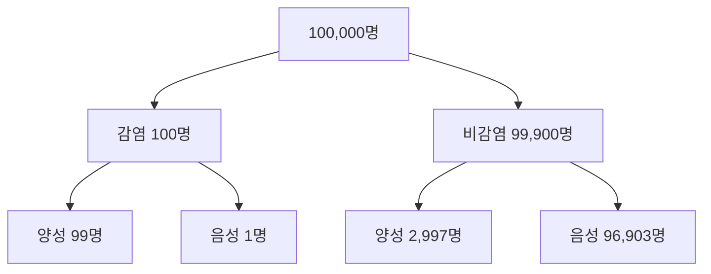
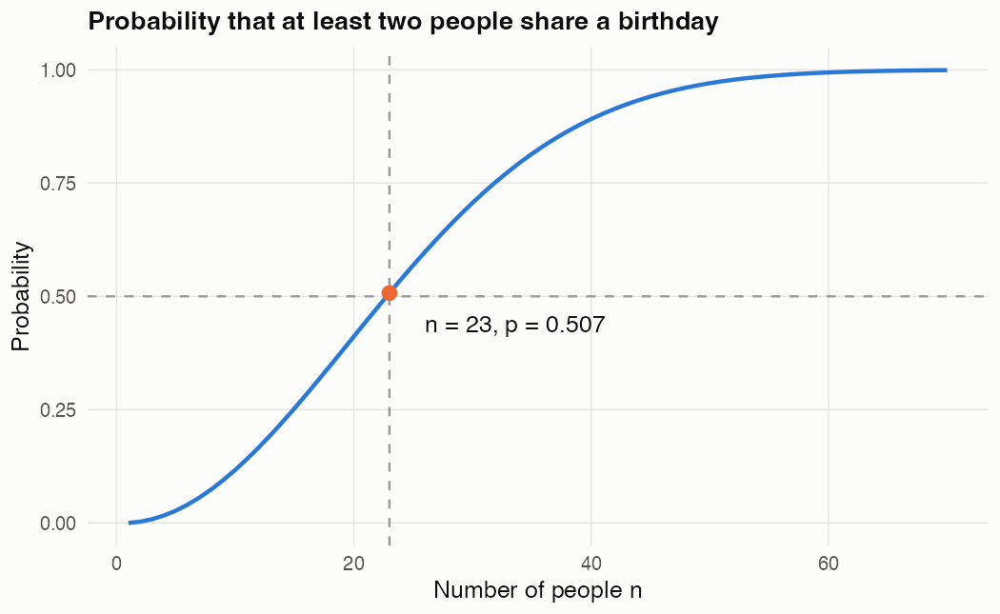

# 13장 — 통계적 사고와 확률의 오류

[레포지토리 안내](../../README.ko.md) | [English](Concepts_Lecture.md) | [한국어](Concepts_Lecture.ko.md)

> **최종 수정일:** 2026-11-19

> **학습 목표:**
> 1. 평균과 분포, 총량과 비율, 직선과 곡선을 구별하여 수치 자료를 사실에 근거해 해석할 수 있다
> 2. 경우의 수를 세어 확률을 계산하고, 독립 사건의 곱셈 규칙을 쓸 수 있다
> 3. 조건부 확률과 베이즈 정리로 검사 결과와 증언의 신뢰도를 계산할 수 있다
> 4. 심슨의 역설이 일어나는 원리를 설명하고 집단별 자료와 합친 자료를 올바르게 비교할 수 있다
> 5. 생일 문제와 무작위 일치 확률로 DNA 데이터베이스 검색의 확률을 해석할 수 있다
> 6. 검사의 오류처럼 조건부 확률의 방향을 뒤바꾸는 추론의 오류를 찾아낼 수 있다

---

## 목차

- [1. 사실에 근거한 세계관과 통계적 사고](#1-사실에-근거한-세계관과-통계적-사고)
  - [1.1 자료로 세계를 보는 방법](#11-자료로-세계를-보는-방법)
  - [1.2 평균과 분포](#12-평균과-분포)
  - [1.3 총량과 비율](#13-총량과-비율)
  - [1.4 직선과 곡선](#14-직선과-곡선)
  - [1.5 위험과 노출](#15-위험과-노출)
  - [1.6 범주와 일반화](#16-범주와-일반화)
- [2. 확률의 기초](#2-확률의-기초)
  - [2.1 주사위와 확률의 탄생](#21-주사위와-확률의-탄생)
  - [2.2 경우의 수와 세 주사위 문제](#22-경우의-수와-세-주사위-문제)
  - [2.3 독립 사건과 곱셈 규칙](#23-독립-사건과-곱셈-규칙)
  - [2.4 점수 문제](#24-점수-문제)
- [3. 조건부 확률과 베이즈 정리](#3-조건부-확률과-베이즈-정리)
  - [3.1 조건부 확률](#31-조건부-확률)
  - [3.2 베이즈 정리](#32-베이즈-정리)
  - [3.3 감염 검사의 양성 판정](#33-감염-검사의-양성-판정)
  - [3.4 뺑소니 택시의 색깔](#34-뺑소니-택시의-색깔)
  - [3.5 검사의 오류와 기저율](#35-검사의-오류와-기저율)
  - [3.6 추천 시스템과 조건부 확률](#36-추천-시스템과-조건부-확률)
- [4. 심슨의 역설](#4-심슨의-역설)
  - [4.1 SAT 점수의 역설](#41-sat-점수의-역설)
  - [4.2 UC 버클리 대학원 입학 자료](#42-uc-버클리-대학원-입학-자료)
  - [4.3 p값으로 본 입학 결과](#43-p값으로-본-입학-결과)
  - [4.4 학과별 자료가 보여 주는 것](#44-학과별-자료가-보여-주는-것)
  - [4.5 역설이 일어나는 원리](#45-역설이-일어나는-원리)
- [5. DNA 증거와 확률](#5-dna-증거와-확률)
  - [5.1 무작위 일치 확률](#51-무작위-일치-확률)
  - [5.2 생일 문제](#52-생일-문제)
  - [5.3 데이터베이스 안의 일치하는 쌍](#53-데이터베이스-안의-일치하는-쌍)
  - [5.4 데이터베이스 검색과 일치 확률](#54-데이터베이스-검색과-일치-확률)
  - [5.5 무고할 확률의 계산](#55-무고할-확률의-계산)
- [개념 적용](#개념-적용)
- [요약](#요약)
- [점검 문제](#점검-문제)
- [참고 문헌](#참고-문헌)

---

<br>

## 1. 사실에 근거한 세계관과 통계적 사고

### 1.1 자료로 세계를 보는 방법

1960년대부터 2000년대 초반까지 각 대륙의 나라들이 경제적으로, 의료적으로 어떻게 발전해 왔고 두 발전이 어떤 관계였는지 알고 싶다고 가정한다. 이 질문에 답하려면 나라마다, 연도마다 평균 기대수명, 1인당 GDP, 인구가 필요하다. 스웨덴의 비영리 통계 분석 기관인 갭마인더(Gapminder)는 유엔 등의 자료를 바탕으로 이런 통계를 모아 공개하며, R의 `gapminder` 패키지(9장)가 그 일부를 담고 있다.

| 변수 | 내용 |
|------|------|
| `country` | 142개의 서로 다른 값(수준)을 갖는 국가 변수 |
| `continent` | 5개의 값을 갖는 대륙 변수 |
| `year` | 숫자형 연도 변수(1952~2007년, 5년 간격) |
| `lifeExp` | 그해에 태어난 사람의 평균 기대수명 |
| `pop` | 인구 |
| `gdpPercap` | 1인당 국민 소득(GDP per capita) |

*표 1. gapminder 자료의 변수*

갭마인더의 공동 설립자인 의사이자 통계학자 한스 로슬링(Hans Rosling)은 이런 자료를 보여 주면서, 사람들이 세계에 대한 기본적인 사실 질문에 무작위로 고르는 것보다도 낮은 정답률을 보인다는 점을 지적했다. 그 원인은 지식이 부족해서라기보다, 자료를 해석할 때 빠지기 쉬운 몇 가지 사고의 습관 때문이라는 것이다. 이 절은 그 습관을 통계적 개념으로 정리한다. 수치 하나를 보았을 때 그것을 무엇과 비교해야 하는지, 어떤 분모로 나누어야 하는지, 앞으로도 같은 방향으로 이어질지를 묻는 것이 통계적 사고의 출발점이다.

### 1.2 평균과 분포

세계를 "선진국"과 "개발 도상국" 두 집단으로 나누고 그 사이에 넓은 간극이 있다고 생각하는 습관을 **간극 본능**(gap instinct)이라고 한다. 이 습관은 다음 세 가지 비교에서 강화된다.

1. **평균의 비교:** 두 집단의 평균이 다르다고 해서 두 집단이 겹치지 않는 것은 아니다. 평균 사이에 차이가 있어도 분포는 크게 겹칠 수 있으며, 그 겹치는 영역에 대부분의 개체가 있을 수 있다. 평균만 보고 "간극"을 말하지 말고, 9장 4절의 밀도 그래프나 상자 그림으로 분포 전체를 보아야 한다.
2. **극단의 비교:** 가장 부유한 집단과 가장 가난한 집단만 비교하면 간극이 커 보인다. 예를 들어 브라질에서는 상위 10%가 전체 소득의 41%를 벌어들이지만, 전체 인구의 소득을 네 단계로 나누어 보면 브라질 사람 대부분은 이미 극빈층을 벗어나 중간 단계에 있다. 극단 두 개는 분포의 양 끝일 뿐이다.
3. **위에서 내려다보는 시각:** 소득이 가장 높은 단계에 사는 사람에게는 그 아래 세 단계가 모두 똑같이 가난해 보이지만, 하루 1달러를 버는 삶과 4달러, 16달러를 버는 삶의 차이는 매우 크다. 로슬링은 세계 인구를 소득에 따라 네 단계로 나누어 보기를 제안했는데, 단계마다 소득이 약 4배씩 차이 나므로 이것은 소득을 로그 척도로 나눈 것과 같다.

> **핵심:** 두 집단을 비교할 때는 평균의 차이뿐 아니라 분포가 얼마나 겹치는지를 함께 보아야 한다. 이분법적인 범주 대신 연속적인 분포와 여러 단계로 자료를 보면 실제로 존재하지 않는 간극을 피할 수 있다.

### 1.3 총량과 비율

수치 하나만 보고 그 크기를 오판하는 습관이 **크기 본능**(size instinct)이다. 큰 수는 언제나 커 보이고, 눈앞의 사례 하나는 실제보다 중요해 보인다. 이것을 바로잡는 방법은 세 가지이다.

- **비교하라:** 수치 하나는 그 자체로 의미가 없다. 2016년에 420만 명의 아기가 첫 생일을 맞기 전에 죽었다는 수치는 충격적이지만, 그 전해에는 440만 명, 1950년에는 1,440만 명이었다는 수치와 비교하면 의미가 달라진다.
- **나누어라:** 총량과 비율은 전혀 다른 이야기를 한다. 1950년의 신생아는 9,700만 명이고 그중 1,440만 명이 죽었으므로 영아 사망률은 $14.4/97 \approx 15\%$이다. 2016년에는 신생아 1억 4,100만 명 가운데 420만 명이 죽었으므로 $4.2/141 \approx 3\%$이다. 사망자 수만 비교하면 3분의 1 정도로 줄었지만, 비율로 비교하면 5분의 1로 줄었다. 크기가 다른 집단, 특히 인구가 다른 나라나 지역을 비교할 때는 1인당 수치를 써야 한다. 이산화 탄소 배출량을 나라별 총량으로 비교하면 인구가 많은 나라가 많이 배출하는 것처럼 보이지만, 1인당 배출량으로 비교하면 순위가 크게 바뀐다. 9장 7.5절에서 단계구분도를 총량이 아니라 비율로 칠해야 한다고 한 것과 같은 원리이다.
- **80/20 규칙:** 긴 목록을 받으면 가장 큰 몇 개 항목을 먼저 찾는다. 대개 그 몇 개가 나머지 전부를 합친 것보다 중요하다.

| 연도 | 신생아 수 | 사망한 아이 수 | 영아 사망률 |
|------|------:|------:|------:|
| 1950 | 9,700만 | 1,440만 | 약 15% |
| 2016 | 1억 4,100만 | 420만 | 약 3% |

*표 2. 총량과 비율로 본 영아 사망*

### 1.4 직선과 곡선

지금까지의 추세가 직선으로 계속 이어질 것이라고 가정하는 습관이 **직선 본능**(straight line instinct)이다. 현실의 추세 가운데 직선은 드물며, 대표적인 곡선은 다음과 같다.

| 곡선의 모양 | 특징 | 예 |
|------|------|------|
| 직선 | 일정한 양만큼 계속 증가 | 여성의 첫 결혼 연령, 평균 교육 연수 |
| S자 곡선 | 느리게 시작해 빠르게 증가한 뒤 상한에 가까워지며 평평해짐 | 문해율, 예방 접종률, 냉장고 보급률 |
| 미끄럼틀 곡선 | 소득이 늘수록 감소하다가 바닥에서 평평해짐 | 여성 1인당 출생아 수 |
| 혹 모양 곡선 | 중간 소득 단계에서 가장 높고 양쪽에서 낮음 | 충치가 있는 아동의 비율, 교통사고 사망 |
| 두 배 증가 | 일정한 기간마다 두 배씩 증가 | 전염병 초기의 감염자 수 |

*표 3. 추세 곡선의 종류*

두 배 증가는 처음에는 느려 보이지만 매우 빠르게 커진다. 감염자가 1, 2, 3, 4, 5처럼 직선을 따라 늘지 않고 1, 2, 4, 8, 16처럼 두 배씩 늘면, 같은 기간이 지난 뒤의 규모는 직선과 비교할 수 없이 크다. 체스판의 첫 칸에 쌀 한 톨, 둘째 칸에 두 톨, 셋째 칸에 네 톨처럼 칸마다 두 배씩 놓으면 64칸 전체의 쌀은 $1 + 2 + 4 + \cdots + 2^{63} = 2^{64} - 1 = 18{,}446{,}744{,}073{,}709{,}551{,}615$톨이다. 등비급수의 합 공식 $\sum_{k=0}^{n-1} 2^k = 2^n - 1$에서 나오는 값이다.

반대로 계속 늘어날 것 같은 양이 실제로는 곡선을 그리며 평평해지기도 한다. 세계 인구는 1800년에 10억을 넘은 뒤 빠르게 늘어 2017년에 약 76억이 되었지만, 유엔의 인구 전문가들은 증가세가 이미 둔화하기 시작했으며 2100년에 약 110억에서 평평해질 것으로 예상한다. 여성 1인당 출생아 수가 미끄럼틀 곡선을 따라 줄어들어, 아동 인구가 거의 늘지 않기 때문이다. 아동 사망률이 높은 극빈층 부모일수록 자녀를 많이 낳으므로, 가난한 아이들을 살리는 것은 인구를 늘리는 것이 아니라 오히려 인구 증가를 멈추는 방향으로 작용한다. 11장의 시계열 분석에서 추세를 단순히 연장하지 않고 모형으로 예측하는 것도 같은 이유이다.

### 1.5 위험과 노출

사람들이 가장 두려워하는 것(뱀, 높은 곳, 비행기 사고, 테러)은 실제로 가장 위험한 것과 다르다. 이런 습관을 **공포 본능**(fear instinct)이라고 한다. 언론은 주의를 끄는 데 공포만 한 것이 없으므로 무서운 사건을 골라 보도하며, 그 결과 세상은 실제보다 무서워 보인다. 무사히 착륙한 비행기는 뉴스가 되지 않는다. 2016년에 상업 항공기 4,000만 대가 무사히 목적지에 도착했고 치명적인 사고를 당한 항공기는 10대였으므로, 사고의 비율은 $10/40{,}000{,}000 = 0.000025\%$이다. 같은 해 전 세계 사망자 가운데 테러로 인한 사망자는 0.05%였다.

> **핵심:** 어떤 대상이 나에게 주는 위험은 그것이 얼마나 무서운지가 아니라 위험도(danger)와 노출(exposure)의 곱으로 정해진다. 위험 = 위험도 × 노출이다.

이와 함께 좋은 일보다 나쁜 일에 더 주목하는 **부정 본능**(negativity instinct)도 자료의 해석을 왜곡한다. 그 원인은 과거를 미화하는 기억, 나쁜 소식을 골라 전하는 선별적 보도, 그리고 생각 대신 느낌으로 판단하는 습관이다. 통계적으로 보면 선별적 보도는 표본이 무작위가 아니라 특정한 기준으로 골라진 **선택 편향**의 한 형태이다. "나쁘지만 나아지고 있다"는 두 사실은 동시에 참일 수 있으며, 수준과 변화의 방향을 구별해서 보아야 한다.

### 1.6 범주와 일반화

범주화는 생각의 틀을 잡는 데 반드시 필요하지만, 실제로는 매우 다른 대상을 같은 범주로 묶거나, 같은 범주의 모든 대상이 비슷하다고 단정하거나, 드문 사례 하나로 범주 전체를 판단하게 만든다. 이것이 **일반화 본능**(generalization instinct)이다. 범주를 점검하는 방법은 다음과 같다.

- **집단 안의 차이와 집단 사이의 유사점을 찾는다.** 아프리카는 54개국 10억 인구가 사는 대륙이어서 네 소득 단계가 모두 있다. "아프리카의 나라들은"이라는 말로 소말리아, 가나, 튀니지를 한데 묶으면 그 안의 큰 차이가 사라진다. 사진 자료를 모아 보면 국가가 달라도 소득 수준이 같으면 삶의 모습이 놀랍도록 비슷하고, 국가가 같아도 소득 수준이 다르면 삶의 모습이 크게 다르다.
- **"다수"가 얼마인지 묻는다.** 다수는 절반을 넘는다는 뜻일 뿐이다. 51%일 수도 있고 99%일 수도 있으므로 몇 퍼센트인지 확인한다.
- **생생한 예외 사례에 주의한다.** 기억하기 쉬운 예는 규칙이 아니라 예외일 수 있다. 사례 하나로 집단 전체에 대해 결론을 내리려 하면 예를 더 요구해야 한다.
- **한 집단의 결론을 다른 집단에 옮길 때 주의한다.** 의식을 잃은 군인은 엎드려 눕혀야 구토물에 질식하지 않는다는 발견이 아기를 엎드려 재우는 관행으로 일반화되었지만, 반사 신경이 작동하는 잠자는 아기에게는 오히려 위험할 수 있다는 사실이 뒤늦게 밝혀졌다. 한 모집단에서 얻은 결과를 성질이 다른 모집단에 적용하는 것은 통계적 추론의 대표적인 오류이다.

그 밖에 사람과 문화의 운명이 타고난 특성으로 정해져 바뀌지 않는다고 여기는 **운명 본능**은 더딘 변화를 불변으로 착각하게 만들고, 모든 문제를 하나의 원인과 하나의 해법으로 설명하려는 **단일 관점 본능**은 수치나 전문 분야 하나에 매몰되게 만든다. 연간 1%의 변화도 수십 년이 쌓이면 큰 변화가 되며, 수치 없이는 세계를 이해할 수 없지만 수치만으로도 세계를 이해할 수 없다.

---

<br>

## 2. 확률의 기초

### 2.1 주사위와 확률의 탄생

우연의 대표적인 상징은 주사위이다. 주사위는 점을 치고 놀이를 하는 데 쓰던 동물의 뼈에서 비롯된 것으로 추정되며, 고대 이란의 샤르에 수크테(Shahr-e Sukhteh) 유적(기원전 3200~1800년경)에서 오늘날과 비슷한 육면체가 발견되었다. 고대 로마에서도 주사위 도박이 성행했지만, 그 시대 주사위의 대부분은 정육면체가 아니라 직사각형 면을 가져 특정한 눈이 다른 눈보다 자주 나왔다. 대칭인 정육면체 주사위가 표준이 된 것은 15세기 중반이다. 초기의 주사위는 1의 반대편에 2, 3의 반대편에 4, 5의 반대편에 6을 두어 마주 보는 두 면의 합이 3, 7, 11의 소수가 되는 "소수 배치"였으나, 1600년경부터 마주 보는 두 면의 합이 모두 7인 오늘날의 배치가 자리 잡았다.

주사위의 모든 면이 나올 가능성이 같다는 가정은 확률 계산의 출발점이다. 결과가 $n$가지이고 각 결과가 같은 가능성으로 일어나면, 사건 $A$의 확률은 $A$에 속하는 결과의 수를 전체 결과의 수로 나눈 값이다.

```math
P(A) = \frac{A\text{에 속하는 결과의 수}}{\text{전체 결과의 수}}
```

이것을 **고전적 확률**이라고 한다. 비대칭인 고대 주사위처럼 결과의 가능성이 같지 않으면 이 공식을 쓸 수 없으며, 그때는 같은 시행을 오래 반복했을 때 사건이 일어나는 비율로 확률을 정한다. 이 상대 빈도의 해석은 2.3절에서 다시 다룬다.

### 2.2 경우의 수와 세 주사위 문제

이탈리아 르네상스 시대의 지롤라모 카르다노(Girolamo Cardano)는 확률을 체계적으로 다룬 최초의 인물로 꼽힌다. 그는 3차 방정식의 해법을 담은 *위대한 기술*(1545)로 수학자의 명성을 얻었고, 3차 방정식을 풀면서 음수의 제곱근, 곧 허수의 필요성을 느꼈다. 의사이자 점성술사였으며 늘 돈이 모자라 노름꾼과 체스 선수로 돈을 벌었던 그는 1564년에 확률을 다룬 최초의 책으로 평가되는 *우연의 게임 지침서*를 썼다.

카르다노는 세 주사위에 관한 오래된 수수께끼를 풀었다. 도박사들은 주사위 세 개를 굴리면 합이 10이 나오는 경우가 9가 나오는 경우보다 많다는 것을 경험으로 알았지만 이유를 몰랐다. 세 수의 조합을 순서 없이 세면 합이 10인 조합은 (1, 4, 5), (1, 3, 6), (2, 4, 4), (2, 2, 6), (2, 3, 5), (3, 3, 4)의 6가지이고, 합이 9인 조합도 (1, 2, 6), (1, 3, 5), (1, 4, 4), (2, 2, 5), (2, 3, 4), (3, 3, 3)의 6가지로 같기 때문이다.

카르다노의 답은 조합을 순서까지 구별해서 세어야 한다는 것이었다. 세 주사위는 서로 다른 물체이므로 (1, 4, 5)는 1-4-5, 1-5-4, 4-1-5, 4-5-1, 5-1-4, 5-4-1의 여섯 가지 결과로 나타난다. 세 수가 모두 다르면 6가지, 두 수가 같으면 3가지, 세 수가 모두 같으면 1가지 순서가 있다. 이렇게 세면 216가지 결과 가운데 합이 10인 결과는 $6 + 6 + 3 + 3 + 6 + 3 = 27$가지, 합이 9인 결과는 $6 + 6 + 3 + 3 + 6 + 1 = 25$가지이다. 합이 9인 조합에 (3, 3, 3)처럼 순서가 하나뿐인 조합이 있기 때문이다. R로 모든 결과를 나열해 확인한다.

```r
rolls <- expand.grid(d1 = 1:6, d2 = 1:6, d3 = 1:6)
s <- rowSums(rolls)
c(total = nrow(rolls), sum9 = sum(s == 9), sum10 = sum(s == 10))
#> total  sum9 sum10 
#>   216    25    27
c(p9 = mean(s == 9), p10 = mean(s == 10))
#>        p9       p10 
#> 0.1157407 0.1250000
```

`expand.grid()`는 세 주사위의 눈 1\~6의 모든 조합인 $6^3 = 216$개 행의 데이터 프레임을 만들고, `rowSums()`는 행마다 세 눈의 합을 구한다. `sum(s == 9)`는 합이 9인 행의 수이고, `mean(s == 9)`는 그 비율, 곧 확률이다. 합이 10일 확률은 $27/216 = 0.125$, 9일 확률은 $25/216 \approx 0.116$이다. 고전적 확률을 쓸 때는 같은 가능성을 갖는 결과를 단위로 세어야 하며, 순서를 무시한 조합은 같은 가능성을 갖지 않는다.

### 2.3 독립 사건과 곱셈 규칙

카르다노는 주사위를 여러 번 굴리는 경우에 대해서도 두 가지 중요한 생각을 남겼다. 첫째, 사건의 확률은 오랜 시간에 걸쳐 주어진 기회에서 그 일이 실제로 일어나는 비율과 같다. 이것이 확률의 **상대 빈도** 해석이며, 시행 횟수가 많아질수록 상대 빈도가 확률에 가까워진다는 큰 수의 법칙으로 정식화되었다. 둘째, 어떤 사건이 한 번의 시도에서 일어날 확률이 $p$이면 $n$번의 시도에서 모두 일어날 확률은 $p^n$이다.

> **용어 정의:** 두 사건 $A$와 $B$에 대해 $P(A \cap B) = P(A)P(B)$가 성립하면 $A$와 $B$를 **독립 사건(independent events)** 이라고 한다.

독립은 한 사건이 일어났다는 사실이 다른 사건의 확률을 바꾸지 않는다는 뜻이다. 주사위를 따로 굴리는 시행들은 독립이므로, 주사위를 세 번 굴려 모두 6이 나올 확률은 $(1/6)^3 = 1/216$이다. 카르다노의 $p^n$은 $n$번의 독립 시행에 이 곱셈 규칙을 적용한 것이다.

곱셈 규칙은 사건들이 실제로 독립일 때만 성립한다. 독립이 아닌 사건에 곱셈 규칙을 쓰면 확률을 크게 잘못 계산하며, 5절의 DNA 증거와 5.5절의 특징 결합 계산은 이 독립성 가정에 결정적으로 의존한다. 예를 들어 "백인이다"와 "65세 이상의 남성 성범죄자이다"가 독립이 아니라면, 두 확률을 곱한 값은 두 특징을 모두 가진 사람의 실제 비율과 다르다.

### 2.4 점수 문제

1654년 전문 도박사 슈발리에 드 메레는 페르마(Pierre de Fermat)와 파스칼(Blaise Pascal)에게 **점수 문제**(problem of the points)의 답을 물었다. 두 사람이 이길 확률이 각각 50%인 게임을 하면서 같은 금액의 판돈을 걸고, 정해진 횟수의 승리를 먼저 거두는 사람이 판돈을 모두 가져가기로 했다. 그런데 게임이 도중에 중단되면 그때까지의 점수로 판돈을 어떻게 나누어야 하는가? 예를 들어 판돈이 100프랑이고 10점을 먼저 얻는 사람이 이기는데 점수가 7대 4일 때 게임을 그만두어야 한다면, 각자 얼마를 가져가야 하는가?

페르마와 파스칼의 서신 교환에서 나온 핵심 생각은, 지금까지의 점수가 아니라 게임을 계속했을 때 각자가 이길 확률에 비례해 판돈을 나누는 것이다. 7점인 A는 3번, 4점인 B는 6번을 더 이겨야 한다. 게임은 늦어도 $3 + 6 - 1 = 8$판 안에 끝나므로, 실제로 끝났든 아니든 8판을 모두 한다고 생각해도 승자는 바뀌지 않는다. 그러면 A가 이기는 것은 8판 가운데 3판 이상을 이기는 경우이고, 이긴 판의 수는 시행 8번, 성공 확률 0.5인 이항분포를 따른다.

```math
P(\text{A 승리}) = \sum_{k=3}^{8} \binom{8}{k} \left(\frac{1}{2}\right)^8 = \frac{56 + 70 + 56 + 28 + 8 + 1}{256} = \frac{219}{256}
```

```r
# A needs 3 more wins, B needs 6 more; at most 3 + 6 - 1 = 8 more games
pA <- sum(dbinom(3:8, size = 8, prob = 0.5))
c(pA = pA, pB = 1 - pA, shareA = 100 * pA, shareB = 100 * (1 - pA))
#>         pA         pB     shareA     shareB 
#>  0.8554688  0.1445312 85.5468750 14.4531250
```

`dbinom(3:8, size = 8, prob = 0.5)`는 8판 가운데 정확히 3, 4, ..., 8판을 이길 확률이고, 그 합이 A가 이길 확률 $219/256 \approx 0.855$이다. 따라서 공정한 분배는 A가 약 85.55프랑, B가 약 14.45프랑이다. 점수의 비율 7:4대로 나누면 A가 약 63.6프랑을 받게 되어, 앞서 있는 사람의 실제 유리함을 과소평가한다. 이 문제의 풀이는 불확실한 미래의 결과를 확률로 가중해 현재의 가치를 정하는 기댓값의 개념으로 이어졌다.

---

<br>

## 3. 조건부 확률과 베이즈 정리

### 3.1 조건부 확률

어떤 사건이 일어났다는 정보는 다른 사건의 확률을 바꿀 수 있다.

> **용어 정의:** 사건 $B$가 일어났을 때 사건 $A$가 일어날 확률인 **조건부 확률(conditional probability)** 은 $P(B) > 0$일 때 $P(A \mid B) = P(A \cap B)/P(B)$로 정의한다.

조건부 확률은 표본 공간을 $B$로 좁힌 뒤 그 안에서 $A$가 차지하는 비율이다. 정의를 바꾸어 쓰면 곱셈 법칙 $P(A \cap B) = P(B)P(A \mid B)$가 되고, $A$와 $B$가 독립이면 $P(A \mid B) = P(A)$이므로 2.3절의 곱셈 규칙이 나온다. 조건부 확률에서 가장 흔한 실수는 방향을 뒤바꾸는 것이다. $P(A \mid B)$와 $P(B \mid A)$는 일반적으로 다르다. 예를 들어 "농구 선수일 때 키가 190cm 이상일 확률"은 높지만 "키가 190cm 이상일 때 농구 선수일 확률"은 낮다.

표본 공간이 서로 겹치지 않는 사건 $B_1, \ldots, B_k$로 나뉠 때, 사건 $A$의 확률은 각 $B_i$ 안에서 $A$가 일어날 확률을 $B_i$의 확률로 가중해 더한 것과 같다. 이것을 **전확률 공식**이라고 한다.

```math
P(A) = \sum_{i=1}^{k} P(B_i) P(A \mid B_i)
```

### 3.2 베이즈 정리

영국의 통계학자이자 장로교 목사였던 토머스 베이즈(Thomas Bayes, 1701~1761)는 자기 이름이 붙은 정리의 특별한 경우를 정식화했다. 그는 이 결과를 생전에 발표하지 않았으며, 그의 원고는 사후에 리처드 프라이스가 정리해 출판했다. 피타고라스 정리나 페르마의 마지막 정리처럼 수학에는 수많은 정리가 있지만, 베이즈 정리는 질병 검사, 재판, 수색, 추천 시스템처럼 인간 사회의 문제를 푸는 데 직접 쓰이는 정리이다.

곱셈 법칙을 두 방향으로 쓰면 $P(A \cap B) = P(B)P(A \mid B) = P(A)P(B \mid A)$이므로, 다음 관계가 성립한다.

```math
P(A \mid B) = \frac{P(A)P(B \mid A)}{P(B)} = \frac{P(A)P(B \mid A)}{P(A)P(B \mid A) + P(A^c)P(B \mid A^c)}
```

분모는 전확률 공식으로 $P(B)$를 풀어 쓴 것이다. 이 식에서 $P(A)$는 증거 $B$를 보기 전의 믿음인 **사전 확률**(prior probability), $P(A \mid B)$는 증거를 본 뒤의 믿음인 **사후 확률**(posterior probability), $P(B \mid A)$는 $A$가 참일 때 그 증거가 나올 확률인 **우도**(likelihood)이다. 베이즈 정리는 증거가 주어졌을 때 믿음을 어떻게 고쳐야 하는지를 알려 주며, 그 결과는 우도만이 아니라 사전 확률에도 크게 좌우된다.

### 3.3 감염 검사의 양성 판정

인구 10만 명당 100명의 감염자가 있는 감염병이 있다고 가정한다. 감염률은 0.1%이다. 어떤 검사는 감염된 사람을 "양성", 감염되지 않은 사람을 "음성"으로 판정하는데, 실제 감염자 100명이 검사를 받으면 99명은 올바르게 양성으로 판정되고 1명은 음성으로 잘못 판정된다. 이 비율 99%를 검사의 **민감도**(sensitivity)라고 한다. 반면 감염되지 않은 사람 100명이 검사를 받으면 97명은 올바르게 음성, 3명은 양성으로 잘못 판정된다. 이 비율 97%가 **특이도**(specificity)이다. 12장 6.2절의 분류 지표와 같은 개념이다.

당신이 이 검사에서 양성 판정을 받았다면 실제로 감염되었을 확률은 얼마인가? 감염을 $D$, 비감염을 $D^c$, 양성을 $+$로 쓰면 $P(D) = 1/1000$, $P(D^c) = 999/1000$, $P(+ \mid D) = 99/100$, $P(+ \mid D^c) = 3/100$이다. 베이즈 정리에 넣으면 다음과 같다.

```math
P(D \mid +) = \frac{\frac{1}{1000} \times \frac{99}{100}}{\frac{1}{1000} \times \frac{99}{100} + \frac{999}{1000} \times \frac{3}{100}} = \frac{99}{99 + 2997} = \frac{99}{3096} \approx 0.032
```

민감도 99%, 특이도 97%인 검사에서 양성이 나와도 실제로 감염되었을 확률은 3.2%에 불과하다. 이 결과는 자연 빈도로 바꾸어 보면 직관적으로 이해된다. 10만 명 가운데 감염자 100명에서 양성이 99명 나오지만, 비감염자 99,900명에서도 3%인 약 2,997명이 양성으로 나온다. 양성 3,096명 가운데 실제 감염자는 99명뿐이다.



*그림 1. 감염 검사 결과를 자연 빈도로 나타낸 나무 그림*

1회째 검사에서 양성 판정을 받은 사람이 같은 검사를 다시 받아 또 양성이 나왔다면, 실제로 감염되었을 확률은 얼마인가? 두 검사의 오류가 서로 독립이라고 가정하면, 첫 검사 뒤의 사후 확률 $99/3096$을 새 사전 확률로 삼아 베이즈 정리를 한 번 더 적용하면 된다. 이때 $P(D) = 99/3096$, $P(D^c) = 2997/3096$이다.

```math
P(D \mid ++) = \frac{\frac{99}{3096} \times \frac{99}{100}}{\frac{99}{3096} \times \frac{99}{100} + \frac{2997}{3096} \times \frac{3}{100}} = \frac{9801}{9801 + 8991} = \frac{9801}{18792} \approx 0.52
```

```r
prior <- 1 / 1000
sens <- 0.99; fpr <- 0.03
post1 <- prior * sens / (prior * sens + (1 - prior) * fpr)
post2 <- post1 * sens / (post1 * sens + (1 - post1) * fpr)
round(c(after_one_positive = post1, after_two_positives = post2), 4)
#>  after_one_positive after_two_positives 
#>              0.0320              0.5216
```

`prior`는 감염률, `sens`는 민감도, `fpr`은 거짓 양성 비율 $1 - \text{특이도} = 0.03$이다. `post1`은 첫 양성 뒤의 사후 확률이고, `post2`는 그것을 사전 확률로 다시 넣어 얻은 두 번째 양성 뒤의 사후 확률이다. 두 번 연속 양성이 나와야 비로소 감염되었을 확률이 52%로 절반을 넘는다. 이처럼 베이즈 정리는 새 증거가 들어올 때마다 차례로 적용할 수 있으며, 앞 단계의 사후 확률이 다음 단계의 사전 확률이 된다.

> **주의:** 재검사의 계산은 두 검사의 결과가 감염 여부가 주어졌을 때 조건부로 독립이라는 가정 위에 서 있다. 같은 사람에게서 같은 이유(예: 교차 반응을 일으키는 다른 항체)로 거짓 양성이 반복된다면 두 번째 양성이 주는 정보는 이보다 훨씬 작다.

### 3.4 뺑소니 택시의 색깔

어느 도시에서 택시 뺑소니 사건이 일어났다. 이 도시의 택시 회사는 청색 택시를 운행하는 회사와 녹색 택시를 운행하는 회사 둘뿐이며, 택시의 15%가 청색, 85%가 녹색이다. 목격자는 뺑소니 택시가 청색이었다고 증언했지만 어두운 밤이었다. 조사해 보니 어두운 밤에 청색 택시를 본 사람의 80%는 청색이라고 올바르게 말하고 20%는 녹색이라고 잘못 말하며, 녹색 택시를 본 사람의 75%는 녹색이라고 올바르게 말하고 25%는 청색이라고 잘못 말한다. 뺑소니 택시가 청색일 확률과 녹색일 확률은 각각 얼마인가?

청색 택시가 달리고 있는 사건을 $B$, 녹색을 $G$, 청색이라고 증언하는 사건을 $T_B$라 하면 $P(B) = 0.15$, $P(G) = 0.85$, $P(T_B \mid B) = 0.8$, $P(T_B \mid G) = 0.25$이다.

```math
P(B \mid T_B) = \frac{P(B)P(T_B \mid B)}{P(B)P(T_B \mid B) + P(G)P(T_B \mid G)} = \frac{0.15 \times 0.8}{0.15 \times 0.8 + 0.85 \times 0.25} = \frac{0.12}{0.3325} \approx 0.36
```

```r
pB <- 0.15; pG <- 0.85
round(c(blue = pB * 0.80 / (pB * 0.80 + pG * 0.25),
        green = pG * 0.25 / (pB * 0.80 + pG * 0.25)), 4)
#>   blue  green 
#> 0.3609 0.6391
```

목격자가 청색이라고 증언했는데도 택시가 청색일 확률은 36%이고, 녹색일 확률이 64%로 오히려 더 높다. 목격자의 정확도(80%)만 보고 "청색일 확률이 80%"라고 생각하기 쉽지만, 청색 택시 자체가 드물다는 사전 정보(15%)가 결과를 크게 바꾼다. 녹색 택시가 워낙 많아서, 녹색 택시를 청색으로 잘못 본 증언(전체의 $0.85 \times 0.25 = 0.2125$)이 청색 택시를 청색으로 올바르게 본 증언(전체의 $0.15 \times 0.8 = 0.12$)보다 많기 때문이다.

### 3.5 검사의 오류와 기저율

3.3절과 3.4절의 두 예는 같은 구조를 갖는다. 증거의 정확도 $P(\text{증거} \mid \text{가설})$가 높아도, 가설 자체가 드물면 $P(\text{가설} \mid \text{증거})$는 낮을 수 있다. 사전 확률, 곧 모집단에서 그 사건이 일어나는 비율을 **기저율**(base rate)이라고 하며, 증거를 평가할 때 기저율을 무시하는 오류를 **기저율 무시**(base rate neglect)라고 한다.

> **용어 정의:** **검사의 오류(prosecutor's fallacy)** 는 피고가 무고할 때 증거가 우연히 나타날 확률 $P(\text{증거} \mid \text{무고})$를 증거가 나타났을 때 피고가 무고할 확률 $P(\text{무고} \mid \text{증거})$로 착각하는 추론의 오류이다.

예를 들어 "무고한 사람의 DNA가 범인의 DNA와 우연히 일치할 확률은 100만분의 1이므로, 피고가 무고할 확률은 100만분의 1이다"라는 주장은 검사의 오류이다. 앞의 확률은 $P(\text{일치} \mid \text{무고})$이고, 뒤의 확률은 $P(\text{무고} \mid \text{일치})$이다. 인구가 3억이면 100만분의 1의 확률로도 일치하는 사람이 약 300명 있을 것이므로, 다른 증거 없이 DNA 일치만으로 피고가 그 300명 가운데 범인일 확률은 300분의 1 정도일 수 있다(5.5절). 반대로 "일치하는 사람이 300명이나 되므로 DNA 일치는 아무 의미가 없다"는 주장도 오류이다. DNA 일치는 용의자의 범위를 수억 명에서 수백 명으로 좁히는 강력한 증거이며, 다른 증거와 결합해서 평가해야 한다. 이 반대 방향의 오류를 **변호인의 오류**(defense attorney's fallacy)라고 부른다.

### 3.6 추천 시스템과 조건부 확률

조건부 확률은 오늘날의 인공지능 서비스에서도 핵심적인 역할을 한다. 영화 대여 회사 넷플릭스는 2010년 무렵까지 연체료 없는 DVD를 빨간 봉투에 담아 우편으로 보내는 사업을 했고, 가입자가 DVD를 반납할 때 1\~5점으로 영화를 평가하게 했다. 그렇게 쌓인 평가 자료에서 가입자의 취향 패턴을 찾는 인공지능을 **추천 시스템**(recommendation system)이라고 한다. 넷플릭스는 자사 평가 자료의 일부를 공개하고 자사 추천 시스템인 시네매치(Cinematch)의 성능을 10% 이상 높이는 팀에 100만 달러를 주는 경진 대회를 열었으며, 2009년에 BellKor's Pragmatic Chaos 팀이 시네매치를 10.06% 능가하는 알고리즘으로 우승했다. 넷플릭스는 이런 자료와 확률 분석을 바탕으로, 시청자가 어떤 콘텐츠를 어떻게 평가할지를 예측해 첫 자체 제작 시리즈 *하우스 오브 카드*의 제작을 결정했다.

추천 시스템이 계산하는 것은 조건부 확률이다.

- 영화 *셜록 홈즈*에 높은 점수를 준 사람이 *이미테이션 게임*이나 *팅커 테일러 솔저 스파이*를 좋아할 조건부 확률
- 어제 Pharrell Williams의 노래를 들은 사람이 오늘 Bruno Mars의 노래를 듣고 싶어 할 조건부 확률
- 유기농 개 사료를 산 사람이 GPS가 달린 개 목걸이를 살 조건부 확률

이 확률들은 $P(\text{B를 좋아함} \mid \text{A를 좋아함}) = P(\text{둘 다 좋아함})/P(\text{A를 좋아함})$으로, 3.1절의 정의를 자료의 빈도로 추정한 것이다. 이때도 방향이 중요하다. 인기 있는 영화 B는 거의 모든 사람이 좋아하므로 $P(B \mid A)$가 높지만, 그것은 A를 좋아하는 사람에게 B를 추천할 특별한 이유가 아니다. 그래서 추천에는 $P(B \mid A)$가 B의 전체 인기 $P(B)$보다 얼마나 큰지가 더 중요하다.

---

<br>

## 4. 심슨의 역설

### 4.1 SAT 점수의 역설

2002년 미국 SAT의 독해 부문 평균 점수는 1981년과 똑같은 504점이었다. 그러나 같은 기간에 인종 집단별 평균 점수는 백인이 8점, 흑인이 19점, 아시아계가 27점, 푸에르토리코계가 18점, 미국 원주민계가 8점 올랐다. 모든 집단의 점수가 올랐는데 어떻게 전체 평균은 21년 동안 변하지 않을 수 있는가?

| 연도 | 백인 | 흑인 | 아시아계 | 멕시코계 | 푸에르토리코계 | 원주민계 | 전체 평균 |
|------|------:|------:|------:|------:|------:|------:|------:|
| 1981 | 519 | 412 | 474 | 438 | 437 | 471 | 504 |
| 2002 | 527 | 431 | 501 | 446 | 455 | 479 | 504 |

*표 4. 집단별 SAT 독해 평균 점수*

| 연도 | 백인 | 흑인 | 아시아계 | 멕시코계 | 푸에르토리코계 | 원주민계 | 합계 |
|------|------:|------:|------:|------:|------:|------:|------:|
| 1981 | 85% | 9% | 3% | 2% | 1% | 0% | 100% |
| 2002 | 65% | 11% | 10% | 4% | 1% | 1% | 92% |

*표 5. 응시자의 집단별 비율(2002년의 나머지 8%는 그 밖의 집단)*

비밀은 표에 직접 나타나지 않는 요소, 곧 각 집단이 응시자 전체에서 차지하는 비율의 변화에 있다. 전체 평균은 집단 평균을 집단 비율로 가중한 평균이다.

```math
\bar{y} = \sum_{g} w_g \bar{y}_g, \qquad w_g = \frac{n_g}{n}
```

1981년과 2002년 모두 점수가 가장 높은 집단은 백인이지만, 백인의 비율이 85%에서 65%로 줄었으므로 전체 평균에 대한 기여가 줄었다. 대신 평균 점수가 낮은 다른 집단의 비율이 늘었다. 각 집단의 평균은 올랐지만 점수가 낮은 집단의 가중치가 커지면서 전체 평균을 끌어내렸고, 두 효과가 상쇄되어 전체 평균은 변하지 않았다.

> **용어 정의:** **심슨의 역설(Simpson's paradox)** 은 여러 집단 각각에서 나타나는 연관이 집단을 합친 자료에서는 사라지거나 방향이 뒤집히는 현상이다.

이 역설은 겉보기에는 이상하지만 수학적으로는 가중 평균의 성질일 뿐이다. 이를 이용하면 쉽게 사람을 속일 수 있다. 어떤 회사의 직원이 "경영진에게 보고할 자료를 준비하는데, 수익이 난 것처럼 만드는 것과 손실이 난 것처럼 만드는 것 중 어느 쪽을 원하느냐고 상사에게 물었다"는 일화가 있을 정도로, 집단을 어떻게 나누고 합치느냐에 따라 같은 자료가 정반대의 결론을 보이게 할 수 있다.

### 4.2 UC 버클리 대학원 입학 자료

1973년 캘리포니아대학교 버클리 캠퍼스(UC 버클리)는 대학원 입학 심사에서 여학생에게 불이익을 주었다는 비판을 받았다. 그해 대학원에 지원한 남학생 8,442명 가운데 3,738명이 합격해 합격률이 44%였던 반면, 여학생은 4,321명 가운데 1,494명만 합격해 합격률이 35%였기 때문이다 [1].

| | 지원자 | 합격자 | 합격률(%) |
|------|------:|------:|------:|
| 남학생 | 8,442 | 3,738 | 44 |
| 여학생 | 4,321 | 1,494 | 35 |

*표 6. 1973년 UC 버클리 대학원 입학 자료*

이 결과가 성차별 때문이 아니라면, 곧 입학 여부가 지원자의 능력만으로 결정되었다면, 남학생이 여학생보다 우수했거나 우연히 이런 차이가 생겼다는 결론이 된다. 그러나 미국의 학부 과정에서는 일반적으로 여학생의 성적이 남학생보다 높으므로, 지원자의 성적 분포로 보면 여학생의 합격률이 더 낮을 이유가 없었다. 그래서 이 결과는 성차별의 증거로 지목되었다.

먼저 우연으로 이런 차이가 생길 수 있는지 따져 본다. 전체 지원자 12,763명 가운데 5,232명이 합격했으므로 전체 합격률은 41%이다. 남녀의 합격 기대 확률이 같다면, 남녀 모두 41%가 합격했을 때의 기대 합격자 수는 남학생 3,461명, 여학생 1,771명이다.

```r
admit <- c(male = 3738, female = 1494)
apply_n <- c(male = 8442, female = 4321)
round(admit / apply_n, 3)
#>   male female 
#>  0.443  0.346
expected <- apply_n * sum(admit) / sum(apply_n)
round(expected)
#>   male female 
#>   3461   1771
```

`sum(admit) / sum(apply_n)`은 전체 합격률이고, 여기에 각 성별의 지원자 수를 곱하면 기대 합격자 수가 된다. UC 버클리는 기대치보다 남학생을 277명 더, 여학생을 277명 덜 선발했다.

### 4.3 p값으로 본 입학 결과

277명의 차이가 우연으로 생길 만한 크기인지는 **p값**으로 판단한다. 큰 통에 지원자 수만큼 8,442개의 검은 공(남학생)과 4,321개의 흰 공(여학생)이 들어 있고, 색을 보지 않고 무작위로 합격자 수만큼 $3{,}738 + 1{,}494 = 5{,}232$개의 공을 꺼낸다고 가정한다. 이때 p값은 흰 공이 1,494개 이하로 나올 확률, 곧 합격이 성별과 무관하게 무작위로 결정되었다는 가정 아래에서 관측한 결과만큼 또는 그보다 더 극단적인 결과가 나올 확률이다. 컴퓨터로 이 실험을 수백만 번 반복하면 p값을 어림할 수 있고, 이론적으로는 초기하분포로 정확히 계산할 수 있다.

```r
phyper(1494, m = 4321, n = 8442, k = 5232)
#> [1] 1.80469e-26
```

`phyper(q, m, n, k)`는 흰 공 `m`개와 검은 공 `n`개가 든 통에서 `k`개를 비복원으로 꺼낼 때 흰 공이 `q`개 이하일 확률이다. p값은 약 $1.8 \times 10^{-26}$으로, 우연으로는 사실상 일어날 수 없는 결과이다.

> **참고:** **p값의 크기.** 이 결과의 p값을 0.0000000057(약 10억분의 1)로 소개하기도 하지만, 위의 초기하분포 계산은 그보다 훨씬 작은 값을 준다. 어느 값이든 우연으로 설명할 수 없다는 결론은 같다.

일반적으로 p값이 1,000분의 1보다 작으면 결과가 순전히 우연으로 생겼다는 가설을 의심할 합당한 이유가 있고, 다른 원인을 찾아야 한다. 그러나 일어날 가능성이 매우 낮은 사건(흔히 블랙 스완이라고 부른다)도 현실에서는 일어나며, 많은 사건을 살피다 보면 그중 일부는 우연히 작은 p값을 갖는다. 핵심은 확률이 낮은 일이 일어났을 때 다른 원인을 의심할 수는 있어도 그것만으로 결론을 내릴 수는 없다는 점이다. 작은 p값이 말해 주는 것은 "우연만으로는 설명하기 어렵다"는 것뿐이고, 그 원인이 성차별인지는 추가 조사로 확인해야 한다. p값의 정확한 정의와 해석, 흔한 오용은 14장에서 다룬다.

### 4.4 학과별 자료가 보여 주는 것

UC 버클리는 통계학 교수, 인류학 교수였던 대학원장, 대학원의 자료 담당 직원으로 조사 위원회를 구성했다. 입학 심사는 학과 단위로 이루어지고 학과마다 독립적이므로, 위원회는 불평등이 학교 전체가 아니라 몇몇 학과에 있을 것이라는 전제로 학과별 입학 자료를 조사했다. 여학생 지원자가 없거나 지원자 전원이 합격한 학과를 빼면 85개 학과가 남았고, 위원회는 학과마다 남녀 합격자의 비율이 우연으로 기대되는 수준에서 얼마나 벗어나는지 p값을 구했다. 대부분의 학과는 주목할 만한 예외를 보이지 않았으며, 추가 조사가 필요한 학과는 규모가 크고 지원자가 많은 여섯 곳이었다.

| | 지원자 | 합격자 | 합격률(%) |
|------|------:|------:|------:|
| 남학생 | 2,590 | 1,192 | 46 |
| 여학생 | 1,835 | 557 | 30 |

*표 7. 지원자가 많은 여섯 개 학과를 합친 입학 자료*

이 여섯 학과를 합치면 남학생은 거의 절반이 합격했지만 여학생은 3분의 1에도 못 미쳤으므로, 학교 전체의 44%와 35%보다 더 심하게 기울어 범인이 드러난 것처럼 보였다. 그러나 학과별로 나누어 보면 전혀 다른 그림이 나타난다.

```r
dept <- data.frame(dept = LETTERS[1:6],
                   m_app = c(825, 560, 325, 417, 191, 272), m_adm = c(511, 353, 120, 139, 53, 16),
                   f_app = c(108, 25, 593, 375, 393, 341), f_adm = c(89, 17, 202, 131, 94, 24))
dept$m_rate <- round(100 * dept$m_adm / dept$m_app)
dept$f_rate <- round(100 * dept$f_adm / dept$f_app)
dept
#>   dept m_app m_adm f_app f_adm m_rate f_rate
#> 1    A   825   511   108    89     62     82
#> 2    B   560   353    25    17     63     68
#> 3    C   325   120   593   202     37     34
#> 4    D   417   139   375   131     33     35
#> 5    E   191    53   393    94     28     24
#> 6    F   272    16   341    24      6      7
colSums(dept[, 2:5])
#> m_app m_adm f_app f_adm 
#>  2590  1192  1835   557
round(100 * c(male = sum(dept$m_adm) / sum(dept$m_app), female = sum(dept$f_adm) / sum(dept$f_app)))
#>   male female 
#>     46     30
```

`m_app`, `m_adm`은 남학생의 지원자와 합격자, `f_app`, `f_adm`은 여학생의 지원자와 합격자이고, `m_rate`, `f_rate`는 학과별 합격률(%)이다. `colSums()`로 여섯 학과를 더하면 표 7의 값이 된다. 여섯 학과 가운데 네 곳(A, B, D, F)은 여학생의 합격률이 남학생보다 높았고, A 학과는 여학생의 82%를 합격시켜 남학생의 62%보다 훨씬 높았다. 나머지 두 학과 C와 E는 남학생이 약간 더 합격했지만(C는 37%와 34%, E는 28%와 24%), 특별히 의심할 만한 차이는 아니었다. 어느 학과도 남학생을 특별히 선호하지 않았고 대부분은 오히려 여학생의 합격률이 높았는데, 합친 자료에서는 여학생의 합격률이 훨씬 낮다. 이것이 4.1절의 심슨의 역설이다.

> **참고:** **원 자료와의 차이.** R에 내장된 `UCBAdmissions` 자료(14장 5.2절)에서는 F 학과 남학생이 373명 지원해 22명이 합격했고, A 학과와 D 학과의 남학생 합격자가 각각 512명과 138명이다. 이 값으로 여섯 학과를 합치면 남학생은 2,691명 가운데 1,198명(44.5%)이 합격한다. 학과마다 남녀 합격률의 대소 관계는 위의 표와 같으므로, 여학생이 합격률이 낮은 학과에 몰려 전체 합격률이 낮아졌다는 결론은 달라지지 않는다.

### 4.5 역설이 일어나는 원리

합친 자료에서 빠진 정보는 "합격률이 높은(또는 낮은) 학과에 지원한 남학생과 여학생의 비율"이다. 표 7의 여섯 학과를 보면 남학생은 2,590명 가운데 1,385명(53%)이 합격률이 60% 안팎인 A, B 학과에 지원했고, 여학생은 1,835명 가운데 1,702명(93%)이 합격률이 35% 이하인 C, D, E, F 학과에 지원했다. 학과마다의 합격률은 남녀가 비슷해도, 여학생은 들어가기 어려운 학과에 몰렸으므로 전체 합격률이 낮아진다.

이 구조를 극단적으로 단순화한 예로 확인한다. 어떤 대학에 학과가 A, B 두 곳뿐이고, 지원자는 남학생 600명, 여학생 400명이며, 두 학과 모두 여학생을 약간 우대한다고 가정한다. 그러나 B 학과의 합격률이 A 학과보다 훨씬 낮고, 대부분의 여학생은 B 학과에 지원했다.

| 학과 | 성별 | 지원자 | 합격자 | 합격률(%) |
|------|------|------:|------:|------:|
| A | 남학생 | 500 | 400 | 80 |
| A | 여학생 | 100 | 90 | 90 |
| B | 남학생 | 100 | 20 | 20 |
| B | 여학생 | 300 | 90 | 30 |
| 합계 | 남학생 | 600 | 420 | 70 |
| 합계 | 여학생 | 400 | 180 | 45 |

*표 8. 심슨의 역설을 보여 주는 두 학과의 가상 자료*

A 학과는 여학생의 90%와 남학생의 80%를, B 학과는 여학생의 30%와 남학생의 20%를 합격시켰으므로 두 학과 모두 여학생의 합격률이 10%p 높다. 그러나 전체 합격률은 남학생 $420/600 = 70\%$, 여학생 $180/400 = 45\%$로 남학생이 훨씬 높다. 전체 합격률은 학과별 합격률을 지원자 분포로 가중한 평균이므로, 남학생의 전체 합격률은 $(500/600) \times 80\% + (100/600) \times 20\% = 70\%$이고 여학생은 $(100/400) \times 90\% + (300/400) \times 30\% = 45\%$이다. 여학생의 가중치가 합격률이 낮은 B 학과에 쏠려 있기 때문이다.

이처럼 성별과 합격 여부 모두에 관련된 학과라는 변수가 겉보기 연관을 만든 것을 12장 5.6절에서 **교란**이라고 했다. 결국 UC 버클리의 입학 심사에서는 성차별의 흔적이 발견되지 않았고, 대신 수학과와 공과대학처럼 경쟁이 치열한 학과에 여성 지원자가 매우 적다는 다른 문제가 드러났다. 학과의 여성 지원자 합격률이 낮다는 사실과 여성 지원자 자체가 적다는 사실은 밀접하게 연관되어 있다.

> **주의:** 심슨의 역설은 언제 합친 자료를, 언제 나눈 자료를 믿어야 하는지를 자료 자체가 알려 주지 않는다는 점을 보여 준다. 그 판단은 변수 사이의 인과 구조에 대한 지식에서 나온다. 버클리 사례에서는 학과 선택이 성별의 결과이고 합격률의 원인이므로, 입학 심사의 공정성을 평가하려면 학과별로 나누어 비교해야 한다.

---

<br>

## 5. DNA 증거와 확률

### 5.1 무작위 일치 확률

1972년 12월 22일 아침, 21세의 간호사 다이애나 실베스터가 샌프란시스코의 자기 아파트에서 살해되었다. 경찰은 시신에서 채취한 정액을 보관했지만 당시에는 DNA 분석 기법이 없었고, 사건은 30년 넘게 미제로 남았다. 2003년 샌프란시스코 경찰청은 증거가 잘 보존된 과거의 미제 사건에 새로운 DNA 기술을 적용하는 허가를 받았다. 그러나 이 사건의 정액 샘플은 많이 손상되어, 전기 영동도 상에서 DNA 분석에 쓰이는 13쌍의 유전자 자리 가운데 5쌍만 분명하게 보였고 2\~3쌍은 일부만 보였다.

두 사람의 DNA를 비교할 때 쓰는 유전자 자리(locus)의 값이 우연히 일치할 확률을 **무작위 일치 확률**(random match probability, RMP)이라고 한다. 미국 연방수사국(FBI)은 대규모 DNA 데이터베이스를 분석해 유전자 자리마다의 RMP를 정밀하게 계산했는데, 평균적으로 한 자리의 RMP는 약 7.5%, 곧 13분의 1 정도이다. 13개 자리의 값은 통계적으로 서로 독립이라고 보므로, 2.3절의 곱셈 규칙으로 여러 자리가 함께 일치할 확률을 구한다.

```r
rmp <- 0.075
round(1 / rmp^c(2, 3, 9, 10, 11, 12, 13))
#> [1] 1.780000e+02 2.370000e+03 1.331829e+10 1.775773e+11 2.367697e+12
#> [6] 3.156929e+13 4.209239e+14
```

`1 / rmp^k`는 $k$개 자리가 모두 일치할 확률의 역수, 곧 "몇 명 가운데 한 명꼴인지"이다. 두 자리가 일치할 확률은 $0.075^2$로 약 178명 중 한 명, 세 자리는 약 2,370명 중 한 명이며, 일치하는 자리가 늘수록 확률이 급격히 줄어 10개는 약 1,780억 명, 11개는 2조 명, 12개는 31조 명 중 한 명이 된다. 13개가 모두 일치할 확률은 약 400조분의 1이다. 세계 인구가 수십억 명이므로, 두 DNA 샘플의 13개 자리가 모두 일치하면 두 샘플은 한 사람의 것이라고 본다. FBI가 실제로 계산한 9개 자리의 RMP는 130억분의 1이며, 이것은 한 자리의 RMP 0.075를 아홉 번 곱한 $0.075^9$(약 133억분의 1)와 거의 같다.

이 계산은 13개 자리가 서로 독립이라는 가정에 결정적으로 의존한다. 같은 혈통의 친척 사이에서는 독립이 성립하지 않아 일치 확률이 훨씬 높고, 전혀 관계없는 사람들 사이에서도 몇 자리가 일치하는 경우는 흔하다. 캘리포니아주 법은 일반적으로 7개 자리 이상이 보여야 데이터베이스 검색을 허용했다.

### 5.2 생일 문제

**생일 문제**는 고전적인 확률 수수께끼이다. 방 안에 몇 명이 있어야 그중 생일이 같은 사람이 있을 확률이 50%를 넘는가? 2월 29일을 무시하고 모든 생일이 같은 가능성을 갖는다고 가정한다. 직관적으로 365의 절반인 183명 정도를 떠올리기 쉽지만, 정답은 23명이다.

여사건으로 계산하면 쉽다. $n$명의 생일이 모두 다를 확률은 첫 사람의 생일은 아무 날이나 되고, 둘째 사람은 나머지 364일 중 하루, 셋째 사람은 나머지 363일 중 하루여야 하므로 다음과 같다.

```math
P(\text{모두 다름}) = \frac{365}{365} \times \frac{364}{365} \times \cdots \times \frac{365 - n + 1}{365}, \qquad P(\text{같은 사람이 있음}) = 1 - P(\text{모두 다름})
```

```r
p_shared <- function(n) 1 - prod((365 - 0:(n - 1)) / 365)
round(sapply(c(10, 23, 30, 50), p_shared), 4)
#> [1] 0.1169 0.5073 0.7063 0.9704
choose(23, 2)
#> [1] 253
```

함수 `p_shared(n)`의 `prod((365 - 0:(n - 1)) / 365)`는 위의 곱이다. 10명이면 약 11.7%, 23명이면 50.7%로 절반을 넘고, 50명이면 97%이다. 23명이 의외로 적은 이유는 사람의 수가 아니라 사람의 쌍의 수가 중요하기 때문이다. 23명에서는 $\binom{23}{2} = 253$개의 쌍을 만들 수 있고, 어느 한 쌍이라도 생일이 같으면 되므로 확률이 빠르게 커진다.



*그림 2. 사람 수에 따라 생일이 같은 사람이 있을 확률*

비슷해 보이지만 전혀 다른 문제가 있다. 방 안의 누군가의 생일이 특정한 날, 예를 들어 1월 1일일 확률이 50%가 되려면 몇 명이 필요한가? 한 사람의 생일이 1월 1일이 아닐 확률은 $364/365$이므로 $n$명 모두 1월 1일이 아닐 확률은 $(364/365)^n$이고, 이 값이 0.5 이하가 되는 가장 작은 $n$을 구하면 된다.

```r
(364/365)^253
#> [1] 0.4995228
min(which((364/365)^(1:400) <= 0.5))
#> [1] 253
```

답은 253명이다. 두 문제의 답이 23명과 253명으로 크게 다른 것은, 앞의 문제는 조건을 만족하는 쌍이 어느 날이든 상관없이 하나만 있으면 되지만, 뒤의 문제는 미리 정한 특정한 날을 맞혀야 하기 때문이다. 미리 정해진 조건(특정한 날, 또는 특정한 DNA 샘플)을 맞힐 확률은 그 조건이 정해지지 않은 "어떤 쌍이 일치할" 확률보다 훨씬 낮다.

### 5.3 데이터베이스 안의 일치하는 쌍

애리조나주 공무원 캐스린 트로이어는 2001년에 1만 명이 넘는 사람의 DNA 데이터베이스를 조사해, 전혀 관계없는 두 사람의 유전자 자리 9개가 일치하는 쌍을 찾아냈다. 9개 자리의 RMP가 130억분의 1이므로, 1만 명 정도의 데이터베이스에서는 이런 사람이 한 명도 나오지 않을 것이라 생각하기 쉽다. 2005년에는 6만 5,000명이 넘는 데이터베이스에서 9개 자리가 일치하는 쌍을 122쌍, 10개 자리가 일치하는 쌍을 20쌍이나 찾아냈다. FBI의 RMP가 틀린 것인가?

모순은 없다. 이것은 생일 문제와 같은 구조이다. 130억분의 1은 특정한 두 사람이 9개 자리에서 일치할 확률이고, 데이터베이스 전체에서는 비교할 수 있는 쌍의 수가 사람의 수보다 훨씬 많다. $N$명의 데이터베이스에는 $N(N - 1)/2$개의 쌍이 있고, 13개 자리 가운데 어느 9개가 일치해도 되므로 9개를 고르는 $\binom{13}{9} = 715$가지 경우를 곱해야 한다. 기대되는 일치 쌍의 수는 이 값에 130억분의 1을 곱한 것이다.

```r
N <- c(10000, 60000, 65000)
pairs <- 715 * N * (N - 1) / 2
data.frame(N = N, pairs = format(pairs, big.mark = ",", scientific = FALSE),
           expected = round(pairs / 13e9, 1))
#>       N             pairs expected
#> 1 10000    35,746,425,000      2.7
#> 2 60000 1,286,978,550,000     99.0
#> 3 65000 1,510,414,262,500    116.2
choose(13, 9)
#> [1] 715
```

| 데이터베이스 크기 | 검사된 쌍 | 9개 자리가 일치할 것으로 기대되는 쌍 | 실제로 발견된 쌍 |
|------:|------:|------:|------:|
| 10,000 | 35,746,425,000 | 약 2.7 | 1 |
| 60,000 | 1,286,978,550,000 | 약 99 | 90 |
| 65,000 | 1,510,414,262,500 | 약 116 | 122 |

*표 9. 데이터베이스 크기에 따른 일치 쌍의 기대 수와 실제 수*

1만 명의 데이터베이스에서도 350억 개 이상의 비교가 가능하므로, 130억분의 1의 사건이 약 2.7번 기대된다. 이론적으로 기대되는 값과 실제로 발견된 값은 상당히 비슷하므로, 트로이어의 결과는 FBI의 RMP와 모순되지 않는다. 데이터베이스 안에서 조건을 만족하는 두 사람을 찾는 문제(쌍의 확률이 높다)와, 특정한 DNA 샘플이 주어졌을 때 그와 똑같은 사람을 찾는 문제(확률이 매우 낮다)를 혼동하는 것이 이런 문제에서 흔히 일어나는 오류이다.

### 5.4 데이터베이스 검색과 일치 확률

2003년 샌프란시스코 경찰은 다이애나 사건의 손상된 DNA 가운데 판독 가능한 부분, 곧 약 5.5개 유전자 자리와 완벽하게 일치하는 사람을 범죄자 데이터베이스에서 찾아냈다. 72세의 존 퓨켓으로, 1977년에 저지른 세 건의 강간 혐의로 유죄 판결을 받은 사람이었다. 퓨켓은 범행을 부인했지만 2008년 1급 살인으로 유죄 평결을 받고 종신형이 선고되었다. 재판의 쟁점은 DNA 일치의 확률을 어떻게 해석하느냐였다.

5.5개 자리가 일치하는 RMP는 110만분의 1이다. 거리에서 누군가를 임의로 골라 그 사람의 DNA를 범인의 DNA와 비교했을 때 일치할 확률이 110만분의 1이라는 뜻이다. 그런데 퓨켓은 거리에서 임의로 고른 사람이 아니라, 캘리포니아주 성범죄자 33만 8,000명의 데이터베이스 전체를 검색해 찾아낸 사람이었다. 변호인단은 데이터베이스의 크기를 고려하면 범인이 아닌 누군가와 일치할 확률이 약 3분의 1에 이른다고 주장했다.

복권으로 이 논리를 설명할 수 있다. 복권 110만 장이 발행되었을 때 한 장을 사면 1등 당첨 확률은 110만분의 1이지만, 10장을 사면 11만분의 1, 100장을 사면 1만 1,000분의 1, 1,000장을 사면 1,100분의 1이 된다. 33만 8,000장을 사면 당첨 확률은 $338{,}000/1{,}100{,}000 \approx 0.307$로 3분의 1에 조금 못 미친다. 범인의 DNA를 1등 당첨 번호로, 데이터베이스의 각 사람을 복권 한 장으로 생각하면, 33만 8,000명을 검사할 때 범인과 DNA가 일치하는 사람을 찾을 확률은 약 3분의 1이다.

```r
c(db_share = 338000 / 1100000, us_matches = 310e6 / 1.1e6)
#>    db_share  us_matches 
#>   0.3072727 281.8181818
```

판사는 이처럼 상충하는 수학적 개념이 배심원을 혼란스럽게 할 것이라며 3분의 1이라는 확률을 재판에서 쓰지 못하게 하고, 퓨켓이 데이터베이스 검색으로 발견되었다는 사실도 배심원단에게 알리지 못하게 했다. 퓨켓 측은 이를 항소 이유로 삼았다.

두 값은 서로 다른 질문에 대한 답이며, 어느 쪽도 퓨켓이 범인인지 아닌지를 직접 알려 주지 않는다. 110만분의 1은 무고한 특정인 한 명이 우연히 일치할 확률 $P(\text{일치} \mid \text{무고})$이고, 3분의 1은 데이터베이스 안에서 범인이 아닌 누군가가 일치할 확률에 가깝다. 어느 쪽을 퓨켓이 무고할 확률 $P(\text{무고} \mid \text{일치})$로 읽으면 3.5절의 검사의 오류가 된다. 또한 3분의 1이라는 계산에도 문제가 있다. 데이터베이스에는 DNA 그래프에서 값이 튀는 곳 다섯 군데가 일치하는 다른 사람이 얼마든지 있을 수 있고, 33만 8,000명 모두가 서로 다른 "복권"이라는 가정도 정확하지 않아, 실제 값은 3분의 1보다 작은 4분의 1 정도라는 지적도 있다. 법학자 데이비드 케이는 데이터베이스에는 범인이기에는 너무 어린 사람이나 인종적으로 다른 사람처럼 관계없는 정보가 포함되어 있어 계산 결과가 왜곡된다고 보고, 검색 전에 나이 같은 이유로 범인일 가능성이 없는 사람을 제외해야 한다고 주장했다. 그는 데이터베이스에서 범인일 가능성이 있는 사람의 비율이 5\~10% 정도이고, 검색으로 찾아낸 사람이 유력한 용의자라면 그가 실제 범인일 확률은 매우 높다고 보았다.

### 5.5 무고할 확률의 계산

그렇다면 퓨켓이 무고할 확률은 어떻게 구할 수 있는가? 먼저 110만분의 1이라는 값만으로 생각한다. 미국 인구가 3억 1,000만 명이므로, 범인의 DNA와 비슷한 구조를 가진 사람이 미국 전체에 약 $310{,}000{,}000/1{,}100{,}000 \approx 280$명, 어림해서 300명 정도 존재한다. DNA 이외에 퓨켓에 관한 정보가 전혀 없다면 그는 이 300명 가운데 한 명일 뿐이므로, 그가 범인이 아닐 확률은 $299/300$로 매우 높다. 그러나 110만분의 1을 전체 맥락과 분리해서 쓸 수 없듯이, 이 값도 다른 정보를 모두 무시한 것이다.

퓨켓은 다른 중요한 특징에서도 범인과 일치한다. 둘 다 백인이고, 당시 캘리포니아에 살았으며, 현실적인 관점에서 남성 성범죄자이고, 1972년에 범행을 저지를 수 있었던 나이로 보아 지금은 65세가 넘었다. 임의의 미국인이 이 특징을 모두 가질 확률을 구한다.

- DNA의 유전자 자리가 일치할 확률: 110만분의 1, 약 0.0000009
- 백인일 확률: 미국 인구 중 백인의 비율 약 0.72
- 캘리포니아에 거주할 확률: 미국 인구에서 캘리포니아 인구가 차지하는 비율 약 0.12
- 65세 이상의 남성 성범죄자일 확률: 성범죄자 목록에 오른 사람은 약 40만 명이지만 실제 성범죄자는 그 두 배인 80만 명으로 추산되고, 그중 약 96%가 남성이므로 76만 8,000명이다. 이것은 전체 인구의 $768{,}000/310{,}000{,}000 = 0.00247$이다. 평생 한 번이라도 성범죄를 저지르는 20\~80세 사람 가운데 65세가 넘는 사람의 비율을 4분의 1로 보면 $0.00247 \times 0.25 = 0.0006175$이다.

이 특징들이 모두 독립이라고 가정하면, 네 확률을 곱한 것이 임의의 미국인이 모든 특징을 가질 확률이다.

```r
p_all <- 0.0000009 * 0.72 * 0.12 * 0.0006175
c(p_all = p_all, expected_people = 310e6 * p_all, one_in = 1 / (310e6 * p_all))
#>           p_all expected_people          one_in 
#>    4.801680e-11    1.488521e-02    6.718079e+01
```

확률은 약 $4.8 \times 10^{-11}$이고, 미국 인구 3억 1,000만 명을 곱하면 이런 사람이 존재할 기대 수는 0.01488, 곧 대략 70분의 1이다. 그런데 이런 사람이 적어도 한 명, 곧 다이애나의 살해범은 실제로 존재했다. 그러므로 물어야 할 질문은 "이 조건을 만족하는 또 다른 사람이 존재할 확률은 얼마인가"이다. 퓨켓이 무고하다면 그 조건을 만족하는 다른 사람이 바로 범인일 것이므로, 이 확률이 곧 퓨켓이 무고할 확률이 된다.

이것을 베이즈 정리로 계산한다. 사건 $A$를 "두 사람이 이 집단에 속한다", 사건 $B$를 "한 사람이 이 집단에 속한다"로 둔다. 한 사람이 이 집단에 속할 확률이 $P(B) = 1/70$이면, 두 사람이 모두 속할 확률은 독립을 가정해 $P(A) = (1/70)^2 = 1/4{,}900$이다. $A$가 참이면 $B$는 반드시 참이므로 $P(B \mid A) = 1$이다.

```math
P(A \mid B) = \frac{P(B \mid A)P(A)}{P(B)} = \frac{1 \times \frac{1}{4900}}{\frac{1}{70}} = \frac{1}{70}
```

한 사람이 이 집단에 속한다는 것을 알 때 두 번째 사람도 속할 확률은 한 사람이 속할 확률과 같은 70분의 1이다. 따라서 퓨켓이 무고할 확률은 최대 70분의 1 정도라는 결론에 이른다. 엄밀하게는 다른 사람이 이 집단에 속하지만 퓨켓 대신 범인일 확률까지 고려해야 하므로 실제 무고 확률은 이보다 약간 작다. 또한 이 계산은 나이와 인종을 독립으로 가정했는데, 성범죄자 가운데 백인의 비율이 전체 인구의 0.72보다 낮다면 0.72 대신 그 값을 써야 하며, 그 경우 결과는 70분의 1보다 더 작아진다.

이 값은 대략적인 값을 이용해 얻은 것이지만, 검찰과 변호인 사이에서 오간 110만분의 1과 3분의 1과는 달리 퓨켓이 무고할 확률이라는 올바른 질문에 대한 답이다. 재판에서 수학을 쓴다면 올바른 질문에 대한 확률을 써야 하며, 증거가 주어졌을 때의 확률과 가설이 주어졌을 때의 확률을 혼동하지 않아야 한다.

---

<br>

## 개념 적용

**T/F 점검:**

| 문장 | 판단과 근거 |
|:-----|:-----|
| 주사위 세 개의 합이 9인 조합과 10인 조합의 수가 같으므로 두 합이 나올 확률도 같다. | **F.** 순서를 구별한 216가지 결과 가운데 합이 10인 결과는 27가지, 9인 결과는 25가지이다. |
| 민감도 99%인 검사에서 양성이 나오면 감염되었을 확률은 99%이다. | **F.** 감염률이 0.1%이고 특이도가 97%이면 양성일 때 감염 확률은 약 3.2%이다. |
| $P(\text{증거} \mid \text{무고})$가 매우 작으면 $P(\text{무고} \mid \text{증거})$도 매우 작다. | **F.** 두 확률은 방향이 다르며, 이를 같다고 보는 것이 검사의 오류이다. |
| 모든 집단의 평균이 올라도 전체 평균은 변하지 않거나 내려갈 수 있다. | **T.** 전체 평균은 집단 비율로 가중한 평균이므로 평균이 낮은 집단의 비율이 커지면 전체 평균이 떨어질 수 있다. |
| UC 버클리 자료에서 여섯 학과 모두 남학생의 합격률이 여학생보다 높았다. | **F.** 네 학과(A, B, D, F)는 여학생의 합격률이 더 높았고, 합친 자료의 차이는 학과 선택의 차이에서 왔다. |
| 23명이 있으면 그중 누군가의 생일이 1월 1일일 확률이 절반을 넘는다. | **F.** 특정한 날을 맞히려면 253명이 필요하며, 23명은 어떤 날이든 생일이 같은 쌍이 있을 확률이 절반을 넘는 수이다. |
| 데이터베이스가 클수록 그 안에서 우연히 DNA가 일치하는 쌍의 기대 수는 사람 수보다 빠르게 늘어난다. | **T.** 쌍의 수가 $N(N - 1)/2$로 사람 수의 제곱에 비례하기 때문이다. |
| 독립이 아닌 특징들의 확률을 곱하면 모든 특징을 가질 확률을 정확하게 구할 수 있다. | **F.** 곱셈 규칙은 독립일 때만 성립하며, 상관된 특징을 곱하면 확률을 잘못 계산한다. |

---

<br>

## 요약

| 개념 | 핵심 요약 |
|------|------------|
| 평균과 분포 | 두 집단의 평균이 달라도 분포는 크게 겹칠 수 있으므로 분포 전체를 보아야 한다. |
| 총량과 비율 | 크기가 다른 집단은 총량이 아니라 비율이나 1인당 수치로 비교한다. |
| 직선과 곡선 | 추세는 S자, 미끄럼틀, 혹 모양, 두 배 증가처럼 다양한 곡선을 그리므로 직선으로 연장하지 않는다. |
| 위험 | 위험은 무서운 정도가 아니라 위험도와 노출의 곱으로 정해진다. |
| 고전적 확률 | 같은 가능성의 결과 가운데 사건에 속하는 결과의 비율이며, 순서를 구별해 세어야 한다. |
| 독립과 곱셈 규칙 | 독립 사건에서만 $P(A \cap B) = P(A)P(B)$가 성립한다. |
| 점수 문제 | 중단된 게임의 판돈은 계속했을 때 각자가 이길 확률에 비례해 나눈다. |
| 조건부 확률 | $P(A \mid B) = P(A \cap B)/P(B)$이며, 일반적으로 $P(A \mid B) \neq P(B \mid A)$이다. |
| 베이즈 정리 | 사전 확률과 우도로 사후 확률을 구하며, 결과는 기저율에 크게 좌우된다. |
| 검사의 오류 | $P(\text{증거} \mid \text{무고})$를 $P(\text{무고} \mid \text{증거})$로 착각하는 오류이다. |
| 심슨의 역설 | 집단별 연관이 합친 자료에서 사라지거나 뒤집히는 현상이며, 가중치(집단 비율)의 차이에서 생긴다. |
| p값 | 우연만 작용한다는 가정 아래에서 관측한 결과만큼 또는 더 극단적인 결과가 나올 확률이다. |
| 무작위 일치 확률 | 특정한 두 사람의 DNA가 우연히 일치할 확률이며, 독립인 유전자 자리의 확률을 곱해 구한다. |
| 생일 문제 | 23명이면 생일이 같은 쌍이 있을 확률이 절반을 넘으며, 쌍의 수가 사람 수보다 훨씬 빨리 늘기 때문이다. |
| 데이터베이스 검색 | 많은 사람을 검사할수록 우연히 일치하는 사람을 찾을 확률이 커지므로, 검색으로 찾은 일치는 해석에 주의해야 한다. |

---

<br>

## 점검 문제

1. **영아 사망의 비교:** 어떤 나라의 신생아가 1990년 200만 명, 2020년 120만 명이고, 첫 생일 전에 사망한 아이가 각각 8만 명과 3만 6,000명이다. 사망자 수와 영아 사망률을 각각 비교하고, 어느 비교가 의료 수준의 변화를 더 잘 보여 주는지 쓰라.

   <details>
   <summary>정답</summary>

   사망자 수는 8만 명에서 3만 6,000명으로 55% 줄었다. 영아 사망률은 $80{,}000/2{,}000{,}000 = 4\%$에서 $36{,}000/1{,}200{,}000 = 3\%$로 25% 줄었다. 사망자 수의 감소에는 출생아 수가 줄어든 효과가 섞여 있으므로, 의료 수준의 변화는 출생아 수로 나눈 비율이 더 잘 보여 준다.

   </details>

2. **점수 문제:** 먼저 10점을 얻는 사람이 이기는 공정한 게임에서 점수가 8대 7일 때 게임이 중단되었다. 판돈 100프랑을 어떻게 나누어야 하는가?

   <details>
   <summary>정답</summary>

   8점인 A는 2번, 7점인 B는 3번 더 이겨야 하므로 게임은 늦어도 $2 + 3 - 1 = 4$판 안에 끝난다. A가 4판 가운데 2판 이상 이길 확률은 $[\binom{4}{2} + \binom{4}{3} + \binom{4}{4}]/16 = (6 + 4 + 1)/16 = 11/16 = 0.6875$이다. 따라서 A가 68.75프랑, B가 31.25프랑을 가져간다.

   </details>

3. **선별 검사:** 유병률이 2%인 질병에 민감도 90%, 특이도 95%인 검사를 한다. 양성 판정을 받은 사람이 실제로 병에 걸렸을 확률을 구하라.

   <details>
   <summary>정답</summary>

   $P(D \mid +) = (0.02 \times 0.9)/(0.02 \times 0.9 + 0.98 \times 0.05) = 0.018/0.067 \approx 0.269$이다. 1,000명으로 생각하면 환자 20명 가운데 18명, 건강한 980명 가운데 49명이 양성이므로 양성 67명 가운데 환자는 18명이다.

   </details>

4. **녹색이라는 증언:** 3.4절의 도시에서 목격자가 뺑소니 택시를 녹색이라고 증언했다면, 택시가 실제로 녹색일 확률은 얼마인가? 청색이라는 증언일 때와 비교하라.

   <details>
   <summary>정답</summary>

   $P(G \mid T_G) = (0.85 \times 0.75)/(0.85 \times 0.75 + 0.15 \times 0.2) = 0.6375/0.6675 \approx 0.955$이다. 녹색 택시가 흔하므로 녹색이라는 증언은 사전 확률과 같은 방향이어서 믿을 만하지만, 청색이라는 증언은 사전 확률과 반대 방향이어서 청색일 확률이 0.36에 그친다. 같은 목격자라도 증언의 신뢰도는 기저율에 따라 달라진다.

   </details>

5. **심슨의 역설:** 두 병원에서 수술 성공률을 비교한다. 병원 X는 쉬운 수술 100건 중 90건, 어려운 수술 400건 중 200건에 성공했고, 병원 Y는 쉬운 수술 400건 중 340건, 어려운 수술 100건 중 40건에 성공했다. 수술 종류별 성공률과 전체 성공률을 비교하고, 어느 병원이 나은지 판단하라.

   <details>
   <summary>정답</summary>

   쉬운 수술은 X가 90%, Y가 85%이고, 어려운 수술은 X가 50%, Y가 40%로 두 종류 모두 X가 높다. 전체 성공률은 X가 $290/500 = 58\%$, Y가 $380/500 = 76\%$로 Y가 높다. X는 성공률이 낮은 어려운 수술을 많이 맡았기 때문이다. 수술의 난이도가 성공률과 병원 선택 모두에 관련되므로, 난이도별로 비교한 X가 나은 병원이다.

   </details>

6. **생일 문제:** 30명이 있는 학급에서 만들 수 있는 사람의 쌍은 몇 개인가? 이 학급에서 생일이 같은 사람이 있을 확률이 약 70%인 이유를 쌍의 수로 설명하라.

   <details>
   <summary>정답</summary>

   $\binom{30}{2} = 435$쌍이다. 한 쌍의 생일이 같을 확률은 $1/365$로 작지만, 435쌍 가운데 어느 한 쌍만 같아도 되므로 확률이 빠르게 커진다. 정확히 계산하면 $1 - \prod_{k=0}^{29}(365 - k)/365 \approx 0.706$이다.

   </details>

7. **데이터베이스 검색:** RMP가 100만분의 1인 DNA 증거로 20만 명의 데이터베이스를 검색했다. 범인이 데이터베이스에 없다고 할 때, 우연히 일치하는 사람의 기대 수를 구하고, 검색으로 한 명이 일치했다는 사실을 어떻게 해석해야 하는지 쓰라.

   <details>
   <summary>정답</summary>

   기대 수는 $200{,}000 \times 10^{-6} = 0.2$명이다. 범인이 데이터베이스에 없어도 5번에 1번꼴로 무고한 사람이 일치할 수 있으므로, 검색으로 찾은 일치 하나만으로 그 사람이 범인이라고 결론 내릴 수 없다. 그 사람이 범인일 가능성은 나이, 거주지, 알리바이 같은 다른 증거와 데이터베이스 밖의 인구까지 고려해 베이즈 정리로 평가해야 한다.

   </details>

8. **검사의 오류:** 검사가 "피고가 무고하다면 혈흔이 그의 혈액형과 일치할 확률은 1%뿐이므로, 피고가 범인일 확률은 99%이다"라고 주장한다. 이 주장의 오류를 설명하고, 이 도시의 성인 인구가 50만 명일 때 다른 증거가 없다면 혈액형 일치만으로 피고가 범인일 확률은 대략 얼마인지 쓰라.

   <details>
   <summary>정답</summary>

   1%는 $P(\text{일치} \mid \text{무고})$이고 99%라고 주장한 것은 $P(\text{범인} \mid \text{일치})$이므로, 조건부 확률의 방향을 뒤바꾼 검사의 오류이다. 50만 명 가운데 혈액형이 일치하는 사람은 약 5,000명이므로, 다른 증거가 없다면 피고는 그 5,000명 가운데 한 명이고 범인일 확률은 대략 5,000분의 1에 불과하다. 혈액형 일치는 용의자의 범위를 좁히는 증거일 뿐이다.

   </details>

---

<br>

## 참고 문헌

1. P. J. Bickel, E. A. Hammel, and J. W. O'Connell, "Sex bias in graduate admissions: Data from Berkeley," *Science*, vol. 187, no. 4175, pp. 398-404, 1975.
