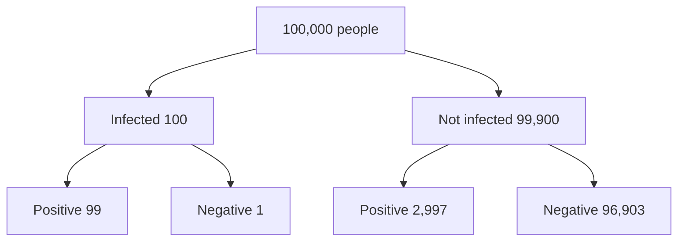
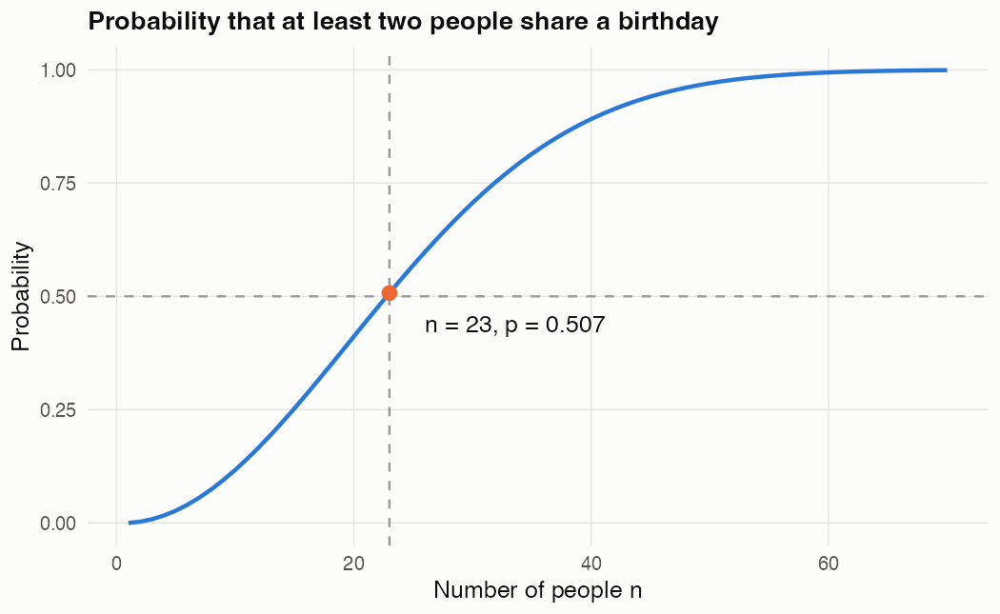

# Chapter 13 — Statistical Thinking and Probability Fallacies

[Repository Guide](../../README.md) | [English](Concepts_Lecture.md) | [한국어](Concepts_Lecture.ko.md)

> **Last Updated:** 2026-11-19

> **Learning Objectives:**
> 1. Interpret numerical data on the basis of facts by distinguishing averages from distributions, totals from rates, and straight lines from curves
> 2. Compute probabilities by counting outcomes and apply the multiplication rule for independent events
> 3. Compute the reliability of test results and testimony with conditional probability and Bayes' theorem
> 4. Explain how Simpson's paradox arises and compare grouped and combined data correctly
> 5. Interpret the probabilities of DNA database searches with the birthday problem and the random match probability
> 6. Identify fallacies of reasoning, such as the prosecutor's fallacy, that reverse the direction of a conditional probability

---

## Table of Contents

- [1. A Fact-Based Worldview and Statistical Thinking](#1-a-fact-based-worldview-and-statistical-thinking)
  - [1.1 Seeing the World Through Data](#11-seeing-the-world-through-data)
  - [1.2 Averages and Distributions](#12-averages-and-distributions)
  - [1.3 Totals and Rates](#13-totals-and-rates)
  - [1.4 Straight Lines and Curves](#14-straight-lines-and-curves)
  - [1.5 Risk and Exposure](#15-risk-and-exposure)
  - [1.6 Categories and Generalization](#16-categories-and-generalization)
- [2. Foundations of Probability](#2-foundations-of-probability)
  - [2.1 Dice and the Birth of Probability](#21-dice-and-the-birth-of-probability)
  - [2.2 Counting Outcomes and the Three Dice Problem](#22-counting-outcomes-and-the-three-dice-problem)
  - [2.3 Independent Events and the Multiplication Rule](#23-independent-events-and-the-multiplication-rule)
  - [2.4 The Problem of Points](#24-the-problem-of-points)
- [3. Conditional Probability and Bayes' Theorem](#3-conditional-probability-and-bayes-theorem)
  - [3.1 Conditional Probability](#31-conditional-probability)
  - [3.2 Bayes' Theorem](#32-bayes-theorem)
  - [3.3 A Positive Result on an Infection Test](#33-a-positive-result-on-an-infection-test)
  - [3.4 The Color of the Hit-and-Run Taxi](#34-the-color-of-the-hit-and-run-taxi)
  - [3.5 The Prosecutor's Fallacy and Base Rates](#35-the-prosecutors-fallacy-and-base-rates)
  - [3.6 Recommendation Systems and Conditional Probability](#36-recommendation-systems-and-conditional-probability)
- [4. Simpson's Paradox](#4-simpsons-paradox)
  - [4.1 The SAT Score Paradox](#41-the-sat-score-paradox)
  - [4.2 UC Berkeley Graduate Admissions Data](#42-uc-berkeley-graduate-admissions-data)
  - [4.3 The Admissions Result Through a p-Value](#43-the-admissions-result-through-a-p-value)
  - [4.4 What the Department Data Show](#44-what-the-department-data-show)
  - [4.5 How the Paradox Arises](#45-how-the-paradox-arises)
- [5. DNA Evidence and Probability](#5-dna-evidence-and-probability)
  - [5.1 The Random Match Probability](#51-the-random-match-probability)
  - [5.2 The Birthday Problem](#52-the-birthday-problem)
  - [5.3 Matching Pairs Within a Database](#53-matching-pairs-within-a-database)
  - [5.4 Database Searches and Match Probabilities](#54-database-searches-and-match-probabilities)
  - [5.5 Computing the Probability of Innocence](#55-computing-the-probability-of-innocence)
- [Concept Applications](#concept-applications)
- [Summary](#summary)
- [Self-Check Questions](#self-check-questions)
- [References](#references)

---

<br>

## 1. A Fact-Based Worldview and Statistical Thinking

### 1.1 Seeing the World Through Data

Suppose one wants to know how the countries of each continent developed economically and medically from the 1960s to the early 2000s, and how the two kinds of development were related. Answering this question requires the average life expectancy, GDP per capita, and population of each country in each year. Gapminder, a Swedish nonprofit statistical analysis organization, collects and publishes such statistics based on data from the United Nations and others, and the R package `gapminder` (Chapter 9) contains part of them.

| Variable | Content |
|------|------|
| `country` | Country variable with 142 distinct values (levels) |
| `continent` | Continent variable with 5 values |
| `year` | Numeric year variable (1952-2007, every 5 years) |
| `lifeExp` | Average life expectancy of people born in that year |
| `pop` | Population |
| `gdpPercap` | Gross domestic product per capita |

*Table 1. Variables of the gapminder data*

Hans Rosling, a physician and statistician who co-founded Gapminder, showed such data while pointing out that people answer basic factual questions about the world less accurately than random guessing would. The cause, he argued, is not so much a lack of knowledge as a few habits of thought into which people easily fall when interpreting data. This section organizes those habits as statistical concepts. Asking what a single number should be compared with, what denominator it should be divided by, and whether it will keep moving in the same direction is the starting point of statistical thinking.

### 1.2 Averages and Distributions

The habit of dividing the world into two groups, "developed" and "developing" countries, and imagining a wide gap between them is called the **gap instinct**. This habit is reinforced by three kinds of comparison.

1. **Comparisons of averages:** Two groups with different averages do not necessarily fail to overlap. Even with a difference between averages, the distributions may overlap greatly, and most individuals may lie in the overlapping region. Instead of speaking of a "gap" from averages alone, look at the whole distribution with the density plots or box plots of Chapter 9, Section 4.
2. **Comparisons of extremes:** Comparing only the richest and the poorest groups makes the gap look large. For example, in Brazil the top 10% earn 41% of all income, but dividing the income of the whole population into four levels shows that most Brazilians have already left extreme poverty and are in the middle levels. Two extremes are only the two ends of a distribution.
3. **The view from up here:** To people living on the highest income level, the three levels below look equally poor, but the difference between living on 1 dollar a day and on 4 or 16 dollars is very large. Rosling proposed viewing the world population in four income levels, and since income differs by a factor of about 4 from level to level, this amounts to dividing income on a logarithmic scale.

> **Key Point:** When comparing two groups, look not only at the difference of averages but also at how much the distributions overlap. Viewing data as continuous distributions and several levels instead of binary categories avoids gaps that do not actually exist.

### 1.3 Totals and Rates

The habit of misjudging the size of a single number is the **size instinct**. Big numbers always look big, and a single case before one's eyes looks more important than it is. There are three ways to correct it.

- **Compare:** A single number means nothing by itself. The figure that 4.2 million babies died before their first birthday in 2016 is shocking, but its meaning changes when it is compared with 4.4 million the year before and 14.4 million in 1950.
- **Divide:** Amounts and rates tell very different stories. In 1950, 14.4 million of 97 million newborns died, an infant mortality rate of $14.4/97 \approx 15\%$. In 2016, 4.2 million of 141 million newborns died, $4.2/141 \approx 3\%$. Comparing only the numbers of deaths shows a reduction to about a third, but comparing rates shows a reduction to a fifth. When comparing groups of different sizes, especially countries or regions with different populations, per capita figures must be used. Comparing carbon dioxide emissions as national totals makes populous countries look like large emitters, but comparing emissions per person changes the ranking greatly. This is the same principle as coloring a choropleth map with rates rather than totals in Chapter 9, Section 7.5.
- **The 80/20 rule:** When given a long list, first look for the few largest items. Those few are usually more important than all the others put together.

| Year | Newborns | Deaths of Children | Infant Mortality Rate |
|------|------:|------:|------:|
| 1950 | 97 million | 14.4 million | About 15% |
| 2016 | 141 million | 4.2 million | About 3% |

*Table 2. Infant deaths seen as totals and as rates*

### 1.4 Straight Lines and Curves

The habit of assuming that a past trend will continue along a straight line is the **straight line instinct**. Straight lines are rare among real trends, and the typical curves are the following.

| Shape of the Curve | Features | Examples |
|------|------|------|
| Straight line | Keeps increasing by a constant amount | Age of women at first marriage, average years of schooling |
| S-bend | Starts slowly, increases quickly, then flattens near a ceiling | Literacy rate, vaccination rate, refrigerator ownership |
| Slide | Decreases as income rises, then flattens at the bottom | Births per woman |
| Hump | Highest at middle income levels and lower on both sides | Proportion of children with tooth decay, traffic deaths |
| Doubling | Doubles every fixed period | Number of infections early in an epidemic |

*Table 3. Kinds of trend curves*

Doubling looks slow at first but grows very fast. If infections grow not along a straight line, 1, 2, 3, 4, 5, but by doubling, 1, 2, 4, 8, 16, the size after the same period is incomparably larger than along the line. Placing one grain of rice on the first square of a chessboard, two on the second, four on the third, and so on, doubling each time, puts $1 + 2 + 4 + \cdots + 2^{63} = 2^{64} - 1 = 18{,}446{,}744{,}073{,}709{,}551{,}615$ grains on all 64 squares. This value comes from the formula for the sum of a geometric series, $\sum_{k=0}^{n-1} 2^k = 2^n - 1$.

Conversely, a quantity that seems bound to keep growing may in fact curve and flatten. The world population passed 1 billion in 1800, grew quickly to about 7.6 billion in 2017, but the population experts of the United Nations expect the growth, which has already begun to slow, to flatten at about 11 billion in 2100. The number of births per woman falls along a slide, so the number of children hardly increases. Parents in extreme poverty, where child mortality is high, have the most children, so saving poor children works not to increase the population but rather to stop its growth. Forecasting trends with models instead of simply extending them, as in the time series analysis of Chapter 11, rests on the same reasoning.

### 1.5 Risk and Exposure

What people fear most (snakes, heights, plane crashes, terrorism) differs from what is actually most dangerous. This habit is called the **fear instinct**. Because nothing captures attention like fear, the media select frightening events to report, and the world consequently looks scarier than it is. A plane that lands safely is not news. In 2016, 40 million commercial flights arrived safely at their destinations and 10 planes suffered fatal accidents, so the accident rate was $10/40{,}000{,}000 = 0.000025\%$. In the same year, deaths from terrorism were 0.05% of all deaths worldwide.

> **Key Point:** The risk something poses to you is determined not by how frightening it is but by the product of its danger and your exposure. Risk = danger × exposure.

The **negativity instinct**, the habit of noticing bad things more than good things, also distorts the interpretation of data. Its causes are memories that glorify the past, selective reporting that passes on bad news, and judging by feeling instead of thinking. Statistically, selective reporting is a form of **selection bias**, in which a sample is chosen not at random but by a particular criterion. "Bad but getting better" can be true at the same time, and the level must be distinguished from the direction of change.

### 1.6 Categories and Generalization

Categorization is essential for framing thought, but it can lead us to group very different things in the same category, to assume that everything in a category is similar, or to judge a whole category from a single rare case. This is the **generalization instinct**. Ways of checking categories are the following.

- **Look for differences within groups and similarities across groups.** Africa is a continent of 54 countries and a billion people, so all four income levels are present. Lumping Somalia, Ghana, and Tunisia together under "African countries" erases the large differences among them. Collections of photographs show that lives are remarkably similar across countries at the same income level and very different within a country at different income levels.
- **Ask what "the majority" is.** A majority only means more than half. It may be 51% or 99%, so check the percentage.
- **Beware of vivid exceptions.** An example that is easy to recall may be an exception rather than the rule. When someone tries to draw a conclusion about a whole group from a single case, ask for more examples.
- **Beware of carrying conclusions from one group to another.** The finding that unconscious soldiers should be laid face down so as not to choke on vomit was generalized into the practice of putting babies to sleep face down, but it was found only later that this can be dangerous for sleeping babies, whose reflexes work. Applying a result obtained in one population to a population with different properties is a classic error of statistical inference.

In addition, the **destiny instinct**, which holds that the fate of people and cultures is fixed by innate characteristics and does not change, makes slow change look like no change, and the **single perspective instinct**, which tries to explain every problem with one cause and one solution, makes people become absorbed in a single number or a single field of expertise. A change of 1% a year becomes a large change over decades, and the world cannot be understood without numbers, nor by numbers alone.

---

<br>

## 2. Foundations of Probability

### 2.1 Dice and the Birth of Probability

The classic symbol of chance is the die. Dice are thought to have originated in animal bones used for divination and games, and cubes similar to today's dice were found at the site of Shahr-e Sukhteh in ancient Iran (about 3200-1800 BCE). Gambling with dice was popular in ancient Rome as well, but most dice of that time were not cubes but had rectangular faces, so certain faces came up more often than others. Symmetric cubic dice became standard only in the mid-fifteenth century. Early dice placed 2 opposite 1, 4 opposite 3, and 6 opposite 5, a "prime arrangement" in which the sums of opposite faces were the primes 3, 7, and 11, but from about 1600 the present arrangement, in which every pair of opposite faces sums to 7, took hold.

The assumption that every face of a die is equally likely is the starting point of probability calculation. If there are $n$ outcomes and each is equally likely, the probability of an event $A$ is the number of outcomes in $A$ divided by the total number of outcomes.

```math
P(A) = \frac{\text{number of outcomes in } A}{\text{total number of outcomes}}
```

This is called **classical probability**. When outcomes are not equally likely, as with the asymmetric ancient dice, this formula cannot be used, and the probability is instead defined as the proportion of times the event occurs when the same trial is repeated many times. This relative frequency interpretation is taken up again in Section 2.3.

### 2.2 Counting Outcomes and the Three Dice Problem

Girolamo Cardano of the Italian Renaissance is regarded as the first person to treat probability systematically. He won fame as a mathematician with *The Great Art* (1545), which contains the solution of the cubic equation, and while solving cubic equations he felt the need for square roots of negative numbers, that is, imaginary numbers. A physician and astrologer who was always short of money and earned it as a gambler and chess player, he wrote in 1564 the *Book on Games of Chance*, regarded as the first book on probability.

Cardano solved an old puzzle about three dice. Gamblers knew from experience that rolling three dice gives a sum of 10 more often than a sum of 9, but they did not know why. Counting combinations of three numbers without order, there are 6 combinations summing to 10, (1, 4, 5), (1, 3, 6), (2, 4, 4), (2, 2, 6), (2, 3, 5), (3, 3, 4), and also 6 combinations summing to 9, (1, 2, 6), (1, 3, 5), (1, 4, 4), (2, 2, 5), (2, 3, 4), (3, 3, 3).

Cardano's answer was that combinations must be counted with their order distinguished. The three dice are distinct objects, so (1, 4, 5) appears as six outcomes: 1-4-5, 1-5-4, 4-1-5, 4-5-1, 5-1-4, 5-4-1. If all three numbers differ there are 6 orders, if two are equal there are 3, and if all three are equal there is 1. Counting this way, of the 216 outcomes, $6 + 6 + 3 + 3 + 6 + 3 = 27$ sum to 10 and $6 + 6 + 3 + 3 + 6 + 1 = 25$ sum to 9. The combinations summing to 9 include one with a single order, (3, 3, 3). Listing all outcomes in R confirms this.

```r
rolls <- expand.grid(d1 = 1:6, d2 = 1:6, d3 = 1:6)
s <- rowSums(rolls)
c(total = nrow(rolls), sum9 = sum(s == 9), sum10 = sum(s == 10))
#> total  sum9 sum10 
#>   216    25    27
c(p9 = mean(s == 9), p10 = mean(s == 10))
#>        p9       p10 
#> 0.1157407 0.1250000
```

`expand.grid()` creates a data frame with $6^3 = 216$ rows, all combinations of the faces 1-6 of three dice, and `rowSums()` computes the sum of the three faces in each row. `sum(s == 9)` is the number of rows summing to 9, and `mean(s == 9)` is their proportion, that is, the probability. The probability of a sum of 10 is $27/216 = 0.125$ and of 9 is $25/216 \approx 0.116$. Classical probability must count equally likely outcomes as its units, and combinations that ignore order are not equally likely.

### 2.3 Independent Events and the Multiplication Rule

Cardano also left two important ideas about rolling a die many times. First, the probability of an event equals the proportion of times it actually occurs over many opportunities. This is the **relative frequency** interpretation of probability, formalized as the law of large numbers, which states that the relative frequency approaches the probability as the number of trials grows. Second, if an event occurs with probability $p$ on one attempt, the probability that it occurs on all $n$ attempts is $p^n$.

> **Definition:** Two events $A$ and $B$ are called **independent events** if $P(A \cap B) = P(A)P(B)$.

Independence means that knowing one event occurred does not change the probability of the other. Separate rolls of a die are independent, so the probability of rolling three sixes in three rolls is $(1/6)^3 = 1/216$. Cardano's $p^n$ applies this multiplication rule to $n$ independent trials.

The multiplication rule holds only when the events are actually independent. Applying it to events that are not independent miscalculates probabilities badly, and the DNA evidence of Section 5 and the combination of characteristics in Section 5.5 depend crucially on this independence assumption. For example, if "being white" and "being a male sex offender aged 65 or over" are not independent, the product of the two probabilities differs from the actual proportion of people with both characteristics.

### 2.4 The Problem of Points

In 1654 the professional gambler Chevalier de Méré asked Pierre de Fermat and Blaise Pascal for the answer to the **problem of points**. Two players play a game in which each has a 50% chance of winning, put equal stakes in the pot, and agree that the first to win a fixed number of rounds takes the whole pot. But if the game is interrupted, how should the pot be divided according to the score so far? For example, if the pot is 100 francs, the first to reach 10 points wins, and the game must stop when the score is 7 to 4, how much should each take?

The key idea from the correspondence between Fermat and Pascal is to divide the pot not by the score so far but in proportion to each player's probability of winning if the game continued. Player A, with 7 points, needs 3 more wins, and B, with 4 points, needs 6 more. The game ends within at most $3 + 6 - 1 = 8$ rounds, so imagining that all 8 rounds are played, whether or not the game would actually have ended, does not change the winner. A wins if A wins at least 3 of the 8 rounds, and the number of rounds won follows a binomial distribution with 8 trials and success probability 0.5.

```math
P(\text{A wins}) = \sum_{k=3}^{8} \binom{8}{k} \left(\frac{1}{2}\right)^8 = \frac{56 + 70 + 56 + 28 + 8 + 1}{256} = \frac{219}{256}
```

```r
# A needs 3 more wins, B needs 6 more; at most 3 + 6 - 1 = 8 more games
pA <- sum(dbinom(3:8, size = 8, prob = 0.5))
c(pA = pA, pB = 1 - pA, shareA = 100 * pA, shareB = 100 * (1 - pA))
#>         pA         pB     shareA     shareB 
#>  0.8554688  0.1445312 85.5468750 14.4531250
```

`dbinom(3:8, size = 8, prob = 0.5)` gives the probabilities of winning exactly 3, 4, ..., 8 of the 8 rounds, and their sum is A's probability of winning, $219/256 \approx 0.855$. A fair division therefore gives A about 85.55 francs and B about 14.45 francs. Dividing in the ratio of the scores, 7:4, would give A about 63.6 francs, underestimating the real advantage of the leader. The solution of this problem led to the concept of expected value, which determines a present value by weighting uncertain future outcomes by their probabilities.

---

<br>

## 3. Conditional Probability and Bayes' Theorem

### 3.1 Conditional Probability

Information that one event has occurred can change the probability of another.

> **Definition:** The **conditional probability** of event $A$ given that event $B$ has occurred is defined as $P(A \mid B) = P(A \cap B)/P(B)$ when $P(B) > 0$.

A conditional probability is the proportion of $A$ within the sample space narrowed down to $B$. Rewriting the definition gives the multiplication law $P(A \cap B) = P(B)P(A \mid B)$, and if $A$ and $B$ are independent, $P(A \mid B) = P(A)$, which gives the multiplication rule of Section 2.3. The most common mistake with conditional probability is reversing its direction. $P(A \mid B)$ and $P(B \mid A)$ generally differ. For example, "the probability of being 190 cm or taller given that one is a basketball player" is high, but "the probability of being a basketball player given that one is 190 cm or taller" is low.

When the sample space is divided into non-overlapping events $B_1, \ldots, B_k$, the probability of an event $A$ equals the sum of the probabilities of $A$ within each $B_i$ weighted by the probabilities of $B_i$. This is called the **law of total probability**.

```math
P(A) = \sum_{i=1}^{k} P(B_i) P(A \mid B_i)
```

### 3.2 Bayes' Theorem

Thomas Bayes (1701-1761), an English statistician and Presbyterian minister, formulated a special case of the theorem that bears his name. He never published this result in his lifetime, and his notes were edited and published after his death by Richard Price. Mathematics has countless theorems, such as the Pythagorean theorem and Fermat's last theorem, but Bayes' theorem is used directly to solve problems of human society, such as disease testing, trials, searches, and recommendation systems.

Writing the multiplication law in both directions gives $P(A \cap B) = P(B)P(A \mid B) = P(A)P(B \mid A)$, so the following relation holds.

```math
P(A \mid B) = \frac{P(A)P(B \mid A)}{P(B)} = \frac{P(A)P(B \mid A)}{P(A)P(B \mid A) + P(A^c)P(B \mid A^c)}
```

The denominator expands $P(B)$ with the law of total probability. In this formula, $P(A)$ is the **prior probability**, the belief before seeing the evidence $B$; $P(A \mid B)$ is the **posterior probability**, the belief after seeing the evidence; and $P(B \mid A)$ is the **likelihood**, the probability of the evidence when $A$ is true. Bayes' theorem tells how a belief should be revised given evidence, and the result depends heavily not only on the likelihood but also on the prior probability.

### 3.3 A Positive Result on an Infection Test

Suppose an infectious disease has 100 infected people per 100,000, an infection rate of 0.1%. A test classifies infected people as "positive" and uninfected people as "negative"; when 100 actually infected people are tested, 99 are correctly classified as positive and 1 is wrongly classified as negative. This proportion, 99%, is the **sensitivity** of the test. When 100 uninfected people are tested, 97 are correctly classified as negative and 3 are wrongly classified as positive. This proportion, 97%, is the **specificity**. These are the same concepts as the classification measures of Chapter 12, Section 6.2.

If you test positive, what is the probability that you are actually infected? Writing infection as $D$, non-infection as $D^c$, and a positive result as $+$, $P(D) = 1/1000$, $P(D^c) = 999/1000$, $P(+ \mid D) = 99/100$, and $P(+ \mid D^c) = 3/100$. Bayes' theorem gives the following.

```math
P(D \mid +) = \frac{\frac{1}{1000} \times \frac{99}{100}}{\frac{1}{1000} \times \frac{99}{100} + \frac{999}{1000} \times \frac{3}{100}} = \frac{99}{99 + 2997} = \frac{99}{3096} \approx 0.032
```

Even with a positive result on a test with 99% sensitivity and 97% specificity, the probability of actually being infected is only 3.2%. Converting to natural frequencies makes the result intuitive. Of 100,000 people, 99 of the 100 infected test positive, but so do 3%, about 2,997, of the 99,900 uninfected. Of the 3,096 positives, only 99 are actually infected.



*Figure 1. Tree diagram of infection test results in natural frequencies*

If a person who tested positive the first time takes the same test again and tests positive again, what is the probability of actually being infected? Assuming the errors of the two tests are independent, Bayes' theorem is applied once more with the posterior probability after the first test, $99/3096$, as the new prior. Then $P(D) = 99/3096$ and $P(D^c) = 2997/3096$.

```math
P(D \mid ++) = \frac{\frac{99}{3096} \times \frac{99}{100}}{\frac{99}{3096} \times \frac{99}{100} + \frac{2997}{3096} \times \frac{3}{100}} = \frac{9801}{9801 + 8991} = \frac{9801}{18792} \approx 0.52
```

```r
prior <- 1 / 1000
sens <- 0.99; fpr <- 0.03
post1 <- prior * sens / (prior * sens + (1 - prior) * fpr)
post2 <- post1 * sens / (post1 * sens + (1 - post1) * fpr)
round(c(after_one_positive = post1, after_two_positives = post2), 4)
#>  after_one_positive after_two_positives 
#>              0.0320              0.5216
```

`prior` is the infection rate, `sens` the sensitivity, and `fpr` the false positive rate $1 - \text{specificity} = 0.03$. `post1` is the posterior probability after the first positive, and `post2` is the posterior probability after the second positive, obtained by feeding `post1` back in as the prior. Only after two consecutive positives does the probability of infection, 52%, exceed one half. Bayes' theorem can thus be applied step by step as new evidence arrives, with the posterior of one step becoming the prior of the next.

> **Caution:** The retest calculation rests on the assumption that the two test results are conditionally independent given the infection status. If false positives recur in the same person for the same reason (for example, other antibodies causing cross-reactions), the second positive carries much less information than this.

### 3.4 The Color of the Hit-and-Run Taxi

A hit-and-run accident involving a taxi occurred in a city. The city has only two taxi companies, one running blue taxis and one running green taxis, and 15% of the taxis are blue and 85% green. A witness testified that the taxi was blue, but it was a dark night. Investigation showed that on a dark night, 80% of people who see a blue taxi correctly say it is blue and 20% wrongly say green, while 75% of people who see a green taxi correctly say green and 25% wrongly say blue. What are the probabilities that the taxi was blue and that it was green?

Let $B$ be the event that a blue taxi was driving, $G$ green, and $T_B$ the event of testifying blue. Then $P(B) = 0.15$, $P(G) = 0.85$, $P(T_B \mid B) = 0.8$, and $P(T_B \mid G) = 0.25$.

```math
P(B \mid T_B) = \frac{P(B)P(T_B \mid B)}{P(B)P(T_B \mid B) + P(G)P(T_B \mid G)} = \frac{0.15 \times 0.8}{0.15 \times 0.8 + 0.85 \times 0.25} = \frac{0.12}{0.3325} \approx 0.36
```

```r
pB <- 0.15; pG <- 0.85
round(c(blue = pB * 0.80 / (pB * 0.80 + pG * 0.25),
        green = pG * 0.25 / (pB * 0.80 + pG * 0.25)), 4)
#>   blue  green 
#> 0.3609 0.6391
```

Even though the witness testified blue, the probability that the taxi was blue is 36%, and the probability that it was green, 64%, is actually higher. It is tempting to say from the witness's accuracy (80%) alone that "the probability of blue is 80%", but the prior information that blue taxis are rare (15%) changes the result greatly. Green taxis are so numerous that testimony mistaking a green taxi for blue ($0.85 \times 0.25 = 0.2125$ of all cases) outnumbers testimony correctly reporting a blue taxi as blue ($0.15 \times 0.8 = 0.12$ of all cases).

### 3.5 The Prosecutor's Fallacy and Base Rates

The two examples of Sections 3.3 and 3.4 share the same structure. Even if the accuracy of the evidence, $P(\text{evidence} \mid \text{hypothesis})$, is high, $P(\text{hypothesis} \mid \text{evidence})$ can be low when the hypothesis itself is rare. The prior probability, the rate at which the event occurs in the population, is called the **base rate**, and the error of ignoring the base rate when evaluating evidence is called **base rate neglect**.

> **Definition:** The **prosecutor's fallacy** is the error of reasoning that mistakes the probability that the evidence appears by chance when the defendant is innocent, $P(\text{evidence} \mid \text{innocent})$, for the probability that the defendant is innocent given the evidence, $P(\text{innocent} \mid \text{evidence})$.

For example, the claim "the probability that an innocent person's DNA matches the perpetrator's by chance is one in a million, so the probability that the defendant is innocent is one in a million" is the prosecutor's fallacy. The first probability is $P(\text{match} \mid \text{innocent})$, and the second is $P(\text{innocent} \mid \text{match})$. In a population of 300 million, about 300 people would match even with a probability of one in a million, so without other evidence, the probability that the defendant is the perpetrator among those 300 from the DNA match alone may be about one in 300 (Section 5.5). Conversely, the claim "300 people match, so the DNA match means nothing" is also a fallacy. A DNA match is strong evidence that narrows the suspects from hundreds of millions to hundreds, and it must be evaluated in combination with other evidence. This error in the opposite direction is called the **defense attorney's fallacy**.

### 3.6 Recommendation Systems and Conditional Probability

Conditional probability also plays a central role in today's artificial intelligence services. Until around 2010, the movie rental company Netflix ran a business of mailing DVDs without late fees in red envelopes, and it asked subscribers to rate movies from 1 to 5 when returning the DVDs. Artificial intelligence that finds patterns of subscriber preferences in such accumulated ratings is called a **recommendation system**. Netflix released part of its rating data and held a competition offering one million dollars to a team that could improve the performance of its recommendation system, Cinematch, by at least 10%, and in 2009 the team BellKor's Pragmatic Chaos won with an algorithm outperforming Cinematch by 10.06%. On the basis of such data and probabilistic analysis, which predicted how viewers would rate content, Netflix decided to produce its first original series, *House of Cards*.

What a recommendation system computes is conditional probability.

- The conditional probability that a person who rated the movie *Sherlock Holmes* highly will like *The Imitation Game* or *Tinker Tailor Soldier Spy*
- The conditional probability that a person who listened to Pharrell Williams yesterday will want to listen to Bruno Mars today
- The conditional probability that a person who just bought organic dog food will buy a dog collar with GPS

These probabilities are $P(\text{likes B} \mid \text{likes A}) = P(\text{likes both})/P(\text{likes A})$, the definition of Section 3.1 estimated from data frequencies. Direction matters here too. A popular movie B is liked by almost everyone, so $P(B \mid A)$ is high, but that is no special reason to recommend B to people who like A. For recommendations, therefore, how much $P(B \mid A)$ exceeds B's overall popularity $P(B)$ matters more.

---

<br>

## 4. Simpson's Paradox

### 4.1 The SAT Score Paradox

The average score on the verbal section of the US SAT in 2002 was 504, exactly the same as in 1981. Over the same period, however, the average scores of the ethnic groups rose by 8 points for whites, 19 for Blacks, 27 for Asians, 18 for Puerto Ricans, and 8 for Native Americans. How could the overall average stay the same for 21 years when every group's score rose?

| Year | White | Black | Asian | Mexican | Puerto Rican | Native American | Overall Average |
|------|------:|------:|------:|------:|------:|------:|------:|
| 1981 | 519 | 412 | 474 | 438 | 437 | 471 | 504 |
| 2002 | 527 | 431 | 501 | 446 | 455 | 479 | 504 |

*Table 4. Average SAT verbal scores by group*

| Year | White | Black | Asian | Mexican | Puerto Rican | Native American | Total |
|------|------:|------:|------:|------:|------:|------:|------:|
| 1981 | 85% | 9% | 3% | 2% | 1% | 0% | 100% |
| 2002 | 65% | 11% | 10% | 4% | 1% | 1% | 92% |

*Table 5. Proportion of test takers by group (the remaining 8% in 2002 are other groups)*

The secret lies in a factor that does not appear directly in the table: the change in the proportion of all test takers that each group makes up. The overall average is the average of the group averages weighted by the group proportions.

```math
\bar{y} = \sum_{g} w_g \bar{y}_g, \qquad w_g = \frac{n_g}{n}
```

In both 1981 and 2002 the highest-scoring group was whites, but the proportion of whites fell from 85% to 65%, so their contribution to the overall average fell. Instead, the proportions of other groups with lower average scores rose. Each group's average rose, but the growing weight of lower-scoring groups pulled the overall average down, and the two effects canceled, leaving the overall average unchanged.

> **Definition:** **Simpson's paradox** is the phenomenon in which an association that appears in each of several groups disappears or reverses direction when the groups are combined.

The paradox looks strange, but mathematically it is merely a property of weighted averages. It can easily be used to deceive. There is even an anecdote of an employee who, preparing a report for management, asked a superior whether the data should be made to show a profit or a loss; depending on how groups are split and combined, the same data can be made to show opposite conclusions.

### 4.2 UC Berkeley Graduate Admissions Data

In 1973 the University of California, Berkeley (UC Berkeley) was criticized for disadvantaging women in graduate admissions. That year, 3,738 of the 8,442 men who applied to graduate school were admitted, an admission rate of 44%, while only 1,494 of the 4,321 women were admitted, an admission rate of 35% [1].

| | Applicants | Admitted | Admission Rate (%) |
|------|------:|------:|------:|
| Men | 8,442 | 3,738 | 44 |
| Women | 4,321 | 1,494 | 35 |

*Table 6. UC Berkeley graduate admissions data, 1973*

If this result were not due to sex discrimination, that is, if admission had been decided by the applicants' abilities alone, the conclusion would be that the men were better qualified than the women or that the difference arose by chance. But in American undergraduate programs women generally earn higher grades than men, so judging by the distribution of applicants' grades there was no reason for women's admission rate to be lower. The result was therefore pointed to as evidence of sex discrimination.

First, consider whether such a difference could arise by chance. Of the 12,763 applicants, 5,232 were admitted, an overall admission rate of 41%. If men and women had the same expected chance of admission, the expected numbers admitted, with 41% of each admitted, would be 3,461 men and 1,771 women.

```r
admit <- c(male = 3738, female = 1494)
apply_n <- c(male = 8442, female = 4321)
round(admit / apply_n, 3)
#>   male female 
#>  0.443  0.346
expected <- apply_n * sum(admit) / sum(apply_n)
round(expected)
#>   male female 
#>   3461   1771
```

`sum(admit) / sum(apply_n)` is the overall admission rate, and multiplying it by the number of applicants of each sex gives the expected numbers admitted. UC Berkeley admitted 277 more men and 277 fewer women than expected.

### 4.3 The Admissions Result Through a p-Value

Whether a difference of 277 people is of a size that could arise by chance is judged with a **p-value**. Suppose a large urn contains 8,442 black balls (men) and 4,321 white balls (women), one per applicant, and $3{,}738 + 1{,}494 = 5{,}232$ balls, one per admitted applicant, are drawn at random without looking at their color. The p-value is then the probability of drawing 1,494 or fewer white balls, that is, the probability, under the assumption that admission was decided at random regardless of sex, of a result as extreme as or more extreme than the one observed. Repeating this experiment millions of times on a computer approximates the p-value, and theoretically it can be computed exactly with the hypergeometric distribution.

```r
phyper(1494, m = 4321, n = 8442, k = 5232)
#> [1] 1.80469e-26
```

`phyper(q, m, n, k)` is the probability of drawing `q` or fewer white balls when `k` balls are drawn without replacement from an urn with `m` white and `n` black balls. The p-value is about $1.8 \times 10^{-26}$, a result that practically cannot occur by chance.

> **Note:** **The size of the p-value.** The p-value of this result is sometimes reported as 0.0000000057 (about one in a billion), but the hypergeometric calculation above gives a far smaller value. Either way, the conclusion that chance cannot explain the result is the same.

In general, a p-value smaller than one in 1,000 gives reasonable grounds to doubt the hypothesis that the result arose purely by chance, and other causes must be sought. But events with very low probability (often called black swans) do happen in reality, and when many events are examined, some of them have small p-values by chance. The key is that when an improbable event occurs, other causes may be suspected, but a conclusion cannot be drawn from that alone. All a small p-value says is that "chance alone can hardly explain it", and whether the cause is sex discrimination must be confirmed by further investigation. The exact definition and interpretation of the p-value and its common misuses are covered in Chapter 14.

### 4.4 What the Department Data Show

UC Berkeley formed an investigating committee of a statistics professor, the dean of the graduate school, who was an anthropology professor, and a data officer of the graduate school. Admissions were decided department by department, independently of one another, so the committee examined admissions data by department on the premise that the inequality lay in a few departments rather than in the university as a whole. Excluding departments with no women applicants or with every applicant admitted left 85 departments, and for each the committee computed a p-value for how far the proportions of admitted men and women departed from what chance would produce. Most departments showed no notable exception, and the departments needing further investigation were six large ones with many applicants.

| | Applicants | Admitted | Admission Rate (%) |
|------|------:|------:|------:|
| Men | 2,590 | 1,192 | 46 |
| Women | 1,835 | 557 | 30 |

*Table 7. Admissions data of the six departments with many applicants combined*

Combining these six departments, almost half of the men were admitted but fewer than a third of the women, a gap even larger than the university-wide 44% and 35%, so the culprit seemed to have been found. Broken down by department, however, a completely different picture appears.

```r
dept <- data.frame(dept = LETTERS[1:6],
                   m_app = c(825, 560, 325, 417, 191, 272), m_adm = c(511, 353, 120, 139, 53, 16),
                   f_app = c(108, 25, 593, 375, 393, 341), f_adm = c(89, 17, 202, 131, 94, 24))
dept$m_rate <- round(100 * dept$m_adm / dept$m_app)
dept$f_rate <- round(100 * dept$f_adm / dept$f_app)
dept
#>   dept m_app m_adm f_app f_adm m_rate f_rate
#> 1    A   825   511   108    89     62     82
#> 2    B   560   353    25    17     63     68
#> 3    C   325   120   593   202     37     34
#> 4    D   417   139   375   131     33     35
#> 5    E   191    53   393    94     28     24
#> 6    F   272    16   341    24      6      7
colSums(dept[, 2:5])
#> m_app m_adm f_app f_adm 
#>  2590  1192  1835   557
round(100 * c(male = sum(dept$m_adm) / sum(dept$m_app), female = sum(dept$f_adm) / sum(dept$f_app)))
#>   male female 
#>     46     30
```

`m_app` and `m_adm` are the men's applicants and admissions, `f_app` and `f_adm` the women's, and `m_rate` and `f_rate` the admission rates (%) by department. Summing the six departments with `colSums()` gives the values of Table 7. In four of the six departments (A, B, D, F), women had a higher admission rate than men, and department A admitted 82% of its women, far more than the 62% of its men. In the other two departments, C and E, men were admitted slightly more often (37% and 34% in C, 28% and 24% in E), but the differences were not particularly suspicious. No department particularly favored men, and in most the women's admission rate was actually higher, yet in the combined data the women's rate is much lower. This is the Simpson's paradox of Section 4.1.

> **Note:** **Differences from the original data.** In the `UCBAdmissions` data built into R (Chapter 14, Section 5.2), 373 men applied to department F and 22 were admitted, and the men admitted to departments A and D number 512 and 138. With these values the six departments together admitted 1,198 of 2,691 men (44.5%). Within each department the order of the men's and women's admission rates is the same as in the table above, so the conclusion that women were concentrated in departments with low admission rates, lowering their overall rate, does not change.

### 4.5 How the Paradox Arises

The information missing from the combined data is "the proportions of men and women who applied to departments with high (or low) admission rates". Among the six departments of Table 7, 1,385 (53%) of the 2,590 men applied to departments A and B, whose admission rates were around 60%, while 1,702 (93%) of the 1,835 women applied to departments C, D, E, and F, whose admission rates were 35% or less. Even though admission rates within each department were similar for men and women, women crowded into the hard-to-enter departments, which lowered their overall admission rate.

An extremely simplified example confirms this structure. Suppose a university has only two departments, A and B, with 600 men and 400 women applying, and both departments slightly favor women. But department B's admission rate is much lower than A's, and most women applied to B.

| Department | Sex | Applicants | Admitted | Admission Rate (%) |
|------|------|------:|------:|------:|
| A | Men | 500 | 400 | 80 |
| A | Women | 100 | 90 | 90 |
| B | Men | 100 | 20 | 20 |
| B | Women | 300 | 90 | 30 |
| Total | Men | 600 | 420 | 70 |
| Total | Women | 400 | 180 | 45 |

*Table 8. Hypothetical data of two departments showing Simpson's paradox*

Department A admitted 90% of its women and 80% of its men, and department B admitted 30% of its women and 20% of its men, so women's admission rate is 10 percentage points higher in both departments. Yet the overall admission rates are $420/600 = 70\%$ for men and $180/400 = 45\%$ for women, much higher for men. The overall admission rate is the average of the departmental rates weighted by the distribution of applicants, so the men's overall rate is $(500/600) \times 80\% + (100/600) \times 20\% = 70\%$ and the women's is $(100/400) \times 90\% + (300/400) \times 30\% = 45\%$. The women's weight is concentrated on department B, with its low admission rate.

A variable such as the department, related to both sex and admission, creating an apparent association in this way was called **confounding** in Chapter 12, Section 5.6. In the end, no trace of sex discrimination was found in UC Berkeley's admissions; instead, another problem came to light: very few women applied to competitive departments such as mathematics and engineering. The low admission rate of women applicants in these departments and the small number of women applicants are closely connected.

> **Caution:** Simpson's paradox shows that the data themselves do not tell when to trust the combined data and when to trust the divided data. That judgment comes from knowledge of the causal structure among the variables. In the Berkeley case, the choice of department is a consequence of sex and a cause of the admission rate, so evaluating the fairness of admissions requires comparing department by department.

---

<br>

## 5. DNA Evidence and Probability

### 5.1 The Random Match Probability

On the morning of December 22, 1972, Diana Sylvester, a 21-year-old nurse, was murdered in her apartment in San Francisco. The police kept semen collected from the body, but DNA analysis did not yet exist, and the case remained unsolved for more than 30 years. In 2003 the San Francisco Police Department obtained permission to apply new DNA technology to well-preserved evidence from old unsolved cases. The semen sample in this case, however, was badly damaged, and on the electropherogram only 5 of the 13 pairs of genetic loci used in DNA analysis were clearly visible, with 2-3 pairs partly visible.

The probability that the values at the genetic loci (locus) used to compare two people's DNA match by chance is called the **random match probability** (RMP). The US Federal Bureau of Investigation (FBI) analyzed a large DNA database to compute the RMP of each locus precisely; on average the RMP of one locus is about 7.5%, about one in 13. The values at the 13 loci are regarded as statistically independent, so the probability that several loci match together is computed with the multiplication rule of Section 2.3.

```r
rmp <- 0.075
round(1 / rmp^c(2, 3, 9, 10, 11, 12, 13))
#> [1] 1.780000e+02 2.370000e+03 1.331829e+10 1.775773e+11 2.367697e+12
#> [6] 3.156929e+13 4.209239e+14
```

`1 / rmp^k` is the reciprocal of the probability that all $k$ loci match, that is, "one in how many people". The probability that two loci match is $0.075^2$, about one in 178 people, and three loci about one in 2,370; the probability falls sharply as the number of matching loci grows, to about one in 178 billion for 10, 2 trillion for 11, and 31 trillion for 12. The probability that all 13 match is about one in 400 trillion. Since the world population is several billion, two DNA samples matching at all 13 loci are regarded as coming from the same person. The RMP actually computed by the FBI for 9 loci is one in 13 billion, almost the same as $0.075^9$ (about one in 13.3 billion), the per-locus RMP of 0.075 multiplied nine times.

This calculation depends crucially on the assumption that the 13 loci are mutually independent. Among relatives of the same lineage independence fails and match probabilities are much higher, and matches at a few loci are common even among completely unrelated people. California law generally permitted a database search only when at least 7 loci were visible.

### 5.2 The Birthday Problem

The **birthday problem** is a classic probability puzzle. How many people must be in a room for the probability that two of them share a birthday to exceed 50%? Ignore February 29 and assume all birthdays are equally likely. One is tempted to think of 183, about half of 365, but the answer is 23.

The complement makes the calculation easy. For all $n$ birthdays to differ, the first person's birthday can be any day, the second person's must be one of the remaining 364 days, the third person's one of the remaining 363, and so on, giving the following.

```math
P(\text{all different}) = \frac{365}{365} \times \frac{364}{365} \times \cdots \times \frac{365 - n + 1}{365}, \qquad P(\text{some shared}) = 1 - P(\text{all different})
```

```r
p_shared <- function(n) 1 - prod((365 - 0:(n - 1)) / 365)
round(sapply(c(10, 23, 30, 50), p_shared), 4)
#> [1] 0.1169 0.5073 0.7063 0.9704
choose(23, 2)
#> [1] 253
```

In the function `p_shared(n)`, `prod((365 - 0:(n - 1)) / 365)` is the product above. With 10 people the probability is about 11.7%, with 23 it is 50.7%, more than half, and with 50 it is 97%. Twenty-three is surprisingly small because what matters is not the number of people but the number of pairs of people. Twenty-three people form $\binom{23}{2} = 253$ pairs, and any one pair sharing a birthday is enough, so the probability grows quickly.



*Figure 2. Probability that someone shares a birthday by number of people*

A problem that looks similar is completely different. How many people are needed for the probability that someone in the room has a birthday on a particular day, say January 1, to reach 50%? The probability that one person's birthday is not January 1 is $364/365$, so the probability that none of $n$ people has that birthday is $(364/365)^n$, and the answer is the smallest $n$ for which this is 0.5 or less.

```r
(364/365)^253
#> [1] 0.4995228
min(which((364/365)^(1:400) <= 0.5))
#> [1] 253
```

The answer is 253. The two answers, 23 and 253, differ greatly because the first problem is satisfied by any pair matching on any day, while the second requires hitting a particular day fixed in advance. The probability of matching a condition fixed in advance (a particular day, or a particular DNA sample) is much lower than the probability that "some pair matches" with no condition fixed.

### 5.3 Matching Pairs Within a Database

In 2001 Kathryn Troyer, an Arizona state employee, examined a DNA database of more than 10,000 people and found a pair of completely unrelated people matching at 9 genetic loci. Since the RMP of 9 loci is one in 13 billion, one would expect no such pair in a database of about 10,000 people. In 2005, in a database of more than 65,000 people, she found as many as 122 pairs matching at 9 loci and 20 pairs matching at 10 loci. Is the FBI's RMP wrong?

There is no contradiction. This has the same structure as the birthday problem. One in 13 billion is the probability that two particular people match at 9 loci, and in a whole database the number of pairs that can be compared is far larger than the number of people. A database of $N$ people contains $N(N - 1)/2$ pairs, and any 9 of the 13 loci may match, so the count must be multiplied by the $\binom{13}{9} = 715$ ways of choosing 9 loci. The expected number of matching pairs is this value multiplied by one in 13 billion.

```r
N <- c(10000, 60000, 65000)
pairs <- 715 * N * (N - 1) / 2
data.frame(N = N, pairs = format(pairs, big.mark = ",", scientific = FALSE),
           expected = round(pairs / 13e9, 1))
#>       N             pairs expected
#> 1 10000    35,746,425,000      2.7
#> 2 60000 1,286,978,550,000     99.0
#> 3 65000 1,510,414,262,500    116.2
choose(13, 9)
#> [1] 715
```

| Database Size | Pairs Examined | Pairs Expected to Match at 9 Loci | Pairs Actually Found |
|------:|------:|------:|------:|
| 10,000 | 35,746,425,000 | About 2.7 | 1 |
| 60,000 | 1,286,978,550,000 | About 99 | 90 |
| 65,000 | 1,510,414,262,500 | About 116 | 122 |

*Table 9. Expected and actual numbers of matching pairs by database size*

Even a database of 10,000 people allows more than 35 billion comparisons, so an event with probability one in 13 billion is expected about 2.7 times. The theoretically expected values are quite close to the values actually found, so Troyer's results do not contradict the FBI's RMP. Confusing the problem of finding two people in a database who satisfy a condition (the probability for pairs is high) with the problem of finding someone identical to a particular given DNA sample (the probability is very low) is a typical error in such problems.

### 5.4 Database Searches and Match Probabilities

In 2003 the San Francisco police found in a criminal database a person who perfectly matched the readable part of the damaged DNA in Diana's case, about 5.5 genetic loci. He was 72-year-old John Puckett, who had been convicted of three rapes committed in 1977. Puckett denied the crime but was found guilty of first-degree murder in 2008 and sentenced to life imprisonment. The issue at trial was how to interpret the probability of the DNA match.

The RMP for a match at 5.5 loci is one in 1.1 million. This means that if someone were picked at random on the street and their DNA compared with the perpetrator's, the probability of a match would be one in 1.1 million. But Puckett was not someone picked at random on the street; he was found by searching an entire database of 338,000 California sex offenders. His defense argued that, taking the size of the database into account, the probability of matching someone other than the perpetrator reached about one in three.

A lottery illustrates this reasoning. When 1.1 million lottery tickets are issued, buying one ticket gives a one-in-1.1-million chance of winning first prize, but buying 10 tickets gives one in 110,000, 100 tickets one in 11,000, and 1,000 tickets one in 1,100. Buying 338,000 tickets gives a chance of $338{,}000/1{,}100{,}000 \approx 0.307$ of winning, a little less than one in three. Thinking of the perpetrator's DNA as the winning number and each person in the database as a lottery ticket, the probability of finding someone whose DNA matches the perpetrator's when testing 338,000 people is about one in three.

```r
c(db_share = 338000 / 1100000, us_matches = 310e6 / 1.1e6)
#>    db_share  us_matches 
#>   0.3072727 281.8181818
```

The judge ruled that such conflicting mathematical concepts would confuse the jury, barred the probability of one in three from the trial, and also barred informing the jury that Puckett had been found through a database search. Puckett's side made this a ground of appeal.

The two values answer different questions, and neither tells directly whether Puckett is the perpetrator. One in 1.1 million is the probability that a particular innocent person matches by chance, $P(\text{match} \mid \text{innocent})$, and one in three is close to the probability that someone other than the perpetrator in the database matches. Reading either as the probability that Puckett is innocent, $P(\text{innocent} \mid \text{match})$, is the prosecutor's fallacy of Section 3.5. The one-in-three calculation also has problems. The database may well contain other people who match at the five places where values stand out in the DNA graph, and the assumption that all 338,000 people are distinct "lottery tickets" is not exact either, so it has been pointed out that the actual value is smaller than one in three, about one in four. The legal scholar David Kaye argued that the database contains irrelevant information, such as people too young to be the perpetrator or of a different race, which distorts the calculation, and that people who could not possibly be the perpetrator, for reasons such as age, should be excluded before the search. He held that the proportion of people in the database who could possibly be the perpetrator is about 5-10%, and that if the person found by the search is a strong suspect, the probability that he is the actual perpetrator is very high.

### 5.5 Computing the Probability of Innocence

How, then, can the probability that Puckett is innocent be found? Consider first only the value of one in 1.1 million. The US population is 310 million, so about $310{,}000{,}000/1{,}100{,}000 \approx 280$, roughly 300, people in the whole country have DNA with a structure similar to the perpetrator's. With no information about Puckett other than the DNA, he is just one of these 300 people, so the probability that he is not the perpetrator is $299/300$, very high. But just as one in 1.1 million cannot be used apart from the whole context, this value also ignores all other information.

Puckett matches the perpetrator in other important characteristics as well. Both are white, lived in California at the time, are, realistically, male sex offenders, and, judging from an age at which he could have committed the crime in 1972, are now over 65. Compute the probability that a random American has all these characteristics.

- Probability that the DNA loci match: one in 1.1 million, about 0.0000009
- Probability of being white: the proportion of whites in the US population, about 0.72
- Probability of living in California: the proportion of the US population living in California, about 0.12
- Probability of being a male sex offender aged 65 or over: about 400,000 people are on sex offender registries, but the actual number of sex offenders is estimated at twice that, 800,000, about 96% of whom are men, giving 768,000. This is $768{,}000/310{,}000{,}000 = 0.00247$ of the population. Taking the proportion over 65 among people aged 20-80 who ever commit a sex offense as one fourth gives $0.00247 \times 0.25 = 0.0006175$.

Assuming these characteristics are all independent, the product of the four probabilities is the probability that a random American has all of them.

```r
p_all <- 0.0000009 * 0.72 * 0.12 * 0.0006175
c(p_all = p_all, expected_people = 310e6 * p_all, one_in = 1 / (310e6 * p_all))
#>           p_all expected_people          one_in 
#>    4.801680e-11    1.488521e-02    6.718079e+01
```

The probability is about $4.8 \times 10^{-11}$, and multiplying by the US population of 310 million gives an expected number of such people of 0.01488, about one in 70. But at least one such person, Diana's murderer, did actually exist. The question to ask is therefore "what is the probability that another person satisfying these conditions exists?" If Puckett is innocent, another person satisfying the conditions must be the perpetrator, so this probability is the probability that Puckett is innocent.

This is computed with Bayes' theorem. Let event $A$ be "two people belong to this group" and event $B$ be "one person belongs to this group". If the probability that one person belongs to the group is $P(B) = 1/70$, then, assuming independence, the probability that two people belong is $P(A) = (1/70)^2 = 1/4{,}900$. If $A$ is true, $B$ is necessarily true, so $P(B \mid A) = 1$.

```math
P(A \mid B) = \frac{P(B \mid A)P(A)}{P(B)} = \frac{1 \times \frac{1}{4900}}{\frac{1}{70}} = \frac{1}{70}
```

Knowing that one person belongs to the group, the probability that a second person also belongs equals the probability that one person belongs, one in 70. This leads to the conclusion that the probability Puckett is innocent is at most about one in 70. Strictly, the probability that another person belongs to the group but is the perpetrator instead of Puckett must also be taken into account, so the actual probability of innocence is slightly smaller. This calculation also treated age and race as independent; if the proportion of whites among sex offenders is lower than the 0.72 of the whole population, that value should be used instead of 0.72, and then the result becomes smaller than one in 70.

This value was obtained from rough figures, but unlike the one in 1.1 million and the one in three exchanged between the prosecution and the defense, it answers the right question, the probability that Puckett is innocent. If mathematics is used in a trial, it must use probabilities that answer the right question and must not confuse the probability given the evidence with the probability given the hypothesis.

---

<br>

## Concept Applications

**True/False Check:**

| Statement | Judgment and Reason |
|:-----|:-----|
| The numbers of combinations of three dice summing to 9 and to 10 are equal, so the two sums are equally likely. | **F.** Of the 216 ordered outcomes, 27 sum to 10 and 25 sum to 9. |
| A positive result on a test with 99% sensitivity means a 99% probability of infection. | **F.** With an infection rate of 0.1% and specificity of 97%, the probability of infection given a positive result is about 3.2%. |
| If $P(\text{evidence} \mid \text{innocent})$ is very small, $P(\text{innocent} \mid \text{evidence})$ is also very small. | **F.** The two probabilities run in different directions, and treating them as equal is the prosecutor's fallacy. |
| Even if every group's average rises, the overall average can stay the same or fall. | **T.** The overall average is weighted by group proportions, so it can fall when the proportion of a lower-scoring group grows. |
| In the UC Berkeley data, men had a higher admission rate than women in all six departments. | **F.** Women had a higher admission rate in four departments (A, B, D, F), and the difference in the combined data came from differences in department choice. |
| With 23 people, the probability that someone's birthday is January 1 exceeds one half. | **F.** Hitting a particular day requires 253 people; 23 is the number at which the probability that some pair shares a birthday on any day exceeds one half. |
| The larger a database, the faster the expected number of chance DNA matches within it grows relative to the number of people. | **T.** The number of pairs, $N(N - 1)/2$, grows with the square of the number of people. |
| Multiplying the probabilities of characteristics that are not independent gives the exact probability of having all of them. | **F.** The multiplication rule holds only under independence, and multiplying correlated characteristics miscalculates the probability. |

---

<br>

## Summary

| Concept | Key Summary |
|---------|-----------|
| Averages and distributions | Even when two groups' averages differ, their distributions can overlap greatly, so the whole distribution must be examined. |
| Totals and rates | Groups of different sizes are compared with rates or per capita figures, not totals. |
| Straight lines and curves | Trends follow various curves, such as S-bends, slides, humps, and doubling, so they are not extended as straight lines. |
| Risk | Risk is determined not by how frightening something is but by the product of danger and exposure. |
| Classical probability | It is the proportion of equally likely outcomes belonging to an event, and outcomes must be counted with order distinguished. |
| Independence and the multiplication rule | $P(A \cap B) = P(A)P(B)$ holds only for independent events. |
| Problem of points | The pot of an interrupted game is divided in proportion to each player's probability of winning if the game continued. |
| Conditional probability | $P(A \mid B) = P(A \cap B)/P(B)$, and in general $P(A \mid B) \neq P(B \mid A)$. |
| Bayes' theorem | It obtains the posterior probability from the prior probability and the likelihood, and the result depends heavily on the base rate. |
| Prosecutor's fallacy | It is the error of mistaking $P(\text{evidence} \mid \text{innocent})$ for $P(\text{innocent} \mid \text{evidence})$. |
| Simpson's paradox | It is the disappearance or reversal of a within-group association in combined data, arising from differences in weights (group proportions). |
| p-value | It is the probability, assuming only chance is at work, of a result as extreme as or more extreme than the one observed. |
| Random match probability | It is the probability that two particular people's DNA matches by chance, computed by multiplying the probabilities of independent loci. |
| Birthday problem | With 23 people the probability that some pair shares a birthday exceeds one half, because the number of pairs grows much faster than the number of people. |
| Database search | The more people are tested, the higher the probability of finding a chance match, so a match found by searching must be interpreted with care. |

---

<br>

## Self-Check Questions

1. **Comparing infant deaths:** A country had 2 million newborns in 1990 and 1.2 million in 2020, and 80,000 and 36,000 children, respectively, died before their first birthday. Compare the numbers of deaths and the infant mortality rates, and state which comparison better shows the change in the level of medical care.

   <details>
   <summary>Answer</summary>

   The number of deaths fell by 55%, from 80,000 to 36,000. The infant mortality rate fell by 25%, from $80{,}000/2{,}000{,}000 = 4\%$ to $36{,}000/1{,}200{,}000 = 3\%$. The fall in deaths mixes in the effect of fewer births, so the change in medical care is better shown by the rate divided by the number of births.

   </details>

2. **Problem of points:** In a fair game won by the first to reach 10 points, play stops at a score of 8 to 7. How should a pot of 100 francs be divided?

   <details>
   <summary>Answer</summary>

   A, with 8 points, needs 2 more wins and B, with 7, needs 3 more, so the game ends within at most $2 + 3 - 1 = 4$ rounds. The probability that A wins at least 2 of 4 rounds is $[\binom{4}{2} + \binom{4}{3} + \binom{4}{4}]/16 = (6 + 4 + 1)/16 = 11/16 = 0.6875$. A therefore takes 68.75 francs and B 31.25 francs.

   </details>

3. **Screening test:** A disease with a prevalence of 2% is tested with a test of 90% sensitivity and 95% specificity. Find the probability that a person who tests positive actually has the disease.

   <details>
   <summary>Answer</summary>

   $P(D \mid +) = (0.02 \times 0.9)/(0.02 \times 0.9 + 0.98 \times 0.05) = 0.018/0.067 \approx 0.269$. Thinking of 1,000 people, 18 of the 20 patients and 49 of the 980 healthy people test positive, so of the 67 positives, 18 are patients.

   </details>

4. **Testimony of green:** In the city of Section 3.4, if the witness had testified that the taxi was green, what would be the probability that it was actually green? Compare with the testimony of blue.

   <details>
   <summary>Answer</summary>

   $P(G \mid T_G) = (0.85 \times 0.75)/(0.85 \times 0.75 + 0.15 \times 0.2) = 0.6375/0.6675 \approx 0.955$. Green taxis are common, so testimony of green points in the same direction as the prior and is credible, while testimony of blue points against the prior, leaving the probability of blue at only 0.36. The credibility of the same witness's testimony depends on the base rate.

   </details>

5. **Simpson's paradox:** The success rates of surgery at two hospitals are compared. Hospital X succeeded in 90 of 100 easy operations and 200 of 400 difficult ones, and hospital Y in 340 of 400 easy operations and 40 of 100 difficult ones. Compare the success rates by type of operation and overall, and decide which hospital is better.

   <details>
   <summary>Answer</summary>

   For easy operations X has 90% and Y 85%, and for difficult operations X has 50% and Y 40%, so X is higher for both types. The overall success rate is $290/500 = 58\%$ for X and $380/500 = 76\%$ for Y, higher for Y, because X took on many difficult operations with low success rates. The difficulty of the operation is related to both the success rate and the choice of hospital, so X, which is better when compared by difficulty, is the better hospital.

   </details>

6. **Birthday problem:** How many pairs of people can be formed in a class of 30? Explain with the number of pairs why the probability that two people in this class share a birthday is about 70%.

   <details>
   <summary>Answer</summary>

   There are $\binom{30}{2} = 435$ pairs. The probability that one pair shares a birthday is small, $1/365$, but any one of the 435 pairs sharing a birthday is enough, so the probability grows quickly. The exact value is $1 - \prod_{k=0}^{29}(365 - k)/365 \approx 0.706$.

   </details>

7. **Database search:** A database of 200,000 people is searched with DNA evidence whose RMP is one in a million. Assuming the perpetrator is not in the database, find the expected number of people who match by chance, and state how the fact that one person matched in the search should be interpreted.

   <details>
   <summary>Answer</summary>

   The expected number is $200{,}000 \times 10^{-6} = 0.2$ people. Even if the perpetrator is not in the database, an innocent person may match about once in five searches, so a single match found by searching does not by itself establish that the person is the perpetrator. The probability that the person is the perpetrator must be evaluated with Bayes' theorem, taking into account other evidence such as age, residence, and alibi, and the population outside the database.

   </details>

8. **Prosecutor's fallacy:** A prosecutor argues, "If the defendant were innocent, the probability that the bloodstain would match his blood type is only 1%, so the probability that he is the perpetrator is 99%." Explain the fallacy, and if the adult population of the city is 500,000, state roughly the probability that the defendant is the perpetrator from the blood type match alone, with no other evidence.

   <details>
   <summary>Answer</summary>

   The 1% is $P(\text{match} \mid \text{innocent})$, while the claimed 99% is $P(\text{perpetrator} \mid \text{match})$, so this is the prosecutor's fallacy, which reverses the direction of a conditional probability. Of 500,000 people, about 5,000 share the blood type, so without other evidence the defendant is one of those 5,000, and the probability that he is the perpetrator is only about one in 5,000. A blood type match is only evidence that narrows the range of suspects.

   </details>

---

<br>

## References

1. P. J. Bickel, E. A. Hammel, and J. W. O'Connell, "Sex bias in graduate admissions: Data from Berkeley," *Science*, vol. 187, no. 4175, pp. 398-404, 1975.
