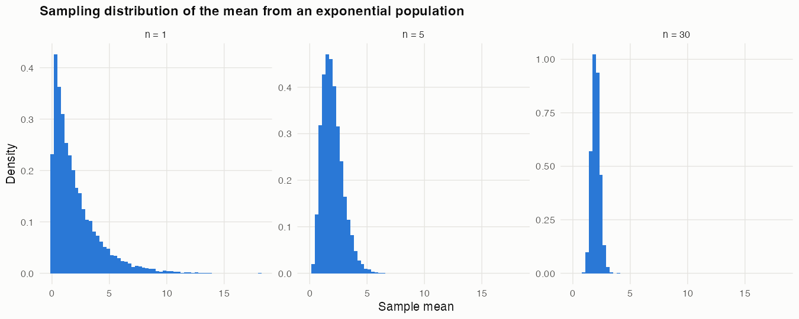
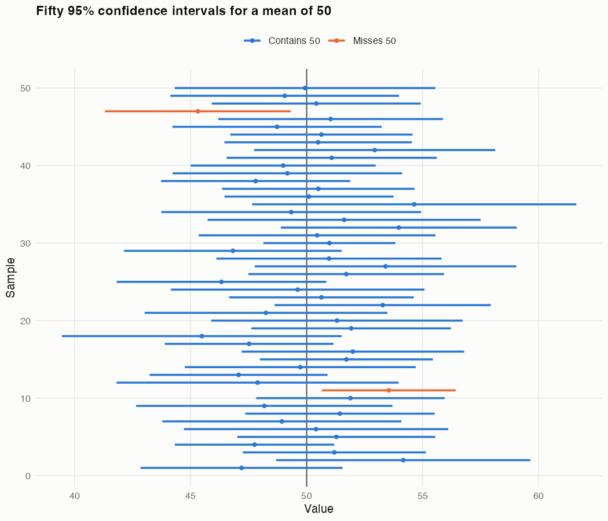
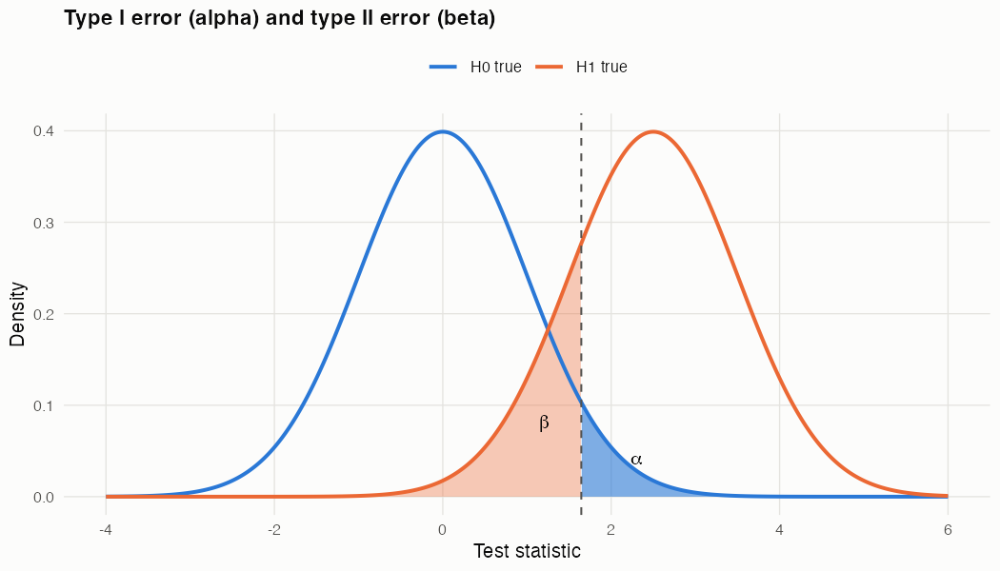

# 14장 — 통계적 추론의 기초

[레포지토리 안내](../../README.ko.md) | [English](Concepts_Lecture.md) | [한국어](Concepts_Lecture.ko.md)

> **최종 수정일:** 2026-11-19

> **학습 목표:**
> 1. 표본 분포와 중심 극한 정리를 설명하고 표준 오차를 계산할 수 있다
> 2. 평균과 비율의 신뢰 구간을 구하고 신뢰 수준의 의미를 올바르게 해석할 수 있다
> 3. 귀무가설과 대립가설을 세우고 p값, 제1종 오류와 제2종 오류, 검정력을 설명할 수 있다
> 4. R로 일표본, 이표본, 대응 표본 t 검정과 일원 분산 분석을 수행하고 결과를 해석할 수 있다
> 5. 카이제곱 적합도 검정과 독립성 검정, 상관 검정을 수행할 수 있다
> 6. p값의 흔한 오용과 다중 비교의 문제를 설명할 수 있다

---

## 목차

- [1. 표본 분포와 중심 극한 정리](#1-표본-분포와-중심-극한-정리)
  - [1.1 모수와 통계량](#11-모수와-통계량)
  - [1.2 표본 분포](#12-표본-분포)
  - [1.3 표본 평균의 기댓값과 분산](#13-표본-평균의-기댓값과-분산)
  - [1.4 중심 극한 정리](#14-중심-극한-정리)
  - [1.5 표준 오차](#15-표준-오차)
- [2. 신뢰 구간](#2-신뢰-구간)
  - [2.1 모표준편차를 알 때의 구간](#21-모표준편차를-알-때의-구간)
  - [2.2 t 분포와 모표준편차를 모를 때의 구간](#22-t-분포와-모표준편차를-모를-때의-구간)
  - [2.3 신뢰 수준의 의미](#23-신뢰-수준의-의미)
  - [2.4 비율의 신뢰 구간](#24-비율의-신뢰-구간)
  - [2.5 구간의 폭과 표본 크기](#25-구간의-폭과-표본-크기)
  - [2.6 부트스트랩 신뢰 구간](#26-부트스트랩-신뢰-구간)
- [3. 가설 검정](#3-가설-검정)
  - [3.1 귀무가설과 대립가설](#31-귀무가설과-대립가설)
  - [3.2 검정 통계량과 p값](#32-검정-통계량과-p값)
  - [3.3 유의수준과 두 종류의 오류](#33-유의수준과-두-종류의-오류)
  - [3.4 검정력과 표본 크기](#34-검정력과-표본-크기)
  - [3.5 단측 검정과 양측 검정](#35-단측-검정과-양측-검정)
  - [3.6 검정과 신뢰 구간의 관계](#36-검정과-신뢰-구간의-관계)
- [4. t 검정](#4-t-검정)
  - [4.1 일표본 t 검정](#41-일표본-t-검정)
  - [4.2 독립 이표본 t 검정](#42-독립-이표본-t-검정)
  - [4.3 대응 표본 t 검정](#43-대응-표본-t-검정)
  - [4.4 t 검정의 가정](#44-t-검정의-가정)
  - [4.5 세 집단 이상의 평균 비교](#45-세-집단-이상의-평균-비교)
- [5. 카이제곱 검정](#5-카이제곱-검정)
  - [5.1 적합도 검정](#51-적합도-검정)
  - [5.2 독립성 검정](#52-독립성-검정)
  - [5.3 기대 도수의 조건](#53-기대-도수의-조건)
  - [5.4 두 비율의 비교](#54-두-비율의-비교)
- [6. 상관 분석](#6-상관-분석)
  - [6.1 피어슨 상관계수](#61-피어슨-상관계수)
  - [6.2 상관 검정](#62-상관-검정)
  - [6.3 상관의 해석과 순위 상관](#63-상관의-해석과-순위-상관)
- [7. p값의 오용](#7-p값의-오용)
  - [7.1 p값이 말하는 것과 말하지 않는 것](#71-p값이-말하는-것과-말하지-않는-것)
  - [7.2 다중 비교](#72-다중-비교)
  - [7.3 통계적 유의성과 효과 크기](#73-통계적-유의성과-효과-크기)
  - [7.4 선택적 보고와 p-해킹](#74-선택적-보고와-p-해킹)
- [8. 통계적 추론의 흔한 실수](#8-통계적-추론의-흔한-실수)
- [개념 적용](#개념-적용)
- [요약](#요약)
- [점검 문제](#점검-문제)
- [참고 문헌](#참고-문헌)

---

<br>

## 1. 표본 분포와 중심 극한 정리

### 1.1 모수와 통계량

통계적 추론은 일부의 자료로 전체에 대해 결론을 내리는 일이다. 알고 싶은 대상 전체를 **모집단**(population)이라 하고, 실제로 관측한 일부를 **표본**(sample)이라 한다. 모집단의 평균 $\mu$, 표준편차 $\sigma$, 비율 $\pi$, 회귀 계수 $\beta$처럼 모집단을 요약하는 값은 모르는 상수이며 **모수**(parameter)라고 부른다. 반면 표본 평균 $\bar{x}$, 표본 표준편차 $s$, 표본 비율 $\hat{p}$, 회귀 계수의 추정값 $\hat{\beta}$처럼 표본으로 계산하는 값은 **통계량**(statistic)이다.

| 모수(모집단) | 통계량(표본) |
|------|------|
| 평균 $\mu$ | 표본 평균 $\bar{x} = \frac{1}{n}\sum x_i$ |
| 표준편차 $\sigma$ | 표본 표준편차 $s = \sqrt{\frac{1}{n - 1}\sum (x_i - \bar{x})^2}$ |
| 비율 $\pi$ | 표본 비율 $\hat{p}$ |
| 회귀 계수 $\beta$ | 최소제곱 추정값 $\hat{\beta}$ |

*표 1. 모수와 그것을 추정하는 통계량*

표본 표준편차의 분모가 $n$이 아니라 $n - 1$인 이유는, 편차를 모집단 평균이 아닌 표본 평균에서 재므로 편차의 제곱합이 작게 치우치기 때문이다. $n - 1$로 나누면 $s^2$의 기댓값이 $\sigma^2$과 같아진다. 10장 2.8절에서 잔차 표준 오차의 분모가 $n - 2$였던 것도 같은 이유이다. 추론이 의미를 가지려면 표본이 모집단을 대표해야 하며, 가장 기본적인 방법은 모집단의 각 개체가 같은 확률로 뽑히는 **단순 무작위 표본**을 얻는 것이다. 13장 1.5절의 선별적 보도처럼 특정 기준으로 골라진 표본에서는 아무리 정교한 계산을 해도 모집단에 대한 올바른 결론이 나오지 않는다.

### 1.2 표본 분포

표본을 새로 뽑을 때마다 통계량의 값은 달라진다. 같은 크기의 표본을 무수히 많이 뽑았을 때 통계량이 이루는 분포를 그 통계량의 **표본 분포**(sampling distribution)라고 한다. 표본 분포는 실제로는 한 번만 관측하는 통계량이 얼마나 흔들릴 수 있는지를 알려 주며, 신뢰 구간과 가설 검정은 모두 이 분포 위에 세워진다.

컴퓨터로 표본을 반복해서 뽑으면 표본 분포를 직접 볼 수 있다. 평균이 2이고 표준편차가 2인 지수분포를 모집단으로 하여, 크기 30의 표본을 1만 번 뽑고 그때마다 표본 평균을 구한다.

```r
set.seed(2026)
mu <- 2; sigma <- 2   # exponential population with mean 2 and standard deviation 2
means <- replicate(10000, mean(rexp(30, rate = 1 / mu)))
round(c(mean_of_means = mean(means), sd_of_means = sd(means),
        theory_se = sigma / sqrt(30)), 4)
#> mean_of_means   sd_of_means     theory_se 
#>        1.9981        0.3628        0.3651
```

`rexp(30, rate = 1 / mu)`는 평균이 `mu`인 지수분포에서 30개의 값을 뽑고, `replicate(10000, ...)`는 이 과정을 1만 번 반복해 표본 평균 1만 개를 모은다. 1만 개의 표본 평균은 평균이 1.998로 모집단 평균 2에 매우 가깝고, 표준편차는 0.363으로 1.3절의 이론값 $\sigma/\sqrt{n} = 2/\sqrt{30} = 0.365$와 거의 같다. `set.seed()`는 난수를 고정해 같은 결과를 재현하게 한다.

### 1.3 표본 평균의 기댓값과 분산

$X_1, \ldots, X_n$이 평균 $\mu$, 분산 $\sigma^2$인 모집단에서 독립적으로 뽑은 확률 변수일 때, 표본 평균 $\bar{X} = \frac{1}{n}\sum X_i$의 기댓값과 분산은 기댓값과 분산의 성질로 바로 구할 수 있다.

```math
E(\bar{X}) = \frac{1}{n}\sum_{i=1}^{n} E(X_i) = \frac{1}{n} \cdot n\mu = \mu, \qquad
\mathrm{Var}(\bar{X}) = \frac{1}{n^2}\sum_{i=1}^{n} \mathrm{Var}(X_i) = \frac{1}{n^2} \cdot n\sigma^2 = \frac{\sigma^2}{n}
```

> **[확률및통계]** 첫째 식은 기댓값의 선형성 $E(aX + bY) = aE(X) + bE(Y)$에서 나오며 독립이 필요 없다. 둘째 식은 $\mathrm{Var}(aX) = a^2\mathrm{Var}(X)$와 독립인 확률 변수의 합의 분산이 분산의 합이라는 성질에서 나온다. 관측값이 서로 상관되어 있으면 공분산 항이 더해지므로 $\sigma^2/n$이 성립하지 않으며, 11장의 시계열처럼 자기상관이 있는 자료에서 이 공식을 그대로 쓰면 불확실성을 과소평가한다.

첫째 식은 표본 평균이 모평균의 **불편 추정량**, 곧 평균적으로 모평균을 맞히는 추정량이라는 뜻이다. 둘째 식은 표본 평균의 퍼짐이 표본 크기의 제곱근에 반비례해 줄어든다는 뜻이다. 표본을 4배로 늘리면 표본 평균의 표준편차는 절반이 되고, 100배로 늘리면 10분의 1이 된다. 정밀도를 두 배로 높이려면 네 배의 표본이 필요하다.

### 1.4 중심 극한 정리

1.3절은 표본 평균의 평균과 분산만 알려 주고 분포의 모양은 알려 주지 않는다. 놀랍게도 모집단의 분포가 무엇이든 표본이 크면 표본 평균의 분포는 정규분포에 가까워진다.

> **용어 정의:** **중심 극한 정리(central limit theorem)** 는 평균 $\mu$, 유한한 분산 $\sigma^2$을 갖는 모집단에서 뽑은 독립인 표본 $n$개의 평균 $\bar{X}$에 대해, $n$이 커질수록 $(\bar{X} - \mu)/(\sigma/\sqrt{n})$의 분포가 표준정규분포에 가까워진다는 정리이다.



*그림 1. 지수분포 모집단에서 표본 크기에 따른 표본 평균의 분포*

그림 1은 오른쪽으로 크게 치우친 지수분포에서 크기 1, 5, 30의 표본을 1만 번씩 뽑아 표본 평균의 분포를 그린 것이다. $n = 1$이면 표본 평균은 관측값 하나이므로 모집단과 같은 지수분포이다. $n = 5$에서는 치우침이 줄고, $n = 30$에서는 평균 2를 중심으로 거의 대칭인 종 모양이 되며 폭도 좁아진다. 이 정리 덕분에 모집단의 분포를 모르더라도 표본이 충분히 크면 정규분포를 이용해 표본 평균에 대한 확률을 계산할 수 있다.

중심 극한 정리는 두 조건을 요구한다. 관측값이 독립이어야 하고, 모집단의 분산이 유한해야 한다. "충분히 큰 $n$"이 얼마인지는 모집단의 모양에 따라 다르다. 대칭인 분포에서는 10\~20개로도 충분하지만, 치우침이 심하거나 극단값이 잦은 분포에서는 수백 개가 필요할 수 있다. 흔히 말하는 "30개 이상"은 대략적인 경험칙일 뿐이다.

### 1.5 표준 오차

> **용어 정의:** **표준 오차(standard error)** 는 통계량의 표본 분포의 표준편차로, 그 통계량이 표본에 따라 흔들리는 정도를 나타낸다.

표본 평균의 표준 오차는 $\sigma/\sqrt{n}$이다. $\sigma$는 모르므로 실제로는 표본 표준편차 $s$로 바꾼 $\mathrm{SE}(\bar{x}) = s/\sqrt{n}$을 쓴다. 표본 비율 $\hat{p}$는 0과 1의 값을 갖는 관측값의 평균이므로 표준 오차는 $\sqrt{\hat{p}(1 - \hat{p})/n}$이다. 10장의 회귀 계수와 12장의 로지스틱 회귀 계수에 붙은 `Std. Error`도 각 추정값의 표준 오차이다.

```r
x <- mtcars$mpg
round(c(n = length(x), mean = mean(x), sd = sd(x), se = sd(x) / sqrt(length(x))), 3)
#>      n   mean     sd     se 
#> 32.000 20.091  6.027  1.065
```

mtcars 자동차 32대의 연비는 평균 20.09mpg, 표준편차 6.03mpg이고, 평균의 표준 오차는 $6.027/\sqrt{32} = 1.065$이다. 표준편차와 표준 오차는 다른 질문에 답한다. 표준편차 6.03은 개별 자동차의 연비가 평균에서 얼마나 흩어져 있는지이고, 표준 오차 1.07은 표본 평균 20.09가 모집단 평균에서 얼마나 벗어나 있을 수 있는지이다. 표본이 커져도 표준편차는 모집단의 퍼짐에 가까워질 뿐 줄지 않지만, 표준 오차는 $\sqrt{n}$에 반비례해 줄어든다.

---

<br>

## 2. 신뢰 구간

### 2.1 모표준편차를 알 때의 구간

중심 극한 정리에 따라 $Z = (\bar{X} - \mu)/(\sigma/\sqrt{n})$은 근사적으로 표준정규분포를 따른다. 표준정규분포에서 가운데 95%의 넓이를 갖는 구간은 $-1.96$에서 $1.96$이므로 $P(-1.96 \leq Z \leq 1.96) = 0.95$이고, 이 부등식을 $\mu$에 대해 풀면 다음과 같다.

```math
P\left(\bar{X} - 1.96\frac{\sigma}{\sqrt{n}} \leq \mu \leq \bar{X} + 1.96\frac{\sigma}{\sqrt{n}}\right) = 0.95
```

따라서 $\bar{x} \pm 1.96\,\sigma/\sqrt{n}$이 $\mu$의 95% 신뢰 구간이다. 일반적으로 신뢰 수준 $1 - \alpha$의 구간은 $\bar{x} \pm z_{1-\alpha/2}\,\sigma/\sqrt{n}$이며, $z_{1-\alpha/2}$는 표준정규분포의 $1 - \alpha/2$ 분위수이다. 90%, 95%, 99% 구간에서 각각 1.645, 1.960, 2.576이다. 구간의 반폭 $z_{1-\alpha/2}\,\sigma/\sqrt{n}$을 **오차 한계**(margin of error)라고 한다.

### 2.2 t 분포와 모표준편차를 모를 때의 구간

실제로는 $\sigma$를 모르므로 $s$로 바꾸어야 하는데, 그러면 $s$도 표본에 따라 흔들리는 확률 변수이므로 $(\bar{X} - \mu)/(s/\sqrt{n})$은 정규분포보다 꼬리가 두꺼운 분포를 따른다. 모집단이 정규분포이면 이 통계량은 정확히 자유도 $n - 1$인 **t 분포**를 따른다. t 분포는 0을 중심으로 대칭인 종 모양이며, 자유도가 작을수록 꼬리가 두껍고 자유도가 커지면 표준정규분포에 가까워진다. 신뢰 구간은 다음과 같다.

```math
\bar{x} \pm t_{1-\alpha/2,\,n-1} \cdot \frac{s}{\sqrt{n}}
```

```r
n <- length(x); xbar <- mean(x); s <- sd(x)
tq <- qt(0.975, df = n - 1)
round(c(t_quantile = tq, lower = xbar - tq * s / sqrt(n), upper = xbar + tq * s / sqrt(n)), 3)
#> t_quantile      lower      upper 
#>      2.040     17.918     22.264
t.test(x)$conf.int
#> [1] 17.91768 22.26357
#> attr(,"conf.level")
#> [1] 0.95
qnorm(0.975)
#> [1] 1.959964
```

`qt(0.975, df = 31)`은 자유도 31인 t 분포의 97.5% 분위수 2.040으로, 정규분포의 1.960보다 조금 크다. 공식으로 계산한 구간 17.92\~22.26mpg는 `t.test()`가 보고하는 `conf.int`와 같다. 10장 2.8절의 회귀 계수 신뢰 구간도 같은 구조이며, 자유도만 $n - p - 1$로 바뀐다.

### 2.3 신뢰 수준의 의미

95% 신뢰 구간 17.92\~22.26을 "모평균이 이 구간 안에 있을 확률이 95%"라고 해석하는 것은 정확하지 않다. 모평균은 확률 변수가 아니라 고정된 상수이므로, 한 번 계산한 구간은 모평균을 포함하거나 포함하지 않거나 둘 중 하나이다. 95%는 구간을 만드는 **절차**의 성질이다. 표본을 반복해서 뽑아 같은 방법으로 구간을 만들면 그 구간들의 95%가 모평균을 포함한다.

```r
set.seed(1)
covered <- replicate(10000, {
  smp <- rnorm(20, mean = 50, sd = 10)
  ci <- t.test(smp)$conf.int
  ci[1] <= 50 & 50 <= ci[2]
})
mean(covered)
#> [1] 0.9513
```

평균이 50인 정규 모집단에서 크기 20의 표본을 1만 번 뽑아 95% 구간을 만들면, 그중 95.13%가 실제로 50을 포함한다. 그림 2는 그 가운데 50개의 구간을 그린 것으로, 2개의 구간(주황색)이 50을 포함하지 못한다.



*그림 2. 모평균 50에 대해 만든 95% 신뢰 구간 50개*

구간마다 중심(표본 평균)과 폭(표본 표준편차에 따라 달라짐)이 다르다는 점에 주목할 필요가 있다. 어느 구간이 50을 놓쳤는지는 모평균을 아는 모의실험에서만 알 수 있으며, 실제 분석에서는 내가 얻은 구간이 95%에 속하는지 5%에 속하는지 알 수 없다.

### 2.4 비율의 신뢰 구간

표본 비율 $\hat{p}$의 표본 분포는 $n$이 크면 평균 $\pi$, 표준 오차 $\sqrt{\pi(1 - \pi)/n}$인 정규분포에 가까워지므로, 95% 신뢰 구간은 근사적으로 $\hat{p} \pm 1.96\sqrt{\hat{p}(1 - \hat{p})/n}$이다. 어떤 정책에 대해 무작위로 뽑은 100명 가운데 56명이 찬성한 경우를 본다.

```r
prop.test(x = 56, n = 100, p = 0.5, correct = FALSE)
#> 
#> 	1-sample proportions test without continuity correction
#> 
#> data:  56 out of 100, null probability 0.5
#> X-squared = 1.44, df = 1, p-value = 0.2301
#> alternative hypothesis: true p is not equal to 0.5
#> 95 percent confidence interval:
#>  0.4622810 0.6532797
#> sample estimates:
#>    p 
#> 0.56
```

`prop.test()`는 성공 수 `x`와 시행 수 `n`으로 비율을 추론하며, `correct = FALSE`는 연속성 수정을 하지 않는다는 뜻이다. 보고되는 구간 0.462\~0.653은 위의 단순한 공식($0.56 \pm 0.097$)과 조금 다른 Wilson 구간으로, 표본이 작거나 비율이 0이나 1에 가까울 때 더 정확하다. 찬성률의 추정값은 56%이지만 구간이 50%를 포함하므로, 이 표본만으로는 과반이 찬성한다고 말할 수 없다. 같은 출력의 p값 0.23은 3절의 검정 결과이다.

### 2.5 구간의 폭과 표본 크기

오차 한계 $z_{1-\alpha/2}\,\sigma/\sqrt{n}$은 세 요소로 정해진다. 신뢰 수준을 높이면 분위수가 커져 구간이 넓어지고, 모집단의 퍼짐 $\sigma$가 크면 구간이 넓어지며, 표본 크기 $n$을 늘리면 $\sqrt{n}$에 반비례해 좁아진다. 원하는 오차 한계 $E$를 정하면 필요한 표본 크기를 거꾸로 구할 수 있다.

```math
n = \left(\frac{z_{1-\alpha/2}\,\sigma}{E}\right)^2
```

비율에서는 $\pi(1 - \pi)$가 $\pi = 0.5$일 때 최대 0.25이므로, 오차 한계를 3%p로 하는 95% 구간에 필요한 표본 크기는 $n = (1.96 \times 0.5/0.03)^2 \approx 1{,}067$이다. 여론 조사가 흔히 1,000명 남짓을 조사하는 이유이다. 이 공식은 표본이 무작위로 뽑혔을 때의 확률적 오차만 반영하며, 응답하지 않은 사람이 체계적으로 다르거나 질문이 편향되어 생기는 오차는 표본을 늘려도 줄지 않는다.

### 2.6 부트스트랩 신뢰 구간

2.2절의 공식은 표본 평균처럼 표준 오차의 공식이 알려진 통계량에만 쓸 수 있다. 중앙값처럼 표준 오차의 공식이 복잡하거나 알려지지 않은 통계량에는 **부트스트랩**(bootstrap)을 쓴다. 부트스트랩은 관측한 표본을 모집단 대신으로 삼아, 그 표본에서 같은 크기의 표본을 복원 추출로 다시 뽑는 일을 여러 번 반복하고 그때마다 통계량을 계산한다. 이렇게 얻은 통계량들의 분포가 표본 분포를 근사한다.

```r
set.seed(42)
x <- mtcars$mpg
boot_medians <- replicate(10000, median(sample(x, replace = TRUE)))
median(x)
#> [1] 19.2
round(sd(boot_medians), 3)
#> [1] 1.267
quantile(boot_medians, c(0.025, 0.975))
#>  2.5% 97.5% 
#> 16.55 21.40
```

`sample(x, replace = TRUE)`는 32개의 값에서 32개를 복원 추출하므로, 어떤 값은 여러 번 뽑히고 어떤 값은 한 번도 뽑히지 않는다. 연비의 중앙값은 19.2mpg이고, 부트스트랩 중앙값 1만 개의 표준편차 1.267이 중앙값의 표준 오차의 추정값이다. 부트스트랩 분포의 2.5%와 97.5% 분위수를 그대로 구간으로 삼는 **백분위수 구간**은 16.55\~21.40mpg이다. 1.2절의 모의실험은 모집단을 알 때 표본 분포를 만든 것이고, 부트스트랩은 모집단을 모를 때 표본으로 같은 일을 흉내 낸 것이다. 부트스트랩은 표본이 모집단을 잘 대표한다는 가정에 기대므로, 표본이 매우 작으면 구간이 부정확하고 최댓값처럼 표본의 극단에 좌우되는 통계량에는 잘 맞지 않는다.

---

<br>

## 3. 가설 검정

### 3.1 귀무가설과 대립가설

가설 검정은 자료가 어떤 주장과 맞는지를 판단하는 절차이다. 먼저 두 가설을 세운다. **귀무가설**(null hypothesis) $H_0$은 효과가 없다, 차이가 없다, 관계가 없다는 기본 입장이고, **대립가설**(alternative hypothesis) $H_1$ 또는 $H_a$는 연구자가 증거를 찾으려는 주장이다. 예를 들어 새 약의 효과를 검정할 때 $H_0$은 "새 약과 기존 약의 평균 효과가 같다", $H_1$은 "평균 효과가 다르다"이다.

검정은 재판과 비슷한 논리를 따른다. 피고는 유죄가 입증되기 전까지 무죄로 추정되듯, $H_0$은 자료가 그것과 맞지 않는다는 강한 증거가 나오기 전까지 참으로 가정된다. 증거가 충분하면 $H_0$을 **기각**하고, 그렇지 않으면 $H_0$을 기각하지 **못한다**. "기각하지 못한다"는 것은 $H_0$이 참이라고 증명했다는 뜻이 아니다. 재판에서 무죄 판결이 결백의 증명이 아니라 유죄의 증거가 부족하다는 뜻인 것과 같다.

### 3.2 검정 통계량과 p값

**검정 통계량**은 자료가 $H_0$에서 얼마나 벗어나 있는지를 하나의 수로 요약한 것이다. 평균에 대한 검정이면 표본 평균과 $H_0$의 평균 $\mu_0$의 차이를 표준 오차로 나눈 $t = (\bar{x} - \mu_0)/(s/\sqrt{n})$이다. $H_0$이 참이면 이 통계량의 분포(**귀무 분포**)를 알 수 있으므로, 관측한 값이 그 분포에서 얼마나 드문지를 계산할 수 있다.

> **용어 정의:** **p값(p-value)** 은 귀무가설이 참이라고 가정할 때, 관측한 검정 통계량만큼 또는 그보다 더 극단적인 값이 나올 확률이다.

p값이 작으면 $H_0$ 아래에서는 드문 일이 일어났다는 뜻이므로 $H_0$을 의심할 근거가 된다. 13장 4.3절의 UC 버클리 자료에서 p값이 $10^{-26}$ 수준이었던 것은, 합격이 성별과 무관하다는 가정 아래에서는 관측한 성별 차이가 사실상 나올 수 없다는 뜻이었다. p값은 $H_0$이 참일 확률이 아니며, 이 차이는 7.1절에서 다시 다룬다.

### 3.3 유의수준과 두 종류의 오류

검정을 하기 전에 $H_0$을 기각할 기준인 **유의수준** $\alpha$를 정하고, p값이 $\alpha$보다 작으면 $H_0$을 기각한다. 흔히 $\alpha = 0.05$를 쓰지만, 이것은 관례일 뿐 자연의 상수가 아니다. 검정의 결론은 실제 상태와 다음 네 가지로 조합된다.

| 결론 \ 실제 | $H_0$이 참 | $H_0$이 거짓 |
|------|------|------|
| $H_0$ 기각 | 제1종 오류 (확률 $\alpha$) | 올바른 결정 (확률 $1 - \beta$, 검정력) |
| $H_0$ 기각하지 못함 | 올바른 결정 (확률 $1 - \alpha$) | 제2종 오류 (확률 $\beta$) |

*표 2. 가설 검정의 결론과 두 종류의 오류*

**제1종 오류**는 $H_0$이 참인데 기각하는 것, 곧 없는 효과를 있다고 하는 거짓 양성이다. **제2종 오류**는 $H_0$이 거짓인데 기각하지 못하는 것, 곧 있는 효과를 놓치는 거짓 음성이다. 재판에 비유하면 제1종 오류는 무고한 사람에게 유죄를 선고하는 것이고, 제2종 오류는 범인을 풀어 주는 것이다. 유의수준 $\alpha$는 제1종 오류의 확률을 직접 정한다. $H_0$이 참인 상황을 모의로 만들어 확인한다.

```r
set.seed(7)
p_null <- replicate(10000, t.test(rnorm(20), rnorm(20))$p.value)
mean(p_null < 0.05)
#> [1] 0.049
```

두 집단을 같은 표준정규분포에서 뽑았으므로 $H_0$(두 평균이 같다)이 참이다. 그런데도 1만 번의 검정 가운데 4.9%에서 p값이 0.05보다 작게 나와 $H_0$을 잘못 기각했다. $H_0$이 참이면 p값은 0과 1 사이에 고르게 분포하므로, p값이 0.05보다 작을 확률이 정확히 5%이다. 이것이 유의수준의 의미이다.



*그림 3. 단측 검정에서 제1종 오류와 제2종 오류의 확률*

그림 3은 $H_0$ 아래의 검정 통계량 분포(파란색, 평균 0)와 $H_1$ 아래의 분포(주황색, 평균 2.5)를 겹쳐 그린 것이다. 유의수준 5%의 단측 검정에서는 통계량이 1.645를 넘으면 $H_0$을 기각한다. 파란 곡선에서 1.645 오른쪽의 넓이가 $\alpha = 0.05$이고, 주황 곡선에서 1.645 왼쪽의 넓이가 $\beta = P(Z < 1.645 - 2.5) = 0.196$이다. 기준선을 오른쪽으로 옮기면 $\alpha$는 줄지만 $\beta$는 늘어나므로, 표본 크기가 정해져 있으면 두 오류를 동시에 줄일 수 없다.

### 3.4 검정력과 표본 크기

> **용어 정의:** **검정력(power)** 은 대립가설이 참일 때 귀무가설을 올바르게 기각할 확률 $1 - \beta$이다.

그림 3의 상황에서 검정력은 $1 - 0.196 = 0.804$이다. 검정력은 네 요소로 정해진다. 실제 효과의 크기가 클수록, 자료의 퍼짐이 작을수록, 표본이 클수록, 유의수준이 클수록 검정력이 높다. 연구를 설계할 때는 의미 있다고 볼 최소 효과 크기를 정하고, 그 효과를 80% 정도의 검정력으로 찾아낼 수 있는 표본 크기를 미리 계산한다.

```r
power.t.test(n = 20, delta = 5, sd = 10, sig.level = 0.05)$power
#> [1] 0.3377084
power.t.test(delta = 5, sd = 10, sig.level = 0.05, power = 0.8)$n
#> [1] 63.76576
```

`power.t.test()`는 이표본 t 검정의 검정력이나 필요한 표본 크기를 계산한다. 두 집단의 평균 차이가 5이고 표준편차가 10일 때, 집단마다 20명이면 검정력은 34%에 불과해 실제로 있는 효과를 세 번 중 두 번 놓친다. 검정력 80%를 얻으려면 집단마다 64명이 필요하다. 검정력이 낮은 연구에서 유의하지 않은 결과가 나왔다면 효과가 없다는 증거가 아니라 연구가 효과를 찾을 능력이 부족했다는 뜻일 수 있다.

### 3.5 단측 검정과 양측 검정

대립가설이 "다르다"($\mu \neq \mu_0$)이면 양쪽 꼬리를 모두 극단으로 보는 **양측 검정**이고, "크다"($\mu > \mu_0$)나 "작다"($\mu < \mu_0$)이면 한쪽 꼬리만 보는 **단측 검정**이다. 같은 통계량에서 단측 검정의 p값은 양측 검정의 절반이다. 단측 검정은 반대 방향의 효과가 이론적으로 불가능하거나 관심이 전혀 없다는 것을 자료를 보기 전에 정했을 때만 쓴다. 자료를 보고 나서 효과가 나온 방향의 단측 검정으로 바꾸어 p값을 절반으로 만드는 것은 7.4절의 p-해킹이다. R의 검정 함수는 `alternative = "two.sided"`(기본값), `"greater"`, `"less"`로 방향을 정한다.

### 3.6 검정과 신뢰 구간의 관계

유의수준 $\alpha$의 양측 검정과 신뢰 수준 $1 - \alpha$의 신뢰 구간은 같은 정보를 다른 방식으로 보여 준다. $\mu_0$이 95% 신뢰 구간 밖에 있으면 유의수준 5%의 양측 검정에서 $H_0: \mu = \mu_0$을 기각하고, 구간 안에 있으면 기각하지 못한다. 2.4절의 찬성률 구간 0.462\~0.653이 0.5를 포함하므로 같은 출력의 검정 p값 0.23이 0.05보다 큰 것이 그 예이다.

신뢰 구간은 검정보다 더 많은 정보를 준다. 검정은 "0이 아니다"라는 결론만 주지만, 신뢰 구간은 효과가 어느 정도의 크기일 수 있는지를 함께 보여 준다. 구간이 0을 간신히 벗어나는지, 넓은지 좁은지는 결론의 무게를 크게 바꾸므로, 결과를 보고할 때는 p값과 함께 효과의 추정값과 신뢰 구간을 제시하는 것이 좋다.

---

<br>

## 4. t 검정

### 4.1 일표본 t 검정

한 모집단의 평균이 특정한 값 $\mu_0$과 같은지 검정한다. 검정 통계량은 $t = (\bar{x} - \mu_0)/(s/\sqrt{n})$이고, $H_0$ 아래에서 자유도 $n - 1$인 t 분포를 따른다. mtcars 자동차의 평균 연비가 20mpg인지 검정한다.

```r
t.test(mtcars$mpg, mu = 20)
#> 
#> 	One Sample t-test
#> 
#> data:  mtcars$mpg
#> t = 0.08506, df = 31, p-value = 0.9328
#> alternative hypothesis: true mean is not equal to 20
#> 95 percent confidence interval:
#>  17.91768 22.26357
#> sample estimates:
#> mean of x 
#>  20.09062
```

$t = (20.091 - 20)/1.065 = 0.085$로 표본 평균이 20에서 표준 오차의 0.09배만큼만 떨어져 있고, p값은 0.93이다. 따라서 평균 연비가 20mpg라는 가설을 기각하지 못한다. 95% 신뢰 구간 17.92\~22.26이 20을 포함하는 것과 같은 결론이다(3.6절).

### 4.2 독립 이표본 t 검정

서로 독립인 두 집단의 평균을 비교한다. $H_0: \mu_1 = \mu_2$이고, 검정 통계량은 두 표본 평균의 차이를 그 차이의 표준 오차로 나눈 값이다.

```math
t = \frac{\bar{x}_1 - \bar{x}_2}{\sqrt{s_1^2/n_1 + s_2^2/n_2}}
```

두 집단의 분산이 같다고 가정하지 않는 이 검정을 **Welch의 t 검정**이라 하며, 자유도는 Welch-Satterthwaite 근사식으로 계산하므로 정수가 아닐 수 있다. R의 `t.test()`는 기본으로 Welch 검정을 하며, 두 분산이 같다고 가정하는 고전적인 검정은 `var.equal = TRUE`로 지정한다. 자동 변속기(`am = 0`)와 수동 변속기(`am = 1`) 자동차의 연비를 비교한다.

```r
t.test(mpg ~ am, data = mtcars)
#> 
#> 	Welch Two Sample t-test
#> 
#> data:  mpg by am
#> t = -3.7671, df = 18.332, p-value = 0.001374
#> alternative hypothesis: true difference in means between group 0 and group 1 is not equal to 0
#> 95 percent confidence interval:
#>  -11.280194  -3.209684
#> sample estimates:
#> mean in group 0 mean in group 1 
#>        17.14737        24.39231
```

수식 `mpg ~ am`은 `am`의 두 집단으로 `mpg`를 나누라는 뜻이다. 자동 변속기 자동차의 평균 연비는 17.15mpg, 수동은 24.39mpg이며, 차이 $-7.24$의 95% 신뢰 구간은 $-11.28$에서 $-3.21$까지이다. p값 0.0014는 두 집단의 평균이 같다는 가설 아래에서 이만큼 큰 차이가 나올 가능성이 매우 낮다는 뜻이다. 그러나 이 자료는 실험이 아니라 관측 자료이므로, 수동 변속기 자동차가 대체로 가볍고 엔진이 작다는 다른 차이가 연비 차이의 원인일 수 있다. 무게를 함께 고려하려면 10장의 다중 회귀를 쓴다.

### 4.3 대응 표본 t 검정

같은 개체를 두 번 측정했거나 쌍을 이룬 개체를 비교할 때는 두 측정이 서로 독립이 아니므로, 쌍마다의 차이 $d_i = x_{i2} - x_{i1}$을 구해 그 평균이 0인지 일표본 t 검정을 한다. R의 내장 자료 `sleep`은 환자 10명에게 두 가지 수면제를 각각 투여했을 때 늘어난 수면 시간(`extra`, 시간)을 기록한 것이다.

```r
extra1 <- sleep$extra[sleep$group == 1]
extra2 <- sleep$extra[sleep$group == 2]
t.test(extra2, extra1, paired = TRUE)
#> 
#> 	Paired t-test
#> 
#> data:  extra2 and extra1
#> t = 4.0621, df = 9, p-value = 0.002833
#> alternative hypothesis: true mean difference is not equal to 0
#> 95 percent confidence interval:
#>  0.7001142 2.4598858
#> sample estimates:
#> mean difference 
#>            1.58
t.test(extra2, extra1)$p.value
#> [1] 0.07939414
```

`paired = TRUE`는 두 벡터의 같은 위치의 값을 한 쌍으로 보고 차이를 검정한다. 두 번째 약이 첫 번째 약보다 수면 시간을 평균 1.58시간 더 늘렸고, p값은 0.0028이다. 같은 자료를 독립 이표본 검정으로 잘못 분석하면 p값이 0.079로 유의하지 않다. 환자마다 원래 잠이 많고 적은 차이가 크기 때문에, 그 차이를 그대로 두면 잡음이 커져 약의 효과가 묻힌다. 대응 설계는 개체 사이의 변동을 차이를 구하는 과정에서 없애므로 같은 수의 관측값으로 더 높은 검정력을 얻는다.

### 4.4 t 검정의 가정

t 검정은 다음 가정 위에서 정확하다.

1. **독립성:** 관측값(대응 표본에서는 쌍의 차이)이 서로 독립이다. 가장 중요한 가정이며, 깨지면 표준 오차가 틀려 결론 전체가 무너진다.
2. **정규성:** 모집단(대응 표본에서는 차이)이 정규분포를 따른다. 표본이 크면 중심 극한 정리(1.4절) 때문에 이 가정이 깨져도 결과가 크게 틀리지 않는다. 표본이 작을 때는 Q-Q 그림(10장 5.3절)으로 확인하고, 치우침이 심하면 로그 변환이나 순위에 기반한 Wilcoxon 검정(`wilcox.test()`)을 쓴다.
3. **분산:** 고전적인 이표본 검정은 두 집단의 분산이 같다고 가정하지만, Welch 검정은 이 가정이 필요 없다. 분산이 같은지 모를 때는 Welch 검정을 쓰는 것이 안전하다.

> **주의:** 이상값 하나는 평균과 표준편차를 함께 크게 바꾸므로 t 검정의 결과를 뒤집을 수 있다. 검정 전에 상자 그림(9장 4.5절)으로 자료를 확인하고, 이상값이 있으면 자료 오류인지 확인한 뒤 그 값을 뺀 결과와 비교한다.

### 4.5 세 집단 이상의 평균 비교

세 집단 이상의 평균을 비교할 때 두 집단씩 t 검정을 반복하면 7.2절의 다중 비교 문제가 생긴다. 집단이 세 개이면 쌍이 3개, 다섯 개이면 10개이다. 대신 모든 집단의 평균이 같다는 $H_0: \mu_1 = \mu_2 = \cdots = \mu_k$를 한 번에 검정하는 **일원 분산 분석**(one-way ANOVA)을 쓴다. 분산 분석은 전체 변동을 집단 평균 사이의 변동과 집단 안의 변동으로 나눈다. 집단 $j$의 크기를 $n_j$, 평균을 $\bar{y}_j$, 전체 평균을 $\bar{y}$라 하면 다음과 같다.

```math
\sum_{j=1}^{k}\sum_{i=1}^{n_j} (y_{ij} - \bar{y})^2 = \underbrace{\sum_{j=1}^{k} n_j (\bar{y}_j - \bar{y})^2}_{\text{SSB}} + \underbrace{\sum_{j=1}^{k}\sum_{i=1}^{n_j} (y_{ij} - \bar{y}_j)^2}_{\text{SSW}}, \qquad
F = \frac{\text{SSB}/(k - 1)}{\text{SSW}/(n - k)}
```

$H_0$이 참이면 집단 평균들은 우연한 변동만큼만 흩어지므로 $F$는 1 근처의 값이 되고, 집단 평균의 차이가 집단 안의 퍼짐에 비해 크면 $F$가 커진다. $H_0$ 아래에서 $F$는 자유도 $(k - 1, n - k)$인 F 분포를 따른다. R의 내장 자료 `PlantGrowth`는 대조군(`ctrl`)과 두 처리 조건(`trt1`, `trt2`)에서 식물을 10개씩 길러 말린 무게를 잰 실험 자료이다.

```r
aggregate(weight ~ group, data = PlantGrowth, FUN = mean)
#>   group weight
#> 1  ctrl  5.032
#> 2  trt1  4.661
#> 3  trt2  5.526
fit <- aov(weight ~ group, data = PlantGrowth)
summary(fit)
#>             Df Sum Sq Mean Sq F value Pr(>F)  
#> group        2  3.766  1.8832   4.846 0.0159 *
#> Residuals   27 10.492  0.3886                 
#> ---
#> Signif. codes:  0 '***' 0.001 '**' 0.01 '*' 0.05 '.' 0.1 ' ' 1
pairwise.t.test(PlantGrowth$weight, PlantGrowth$group, p.adjust.method = "bonferroni")
#> 
#> 	Pairwise comparisons using t tests with pooled SD 
#> 
#> data:  PlantGrowth$weight and PlantGrowth$group 
#> 
#>      ctrl  trt1 
#> trt1 0.583 -    
#> trt2 0.263 0.013
#> 
#> P value adjustment method: bonferroni
```

세 집단의 평균은 5.03, 4.66, 5.53이다. `summary(fit)`의 `group` 행에서 SSB는 3.766, 자유도는 $3 - 1 = 2$이고, `Residuals` 행에서 SSW는 10.492, 자유도는 $30 - 3 = 27$이다. $F = (3.766/2)/(10.492/27) = 4.85$이고 p값은 0.016이므로 세 평균이 모두 같다는 가설을 기각한다. 그러나 F 검정은 어느 집단이 다른지는 알려 주지 않으므로, 이어서 본페로니 보정을 한 두 집단씩의 비교(`pairwise.t.test()`)를 하면 처리 1과 처리 2의 차이만 유의하다(보정된 p값 0.013). 분산 분석은 집단을 나타내는 가변수를 예측 변수로 쓴 회귀(10장 3.8절)와 같은 모형이며, 이 F 검정은 10장 4.7절의 F 검정과 같은 원리이다. 가정도 t 검정과 같아서 관측값이 독립이고, 각 집단이 정규분포를 따르며, 집단들의 분산이 같아야 한다.

---

<br>

## 5. 카이제곱 검정

### 5.1 적합도 검정

범주형 자료의 관측 도수가 어떤 이론적 비율과 맞는지 검정하는 것이 **적합도 검정**(goodness-of-fit test)이다. 범주 $k$개의 관측 도수를 $O_i$, 귀무가설의 비율로 계산한 기대 도수를 $E_i = n\pi_i$라 하면 검정 통계량은 다음과 같다.

```math
\chi^2 = \sum_{i=1}^{k} \frac{(O_i - E_i)^2}{E_i}
```

관측 도수가 기대 도수에 가까우면 $\chi^2$이 작고, 크게 어긋나면 커진다. 귀무가설이 참이고 기대 도수가 충분히 크면 $\chi^2$은 근사적으로 자유도 $k - 1$인 카이제곱 분포를 따른다. 자유도가 $k$가 아니라 $k - 1$인 것은 도수의 합이 $n$으로 정해져 있어 $k - 1$개의 도수만 자유롭게 변할 수 있기 때문이다. 주사위를 120번 던져 각 눈이 14, 22, 18, 25, 21, 20번 나온 가상의 자료로 주사위가 공정한지 검정한다.

```r
observed <- c(14, 22, 18, 25, 21, 20)
chisq.test(observed, p = rep(1/6, 6))
#> 
#> 	Chi-squared test for given probabilities
#> 
#> data:  observed
#> X-squared = 3.5, df = 5, p-value = 0.6234
```

`p = rep(1/6, 6)`은 여섯 눈의 확률이 모두 1/6이라는 귀무가설이다. 기대 도수는 모두 20이므로 $\chi^2 = (36 + 4 + 4 + 25 + 1 + 0)/20 = 3.5$이고, 자유도 5에서 p값은 0.62이다. 눈마다 14번에서 25번까지 차이가 있지만, 공정한 주사위에서도 이 정도의 변동은 흔하므로 주사위가 공정하다는 가설을 기각하지 못한다. 13장 2.1절의 비대칭인 고대 주사위처럼 실제로 불공정한 주사위를 찾으려면 이보다 훨씬 많이 던져야 한다.

### 5.2 독립성 검정

두 범주형 변수가 서로 독립인지 검정할 때는 교차표의 각 칸에 대해 독립일 때의 기대 도수를 구한다. 행 $i$의 합을 $R_i$, 열 $j$의 합을 $C_j$, 전체를 $n$이라 하면, 독립일 때 칸 $(i, j)$의 기대 도수는 $E_{ij} = R_i C_j / n$이다. 검정 통계량은 모든 칸에 대한 $\sum (O_{ij} - E_{ij})^2/E_{ij}$이고, 자유도는 $(r - 1)(c - 1)$이다. R에 내장된 `UCBAdmissions`는 13장 4절의 UC 버클리 대학원 입학 자료 가운데 지원자가 가장 많은 여섯 학과의 자료이다 [1]. 일부 칸의 수치는 13장의 표와 조금 다르다. 학과를 합쳐 성별과 합격 여부의 교차표를 만든다.

```r
tab <- apply(UCBAdmissions, c(1, 2), sum)
tab
#>           Gender
#> Admit      Male Female
#>   Admitted 1198    557
#>   Rejected 1493   1278
res <- chisq.test(tab, correct = FALSE)
res
#> 
#> 	Pearson's Chi-squared test
#> 
#> data:  tab
#> X-squared = 92.205, df = 1, p-value < 2.2e-16
round(res$expected, 1)
#>           Gender
#> Admit        Male Female
#>   Admitted 1043.5  711.5
#>   Rejected 1647.5 1123.5
```

`UCBAdmissions`는 합격 여부, 성별, 학과의 3차원 표이고, `apply(..., c(1, 2), sum)`은 셋째 차원인 학과를 더해 2×2 표를 만든다. 전체 4,526명 가운데 1,755명(38.8%)이 합격했으므로, 성별과 합격이 독립이라면 남학생 2,691명 가운데 $2{,}691 \times 1{,}755/4{,}526 = 1{,}043.5$명이 합격했어야 한다. 실제로는 1,198명이 합격했다. $\chi^2 = 92.2$, 자유도 1에서 p값은 $2.2 \times 10^{-16}$보다 작으므로 합친 자료에서 성별과 합격 여부는 독립이 아니다. 2×2 표의 자유도는 $(2 - 1)(2 - 1) = 1$이다.

```r
round(sapply(1:6, function(d) chisq.test(UCBAdmissions[, , d], correct = FALSE)$p.value), 4)
#> [1] 0.0000 0.6145 0.3854 0.5852 0.3171 0.5354
```

그러나 학과마다 따로 검정하면 A 학과만 유의하고(A 학과는 여학생의 합격률이 더 높다), 나머지 다섯 학과는 p값이 0.3 이상이다. 합친 표의 강한 연관은 13장 4.5절에서 본 심슨의 역설의 결과이며, 독립성 검정도 교란 변수를 무시하면 잘못된 결론으로 이어진다.

### 5.3 기대 도수의 조건

카이제곱 분포 근사는 기대 도수가 충분히 클 때만 정확하다. 흔히 쓰는 기준은 모든 칸의 기대 도수가 5 이상이어야 한다는 것이다. 기대 도수가 작은 칸이 있으면 범주를 합치거나, 2×2 표에서는 근사 없이 정확한 확률을 계산하는 **Fisher의 정확 검정**(`fisher.test()`)을 쓴다. 13장 4.3절에서 UC 버클리 자료의 p값을 초기하분포로 계산한 것이 바로 Fisher 검정의 원리이다. 기대 도수의 조건은 관측 도수가 아니라 기대 도수에 대한 것이라는 점에 주의해야 한다. 또한 `chisq.test()`는 2×2 표에서 기본으로 연속성 수정(`correct = TRUE`)을 하며, 위의 예에서는 공식과 비교하기 쉽게 이것을 껐다.

### 5.4 두 비율의 비교

2×2 표의 독립성 검정은 두 집단의 비율이 같은지 검정하는 것과 같다. 5.2절의 자료에서 남학생의 합격률은 $1{,}198/2{,}691 = 0.445$, 여학생의 합격률은 $557/1{,}835 = 0.304$이다.

```r
prop.test(x = c(1198, 557), n = c(2691, 1835), correct = FALSE)
#> 
#> 	2-sample test for equality of proportions without continuity correction
#> 
#> data:  c(1198, 557) out of c(2691, 1835)
#> X-squared = 92.205, df = 1, p-value < 2.2e-16
#> alternative hypothesis: two.sided
#> 95 percent confidence interval:
#>  0.1134470 0.1698439
#> sample estimates:
#>    prop 1    prop 2 
#> 0.4451877 0.3035422
```

`prop.test()`에 두 집단의 성공 수와 시행 수를 벡터로 주면 두 비율이 같은지 검정한다. 검정 통계량 92.205는 5.2절의 카이제곱 통계량과 정확히 같다. 이 검정의 장점은 비율 차이 0.142의 95% 신뢰 구간 0.113\~0.170을 함께 준다는 것이다. 3.6절에서 말한 대로 "차이가 있다"는 결론에 그치지 않고 차이가 14%p 안팎이라는 크기를 보여 준다. 물론 이 차이도 학과를 무시한 비교이므로 5.2절의 학과별 결과와 함께 해석해야 한다.

---

<br>

## 6. 상관 분석

### 6.1 피어슨 상관계수

두 수치형 변수의 선형 관계의 방향과 강도는 **피어슨 상관계수**로 잰다.

```math
r = \frac{\sum_{i=1}^{n} (x_i - \bar{x})(y_i - \bar{y})}{\sqrt{\sum_{i=1}^{n} (x_i - \bar{x})^2 \sum_{i=1}^{n} (y_i - \bar{y})^2}}
```

$r$은 $-1$과 1 사이의 값을 갖는다. $r = 1$이나 $-1$이면 모든 점이 기울기가 양수나 음수인 한 직선 위에 있고, $r = 0$이면 선형 관계가 없다. $r$은 단위에 의존하지 않아 $x$와 $y$의 척도를 바꾸어도 같고, $x$와 $y$를 바꾸어도 같다. 단순 선형 회귀에서는 $R^2 = r^2$이며(10장 4.5절), 회귀 기울기는 $\hat{\beta}_1 = r \cdot s_y/s_x$이다. 11장 5.4절의 표본 자기상관 계수는 같은 계열의 시차를 둔 값 사이의 상관계수이다.

### 6.2 상관 검정

모상관계수를 $\rho$라 할 때 $H_0: \rho = 0$은 다음 통계량으로 검정한다. 두 변수가 이변량 정규분포를 따르면 이 통계량은 $H_0$ 아래에서 자유도 $n - 2$인 t 분포를 따른다.

```math
t = \frac{r\sqrt{n - 2}}{\sqrt{1 - r^2}}
```

R에 내장된 `cars`는 1920년대에 자동차 50대의 속도(mph)와 제동 거리(ft)를 기록한 자료이다.

```r
cor.test(cars$speed, cars$dist)
#> 
#> 	Pearson's product-moment correlation
#> 
#> data:  cars$speed and cars$dist
#> t = 9.464, df = 48, p-value = 1.49e-12
#> alternative hypothesis: true correlation is not equal to 0
#> 95 percent confidence interval:
#>  0.6816422 0.8862036
#> sample estimates:
#>       cor 
#> 0.8068949
r <- cor(cars$speed, cars$dist); n <- nrow(cars)
c(r = r, t = r * sqrt(n - 2) / sqrt(1 - r^2))
#>         r         t 
#> 0.8068949 9.4639900
```

상관계수는 0.807이고, 공식으로 계산한 $t = 0.807\sqrt{48}/\sqrt{1 - 0.651} = 9.46$은 `cor.test()`의 값과 같다. p값은 $1.5 \times 10^{-12}$이므로 속도와 제동 거리 사이에 상관이 없다는 가설을 기각한다. 상관계수의 95% 신뢰 구간 0.68\~0.89는 Fisher의 $z$ 변환으로 계산한 것이다. 이 검정은 단순 선형 회귀에서 기울기가 0인지 검정하는 t 검정과 같은 결과를 준다.

### 6.3 상관의 해석과 순위 상관

상관계수를 해석할 때는 다음을 기억해야 한다.

- **선형 관계만 잰다.** $r = 0$이어도 곡선 관계는 있을 수 있다. 10장 5.7절의 Anscombe의 네 자료는 상관계수가 모두 0.816이지만 관계의 모양은 전혀 다르다. 상관계수는 반드시 산점도와 함께 본다.
- **이상값에 민감하다.** 극단적인 점 하나가 상관계수를 크게 올리거나 내릴 수 있다.
- **상관은 인과가 아니다.** 두 변수가 함께 움직이는 것은 제3의 변수(교란 변수)가 둘 모두에 영향을 주기 때문일 수 있다(12장 5.6절).
- **유의성과 강도는 다르다.** 표본이 크면 $r = 0.05$처럼 약한 상관도 p값이 매우 작아진다. 관계가 얼마나 강한지는 $r$의 크기와 신뢰 구간으로 판단한다.

관계가 직선이 아니어도 한 변수가 커질 때 다른 변수가 일관되게 커지거나 작아지는(단조) 관계를 재려면, 값 대신 순위로 상관계수를 구하는 **스피어만 순위 상관계수**를 쓴다. 순위를 쓰므로 이상값에도 덜 민감하다. `cars` 자료의 스피어만 상관계수는 `cor.test(..., method = "spearman")`으로 구하며 0.830이다.

---

<br>

## 7. p값의 오용

### 7.1 p값이 말하는 것과 말하지 않는 것

p값은 과학 연구에서 가장 널리 쓰이면서 가장 자주 잘못 해석되는 통계량이다. 미국통계학회(ASA)는 2016년에 p값의 올바른 사용과 해석에 관한 성명을 발표하고, 다음 여섯 원칙을 제시했다 [2].

1. p값은 자료가 특정한 통계 모형과 얼마나 맞지 않는지를 나타낼 수 있다.
2. p값은 연구 가설이 참일 확률이나, 자료가 우연만으로 생겼을 확률을 재지 않는다.
3. 과학적 결론과 사업이나 정책의 결정은 p값이 특정한 기준을 넘는지만으로 내려서는 안 된다.
4. 올바른 추론에는 완전한 보고와 투명성이 필요하다.
5. p값이나 통계적 유의성은 효과의 크기나 결과의 중요성을 재지 않는다.
6. p값 자체만으로는 모형이나 가설에 대한 증거의 좋은 척도가 되지 못한다.

둘째 원칙은 13장 3.5절의 검사의 오류와 같은 구조이다. p값은 $P(\text{이만큼 극단적인 자료} \mid H_0)$이지 $P(H_0 \mid \text{자료})$가 아니다. p = 0.03을 "귀무가설이 참일 확률이 3%" 또는 "결과가 우연일 확률이 3%"로 읽는 것은 조건부 확률의 방향을 뒤바꾼 것이다. $H_0$이 참일 확률은 13장의 베이즈 정리처럼 사전 확률이 있어야 계산할 수 있으며, 처음부터 그럴듯하지 않은 가설은 p = 0.03이 나와도 여전히 거짓일 가능성이 높다.

p값이 0.05보다 크다는 것도 "효과가 없다"는 증거가 아니다. 3.4절처럼 검정력이 낮은 연구에서는 실제 효과가 있어도 p값이 크게 나오기 쉽다. 또한 p = 0.049와 p = 0.051은 증거의 강도가 거의 같은데도, 0.05를 기준으로 "유의함"과 "유의하지 않음"으로 나누면 정반대의 결론처럼 보인다. 셋째 원칙이 경고하는 것이 이런 이분법이다.

### 7.2 다중 비교

여러 가설을 동시에 검정하면, 모든 귀무가설이 참이어도 그중 일부가 우연히 유의하게 나올 확률이 커진다. 유의수준 0.05로 서로 독립인 검정 20개를 하면 적어도 하나가 잘못 유의하게 나올 확률은 $1 - 0.95^{20} = 0.64$이다. 모든 귀무가설이 참인 상황을 모의로 만들어 확인한다.

```r
set.seed(11)
p20 <- replicate(20, t.test(rnorm(30), rnorm(30))$p.value)
round(sort(p20)[1:3], 4)
#> [1] 0.0320 0.1070 0.1807
sum(p20 < 0.05)
#> [1] 1
1 - 0.95^20
#> [1] 0.6415141
round(sort(p.adjust(p20, method = "bonferroni"))[1:3], 4)
#> [1] 0.6407 1.0000 1.0000
```

20번의 검정 모두 두 집단이 같은 분포에서 나왔지만, 가장 작은 p값은 0.032로 하나가 "유의"하게 나왔다. 이 결과 하나만 보고하면 존재하지 않는 효과를 발견한 것처럼 보인다. 이 문제를 다루는 가장 간단한 방법인 **본페로니 보정**은 검정 수 $m$으로 유의수준을 나누어 $\alpha/m$을 기준으로 삼거나, 같은 뜻으로 각 p값에 $m$을 곱한다(1을 넘으면 1). `p.adjust(..., method = "bonferroni")`로 보정하면 가장 작은 p값이 $0.032 \times 20 = 0.64$가 되어 더 이상 유의하지 않다. 본페로니 보정은 보수적이어서 검정력을 많이 잃으므로, 검정이 많을 때는 거짓 발견 비율을 조절하는 방법(`method = "BH"`)도 쓴다. 10장 4.7절의 F 검정이 예측 변수마다 t 검정을 따로 하는 대신 한 번에 검정하는 것도 같은 문제를 피하기 위해서이다.

### 7.3 통계적 유의성과 효과 크기

p값은 효과의 크기와 표본의 크기를 함께 반영한다. 그러므로 표본이 매우 크면 실질적으로 무시할 만한 효과도 p값이 매우 작아진다.

```r
set.seed(3)
a <- rnorm(100000, mean = 100, sd = 15)
b <- rnorm(100000, mean = 100.3, sd = 15)
tt <- t.test(a, b)
c(diff = mean(b) - mean(a), p = tt$p.value, d = (mean(b) - mean(a)) / 15)
#>         diff            p            d 
#> 2.848709e-01 2.249087e-05 1.899139e-02
```

평균이 100과 100.3이고 표준편차가 15인 두 집단에서 10만 명씩 뽑으면, 평균의 차이는 0.28로 표준편차의 2% 정도에 불과하지만 p값은 0.00002로 "매우 유의"하다. 지능 검사 점수처럼 표준편차가 15인 척도에서 0.3점의 차이는 실질적으로 아무 의미가 없다. 효과의 크기는 평균 차이를 표준편차로 나눈 **표준화 효과 크기** $d = (\bar{x}_1 - \bar{x}_2)/s$로 나타낼 수 있으며, 이 예에서 $d = 0.019$이다. 다섯째 원칙대로 결과를 보고할 때는 p값만이 아니라 효과의 추정값과 신뢰 구간, 그리고 그 크기가 실질적으로 의미 있는지에 대한 판단을 함께 제시해야 한다.

### 7.4 선택적 보고와 p-해킹

넷째 원칙은 분석의 전 과정을 보고해야 한다는 것이다. 연구자가 여러 분석을 시도한 뒤 유의하게 나온 것만 보고하면 7.2절의 다중 비교 문제가 보이지 않게 숨는다. 자료를 보면서 변수를 바꾸고, 이상값을 빼고, 부분 집단을 고르고, 단측 검정으로 바꾸는 식으로 p값이 0.05보다 작아질 때까지 분석을 조정하는 것을 **p-해킹**(p-hacking) 또는 자료 준설(data dredging)이라고 한다. 또한 유의한 결과가 나온 연구만 출판되고 유의하지 않은 연구는 서랍 속에 남는 **출판 편향**(file-drawer effect)이 겹치면, 출판된 문헌 전체가 실제보다 큰 효과를 보이게 된다. 13장 1.5절의 선별적 보도가 과학 문헌에서 일어나는 것이다.

이런 문제를 줄이려면 자료를 보기 전에 가설, 주요 분석, 표본 크기를 정하고(사전 등록), 시도한 분석과 그 결과를 모두 보고하며, 중요한 결과는 새 자료로 재현해 확인한다. 10장 6.4절에서 변수 선택을 한 뒤의 p값이 낙관적이라고 한 것도, 12장 6.6절에서 임계값을 고른 자료와 평가하는 자료를 나누어야 한다고 한 것도 같은 원리이다. 자료를 보고 정한 가설은 같은 자료로 검정할 수 없다.

---

<br>

## 8. 통계적 추론의 흔한 실수

- **표준편차와 표준 오차를 혼동한다.** 표준편차는 개별 관측값의 퍼짐이고, 표준 오차는 추정값의 흔들림이다(1.5절). 그래프의 오차 막대가 어느 것인지 밝히지 않으면 독자는 차이의 크기를 잘못 읽는다.
- **신뢰 구간을 모수가 들어 있을 확률로 해석한다.** 신뢰 수준은 구간을 만드는 절차의 성질이며, 한 번 계산한 구간에 대한 확률이 아니다(2.3절).
- **두 집단의 신뢰 구간이 겹치면 차이가 유의하지 않다고 판단한다.** 두 평균의 차이의 표준 오차는 $\sqrt{\mathrm{SE}_1^2 + \mathrm{SE}_2^2}$로 $\mathrm{SE}_1 + \mathrm{SE}_2$보다 작다. 그러므로 두 95% 구간이 조금 겹쳐도 차이가 5% 수준에서 유의할 수 있으며, 차이를 판단하려면 차이 자체의 신뢰 구간이나 검정을 본다.
- **p값을 귀무가설이 참일 확률로 읽는다.** p값은 귀무가설 아래에서 자료가 얼마나 드문지를 잴 뿐이다(7.1절).
- **유의하지 않은 결과를 효과가 없다는 증거로 본다.** 검정력이 낮으면 실제 효과가 있어도 귀무가설을 기각하지 못한다(3.4절). 효과가 없다고 주장하려면 신뢰 구간이 의미 있는 크기의 효과를 모두 배제하는지 확인한다.
- **대응 자료를 독립 표본으로 분석한다.** 같은 개체를 두 번 잰 자료를 독립 이표본 검정으로 분석하면 검정력을 잃는다(4.3절). 반대로 서로 관계없는 두 집단을 짝지어 대응 검정을 하는 것도 틀린다.
- **조건을 확인하지 않고 검정을 고른다.** 기대 도수가 작은 표에 카이제곱 검정을 쓰거나(5.3절), 자기상관이 있는 시계열에 독립을 가정한 검정을 쓰면 p값이 틀린다.
- **여러 번 검정하고 유의한 것만 보고한다.** 검정의 수만큼 거짓 양성이 늘어나므로, 검정한 가설의 수를 밝히고 필요하면 보정한다(7.2절).
- **관측 자료의 유의한 차이를 인과로 해석한다.** 4.2절의 변속기와 연비, 5.2절의 성별과 합격처럼 유의한 차이도 교란 변수 때문일 수 있다. 인과는 무작위 배정 실험이나 교란 변수를 고려한 분석이 있어야 주장할 수 있다.

---

<br>

## 개념 적용

**T/F 점검:**

| 문장 | 판단과 근거 |
|:-----|:-----|
| 표본 크기를 4배로 늘리면 표본 평균의 표준 오차는 절반이 된다. | **T.** 표준 오차는 $\sigma/\sqrt{n}$이므로 $\sqrt{4} = 2$배 작아진다. |
| 중심 극한 정리에 따르면 표본이 크면 모집단의 분포가 정규분포가 된다. | **F.** 정규분포에 가까워지는 것은 표본 평균의 분포이며, 모집단의 분포는 바뀌지 않는다. |
| 95% 신뢰 구간 (17.9, 22.3)은 모평균이 이 구간에 있을 확률이 95%라는 뜻이다. | **F.** 95%는 같은 방법으로 만든 구간들이 모평균을 포함하는 비율이며, 한 번 계산한 구간은 모평균을 포함하거나 포함하지 않는다. |
| p값이 0.03이면 귀무가설이 참일 확률이 3%이다. | **F.** p값은 귀무가설 아래에서 이만큼 극단적인 자료가 나올 확률이지 귀무가설이 참일 확률이 아니다. |
| 귀무가설이 참일 때 유의수준 0.05의 검정은 약 5%의 확률로 귀무가설을 잘못 기각한다. | **T.** 유의수준이 곧 제1종 오류의 확률이며, 모의실험에서도 4.9%였다. |
| p값이 0.2이면 효과가 없다는 것이 입증된 것이다. | **F.** 귀무가설을 기각하지 못했을 뿐이며, 검정력이 낮으면 실제 효과가 있어도 p값이 크게 나올 수 있다. |
| 같은 자료를 대응 표본 검정과 독립 이표본 검정으로 분석하면 p값이 다를 수 있다. | **T.** 대응 검정은 개체 사이의 변동을 없애므로 `sleep` 자료에서 p값이 0.0028과 0.079로 크게 달랐다. |
| 상관계수가 0이면 두 변수 사이에 아무 관계가 없다. | **F.** 상관계수는 선형 관계만 재므로 곡선 관계는 있을 수 있다. |

---

<br>

## 요약

| 개념 | 핵심 요약 |
|------|------------|
| 모수와 통계량 | 모수는 모집단을 요약하는 모르는 상수이고, 통계량은 표본으로 계산해 모수를 추정하는 값이다. |
| 표본 분포 | 같은 크기의 표본을 반복해 뽑을 때 통계량이 이루는 분포이며, 추론의 바탕이다. |
| 중심 극한 정리 | 분산이 유한한 모집단에서 표본이 크면 표본 평균의 분포가 정규분포에 가까워진다. |
| 표준 오차 | 통계량의 표본 분포의 표준편차이며, 표본 평균에서는 $s/\sqrt{n}$이다. |
| 신뢰 구간 | 추정값 ± 분위수 × 표준 오차이며, 신뢰 수준은 구간을 만드는 절차가 모수를 포함하는 비율이다. |
| 부트스트랩 | 표본에서 복원 추출을 반복해 통계량의 표본 분포를 근사하며, 공식이 없는 통계량의 구간에 쓴다. |
| t 분포 | 모표준편차를 표본 표준편차로 바꿀 때 쓰는 분포로, 자유도가 작을수록 꼬리가 두껍다. |
| 귀무가설과 대립가설 | 귀무가설은 효과가 없다는 기본 입장이고, 대립가설은 증거를 찾으려는 주장이다. |
| p값 | 귀무가설 아래에서 관측한 것만큼 또는 더 극단적인 결과가 나올 확률이다. |
| 두 종류의 오류 | 제1종 오류는 참인 귀무가설을 기각하는 것(확률 $\alpha$), 제2종 오류는 거짓인 귀무가설을 기각하지 못하는 것(확률 $\beta$)이다. |
| 검정력 | 대립가설이 참일 때 귀무가설을 기각할 확률 $1 - \beta$이며, 효과 크기와 표본 크기가 클수록 높다. |
| t 검정 | 일표본, 독립 이표본(Welch), 대응 표본 검정이 있으며, 대응 설계는 개체 사이의 변동을 없앤다. |
| 일원 분산 분석 | 집단 사이의 변동과 집단 안의 변동의 비 $F$로 세 집단 이상의 평균이 모두 같은지 한 번에 검정한다. |
| 카이제곱 검정 | 관측 도수와 기대 도수의 차이로 적합도와 독립성을 검정하며, 기대 도수가 5 이상이어야 한다. |
| 상관 검정 | $t = r\sqrt{n - 2}/\sqrt{1 - r^2}$로 모상관계수가 0인지 검정하며, 선형 관계만 잰다. |
| 다중 비교 | 검정을 여러 번 하면 우연히 유의한 결과가 나올 확률이 커지므로 본페로니 같은 보정이 필요하다. |
| 효과 크기 | p값은 효과의 크기를 재지 않으므로 효과의 추정값과 신뢰 구간을 함께 보고한다. |

---

<br>

## 점검 문제

1. **표준 오차:** 표준편차가 15인 모집단에서 크기 25의 표본을 뽑는다. 표본 평균의 표준 오차를 구하고, 표준 오차를 1.5로 줄이려면 표본이 몇 개 필요한지 쓰라.

   <details>
   <summary>정답</summary>

   표준 오차는 $15/\sqrt{25} = 3$이다. $15/\sqrt{n} = 1.5$에서 $\sqrt{n} = 10$이므로 $n = 100$이다. 표준 오차를 절반으로 줄이려면 표본을 4배로 늘려야 한다.

   </details>

2. **중심 극한 정리:** 어떤 도시의 가구 소득은 오른쪽으로 크게 치우쳐 있다. 이 도시에서 무작위로 뽑은 가구 100곳의 평균 소득의 분포에 대해 무엇을 말할 수 있는가? 가구 하나의 소득 분포와 비교하라.

   <details>
   <summary>정답</summary>

   표본 평균의 분포는 중심 극한 정리에 따라 모평균을 중심으로 한 정규분포에 가깝고, 표준 오차는 $\sigma/10$이다. 가구 하나의 소득은 여전히 치우친 분포를 따르며 바뀌지 않는다. 정규분포에 가까워지는 것은 개별 관측값이 아니라 평균의 분포이다.

   </details>

3. **신뢰 구간:** 학생 25명의 시험 점수가 평균 102.5, 표준편차 5이다. 모평균의 95% 신뢰 구간을 구하라. 자유도 24인 t 분포의 97.5% 분위수는 2.064이다. 이 구간으로 모평균이 100이라는 가설에 대해 무엇을 말할 수 있는가?

   <details>
   <summary>정답</summary>

   표준 오차는 $5/\sqrt{25} = 1$이므로 구간은 $102.5 \pm 2.064 \times 1 = (100.44, 104.56)$이다. 100이 구간 밖에 있으므로 유의수준 5%의 양측 검정에서 $H_0: \mu = 100$을 기각한다. 실제로 $t = 2.5$이고 p값은 약 0.020이다.

   </details>

4. **두 종류의 오류:** 새 진단 검사의 효과를 검정할 때 제1종 오류와 제2종 오류가 각각 무엇을 뜻하는지 쓰고, 표본 크기를 바꾸지 않은 채 유의수준을 0.05에서 0.01로 낮추면 두 오류의 확률이 어떻게 변하는지 설명하라.

   <details>
   <summary>정답</summary>

   제1종 오류는 효과가 없는 검사를 효과가 있다고 판단하는 것이고, 제2종 오류는 효과가 있는 검사를 효과가 없다고 판단하는 것이다. 유의수준을 낮추면 기각 기준이 엄격해져 제1종 오류의 확률은 0.01로 줄지만, 효과가 있을 때 기각하지 못할 확률인 제2종 오류의 확률은 커지고 검정력은 낮아진다.

   </details>

5. **대응 설계:** 학생 12명이 강의 전과 후에 같은 시험을 보았다. 이 자료를 독립 이표본 t 검정으로 분석하면 안 되는 이유를 쓰고, 알맞은 검정을 쓰라.

   <details>
   <summary>정답</summary>

   같은 학생의 전후 점수는 학생의 원래 실력 때문에 서로 상관되어 있으므로 두 표본이 독립이 아니다. 독립 검정은 학생 사이의 큰 변동을 잡음으로 남겨 검정력이 낮아진다. 학생마다 차이(후 점수 - 전 점수)를 구해 그 평균이 0인지 검정하는 대응 표본 t 검정(`t.test(after, before, paired = TRUE)`)을 쓴다.

   </details>

6. **카이제곱 적합도 검정:** 네 가지 맛의 사탕이 같은 비율로 들어 있다는 회사의 주장을 확인하려고 200개를 조사했더니 60, 45, 50, 45개였다. 검정 통계량과 자유도를 구하고, 자유도 3인 카이제곱 분포의 95% 분위수가 7.815일 때 결론을 쓰라.

   <details>
   <summary>정답</summary>

   기대 도수는 모두 50이므로 $\chi^2 = (100 + 25 + 0 + 25)/50 = 3.0$이고 자유도는 $4 - 1 = 3$이다. 3.0이 7.815보다 작으므로 같은 비율이라는 주장을 기각하지 못한다.

   </details>

7. **상관과 유의성:** 표본 1만 개에서 두 변수의 상관계수가 $r = 0.03$이고 p값이 0.003이었다. 이 결과를 "두 변수가 강하게 관련되어 있다"고 해석해도 되는가?

   <details>
   <summary>정답</summary>

   안 된다. p값이 작은 것은 표본이 매우 커서 극히 약한 상관도 0과 구별되기 때문이다. $r^2 = 0.0009$이므로 한 변수가 다른 변수 변동의 0.1%도 설명하지 못한다. 관계의 강도는 $r$의 크기와 신뢰 구간으로 판단해야 하며, 상관은 인과도 아니다.

   </details>

8. **다중 비교:** 한 연구자가 10가지 음식과 질병의 관계를 각각 유의수준 0.05로 검정해 한 음식에서 p = 0.04를 얻고 그 결과만 발표했다. 모든 귀무가설이 참일 때 적어도 하나가 유의하게 나올 확률을 구하고, 본페로니 보정을 적용한 기준으로 이 결과를 다시 판단하라.

   <details>
   <summary>정답</summary>

   검정이 독립이면 $1 - 0.95^{10} \approx 0.40$이므로, 아무 관계가 없어도 40%의 확률로 적어도 하나가 유의하게 나온다. 본페로니 기준은 $0.05/10 = 0.005$이고 0.04는 이보다 크므로 유의하지 않다. 10가지를 검정했다는 사실을 숨기고 하나만 보고하는 것은 선택적 보고이다.

   </details>

---

<br>

## 참고 문헌

1. P. J. Bickel, E. A. Hammel, and J. W. O'Connell, "Sex bias in graduate admissions: Data from Berkeley," *Science*, vol. 187, no. 4175, pp. 398-404, 1975.
2. R. L. Wasserstein and N. A. Lazar, "The ASA statement on p-values: Context, process, and purpose," *The American Statistician*, vol. 70, no. 2, pp. 129-133, 2016.
