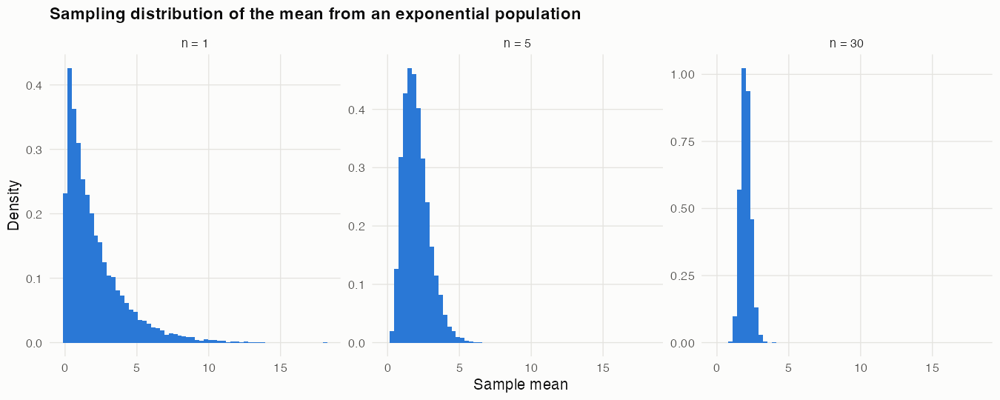
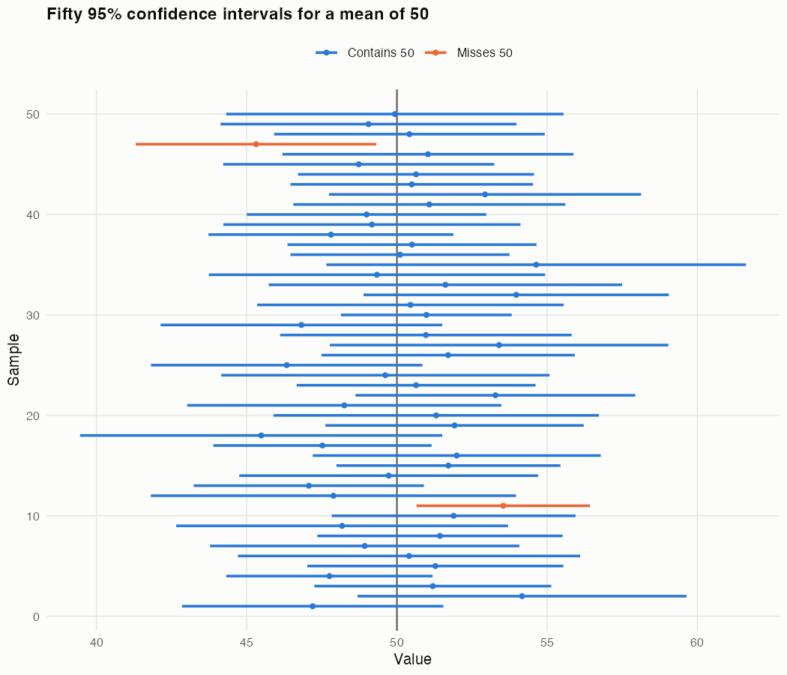
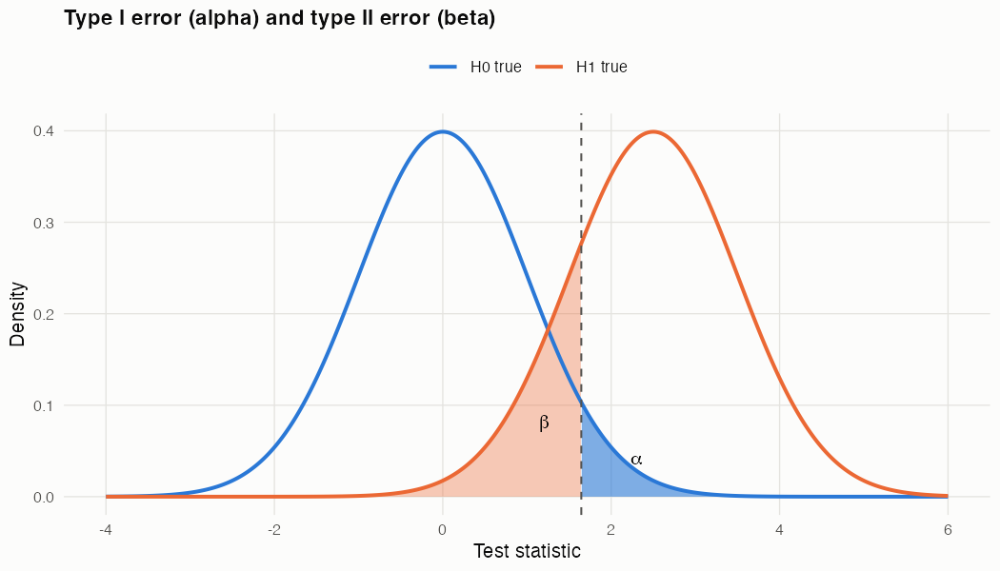

# Chapter 14 — Foundations of Statistical Inference

[Repository Guide](../../README.md) | [English](Concepts_Lecture.md) | [한국어](Concepts_Lecture.ko.md)

> **Last Updated:** 2026-11-19

> **Learning Objectives:**
> 1. Explain sampling distributions and the central limit theorem and compute standard errors
> 2. Construct confidence intervals for means and proportions and interpret the confidence level correctly
> 3. State null and alternative hypotheses and explain p-values, type I and type II errors, and power
> 4. Perform one-sample, two-sample, and paired t-tests and one-way analysis of variance in R and interpret the results
> 5. Perform chi-square goodness-of-fit and independence tests and correlation tests
> 6. Explain common misuses of p-values and the problem of multiple comparisons

---

## Table of Contents

- [1. Sampling Distributions and the Central Limit Theorem](#1-sampling-distributions-and-the-central-limit-theorem)
  - [1.1 Parameters and Statistics](#11-parameters-and-statistics)
  - [1.2 Sampling Distributions](#12-sampling-distributions)
  - [1.3 Expected Value and Variance of the Sample Mean](#13-expected-value-and-variance-of-the-sample-mean)
  - [1.4 The Central Limit Theorem](#14-the-central-limit-theorem)
  - [1.5 The Standard Error](#15-the-standard-error)
- [2. Confidence Intervals](#2-confidence-intervals)
  - [2.1 Intervals When the Population Standard Deviation Is Known](#21-intervals-when-the-population-standard-deviation-is-known)
  - [2.2 The t Distribution and Intervals When the Population Standard Deviation Is Unknown](#22-the-t-distribution-and-intervals-when-the-population-standard-deviation-is-unknown)
  - [2.3 The Meaning of the Confidence Level](#23-the-meaning-of-the-confidence-level)
  - [2.4 Confidence Intervals for a Proportion](#24-confidence-intervals-for-a-proportion)
  - [2.5 Interval Width and Sample Size](#25-interval-width-and-sample-size)
  - [2.6 Bootstrap Confidence Intervals](#26-bootstrap-confidence-intervals)
- [3. Hypothesis Testing](#3-hypothesis-testing)
  - [3.1 Null and Alternative Hypotheses](#31-null-and-alternative-hypotheses)
  - [3.2 Test Statistics and p-Values](#32-test-statistics-and-p-values)
  - [3.3 Significance Level and the Two Types of Error](#33-significance-level-and-the-two-types-of-error)
  - [3.4 Power and Sample Size](#34-power-and-sample-size)
  - [3.5 One-Sided and Two-Sided Tests](#35-one-sided-and-two-sided-tests)
  - [3.6 The Relationship Between Tests and Confidence Intervals](#36-the-relationship-between-tests-and-confidence-intervals)
- [4. t-Tests](#4-t-tests)
  - [4.1 The One-Sample t-Test](#41-the-one-sample-t-test)
  - [4.2 The Independent Two-Sample t-Test](#42-the-independent-two-sample-t-test)
  - [4.3 The Paired t-Test](#43-the-paired-t-test)
  - [4.4 Assumptions of the t-Test](#44-assumptions-of-the-t-test)
  - [4.5 Comparing the Means of Three or More Groups](#45-comparing-the-means-of-three-or-more-groups)
- [5. Chi-Square Tests](#5-chi-square-tests)
  - [5.1 Goodness-of-Fit Tests](#51-goodness-of-fit-tests)
  - [5.2 Tests of Independence](#52-tests-of-independence)
  - [5.3 Conditions on Expected Counts](#53-conditions-on-expected-counts)
  - [5.4 Comparing Two Proportions](#54-comparing-two-proportions)
- [6. Correlation Analysis](#6-correlation-analysis)
  - [6.1 The Pearson Correlation Coefficient](#61-the-pearson-correlation-coefficient)
  - [6.2 The Correlation Test](#62-the-correlation-test)
  - [6.3 Interpreting Correlation and Rank Correlation](#63-interpreting-correlation-and-rank-correlation)
- [7. Misuse of p-Values](#7-misuse-of-p-values)
  - [7.1 What a p-Value Does and Does Not Say](#71-what-a-p-value-does-and-does-not-say)
  - [7.2 Multiple Comparisons](#72-multiple-comparisons)
  - [7.3 Statistical Significance and Effect Size](#73-statistical-significance-and-effect-size)
  - [7.4 Selective Reporting and p-Hacking](#74-selective-reporting-and-p-hacking)
- [8. Common Mistakes in Statistical Inference](#8-common-mistakes-in-statistical-inference)
- [Concept Applications](#concept-applications)
- [Summary](#summary)
- [Self-Check Questions](#self-check-questions)
- [References](#references)

---

<br>

## 1. Sampling Distributions and the Central Limit Theorem

### 1.1 Parameters and Statistics

Statistical inference draws conclusions about a whole from part of the data. The whole of what one wants to know about is the **population**, and the part actually observed is the **sample**. Values that summarize a population, such as its mean $\mu$, standard deviation $\sigma$, proportion $\pi$, or regression coefficient $\beta$, are unknown constants called **parameters**. Values computed from a sample, such as the sample mean $\bar{x}$, the sample standard deviation $s$, the sample proportion $\hat{p}$, or the estimated regression coefficient $\hat{\beta}$, are **statistics**.

| Parameter (Population) | Statistic (Sample) |
|------|------|
| Mean $\mu$ | Sample mean $\bar{x} = \frac{1}{n}\sum x_i$ |
| Standard deviation $\sigma$ | Sample standard deviation $s = \sqrt{\frac{1}{n - 1}\sum (x_i - \bar{x})^2}$ |
| Proportion $\pi$ | Sample proportion $\hat{p}$ |
| Regression coefficient $\beta$ | Least squares estimate $\hat{\beta}$ |

*Table 1. Parameters and the statistics that estimate them*

The denominator of the sample standard deviation is $n - 1$ rather than $n$ because deviations are measured from the sample mean rather than the population mean, which biases the sum of squared deviations downward. Dividing by $n - 1$ makes the expected value of $s^2$ equal to $\sigma^2$. The denominator $n - 2$ of the residual standard error in Chapter 10, Section 2.8 has the same reason. For inference to be meaningful, the sample must represent the population, and the most basic way to achieve this is a **simple random sample**, in which every individual in the population has the same chance of being drawn. From a sample chosen by a particular criterion, like the selective reporting of Chapter 13, Section 1.5, no amount of careful calculation yields correct conclusions about the population.

### 1.2 Sampling Distributions

The value of a statistic changes each time a new sample is drawn. The distribution formed by a statistic when infinitely many samples of the same size are drawn is called its **sampling distribution**. The sampling distribution shows how much a statistic, which in practice is observed only once, can vary, and confidence intervals and hypothesis tests are all built on it.

Drawing samples repeatedly on a computer shows a sampling distribution directly. Taking an exponential distribution with mean 2 and standard deviation 2 as the population, samples of size 30 are drawn 10,000 times and the sample mean is computed each time.

```r
set.seed(2026)
mu <- 2; sigma <- 2   # exponential population with mean 2 and standard deviation 2
means <- replicate(10000, mean(rexp(30, rate = 1 / mu)))
round(c(mean_of_means = mean(means), sd_of_means = sd(means),
        theory_se = sigma / sqrt(30)), 4)
#> mean_of_means   sd_of_means     theory_se 
#>        1.9981        0.3628        0.3651
```

`rexp(30, rate = 1 / mu)` draws 30 values from an exponential distribution with mean `mu`, and `replicate(10000, ...)` repeats this 10,000 times to collect 10,000 sample means. The 10,000 sample means have a mean of 1.998, very close to the population mean 2, and a standard deviation of 0.363, almost equal to the theoretical value of Section 1.3, $\sigma/\sqrt{n} = 2/\sqrt{30} = 0.365$. `set.seed()` fixes the random numbers so that the same results can be reproduced.

### 1.3 Expected Value and Variance of the Sample Mean

When $X_1, \ldots, X_n$ are random variables drawn independently from a population with mean $\mu$ and variance $\sigma^2$, the expected value and variance of the sample mean $\bar{X} = \frac{1}{n}\sum X_i$ follow directly from the properties of expected values and variances.

```math
E(\bar{X}) = \frac{1}{n}\sum_{i=1}^{n} E(X_i) = \frac{1}{n} \cdot n\mu = \mu, \qquad
\mathrm{Var}(\bar{X}) = \frac{1}{n^2}\sum_{i=1}^{n} \mathrm{Var}(X_i) = \frac{1}{n^2} \cdot n\sigma^2 = \frac{\sigma^2}{n}
```

> **[Probability and Statistics]** The first formula follows from the linearity of expectation, $E(aX + bY) = aE(X) + bE(Y)$, and does not require independence. The second follows from $\mathrm{Var}(aX) = a^2\mathrm{Var}(X)$ and the property that the variance of a sum of independent random variables is the sum of their variances. When observations are correlated, covariance terms are added, so $\sigma^2/n$ does not hold, and using this formula as is for data with autocorrelation, such as the time series of Chapter 11, underestimates the uncertainty.

The first formula means that the sample mean is an **unbiased estimator** of the population mean, an estimator that hits the population mean on average. The second means that the spread of the sample mean shrinks in inverse proportion to the square root of the sample size. Quadrupling the sample halves the standard deviation of the sample mean, and multiplying it by 100 reduces it to a tenth. Doubling the precision requires four times as many observations.

### 1.4 The Central Limit Theorem

Section 1.3 gives only the mean and variance of the sample mean, not the shape of its distribution. Remarkably, whatever the distribution of the population, the distribution of the sample mean approaches a normal distribution when the sample is large.

> **Definition:** The **central limit theorem** states that for the mean $\bar{X}$ of $n$ independent observations from a population with mean $\mu$ and finite variance $\sigma^2$, the distribution of $(\bar{X} - \mu)/(\sigma/\sqrt{n})$ approaches the standard normal distribution as $n$ grows.



*Figure 1. Distribution of the sample mean from an exponential population by sample size*

Figure 1 shows the distribution of the sample mean for samples of size 1, 5, and 30, each drawn 10,000 times from a strongly right-skewed exponential distribution. With $n = 1$, the sample mean is a single observation, so its distribution is the same exponential as the population. With $n = 5$ the skewness decreases, and with $n = 30$ the distribution becomes an almost symmetric bell centered at the mean 2, and it also becomes narrower. Thanks to this theorem, probabilities about the sample mean can be computed with the normal distribution even when the population distribution is unknown, provided the sample is large enough.

The central limit theorem requires two conditions: the observations must be independent, and the population variance must be finite. How large "large enough" is depends on the shape of the population. For symmetric distributions 10-20 observations suffice, but for strongly skewed distributions or those with frequent extreme values several hundred may be needed. The common "30 or more" is only a rough rule of thumb.

### 1.5 The Standard Error

> **Definition:** The **standard error** is the standard deviation of the sampling distribution of a statistic and expresses how much the statistic varies from sample to sample.

The standard error of the sample mean is $\sigma/\sqrt{n}$. Since $\sigma$ is unknown, in practice $\mathrm{SE}(\bar{x}) = s/\sqrt{n}$, with the sample standard deviation $s$ in its place, is used. The sample proportion $\hat{p}$ is the mean of observations taking the values 0 and 1, so its standard error is $\sqrt{\hat{p}(1 - \hat{p})/n}$. The `Std. Error` attached to the regression coefficients of Chapter 10 and the logistic regression coefficients of Chapter 12 is likewise the standard error of each estimate.

```r
x <- mtcars$mpg
round(c(n = length(x), mean = mean(x), sd = sd(x), se = sd(x) / sqrt(length(x))), 3)
#>      n   mean     sd     se 
#> 32.000 20.091  6.027  1.065
```

The fuel efficiency of the 32 cars in mtcars has a mean of 20.09 mpg and a standard deviation of 6.03 mpg, and the standard error of the mean is $6.027/\sqrt{32} = 1.065$. The standard deviation and the standard error answer different questions. The standard deviation 6.03 is how much the fuel efficiency of individual cars is scattered around the mean, and the standard error 1.07 is how far the sample mean 20.09 may be from the population mean. As the sample grows, the standard deviation merely approaches the spread of the population and does not shrink, but the standard error shrinks in inverse proportion to $\sqrt{n}$.

---

<br>

## 2. Confidence Intervals

### 2.1 Intervals When the Population Standard Deviation Is Known

By the central limit theorem, $Z = (\bar{X} - \mu)/(\sigma/\sqrt{n})$ approximately follows the standard normal distribution. The interval holding the central 95% of the area of the standard normal distribution is $-1.96$ to $1.96$, so $P(-1.96 \leq Z \leq 1.96) = 0.95$, and solving this inequality for $\mu$ gives the following.

```math
P\left(\bar{X} - 1.96\frac{\sigma}{\sqrt{n}} \leq \mu \leq \bar{X} + 1.96\frac{\sigma}{\sqrt{n}}\right) = 0.95
```

Therefore $\bar{x} \pm 1.96\,\sigma/\sqrt{n}$ is a 95% confidence interval for $\mu$. In general, the interval with confidence level $1 - \alpha$ is $\bar{x} \pm z_{1-\alpha/2}\,\sigma/\sqrt{n}$, where $z_{1-\alpha/2}$ is the $1 - \alpha/2$ quantile of the standard normal distribution: 1.645, 1.960, and 2.576 for 90%, 95%, and 99% intervals. The half-width of the interval, $z_{1-\alpha/2}\,\sigma/\sqrt{n}$, is called the **margin of error**.

### 2.2 The t Distribution and Intervals When the Population Standard Deviation Is Unknown

In practice $\sigma$ is unknown and must be replaced by $s$, but $s$ is itself a random variable that varies from sample to sample, so $(\bar{X} - \mu)/(s/\sqrt{n})$ follows a distribution with heavier tails than the normal. If the population is normal, this statistic follows exactly the **t distribution** with $n - 1$ degrees of freedom. The t distribution is bell-shaped and symmetric about 0; its tails are heavier for fewer degrees of freedom, and it approaches the standard normal distribution as the degrees of freedom grow. The confidence interval is as follows.

```math
\bar{x} \pm t_{1-\alpha/2,\,n-1} \cdot \frac{s}{\sqrt{n}}
```

```r
n <- length(x); xbar <- mean(x); s <- sd(x)
tq <- qt(0.975, df = n - 1)
round(c(t_quantile = tq, lower = xbar - tq * s / sqrt(n), upper = xbar + tq * s / sqrt(n)), 3)
#> t_quantile      lower      upper 
#>      2.040     17.918     22.264
t.test(x)$conf.int
#> [1] 17.91768 22.26357
#> attr(,"conf.level")
#> [1] 0.95
qnorm(0.975)
#> [1] 1.959964
```

`qt(0.975, df = 31)` is the 97.5% quantile of the t distribution with 31 degrees of freedom, 2.040, slightly larger than the normal 1.960. The interval computed from the formula, 17.92-22.26 mpg, is the same as the `conf.int` reported by `t.test()`. The confidence intervals for regression coefficients in Chapter 10, Section 2.8 have the same structure, with only the degrees of freedom changed to $n - p - 1$.

### 2.3 The Meaning of the Confidence Level

Interpreting the 95% confidence interval 17.92-22.26 as "the probability that the population mean lies in this interval is 95%" is not accurate. The population mean is not a random variable but a fixed constant, so an interval computed once either contains the population mean or does not. The 95% is a property of the **procedure** that constructs the interval: if samples are drawn repeatedly and intervals constructed the same way, 95% of the intervals contain the population mean.

```r
set.seed(1)
covered <- replicate(10000, {
  smp <- rnorm(20, mean = 50, sd = 10)
  ci <- t.test(smp)$conf.int
  ci[1] <= 50 & 50 <= ci[2]
})
mean(covered)
#> [1] 0.9513
```

Drawing samples of size 20 from a normal population with mean 50 10,000 times and constructing 95% intervals, 95.13% of them actually contain 50. Figure 2 shows 50 of these intervals, of which 2 (orange) fail to contain 50.



*Figure 2. Fifty 95% confidence intervals constructed for a population mean of 50*

Note that the intervals differ in center (the sample mean) and width (which depends on the sample standard deviation). Which intervals missed 50 can be known only in a simulation where the population mean is known; in a real analysis, one cannot know whether one's interval belongs to the 95% or the 5%.

### 2.4 Confidence Intervals for a Proportion

For large $n$, the sampling distribution of the sample proportion $\hat{p}$ approaches a normal distribution with mean $\pi$ and standard error $\sqrt{\pi(1 - \pi)/n}$, so the 95% confidence interval is approximately $\hat{p} \pm 1.96\sqrt{\hat{p}(1 - \hat{p})/n}$. Suppose 56 of 100 randomly selected people support a policy.

```r
prop.test(x = 56, n = 100, p = 0.5, correct = FALSE)
#> 
#> 	1-sample proportions test without continuity correction
#> 
#> data:  56 out of 100, null probability 0.5
#> X-squared = 1.44, df = 1, p-value = 0.2301
#> alternative hypothesis: true p is not equal to 0.5
#> 95 percent confidence interval:
#>  0.4622810 0.6532797
#> sample estimates:
#>    p 
#> 0.56
```

`prop.test()` makes inferences about a proportion from the number of successes `x` and the number of trials `n`, and `correct = FALSE` means no continuity correction. The reported interval, 0.462-0.653, is a Wilson interval, slightly different from the simple formula above ($0.56 \pm 0.097$) and more accurate when the sample is small or the proportion is near 0 or 1. The estimated support is 56%, but the interval contains 50%, so this sample alone cannot establish that a majority supports the policy. The p-value 0.23 in the same output is the result of the test of Section 3.

### 2.5 Interval Width and Sample Size

The margin of error $z_{1-\alpha/2}\,\sigma/\sqrt{n}$ is determined by three factors. Raising the confidence level increases the quantile and widens the interval; a larger population spread $\sigma$ widens the interval; and increasing the sample size $n$ narrows it in inverse proportion to $\sqrt{n}$. Fixing a desired margin of error $E$, the required sample size can be found in reverse.

```math
n = \left(\frac{z_{1-\alpha/2}\,\sigma}{E}\right)^2
```

For a proportion, $\pi(1 - \pi)$ is at most 0.25, at $\pi = 0.5$, so a 95% interval with a margin of error of 3 percentage points requires $n = (1.96 \times 0.5/0.03)^2 \approx 1{,}067$. This is why opinion polls often survey a little over 1,000 people. This formula reflects only the random error of a randomly drawn sample; errors arising because nonrespondents differ systematically or because questions are biased do not shrink with a larger sample.

### 2.6 Bootstrap Confidence Intervals

The formula of Section 2.2 can be used only for statistics whose standard error formula is known, such as the sample mean. For statistics such as the median, whose standard error formula is complicated or unknown, the **bootstrap** is used. The bootstrap takes the observed sample as a stand-in for the population, repeatedly draws samples of the same size from it with replacement, and computes the statistic each time. The distribution of the statistics obtained in this way approximates the sampling distribution.

```r
set.seed(42)
x <- mtcars$mpg
boot_medians <- replicate(10000, median(sample(x, replace = TRUE)))
median(x)
#> [1] 19.2
round(sd(boot_medians), 3)
#> [1] 1.267
quantile(boot_medians, c(0.025, 0.975))
#>  2.5% 97.5% 
#> 16.55 21.40
```

`sample(x, replace = TRUE)` draws 32 values with replacement from the 32 values, so some values are drawn several times and some not at all. The median fuel efficiency is 19.2 mpg, and the standard deviation of the 10,000 bootstrap medians, 1.267, is the estimate of the standard error of the median. The **percentile interval**, which takes the 2.5% and 97.5% quantiles of the bootstrap distribution directly as the interval, is 16.55-21.40 mpg. The simulation of Section 1.2 built a sampling distribution when the population was known, and the bootstrap imitates the same thing with the sample when the population is unknown. The bootstrap relies on the assumption that the sample represents the population well, so with a very small sample the interval is inaccurate, and it does not work well for statistics driven by the extremes of the sample, such as the maximum.

---

<br>

## 3. Hypothesis Testing

### 3.1 Null and Alternative Hypotheses

Hypothesis testing is a procedure for judging whether data are consistent with a claim. First, two hypotheses are stated. The **null hypothesis** $H_0$ is the default position that there is no effect, no difference, or no relationship, and the **alternative hypothesis** $H_1$ or $H_a$ is the claim for which the researcher seeks evidence. For example, when testing the effect of a new drug, $H_0$ is "the mean effects of the new and existing drugs are the same" and $H_1$ is "the mean effects differ".

A test follows logic similar to a trial. Just as a defendant is presumed innocent until proven guilty, $H_0$ is assumed true until strong evidence that the data are inconsistent with it appears. If the evidence is sufficient, $H_0$ is **rejected**; otherwise, $H_0$ is **not rejected**. "Not rejected" does not mean that $H_0$ has been proven true, just as an acquittal in a trial means not a proof of innocence but a lack of evidence of guilt.

### 3.2 Test Statistics and p-Values

A **test statistic** summarizes in one number how far the data depart from $H_0$. For a test about a mean, it is $t = (\bar{x} - \mu_0)/(s/\sqrt{n})$, the difference between the sample mean and the mean $\mu_0$ under $H_0$ divided by the standard error. If $H_0$ is true, the distribution of this statistic (the **null distribution**) is known, so how rare the observed value is in that distribution can be computed.

> **Definition:** The **p-value** is the probability, assuming the null hypothesis is true, of a test statistic as extreme as or more extreme than the one observed.

A small p-value means that something rare under $H_0$ has occurred, which gives grounds to doubt $H_0$. The p-value on the order of $10^{-26}$ for the UC Berkeley data in Chapter 13, Section 4.3 meant that under the assumption that admission was unrelated to sex, the observed difference between the sexes practically could not occur. A p-value is not the probability that $H_0$ is true, a difference discussed again in Section 7.1.

### 3.3 Significance Level and the Two Types of Error

Before testing, a **significance level** $\alpha$, the criterion for rejecting $H_0$, is set, and $H_0$ is rejected if the p-value is smaller than $\alpha$. $\alpha = 0.05$ is commonly used, but it is only a convention, not a constant of nature. The conclusion of a test combines with the true state in the following four ways.

| Conclusion \ Truth | $H_0$ True | $H_0$ False |
|------|------|------|
| Reject $H_0$ | Type I error (probability $\alpha$) | Correct decision (probability $1 - \beta$, power) |
| Do not reject $H_0$ | Correct decision (probability $1 - \alpha$) | Type II error (probability $\beta$) |

*Table 2. Conclusions of a hypothesis test and the two types of error*

A **type I error** is rejecting $H_0$ when it is true, a false positive that declares a nonexistent effect. A **type II error** is failing to reject $H_0$ when it is false, a false negative that misses an existing effect. In terms of a trial, a type I error convicts an innocent person and a type II error lets a criminal go free. The significance level $\alpha$ directly sets the probability of a type I error. Simulating a situation in which $H_0$ is true confirms this.

```r
set.seed(7)
p_null <- replicate(10000, t.test(rnorm(20), rnorm(20))$p.value)
mean(p_null < 0.05)
#> [1] 0.049
```

Both groups were drawn from the same standard normal distribution, so $H_0$ (the two means are equal) is true. Even so, in 4.9% of the 10,000 tests the p-value came out below 0.05, wrongly rejecting $H_0$. When $H_0$ is true, p-values are uniformly distributed between 0 and 1, so the probability that a p-value is below 0.05 is exactly 5%. This is what the significance level means.



*Figure 3. Probabilities of type I and type II errors in a one-sided test*

Figure 3 overlays the distribution of the test statistic under $H_0$ (blue, mean 0) and under $H_1$ (orange, mean 2.5). A one-sided test at the 5% significance level rejects $H_0$ when the statistic exceeds 1.645. The area of the blue curve to the right of 1.645 is $\alpha = 0.05$, and the area of the orange curve to the left of 1.645 is $\beta = P(Z < 1.645 - 2.5) = 0.196$. Moving the cutoff to the right reduces $\alpha$ but increases $\beta$, so with a fixed sample size the two errors cannot be reduced at the same time.

### 3.4 Power and Sample Size

> **Definition:** The **power** of a test is the probability $1 - \beta$ of correctly rejecting the null hypothesis when the alternative hypothesis is true.

In the situation of Figure 3, the power is $1 - 0.196 = 0.804$. Power is determined by four factors: it is higher when the true effect is larger, the spread of the data is smaller, the sample is larger, and the significance level is larger. When designing a study, the smallest effect size regarded as meaningful is fixed, and the sample size needed to detect that effect with a power of about 80% is computed in advance.

```r
power.t.test(n = 20, delta = 5, sd = 10, sig.level = 0.05)$power
#> [1] 0.3377084
power.t.test(delta = 5, sd = 10, sig.level = 0.05, power = 0.8)$n
#> [1] 63.76576
```

`power.t.test()` computes the power of a two-sample t-test or the required sample size. When the difference between the two group means is 5 and the standard deviation is 10, 20 people per group give a power of only 34%, missing a real effect two times out of three. A power of 80% requires 64 people per group. A non-significant result from a low-powered study may mean not that there is no effect but that the study lacked the ability to find it.

### 3.5 One-Sided and Two-Sided Tests

If the alternative hypothesis is "different" ($\mu \neq \mu_0$), the test is a **two-sided test** that treats both tails as extreme; if it is "greater" ($\mu > \mu_0$) or "less" ($\mu < \mu_0$), it is a **one-sided test** that looks at one tail only. For the same statistic, the p-value of a one-sided test is half that of a two-sided test. A one-sided test is used only when it was decided before seeing the data that an effect in the opposite direction is theoretically impossible or of no interest at all. Switching, after seeing the data, to a one-sided test in the direction of the observed effect to halve the p-value is the p-hacking of Section 7.4. R's test functions set the direction with `alternative = "two.sided"` (the default), `"greater"`, or `"less"`.

### 3.6 The Relationship Between Tests and Confidence Intervals

A two-sided test at significance level $\alpha$ and a confidence interval with confidence level $1 - \alpha$ show the same information in different ways. If $\mu_0$ lies outside the 95% confidence interval, $H_0: \mu = \mu_0$ is rejected by a two-sided test at the 5% level, and if it lies inside, it is not rejected. The interval for the support rate in Section 2.4, 0.462-0.653, contains 0.5, and accordingly the test p-value in the same output, 0.23, exceeds 0.05.

A confidence interval gives more information than a test. A test gives only the conclusion "not zero", but a confidence interval also shows how large the effect might be. Whether the interval barely excludes zero, and whether it is wide or narrow, greatly changes the weight of the conclusion, so results are best reported with the effect estimate and its confidence interval alongside the p-value.

---

<br>

## 4. t-Tests

### 4.1 The One-Sample t-Test

This tests whether the mean of one population equals a particular value $\mu_0$. The test statistic is $t = (\bar{x} - \mu_0)/(s/\sqrt{n})$, which under $H_0$ follows a t distribution with $n - 1$ degrees of freedom. Test whether the mean fuel efficiency of the mtcars cars is 20 mpg.

```r
t.test(mtcars$mpg, mu = 20)
#> 
#> 	One Sample t-test
#> 
#> data:  mtcars$mpg
#> t = 0.08506, df = 31, p-value = 0.9328
#> alternative hypothesis: true mean is not equal to 20
#> 95 percent confidence interval:
#>  17.91768 22.26357
#> sample estimates:
#> mean of x 
#>  20.09062
```

$t = (20.091 - 20)/1.065 = 0.085$, so the sample mean lies only 0.09 standard errors from 20, and the p-value is 0.93. The hypothesis that the mean fuel efficiency is 20 mpg is therefore not rejected. This is the same conclusion as the 95% confidence interval 17.92-22.26 containing 20 (Section 3.6).

### 4.2 The Independent Two-Sample t-Test

This compares the means of two mutually independent groups. $H_0: \mu_1 = \mu_2$, and the test statistic is the difference between the two sample means divided by the standard error of that difference.

```math
t = \frac{\bar{x}_1 - \bar{x}_2}{\sqrt{s_1^2/n_1 + s_2^2/n_2}}
```

This test, which does not assume equal variances in the two groups, is called **Welch's t-test**, and its degrees of freedom are computed by the Welch-Satterthwaite approximation, so they need not be an integer. R's `t.test()` performs Welch's test by default, and the classical test assuming equal variances is requested with `var.equal = TRUE`. Compare the fuel efficiency of cars with automatic (`am = 0`) and manual (`am = 1`) transmissions.

```r
t.test(mpg ~ am, data = mtcars)
#> 
#> 	Welch Two Sample t-test
#> 
#> data:  mpg by am
#> t = -3.7671, df = 18.332, p-value = 0.001374
#> alternative hypothesis: true difference in means between group 0 and group 1 is not equal to 0
#> 95 percent confidence interval:
#>  -11.280194  -3.209684
#> sample estimates:
#> mean in group 0 mean in group 1 
#>        17.14737        24.39231
```

The formula `mpg ~ am` means splitting `mpg` by the two groups of `am`. The mean fuel efficiency is 17.15 mpg for automatic cars and 24.39 mpg for manual cars, and the 95% confidence interval for the difference of $-7.24$ is $-11.28$ to $-3.21$. The p-value 0.0014 means that a difference this large would be very unlikely under the hypothesis that the two group means are equal. But these are observational, not experimental, data, so other differences, such as manual cars generally being lighter with smaller engines, may cause the difference in fuel efficiency. To take weight into account, use the multiple regression of Chapter 10.

### 4.3 The Paired t-Test

When the same individuals are measured twice or paired individuals are compared, the two measurements are not independent, so the difference within each pair, $d_i = x_{i2} - x_{i1}$, is computed and a one-sample t-test is applied to whether its mean is 0. R's built-in data `sleep` record the increase in hours of sleep (`extra`) when each of 10 patients was given two sleeping drugs.

```r
extra1 <- sleep$extra[sleep$group == 1]
extra2 <- sleep$extra[sleep$group == 2]
t.test(extra2, extra1, paired = TRUE)
#> 
#> 	Paired t-test
#> 
#> data:  extra2 and extra1
#> t = 4.0621, df = 9, p-value = 0.002833
#> alternative hypothesis: true mean difference is not equal to 0
#> 95 percent confidence interval:
#>  0.7001142 2.4598858
#> sample estimates:
#> mean difference 
#>            1.58
t.test(extra2, extra1)$p.value
#> [1] 0.07939414
```

`paired = TRUE` treats the values at the same position of the two vectors as a pair and tests their differences. The second drug increased sleep by 1.58 hours more than the first on average, with a p-value of 0.0028. Wrongly analyzing the same data with an independent two-sample test gives a non-significant p-value of 0.079. Patients differ greatly in how much they sleep to begin with, and leaving that difference in inflates the noise and buries the drug's effect. A paired design removes the variation between individuals in the process of taking differences and so achieves higher power with the same number of observations.

### 4.4 Assumptions of the t-Test

The t-test is exact under the following assumptions.

1. **Independence:** The observations (the pair differences, for paired samples) are mutually independent. This is the most important assumption; if it fails, the standard error is wrong and the whole conclusion collapses.
2. **Normality:** The population (the differences, for paired samples) is normally distributed. With a large sample, the central limit theorem (Section 1.4) keeps the results from going far wrong even when this assumption fails. With a small sample, check with a Q-Q plot (Chapter 10, Section 5.3), and if the skewness is severe, use a log transformation or the rank-based Wilcoxon test (`wilcox.test()`).
3. **Variance:** The classical two-sample test assumes equal variances in the two groups, but Welch's test does not need this assumption. When it is unknown whether the variances are equal, Welch's test is the safe choice.

> **Caution:** A single outlier changes both the mean and the standard deviation greatly and can overturn the result of a t-test. Before testing, check the data with a box plot (Chapter 9, Section 4.5), and if there is an outlier, check whether it is a data error and compare with the result without it.

### 4.5 Comparing the Means of Three or More Groups

Comparing the means of three or more groups by repeating t-tests on each pair raises the multiple comparison problem of Section 7.2. Three groups give 3 pairs, and five groups give 10. Instead, **one-way analysis of variance** (one-way ANOVA) tests at once the hypothesis that all group means are equal, $H_0: \mu_1 = \mu_2 = \cdots = \mu_k$. Analysis of variance splits the total variation into variation between group means and variation within groups. With $n_j$ the size of group $j$, $\bar{y}_j$ its mean, and $\bar{y}$ the overall mean, this is as follows.

```math
\sum_{j=1}^{k}\sum_{i=1}^{n_j} (y_{ij} - \bar{y})^2 = \underbrace{\sum_{j=1}^{k} n_j (\bar{y}_j - \bar{y})^2}_{\text{SSB}} + \underbrace{\sum_{j=1}^{k}\sum_{i=1}^{n_j} (y_{ij} - \bar{y}_j)^2}_{\text{SSW}}, \qquad
F = \frac{\text{SSB}/(k - 1)}{\text{SSW}/(n - k)}
```

If $H_0$ is true, the group means scatter only by chance variation, so $F$ takes values near 1, and if the differences between group means are large relative to the spread within groups, $F$ becomes large. Under $H_0$, $F$ follows an F distribution with $(k - 1, n - k)$ degrees of freedom. R's built-in `PlantGrowth` is experimental data in which 10 plants each were grown under a control (`ctrl`) and two treatment conditions (`trt1`, `trt2`) and their dried weight was measured.

```r
aggregate(weight ~ group, data = PlantGrowth, FUN = mean)
#>   group weight
#> 1  ctrl  5.032
#> 2  trt1  4.661
#> 3  trt2  5.526
fit <- aov(weight ~ group, data = PlantGrowth)
summary(fit)
#>             Df Sum Sq Mean Sq F value Pr(>F)  
#> group        2  3.766  1.8832   4.846 0.0159 *
#> Residuals   27 10.492  0.3886                 
#> ---
#> Signif. codes:  0 '***' 0.001 '**' 0.01 '*' 0.05 '.' 0.1 ' ' 1
pairwise.t.test(PlantGrowth$weight, PlantGrowth$group, p.adjust.method = "bonferroni")
#> 
#> 	Pairwise comparisons using t tests with pooled SD 
#> 
#> data:  PlantGrowth$weight and PlantGrowth$group 
#> 
#>      ctrl  trt1 
#> trt1 0.583 -    
#> trt2 0.263 0.013
#> 
#> P value adjustment method: bonferroni
```

The three group means are 5.03, 4.66, and 5.53. In the `group` row of `summary(fit)`, SSB is 3.766 with $3 - 1 = 2$ degrees of freedom, and in the `Residuals` row, SSW is 10.492 with $30 - 3 = 27$ degrees of freedom. $F = (3.766/2)/(10.492/27) = 4.85$ with a p-value of 0.016, so the hypothesis that all three means are equal is rejected. The F-test, however, does not say which groups differ, so a follow-up of pairwise comparisons with the Bonferroni correction (`pairwise.t.test()`) shows that only the difference between treatment 1 and treatment 2 is significant (adjusted p-value 0.013). Analysis of variance is the same model as a regression with dummy variables for the groups as predictors (Chapter 10, Section 3.8), and this F-test follows the same principle as the F-test of Chapter 10, Section 4.7. Its assumptions are also those of the t-test: the observations are independent, each group is normally distributed, and the groups have equal variances.

---

<br>

## 5. Chi-Square Tests

### 5.1 Goodness-of-Fit Tests

A **goodness-of-fit test** tests whether the observed counts of categorical data agree with some theoretical proportions. With $O_i$ the observed counts of $k$ categories and $E_i = n\pi_i$ the expected counts computed from the proportions under the null hypothesis, the test statistic is as follows.

```math
\chi^2 = \sum_{i=1}^{k} \frac{(O_i - E_i)^2}{E_i}
```

If the observed counts are close to the expected counts, $\chi^2$ is small, and if they differ greatly, it is large. When the null hypothesis is true and the expected counts are large enough, $\chi^2$ approximately follows a chi-square distribution with $k - 1$ degrees of freedom. The degrees of freedom are $k - 1$ rather than $k$ because the counts must sum to $n$, so only $k - 1$ of them can vary freely. With hypothetical data in which a die thrown 120 times shows each face 14, 22, 18, 25, 21, and 20 times, test whether the die is fair.

```r
observed <- c(14, 22, 18, 25, 21, 20)
chisq.test(observed, p = rep(1/6, 6))
#> 
#> 	Chi-squared test for given probabilities
#> 
#> data:  observed
#> X-squared = 3.5, df = 5, p-value = 0.6234
```

`p = rep(1/6, 6)` is the null hypothesis that each of the six faces has probability 1/6. The expected counts are all 20, so $\chi^2 = (36 + 4 + 4 + 25 + 1 + 0)/20 = 3.5$, and the p-value at 5 degrees of freedom is 0.62. The faces differ from 14 to 25 occurrences, but variation of this size is common even for a fair die, so the hypothesis that the die is fair is not rejected. Finding a truly unfair die, like the asymmetric ancient dice of Chapter 13, Section 2.1, requires far more throws than this.

### 5.2 Tests of Independence

To test whether two categorical variables are independent, the expected count under independence is computed for each cell of the cross-tabulation. With $R_i$ the total of row $i$, $C_j$ the total of column $j$, and $n$ the grand total, the expected count of cell $(i, j)$ under independence is $E_{ij} = R_i C_j / n$. The test statistic is $\sum (O_{ij} - E_{ij})^2/E_{ij}$ over all cells, with $(r - 1)(c - 1)$ degrees of freedom. R's built-in `UCBAdmissions` contains the data of the six departments with the most applicants from the UC Berkeley graduate admissions data of Chapter 13, Section 4 [1]. Some cells differ slightly from the table of Chapter 13. Combining the departments gives a cross-tabulation of sex and admission.

```r
tab <- apply(UCBAdmissions, c(1, 2), sum)
tab
#>           Gender
#> Admit      Male Female
#>   Admitted 1198    557
#>   Rejected 1493   1278
res <- chisq.test(tab, correct = FALSE)
res
#> 
#> 	Pearson's Chi-squared test
#> 
#> data:  tab
#> X-squared = 92.205, df = 1, p-value < 2.2e-16
round(res$expected, 1)
#>           Gender
#> Admit        Male Female
#>   Admitted 1043.5  711.5
#>   Rejected 1647.5 1123.5
```

`UCBAdmissions` is a three-dimensional table of admission, sex, and department, and `apply(..., c(1, 2), sum)` sums over the third dimension, the department, to make a 2×2 table. Of all 4,526 applicants, 1,755 (38.8%) were admitted, so if sex and admission were independent, $2{,}691 \times 1{,}755/4{,}526 = 1{,}043.5$ of the 2,691 men should have been admitted. In fact 1,198 were. With $\chi^2 = 92.2$ and a p-value below $2.2 \times 10^{-16}$ at 1 degree of freedom, sex and admission are not independent in the combined data. The degrees of freedom of a 2×2 table are $(2 - 1)(2 - 1) = 1$.

```r
round(sapply(1:6, function(d) chisq.test(UCBAdmissions[, , d], correct = FALSE)$p.value), 4)
#> [1] 0.0000 0.6145 0.3854 0.5852 0.3171 0.5354
```

Testing each department separately, however, only department A is significant (and in department A women have the higher admission rate), while the other five departments have p-values of 0.3 or more. The strong association in the combined table is a result of the Simpson's paradox seen in Chapter 13, Section 4.5, and a test of independence that ignores a confounding variable also leads to a wrong conclusion.

### 5.3 Conditions on Expected Counts

The chi-square approximation is accurate only when the expected counts are large enough. A commonly used criterion is that every cell should have an expected count of at least 5. If some cells have small expected counts, merge categories, or, for a 2×2 table, use **Fisher's exact test** (`fisher.test()`), which computes exact probabilities without approximation. Computing the p-value of the UC Berkeley data with the hypergeometric distribution in Chapter 13, Section 4.3 is precisely the principle of Fisher's test. Note that the condition concerns the expected counts, not the observed counts. In addition, `chisq.test()` applies a continuity correction (`correct = TRUE`) by default for 2×2 tables, which was turned off in the example above to make comparison with the formula easy.

### 5.4 Comparing Two Proportions

A test of independence for a 2×2 table is the same as a test of whether the proportions of two groups are equal. In the data of Section 5.2, the admission rate is $1{,}198/2{,}691 = 0.445$ for men and $557/1{,}835 = 0.304$ for women.

```r
prop.test(x = c(1198, 557), n = c(2691, 1835), correct = FALSE)
#> 
#> 	2-sample test for equality of proportions without continuity correction
#> 
#> data:  c(1198, 557) out of c(2691, 1835)
#> X-squared = 92.205, df = 1, p-value < 2.2e-16
#> alternative hypothesis: two.sided
#> 95 percent confidence interval:
#>  0.1134470 0.1698439
#> sample estimates:
#>    prop 1    prop 2 
#> 0.4451877 0.3035422
```

Given the numbers of successes and trials of two groups as vectors, `prop.test()` tests whether the two proportions are equal. The test statistic 92.205 is exactly the chi-square statistic of Section 5.2. The advantage of this test is that it also gives the 95% confidence interval for the difference in proportions of 0.142, 0.113-0.170. As Section 3.6 said, it goes beyond the conclusion "there is a difference" and shows its size, around 14 percentage points. This difference, too, is a comparison that ignores departments, so it must be interpreted together with the department-level results of Section 5.2.

---

<br>

## 6. Correlation Analysis

### 6.1 The Pearson Correlation Coefficient

The direction and strength of the linear relationship between two numeric variables are measured by the **Pearson correlation coefficient**.

```math
r = \frac{\sum_{i=1}^{n} (x_i - \bar{x})(y_i - \bar{y})}{\sqrt{\sum_{i=1}^{n} (x_i - \bar{x})^2 \sum_{i=1}^{n} (y_i - \bar{y})^2}}
```

$r$ takes values between $-1$ and 1. $r = 1$ or $-1$ means that all points lie on a single line with positive or negative slope, and $r = 0$ means no linear relationship. $r$ does not depend on units, so it is unchanged by changing the scales of $x$ and $y$, and it is also unchanged by swapping $x$ and $y$. In simple linear regression $R^2 = r^2$ (Chapter 10, Section 4.5), and the regression slope is $\hat{\beta}_1 = r \cdot s_y/s_x$. The sample autocorrelation coefficient of Chapter 11, Section 5.4 is the correlation coefficient between lagged values of the same series.

### 6.2 The Correlation Test

With $\rho$ the population correlation, $H_0: \rho = 0$ is tested with the following statistic. If the two variables follow a bivariate normal distribution, this statistic follows a t distribution with $n - 2$ degrees of freedom under $H_0$.

```math
t = \frac{r\sqrt{n - 2}}{\sqrt{1 - r^2}}
```

R's built-in `cars` records the speed (mph) and stopping distance (ft) of 50 cars in the 1920s.

```r
cor.test(cars$speed, cars$dist)
#> 
#> 	Pearson's product-moment correlation
#> 
#> data:  cars$speed and cars$dist
#> t = 9.464, df = 48, p-value = 1.49e-12
#> alternative hypothesis: true correlation is not equal to 0
#> 95 percent confidence interval:
#>  0.6816422 0.8862036
#> sample estimates:
#>       cor 
#> 0.8068949
r <- cor(cars$speed, cars$dist); n <- nrow(cars)
c(r = r, t = r * sqrt(n - 2) / sqrt(1 - r^2))
#>         r         t 
#> 0.8068949 9.4639900
```

The correlation coefficient is 0.807, and $t = 0.807\sqrt{48}/\sqrt{1 - 0.651} = 9.46$ computed from the formula equals the value from `cor.test()`. The p-value is $1.5 \times 10^{-12}$, so the hypothesis of no correlation between speed and stopping distance is rejected. The 95% confidence interval for the correlation, 0.68-0.89, is computed with Fisher's $z$ transformation. This test gives the same result as the t-test of whether the slope is 0 in simple linear regression.

### 6.3 Interpreting Correlation and Rank Correlation

When interpreting a correlation coefficient, keep the following in mind.

- **It measures only linear relationships.** Even with $r = 0$, there may be a curved relationship. Anscombe's four data sets in Chapter 10, Section 5.7 all have a correlation of 0.816 but completely different relationships. A correlation coefficient must always be viewed together with a scatterplot.
- **It is sensitive to outliers.** A single extreme point can raise or lower the correlation coefficient greatly.
- **Correlation is not causation.** Two variables may move together because a third variable (a confounder) affects both (Chapter 12, Section 5.6).
- **Significance and strength differ.** With a large sample, even a weak correlation such as $r = 0.05$ has a very small p-value. How strong a relationship is must be judged by the size of $r$ and its confidence interval.

To measure a monotonic relationship, in which one variable consistently increases or decreases as the other increases even if the relationship is not a straight line, use the **Spearman rank correlation coefficient**, which computes the correlation on ranks instead of values. Because it uses ranks, it is also less sensitive to outliers. The Spearman correlation of the `cars` data, obtained with `cor.test(..., method = "spearman")`, is 0.830.

---

<br>

## 7. Misuse of p-Values

### 7.1 What a p-Value Does and Does Not Say

The p-value is the most widely used and most often misinterpreted statistic in scientific research. In 2016 the American Statistical Association (ASA) issued a statement on the proper use and interpretation of p-values and set out the following six principles [2].

1. P-values can indicate how incompatible the data are with a specified statistical model.
2. P-values do not measure the probability that the studied hypothesis is true, or the probability that the data were produced by random chance alone.
3. Scientific conclusions and business or policy decisions should not be based only on whether a p-value passes a specific threshold.
4. Proper inference requires full reporting and transparency.
5. A p-value, or statistical significance, does not measure the size of an effect or the importance of a result.
6. By itself, a p-value does not provide a good measure of evidence regarding a model or hypothesis.

The second principle has the same structure as the prosecutor's fallacy of Chapter 13, Section 3.5. A p-value is $P(\text{data this extreme} \mid H_0)$, not $P(H_0 \mid \text{data})$. Reading p = 0.03 as "the probability that the null hypothesis is true is 3%" or "the probability that the result is due to chance is 3%" reverses the direction of a conditional probability. The probability that $H_0$ is true can be computed only with a prior probability, as with Bayes' theorem in Chapter 13, and a hypothesis that was implausible to begin with may well remain false even with p = 0.03.

A p-value larger than 0.05 is not evidence that "there is no effect" either. As in Section 3.4, in a low-powered study the p-value easily comes out large even when a real effect exists. Moreover, p = 0.049 and p = 0.051 represent almost the same strength of evidence, yet splitting them at 0.05 into "significant" and "not significant" makes them look like opposite conclusions. This dichotomy is what the third principle warns against.

### 7.2 Multiple Comparisons

When many hypotheses are tested at once, the probability that some of them come out significant by chance grows, even if all the null hypotheses are true. Performing 20 independent tests at significance level 0.05 gives a probability of $1 - 0.95^{20} = 0.64$ that at least one is wrongly significant. Simulating a situation in which all null hypotheses are true confirms this.

```r
set.seed(11)
p20 <- replicate(20, t.test(rnorm(30), rnorm(30))$p.value)
round(sort(p20)[1:3], 4)
#> [1] 0.0320 0.1070 0.1807
sum(p20 < 0.05)
#> [1] 1
1 - 0.95^20
#> [1] 0.6415141
round(sort(p.adjust(p20, method = "bonferroni"))[1:3], 4)
#> [1] 0.6407 1.0000 1.0000
```

In all 20 tests the two groups came from the same distribution, yet the smallest p-value is 0.032, so one came out "significant". Reporting this one result alone makes it look as if a nonexistent effect had been discovered. The **Bonferroni correction**, the simplest way to deal with this problem, divides the significance level by the number of tests $m$ and uses $\alpha/m$ as the criterion, or equivalently multiplies each p-value by $m$ (capping at 1). Correcting with `p.adjust(..., method = "bonferroni")` makes the smallest p-value $0.032 \times 20 = 0.64$, no longer significant. The Bonferroni correction is conservative and loses much power, so with many tests, methods that control the false discovery rate (`method = "BH"`) are also used. The F-test of Chapter 10, Section 4.7, which tests all predictors at once instead of running a separate t-test for each, likewise avoids this problem.

### 7.3 Statistical Significance and Effect Size

A p-value reflects both the size of an effect and the size of the sample. Therefore, with a very large sample, even a practically negligible effect gets a very small p-value.

```r
set.seed(3)
a <- rnorm(100000, mean = 100, sd = 15)
b <- rnorm(100000, mean = 100.3, sd = 15)
tt <- t.test(a, b)
c(diff = mean(b) - mean(a), p = tt$p.value, d = (mean(b) - mean(a)) / 15)
#>         diff            p            d 
#> 2.848709e-01 2.249087e-05 1.899139e-02
```

Drawing 100,000 people each from two groups with means 100 and 100.3 and standard deviation 15, the difference in means is 0.28, only about 2% of the standard deviation, yet the p-value is 0.00002, "highly significant". On a scale with a standard deviation of 15, such as intelligence test scores, a difference of 0.3 points has no practical meaning. The size of an effect can be expressed as the **standardized effect size** $d = (\bar{x}_1 - \bar{x}_2)/s$, the difference in means divided by the standard deviation, which is $d = 0.019$ in this example. As the fifth principle says, results should be reported not with p-values alone but with the effect estimate, its confidence interval, and a judgment of whether its size is practically meaningful.

### 7.4 Selective Reporting and p-Hacking

The fourth principle is that the whole analysis must be reported. If researchers try many analyses and report only those that come out significant, the multiple comparison problem of Section 7.2 hides out of sight. Adjusting an analysis while looking at the data, by changing variables, dropping outliers, choosing subgroups, or switching to one-sided tests, until the p-value falls below 0.05 is called **p-hacking** or data dredging. When this combines with the **file-drawer effect**, in which only studies with significant results are published while non-significant ones stay in the drawer, the published literature as a whole shows larger effects than actually exist. This is the selective reporting of Chapter 13, Section 1.5 happening in the scientific literature.

To reduce these problems, fix the hypotheses, main analyses, and sample size before seeing the data (preregistration), report every analysis tried and its results, and confirm important results by replication with new data. The statement in Chapter 10, Section 6.4 that p-values after variable selection are optimistic and the statement in Chapter 12, Section 6.6 that the data used to choose a threshold should be separate from the data used to evaluate it rest on the same principle. A hypothesis chosen by looking at data cannot be tested with the same data.

---

<br>

## 8. Common Mistakes in Statistical Inference

- **Confusing the standard deviation with the standard error.** The standard deviation is the spread of individual observations, and the standard error is the variability of an estimate (Section 1.5). If a graph does not state which one its error bars show, readers misjudge the size of differences.
- **Interpreting a confidence interval as the probability that it contains the parameter.** The confidence level is a property of the procedure that constructs intervals, not a probability about an interval computed once (Section 2.3).
- **Concluding that a difference is not significant because the two groups' confidence intervals overlap.** The standard error of the difference between two means is $\sqrt{\mathrm{SE}_1^2 + \mathrm{SE}_2^2}$, which is smaller than $\mathrm{SE}_1 + \mathrm{SE}_2$. Two 95% intervals can therefore overlap slightly while the difference is significant at the 5% level, and judging the difference requires the confidence interval or test of the difference itself.
- **Reading a p-value as the probability that the null hypothesis is true.** A p-value only measures how rare the data are under the null hypothesis (Section 7.1).
- **Taking a non-significant result as evidence of no effect.** With low power, the null hypothesis is not rejected even when a real effect exists (Section 3.4). To claim no effect, check whether the confidence interval rules out every effect of meaningful size.
- **Analyzing paired data as independent samples.** Analyzing data that measure the same individuals twice with an independent two-sample test loses power (Section 4.3). Conversely, pairing up two unrelated groups for a paired test is also wrong.
- **Choosing a test without checking its conditions.** Using a chi-square test on a table with small expected counts (Section 5.3), or a test that assumes independence on an autocorrelated time series, gives wrong p-values.
- **Running many tests and reporting only the significant ones.** False positives grow with the number of tests, so state the number of hypotheses tested and correct when needed (Section 7.2).
- **Interpreting a significant difference in observational data as causal.** Like transmission and fuel efficiency in Section 4.2 or sex and admission in Section 5.2, even a significant difference may be due to a confounder. Causation can be claimed only with a randomized experiment or an analysis that accounts for confounders.

---

<br>

## Concept Applications

**True/False Check:**

| Statement | Judgment and Reason |
|:-----|:-----|
| Quadrupling the sample size halves the standard error of the sample mean. | **T.** The standard error is $\sigma/\sqrt{n}$, so it becomes $\sqrt{4} = 2$ times smaller. |
| By the central limit theorem, a large sample makes the population distribution normal. | **F.** It is the distribution of the sample mean that approaches normality; the population distribution does not change. |
| The 95% confidence interval (17.9, 22.3) means that the probability that the population mean lies in this interval is 95%. | **F.** The 95% is the proportion of intervals made by the same method that contain the population mean; an interval computed once either contains it or does not. |
| A p-value of 0.03 means that the probability that the null hypothesis is true is 3%. | **F.** A p-value is the probability of data this extreme under the null hypothesis, not the probability that the null hypothesis is true. |
| When the null hypothesis is true, a test at significance level 0.05 wrongly rejects it with probability about 5%. | **T.** The significance level is the probability of a type I error, and the simulation also gave 4.9%. |
| A p-value of 0.2 proves that there is no effect. | **F.** The null hypothesis was merely not rejected, and with low power the p-value can be large even when a real effect exists. |
| Analyzing the same data with a paired test and with an independent two-sample test can give different p-values. | **T.** The paired test removes variation between individuals, so for the `sleep` data the p-values differed greatly, 0.0028 and 0.079. |
| A correlation coefficient of 0 means that the two variables have no relationship at all. | **F.** The correlation coefficient measures only linear relationships, so a curved relationship may exist. |

---

<br>

## Summary

| Concept | Key Summary |
|---------|-----------|
| Parameters and statistics | A parameter is an unknown constant summarizing a population, and a statistic is a value computed from a sample to estimate it. |
| Sampling distribution | It is the distribution a statistic forms when samples of the same size are drawn repeatedly, and it is the basis of inference. |
| Central limit theorem | For a population with finite variance, the distribution of the sample mean approaches normality when the sample is large. |
| Standard error | It is the standard deviation of the sampling distribution of a statistic, $s/\sqrt{n}$ for the sample mean. |
| Confidence interval | It is the estimate ± quantile × standard error, and the confidence level is the proportion of times the procedure captures the parameter. |
| Bootstrap | It approximates the sampling distribution of a statistic by resampling the sample with replacement, for intervals of statistics without a formula. |
| t distribution | It is used when the sample standard deviation replaces the population standard deviation, with heavier tails for fewer degrees of freedom. |
| Null and alternative hypotheses | The null hypothesis is the default position of no effect, and the alternative is the claim for which evidence is sought. |
| p-value | It is the probability, under the null hypothesis, of a result as extreme as or more extreme than the one observed. |
| Two types of error | A type I error rejects a true null hypothesis (probability $\alpha$), and a type II error fails to reject a false one (probability $\beta$). |
| Power | It is the probability $1 - \beta$ of rejecting the null hypothesis when the alternative is true, higher for larger effects and samples. |
| t-tests | There are one-sample, independent two-sample (Welch), and paired tests, and a paired design removes variation between individuals. |
| One-way ANOVA | It tests at once whether the means of three or more groups are all equal, using the ratio $F$ of between-group to within-group variation. |
| Chi-square tests | They test goodness of fit and independence by the differences between observed and expected counts, which should be at least 5. |
| Correlation test | It tests whether the population correlation is 0 with $t = r\sqrt{n - 2}/\sqrt{1 - r^2}$ and measures only linear relationships. |
| Multiple comparisons | Running many tests raises the chance of a significant result by chance, so corrections such as Bonferroni are needed. |
| Effect size | A p-value does not measure the size of an effect, so the effect estimate and its confidence interval are reported together. |

---

<br>

## Self-Check Questions

1. **Standard error:** A sample of size 25 is drawn from a population with standard deviation 15. Find the standard error of the sample mean, and state how many observations are needed to reduce the standard error to 1.5.

   <details>
   <summary>Answer</summary>

   The standard error is $15/\sqrt{25} = 3$. From $15/\sqrt{n} = 1.5$, $\sqrt{n} = 10$, so $n = 100$. Halving the standard error requires quadrupling the sample.

   </details>

2. **Central limit theorem:** Household income in a city is strongly right-skewed. What can be said about the distribution of the mean income of 100 households randomly selected in this city? Compare with the distribution of a single household's income.

   <details>
   <summary>Answer</summary>

   By the central limit theorem, the distribution of the sample mean is close to a normal distribution centered at the population mean, with standard error $\sigma/10$. A single household's income still follows the skewed distribution, which does not change. What approaches normality is the distribution of the mean, not the individual observations.

   </details>

3. **Confidence interval:** The test scores of 25 students have a mean of 102.5 and a standard deviation of 5. Find a 95% confidence interval for the population mean, given that the 97.5% quantile of the t distribution with 24 degrees of freedom is 2.064. What does this interval say about the hypothesis that the population mean is 100?

   <details>
   <summary>Answer</summary>

   The standard error is $5/\sqrt{25} = 1$, so the interval is $102.5 \pm 2.064 \times 1 = (100.44, 104.56)$. Since 100 lies outside the interval, $H_0: \mu = 100$ is rejected by a two-sided test at the 5% level. Indeed $t = 2.5$ and the p-value is about 0.020.

   </details>

4. **Two types of error:** When testing the effectiveness of a new diagnostic test, state what a type I error and a type II error each mean, and explain how the probabilities of the two errors change if the significance level is lowered from 0.05 to 0.01 without changing the sample size.

   <details>
   <summary>Answer</summary>

   A type I error judges an ineffective test to be effective, and a type II error judges an effective test to be ineffective. Lowering the significance level makes the rejection criterion stricter, reducing the probability of a type I error to 0.01, but it increases the probability of a type II error, failing to reject when there is an effect, and lowers the power.

   </details>

5. **Paired design:** Twelve students took the same exam before and after a lecture. Explain why these data should not be analyzed with an independent two-sample t-test, and state the appropriate test.

   <details>
   <summary>Answer</summary>

   The before and after scores of the same student are correlated because of the student's underlying ability, so the two samples are not independent. An independent test leaves the large variation between students as noise and loses power. Compute each student's difference (after score - before score) and use the paired t-test of whether its mean is 0 (`t.test(after, before, paired = TRUE)`).

   </details>

6. **Chi-square goodness-of-fit test:** To check a company's claim that candies of four flavors are mixed in equal proportions, 200 candies were examined and found to be 60, 45, 50, and 45. Find the test statistic and its degrees of freedom, and state the conclusion, given that the 95% quantile of the chi-square distribution with 3 degrees of freedom is 7.815.

   <details>
   <summary>Answer</summary>

   The expected counts are all 50, so $\chi^2 = (100 + 25 + 0 + 25)/50 = 3.0$ with $4 - 1 = 3$ degrees of freedom. Since 3.0 is smaller than 7.815, the claim of equal proportions is not rejected.

   </details>

7. **Correlation and significance:** In a sample of 10,000, the correlation between two variables is $r = 0.03$ with a p-value of 0.003. May this result be interpreted as "the two variables are strongly related"?

   <details>
   <summary>Answer</summary>

   No. The p-value is small because the sample is so large that even a very weak correlation is distinguished from 0. Since $r^2 = 0.0009$, one variable explains less than 0.1% of the variation of the other. The strength of a relationship must be judged by the size of $r$ and its confidence interval, and correlation is not causation either.

   </details>

8. **Multiple comparisons:** A researcher tested the relationships of 10 foods with a disease, each at significance level 0.05, obtained p = 0.04 for one food, and published only that result. Find the probability that at least one test comes out significant when all null hypotheses are true, and judge the result again by the Bonferroni-corrected criterion.

   <details>
   <summary>Answer</summary>

   If the tests are independent, $1 - 0.95^{10} \approx 0.40$, so even with no relationships at all, at least one comes out significant with probability 40%. The Bonferroni criterion is $0.05/10 = 0.005$, and 0.04 exceeds it, so the result is not significant. Hiding the fact that 10 tests were run and reporting only one is selective reporting.

   </details>

---

<br>

## References

1. P. J. Bickel, E. A. Hammel, and J. W. O'Connell, "Sex bias in graduate admissions: Data from Berkeley," *Science*, vol. 187, no. 4175, pp. 398-404, 1975.
2. R. L. Wasserstein and N. A. Lazar, "The ASA statement on p-values: Context, process, and purpose," *The American Statistician*, vol. 70, no. 2, pp. 129-133, 2016.
